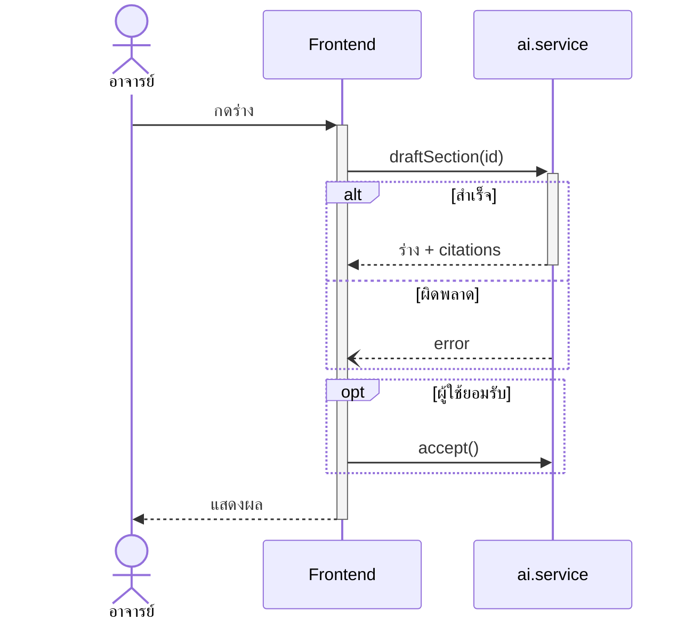
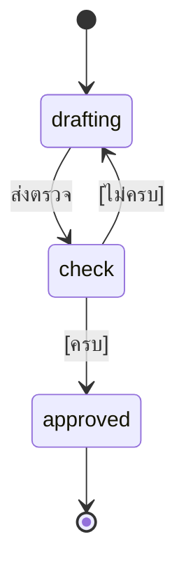
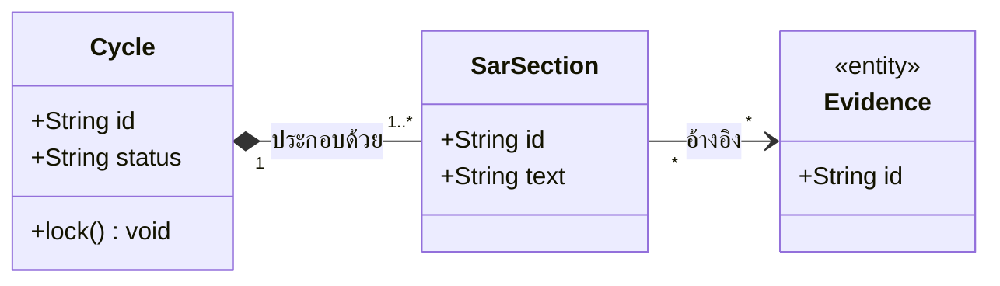
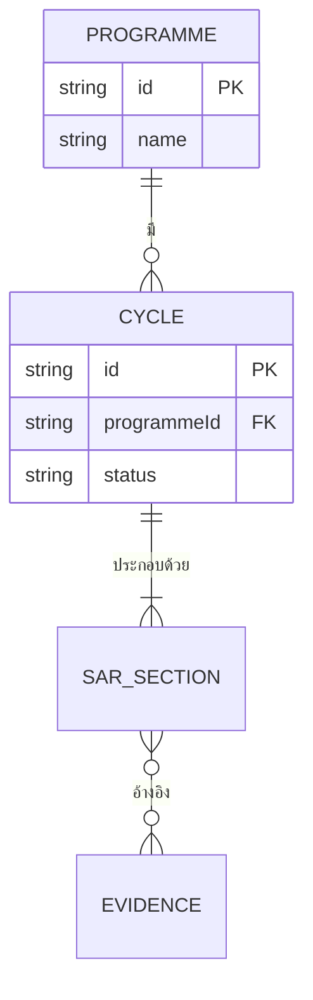
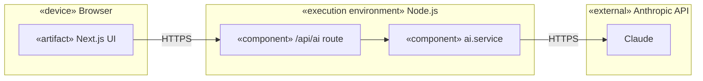

# มาตรฐาน UML 2.5 + เครื่องมือวาด (Mermaid vs PlantUML) สำหรับเล่มโครงงานสายคอมพิวเตอร์

> ผู้ใช้หลัก: diagram-designer (อ่านก่อนลงมือทุกครั้ง) · รอง: thesis-writer (คำบรรยายรูป/ย่อหน้าอธิบาย)
> จัดทำ: researcher · TASK-0001 · เข้าถึงแหล่งทั้งหมด **2026-10-21**
> ป้าย: **[ทดสอบ]** = ผู้จัดทำรัน `mmdc` บนเครื่องนี้แล้วเปิดดูภาพผลลัพธ์/ไม่ error · **[VP]** = ยืนยันจากคู่มือ Visual Paradigm ที่เปิดอ่านจริง · **[Mermaid-doc]**/**[PlantUML-doc]** = จากเอกสารทางการที่เปิดอ่านจริง · **[ความรู้ UML ทั่วไป]** = ไม่มีแหล่งที่เปิดอ่านได้ในรอบนี้ (เปิดสเปก OMG ไม่ได้: PDF > 10 MB) → ถ้าจะอ้างเป็น "ตามมาตรฐาน UML" ในเล่ม ให้ตรวจกับ OMG UML 2.5.1 (formal/17-12-05) ก่อน
> ป้ายที่ต้องไปคุยกับสาขา: `[ต้องตรวจสอบกับคู่มือสาขา]`

## 0. สรุปสั้น (อ่านแค่นี้ถ้าเร่ง)
1. **ใช้ Mermaid ทุกชนิด ยกเว้น Deployment/Component/Package** → ไม่ต้องติดตั้งอะไรเพิ่ม (`mmdc 12.0.0` + `mermaid 12.2.0` มีอยู่แล้ว **[ทดสอบ]**)
2. Use Case = `usecase-beta` · Activity = `swimlane-beta` (มี swimlane จริง, initial/final/fork/join ที่ถูกสัญลักษณ์) — ทั้งคู่เป็น **beta** → ระบุเวอร์ชัน mmdc ใน INDEX.md และห้ามอัปเกรดกลางงาน
3. ER = crow's foot (Mermaid รองรับแบบเดียว ไม่มี Chen)
4. Deployment/Component = `flowchart` + `subgraph` + ป้าย «stereotype» (ไม่ใช่ UML เต็มรูป) → ถ้าสาขาบังคับ UML deployment แบบ 3D node ต้องใช้ PlantUML = ต้องให้เจ้าของอนุมัติติดตั้ง Java 11+ (เครื่องนี้**ยังไม่มี java/dot**)
5. สาขาคอมพิวเตอร์ที่เปิดอ่าน (KKU) บังคับ artifact เฉพาะ: use case (ข้อความ+diagram), System Sequence Diagram, conceptual class, package/component, design class, sequence/communication, state/activity, ER (ไม่บังคับ) — ดูหัวข้อ 4

---

## 1. ประเมินเครื่องมือ

### 1.1 สภาพ pipeline จริง (ตรวจแล้ว)
| รายการ | ผล | หลักฐาน |
|---|---|---|
| `mmdc` | 12.0.0 ติดตั้งแล้ว (`npm ls -g`), bundle `mermaid@12.2.0` | `npm ls -g --depth=1`; `…/mermaid-cli/node_modules/mermaid/package.json` |
| render ใน `scripts/thesis/build.py` | `cmd_diagrams` เรียก `mmdc -i *.mmd -o figures/*.png -s 2 -b white` — **รองรับเฉพาะ `.mmd`** | `scripts/thesis/build.py:152-166` |
| `.puml` / PlantUML | **ไม่รองรับ** ต้องแก้ build.py (ส่วน placeholder `{{diagram:name}}` อ่านเฉพาะ `docs/diagrams/<name>.mmd` บรรทัด 81-82) | `build.py:81-82, 99` |
| GEMINI_HANDOFF | ฝัง ```` ```mermaid ```` ตามเดิม ถ้าใช้ PlantUML ต้องเพิ่มคำสั่งในหัว/แปลงเป็นรูปก่อน | `build.py:62-63, 100` |
| Java / Graphviz / PlantUML | **ไม่มี** (`where java dot plantuml` → "Could not find") | รันตรวจ 2026-10-21 |
| pandoc | **ไม่พบในเครื่องนี้** (`which pandoc` ไม่พบ) → `thesis.docx` สร้างใหม่บนเครื่องนี้ไม่ได้ ถึง diagram จะพร้อม | รันตรวจ |
| ธีม mmdc | มี `-t neutral`, `-c config.json` (ตั้ง `themeVariables.fontFamily`) | `mmdc --help` |

### 1.2 Mermaid — ความสามารถต่อชนิด (ทดสอบ render ด้วย mmdc 12.0.0 บนเครื่องนี้ รูปอยู่ที่ scratchpad เฉพาะรอบนี้)
| ชนิด | keyword | ผล | ข้อสังเกต/ข้อจำกัด |
|---|---|---|---|
| Use Case | `usecase-beta` (Mermaid ≥ 12.0.0 [Mermaid-doc]) | render ได้ **[ทดสอบ]** — actor, use case วงรี, `systemBoundary`, include/extend (เส้นประ), generalization (หัวสามเหลี่ยมกลวง) | ป้ายแสดงเป็น `include`/`extend` **ไม่มี «»**; เส้น association บางเส้นพาดข้ามขอบ boundary; boundary ซ้อนได้ชั้นเดียว [Mermaid-doc]; ยังเป็น beta |
| Activity (swimlane) | `swimlane-beta` (≥ 11.16.0 [Mermaid-doc]) | render ได้ **[ทดสอบ]** — lane จริง (คอลัมน์), `f-circ` = initial (วงกลมทึบ), `fr-circ` = activity final, `fork` = แถบ fork/join, `diam` = decision | ยังเป็น beta ("syntax may evolve"); action ปกติเป็นสี่เหลี่ยมเหลี่ยม ถ้าต้องมุมมน ใช้ `( )` **[ไม่ได้ทดสอบ ใน swimlane-beta]**; แถบ fork/join เป็นสีขาวตามธีมเริ่มต้น (UML ปกติเป็นแถบทึบ) |
| Activity (ไม่ lane) | `flowchart` | render ได้ **[ทดสอบ]** | `subgraph` ใน flowchart เป็นกรอบจัดกลุ่ม **ไม่ใช่ swimlane** (วางซ้อนแนวตั้ง ลูกศรไม่ถูกบังคับให้อยู่ใน lane) → **เลิกใช้แทน swimlane** |
| Sequence | `sequenceDiagram` | render ได้ **[ทดสอบ]** — actor/participant, activation (`+`/`-`), `alt/else`, `opt`, `loop`, return เส้นประ, async `-)` | `par`, `critical`, `break`, `rect` มีใน Mermaid แต่ **ไม่ได้ทดสอบ**; ไม่พบ fragment `ref` (ไม่ได้ยืนยัน) |
| State | `stateDiagram-v2` | ไม่ error **[ทดสอบ]** — `[*]`, `<<choice>>`, `<<fork>>` | ไม่ได้เปิดดูภาพ choice/fork |
| Class | `classDiagram` | render ได้ **[ทดสอบ]** — multiplicity, composition (ทึบ), aggregation (กลวง), realization (เส้นประ+สามเหลี่ยมกลวง), `<<stereotype>>` | |
| ER | `erDiagram` | render ได้ **[ทดสอบ]** — **crow's foot เท่านั้น** [Mermaid-doc]; PK/FK/UK; identifying `--` ทึบ / non-identifying `..` ประ | **ไม่มี Chen** (เอกสารไม่กล่าวถึง; รายการชนิด diagram ก็ไม่มี) |
| Deployment / Component / Package | ไม่มีชนิดเฉพาะ | ใช้ `flowchart` + `subgraph` + ข้อความ «device»/«component» → render ได้ **[ทดสอบ: ไม่ error ยังไม่ได้เปิดดูภาพ]** | **ไม่ใช่สัญลักษณ์ UML** (ไม่มี 3D node/สัญลักษณ์ component); มี `architecture-beta`, `c4` (C4 มีคำเตือน) แต่ไม่ใช่ UML [Mermaid-doc รายการชนิด] |

ภาษาไทยใน node/label/lane: แสดงได้ปกติ **[ทดสอบ]** (ใช้ฟอนต์สำรองของเบราว์เซอร์ ไม่ใช่ TH Sarabun New — ดูข้อเสนอ 5.3)

### 1.3 PlantUML — ความสามารถ/ข้อกำหนด
- ต้องมี **Java** (แนะนำ ≥ 11); Graphviz (dot) ฝังมาให้เฉพาะ Windows, Linux ต้องลงเอง; รันได้ 3 แบบ: `plantuml.jar`, เซิร์ฟเวอร์ออนไลน์ plantuml.com (เหมาะแค่ทดลอง — ซอร์สไดอะแกรมถูกส่งออกนอกเครื่อง), Docker `plantuml/plantuml-server:jetty` [PlantUML-doc: plantuml.com/starting]
- ชนิดที่ Mermaid ทำไม่ได้/ไม่ถูกหลัก และ PlantUML ทำได้ [PlantUML-doc]:
  - **Deployment**: `node`, `artifact`, `cloud`, `database`, `component`, ซ้อนได้หลายชั้น (plantuml.com/deployment-diagram)
  - Component/Package (มีองค์ประกอบ `component`, `package`, `interface` ในชนิดเดียวกัน)
  - Activity (syntax ใหม่): `start/stop/end`, `if/else`, `fork/fork again/end fork`, swimlane `|Name|`, `partition` (plantuml.com/activity-diagram-beta)
  - Use case: `actor`, `usecase`, `rectangle` (boundary), `.> : include` / `.> : extends`, generalization `<|--` (plantuml.com/use-case-diagram — หน้าเอกสารไม่แสดงป้าย «include»; **ไม่ทดสอบ** เพราะไม่มี Java)
  - ER: รองรับ crow's foot (IE) `||--o{` ฯลฯ (plantuml.com/ie-diagram)
- ข้อเสีย: ต้องติดตั้ง Java (ต้องให้เจ้าของอนุมัติ — ผู้ช่วยไม่ติดตั้งเอง), ต้องแก้ build.py, ต้องปรับ GEMINI_HANDOFF, สไตล์ default เก่ากว่า, ต้องเช็กฟอนต์ไทยเอง **[อนุมาน]**
- ข้อดี: UML ชนิดที่ Mermaid ขาดครบกว่า, deployment/component ถูกสัญลักษณ์

### 1.4 คำแนะนำต่อชนิด diagram
| ชนิด | เครื่องมือ | เหตุผล | ความเสี่ยง |
|---|---|---|---|
| Use Case | Mermaid `usecase-beta` | ถูกสัญลักษณ์หลัก (actor, boundary, include/extend ทิศถูก, generalization) | beta; ป้ายไม่มี « » → เขียนใต้รูปว่า "include/extend หมายถึง «include»/«extend»"; fallback = `flowchart` + edge label `"«include»"` |
| Activity | Mermaid `swimlane-beta` | lane จริง + node UML ครบ | beta; แถบ fork/join สีขาว |
| Sequence | Mermaid | ถูกหลัก | ใช้ fragment ที่ทดสอบแล้ว (alt/opt/loop) |
| State | Mermaid | ถูกหลัก | ตรวจ choice/fork ด้วยตาก่อนส่ง |
| Class (conceptual/design) | Mermaid | ถูกหลัก | — |
| ER | Mermaid crow's foot | Thai CS ใช้ได้ (ดู 3) | ไม่มี Chen |
| Deployment / Component / Package | Mermaid flowchart (ชั่วคราว) → **PlantUML ถ้าสาขากำหนด** | Mermaid ไม่มีชนิดนี้ | ต้องตัดสินใจ: ติดตั้ง Java (เจ้าของอนุมัติ) |

---

## 2. สัญลักษณ์ UML 2.5 และข้อผิดพลาดที่ต้องเลี่ยง

> หมวด "ข้อผิดพลาดที่กรรมการมักทัก" **ไม่มีแหล่งเอกสารที่ยืนยันว่ากรรมการทักอะไร** — เป็นรายการตรวจตนเองจากกฎ UML [ความรู้ UML ทั่วไป] ไม่ใช่ข้อกำหนดของสถาบัน

### 2.1 Use Case
**สัญลักษณ์**
- Actor = บทบาท (คน/ระบบภายนอก) ตั้งชื่อเป็นนาม วาง **นอก** system boundary [VP]
- System boundary = สี่เหลี่ยมล้อม use case ทั้งหมดของระบบ มีชื่อระบบ [VP]
- Association = เส้นทึบ actor–use case [VP]
- `include` = เส้นประ ลูกศรเปิด **ชี้ไปที่ use case ที่ถูก include**, ป้าย «include» [VP]
- `extend` = เส้นประ ลูกศรเปิด **ชี้ไปที่ base use case**, ป้าย «extend» (use case ที่ extend อยู่ปลายหาง) [VP]
- Generalization = เส้นทึบ หัวสามเหลี่ยมกลวง ชี้ไปที่ parent (ใช้ได้ทั้ง actor–actor และ use case–use case) [VP]
- ชื่อ use case = กริยา+กรรม (เช่น "ร่าง SAR ด้วย AI") [ความรู้ UML ทั่วไป]

**ข้อผิดพลาด (ตรวจตนเอง)**
- [ ] actor อยู่ในกรอบระบบ / use case อยู่นอกกรอบ
- [ ] ลูกศร include/extend กลับด้าน (ผิดบ่อยที่สุด); ใช้ include เมื่อควรเป็น extend (extend = ทางเลือก/มีเงื่อนไข, include = ทำทุกครั้ง)
- [ ] use case ละเอียดเป็นฟังก์ชัน CRUD ทีละปุ่ม (ระดับ goal ไม่ใช่ระดับหน้าจอ)
- [ ] ไม่มี use case text/ตารางอธิบายประกอบ (KKU บังคับ "Use case text and Use case diagram" [S3])
- [ ] actor ไม่ตรงกับ role ใน RBAC จริง (ตรวจกับ `.agents/SYSTEM_MAP.md`/spec หัวข้อ 3.2)

**Mermaid [ทดสอบ]** — สำคัญ: ไวยากรณ์ include/extend คือ `A ..> : include B` (**ไม่ใช่** `A ..> B : include` ซึ่ง parse error)
```mermaid
usecase-beta
direction LR
actor Lecturer("อาจารย์")
actor Chair("ประธานหลักสูตร")
systemBoundary Sys
  Write("เขียน SAR")
  Draft("ร่างด้วย AI")
  Cite("แนบหลักฐาน")
end
Lecturer --> Write
Chair --> Write
Write ..> : include Cite
Draft ..> : extend Write
Chair --|> Lecturer
```
> ใส่ชื่อระบบเป็นหัวกรอบด้วย `systemBoundary <id>` (ข้อความที่แสดงคือ id; `type: package` ให้แท็บชื่อ [Mermaid-doc])

### 2.2 Activity
**สัญลักษณ์**
- Initial node = วงกลมทึบ **1 อันต่อ activity**; Activity final = วงกลมซ้อนวงกลมทึบ (หยุดทุก flow) [VP: "Stop all control flows"]; Flow final = วงกลมมี ×
- Action = สี่เหลี่ยมมุมมน; Decision = เพชร มี guard `[เงื่อนไข]` บน **ทุก**ขาออก (ครอบคลุมและไม่ทับกัน); Merge = เพชรรวมขาเข้า [VP + ความรู้ UML ทั่วไป]
- Fork = แถบหนาแตกเป็นหลายขนาน; Join = แถบหนารอรวมทุกขนานก่อนไปต่อ — fork/join ต้อง **สมดุลกัน** [VP นิยาม; "สมดุล" = ความรู้ UML ทั่วไป]
- Swimlane/Partition = แบ่งตามผู้รับผิดชอบ (บทบาท) [VP]

**ข้อผิดพลาด**
- [ ] ไม่มี initial/final หรือมีหลาย initial
- [ ] decision ขาออกไม่มี guard / ไม่ครบเงื่อนไข / ใช้ decision แทน merge
- [ ] ใช้ flowchart (กล่องเพชรสุ่ม) ที่ไม่ใช่ UML + ไม่มี swimlane ทั้งที่มีหลายบทบาท
- [ ] fork ไม่มี join; ขนานกันแต่ข้อมูลจริงทำต่อเนื่อง (ตรวจกับโค้ด)
- [ ] ปน sequence (เรียก method) เข้ามาใน activity (ระดับกิจกรรมของผู้ใช้/ธุรกิจ)

**Mermaid [ทดสอบ]**
```mermaid
swimlane-beta TB
  subgraph Lecturer["อาจารย์"]
    S@{ shape: f-circ, label: "เริ่ม" }
    B[เขียน SAR]
    D@{ shape: diam, label: "หลักฐานครบ?" }
  end
  subgraph Chair["ประธานหลักสูตร"]
    FK@{ shape: fork, label: "fork" }
    N[แจ้งเตือน]
    A[บันทึก audit]
    JN@{ shape: fork, label: "join" }
    E@{ shape: fr-circ, label: "สิ้นสุด" }
  end
  S --> B --> D
  D -- "[ไม่ครบ]" --> B
  D -- "[ครบ]" --> FK
  FK --> N --> JN
  FK --> A --> JN
  JN --> E
```

### 2.3 Sequence
**สัญลักษณ์**
- Lifeline = กล่องหัว + เส้นประลงมา (actor มนุษย์ใช้รูปคน) [VP]; Activation = แถบสี่เหลี่ยมบาง ๆ บน lifeline ตอนที่กำลังทำงาน [VP]
- ข้อความ: call/sync = เส้นทึบหัวลูกศรทึบ; return = เส้นประหัวเปิด; async = เส้นทึบหัวเปิด (`-)`) ; self-message = ลูกศรวนกลับ; create/destroy [VP ชนิดของข้อความ; รูปแบบลูกศรตาม [ความรู้ UML ทั่วไป]]
- Combined fragment = กรอบ + ตัวดำเนินการมุมซ้ายบน: `alt` (ทางเลือก), `opt` (ถ้า), `loop` (วน), `par` (ขนาน) พร้อม guard `[…]` [VP]
- ลำดับเวลาไหลบนลงล่าง

**ข้อผิดพลาด**
- [ ] ข้อความไม่มี return/ไม่มี `alt` ของกรณี error ทั้งที่โค้ดมี
- [ ] ชื่อข้อความไม่ตรงชื่อ function/endpoint จริง (กฎของ diagram-designer: ยึดโค้ดจริง)
- [ ] lifeline ปน "คลาส" กับ "เลเยอร์" ในรูปเดียว; มากกว่า ~6–7 lifeline (แยกรูป) **[อนุมาน — ข้อสังเกตเชิงปฏิบัติ]**
- [ ] activation ไม่ปิด / ซ้อนผิดลำดับ
- [ ] ลูกศร async ใช้หัวทึบ หรือ return ใช้เส้นทึบ

**Mermaid [ทดสอบ]**

> `S--)UI` คือ async หัวเปิด; ในตัวอย่าง `S` activate 1 ครั้งแล้ว deactivate ด้วย `-` ในสาขา alt แรก — ถ้าสาขาแตกต่างกัน ให้ตรวจ activation bar ด้วยตาก่อนส่ง

### 2.4 State machine
- Initial pseudo-state (วงกลมทึบ), state (สี่เหลี่ยมมุมมน), final (วงกลมซ้อน), transition ป้าย `event [guard] / action`, choice (เพชร), fork/join, composite state [ความรู้ UML ทั่วไป; ชนิดที่ Mermaid รองรับ **[ทดสอบ]**: `[*]`, `<<choice>>`, `<<fork>>`]
- ข้อผิดพลาด: [ ] ชื่อ state เป็นกริยา (state = "สถานะที่เป็นอยู่" เช่น `drafting`, `approved`); [ ] ไม่มีสถานะเริ่ม/จบ; [ ] transition ไม่ตรงตารางใน `eduflow-next/lib/api/workflow.ts` (spec หัวข้อ 4.1) — ต้องเทียบทีละเส้น; [ ] มี state ที่เข้าไม่ถึง/ออกไม่ได้


### 2.5 Class (Conceptual vs Design)
- ช่อง 3 ส่วน: ชื่อ / attribute / operation; visibility `+ - # ~`; multiplicity (`1`, `0..1`, `1..*`, `*`); association เส้นทึบ; aggregation เพชรกลวง (ที่ฝั่ง whole); composition เพชรทึบ (ที่ฝั่ง whole); generalization หัวสามเหลี่ยมกลวง ชี้ parent; realization เส้นประ+สามเหลี่ยมกลวง; dependency เส้นประลูกศรเปิด; `«interface»` [VP ไม่ได้เปิดหน้า class; ความรู้ UML ทั่วไป; Mermaid ชนิดที่ใช้ **[ทดสอบ]**]
- **KKU แยก 2 ระดับ**: *conceptual class diagram* (ระยะวิเคราะห์ ไม่มี operation/ชนิดข้อมูลละเอียด) กับ *design class* (ระยะออกแบบ) [S3 หัวข้อ 4.1, 4.2] → ถ้าสาขาไหนบังคับ ต้องวาด 2 รูป
- ข้อผิดพลาด: [ ] composition/aggregation สลับหรือใช้ทิศผิด; [ ] ไม่มี multiplicity; [ ] attribute ไม่มีชนิด (ในรูป design); [ ] ใส่ getter/setter ทุกตัว; [ ] class มีชื่อแต่ไม่มีอยู่ในโค้ด (ดูกฎ "ตรงกับโค้ดจริง")

> [ทดสอบ] ฉบับใกล้เคียงกันนี้ render ได้ (composition เพชรทึบที่ฝั่ง Cycle, multiplicity ครบ) — เขียน attribute **หนึ่งตัวต่อบรรทัด**

### 2.6 ER — ใช้ Crow's foot หรือ Chen?
- **ผลการค้นหา**: ไม่พบคู่มือ/เอกสารไทยที่ระบุว่าสายคอมพิวเตอร์ไทยนิยมแบบไหน (ค้นภาษาไทย 1 รอบ ได้แต่แหล่งอังกฤษ) → **ข้อสรุปว่า "นิยมแบบไหนในไทย" ไม่ยืนยัน**
- สิ่งที่ยืนยันได้ [แหล่งอังกฤษ: DBSchema/gleek/draw.io ผ่านสรุปผลค้นหา — ไม่ได้เปิดหน้าเต็ม]: Chen (สี่เหลี่ยม+เพชร+วงรี attribute) เหมาะการสอน/conceptual; crow's foot กระชับและนิยมใน schema จริง; crow's foot ไม่มีมาตรฐานเดียว
- หลักฐานเชิงโครงงาน: KKU (S3 หัวข้อ 4.2) ให้ **"แปลงคลาสเป็นตารางฐานข้อมูลเชิงสัมพันธ์ อาจแสดง E-R ประกอบก็ได้"** = ER เป็นของเสริม/อยู่ฝั่งฐานข้อมูล ไม่ใช่ตัวหลักของบทวิเคราะห์
- **คำแนะนำ**: ใช้ **crow's foot** เพราะ (1) Mermaid/PlantUML วาดได้ (2) เทียบกับ schema/migration ได้ตรง (3) มี PK/FK ตามกฎ diagram-designer. ใส่ **คำอธิบายสัญลักษณ์** ใต้รูปหรือย่อหน้านำ (ผู้อ่านต้องรู้ว่า `||--o{` = หนึ่งต่อศูนย์หรือมาก). ติดป้าย `[ต้องตรวจสอบกับคู่มือสาขา]` ว่าสาขากำหนดแบบ Chen หรือไม่ (ถ้า Chen ต้องวาดด้วย draw.io/PlantUML class-style ไม่ใช่ Mermaid)
- ข้อผิดพลาด: [ ] ไม่มี PK/FK; [ ] M:N ในระดับ physical ไม่แตกเป็นตารางเชื่อม; [ ] cardinality ไม่ครบสองฝั่ง; [ ] ชื่อฟิลด์ไม่ตรง migration/types จริง; [ ] ใช้ identifying/non-identifying สับสน (Mermaid: `--` identifying ทึบ, `..` non-identifying ประ [Mermaid-doc])

[ทดสอบ] ; ตัวอย่างนี้ **M:N `}o--o{` ยังไม่แตกตาราง** → ใช้ได้ในระดับ conceptual เท่านั้น; ระดับ physical ต้องเพิ่มตารางเชื่อม

### 2.7 Deployment / Component
- Deployment: **Node** (กล่อง 3 มิติ) แทนอุปกรณ์/สภาพแวดล้อมประมวลผล, **Artifact** «artifact» ที่รันบน node, **communication path** เส้นระหว่าง node พร้อมโปรโตคอล (เช่น HTTPS) [ความรู้ UML ทั่วไป — PlantUML-doc ยืนยันว่ามีองค์ประกอบ node/artifact/database/cloud]
- Component: กล่อง «component» + interface (lollipop/socket) [ความรู้ UML ทั่วไป]; KKU ใช้ Package + Component สำหรับ "สถาปัตยกรรมเชิงตรรกะ/กายภาพ" [S3 4.2]
- ข้อผิดพลาด: [ ] ปนส่วนประกอบเชิงตรรกะกับ node กายภาพ; [ ] เส้นเชื่อมไม่ติดป้ายโปรโตคอล; [ ] ใส่สิ่งที่ไม่มีในระบบ (เช่น server ที่ยังไม่ได้ deploy — ดูสถานะจริงใน SYSTEM_MAP)
- Mermaid (ชั่วคราว) **[ทดสอบ ไม่ error]**:

> ใต้รูปต้องเขียนว่า "แผนภาพนี้ใช้สัญลักษณ์ประยุกต์จาก UML Deployment Diagram" ไม่เรียกว่า UML deployment เต็มรูป

---

## 3. กฎทั่วไปของรูปในเล่ม (จากคู่มือที่เปิดอ่านจริง)
- ตัวอักษรในรูปต้องใหญ่พออ่านง่าย; เส้นเป็นสีดำคมชัด รูปสีอนุโลมได้ [S1] → ใช้ `mmdc -t neutral` หรือคุมสี; **อย่าใช้สีเป็นตัวแบกความหมาย** (พิมพ์ขาวดำแล้วต้องอ่านออก) **[อนุมานจาก S1]**
- มีเลขและคำบรรยายใต้รูป ไม่ขึ้นต้นด้วย "แสดง…" [S1]; คำบรรยายยาวเกิน 1 บรรทัด บรรทัดสองเริ่มตรงตัวอักษรแรกของชื่อ [S2]
- ต้องอ้างถึงรูปในเนื้อหาก่อนรูปปรากฏ (เช่น "ดังรูปที่ 3.2") **[อนุมาน — ธรรมเนียมวิชาการ ไม่พบในคู่มือที่เปิดอ่าน]**
- รูปเกิน 1 หน้า: ใส่ "(ต่อ)" [S2]
- ความละเอียด: build.py ใช้ `-s 2` สเกล 2 เท่า เพียงพอสำหรับ A4 **[อนุมาน]**; รูปกว้างมาก (sequence > 7 lifeline) ให้แยกรูป

## 4. Artifact ที่สาขาคอมพิวเตอร์คาดหวัง (หลักฐาน: KKU CS [S3 หัวข้อ 10.4])
บทวิเคราะห์ระบบและพัฒนาโปรแกรม ต้องมี (ตามที่คู่มือระบุ "เช่น"):
1. ความต้องการระบบ: ผังกิจกรรมของปัญหา, รายการความต้องการ, **Use case text + Use case diagram**, **System Sequence Diagram**, **conceptual class diagram**
2. ออกแบบ: สถาปัตยกรรมเชิงตรรกะ+กายภาพ (ใช้ **Package Diagram + Component Diagram**), **Design Class**, **Sequence หรือ Communication Diagram**, State/Activity/Timing diagram ตามความเหมาะสม, แปลงคลาส→ตารางฐานข้อมูล (E-R ไม่บังคับ), **Mockup UI**
3. พัฒนา: เครื่องมือ/ภาษา/ไลบรารี, GUI package, program specification, การติดต่อฐานข้อมูล, Component diagram ของส่วนที่นำมาใช้
4. ทดสอบ: Testing Plan, Test case, ทดสอบการยอมรับ

**ช่องว่างเทียบกับ `docs/diagrams/` ปัจจุบัน** (โฟลเดอร์มีแค่ `INDEX.md`): ยังไม่มีไฟล์ diagram ใด; ชุดแรกที่ควรสร้าง = `uc-*`, `act-*`, `seq-*` (รวม System Sequence = sequence ที่ lifeline ระบบเป็นกล่องเดียว), `class-*` (conceptual), `er-*`, `state-*` (SAR/Cycle lifecycle), `deploy-*`
- **System Sequence Diagram** = sequence ที่มอง "ระบบ" เป็น black box lifeline เดียว (actor ↔ system) [ความรู้ UML ทั่วไป/ศัพท์เชิงวิธีวิเคราะห์ — ไม่ใช่ชนิดแยกใน UML; ใช้ `sequenceDiagram` ได้] → ใน INDEX.md ให้ชนิด = `seq` + คำอธิบาย "SSD"
- แหล่งเดียว (KKU) ที่ระบุรายการนี้ → `[ต้องตรวจสอบกับคู่มือสาขา]`

## 5. ข้อเสนอที่เกี่ยวกับ pipeline/ความเข้ากันได้
1. **ห้ามอัปเกรด mmdc/mermaid กลางงาน** — `usecase-beta`/`swimlane-beta` เป็น beta (คำเตือนใน [Mermaid-doc]) → ใส่ `mmdc 12.0.0 / mermaid 12.2.0` ใน `docs/diagrams/INDEX.md`
2. diagram-designer ต้อง **เปิดดูภาพ PNG** ทุกรูปก่อนส่ง ไม่ใช่แค่ "mmdc ไม่ error" (ตัวอย่าง: use case ถ้าใช้ไวยากรณ์ผิด → error ชัด แต่ปัญหา activation/กรอบ boundary เห็นได้เฉพาะจากภาพ)
3. ฟอนต์ในรูป: ปัจจุบัน Mermaid ใช้ฟอนต์สำรอง → เล่มใช้ TH Sarabun New. ข้อเสนอ: ใส่ `-c mermaid.config.json` ที่ตั้ง `themeVariables.fontFamily` เป็น "TH Sarabun New" **[อนุมาน — ไม่ได้ทดสอบ; ต้องมีฟอนต์ติดตั้งในเครื่อง puppeteer]** แล้วให้ build.py ส่ง `-c`
4. ถ้าสาขากำหนดให้ใช้ UML deployment/component ตรงตัว → เสนอเจ้าของ: ติดตั้ง Java 11+ แล้วเพิ่ม `build.py diagrams` ให้รองรับ `*.puml` (`java -jar plantuml.jar -tpng -o figures`) — **หยุดรอเจ้าของอนุมัติการติดตั้ง**

## 6. แหล่งอ้างอิง (เข้าถึง 2026-10-21)
เปิดอ่านจริง
- Mermaid. (ม.ป.ป.). *Diagram syntax reference*. https://mermaid.js.org/intro/syntax-reference.html
- Mermaid. (ม.ป.ป.). *Use Case Diagram (Mermaid 12.0.0+)*. https://mermaid.js.org/syntax/usecase.html (+ ตรวจไวยากรณ์ `..> : include|extend` จาก grammar ใน `mermaid/dist/chunks/mermaid.esm/usecaseDiagram-WIC6AC6W.mjs` บรรทัด 8105-8115)
- Mermaid. (ม.ป.ป.). *Swimlanes (beta, v11.16.0+)*. https://mermaid.js.org/syntax/swimlanes.html
- Mermaid. (ม.ป.ป.). *Entity Relationship Diagrams*. https://mermaid.js.org/syntax/entityRelationshipDiagram.html
- PlantUML. (ม.ป.ป.). *Getting started*. https://plantuml.com/starting · *Deployment diagram* https://plantuml.com/deployment-diagram · *Use case diagram* https://plantuml.com/use-case-diagram · *Activity diagram (new syntax)* https://plantuml.com/activity-diagram-beta · *IE/ER diagram* https://plantuml.com/ie-diagram
- Visual Paradigm. (ม.ป.ป.). *What is use case diagram?* https://www.visual-paradigm.com/guide/uml-unified-modeling-language/what-is-use-case-diagram/ · *What is activity diagram?* …/what-is-activity-diagram/ · *What is sequence diagram?* …/what-is-sequence-diagram/
- OMG. (2017). *Unified Modeling Language (UML) version 2.5.1* (formal/17-12-05). https://www.omg.org/spec/UML/2.5.1/About-UML (เปิดได้เฉพาะหน้าข้อมูล; ตัว PDF เปิดไม่ได้)
- ภาควิชาวิทยาการคอมพิวเตอร์ คณะวิทยาศาสตร์ มหาวิทยาลัยขอนแก่น. (2557). *คู่มือการจัดทำโครงงานคอมพิวเตอร์ 322 494 และ 322 496*. https://csperson.kku.ac.th/chakchai/322391_Fall14/2014-06-02%2017-05-32.pdf [S3] — และ S1/S2 ตาม `thesis-th.md` หัวข้อ 8
ทดสอบด้วยตนเอง: รัน `mmdc` 12.0.0 บน Windows 11 กับตัวอย่างทุกอันในไฟล์นี้ที่ติดป้าย [ทดสอบ] (ไฟล์ทดสอบอยู่ใน scratchpad ของ session นี้ ไม่ได้อยู่ใน repo)
ผ่านสรุปผลค้นหาเท่านั้น (ไม่ได้เปิดหน้าเต็ม): เปรียบเทียบ Chen/crow's foot — https://dbschema.com/blog/design/choosing-an-er-notation-your-team-can-read/ · https://gleek.io/blog/crows-foot-chen · https://www.drawio.com/blog/crows-foot-notation
เปิดไม่ได้ (ข้อจำกัด): uml-diagrams.org (ใบรับรอง SSL ตรวจไม่ผ่าน), OMG UML 2.5.1 PDF (> 10 MB), apastyle.apa.org (หน้าโหลดว่าง)
