# AUN-QA Copilot — Project Specification (ฉบับสำหรับโปรเจกต์จบ)

> เอกสารนี้เป็น **source of truth** สำหรับ agent ที่พัฒนาโปรเจกต์
> เวอร์ชัน: 1.0 · วันที่: 2026-10-21
> ส่วนที่ติดป้าย **[ASSUMPTION]** = ยังไม่ได้ยืนยันกับผู้ใช้จริง ห้าม hard-code ให้ทำเป็น config

---

## 0. วิธีใช้เอกสารนี้กับ agent

- อ่านหัวข้อ 1–4 ก่อนเพื่อเข้าใจ domain และ workflow
- หัวข้อ 6 คือ **seed data** (53 requirements) — นำไปทำ seed script ได้ตรง ๆ
- หัวข้อ 8–10 คือแบบสำหรับเขียน schema, API และ UI
- หัวข้อ 14–15 กำหนดว่า **ทำอะไรก่อน-หลัง** ห้ามทำนอก MVP จนกว่า MVP จะผ่านการทดสอบ
- กฎเหล็ก 3 ข้อ (ห้ามละเมิดในโค้ด):
  1. **AI ห้ามให้คะแนนทางการ อนุมัติ หรือสร้างตัวเลข/หลักฐานที่ไม่มีอยู่จริง**
  2. **ห้ามส่งข้อมูลส่วนบุคคลดิบเข้า LLM** ต้องผ่าน PII redaction ก่อนเสมอ
  3. **ทุกการแก้ไข/อนุมัติ/ให้คะแนน ต้องลง audit log**

---

## 1. ภาพรวมโปรเจกต์

### 1.1 ที่มา (Pivot)

- โปรเจกต์เดิม: เว็บให้ครูเปิดคลาสสอนพิเศษและรับชำระเงินจากนักเรียน → ยกเลิก เพราะขัดจรรยาบรรณวิชาชีพครูและเสี่ยงผิดระเบียบ
- โปรเจกต์ใหม่: **เว็บแอปช่วยอาจารย์ประจำหลักสูตรเตรียมเอกสารประกันคุณภาพ (SAR + หลักฐาน) ตามเกณฑ์ AUN-QA v4.0** โดยนำโมดูล AI เดิม (ประมวลผลคำถาม-เฉลย/ประเมินผลผู้เรียน) มาใช้ต่อ

### 1.2 ปัญหา

- การเก็บข้อมูลเพื่อเขียน SAR และการเก็บหลักฐานเพิ่มภาระบุคลากรมาก (มีงานวิจัยไทยรองรับ)
- หลักฐานกระจายใน Drive/อีเมล/LINE ตั้งชื่อไม่เป็นระบบ หลักฐานชิ้นเดียวใช้หลายข้อแต่ถูก copy ซ้ำ
- SAR เขียนหลายคน หลายไฟล์ รวมเล่มยาก ไม่รู้ว่าข้อไหนเสร็จ
- เขียนไม่ครบวงจร PDCA (ขาด Check/Act) → ติดคะแนน 3 ไม่ถึง 4
- หลักสูตรไทยหลายแห่งได้คะแนนเฉลี่ยประมาณ 3.7–3.9 (ต่ำกว่าเกณฑ์ผ่าน 4)
- ต้องแปล SAR เป็นภาษาอังกฤษ

### 1.3 เป้าหมาย (Objectives) — ใช้เขียนบทที่ 1 ของเล่มได้

1. พัฒนาเว็บแอปสำหรับจัดการเอกสารและหลักฐานประกันคุณภาพระดับหลักสูตรตามเกณฑ์ AUN-QA v4.0 ครบ 8 เกณฑ์ 53 ข้อ
2. พัฒนาระบบ AI ช่วยร่าง SAR จากหลักฐานจริง และวิเคราะห์ช่องว่าง (gap analysis) ตามวงจร PDCA
3. พัฒนาระบบ workflow การส่งตรวจ–แก้ไข–อนุมัติ พร้อมการควบคุมสิทธิ์และ audit log
4. ประเมินประสิทธิภาพของระบบด้านเวลาที่ใช้เตรียมเอกสาร ความถูกต้องของ AI และความพึงพอใจผู้ใช้

### 1.4 ขอบเขตหลัก

- ระดับ: **หลักสูตร (Programme level)** เท่านั้น ไม่รวมระดับสถาบัน
- เกณฑ์: AUN-QA Programme Level v4.0 (ออกแบบให้เพิ่มเกณฑ์อื่นได้ภายหลัง)
- ภาษา UI: ไทย (+อังกฤษ), ภาษา SAR: ไทย/อังกฤษ
- ผู้ใช้เป้าหมาย: อาจารย์มหาวิทยาลัย **[ASSUMPTION — ถ้าเป็นครูโรงเรียน ต้องเปลี่ยนเป็นมาตรฐานการศึกษาขั้นพื้นฐาน 2561 ดูหัวข้อ 2.4]**

### 1.5 สิ่งที่ระบบ "ไม่ทำ"

- ไม่ใช่ระบบรับรองคุณภาพ ไม่ออกผลประเมินแทนกรรมการ
- ไม่แทนที่ CHE QA Online (แค่ export ข้อมูลช่วยกรอก)
- ไม่เป็นระบบทะเบียนนักศึกษา (รับ import ข้อมูลสรุป)

---

## 2. ความรู้ domain

### 2.1 AUN-QA Programme Level Version 4.0

- เผยแพร่โดย AUN Secretariat; ใช้คู่ขนานกับ v3.0 ช่วง ต.ค. 2564–ก.ย. 2565 และใช้เต็มรูปแบบตั้งแต่ ต.ค. 2565
- **8 เกณฑ์ / 53 ข้อ** (v3.0 มี 11 เกณฑ์ / 62 ข้อ)
- PDCA ฝังอยู่ในทุกเกณฑ์ (แต่ละเกณฑ์มีข้อเรื่อง "ปรับปรุงต่อเนื่อง")

| # | Criterion | ชื่อไทย | จำนวนข้อ | กลุ่ม |
|---|---|---|---|---|
| 1 | Expected Learning Outcomes | ผลการเรียนรู้ที่คาดหวัง | 5 | Design |
| 2 | Programme Structure and Content | โครงสร้างและเนื้อหาหลักสูตร | 7 | Design |
| 3 | Teaching and Learning Approach | แนวทางการเรียนการสอน | 6 | Design |
| 4 | Student Assessment | การวัดและประเมินผลผู้เรียน | 7 | Design |
| 5 | Academic Staff | อาจารย์ | 8 | Resource |
| 6 | Student Support Services | การบริการสนับสนุนผู้เรียน | 6 | Resource |
| 7 | Facilities and Infrastructure | สิ่งอำนวยความสะดวกและโครงสร้างพื้นฐาน | 9 | Resource |
| 8 | Output and Outcomes | ผลผลิตและผลลัพธ์ | 5 | Output |
| | **รวม** | | **53** | |

### 2.2 สเกลคะแนน 1–7

| คะแนน | ระดับ | ความหมายภาษาคน | ระบบใช้ตรวจอะไร |
|---|---|---|---|
| 1 | Absolutely Inadequate | ยังไม่ทำ ไม่มีแผน/เอกสาร/หลักฐาน | ไม่มี evidence ผูกเลย |
| 2 | Inadequate and Improvement is Necessary | อยู่ขั้นวางแผน หลักฐานน้อย | มีแค่ Plan |
| 3 | Inadequate but Minor Improvement Will Make It Adequate | ทำแล้วแต่ไม่มีหลักฐานว่าใช้จริง ผลไม่สม่ำเสมอ | มี Plan+Do แต่ขาด Check/Act หรือขาดผลลัพธ์ |
| 4 | Adequate as Expected | **ผ่าน** ทำครบ มีหลักฐาน ผลสม่ำเสมอ | PDCA ครบ + มีผลลัพธ์ |
| 5 | Better Than Adequate | มีประสิทธิภาพ ผลดี แนวโน้มดีขึ้น | + ข้อมูลหลายปีที่ดีขึ้น |
| 6 | Example of Best Practices | แบบอย่างในสาขา | + benchmark ดีกว่าคู่เทียบ |
| 7 | Excellent (World-class) | ระดับโลก มีนวัตกรรม | (ระบบไม่เสนอระดับนี้อัตโนมัติ) |

กฎ:
- คะแนนเป็น **จำนวนเต็ม** เท่านั้น
- รายงานทางการให้คะแนน **รายเกณฑ์** (ไม่รายงานรายข้อย่อย) แต่ self-rating ทำรายข้อได้ (Appendix A)
- **Overall verdict ตัดสินแบบองค์รวม ห้ามใช้ค่าเฉลี่ย** → ในระบบเป็นช่องให้กรรมการเลือก ไม่คำนวณ

### 2.3 กระบวนการประเมินตามคู่มือ (PDCA ของการประเมิน)

1. **Plan:** หลักสูตรเขียน SAR ส่งกรรมการล่วงหน้า
2. **Do – Desktop assessment:** กรรมการอ่าน SAR + เอกสาร, หาจุดแข็ง/จุดอ่อน/gap, เตรียมคำถามสัมภาษณ์, ระบุหลักฐานที่ต้องตรวจ (ใช้ Appendix B)
3. **Do – Site assessment (ปกติ 3 วัน):** เปิดประชุม → สัมภาษณ์ทีมเขียน SAR, อาจารย์, สายสนับสนุน, นักศึกษา (~5 คน/ชั้นปี, ไม่มีอาจารย์อยู่ด้วย), ศิษย์เก่า, นายจ้าง → เยี่ยมชมห้องเรียน/แล็บ/ห้องสมุด → สรุป
4. **Check:** ประชุมชี้แจงผลเบื้องต้น, ตกลงจุดที่ต้องพัฒนา
5. **Act:** รายงานฉบับสุดท้าย (Appendix D): คะแนนรายเกณฑ์ + Strengths + Areas for Improvement; หลักสูตรนำไปทำแผนปรับปรุง

แบบฟอร์มในคู่มือที่ระบบควรรองรับ:
- Appendix A — Self-rating checklist
- Appendix B — Assessment Planning (ต่อข้อ: Strengths / Interview Questions / Sources of Evidence / Areas for Improvement)
- Appendix D — Assessment Report template

### 2.4 กรอบของประเทศไทย

| กรอบ | สาระที่เกี่ยว | ผลต่อระบบ |
|---|---|---|
| กฎกระทรวงมาตรฐานหลักสูตรการศึกษาระดับอุดมศึกษา พ.ศ. 2565 | ทุกหลักสูตรต้องมีระบบประกันคุณภาพ | เหตุผลที่ระบบจำเป็น |
| ประกาศเกณฑ์มาตรฐานหลักสูตรระดับปริญญาตรี/บัณฑิตศึกษา พ.ศ. 2565 (ประกาศใช้ 27 ก.ย. 2565) | อาจารย์ประจำหลักสูตร, OBE | field อาจารย์ประจำหลักสูตร, PLO |
| ประกาศรายละเอียดผลลัพธ์การเรียนรู้ตามมาตรฐานคุณวุฒิฯ 2565 | กรอบ PLO/CLO | module curriculum mapping |
| CHE QA Online (3D) | มหาวิทยาลัยส่งข้อมูลให้ สป.อว.; รอบปีการศึกษา, ทุนวิจัย = ปีงบประมาณ, ผลงาน = ปีปฏิทิน | metric ต้องมี `period_type` + export |
| มหาวิทยาลัยเลือกระบบ QA หลักสูตรได้ (AUN-QA / สภาวิชาชีพ / ABET, AACSB ฯลฯ) | เกณฑ์หลายชุด | framework เป็น config |
| พ.ร.บ.คุ้มครองข้อมูลส่วนบุคคล พ.ศ. 2562 | ข้อมูลนักศึกษา/อาจารย์ | หัวข้อ 11 |

**ถ้ากลุ่มเป้าหมายเป็นครูโรงเรียน:** ใช้มาตรฐานการศึกษาขั้นพื้นฐาน พ.ศ. 2561 (3 มาตรฐาน: คุณภาพผู้เรียน / กระบวนการบริหารและการจัดการ / กระบวนการจัดการเรียนการสอนที่เน้นผู้เรียนเป็นสำคัญ) + SAR ประจำปีตามกฎกระทรวงการประกันคุณภาพการศึกษา พ.ศ. 2561 → ระบบนี้รองรับได้ถ้าทำ framework เป็น config (หัวข้อ 8)

---

## 3. ผู้ใช้และสิทธิ์

### 3.1 Personas

| Persona | เป้าหมาย | ความเจ็บปวด | ระบบช่วยอย่างไร |
|---|---|---|---|
| **อ.สมศรี** ประธานหลักสูตร | ส่ง SAR ทันกำหนดและได้ ≥ 4 | ต้องตามงานคนอื่น รวมเล่มเอง | dashboard ความพร้อม, มอบหมายงาน, รวมเล่มอัตโนมัติ |
| **อ.วิชัย** อาจารย์ประจำหลักสูตร | เขียนเกณฑ์ที่ได้รับมอบหมายให้เสร็จเร็ว | ไม่รู้ต้องใช้หลักฐานอะไร เขียนภาษาอังกฤษไม่คล่อง | checklist evidence, AI ร่าง + แปล |
| **คุณนิด** เจ้าหน้าที่หลักสูตร | กรอกสถิติให้ถูก | Excel หลายไฟล์ | import template, ตรวจความถูกต้อง |
| **คุณเอ** งาน QA คณะ | ตรวจหลายหลักสูตรพร้อมกัน | ตามผ่าน LINE | review queue, comment, ส่งกลับแก้ |
| **รศ.ดร.ประเสริฐ** กรรมการประเมิน | อ่าน SAR + หลักฐานได้เร็ว | หาหลักฐานไม่เจอ | evidence index คลิกเปิดได้, Appendix B |

### 3.2 Roles (RBAC)

| Permission | super_admin | uni_admin | programme_chair | programme_staff (อาจารย์) | data_staff (เจ้าหน้าที่) | faculty_qa | dean | assessor |
|---|---|---|---|---|---|---|---|---|
| จัดการมหาวิทยาลัย/framework | ✓ | | | | | | | |
| จัดการผู้ใช้ในมหาวิทยาลัย | ✓ | ✓ | | | | | | |
| สร้างรอบประเมิน | | ✓ | ✓ | | | | | |
| มอบหมายเจ้าของเกณฑ์ | | | ✓ | | | | | |
| เขียน SAR | | | ✓ (ทุกข้อ) | ✓ (ข้อที่ได้รับ) | | | | |
| อัปโหลด/ผูกหลักฐาน | | | ✓ | ✓ | ✓ | | | |
| กรอก metric | | | ✓ | | ✓ | | | |
| ใช้ AI | | | ✓ | ✓ | ✓ (เฉพาะตรวจข้อมูล) | ✓ | | ✓ (สรุป/ช่วยเตรียมคำถาม) |
| Self-rating | | | ✓ | ✓ (ข้อตน) | | | | |
| Comment / ส่งกลับแก้ | | | ✓ | | | ✓ | ✓ | ✓ (comment) |
| อนุมัติระดับคณะ | | | | | | ✓ | | |
| อนุมัติสุดท้าย + lock | | | | | | | ✓ | |
| ให้คะแนนทางการ + verdict | | | | | | | | ✓ |
| เขียน Strengths / AFI | | | | | | | | ✓ |
| ดู audit log | ✓ | ✓ | ✓ (หลักสูตรตน) | | | ✓ | ✓ | |

กฎ:
- ทุก role ยกเว้น super_admin เห็นเฉพาะข้อมูลของ **university** ตนเอง (multi-tenant)
- assessor เห็นเฉพาะรอบประเมินที่ได้รับมอบหมาย และ **read-only** ต่อ SAR/หลักฐาน
- self-rating แยกจากคะแนนกรรมการ ห้ามเขียนทับ
- หลัง lock แก้ไม่ได้ ต้องเปิด revision ใหม่

---

## 4. วงจรการทำงานทั้งหมด

```mermaid
flowchart LR
  A[สร้างรอบประเมิน] --> B[มอบหมายเจ้าของเกณฑ์]
  B --> C[นำเข้าข้อมูลพื้นฐาน + metric ย้อนหลัง]
  C --> D[เก็บ/อัปโหลดหลักฐาน + tag]
  D --> E[Gap analysis]
  E --> F[ร่าง SAR รายข้อ + AI ช่วย]
  F --> G[Self-rating + ตรวจ PDCA]
  G --> H{QA คณะตรวจ}
  H -- ส่งกลับแก้ --> F
  H -- ผ่าน --> I[คณบดีอนุมัติ + lock]
  I --> J[Export SAR + Evidence index]
  J --> K[กรรมการ Desktop assessment]
  K --> L[Site visit / สัมภาษณ์]
  L --> M[กรรมการให้คะแนน + รายงาน]
  M --> N[แผนปรับปรุง Action plan]
  N --> A
```



### 4.1 สถานะ (State machine)

**AssessmentCycle:** `draft → in_progress → under_review → revision_requested ↔ in_progress → faculty_approved → final_approved (locked) → under_assessment → assessed → closed`

**SarSection (รายข้อ):** `not_started → drafting → ready_for_review → changes_requested → approved`

**Evidence:** `uploaded → tagged → verified` (+ `flagged_pii`)

**ActionItem:** `open → in_progress → done → verified`

### 4.2 ปฏิทินโดยประมาณ **[ASSUMPTION — แต่ละมหาวิทยาลัยต่างกัน]**

| ช่วง | งาน |
|---|---|
| ต้นปีการศึกษา | สร้างรอบ, มอบหมาย, ตั้ง deadline |
| ระหว่างปี | เก็บหลักฐานต่อเนื่อง (ไม่ใช่รวบท้ายปี) |
| ปลายปีการศึกษา | นำเข้า metric, ร่าง SAR |
| 1–2 เดือนก่อนประเมิน | ตรวจ–แก้–อนุมัติ, ส่ง SAR ล่วงหน้า |
| วันประเมิน (~3 วัน) | site visit |
| หลังประเมิน | รับผล, ทำ action plan → ยกไปรอบหน้า |

---

## 5. โมดูลของระบบ

แต่ละโมดูลระบุ: **วัตถุประสงค์ · ขั้นตอนผู้ใช้ · ระบบช่วยอะไร · Acceptance criteria · ระดับความสำคัญ (M = MVP, S = Should, C = Could)**

### M1 — Authentication & Organization (M)

**วัตถุประสงค์:** ให้มหาวิทยาลัย/คณะ/หลักสูตรมีพื้นที่ของตัวเอง

**ขั้นตอน**
1. uni_admin สร้างคณะ และหลักสูตร (ชื่อ TH/EN, ระดับปริญญา, ปีปรับปรุงหลักสูตร)
2. เชิญผู้ใช้ทางอีเมล + กำหนด role ต่อหลักสูตร (คนเดียวมีหลาย role ได้ในหลายหลักสูตร)
3. ผู้ใช้ตั้งรหัสผ่าน/ล็อกอินด้วย Google (อีเมลมหาวิทยาลัย)

**ระบบช่วย:** import ผู้ใช้จาก CSV, จำกัด domain อีเมล

**Acceptance**
- ผู้ใช้หลักสูตร A มองไม่เห็นข้อมูลหลักสูตร B (ทดสอบด้วย RLS)
- เปลี่ยน role แล้วสิทธิ์เปลี่ยนทันที

### M2 — Framework & Requirement Library (M)

**วัตถุประสงค์:** เก็บเกณฑ์เป็นข้อมูล ไม่ hard-code

**ขั้นตอน**
1. ระบบ seed AUN-QA v4.0 (8 criteria, 53 requirements, TH/EN, คำอธิบายภาษาคน, evidence แนะนำ, diagnostic questions)
2. ผู้ใช้เปิดดูแต่ละข้อ: ข้อความทางการ, ความหมายภาษาคน, ตัวอย่างหลักฐาน, คำถามที่กรรมการมักถาม, เคล็ดลับให้ถึงคะแนน 4

**ระบบช่วย:** "Requirement card" เป็นคู่มือในตัว ไม่ต้องเปิด PDF

**Acceptance:** แสดงครบ 53 ข้อ, ค้นหาได้ทั้งไทยและอังกฤษ, uni_admin เพิ่ม evidence แนะนำของมหาวิทยาลัยเองได้ (override)

### M3 — Assessment Cycle & Assignment (M)

**วัตถุประสงค์:** จัดงานเป็นรอบและแบ่งความรับผิดชอบ

**ขั้นตอน**
1. ประธานสร้างรอบ (ปีการศึกษา, framework, วันส่ง, วันประเมิน)
2. ระบบสร้าง SarSection 53 ข้ออัตโนมัติ
3. มอบหมายเจ้าของรายเกณฑ์หรือรายข้อ + deadline
4. (ทางเลือก) **Copy from previous cycle** — ดึงร่างและหลักฐานปีก่อนมาเป็นจุดตั้งต้น

**ระบบช่วย:** แจ้งเตือนอีเมล/ในระบบเมื่อได้รับมอบหมาย และก่อน deadline 7/3/1 วัน

**Acceptance:** รอบใหม่มี 53 sections, แต่ละ section มี owner, copy รอบก่อนไม่ทับหลักฐานต้นฉบับ

### M4 — Programme Profile & Curriculum Mapping (M)

**วัตถุประสงค์:** เก็บข้อมูลหลักสูตรที่ใช้ซ้ำหลายข้อ (C1, C2, C4)

**ขั้นตอน**
1. กรอกปรัชญา วิสัยทัศน์ พันธกิจของหลักสูตร/มหาวิทยาลัย
2. กรอก PLO (รหัส, ข้อความ TH/EN, ประเภท generic/specific, ระดับ Bloom)
3. กรอกรายวิชา (รหัส, ชื่อ, หน่วยกิต, ชั้นปี/ภาค, prerequisite, ประเภทวิชา, วิชาเลือก/แขนง)
4. กรอก CLO ของแต่ละวิชา
5. ทำ matrix CLO→PLO และวิชา→PLO (ระดับ I/R/M หรือ 1–3)
6. ผูกวิธีวัดผลกับ CLO

**ระบบช่วย**
- import รายวิชา/PLO/CLO จาก Excel template
- ตรวจอัตโนมัติ: PLO ที่ไม่มีวิชาใดรับผิดชอบ, วิชาที่ไม่ผูก PLO, PLO ที่ไม่มีวิธีวัด, ลำดับ prerequisite วนซ้ำ
- AI: ตรวจว่า PLO/CLO ใช้คำกริยาตามระดับ Bloom หรือไม่ และเสนอคำกริยาที่วัดได้
- สร้างภาพ curriculum map (heatmap) + ผัง prerequisite ไปใช้ใน SAR ได้ทันที

**Acceptance:** matrix แก้ไขได้, export เป็นตาราง/รูป, แสดงคำเตือน gap ถูกต้องตามข้อมูลทดสอบ

### M5 — Evidence Repository (M) — หัวใจของระบบ

**วัตถุประสงค์:** คลังหลักฐานกลาง ชิ้นเดียวผูกได้หลายข้อ

**ขั้นตอน**
1. อัปโหลดไฟล์ (PDF, DOCX, XLSX, รูป) หรือแปะลิงก์
2. กรอก metadata: ชื่อ, ปีการศึกษา, ประเภท (นโยบาย/แผน/รายงานการประชุม/ผลสำรวจ/สถิติ/ภาพกิจกรรม/ผลงาน), ขั้น PDCA ที่หลักฐานแสดง (P/D/C/A)
3. ผูกกับ requirement (เลือกเองหรือรับคำแนะนำจาก AI)
4. ระบบตั้งรหัสอัตโนมัติ เช่น `E-1.4-02` (ข้อหลักที่ผูก + ลำดับ)
5. ผู้มีสิทธิ์กด verify

**ระบบช่วย**
- AI อ่านไฟล์ (text extraction/OCR) → สรุป 2–3 บรรทัด + เสนอ requirement ที่น่าจะเกี่ยว + เสนอขั้น PDCA
- ตรวจไฟล์ซ้ำ (hash)
- สแกน PII ในไฟล์ (ชื่อ, รหัสนักศึกษา, เลขบัตรประชาชน) → ติดธง `contains_pii` เตือนให้ปิดก่อนส่งกรรมการ
- ค้นหาเต็มข้อความ, กรองตามปี/เกณฑ์/ประเภท/PDCA
- เวอร์ชันไฟล์ (อัปโหลดทับเก็บเวอร์ชันเก่า)

**Acceptance:** หลักฐาน 1 ชิ้นผูก 3 ข้อแล้วแสดงในทั้ง 3 ข้อโดยไม่ copy ไฟล์, รหัสไม่ซ้ำ, ไฟล์ที่มีเลขบัตรประชาชนถูกติดธง

### M6 — Metrics & Data Import (M สำหรับ C8 / S สำหรับเกณฑ์อื่น)

**วัตถุประสงค์:** เก็บตัวเลขย้อนหลังที่ใช้พิสูจน์ผลลัพธ์และแนวโน้ม

**Metric มาตรฐาน**

| Code | ชื่อ | ใช้ในข้อ | หน่วย | period |
|---|---|---|---|---|
| `intake` | จำนวนรับเข้า/ผู้สมัคร | 6.1 | คน | academic_year |
| `pass_rate` | อัตราสำเร็จตามเวลา | 8.1 | % | cohort |
| `dropout_rate` | อัตราออกกลางคัน | 8.1 | % | cohort |
| `time_to_graduate` | เวลาเฉลี่ยจบ | 8.1 | ปี | cohort |
| `employment_rate` | ภาวะการมีงานทำภายใน 1 ปี | 8.2 | % | graduation_year |
| `further_study_rate` | ศึกษาต่อ | 8.2 | % | graduation_year |
| `self_employed_rate` | ประกอบอาชีพอิสระ | 8.2 | % | graduation_year |
| `publications_staff` | ผลงานอาจารย์ | 8.3 | ชิ้น | calendar_year |
| `publications_student` | ผลงานนักศึกษา | 8.3 | ชิ้น | calendar_year |
| `research_funding` | ทุนวิจัย | 8.3 | บาท | fiscal_year |
| `plo_achievement` | % นักศึกษาบรรลุ PLO (ต่อ PLO) | 1.5, 4.5, 8.4 | % | cohort |
| `satisfaction_student` / `_employer` / `_alumni` / `_staff` | ความพึงพอใจ | 8.5, 6.6, 7.9 | คะแนน/5 | academic_year |
| `staff_student_ratio` | สัดส่วนอาจารย์:นักศึกษา (FTE) | 5.1 | ratio | academic_year |
| `staff_qualification` | % ปริญญาเอก / ตำแหน่งวิชาการ | 5.1, 5.5 | % | academic_year |
| `appeal_count` | คำร้องอุทธรณ์ผลการเรียน | 4.2 | ครั้ง | academic_year |

ทุก metric มี `benchmark_value` + `benchmark_source` (คู่เทียบ) และ `target_value`

**ขั้นตอน**
1. ดาวน์โหลด Excel template
2. กรอก/วางข้อมูล → อัปโหลด
3. ระบบ validate (ช่วงค่า 0–100%, ปีซ้ำ, ปีขาด) แสดง preview → ยืนยัน
4. ดูกราฟแนวโน้ม 3–5 ปี + เส้นเป้าหมาย/เทียบเคียง

**ระบบช่วย**
- คำนวณ pass/dropout/time-to-grad จากไฟล์ cohort รายคน แล้ว **เก็บแค่ผลรวม** (ไฟล์รายคนไม่ถูกเก็บถาวร)
- เตือน "ข้อมูลไม่ครบ 3 ปี" สำหรับข้อที่ต้องแสดงแนวโน้ม
- สร้างกราฟพร้อมใส่ใน SAR

**Acceptance:** import ไฟล์ตัวอย่างแล้วตัวเลขตรงกับคำนวณมือ, แถวผิดรูปแบบถูกปฏิเสธพร้อมบอกแถว

### M7 — Survey Results Module (S)

**วัตถุประสงค์:** รองรับข้อ 1.4, 2.3, 6.6, 7.9, 8.5 ที่ต้องใช้ผลสำรวจ

**ขั้นตอน**
1. import ผลสำรวจจาก Google Forms/Excel (ตัดคอลัมน์ชื่อ/อีเมลก่อน)
2. ระบุกลุ่มผู้ตอบ (นักศึกษา/ศิษย์เก่า/นายจ้าง/อาจารย์) และปี
3. ระบบสรุปค่าเฉลี่ย/SD/จำนวนผู้ตอบต่อคำถาม
4. AI สรุปคำตอบปลายเปิดเป็นประเด็น (theme) พร้อมจำนวนครั้งที่พบ

**ระบบช่วย:** แบบสอบถามมาตรฐาน (template คำถามตามเกณฑ์), เชื่อมผลสำรวจ stakeholder → PLO (ข้อ 1.4: ความต้องการ X สะท้อนใน PLO ไหน)

**Acceptance:** คอลัมน์ที่ดูเหมือน PII ถูกตัดก่อนบันทึก, สรุปตัวเลขตรงกับคำนวณมือ

### M8 — SAR Editor (M)

**วัตถุประสงค์:** เขียน SAR รายข้อ เป็นโครงสร้างเดียวกัน

**โครงสร้าง 1 ข้อ (SarSection)**
- **Narrative** (ไทย / อังกฤษ)
- **PDCA checklist:** Plan (มีนโยบาย/แผนไหม) · Do (ทำจริง มีหลักฐาน) · Check (วัดผล/ทบทวน) · Act (ปรับปรุงจากผล)
- **Evidence ที่อ้าง** (แทรก `[E-1.4-02]` แล้วลิงก์อัตโนมัติ)
- **Metric/กราฟที่แทรก**
- **Self-rating** 1–7 + เหตุผล
- **Comment thread**

**โครงสร้างทั้งเล่ม (export)**
1. ปก + สารบัญ
2. บทสรุปผู้บริหาร
3. Part 1 — บทนำ: ข้อมูลมหาวิทยาลัย/คณะ/หลักสูตร, กระบวนการเขียน SAR, คณะทำงาน
4. Part 2 — AUN-QA Criteria 1–8 (แต่ละเกณฑ์: ข้อ x.1…x.n)
5. Part 3 — Strengths & Weaknesses analysis (สรุปรายเกณฑ์)
6. Part 4 — Self-assessment checklist (Appendix A)
7. ภาคผนวก — Evidence index (รหัส · ชื่อ · ข้อที่ผูก · ลิงก์)

**ขั้นตอน**
1. เปิดข้อที่ได้รับมอบหมาย → ดู requirement card ข้าง ๆ
2. ดู evidence ที่ผูกแล้ว + gap warning
3. เขียนเองหรือกด "AI ร่างจากหลักฐาน"
4. ติ๊ก PDCA, อ้าง evidence, แทรกกราฟ
5. กด "AI ตรวจ" → ได้ feedback ก่อนส่ง
6. Self-rate → ส่งตรวจ

**ระบบช่วย:** autosave, version history, เทียบกับปีก่อน (diff), นับคำ, เตือนประโยคที่ไม่มี evidence อ้าง

**Acceptance:** อ้าง evidence ที่ไม่มีจริงไม่ได้, export Word/PDF ครบ 53 ข้อเรียงถูก, evidence index ตรงกับที่อ้าง

### M9 — Gap Analysis & Readiness Dashboard (M)

**วัตถุประสงค์:** บอกว่า "ยังขาดอะไร" ก่อนกรรมการบอก

**กฎตรวจ (rule-based — ทำได้ไม่ต้องพึ่ง AI)**

| Rule | ตรวจ | ระดับ |
|---|---|---|
| R1 | ข้อนี้ไม่มี evidence ผูก | Critical |
| R2 | ไม่มี evidence ขั้น Check หรือ Act | High |
| R3 | metric ที่ข้อนี้ต้องใช้มีข้อมูล < 3 ปี | High |
| R4 | narrative ว่าง / < 100 คำ | Medium |
| R5 | evidence เก่ากว่า N ปี | Medium |
| R6 | evidence ติดธง PII ยังไม่จัดการ | High |
| R7 | PLO ไม่มีวิชารับผิดชอบ / ไม่มีวิธีวัด (C1, C2, C4) | High |
| R8 | ไม่มี benchmark (ข้อที่คำว่า benchmarked อยู่ในเกณฑ์: 6.6, 8.1–8.3, 8.5) | Medium |
| R9 | ประโยคใน narrative ไม่มีการอ้าง evidence | Low |
| R10 | self-rating ≥ 4 แต่ R1/R2 ยังเปิด | High |

**AI gap (เสริม):** อ่าน narrative เทียบ requirement → ประเด็นที่ requirement ถามแต่ยังไม่ตอบ (เช่น 1.1 ถาม "known to all stakeholders" แต่ไม่มีการพูดถึงการเผยแพร่)

**Dashboard**
- แผนภาพ 8 เกณฑ์ × สถานะ (heatmap 53 ช่อง)
- % ความพร้อมรวม, จำนวน gap แยกระดับ
- งานค้างรายคน + deadline
- ระดับคณะ: หลายหลักสูตรในหน้าเดียว (S)

**Acceptance:** เปลี่ยนข้อมูลแล้ว gap อัปเดต, rule ทุกข้อมี unit test

### M10 — Review & Approval Workflow (M)

**ขั้นตอน**
1. เจ้าของข้อกด `ready_for_review`
2. ประธานตรวจรายข้อ → approve หรือ comment
3. เมื่อครบ 53 ข้อ ประธานส่งทั้งเล่มให้ QA คณะ
4. QA คณะ comment/ส่งกลับ (`revision_requested`) หรืออนุมัติ
5. คณบดีอนุมัติสุดท้าย → ระบบ **lock** + สร้าง snapshot PDF + hash
6. แก้หลัง lock = เปิด revision ใหม่ (เก็บประวัติ)

**ระบบช่วย:** comment แบบ anchor ที่ข้อความ, resolve thread, แจ้งเตือน, ประวัติ "ใครอนุมัติเมื่อไหร่"

**Acceptance:** state เปลี่ยนตาม state machine เท่านั้น (ทดสอบ transition ที่ห้าม), lock แล้วแก้ไม่ได้

### M11 — Export & Reports (M)

| รายงาน | รูปแบบ | ระดับ |
|---|---|---|
| SAR ฉบับเต็ม | DOCX + PDF | M |
| Evidence index | XLSX/PDF | M |
| Self-rating checklist (Appendix A) | PDF/XLSX | M |
| Evidence package (zip ไฟล์หลักฐานตามรหัส) | ZIP | S |
| Assessment planning (Appendix B) | DOCX | S |
| Assessment report (Appendix D) | DOCX | S |
| ข้อมูลสำหรับกรอก CHE QA Online | XLSX **[ASSUMPTION: ยังไม่ทราบรูปแบบนำเข้า]** | C |
| Action plan | XLSX/PDF | S |

### M12 — Assessor Workspace (S)

**ขั้นตอน**
1. QA คณะมอบหมายกรรมการเข้ารอบประเมิน
2. กรรมการเปิด SAR (read-only) + คลิก evidence ได้
3. กรอก Appendix B ต่อข้อ: Strengths / Interview Questions / Sources of Evidence / AFI
4. ให้คะแนนรายเกณฑ์ 1–7 + เลือก overall verdict
5. สร้างรายงาน Appendix D

**ระบบช่วย:** AI สรุป SAR รายเกณฑ์, AI เสนอคำถามสัมภาษณ์แบบ 5W1H/PDCA แยกกลุ่ม (อาจารย์/นักศึกษา/ศิษย์เก่า/นายจ้าง), ตารางนัดสัมภาษณ์

**Acceptance:** กรรมการแก้ SAR ไม่ได้, คะแนนกรรมการไม่ไปทับ self-rating, verdict ต้องเลือกเอง

### M13 — Mock Assessment (C)

**ขั้นตอน:** เลือกเกณฑ์ → AI ถามแบบกรรมการ (ทีละคำถาม) → ผู้ใช้ตอบ → AI บอกว่าคำตอบขาด evidence/PDCA ส่วนไหน + ชี้ evidence ในคลังที่ควรใช้

**Acceptance:** คำถามอ้างอิง requirement จริง, ไม่มีการให้คะแนนผู้ตอบเป็นตัวเลข

### M14 — Action Plan / Continuous Improvement (S)

**ขั้นตอน**
1. นำ AFI จากรายงานกรรมการ (หรือ gap ที่เหลือ) มาสร้าง action item
2. กำหนดผู้รับผิดชอบ, deadline, ตัวชี้วัดความสำเร็จ
3. ติดตามสถานะตลอดปี
4. เมื่อเปิดรอบใหม่ action item ที่ done กลายเป็น evidence ขั้น **Act** ของข้อนั้นอัตโนมัติ

**ระบบช่วย:** ปิดวงจร PDCA ข้ามปี — จุดขายสำคัญสำหรับข้อ 2.7, 3.6, 4.7, 6.6, 7.9

### M15 — Assessment Analytics (ใช้ AI เดิม) (S)

**วัตถุประสงค์:** repurpose โมดูล AI ประมวลผลคำถาม-เฉลย/ประเมินผลผู้เรียน

**ฟีเจอร์**
1. **Exam–CLO alignment:** อัปโหลดข้อสอบ → AI จัดแต่ละข้อเข้า CLO และระดับ Bloom → รายงานว่าข้อสอบครอบคลุม CLO/ระดับครบไหม (ข้อ 4.1, 4.4, 4.5)
2. **CLO/PLO achievement:** import คะแนนรายข้อสอบ (นิรนาม) + mapping → คำนวณ % บรรลุ CLO → รวมเป็น PLO (ข้อ 1.5, 4.5, 8.4)
3. **Rubric checker:** ตรวจว่า rubric มีเกณฑ์ชัด/ระดับครบ (ข้อ 4.4)

**Acceptance:** ผลคำนวณ % บรรลุตรงกับคำนวณมือในชุดข้อมูลทดสอบ, AI จัด Bloom level ได้ accuracy ตามเป้าในหัวข้อ 17

### M16 — Notifications & Activity (M ขั้นพื้นฐาน)

- แจ้งในระบบ + อีเมล: ได้รับมอบหมาย, ใกล้ deadline, ถูก comment, ถูกส่งกลับ, อนุมัติแล้ว
- Activity feed ต่อรอบประเมิน

### M17 — Audit Log & Admin (M)

- บันทึก: actor, action, target, before/after (diff), IP, timestamp
- ดูได้ตามสิทธิ์, export ได้
- หน้า admin: จัดการผู้ใช้, framework, ตั้งค่า retention, ตั้งค่า AI (เปิด/ปิดต่อมหาวิทยาลัย)

---

## 6. 53 Requirements

รูปแบบ: **ข้อ · Requirement (สรุป) · ภาษาคน · Evidence แนะนำ · ระบบช่วย (โมดูล)**
Evidence เป็นรายการแนะนำจากคู่มือ + แนวปฏิบัติมหาวิทยาลัยไทย มหาวิทยาลัยปรับได้

### Criterion 1 — Expected Learning Outcomes (5)

| ข้อ | Requirement | ภาษาคน | Evidence แนะนำ | ระบบช่วย |
|---|---|---|---|---|
| 1.1 | ELO formulated per learning taxonomy, aligned to vision/mission, known to all stakeholders | PLO เขียนถูกหลัก ตรงปรัชญา และประกาศให้ทุกคนรู้ | เล่มหลักสูตร, วิสัยทัศน์/พันธกิจ, เว็บไซต์/คู่มือนักศึกษา | M4 ตรวจ Bloom verb, ตาราง PLO↔พันธกิจ; M5 tag หลักฐานการเผยแพร่ |
| 1.2 | Course ELOs aligned to programme ELOs | CLO ทุกวิชาต่อกับ PLO ได้ | Curriculum mapping, course spec | M4 matrix + เตือน CLO ที่ไม่ผูก |
| 1.3 | ELOs include generic + subject-specific | มีทั้งทักษะทั่วไปและเฉพาะสาขา | ตาราง PLO แยกประเภท | M4 field ประเภท PLO + สรุปสัดส่วน |
| 1.4 | Stakeholder (esp. external) requirements gathered and reflected | ถามนายจ้าง/ศิษย์เก่าแล้วนำมาใช้จริง | ผลสำรวจ, รายงานประชุม, ตาราง needs→PLO | M7 สรุปผลสำรวจ + ตาราง needs→PLO |
| 1.5 | ELOs achieved by graduation | พิสูจน์ได้ว่าบัณฑิตทำได้ตาม PLO | ผลประเมิน PLO รายรุ่น, portfolio, exit exam | M15 คำนวณ PLO achievement; M6 กราฟรายรุ่น |

### Criterion 2 — Programme Structure and Content (7)

| ข้อ | Requirement | ภาษาคน | Evidence แนะนำ | ระบบช่วย |
|---|---|---|---|---|
| 2.1 | Programme/course specs comprehensive, up-to-date, communicated | เอกสารหลักสูตรครบและเข้าถึงได้ | เล่มหลักสูตร, course spec, ช่องทางเผยแพร่ | M5 เช็คว่ามี spec ครบทุกวิชาใน M4 |
| 2.2 | Curriculum constructively aligned | วิชา–วิธีสอน–วิธีวัด สอดคล้อง PLO | Alignment matrix | M4 matrix 3 มิติ (CLO–T&L–Assessment) |
| 2.3 | Design includes stakeholder feedback | ใช้ความเห็นภายนอกตอนออกแบบ | รายงานวิพากษ์หลักสูตร, ผลสำรวจ | M7 + M5 tag |
| 2.4 | Each course's contribution to ELOs clear | รู้ว่าวิชาไหนรับผิดชอบ PLO ไหน | Curriculum map (I/R/M) | M4 heatmap export |
| 2.5 | Courses logically structured, sequenced, integrated | ลำดับวิชาสมเหตุสมผล | แผนการศึกษา, ผัง prerequisite | M4 ผัง prerequisite + ตรวจวนซ้ำ |
| 2.6 | Options for major/minor specialisations | มีวิชาเลือก/แขนง | โครงสร้างหลักสูตร | M4 field กลุ่มวิชา/แขนง |
| 2.7 | Curriculum reviewed periodically, relevant to industry | ปรับปรุงหลักสูตรตามรอบ | รายงานผลการดำเนินงานรายปี, มติปรับปรุง | M14 action plan เป็นหลักฐาน Act; M3 copy ปีก่อนเพื่อเทียบ |

### Criterion 3 — Teaching and Learning Approach (6)

| ข้อ | Requirement | ภาษาคน | Evidence แนะนำ | ระบบช่วย |
|---|---|---|---|---|
| 3.1 | Educational philosophy articulated, communicated, reflected | มีปรัชญาการศึกษาและใช้จริง | ปรัชญาการศึกษา, แผนการสอน | M4 field ปรัชญา; AI ตรวจความสอดคล้องกับวิธีสอน |
| 3.2 | Students participate responsibly | นักศึกษามีบทบาทในการเรียน | แผนการสอน, ผลประเมินรายวิชา | M5 tag; M7 |
| 3.3 | Active learning | สอนแบบลงมือทำ | แผนการสอน, ภาพกิจกรรม | M4 field วิธีสอนต่อวิชา → สรุป % active learning |
| 3.4 | Life-long learning | ฝึกเรียนรู้ด้วยตนเอง | กิจกรรมค้นคว้า, งานวิจัยนักศึกษา | M5 tag |
| 3.5 | Creativity, innovation, entrepreneurial mindset | กิจกรรมนวัตกรรม/startup | โครงการ, ผลการแข่งขัน | M5 tag; M6 metric ผลงานนักศึกษา |
| 3.6 | T&L continuously improved | ใช้ผลประเมินมาปรับการสอน | รายงานผลรายวิชา + แผนปรับปรุง | M14 + R2 (ขาด Act) |

### Criterion 4 — Student Assessment (7)

| ข้อ | Requirement | ภาษาคน | Evidence แนะนำ | ระบบช่วย |
|---|---|---|---|---|
| 4.1 | Variety of assessment methods, aligned | วัดหลายแบบและตรง PLO | Assessment plan, matrix | M4 วิธีวัด↔CLO; M15 exam–CLO |
| 4.2 | Assessment & appeal policies explicit, consistent | มีระเบียบเกรดและช่องทางร้องเรียน | ระเบียบวัดผล, ขั้นตอนอุทธรณ์, สถิติคำร้อง | M6 `appeal_count`; M5 |
| 4.3 | Progression & completion standards explicit | รู้ว่าต้องทำอะไรถึงจบ | ข้อบังคับการศึกษา, คู่มือนักศึกษา | M5 |
| 4.4 | Rubrics, marking schemes, timelines → valid, reliable, fair | วัดผลแฟร์ ตรวจสอบได้ | Rubric, การทวนสอบผลสัมฤทธิ์ | M15 rubric checker |
| 4.5 | Methods measure ELO achievement | คะแนนบอกการบรรลุ PLO/CLO | ผลประเมิน CLO/PLO | M15 achievement |
| 4.6 | Timely feedback | คืนผลเร็ว | กำหนดเวลาคืนผล, ผลสำรวจ | M7 คำถามเรื่อง feedback |
| 4.7 | Assessment continuously reviewed | ปรับวิธีวัดผลตามผลลัพธ์ | รายงานทบทวน, มติประชุม | M14 |

### Criterion 5 — Academic Staff (8)

| ข้อ | Requirement | ภาษาคน | Evidence แนะนำ | ระบบช่วย |
|---|---|---|---|---|
| 5.1 | Staff planning (succession, promotion, retirement…) | มีแผนคนพอทั้งจำนวนและคุณภาพ | แผนอัตรากำลัง, สัดส่วน FTE | M6 `staff_student_ratio`, ตารางอาจารย์ + ปีเกษียณ → เตือน |
| 5.2 | Workload measured and monitored | รู้ภาระงานแต่ละคน | ภาระงานสอน/วิจัย/บริการ | M6 (สรุประดับหลักสูตร) |
| 5.3 | Competences determined, evaluated, communicated | มีกรอบสมรรถนะ | Competency framework | M5 |
| 5.4 | Duties appropriate to qualifications | สอนตรงสาขา | ประวัติอาจารย์, ตารางสอน | ตารางอาจารย์↔วิชา ตรวจคุณวุฒิ (S) |
| 5.5 | Merit-based promotion | ขอตำแหน่งตามผลงาน | เกณฑ์ตำแหน่ง, สถิติตำแหน่ง | M6 `staff_qualification` |
| 5.6 | Rights, ethics, academic freedom defined | รู้สิทธิ-หน้าที่ | จรรยาบรรณ, ข้อบังคับ | M5 |
| 5.7 | Training needs identified and fulfilled | มีแผนพัฒนารายบุคคล | IDP, ประวัติอบรม | M5 + สรุปจำนวนชั่วโมงอบรม (C) |
| 5.8 | Performance management, reward, recognition | ประเมินผลงานและให้รางวัล | ผลประเมิน, รางวัล | M5 (ข้อมูลรายบุคคล = สิทธิ์จำกัด) |

### Criterion 6 — Student Support Services (6)

| ข้อ | Requirement | ภาษาคน | Evidence แนะนำ | ระบบช่วย |
|---|---|---|---|---|
| 6.1 | Intake policy & admission clear, published | เกณฑ์รับเข้าชัด | ประกาศรับสมัคร, สถิติ | M6 `intake` |
| 6.2 | Short/long-term planning of support services | มีแผนบริการนักศึกษา | แผนงานกิจการนักศึกษา | M5 |
| 6.3 | Student progress monitoring + feedback + corrective action | ติดตามและช่วยเมื่อมีปัญหา | ระบบที่ปรึกษา, รายงานผลการเรียน | M6 cohort; M5 |
| 6.4 | Co-curricular activities, competitions | กิจกรรมพัฒนานักศึกษา | รายการกิจกรรม, ผลแข่งขัน | M5 tag + นับจำนวน |
| 6.5 | Support staff competences | เจ้าหน้าที่มีทักษะตรงงาน | กรอบสมรรถนะ, ผลประเมิน | M5 |
| 6.6 | Services evaluated, benchmarked, enhanced | วัดความพอใจและเทียบที่อื่น | ผลสำรวจ, benchmark | M7 + M6 benchmark + R8 |

### Criterion 7 — Facilities and Infrastructure (9)

| ข้อ | Requirement | ภาษาคน | Evidence แนะนำ | ระบบช่วย |
|---|---|---|---|---|
| 7.1 | Physical resources sufficient | อุปกรณ์/ห้องพอ | รายการครุภัณฑ์/ห้อง | M5 + ตารางทรัพยากร (C) |
| 7.2 | Labs/equipment up-to-date, available | แล็บพร้อม | ทะเบียนแล็บ, บันทึกการใช้ | M5 |
| 7.3 | Digital library | มี e-resource | รายการฐานข้อมูล, สถิติใช้ | M5 |
| 7.4 | IT systems meet needs | ระบบสารสนเทศใช้ได้ | รายการระบบ, ผลสำรวจ | M5 + M7 |
| 7.5 | Accessible computer/network infrastructure | เครือข่ายครอบคลุม | ข้อมูลเครือข่าย | M5 |
| 7.6 | EHS standards, access for special needs | ปลอดภัยและเข้าถึงได้ | นโยบายความปลอดภัย, สิ่งอำนวยความสะดวก | M5 |
| 7.7 | Conducive physical/social/psychological environment | บรรยากาศดี มีบริการสุขภาวะ | บริการให้คำปรึกษา, พื้นที่ | M5 (สถิติเท่านั้น ไม่เก็บรายบุคคล) |
| 7.8 | Facility support staff competences | เจ้าหน้าที่แล็บ/IT มีทักษะ | ประวัติอบรม | M5 |
| 7.9 | Facilities evaluated and enhanced | วัดความพอใจและปรับปรุง | ผลสำรวจ + แผนปรับปรุง | M7 + M14 |

### Criterion 8 — Output and Outcomes (5)

| ข้อ | Requirement | ภาษาคน | Evidence แนะนำ | ระบบช่วย |
|---|---|---|---|---|
| 8.1 | Pass rate, dropout, time to graduate — monitored, benchmarked | สถิติการจบและการออก | ข้อมูล cohort ย้อนหลัง, benchmark | M6 คำนวณจากไฟล์ cohort + กราฟ + benchmark |
| 8.2 | Employability, self-employment, further study | บัณฑิตมีงานทำ | ภาวะมีงานทำ, tracer study | M6 + M7 |
| 8.3 | Research & creative output (staff + students) | ผลงานวิจัย | รายการตีพิมพ์, ทุน | M6 (calendar/fiscal year) |
| 8.4 | Direct data on programme outcome achievement | หลักฐานตรงว่าบรรลุผล | ผลประเมิน PLO | M15 (ใช้ข้อมูลชุดเดียวกับ 1.5, 4.5) |
| 8.5 | Stakeholder satisfaction — monitored, benchmarked | ผู้เกี่ยวข้องพอใจ | ผลสำรวจ + benchmark | M7 + M6 |

> หมายเหตุ: ข้อ 1.5, 4.5, 8.4 ใช้ข้อมูล PLO achievement ชุดเดียวกัน → เก็บครั้งเดียว อ้างหลายข้อ

---

## 7. AI

### 7.1 หลักการ

- AI = ผู้ช่วยเขียน/ตรวจ/สรุป ไม่ใช่ผู้ประเมิน
- **Grounded only:** ทุกข้อความที่ AI ร่างต้องอ้าง evidence ID ที่มีอยู่จริง ถ้าไม่มีหลักฐาน → บอกว่าขาด ห้ามแต่ง
- **Human-in-the-loop:** ผลลัพธ์ AI เป็น "ข้อเสนอ" ต้องกดยอมรับก่อนเข้าเอกสาร
- **Traceable:** เก็บ AiRun ทุกครั้ง (input refs, prompt version, output, ผู้ยอมรับ)

### 7.2 รายการฟีเจอร์ AI

| ID | ฟีเจอร์ | Input | Output | ใช้ใน | ระดับ |
|---|---|---|---|---|---|
| AI-1 | Evidence summarizer & tagger | ข้อความจากไฟล์ (redacted) | สรุป 2–3 บรรทัด, requirement ที่แนะนำ + ความมั่นใจ, ขั้น PDCA | M5 | M |
| AI-2 | SAR drafter | requirement + evidence สรุป + metric | ร่าง narrative ที่มี `[E-x.x-xx]` ทุกประโยคที่อ้างข้อเท็จจริง + รายการสิ่งที่ขาด | M8 | M |
| AI-3 | SAR reviewer | narrative + requirement + PDCA flags | ประเด็นที่ requirement ถามแต่ไม่ได้ตอบ, ประโยคที่ไม่มีหลักฐาน, ข้อเสนอปรับ | M8, M9 | M |
| AI-4 | Translator TH↔EN | narrative | ฉบับแปล (ศัพท์ AUN-QA มาตรฐานจาก glossary) | M8 | M |
| AI-5 | Rating suggester | evidence + PDCA + metric trend | "หลักฐานน่าจะรองรับระดับ X" + เหตุผล + สิ่งที่ต้องเพิ่มเพื่อขึ้นระดับถัดไป (ติดป้าย ข้อเสนอ AI) | M8 | S |
| AI-6 | Survey theme summarizer | คำตอบปลายเปิด (redacted) | theme + จำนวนครั้ง + ตัวอย่างคำตอบ | M7 | S |
| AI-7 | PLO/CLO verb checker | ข้อความ PLO/CLO | ระดับ Bloom, คำกริยาที่วัดได้กว่า | M4 | M |
| AI-8 | Exam–CLO aligner | ข้อสอบ + CLO | CLO + Bloom level ต่อข้อสอบ | M15 | S |
| AI-9 | Assessor summary & interview questions | SAR รายเกณฑ์ | สรุป + คำถาม 5W1H แยกกลุ่มผู้ให้ข้อมูล | M12 | S |
| AI-10 | Mock assessor chat | requirement + คลังหลักฐาน | คำถามแบบกรรมการ + feedback คำตอบ | M13 | C |
| AI-11 | Q&A over requirement guide | คำถามผู้ใช้ | คำอธิบายเกณฑ์ (จาก library ใน M2) | M2 | C |

### 7.3 สิ่งที่ AI ห้ามทำ (บังคับในโค้ด ไม่ใช่แค่ใน prompt)

| ห้าม | วิธีบังคับ |
|---|---|
| ให้คะแนนทางการ/verdict | API `ratings` รับ `rater_type=committee` จาก role assessor เท่านั้น; AI เขียนได้แค่ `ai_suggestion` |
| อนุมัติ/เปลี่ยน state | AI service ไม่มีสิทธิ์เรียก workflow endpoint |
| สร้างตัวเลข | post-check: ตัวเลขทุกตัวใน output ต้องพบใน input context ไม่งั้นติดธง/ตัดทิ้ง |
| อ้าง evidence ที่ไม่มี | post-check: ทุก `[E-…]` ต้องมีใน DB ของรอบนั้น |
| ประเมินบุคคล | ไม่ส่งข้อมูลรายบุคคลเข้า AI เลย |
| เห็น PII | redaction layer ก่อนเรียก LLM (regex เลขบัตร/รหัสนักศึกษา/อีเมล/เบอร์ + NER ชื่อคน) |

### 7.4 ตัวอย่าง prompt skeleton (AI-2 SAR drafter)

```
SYSTEM:
คุณช่วยร่าง Self-Assessment Report ตามเกณฑ์ AUN-QA v4.0
กฎ:
1. ใช้ข้อเท็จจริงจาก <evidence> และ <metrics> เท่านั้น
2. ทุกประโยคที่มีข้อเท็จจริง ต้องลงท้ายด้วยรหัสหลักฐาน เช่น [E-1.4-02]
3. ห้ามสร้างตัวเลข ชื่อ วันที่ ที่ไม่มีใน input
4. เขียนตามลำดับ PDCA: Plan → Do → Check → Act
5. ถ้าขั้นใดไม่มีหลักฐาน ให้ใส่ใน <missing> แทนการเขียน
6. ห้ามให้คะแนน
รูปแบบผลลัพธ์: JSON {"draft": "...", "missing": ["..."], "used_evidence": ["E-..."]}

USER:
<requirement id="1.4">...</requirement>
<evidence>
  <item id="E-1.4-01" pdca="P">สรุป...</item>
  <item id="E-1.4-02" pdca="D">สรุป...</item>
</evidence>
<metrics>...</metrics>
<language>th</language>
```

### 7.5 การประเมินคุณภาพ AI (eval set)

- ชุดทดสอบ: 20–30 requirement × evidence ตัวอย่าง (ทำเองจาก SAR สาธารณะที่ตัดข้อมูลบุคคลแล้ว)
- ตัวชี้วัด:
  - **Citation validity:** % `[E-…]` ที่มีจริง (เป้า 100% หลัง post-check)
  - **Hallucinated numbers:** จำนวนตัวเลขที่ไม่มีใน input (เป้า 0 หลัง post-check)
  - **Tagging accuracy (AI-1):** top-3 accuracy เทียบผู้เชี่ยวชาญ (เป้า ≥ 80%)
  - **Bloom classification (AI-7/8):** accuracy (เป้า ≥ 75%)
  - **Expert rating ของร่าง:** อาจารย์ด้าน QA ให้คะแนนความใช้ได้ 1–5 (เป้าเฉลี่ย ≥ 3.5)

### 7.6 การนำ AI เดิมมาใช้

| ของเดิม | ใช้ต่อเป็น |
|---|---|
| ประมวลผลคำถาม-เฉลย | AI-8 Exam–CLO aligner, rubric checker |
| ประเมินผลผู้เรียน | คำนวณ CLO/PLO achievement (M15) |
| (pipeline เรียก LLM) | AI service กลาง + redaction + logging |

---

## 8. Data model

PostgreSQL. ทุกตาราง (ยกเว้น framework library) มี `university_id` สำหรับ RLS, และ `created_at`, `updated_at`, `created_by`

```sql
-- ===== Organization =====
universities(id, name_th, name_en, email_domain, ai_enabled bool, retention_years int)
faculties(id, university_id, name_th, name_en)
programmes(id, university_id, faculty_id, code, name_th, name_en,
           degree_level enum('bachelor','master','doctoral'),
           curriculum_year int, active bool)
users(id, university_id, email, full_name, locale)
role_assignments(id, user_id, role enum(...), scope_type enum('university','faculty','programme','cycle'), scope_id)

-- ===== Framework library (global) =====
frameworks(id, code, name, version, level enum('programme','institution'), active)
criteria(id, framework_id, no int, name_en, name_th, group enum('design','resource','output'))
requirements(id, criterion_id, no text,            -- '1.1'
             text_en, text_th, plain_th,
             diagnostic_questions jsonb,           -- คำถามที่กรรมการมักถาม
             suggested_evidence jsonb,             -- ['เล่มหลักสูตร', ...]
             related_metrics text[],               -- ['pass_rate', ...]
             needs_benchmark bool, needs_trend bool)
university_requirement_overrides(id, university_id, requirement_id, extra_evidence jsonb, notes)

-- ===== Curriculum =====
plos(id, programme_id, code, text_th, text_en, type enum('generic','specific'), bloom_level int)
courses(id, programme_id, code, name_th, name_en, credits, year, semester,
        category, is_elective bool, track text)
course_prerequisites(course_id, prerequisite_id)
clos(id, course_id, code, text_th, text_en, bloom_level int)
clo_plo_map(clo_id, plo_id, level enum('I','R','M'))
course_methods(id, course_id, kind enum('teaching','assessment'), method text, clo_ids uuid[])

-- ===== Cycle & SAR =====
assessment_cycles(id, programme_id, framework_id, academic_year int,
                  status enum(...), submission_due date, assessment_date date,
                  locked_at, locked_by, snapshot_file_id, snapshot_hash, revision int)
sar_sections(id, cycle_id, requirement_id, owner_user_id, due date,
             status enum(...), narrative_th text, narrative_en text,
             pdca jsonb,                            -- {"plan":true,"do":true,"check":false,"act":false}
             word_count int)
sar_section_versions(id, section_id, narrative_th, narrative_en, pdca, saved_by, saved_at)
sar_parts(id, cycle_id, kind enum('exec_summary','intro','swot','other'), content_th, content_en)

-- ===== Evidence =====
evidence(id, university_id, programme_id, code text,   -- 'E-1.4-02' unique per programme
         title, description, ai_summary,
         kind enum('policy','plan','minutes','survey','statistics','photo','publication','other'),
         pdca_stage enum('P','D','C','A'), academic_year int,
         file_id, url, sha256, contains_pii bool, pii_resolved bool,
         status enum('uploaded','tagged','verified'), verified_by)
evidence_links(evidence_id, requirement_id, cycle_id, source enum('manual','ai'),
               confidence numeric, confirmed_by)
files(id, storage_key, mime, size, original_name, version int, parent_file_id)

-- ===== Metrics & Surveys =====
metric_definitions(code, name_th, name_en, unit, period_type enum('academic_year','fiscal_year','calendar_year','cohort','graduation_year'))
metrics(id, programme_id, code, period int, value numeric,
        target_value numeric, benchmark_value numeric, benchmark_source text,
        source_evidence_id, entered_by)
surveys(id, programme_id, respondent_group enum('student','alumni','employer','staff'),
        academic_year, n_respondents, file_id)
survey_items(id, survey_id, question, mean numeric, sd numeric, n int)
survey_themes(id, survey_id, theme, count int, sample_quotes jsonb, ai_run_id)
plo_achievements(id, programme_id, plo_id, cohort int, percent numeric, method text, source_evidence_id)

-- ===== Rating & Assessment =====
ratings(id, cycle_id, criterion_id, requirement_id null,
        rater_type enum('self','committee','ai_suggestion'),
        rater_user_id, score int check (score between 1 and 7), rationale)
assessment_verdicts(id, cycle_id, verdict enum(7 levels), assessor_user_id)  -- เลือกเอง ไม่คำนวณ
assessment_findings(id, cycle_id, requirement_id, strengths, afi, interview_questions, sources_of_evidence)

-- ===== Workflow & Collaboration =====
comments(id, target_type, target_id, anchor jsonb, author_id, body, parent_id, resolved_at)
review_events(id, cycle_id, from_status, to_status, actor_id, note, at)
action_items(id, programme_id, origin_cycle_id, requirement_id, description,
             owner_user_id, due, kpi, status enum(...), evidence_id)
notifications(id, user_id, kind, payload jsonb, read_at)

-- ===== AI & Audit =====
ai_runs(id, university_id, feature text, prompt_version, input_refs jsonb,
        redacted_input_hash, model, output jsonb, post_check jsonb,
        accepted bool, accepted_by, tokens_in, tokens_out, latency_ms)
audit_logs(id, university_id, actor_id, action, target_type, target_id,
           before jsonb, after jsonb, ip, at)
```

ข้อจำกัดสำคัญ:
- `UNIQUE(programme_id, code)` บน evidence
- `ratings`: trigger ห้าม `rater_type='committee'` ถ้า user ไม่มี role assessor ใน cycle นั้น
- `sar_sections`: ห้าม UPDATE เมื่อ cycle `locked_at IS NOT NULL`
- RLS: `university_id = current_user_university()` + programme scope ตาม role_assignments

---

## 9. API design

REST (หรือ Next.js Route Handlers / Server Actions) — ตัวอย่าง endpoint หลัก

```
Auth
POST   /auth/invite                  เชิญผู้ใช้
POST   /auth/accept

Framework
GET    /frameworks/:id/criteria
GET    /requirements/:id

Programme & curriculum
GET/POST /programmes
GET/POST /programmes/:id/plos
GET/POST /programmes/:id/courses
POST     /programmes/:id/curriculum/import      (xlsx)
GET      /programmes/:id/curriculum/gaps

Cycle
POST   /programmes/:id/cycles                    { academic_year, framework_id, copy_from? }
GET    /cycles/:id
POST   /cycles/:id/assign                         [{ requirement_id|criterion_id, user_id, due }]
POST   /cycles/:id/transition                     { to_status, note }   ← ตรวจ state machine + role
GET    /cycles/:id/readiness                      dashboard data + gaps

SAR
GET    /cycles/:id/sections
GET    /sections/:id
PATCH  /sections/:id                              { narrative_th, narrative_en, pdca }
POST   /sections/:id/ai/draft
POST   /sections/:id/ai/review
POST   /sections/:id/ai/translate                 { to: 'en'|'th' }
POST   /sections/:id/ratings                      { score, rationale }   (self)

Evidence
POST   /programmes/:id/evidence                    (multipart)
GET    /programmes/:id/evidence?req=&year=&pdca=&q=
PATCH  /evidence/:id
POST   /evidence/:id/links                         { requirement_id, cycle_id }
POST   /evidence/:id/ai/analyze                    summary + tag suggestions + PII scan

Metrics & surveys
GET    /metric-definitions
POST   /programmes/:id/metrics/import
POST   /programmes/:id/cohorts/import              → คำนวณแล้วเก็บผลรวม
POST   /programmes/:id/surveys/import
POST   /surveys/:id/ai/themes

Assessor
GET    /cycles/:id/assessor-view
PUT    /cycles/:id/findings/:requirement_id
POST   /cycles/:id/committee-ratings               { criterion_id, score, rationale }
PUT    /cycles/:id/verdict
POST   /cycles/:id/ai/interview-questions

Export
POST   /cycles/:id/export                          { kind: 'sar_docx'|'sar_pdf'|'evidence_index'|'appendix_a'|'appendix_b'|'appendix_d'|'evidence_zip' }

Action plan
GET/POST /programmes/:id/action-items
PATCH    /action-items/:id

Admin
GET    /audit-logs?target=&actor=
```

ทุก endpoint: ตรวจ role + scope, เขียน audit log สำหรับ write, rate-limit endpoint AI

---

## 10. หน้าจอ

| # | หน้าจอ | ผู้ใช้หลัก | องค์ประกอบ |
|---|---|---|---|
| S1 | Login / รับคำเชิญ | ทุกคน | Google login, อีเมล |
| S2 | Home / งานของฉัน | ทุกคน | งานที่ได้รับมอบหมาย, deadline, แจ้งเตือน |
| S3 | Programme overview | ประธาน | ข้อมูลหลักสูตร, รอบประเมิน, ทีม |
| S4 | Cycle dashboard | ประธาน, QA คณะ | heatmap 53 ข้อ, % พร้อม, gap list, งานค้างรายคน |
| S5 | Assignment board | ประธาน | ตารางข้อ × เจ้าของ × deadline |
| S6 | Requirement workspace (SAR editor) | อาจารย์ | ซ้าย: requirement card · กลาง: editor + PDCA · ขวา: evidence/AI panel/comments |
| S7 | Evidence library | ทุกคน | ค้นหา/กรอง, อัปโหลด, AI tag, PII flag |
| S8 | Evidence detail | ทุกคน | preview, metadata, ข้อที่ผูก, เวอร์ชัน |
| S9 | Curriculum mapping | ประธาน | PLO, รายวิชา, CLO, matrix, heatmap, prerequisite graph |
| S10 | Metrics & charts | เจ้าหน้าที่ | import, ตาราง, กราฟแนวโน้ม + benchmark |
| S11 | Surveys | เจ้าหน้าที่ | import, สรุป, theme |
| S12 | Review queue | QA คณะ, คณบดี | รายการรอตรวจ, approve/return |
| S13 | Export center | ประธาน | เลือกรายงาน, preview, ดาวน์โหลด |
| S14 | Assessor workspace | กรรมการ | SAR read-only, Appendix B form, คะแนน, verdict |
| S15 | Action plan | ประธาน | รายการ AFI → action item, สถานะ |
| S16 | Admin | uni_admin | ผู้ใช้, role, ตั้งค่า AI/retention, audit log |

ข้อกำหนด UI: ภาษาไทยเป็นค่าเริ่มต้น, responsive (อ่านบนมือถือได้ แก้ไขหลักบน desktop), สถานะใช้ทั้งสีและข้อความ (ไม่พึ่งสีอย่างเดียว)

---

## 11. PDPA และความปลอดภัย

### 11.1 บทบาทตามกฎหมาย

- มหาวิทยาลัย = **Data Controller**; ระบบ = **Data Processor** → ต้องมี DPA (สัญญาประมวลผลข้อมูล) **[ASSUMPTION: ให้ที่ปรึกษากฎหมายยืนยัน]**
- สำหรับโปรเจกต์จบ: ใช้ **ข้อมูลสมมติ/ข้อมูลที่ทำให้เป็นนิรนามแล้ว** เท่านั้น ห้ามใช้ข้อมูลนักศึกษาจริง

### 11.2 การจัดประเภทข้อมูล

| ประเภท | ตัวอย่าง | ระดับ | นโยบาย |
|---|---|---|---|
| ระบุตัวตนนักศึกษา | รหัส, ชื่อ, วันเกิด, เลขบัตร | สูง | ไม่เก็บถาวร; ใช้คำนวณแล้วทิ้ง; เลขบัตรประชาชน = ห้ามเก็บ |
| ผลการเรียนรายคน | เกรด, คะแนน | สูง | คำนวณผลรวมแล้วทิ้งไฟล์ดิบ |
| ข้อมูลอาจารย์ | คุณวุฒิ, ตำแหน่ง | กลาง | เห็นในหลักสูตร |
| ผลประเมินอาจารย์รายคน | performance | สูง | ไม่เก็บในระบบ (เก็บแค่หลักฐานว่ามีกระบวนการ) |
| ข้อมูลอ่อนไหว ม.26 | สุขภาพ, ความพิการ | สูงมาก | ไม่เก็บรายบุคคล |
| ผลสำรวจ | ความเห็น | กลาง | ตัด PII ก่อนบันทึก |
| ไฟล์หลักฐาน | รายงานประชุม, ภาพ | กลาง | สแกน PII, เตือนปิดข้อมูล |

### 11.3 มาตรการ

- เข้ารหัส in transit (TLS) และ at rest (storage + DB)
- RLS ระดับ DB + ตรวจสิทธิ์ใน API (defense in depth)
- Signed URL อายุสั้นสำหรับไฟล์
- PII redaction ก่อนเรียก LLM + บันทึก hash ของสิ่งที่ส่ง
- ตั้งค่า AI เปิด/ปิดต่อมหาวิทยาลัย
- Retention policy ต่อมหาวิทยาลัย + job ลบอัตโนมัติ
- Audit log ห้ามแก้ (append-only)
- สิทธิ์ของเจ้าของข้อมูล: export/ลบข้อมูลบัญชีผู้ใช้ได้
- Backup รายวัน
- OWASP Top 10: validate input, ป้องกัน XSS ใน editor, CSRF, rate limit, จำกัดชนิด/ขนาดไฟล์

---

## 12. Non-functional requirements

| หมวด | ข้อกำหนด |
|---|---|
| Performance | หน้า dashboard < 2 วิ (ข้อมูล 1 หลักสูตร); AI draft < 30 วิ แสดง streaming |
| Scale (โปรเจกต์จบ) | 5 มหาวิทยาลัย × 20 หลักสูตร × 500 ไฟล์ |
| ไฟล์ | สูงสุด 50 MB/ไฟล์; PDF, DOCX, XLSX, PNG, JPG |
| Availability | ไม่กำหนด SLA (เดโม) |
| Usability | ผู้ใช้ใหม่ทำ task "อัปโหลดหลักฐาน + ผูก 1 ข้อ" ได้ใน < 3 นาทีโดยไม่มีคู่มือ |
| Accessibility | contrast WCAG AA, ใช้คีย์บอร์ดได้ |
| i18n | UI ไทย/อังกฤษ; วันที่แสดงทั้ง พ.ศ./ค.ศ. ตามการตั้งค่า |
| Observability | log error, log AI cost/latency |
| Maintainability | TypeScript strict, test coverage ส่วน business rule ≥ 80% |

---

## 13. Tech stack

แนะนำ (ปรับได้ตามของเดิมในโปรเจกต์):

| ชั้น | เลือก | เหตุผล |
|---|---|---|
| Frontend + Backend | **Next.js (App Router) + TypeScript** | ทีมเดียวทำได้ทั้งสองฝั่ง |
| UI | Tailwind + shadcn/ui | เร็ว, สวยพอ |
| Editor | TipTap | rich text + mention `[E-…]` + comment anchor |
| DB + Auth + Storage | **Supabase (PostgreSQL + RLS + Storage)** | RLS ตอบโจทย์ multi-tenant |
| ORM | Prisma หรือ Drizzle | type-safe |
| AI | Claude API (หรือ LLM ที่โปรเจกต์ใช้อยู่) ผ่าน AI service กลาง | redaction + logging จุดเดียว |
| File parsing | pdf-parse / mammoth (docx) / SheetJS (xlsx) / Tesseract (OCR, C) | ดึงข้อความให้ AI |
| Charts | Recharts | กราฟแนวโน้ม |
| Graph | React Flow หรือ Mermaid | prerequisite graph |
| Export | `docx` (npm) สำหรับ Word, Playwright/Puppeteer พิมพ์ PDF | ตรงแบบฟอร์ม |
| Jobs | Supabase cron / Inngest | แจ้งเตือน, retention |
| Testing | Vitest (unit), **Playwright (E2E)** | |
| Deploy | Vercel + Supabase | ฟรี tier พอเดโม |

---

## 14. ขอบเขตโปรเจกต์จบ

### Must (MVP — ต้องเสร็จก่อนสอบ)

- M1 Auth & org (role 6 แบบหลัก)
- M2 Framework library (seed 53 ข้อ)
- M3 Cycle & assignment
- M4 Curriculum mapping (PLO/CLO/matrix + gap rules)
- M5 Evidence repository (อัปโหลด, รหัส, ผูกหลายข้อ, AI-1, PII flag)
- M6 Metrics (C8) + กราฟ
- M8 SAR editor + AI-2, AI-3, AI-4
- M9 Gap rules R1–R10 + dashboard
- M10 Workflow + lock
- M11 Export SAR DOCX/PDF + evidence index + Appendix A
- M16 Notification พื้นฐาน, M17 Audit log
- PII redaction + AI post-check

### Should

- M7 Surveys + AI-6
- M12 Assessor workspace + Appendix B/D + AI-9
- M14 Action plan
- M15 Assessment analytics (AI-7 เต็ม, AI-8)
- AI-5 rating suggester
- มุมมองระดับคณะ

### Could

- M13 Mock assessor
- OCR ไฟล์สแกน
- Export CHE QA Online
- Framework อื่น (สภาวิชาชีพ, มาตรฐานการศึกษาขั้นพื้นฐาน 2561)
- เชื่อม Google Drive

### Won't (ระบุในเล่มว่าเป็นงานในอนาคต)

- เชื่อมระบบทะเบียนจริง
- AUN-QA ระดับสถาบัน
- Mobile app native
- ระบบชำระเงิน/subscription จริง

---

## 15. แผนงาน

สมมติ 16 สัปดาห์ (ปรับตามปฏิทินมหาวิทยาลัย)

| สัปดาห์ | งาน | ผลลัพธ์ |
|---|---|---|
| 1 | สัมภาษณ์ผู้ใช้ 3–5 คน (หัวข้อ 19), เก็บ SAR ตัวอย่างสาธารณะ | requirement ยืนยัน |
| 2 | ออกแบบ ER, wireframe S4/S6/S7, setup repo + CI | design doc |
| 3 | M1 + RLS + seed M2 | ล็อกอินได้, เห็น 53 ข้อ |
| 4 | M3 cycle + assignment | สร้างรอบ มอบหมายได้ |
| 5–6 | M5 evidence (อัปโหลด, รหัส, link, PII scan) | คลังหลักฐานใช้ได้ |
| 7 | M4 curriculum + gap rules ฝั่ง curriculum | matrix ใช้ได้ |
| 8 | AI service กลาง + redaction + post-check + AI-1 | AI tag หลักฐาน |
| 9–10 | M8 editor + AI-2/3/4 | ร่าง SAR ได้ |
| 11 | M6 metrics + charts | C8 ครบ |
| 12 | M9 gap + dashboard | readiness |
| 13 | M10 workflow + lock + M17 audit | ส่งตรวจ–อนุมัติได้ |
| 14 | M11 export | ได้ไฟล์ SAR |
| 15 | Should items ที่ทันเวลา + eval AI | ผล eval |
| 16 | UAT กับผู้ใช้, วัดผล, เขียนเล่ม, เตรียมเดโม | เล่ม + เดโม |

---

## 16. แผนการทดสอบ

### 16.1 ระดับการทดสอบ

| ระดับ | เครื่องมือ | ครอบคลุม |
|---|---|---|
| Unit | Vitest | gap rules R1–R10, state machine, คำนวณ cohort/PLO, รหัส evidence, post-check AI |
| Integration | Vitest + Supabase local | RLS (ข้าม tenant ไม่ได้), trigger ratings, lock |
| E2E | Playwright | user flow หลัก (16.2) |
| AI eval | script + eval set | หัวข้อ 7.5 |
| Security | ตรวจ manual + OWASP ZAP (C) | IDOR, XSS ใน editor, ไฟล์อันตราย |
| UAT | อาจารย์จริง 3–5 คน | task-based + แบบสอบถาม |

### 16.2 E2E scenario หลัก

| ID | Scenario | ผลที่คาดหวัง |
|---|---|---|
| E2E-01 | uni_admin สร้างหลักสูตร + เชิญประธาน | ประธานล็อกอินเห็นหลักสูตร |
| E2E-02 | ประธานสร้างรอบ 2569 | มี 53 sections |
| E2E-03 | มอบหมาย C1 ให้อาจารย์ A | A เห็นเฉพาะ 5 ข้อ ใน "งานของฉัน" |
| E2E-04 | A อัปโหลดหลักฐาน ผูก 1.1 และ 2.1 | หลักฐานโผล่ทั้ง 2 ข้อ รหัสไม่ซ้ำ |
| E2E-05 | อัปโหลดไฟล์มีเลขบัตรประชาชนปลอม | ติดธง PII, gap R6 ขึ้น |
| E2E-06 | AI ร่าง 1.4 | ทุก `[E-…]` คลิกเปิดได้, ไม่มีตัวเลขนอก input |
| E2E-07 | self-rate 5 ทั้งที่ไม่มีหลักฐาน C/A | gap R10 ขึ้น |
| E2E-08 | QA คณะส่งกลับแก้ | สถานะ `revision_requested`, A ได้แจ้งเตือน |
| E2E-09 | คณบดีอนุมัติ | lock, แก้ไม่ได้, มี snapshot hash |
| E2E-10 | Export SAR DOCX | 53 ข้อเรียงถูก, evidence index ตรง |
| E2E-11 | ผู้ใช้มหาวิทยาลัย X เปิด URL หลักฐานมหาวิทยาลัย Y | 403 |
| E2E-12 | กรรมการพยายามแก้ narrative | ไม่มีปุ่ม + API 403 |
| E2E-13 | กรรมการให้คะแนน + เลือก verdict | self-rating เดิมไม่เปลี่ยน |
| E2E-14 | import cohort file | pass/dropout/time-to-grad ตรงคำนวณมือ, ไฟล์ดิบไม่ถูกเก็บ |

### 16.3 ข้อมูลทดสอบ

- สร้าง "มหาวิทยาลัยสมมติ" + หลักสูตรสมมติ 2 หลักสูตร, ข้อมูล 5 ปี, หลักฐานตัวอย่าง ~60 ไฟล์ (สร้างเอง ไม่มีข้อมูลจริง)

---

## 17. การวัดผลโปรเจกต์

| ด้าน | ตัวชี้วัด | วิธีวัด | เป้า |
|---|---|---|---|
| ประสิทธิภาพเวลา | เวลาเขียน 1 ข้อ (ระบบ vs Word+Drive) | ให้ผู้ทดสอบทำ 2 ข้อด้วยทั้ง 2 วิธี จับเวลา | ลด ≥ 30% |
| ความครบถ้วน | % ข้อที่ PDCA ครบ | เทียบก่อน/หลังใช้ gap analysis | เพิ่มขึ้น |
| ความถูกต้อง AI | citation validity, hallucinated numbers, tagging top-3, Bloom accuracy | eval set (7.5) | ตามเป้าใน 7.5 |
| คุณภาพร่าง | คะแนนผู้เชี่ยวชาญ 1–5 | อาจารย์ QA 2–3 คน | ≥ 3.5 |
| Usability | SUS score | แบบสอบถาม SUS | ≥ 68 |
| ความพึงพอใจ | Likert 5 ระดับ | แบบสอบถาม | ≥ 4.0 |
| ความปลอดภัย | ผ่าน E2E-11/12, RLS test | automated | 100% |

---

## 18. ความเสี่ยง

| ความเสี่ยง | ผลกระทบ | ทางแก้ |
|---|---|---|
| กลุ่มเป้าหมายจริงเป็นครูโรงเรียน ไม่ใช่มหาวิทยาลัย | เกณฑ์ผิดทั้งชุด | framework เป็น config; ยืนยันสัปดาห์ที่ 1 |
| AI แต่งข้อเท็จจริง | SAR ผิด เสียความน่าเชื่อถือ | grounded prompt + post-check + human approve |
| ไม่มีข้อมูลจริงทดสอบ | ประเมินผลยาก | ข้อมูลสมมติ + SAR สาธารณะ + ผู้เชี่ยวชาญตรวจ |
| PDPA | ปัญหากฎหมาย/จริยธรรมวิจัย | ข้อมูลสมมติเท่านั้นในโปรเจกต์; redaction |
| Scope ใหญ่เกิน 1 เทอม | ไม่เสร็จ | ยึด MVP หัวข้อ 14; Should/Could เป็น stretch |
| Export DOCX ตรงแบบฟอร์มยาก | เสียเวลา | ทำ template เดียวก่อน, PDF จาก HTML เป็นสำรอง |
| ค่า API LLM | งบ | cache ผล, จำกัดความยาว input, ใช้โมเดลเล็กกับงาน tag |
| ผู้ใช้ไม่ไว้ใจ AI | ไม่ใช้ | แสดงแหล่งที่มาทุกประโยค, ปิด AI ได้ |

---

## 19. คำถามที่ยังต้องยืนยัน

ชุดสั้นที่สุด (ถามก่อน):

1. ตอนนี้ทำ QA กันอย่างไร ใช้เครื่องมืออะไร?
2. แต่ละ 53 ข้อต้องใช้ evidence อะไร มหาวิทยาลัยกำหนดขั้นต่ำเองไหม?
3. ใครกรอก → ใครตรวจ → ใครอนุมัติ กี่รอบ?
4. งานส่วนไหนเสียเวลา/ยุ่งยากที่สุด?
5. อยากให้ AI ช่วยอะไร และอะไรที่ AI ห้ามตัดสิน?

ชุดเต็ม:

- [ ] กลุ่มเป้าหมาย: อาจารย์มหาวิทยาลัย (AUN-QA) หรือครูโรงเรียน (มาตรฐาน 2561)?
- [ ] ใช้ AUN-QA v4.0 ครบ 53 ข้อ หรือมหาวิทยาลัยปรับ/เพิ่มเกณฑ์เอง?
- [ ] ประเมินภายในอย่างเดียว หรือยื่น AUN-QA ระดับอาเซียนด้วย?
- [ ] SAR เขียนภาษาไทย อังกฤษ หรือทั้งสองภาษา?
- [ ] ใช้แม่แบบ SAR ของมหาวิทยาลัยเองไหม (ขอไฟล์ตัวอย่าง)?
- [ ] ข้อมูลย้อนหลังต้องกี่ปี/กี่รุ่น? เก็บไฟล์นานเท่าไร?
- [ ] ใครเป็นกรรมการประเมิน ภายใน/ภายนอก? ใครยืนยันคะแนน?
- [ ] ต้องส่งข้อมูลเข้า CHE QA Online ไหม ใครกรอก?
- [ ] ข้อมูลนักศึกษา/ผลการเรียนได้มาอย่างไร (ระบบทะเบียน/Excel)?
- [ ] มีนโยบายส่งข้อมูลเข้า AI ภายนอก/เก็บข้อมูลนอกประเทศไหม?
- [ ] รายงานไหนต้องส่งจริง รูปแบบไฟล์อะไร?
- [ ] (เชิงธุรกิจ) ใครจ่ายเงิน: อาจารย์, คณะ หรือมหาวิทยาลัย?

---

## 20. อภิธานศัพท์

| คำ | ความหมาย |
|---|---|
| AUN-QA | ASEAN University Network – Quality Assurance เครือข่ายประกันคุณภาพมหาวิทยาลัยอาเซียน |
| SAR | Self-Assessment Report รายงานการประเมินตนเอง |
| ELO / PLO | Expected / Programme Learning Outcomes ผลการเรียนรู้ที่คาดหวังของหลักสูตร |
| CLO | Course Learning Outcomes ผลการเรียนรู้ระดับรายวิชา |
| OBE | Outcome-Based Education การศึกษาที่มุ่งผลลัพธ์ |
| PDCA | Plan–Do–Check–Act วงจรพัฒนาคุณภาพ |
| AFI | Areas for Improvement ข้อเสนอแนะเพื่อการพัฒนา |
| Constructive alignment | ความสอดคล้องระหว่างผลลัพธ์–วิธีสอน–วิธีวัด |
| Benchmarking | การเทียบเคียงกับหน่วยงานอื่น |
| Tracer study | การติดตามบัณฑิตหลังจบ |
| Desktop assessment | กรรมการอ่านเอกสารก่อนลงพื้นที่ |
| Site visit | การลงพื้นที่ สัมภาษณ์ เยี่ยมชม |
| CHE QA Online | ระบบฐานข้อมูลประกันคุณภาพของ สป.อว. |
| RLS | Row-Level Security การจำกัดสิทธิ์ระดับแถวใน DB |
| PII | Personally Identifiable Information ข้อมูลที่ระบุตัวบุคคลได้ |

---

## 21. แหล่งอ้างอิง

- Guide to AUN-QA Assessment at Programme Level Version 4.0 (AUN Secretariat) — https://www.aunsec.org/application/files/2816/7290/3752/Guide_to_AUN-QA_Assessment_at_Programme_Level_Version_4.0_4.pdf
- Guide v4.0 — Appendix A (53 ข้อ), rating scale, กระบวนการประเมิน — https://anyflip.com/ddhve/tlqk/basic/51-100
- Guide v4.0 ฉบับ ม.อ. (8 เกณฑ์ 53 ข้อ แทน 11 เกณฑ์ 62 ข้อ) — https://natres.psu.ac.th/qa/doc/CUPT%20QA/aun2020.pdf
- HUIT: กำหนดการใช้ v4.0 — https://huit.edu.vn/en/tin-tuc/tieu-chuan-danh-gia-chat-luong-chuong-trinh-dao-tao-cua-aun-qa-phien-ban-4-0
- คู่มือการดำเนินงานหลักสูตรตาม AUN-QA 4.0 (มทร.ธัญบุรี) — https://mct.rmutt.ac.th/wp-content/uploads/2025/04/คู่มือประกอบการดำเนินงานของหลักสูตรตามเ.pdf
- รวมกฎหมายและประกาศมาตรฐานการอุดมศึกษา พ.ศ. 2565 (สป.อว., ส.ค. 2569) — https://ww3.acad.nu.ac.th/wp-content/uploads/2026/09/3.รวมเล่ม-มาตรฐานการอุดมศึกษา-พ.ศ.-2565-สิงหาคม-2.pdf
- ประกาศเกณฑ์มาตรฐานหลักสูตรระดับปริญญาตรี พ.ศ. 2565 — https://dic.sat.psu.ac.th/pdfdoc/undergrad_standard65.pdf
- แผนประกันคุณภาพ สจล. (กลุ่มหลักสูตร A/B/C, CHE QA Online) — https://office.kmitl.ac.th/oaq/wp-content/uploads/2022/03/แผนและกรอบระยะเวลาการดำเนินงานการประกันคุณภาพ-ปีการศึกษา-2564-เข้าที่ประชุม-12-ม.ค.-65.pdf
- คู่มือ CHE QA Online (มหิดล) — https://quality.sc.mahidol.ac.th/wp-content/uploads/2018/09/CHE_QA_Online_2018c.pdf
- ผลประเมิน AUN-QA หลักสูตร คณะศิลปศาสตร์ ม.อ. — https://so03.tci-thaijo.org/index.php/humsujournal/article/view/266983
- ระบบสารสนเทศงาน QA และภาระงาน SAR — https://ph01.tci-thaijo.org/index.php/IT_Journal/article/view/74090
- ระบบควบคุมงาน QA หลักสูตรออนไลน์ (ราชภัฏรำไพพรรณี) — https://so05.tci-thaijo.org/index.php/irdssru/article/view/213882
- Privacy Notice นักศึกษา (มหิดล) — https://il.mahidol.ac.th/upload/pdpa/privacy_notice/03_PrivacyNoticeStudent-TH.pdf
- มาตรฐานการศึกษาขั้นพื้นฐาน พ.ศ. 2561 (กรณีกลุ่มเป้าหมายเป็นโรงเรียน) — https://so02.tci-thaijo.org/index.php/JRKSA/article/view/266945
