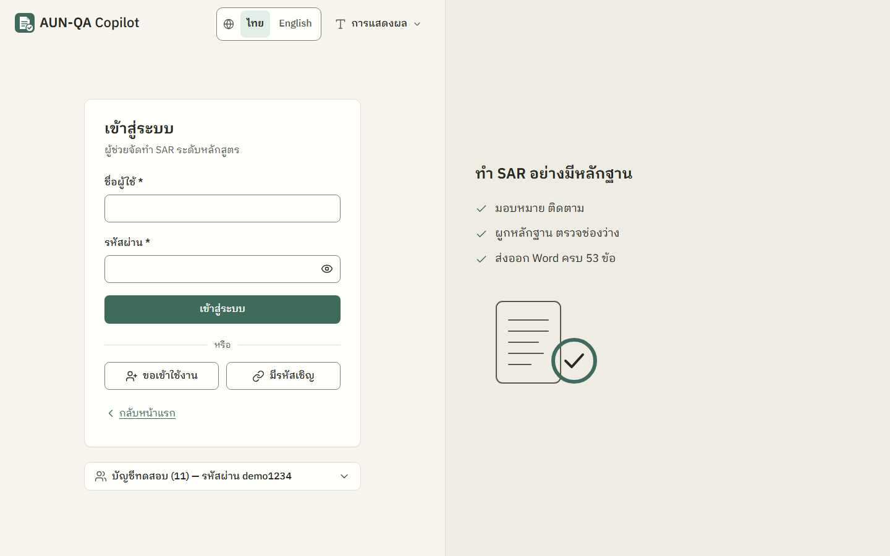
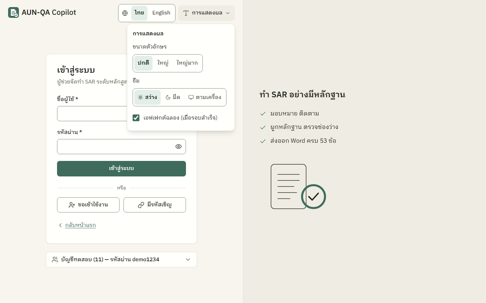
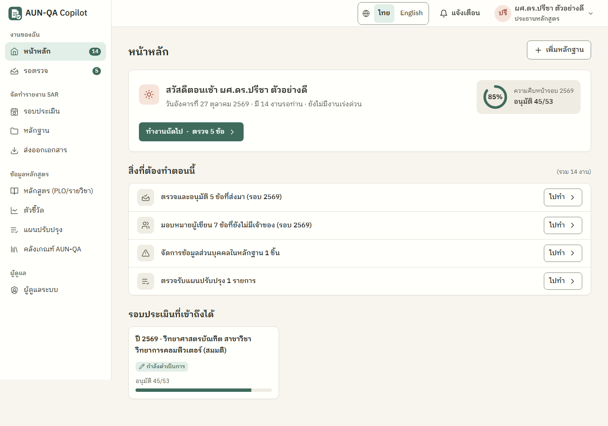
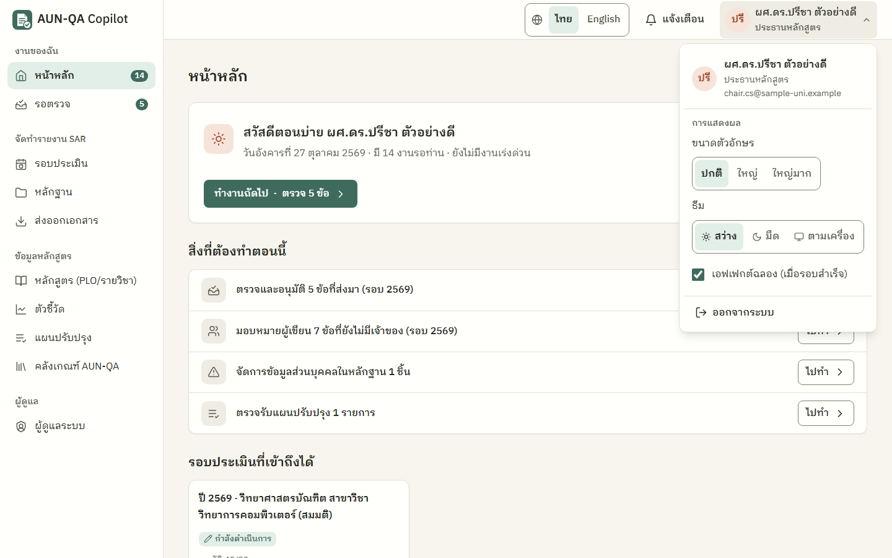
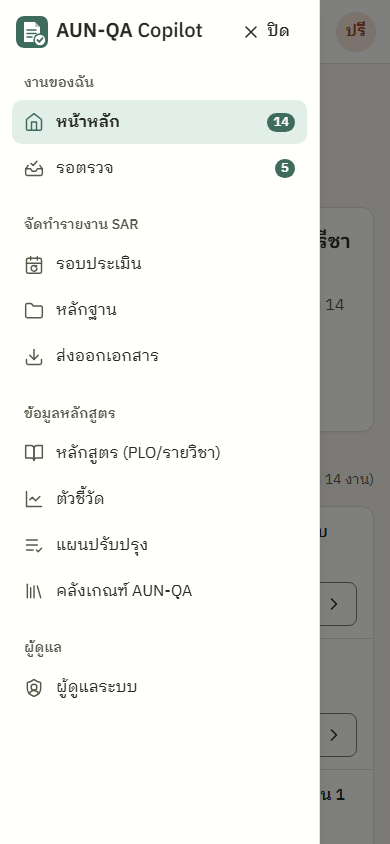
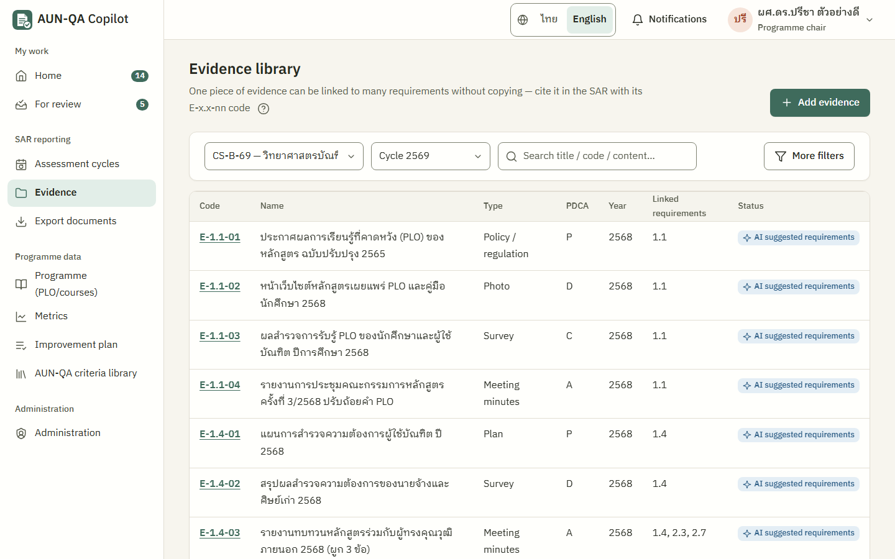
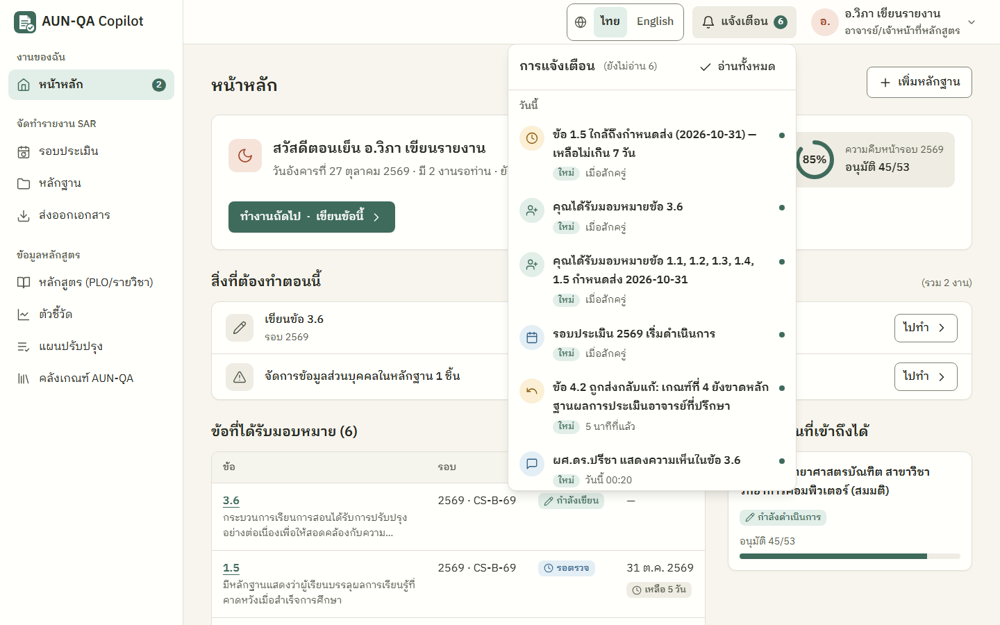
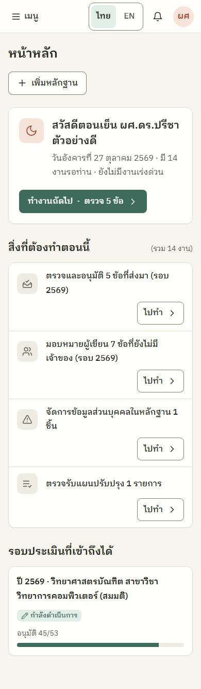

# ภาพรวม AUN-QA Copilot — ตั้งแต่ต้นจนจบ

> อ่านไฟล์นี้ก่อนไฟล์อื่น ใช้เวลาประมาณ 15 นาที
> ข้อมูลทุกอย่างในระบบเดโม่และในคู่มือนี้เป็นข้อมูลสมมติ ไม่มีข้อมูลบุคคลจริง

## สารบัญ
1. [ระบบนี้คืออะไร แก้ปัญหาอะไร](#1-ระบบนี้คืออะไร-แก้ปัญหาอะไร)
2. [AUN-QA แบบเข้าใจง่าย](#2-aun-qa-แบบเข้าใจง่าย)
3. [วงจรรอบประเมินทั้งหมด และใครทำอะไรเมื่อไหร่](#3-วงจรรอบประเมินทั้งหมด-และใครทำอะไรเมื่อไหร่)
4. [กฎเหล็กของระบบ: AI, ข้อมูลส่วนบุคคล, audit log](#4-กฎเหล็กของระบบ)
5. [หน้าตาและการใช้งานพื้นฐาน](#5-หน้าตาและการใช้งานพื้นฐาน)
6. [วิธีเปิดเดโม่บนเครื่องตัวเอง](#6-วิธีเปิดเดโม่บนเครื่องตัวเอง)
7. [เส้นทางสาธิตแนะนำ (เดินครบรอบใน 30–45 นาที)](#7-เส้นทางสาธิตแนะนำ)
8. [ข้อจำกัดของเดโม่ (ต้องรู้ก่อนใช้)](#8-ข้อจำกัดของเดโม่)
9. [คำถามที่พบบ่อยและการแก้ปัญหา](#9-คำถามที่พบบ่อยและการแก้ปัญหา)

---

## 1. ระบบนี้คืออะไร แก้ปัญหาอะไร

**AUN-QA Copilot** คือเว็บแอปที่ช่วยอาจารย์และบุคลากรของหลักสูตรเตรียม **รายงานการประเมินตนเอง (SAR)** และ **หลักฐาน** ตามเกณฑ์ประกันคุณภาพ AUN-QA ระดับหลักสูตร ฉบับ 4.0 ตั้งแต่เริ่มรอบจนถึงกรรมการประเมินเสร็จและปิดรอบ

### ปัญหาที่พบในงานประกันคุณภาพแบบเดิม
| ปัญหา | ระบบช่วยอย่างไร |
|---|---|
| หลักฐานกระจายอยู่ใน Drive อีเมล LINE ตั้งชื่อไม่เป็นระบบ และชิ้นเดียวถูกคัดลอกไปใช้หลายข้อ | คลังหลักฐานกลาง หลักฐาน 1 ชิ้นผูกได้หลายข้อโดยไม่ต้องคัดลอก มีรหัส `E-x.x-nn` ไว้อ้างอิง |
| SAR เขียนหลายคน หลายไฟล์ รวมเล่มยาก ไม่รู้ว่าข้อไหนเสร็จ | แบ่งงานรายข้อ มีเจ้าของและกำหนดส่ง แดชบอร์ดบอกความคืบหน้า ส่งออก Word ครบ 53 ข้อในไฟล์เดียว |
| เขียนไม่ครบวงจร PDCA (มักขาด Check/Act) จึงติดคะแนน 3 ไม่ถึง 4 | ตรวจช่องว่างอัตโนมัติ 11 กฎ (R1–R11) เช่น "ขาดหลักฐานขั้น Check/Act" |
| ตามงานกันผ่าน LINE ไม่มีร่องรอยว่าใครอนุมัติอะไรเมื่อไหร่ | ส่งตรวจ–ส่งกลับ–อนุมัติตามลำดับขั้น มีแจ้งเตือนในระบบ และบันทึกทุกการกระทำใน audit log |
| ต้องแปล SAR เป็นภาษาอังกฤษ | กล่องเขียนไทย/อังกฤษคู่กัน และปุ่มให้ AI ช่วยแปล |

### สิ่งที่ระบบ "ไม่ทำ"
- **ไม่ให้คะแนนแทนกรรมการ** และไม่ออกผลรับรองคุณภาพ
- ไม่ใช่ระบบทะเบียนนักศึกษา (รับเฉพาะข้อมูลสรุป เช่น อัตราการจบรายรุ่น)
- ไม่แทนระบบ CHE QA Online ของ สป.อว.

---

## 2. AUN-QA แบบเข้าใจง่าย

**AUN-QA** (ASEAN University Network – Quality Assurance) คือเกณฑ์ประกันคุณภาพของเครือข่ายมหาวิทยาลัยอาเซียน ระบบนี้ใช้ **ระดับหลักสูตร ฉบับ 4.0** ซึ่งมี **8 เกณฑ์ รวม 53 ข้อ**

| เกณฑ์ | ชื่อ (ไทย / อังกฤษ) | จำนวนข้อ | ถามเรื่องอะไร (ภาษาคน) |
|---|---|---|---|
| 1 | ผลการเรียนรู้ที่คาดหวัง / Expected Learning Outcomes | 5 | หลักสูตรตั้งเป้าว่าบัณฑิตต้องทำอะไรได้ (PLO) ชัดไหม และทำได้จริงไหม |
| 2 | โครงสร้างและเนื้อหาหลักสูตร / Programme Structure and Content | 7 | วิชาต่าง ๆ เรียงลำดับสมเหตุสมผล และรับผิดชอบ PLO ครบไหม |
| 3 | แนวทางการเรียนการสอน / Teaching and Learning Approach | 6 | สอนแบบลงมือทำ ส่งเสริมการเรียนรู้ตลอดชีวิต และปรับปรุงการสอนต่อเนื่องไหม |
| 4 | การวัดและประเมินผลผู้เรียน / Student Assessment | 7 | วัดผลหลากหลาย ยุติธรรม ตรงกับ PLO และคืนผลเร็วไหม |
| 5 | อาจารย์ / Academic Staff | 8 | มีอาจารย์พอ ภาระงานเหมาะสม และได้รับการพัฒนาไหม |
| 6 | การบริการสนับสนุนผู้เรียน / Student Support Services | 6 | รับนักศึกษาอย่างไร ติดตามช่วยเหลือ และมีกิจกรรมพัฒนาไหม |
| 7 | สิ่งอำนวยความสะดวกและโครงสร้างพื้นฐาน / Facilities and Infrastructure | 9 | ห้อง แล็บ ห้องสมุด ระบบไอทีพอและปลอดภัยไหม |
| 8 | ผลผลิตและผลลัพธ์ / Output and Outcomes | 5 | อัตราจบ การได้งานทำ ผลงานวิจัย ความพึงพอใจ ดีและติดตามต่อเนื่องไหม |

ดูทั้ง 53 ข้อพร้อมคำอธิบายภาษาคนได้ที่เมนู **คลังเกณฑ์ AUN-QA** (`/app/requirements`)


### สเกลคะแนน 1–7
คะแนนเป็นจำนวนเต็มเท่านั้น **ระดับ 4 = ผ่าน**

| คะแนน | ชื่อระดับ | ความหมายภาษาคน |
|---|---|---|
| 1 | ไม่เพียงพออย่างยิ่ง (Absolutely Inadequate) | ยังไม่ได้ทำ ไม่มีแผน ไม่มีเอกสาร |
| 2 | ไม่เพียงพอ ต้องปรับปรุง (Inadequate and Improvement is Necessary) | อยู่ขั้นวางแผน หลักฐานน้อย |
| 3 | ยังไม่เพียงพอ แต่ปรับเล็กน้อยก็พอ (Inadequate but Minor Improvement Will Make It Adequate) | ทำแล้ว แต่ไม่มีหลักฐานว่าตรวจผลและปรับปรุง |
| **4** | **เพียงพอตามที่คาดหวัง (Adequate as Expected)** | **ผ่าน** ทำครบวงจร มีหลักฐาน ผลสม่ำเสมอ |
| 5 | ดีกว่าเพียงพอ (Better Than Adequate) | ผลดี และมีข้อมูลหลายปีที่ดีขึ้น |
| 6 | เป็นแบบอย่างที่ดี (Example of Best Practices) | ดีกว่าคู่เทียบ (benchmark) |
| 7 | ยอดเยี่ยมระดับโลก (Excellent) | ระดับโลก มีนวัตกรรม |

ในระบบมีคะแนน 2 แบบที่ **แยกกันเด็ดขาด ไม่เขียนทับกัน**
- **คะแนนประเมินตนเอง (self-rating)** — หลักสูตรให้เองรายข้อ ใช้ทำ Appendix A
- **คะแนนของกรรมการ** — กรรมการให้ **รายเกณฑ์** (8 ค่า) และเลือก **verdict** (ผลสรุปภาพรวม) เอง ระบบไม่คำนวณค่าเฉลี่ยให้ เพราะคู่มือกำหนดให้ตัดสินแบบองค์รวม

### PDCA คืออะไร ทำไมสำคัญ
PDCA คือวงจรพัฒนางาน 4 ขั้น
- **P – Plan** มีแผน นโยบาย
- **D – Do** ลงมือทำจริง
- **C – Check** ติดตาม ตรวจสอบผล
- **A – Act** นำผลมาปรับปรุง

หลักสูตรส่วนใหญ่มีหลักฐาน P และ D แต่ขาด C และ A จึงได้คะแนน 3 ระบบช่วยโดย
- ให้ระบุขั้น PDCA ของหลักฐานทุกชิ้น
- ให้ติ๊ก PDCA ที่ครอบคลุมในแต่ละข้อของ SAR
- เตือนเมื่อข้อใดยังไม่มีหลักฐานขั้น C/A (กฎ R2)
- แผนปรับปรุงที่ทำเสร็จและตรวจรับแล้ว จะกลายเป็น **หลักฐานขั้น A ในรอบถัดไปโดยอัตโนมัติ**

---

## 3. วงจรรอบประเมินทั้งหมด และใครทำอะไรเมื่อไหร่

### บทบาท 8 แบบในระบบ
| บทบาท (รหัส) | เป็นใคร | งานหลัก | คู่มือ |
|---|---|---|---|
| ประธานหลักสูตร (`programme_chair`) | หัวหน้าทีมทำ SAR | สร้างรอบ มอบหมาย ตรวจและอนุมัติรายข้อ ส่ง QA คณะ | [10-programme-chair.md](10-programme-chair.md) |
| อาจารย์ประจำหลักสูตร (`programme_staff`) | ผู้เขียน SAR รายข้อ | เขียนข้อที่ได้รับ ผูกหลักฐาน ให้คะแนนตนเอง ส่งตรวจ | [11-lecturer.md](11-lecturer.md) |
| เจ้าหน้าที่ข้อมูล (`data_staff`) | ผู้ดูแลตัวเลขและเอกสาร | อัปโหลดหลักฐาน นำเข้าตัวชี้วัดจาก Excel | [12-data-staff.md](12-data-staff.md) |
| QA คณะ (`faculty_qa`) | งานประกันคุณภาพคณะ | ตรวจและอนุมัติระดับคณะ เริ่มการประเมิน ตรวจรับแผนปรับปรุง | [13-faculty-qa.md](13-faculty-qa.md) |
| คณบดี (`dean`) | ผู้อนุมัติสุดท้าย | อนุมัติสุดท้ายและล็อกรอบ หรือส่งกลับแก้ไข | [14-dean.md](14-dean.md) |
| กรรมการประเมิน (`assessor`) | ผู้ประเมินภายนอก | อ่าน SAR แบบอ่านอย่างเดียว ให้คะแนนรายเกณฑ์ เลือก verdict | [15-assessor.md](15-assessor.md) |
| ผู้ดูแลมหาวิทยาลัย (`uni_admin`) | ผู้ดูแลระบบระดับมหาวิทยาลัย | เชิญผู้ใช้ อนุมัติคำขอเข้าใช้งาน กำหนดบทบาท ระงับบัญชี สร้างรอบ มอบหมายกรรมการ เริ่มการประเมิน ปิดรอบ ดู audit log | [16-uni-admin.md](16-uni-admin.md) |
| ผู้ดูแลระบบสูงสุด (`super_admin`) | ผู้ดูแลแพลตฟอร์ม | จัดการผู้ใช้ (รวมผู้ดูแลมหาวิทยาลัย) ดู audit log เห็นข้อมูลทุกมหาวิทยาลัย รีเซ็ตข้อมูลเดโม่ | [17-super-admin.md](17-super-admin.md) |

ยังไม่มีบัญชี? ผู้ใช้ใหม่ "ขอเข้าใช้งาน" แล้วรอผู้ดูแลอนุมัติ หรือรับลิงก์เชิญจากผู้ดูแล — ดู [คู่มือผู้ใช้ใหม่](01-new-user.md) ผู้ขอเลือกบทบาทเองไม่ได้ ผู้ดูแลเป็นคนกำหนดบทบาทและขอบเขต

### สถานะของรอบประเมิน
แดชบอร์ดรอบแสดงเส้นขั้นตอน 6 ขั้น: **ร่าง → ดำเนินการ → QA คณะตรวจ → คณบดีอนุมัติ/ล็อก → ประเมิน → ปิดรอบ**

```
ร่าง ──► กำลังดำเนินการ ──► รอ QA คณะตรวจ ──► QA คณะอนุมัติ ──► อนุมัติสุดท้าย (ล็อก)
             ▲                    │                  │                  │
             │                    ▼                  ▼                  ▼
             └──────────── ส่งกลับแก้ไข ◄────────────┘           อยู่ระหว่างประเมิน
                                                                         │
                                                                         ▼
                                                     ปิดรอบ ◄──── ประเมินแล้ว
```

สถานะของแต่ละข้อ (53 ข้อ): **ยังไม่เริ่ม → กำลังเขียน → รอตรวจ → อนุมัติแล้ว** (ถ้าถูกส่งกลับ = **ส่งกลับแก้ไข** แล้วแก้และส่งใหม่)

### ลำดับงานทั้งรอบ: ใคร ทำอะไร ที่ไหน
| ลำดับ | ใคร | ทำอะไร | หน้าจอ | ผลที่เกิด |
|---|---|---|---|---|
| 1 | ประธานหลักสูตร หรือผู้ดูแลมหาวิทยาลัย | สร้างรอบประเมินปีการศึกษาใหม่ (คัดลอกจากรอบก่อนได้) | `/app/cycles` → "สร้างรอบใหม่" | ระบบสร้างครบ 53 ข้อให้อัตโนมัติ สถานะ "ร่าง" |
| 2 | ประธานหลักสูตร | กำหนดวันสำคัญ มอบหมายเจ้าของและกำหนดส่งรายข้อหรือทั้งเกณฑ์ | `/app/cycles/{รอบ}/assign` | ผู้ได้รับมอบหมายเห็นงานที่หน้าหลัก |
| 3 | ประธานหลักสูตร | กด "เริ่ม/กลับไปดำเนินการ" | แดชบอร์ดรอบ | สถานะ "กำลังดำเนินการ" |
| 4 | ทุกคนที่มีสิทธิ์ (ทำต่อเนื่องตลอดปี) | อัปโหลดหลักฐาน ผูกกับข้อ ระบุขั้น PDCA | `/app/evidence` | หลักฐานได้รหัส `E-x.x-nn` |
| 5 | เจ้าหน้าที่ข้อมูล / ประธาน | นำเข้าตัวชี้วัดย้อนหลัง 3–5 ปี (เกณฑ์ 8) | `/app/metrics` | มีกราฟแนวโน้ม ใช้ตรวจกฎ R3/R8 |
| 6 | อาจารย์ / ประธาน | เขียน SAR รายข้อ ให้ AI ช่วยร่าง/ตรวจ/แปล ติ๊ก PDCA ให้คะแนนตนเอง แล้วส่งตรวจ | `/app/sections/{รอบ}::{ข้อ}` | ข้อเป็น "รอตรวจ" ประธานได้รับแจ้งเตือน |
| 7 | ประธานหลักสูตร | อ่านแล้วอนุมัติ หรือส่งกลับแก้ไขพร้อมเหตุผล | `/app/review` | ข้อเป็น "อนุมัติแล้ว" หรือ "ส่งกลับแก้ไข" |
| 8 | ประธานหลักสูตร | เมื่ออนุมัติครบ 53 ข้อ กด "ส่งให้ QA คณะตรวจ" | แดชบอร์ดรอบ | QA คณะได้รับแจ้งเตือน |
| 9 | QA คณะ | อ่าน SAR ทั้งรอบ แล้ว "อนุมัติ (QA คณะ)" หรือ "ส่งกลับแก้ไข" | แดชบอร์ดรอบ | คณบดีได้รับแจ้งเตือน |
| 10 | คณบดี | "อนุมัติสุดท้ายและล็อก" หรือ "ส่งกลับแก้ไข" | แดชบอร์ดรอบ | รอบถูกล็อก บันทึก hash (ลายนิ้วมือเอกสาร) แก้ไขไม่ได้อีก |
| 11 | ประธาน / ทุกคน | ส่งออก SAR (.docx) ดัชนีหลักฐาน Appendix A ส่งกรรมการ | `/app/export` | ได้ไฟล์ Word/Excel |
| 12 | QA คณะ หรือผู้ดูแลมหาวิทยาลัย | ปุ่ม "มอบหมายกรรมการ" บนหน้ารอบ → เลือกกรรมการ แล้ว "เริ่มการประเมิน" | หน้ามอบหมาย + แดชบอร์ดรอบ | กรรมการได้รับแจ้งเตือน |
| 13 | กรรมการประเมิน (ทุกคนที่ได้รับมอบหมาย) | อ่าน SAR และหลักฐาน บันทึกข้อค้นพบ ให้คะแนน 8 เกณฑ์ เลือก verdict แล้วส่งผล | `/app/cycles/{รอบ}/assess` | เมื่อกรรมการ **ทุกคน** ให้คะแนนครบ สถานะเป็น "ประเมินแล้ว" หลักสูตรเห็นผล |
| 14 | ประธานหลักสูตร | สร้างแผนปรับปรุงจากข้อเสนอแนะของกรรมการ (AFI) | `/app/actions` | มีรายการแผนปรับปรุง |
| 15 | ผู้ดูแลมหาวิทยาลัย / ประธาน / QA คณะ | ปิดรอบ | แดชบอร์ดรอบ | รอบปิด แก้ผลประเมินไม่ได้ |
| 16 | ผู้รับผิดชอบแผน → ประธาน/QA คณะ | ทำแผนปรับปรุงจนเสร็จ แล้วตรวจรับ | `/app/actions` | เมื่อสร้างรอบปีถัดไป รายการที่ตรวจรับแล้วกลายเป็นหลักฐานขั้น A อัตโนมัติ |

> ทุกครั้งที่รอบเปลี่ยนสถานะ ระบบแจ้งเตือนบทบาทถัดไปทันที กดแจ้งเตือนแล้วไปถึงหน้าของงานนั้น และงานจะขึ้นใน "สิ่งที่ต้องทำตอนนี้" ของหน้าหลัก (ปุ่ม "ทำงานถัดไป") ผู้ใช้จึงไม่ต้องจำว่าต้องไปหน้าไหน
>
> ถ้า QA คณะหรือคณบดีส่งรอบกลับ หน้ารอบจะมีกล่องบนสุดบอก **ใคร ส่งกลับเมื่อไร และเหตุผล** พร้อมขั้นตอน 1-2-3 ให้ประธานทำต่อ ดู [คู่มือประธาน หัวข้อ 5](10-programme-chair.md#5-ส่งรอบให้-qa-คณะตรวจ)

### ปฏิทินโดยประมาณ (แต่ละมหาวิทยาลัยต่างกัน)
| ช่วง | งาน |
|---|---|
| ต้นปีการศึกษา | สร้างรอบ มอบหมาย ตั้งกำหนดส่ง |
| ระหว่างปี | เก็บหลักฐานต่อเนื่อง ไม่รอรวบท้ายปี |
| ปลายปีการศึกษา | นำเข้าตัวชี้วัด ร่าง SAR |
| 1–2 เดือนก่อนประเมิน | ตรวจ แก้ อนุมัติ ล็อก ส่ง SAR ล่วงหน้า |
| วันประเมิน (ประมาณ 3 วัน) | กรรมการลงพื้นที่ |
| หลังประเมิน | รับผล ทำแผนปรับปรุง ยกไปรอบหน้า |

---

## 4. กฎเหล็กของระบบ

### AI เป็นผู้ช่วย ไม่ใช่ผู้ตัดสิน
1. **AI ให้คะแนนทางการหรือ verdict ไม่ได้** และเปลี่ยนสถานะ/อนุมัติอะไรไม่ได้ ถ้า AI เขียนประโยคตัดสินทำนอง "ผ่านเกณฑ์" หรือ "ควรได้ระดับ 6" ระบบจะตัดทิ้งและติดธงเตือน
2. **AI ต้องอ้างหลักฐานที่มีจริง** ทุก `[E-…]` ในผลของ AI ต้องมีอยู่ในรอบนั้น ตัวเลขทุกตัวต้องพบในข้อมูลที่ส่งให้ ถ้าไม่ผ่านจะขึ้นป้ายเตือน
3. **ผลของ AI เป็นแค่ข้อเสนอ** ต้องกด "ยอมรับ" ก่อนจึงเข้าเอกสาร และทุกครั้งที่ใช้ AI ระบบเก็บประวัติไว้
4. ฟีเจอร์ AI ที่มีในระบบ
   | ฟีเจอร์ | อยู่ที่ | ใครใช้ได้ |
   |---|---|---|
   | แนะนำข้อและขั้น PDCA ให้หลักฐาน | หน้ารายละเอียดหลักฐาน → "ให้ AI แนะนำ" | ประธาน อาจารย์ เจ้าหน้าที่ข้อมูล |
   | ร่างเนื้อหาจากหลักฐานที่ผูก | หน้าเขียนข้อ → "ร่างจากหลักฐาน" | ประธาน อาจารย์ (เฉพาะข้อที่แก้ไขได้) |
   | ตรวจเนื้อหา | หน้าเขียนข้อ → "ตรวจเนื้อหา" | ประธาน อาจารย์ QA คณะ (ใช้ได้แม้ข้อนั้นอ่านอย่างเดียว) |
   | แปล ไทย↔อังกฤษ | หน้าเขียนข้อ → "แปลเป็น EN" / "แปลเป็น TH" | ประธาน อาจารย์ (เฉพาะข้อที่แก้ไขได้) |
   | ตรวจคำกริยา Bloom ของ PLO/CLO | หน้าหลักสูตร → แท็บ "ตรวจคำกริยา Bloom (AI)" | ประธาน อาจารย์ QA คณะ |
   | สรุปเกณฑ์และร่างคำถามสัมภาษณ์ | พื้นที่ทำงานกรรมการ → "AI สรุปเกณฑ์นี้ + ร่างคำถามสัมภาษณ์" | กรรมการเท่านั้น |

#### AI 2 โหมด: ในเครื่อง (offline) กับ Claude
| | โหมดในเครื่อง (offline) | Claude |
|---|---|---|
| ใช้เมื่อ | ค่าเริ่มต้น เมื่อไม่ได้ตั้งค่า API key | ผู้ติดตั้งตั้งค่า `ANTHROPIC_API_KEY` ฝั่ง server |
| ส่งข้อมูลออกนอกเครื่องไหม | ไม่ส่ง | ส่งข้อความที่ **ปกปิดข้อมูลส่วนบุคคลแล้ว** ไปยังบริการ Claude |
| คุณภาพผล | เป็นโครงร่างหรือคำแนะนำพื้นฐานจากกฎในเครื่อง เช่น ร่างเป็นหัวข้อจากชื่อหลักฐาน การแปลแทนเฉพาะศัพท์ AUN-QA | ข้อความอ่านได้เป็นประโยค |
| รู้ได้อย่างไรว่าใช้โหมดไหน | ผลของ AI มีป้าย "โหมดในเครื่อง (offline)" | ผลของ AI ระบุชื่อโมเดลที่ตอบ |

ถ้าเรียก Claude ไม่สำเร็จ (ไม่มี key, เครือข่ายล่ม, เกินโควตา) ระบบจะใช้โหมดในเครื่องแทนโดยอัตโนมัติ เดโม่จึงใช้งานได้เสมอ

### ข้อมูลส่วนบุคคล (PII) และ PDPA
- **ใช้ข้อมูลสมมติเท่านั้น** ในเดโม่และงานโปรเจกต์ ห้ามใช้ข้อมูลนักศึกษาหรืออาจารย์จริง
- ตอนเพิ่มหลักฐาน ระบบสแกนหาเลขบัตรประชาชน เบอร์โทร อีเมล รหัสนักศึกษา (รวมเลขไทยและ +66) ทั้งในชื่อ คำอธิบาย ชื่อไฟล์ และข้อความที่ดึงได้ ถ้าพบจะขึ้นกล่อง "พบข้อมูลส่วนบุคคล" และติดป้าย PII ที่หลักฐาน
- หลักฐานที่มี PII ต้องจัดการ (เช่น ปิดบังในต้นฉบับ) แล้วกด "ทำเครื่องหมายว่าจัดการแล้ว" พร้อมเขียนว่าทำอะไร จึงจะยืนยันหลักฐานได้ และจะถูกเตือนตอนส่งต่อรอบ (กฎ R6)
- **ก่อนส่งข้อความให้ AI ระบบปกปิดข้อมูลส่วนบุคคลทุกครั้ง** ผลของ AI บอกจำนวนจุดที่ปกปิด
- การนำเข้าผลการศึกษารายรุ่นจาก Excel อ่านเฉพาะคอลัมน์ที่จำเป็น เก็บแค่ผลรวมต่อรุ่น ไม่เก็บรายชื่อหรือรหัสรายคน

### Audit log และการล็อก
- ทุกการเขียน การอนุมัติ การให้คะแนน การส่งออก ถูกบันทึกใน **audit log** แบบเพิ่มได้อย่างเดียว ไม่มีปุ่มแก้หรือลบ ผู้มีสิทธิ์ดูได้ที่ `/app/admin` แท็บ Audit log และดาวน์โหลดเป็น CSV
- **แยกหน้าที่ผู้เขียนกับผู้อนุมัติ** ผู้ที่เขียนข้อล่าสุด อนุมัติข้อนั้นเองไม่ได้
- **ข้อที่ส่งตรวจหรืออนุมัติแล้ว เปลี่ยนหลักฐานไม่ได้** ผูกเพิ่ม เลิกผูก หรืออัปโหลดหลักฐานใหม่ให้ข้อนั้นไม่ได้ทุกทาง (หน้าเขียนข้อ หน้ารายละเอียดหลักฐาน ฟอร์มเพิ่มหลักฐาน) ระบบบอกเหตุผลและวิธีแก้ คือให้ประธานหลักสูตรส่งข้อนั้นกลับแก้ไขก่อน ดู [คู่มืออาจารย์ หัวข้อ 1](11-lecturer.md#ข้อที่ล็อกแล้ว-ผูกหลักฐานไม่ได้)
- เมื่อคณบดีอนุมัติสุดท้าย รอบจะ **ล็อก** และระบบเก็บ **hash** (ลายนิ้วมือเอกสาร) ของ SAR ทั้งรอบ ถ้าเนื้อหาเปลี่ยนแม้ตัวอักษรเดียว hash จะไม่ตรง แดชบอร์ดแสดงผลตรวจว่า "ตรงกับที่ล็อก" หรือไม่

---

## 5. หน้าตาและการใช้งานพื้นฐาน

หน้าตาระบบใช้โทนสีเอิร์ธโทน (เขียวเข้ม ครีม น้ำตาลอ่อน) ตัวอักษรใหญ่อ่านง่าย ปุ่มทุกปุ่มมีคำกำกับ สถานะทุกอย่างบอกด้วยไอคอนและคำ ไม่ใช้สีอย่างเดียว

### เข้าสู่ระบบ
1. เปิดหน้าแรก กด "เข้าสู่ระบบ"
2. กรอกชื่อผู้ใช้และรหัสผ่าน (ชื่อผู้ใช้พิมพ์ตัวใหญ่หรือเล็กก็ได้) แล้วกด **"เข้าสู่ระบบ"**
3. ถ้าใช้บัญชีทดสอบ กด **"บัญชีทดสอบ (11) — รหัสผ่าน demo1234"** ใต้ฟอร์ม แล้วกดชื่อบัญชี ระบบเติมฟอร์มให้



- ใส่รหัสผ่านผิดครบ 5 ครั้ง บัญชีจะถูกล็อก 5 นาที (ฟอร์มบอกว่าเหลืออีกกี่ครั้ง)
- ถ้ารหัสผ่านถูกแต่บัญชียังรออนุมัติ จะขึ้น "บัญชีนี้กำลังรอผู้ดูแลอนุมัติ…" ถ้าถูกระงับ จะขึ้น "บัญชีนี้ถูกระงับการใช้งาน กรุณาติดต่อผู้ดูแลระบบของมหาวิทยาลัย"
- มุมบนของหน้ามีปุ่มภาษา **"ไทย │ English"** และปุ่ม **"การแสดงผล"** (ขนาดตัวอักษร ธีม เอฟเฟกต์ฉลอง) ปรับได้ตั้งแต่ก่อนเข้าสู่ระบบ



### ยังไม่มีบัญชี
ใต้ปุ่มเข้าสู่ระบบมี 2 ปุ่มสำหรับผู้ใช้ใหม่
- **"ขอเข้าใช้งาน"** (`/request-access`) — กรอกชื่อ อีเมลของมหาวิทยาลัย เหตุผล และตั้งชื่อผู้ใช้/รหัสผ่านเอง แล้วรอผู้ดูแลมหาวิทยาลัยอนุมัติและกำหนดบทบาท ระบบยังไม่ส่งอีเมลแจ้งผล ให้ลองเข้าสู่ระบบภายหลัง (ถ้าเข้าไม่ได้หลายวัน ติดต่อผู้ดูแล อย่าลองรหัสผ่านซ้ำหลายครั้ง)
- **"มีรหัสเชิญ"** (`/invite`) — วางลิงก์หรือรหัสเชิญที่ผู้ดูแลส่งให้ ตั้งรหัสผ่าน แล้วเข้าระบบได้ทันที

รายละเอียดทีละขั้นอยู่ใน [คู่มือผู้ใช้ใหม่](01-new-user.md) — ข้อจำกัดของเดโม่: คำขอและลิงก์เชิญใช้ได้เฉพาะ **เบราว์เซอร์เดียวกับที่ผู้ดูแลใช้** (ทั้งสองหน้ามีป้าย "ระบบสาธิต" บอกไว้)

### หน้าจอหลังเข้าสู่ระบบ


- **เมนูซ้าย** จัดกลุ่ม: งานของฉัน (หน้าหลัก, รอตรวจ) · จัดทำรายงาน SAR (รอบประเมิน, หลักฐาน, ส่งออกเอกสาร) · ข้อมูลหลักสูตร (หลักสูตร, ตัวชี้วัด, แผนปรับปรุง, คลังเกณฑ์ AUN-QA) · ผู้ดูแล (ผู้ดูแลระบบ) — แต่ละบทบาทเห็นเมนูไม่เท่ากัน ตัวเลขข้างเมนูคือจำนวนงานที่รอท่าน
- **แถบบน (ขวา)** เรียงจากซ้ายไปขวา: ปุ่มภาษา **"ไทย │ English"** · ปุ่ม **"แจ้งเตือน"** (กระดิ่ง มีตัวเลขเมื่อมีรายการยังไม่อ่าน) · **ชื่อของคุณ** (เมนูผู้ใช้)
- **เมนูผู้ใช้** (กดชื่อมุมขวาบน) แสดงชื่อ บทบาท อีเมล และหัวข้อ **"การแสดงผล"** แล้วปิดท้ายด้วยปุ่ม **"ออกจากระบบ"** ปิดเมนูได้ด้วย Esc หรือคลิกนอกเมนู
- ปุ่ม (?) ข้างศัพท์เฉพาะ กดแล้วมีคำอธิบายสั้น ๆ



บนมือถือ เมนูซ้ายจะซ่อน กดปุ่ม **"เมนู"** มุมซ้ายบนเพื่อเปิด (มีปุ่มปิด) ปุ่มภาษาย่อเป็น "ไทย │ EN" กระดิ่งและรูปชื่อย่อเหลือแต่ไอคอน



### การแสดงผล: ขนาดตัวอักษร ธีม เอฟเฟกต์
อยู่ในเมนูผู้ใช้ (หลังเข้าสู่ระบบ) หรือปุ่ม "การแสดงผล" (หน้าแรก/หน้าเข้าสู่ระบบ) เปลี่ยนแล้วเห็นผลทันที ระบบจำค่าไว้ในเบราว์เซอร์นี้
| ตัวเลือก | ค่าที่เลือกได้ |
|---|---|
| ขนาดตัวอักษร | **ปกติ · ใหญ่ · ใหญ่มาก** (ใหญ่มาก = 125%) ตารางจะเปลี่ยนเป็นการ์ดเองเมื่อพื้นที่ไม่พอ ปุ่มไม่หายไป |
| ธีม | **สว่าง · มืด · ตามเครื่อง** (ตามเครื่อง = ตามการตั้งค่าโหมดมืดของคอมพิวเตอร์/มือถือ) ค่าเริ่มต้นคือสว่าง |
| เอฟเฟกต์ฉลอง (เมื่อรอบสำเร็จ) | ติ๊กเปิด/ปิด |

### ภาษา
- กด **"ไทย"** หรือ **"English"** ที่แถบบน (หรือหน้าแรก/หน้าเข้าสู่ระบบ) **เลือกครั้งเดียวมีผลทุกหน้า** รวมหน้าเข้าสู่ระบบ หน้าขอเข้าใช้งาน และหน้ารับคำเชิญ
- แท็บอื่นที่เปิดระบบอยู่ในเบราว์เซอร์เดียวกันเปลี่ยนภาษาตามทันที
- ภาษาที่เลือกจำไว้ในเบราว์เซอร์ ไม่ได้ผูกกับบัญชี เปิดจากเครื่องอื่นจะเริ่มเป็นไทย



### แจ้งเตือน (กระดิ่ง)
1. กดปุ่ม **"แจ้งเตือน"** ที่แถบบน → แผง **"การแจ้งเตือน"** เปิด (บนมือถือเต็มจอ มีปุ่ม "ปิด") หัวแผงบอกจำนวนที่ยังไม่อ่าน
2. รายการจัดกลุ่มตามวัน รายการที่ยังไม่อ่านตัวหนา มีป้าย **"ใหม่"** และจุดสีท้ายแถว แสดง 30 รายการล่าสุด
3. **กดรายการใดก็ได้ ระบบพาไปหน้าของงานนั้นทันที** และรายการนั้นเป็น "อ่านแล้ว" เช่น ได้รับมอบหมายข้อ → หน้าเขียนข้อ · มีความเห็นใหม่ → หน้าข้อ แท็บความเห็นเปิดเอง · มอบหมายแผนปรับปรุง → หน้าแผนปรับปรุง แถวนั้นถูกไฮไลต์ · คำขอเข้าใช้งานใหม่ → แท็บคำขอของผู้ดูแล
4. กด **"อ่านทั้งหมด"** เพื่อล้างตัวเลข ปิดแผงด้วย Esc (กลับไปที่กระดิ่ง) หรือคลิกนอกแผง
- วันที่ในข้อความแสดงแบบ พ.ศ. เช่น "กำหนดส่ง 1 พ.ย. 2569"
- แจ้งเตือนบางชนิดของงานที่ทำไปแล้วยังค้าง "ใหม่" (เช่น "ข้อ x.x ส่งตรวจแล้ว รอประธานอนุมัติ" หลังประธานอนุมัติแล้ว) ให้กด "อ่านทั้งหมด" เอง



### หน้าหลัก
- **การ์ดทักทาย** "สวัสดีตอนเช้า/บ่าย/เย็น <ชื่อ>" บอกวันที่ จำนวนงานที่รอ และมีงานเร่งด่วนไหม (จอกว้างมีวงความคืบหน้าของรอบแรกด้วย)
- ปุ่มเขียว **"ทำงานถัดไป · …"** พาไปงานแรกที่ควรทำ กดปุ่มเดียวพอ ไม่ต้องรู้ว่าอยู่เมนูไหน
- **"สิ่งที่ต้องทำตอนนี้"** รายการงานเรียงตามความเร่งด่วน แต่ละแถวมีปุ่ม **"ไปทำ"** งานเร่งด่วน (เช่น ข้อถูกส่งกลับ) มีป้าย "เร่งด่วน" ถ้ามีมากกว่า 4 งาน งานที่เหลือพับอยู่ใต้ "งานอื่น ๆ อีก n รายการ"
- ถัดลงไป: ตาราง "ข้อที่ได้รับมอบหมาย" (ถ้ามี) และ "รอบประเมินที่เข้าถึงได้"
- ผู้ที่เพิ่มหลักฐานได้ มีปุ่ม **"เพิ่มหลักฐาน"** มุมขวาบน กดแล้วฟอร์มเปิดทันที



### การบันทึกงาน
- หน้าเขียน SAR **บันทึกอัตโนมัติ** ระหว่างพิมพ์ และบันทึกทันทีเมื่อย้ายออกจากกล่อง สลับแท็บ ปิดหน้า หรือออกจากระบบ ดูสถานะได้ที่แถบล่าง เช่น "บันทึกแล้ว 14:32"
- ไม่ได้ใช้งาน 4 ชั่วโมง หรือเข้าระบบต่อเนื่องครบ 12 ชั่วโมง ระบบจะให้เข้าสู่ระบบใหม่ งานที่ค้างถูกบันทึกไว้แล้ว
- ออกจากระบบในแท็บหนึ่ง แท็บอื่นจะออกด้วย พร้อมข้อความ "ออกจากระบบจากแท็บอื่นแล้ว งานที่ค้างถูกบันทึกแล้ว"
- **ข้อความเดียวกันนี้ขึ้นเมื่อมีการเข้าสู่ระบบด้วยบัญชีอื่นในแท็บอื่นของเบราว์เซอร์เดียวกัน** — ในเบราว์เซอร์เดียวใช้ได้ทีละบัญชี ถ้าจะสาธิตสองบทบาทพร้อมกัน ให้ออกจากระบบแล้วเข้าบัญชีใหม่ตามลำดับ (ใช้อีกเบราว์เซอร์ไม่ได้ เพราะข้อมูลแยกกัน ดูหัวข้อ 8)

---

## 6. วิธีเปิดเดโม่บนเครื่องตัวเอง

### สิ่งที่ต้องมี
- Node.js เวอร์ชัน 20 ขึ้นไป (ดาวน์โหลดจาก https://nodejs.org)
- เบราว์เซอร์ Chrome หรือ Edge รุ่นใหม่

### วิธีที่ 1: ดับเบิลคลิก (Windows)
ดับเบิลคลิกไฟล์ `เปิด EduFlow ใหม่ (Next.js).bat` ที่โฟลเดอร์บนสุดของโปรเจกต์ ครั้งแรกจะติดตั้งให้เอง (1–2 นาที) แล้วเปิดเบราว์เซอร์ที่ `http://localhost:3000` ให้อัตโนมัติ ปิดหน้าต่างดำหรือกด Ctrl+C เพื่อหยุด

> ชื่อไฟล์ยังเป็นชื่อเดิมของโปรเจกต์ (EduFlow) แต่เปิดแอป AUN-QA Copilot ตัวเดียวกัน

### วิธีที่ 2: ใช้คำสั่ง
```bash
cd eduflow-next
npm install        # ครั้งแรกครั้งเดียว
npm run dev        # เปิดที่ http://localhost:3000
```
ถ้าต้องการความเร็วแบบใช้งานจริง (เช่น ตอนสาธิตหน้ากรรมการ)
```bash
npm run build
npm run start      # http://localhost:3000
```

### เปิดใช้ AI แบบ Claude (ไม่บังคับ)
สร้างไฟล์ `eduflow-next/.env.local` แล้วใส่บรรทัด `ANTHROPIC_API_KEY=<คีย์ของคุณ>` จากนั้นเริ่มเซิร์ฟเวอร์ใหม่ ถ้าไม่ทำ ระบบใช้โหมดในเครื่องตามปกติ
**ห้าม commit ไฟล์ `.env.local` หรือส่งคีย์ให้ผู้อื่น**

### บัญชีทดสอบ (รหัสผ่านทุกบัญชี `demo1234`)
| ชื่อผู้ใช้ | ชื่อในระบบ (สมมติ) | บทบาท | ขอบเขต |
|---|---|---|---|
| `chair1` | ผศ.ดร.ปรีชา ตัวอย่างดี | ประธานหลักสูตร | หลักสูตร CS-B-69 |
| `staff1` | อ.วิภา เขียนรายงาน | อาจารย์ประจำหลักสูตร | หลักสูตร CS-B-69 |
| `lect1` | อ.ธนา สอนดี | อาจารย์ประจำหลักสูตร | หลักสูตร CS-B-69 |
| `lect2` | อ.มาลี วิจัยเด่น | อาจารย์ประจำหลักสูตร | หลักสูตร DS-M-69 |
| `data1` | คุณสุดา เก็บข้อมูล | เจ้าหน้าที่ข้อมูล | ทั้งคณะ |
| `fqa1` | ดร.กมล ประกันคุณภาพ | QA คณะ | ทั้งคณะ |
| `dean1` | รศ.ดร.สมชาย คณบดีสมมติ | คณบดี | ทั้งคณะ |
| `assess1` | ศ.ดร.วรรณา ผู้ประเมินภายนอก | กรรมการประเมิน | เฉพาะรอบ 2569 |
| `uadmin` | สมศรี ผู้ดูแลมหาวิทยาลัย | ผู้ดูแลมหาวิทยาลัย | มหาวิทยาลัยตัวอย่างภาคเหนือ |
| `sadmin` | ผู้ดูแลระบบ สมมติ | ผู้ดูแลระบบสูงสุด | ทุกมหาวิทยาลัย |
| `uadmin2` | สมปอง ผู้ดูแลมหาวิทยาลัยที่สอง | ผู้ดูแลมหาวิทยาลัย | มหาวิทยาลัยทดสอบภาคใต้ (ใช้ทดสอบการแยกข้อมูลข้ามมหาวิทยาลัย; มหาวิทยาลัยนี้ปิด AI) |

รายการบัญชีทดสอบอยู่ใต้ฟอร์มเข้าสู่ระบบ (กล่อง "บัญชีทดสอบ (11) — รหัสผ่าน demo1234" กดเพื่อกาง) อีเมลของบัญชีเดโม่ลงท้ายด้วย `@sample-uni.example` (โดเมนสมมติ) ใช้โดเมนเดียวกันนี้ทดลอง "ขอเข้าใช้งาน" ได้

### ข้อมูลเดโม่ตอนเริ่ม
- มหาวิทยาลัยตัวอย่างภาคเหนือ · คณะวิทยาศาสตร์และเทคโนโลยีตัวอย่าง · 2 หลักสูตร: วท.บ. วิทยาการคอมพิวเตอร์ (CS-B-69) และ วท.ม. วิทยาการข้อมูล (DS-M-69)
- **รอบประเมิน 2569 ของ CS-B-69** อยู่สถานะ "กำลังดำเนินการ" อนุมัติแล้ว 45 ข้อ รอตรวจ 5 ข้อ กำลังเขียน 3 ข้อ
- มีหลักฐานตัวอย่าง (1 ชิ้นมีเลขบัตรประชาชนปลอม ไว้สาธิต PII) ตัวชี้วัดย้อนหลัง ข้อมูลหลักสูตร PLO/รายวิชา และแผนปรับปรุง 6 รายการ
- เริ่มใหม่ได้ทุกเมื่อ: เข้า **`sadmin`** → ผู้ดูแลระบบ → แท็บ "ข้อมูลเดโม่" → "รีเซ็ตข้อมูลเดโม่" (ล้างทุกอย่างรวม audit log ผู้ใช้ที่เพิ่ม คำขอ และคำเชิญ แล้วสร้างข้อมูลสมมติใหม่ ต้องเข้าสู่ระบบใหม่) — **เฉพาะผู้ดูแลระบบสูงสุด** ผู้ดูแลมหาวิทยาลัย (`uadmin`) ไม่เห็นแท็บนี้

---

## 7. เส้นทางสาธิตแนะนำ

เส้นทางนี้คือลำดับเดียวกับที่ทีมทดสอบเล่นจริงครบทุกบทบาท ใช้ได้ตอนนำเสนอ (เริ่มจากรีเซ็ตข้อมูลเดโม่ด้วย `sadmin` ก่อน) ทุกขั้นเดินผ่านกระดิ่งแจ้งเตือนหรือปุ่ม "ทำงานถัดไป" ได้ ใช้เบราว์เซอร์เดียวกันทั้งเส้นทาง และออกจากระบบก่อนเปลี่ยนบัญชี

**ขั้น 0 (ไม่บังคับ) รับผู้ใช้ใหม่:** ออกจากระบบ → "ขอเข้าใช้งาน" ด้วยอีเมล `@sample-uni.example` → เข้า `uadmin` → งาน "อนุมัติคำขอเข้าใช้งาน" → เลือกบทบาท/ขอบเขต → อนุมัติ หรือ `uadmin` → "เพิ่มผู้ใช้" แบบส่งลิงก์เชิญ → คัดลอกลิงก์ → ออกจากระบบ → วางลิงก์ในแท็บเดิม → ตั้งรหัสผ่าน ดู [คู่มือผู้ดูแลมหาวิทยาลัย หัวข้อ 2–4](16-uni-admin.md#2-เพิ่มผู้ใช้-แนะนำ-ส่งลิงก์เชิญ)

| ขั้น | เข้าในฐานะ | ทำอะไร | ดูรายละเอียด |
|---|---|---|---|
| 1 | `chair1` | หน้าหลักเห็น "ตรวจ 5 ข้อ" และ "มอบหมายผู้เขียน" → มอบหมายข้อ 3.6, 5.1, 7.9 ให้ อ.วิภา (`staff1`) | [ประธาน: มอบหมายงาน](10-programme-chair.md#2-มอบหมายเจ้าของและกำหนดส่ง) |
| 2 | `staff1` | หน้าหลักเห็นงานเขียน 3 ข้อ → เปิดข้อ 3.6 ผูกหลักฐาน กด AI ร่าง ติ๊ก PDCA ให้คะแนน → ส่งตรวจ (ทำซ้ำกับ 5.1 และ 7.9) | [อาจารย์: เขียนข้อ](11-lecturer.md#2-เขียน-sar-ข้อที่ได้รับมอบหมาย-ทีละขั้น) |
| 3 | `chair1` | เมนู "รอตรวจ" → เปิดอ่าน อนุมัติ (ลองส่งกลับ 1 ข้อเพื่อสาธิต แล้วให้ `staff1` แก้ส่งใหม่) → อนุมัติครบ 53 ข้อ → "ส่งให้ QA คณะตรวจ" | [ประธาน: ตรวจและอนุมัติ](10-programme-chair.md#4-ตรวจและอนุมัติรายข้อ) |
| 4 | `fqa1` | การ์ด "ตรวจรอบ 2569 ระดับคณะ" → อ่าน SAR ทั้งรอบ (.docx) → "อนุมัติ (QA คณะ)" | [QA คณะ](13-faculty-qa.md) |
| 5 | `dean1` | การ์ด "พิจารณาอนุมัติสุดท้าย" → อ่านคำเตือน → "อนุมัติสุดท้ายและล็อก" | [คณบดี](14-dean.md) |
| 6 | `fqa1` หรือ `uadmin` | การ์ด "เริ่มการประเมิน" → ยืนยัน | [QA คณะ: เริ่มการประเมิน](13-faculty-qa.md#3-เริ่มการประเมิน) |
| 7 | `assess1` | การ์ด "ประเมินรอบ 2569" → ให้คะแนน 8 เกณฑ์ → เลือก verdict → ส่งผล | [กรรมการ](15-assessor.md) |
| 8 | `chair1` | แผนปรับปรุง → "สร้างจากข้อเสนอแนะของกรรมการ (AFI)" | [ประธาน: แผนปรับปรุง](10-programme-chair.md#8-แผนปรับปรุงหลังได้ผลประเมิน) |
| 9 | `uadmin` | การ์ด "ปิดรอบ" → ยืนยัน | [ผู้ดูแลมหาวิทยาลัย](16-uni-admin.md) |
| 10 | `chair1` | สร้างรอบ 2570 → ระบบสร้าง 53 ข้อ และนำแผนที่ตรวจรับแล้วมาเป็นหลักฐานขั้น A | [ประธาน: สร้างรอบ](10-programme-chair.md#1-สร้างรอบประเมินใหม่) |

> ข้อมูลเดโม่ตั้งใจให้ยังมี "ช่องว่างวิกฤต" หลายรายการ (ข้อที่อนุมัติแล้วแต่ยังไม่มีหลักฐานผูก) เพื่อให้เห็นคำเตือนก่อนส่งต่อ ระบบเตือนแต่ไม่บังคับหยุด เพราะการตัดสินใจเป็นของคน

---

## 8. ข้อจำกัดของเดโม่

ระบบเวอร์ชันนี้ทำมาเพื่อ **สาธิตบนเครื่องตัวเอง** ยังไม่พร้อมให้คนนอกเข้าใช้ผ่านอินเทอร์เน็ต เหตุผลมีดังนี้

| เรื่อง | สภาพตอนนี้ | ผลต่อผู้ใช้ |
|---|---|---|
| ที่เก็บข้อมูล | ข้อมูลทั้งหมดอยู่ใน **เบราว์เซอร์ของเครื่องนั้น** (localStorage) ไม่มีฐานข้อมูลกลาง | ข้อมูลไม่ข้ามเครื่องหรือข้ามเบราว์เซอร์ ล้างข้อมูลเบราว์เซอร์ = ข้อมูลหาย · คนสองคนใช้คนละเครื่องจะไม่เห็นงานของกัน |
| การตรวจสิทธิ์และการเข้าสู่ระบบ | ทำในเบราว์เซอร์ทั้งหมด รหัสผ่านทุกบัญชีเดโม่เหมือนกัน | กันการใช้งานผิดผ่านหน้าจอได้ แต่กันผู้ที่ตั้งใจแก้ข้อมูลผ่านเครื่องมือของเบราว์เซอร์ไม่ได้ |
| audit log | ไม่มีปุ่มแก้/ลบ แต่เก็บในเบราว์เซอร์ และถูกล้างเมื่อรีเซ็ตเดโม่ | ใช้สาธิตแนวคิดได้ ยังไม่ใช่หลักฐานทางกฎหมาย |
| ไฟล์หลักฐาน | ไฟล์ไม่เกิน 1 MB เก็บตัวไฟล์ ไฟล์ใหญ่กว่านั้นเก็บแค่ชื่อ ขนาด และ hash | ไฟล์ใหญ่เปิดหรือดาวน์โหลดภายหลังไม่ได้ |
| การสแกนข้อมูลส่วนบุคคล | สแกนข้อความที่พิมพ์ ไฟล์ .txt/.csv ชื่อ คำอธิบาย และชื่อไฟล์ ไฟล์ PDF/DOCX/XLSX/รูปภาพยังไม่ถูกอ่านเนื้อใน (สถานะ "ยังไม่ได้สแกน") และยังไม่ตรวจชื่อคน | ต้องตรวจเนื้อในไฟล์เองก่อนอัปโหลด |
| AI | ค่าเริ่มต้นเป็นโหมดในเครื่อง ผลเป็นโครงร่าง ส่วน Claude ต้องมี API key และยังไม่จำกัดโควตาต่อผู้ใช้ | อย่าคาดหวังร่างฉบับเต็มจากโหมดในเครื่อง ต้องเขียนต่อเอง |
| อีเมล | แจ้งเตือนเฉพาะในระบบ (กระดิ่ง) ไม่มีอีเมล ไม่มีการยืนยันอีเมลของผู้ขอเข้าใช้งาน | ต้องเข้าระบบเพื่อดูงาน · ผู้ขอไม่ได้รับแจ้งผลอนุมัติ/ปฏิเสธทางอีเมล · ผู้ดูแลต้องตรวจตัวตนผู้ขอเองก่อนอนุมัติ |
| คำขอเข้าใช้งานและลิงก์เชิญ | เก็บในเบราว์เซอร์เดียวกับข้อมูลอื่น | ผู้ขอต้องส่งคำขอจากเบราว์เซอร์ที่ผู้ดูแลใช้ และ **ลิงก์เชิญต้องเปิดในเบราว์เซอร์เดียวกับที่ผู้ดูแลสร้าง** เปิดจากเครื่องอื่นจะขึ้น "ลิงก์ไม่ถูกต้องหรือหมดอายุแล้ว" |
| ใช้หลายบัญชีพร้อมกัน | เบราว์เซอร์หนึ่งเข้าได้ทีละบัญชี | เข้าบัญชีอื่นในแท็บใหม่ แท็บเดิมจะถูกออกจากระบบ ("ออกจากระบบจากแท็บอื่นแล้ว") สาธิตทีละบทบาท |
| เปิดลิงก์ตรงตอนยังไม่เข้าสู่ระบบ | ระบบพาไปหน้าเข้าสู่ระบบ | หลังเข้าสู่ระบบจะไปหน้าหลัก ไม่กลับหน้าที่เปิดไว้ ต้องเปิดลิงก์อีกครั้ง |
| กรรมการหลายคนในรอบเดียว | ยังไม่มีสถานะ "ส่งผลแล้ว" รายคน | คนที่ส่งก่อนเห็นข้อความ "ยังรอ …" แต่ข้อความหายเมื่อรีเฟรชหน้า รอบเปลี่ยนเป็น "ประเมินแล้ว" เมื่อคนสุดท้ายกดส่ง |
| ภาษา | เมนู หน้าจอ ป้ายตาราง และแจ้งเตือนแปลแล้ว ภาษาที่เลือกจำในเบราว์เซอร์ (ไม่ผูกกับบัญชี) | ข้อความแจ้งข้อผิดพลาดบางส่วนและข้อมูลตัวอย่างยังเป็นไทย · วันที่ในแจ้งเตือนโหมด English เป็นแบบ ค.ศ. (เช่น 2026-11-01) |
| การแก้ข้อเดียวกันพร้อมกัน | ถ้าเปิดข้อเดียวกันสองแท็บ ระบบจะเตือน "ข้อนี้ถูกแก้จากที่อื่น" แทนการเขียนทับเงียบ ๆ | เลือก "คัดลอกข้อความของฉันก่อน" แล้วโหลดฉบับล่าสุด |

สิ่งที่ต้องทำก่อนใช้งานจริง (งานในอนาคต): ย้ายข้อมูลไปฐานข้อมูลฝั่ง server พร้อมตรวจสิทธิ์ซ้ำ, เข้าสู่ระบบด้วย session cookie และ hash รหัสผ่านฝั่ง server, อัปเกรด Next.js, ตั้ง security header และ HTTPS, เก็บไฟล์ในที่เก็บที่เข้ารหัส, ทำ backup และนโยบายการเก็บรักษาข้อมูล, เพิ่มการอ่านข้อความจาก PDF/DOCX และตรวจชื่อคนก่อนส่ง AI, ทำสัญญาประมวลผลข้อมูล (DPA) ตาม PDPA

---

## 9. คำถามที่พบบ่อยและการแก้ปัญหา

**เข้าสู่ระบบไม่ได้**
- ตรวจว่ารหัสผ่านคือ `demo1234` (ตัวเล็กทั้งหมด) ชื่อผู้ใช้พิมพ์ตัวใหญ่ได้
- ถ้าขึ้นว่าถูกล็อก ให้รอ 5 นาที แล้วลองใหม่
- ถ้าเพิ่งรีเซ็ตเดโม่หรือล้างข้อมูลเบราว์เซอร์ ให้รีเฟรชหน้าครั้งหนึ่งก่อน
- ขึ้น "กำลังรอผู้ดูแลอนุมัติ" = ส่งคำขอแล้วแต่ยังไม่อนุมัติ · ขึ้น "ถูกระงับการใช้งาน" = ติดต่อผู้ดูแลระบบของมหาวิทยาลัย

**ยังไม่มีบัญชี / ลิงก์เชิญใช้ไม่ได้**
- ดู [คู่มือผู้ใช้ใหม่](01-new-user.md) ส่วนใหญ่เกิดจากเปิดลิงก์คนละเบราว์เซอร์กับผู้ดูแล (ข้อจำกัดเดโม่)

**เปิดอีกแท็บแล้วแท็บแรกเด้งไปหน้าเข้าสู่ระบบ**
- มีการเข้าสู่ระบบด้วยบัญชีอื่นในเบราว์เซอร์เดียวกัน ระบบใช้ได้ทีละบัญชีต่อเบราว์เซอร์ งานที่ค้างถูกบันทึกแล้ว

**หน้าหลักไม่มีงานเลย ("ตอนนี้ไม่มีงานรอท่าน")**
- ปกติสำหรับบทบาทที่ยังไม่ถึงคิว เช่น คณบดีจะมีงานเมื่อ QA คณะอนุมัติแล้ว อาจารย์จะมีงานเมื่อประธานมอบหมายข้อให้
- ดูว่ารอบอยู่ขั้นไหนได้ที่แดชบอร์ดรอบ กล่อง "ขั้นตอนถัดไป" บอกว่า "ตอนนี้รอ: ใคร"

**ปุ่มเป็นสีเทา กดไม่ได้**
- ใต้ปุ่มมีข้อความบอกเหตุผลเสมอ เช่น "ยังมี 8 จาก 53 ข้อที่ยังไม่อนุมัติ" หรือ "ยังขาด: ให้คะแนนเกณฑ์ 4, 5"

**ขึ้น "คุณไม่มีสิทธิ์เข้าหน้านี้"**
- บทบาทของคุณไม่มีสิทธิ์ในหน้านั้น กด "กลับหน้าหลัก" ถ้าคิดว่าควรมีสิทธิ์ ให้ผู้ดูแลมหาวิทยาลัยเพิ่มบทบาทให้

**บันทึกเนื้อหาไม่ได้: "อ้างหลักฐานที่ไม่มีในรอบนี้"**
- มีรหัส `[E-…]` ที่พิมพ์ผิดหรือหลักฐานนั้นยังไม่ได้ผูกกับรอบนี้ ข้อความเตือนแสดงรหัสที่อ้างได้ ให้แก้รหัส หรือผูกหลักฐานก่อน

**ขึ้นกล่อง "ข้อนี้ถูกแก้จากที่อื่น"**
- มีคนหรือแท็บอื่นบันทึกข้อนี้หลังคุณเปิดหน้า กด "คัดลอกข้อความของฉันก่อน" เพื่อเก็บสิ่งที่พิมพ์ แล้ว "ยืนยันโหลดฉบับล่าสุด" จากนั้นวางส่วนที่ต้องการกลับเข้าไป

**เปิดไฟล์ SAR .docx แล้ว Word ถามเรื่องอัปเดต field**
- ตอบ "ใช่" เพื่อให้สารบัญแสดงเลขหน้าถูกต้อง

**แก้เนื้อหาไม่ได้ ขึ้น "รอบถูกล็อกแล้ว แก้ไขไม่ได้"**
- รอบผ่านคณบดีแล้ว ถ้าต้องแก้ก่อนเริ่มการประเมิน ให้คณบดีกด "เปิด revision ใหม่" พร้อมเหตุผล

**ไฟล์หลักฐานขึ้นว่า "เก็บเฉพาะข้อมูลไฟล์"**
- ไฟล์ใหญ่กว่า 1 MB ในเดโม่เก็บแค่ชื่อ ขนาด และ hash ให้ใส่ลิงก์ไปยังไฟล์ต้นฉบับแทน หรือย่อไฟล์

**ข้อมูลหาย / อยากเริ่มใหม่**
- ข้อมูลอยู่ในเบราว์เซอร์เครื่องนั้นเท่านั้น ถ้าเปิดคนละเบราว์เซอร์จะเห็นข้อมูลเดโม่ชุดเริ่มต้น เริ่มใหม่ได้ด้วยปุ่มรีเซ็ตข้อมูลเดโม่ของ `sadmin`

**ตัวหนังสือเล็กไป / จอสว่างหรือมืดเกินไป**
- หลังเข้าสู่ระบบ: กดชื่อของคุณมุมขวาบน → "การแสดงผล" → ขนาดตัวอักษร เลือก **ใหญ่** หรือ **ใหญ่มาก** · ธีม เลือก **สว่าง / มืด / ตามเครื่อง**
- หน้าแรกและหน้าเข้าสู่ระบบ: ปุ่ม **"การแสดงผล"** มุมบน
- ระบบจำค่าไว้ในเบราว์เซอร์นี้

**อยากใช้ภาษาอังกฤษ**
- กด "English" ที่แถบบนครั้งเดียว ทุกหน้าและทุกแท็บเปลี่ยนตาม

**พิมพ์ URL ผิด**
- ขึ้นหน้า "ไม่พบหน้าที่ต้องการ" มีปุ่มกลับหน้าหลัก
