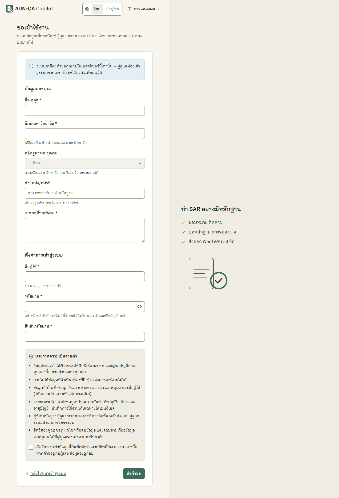
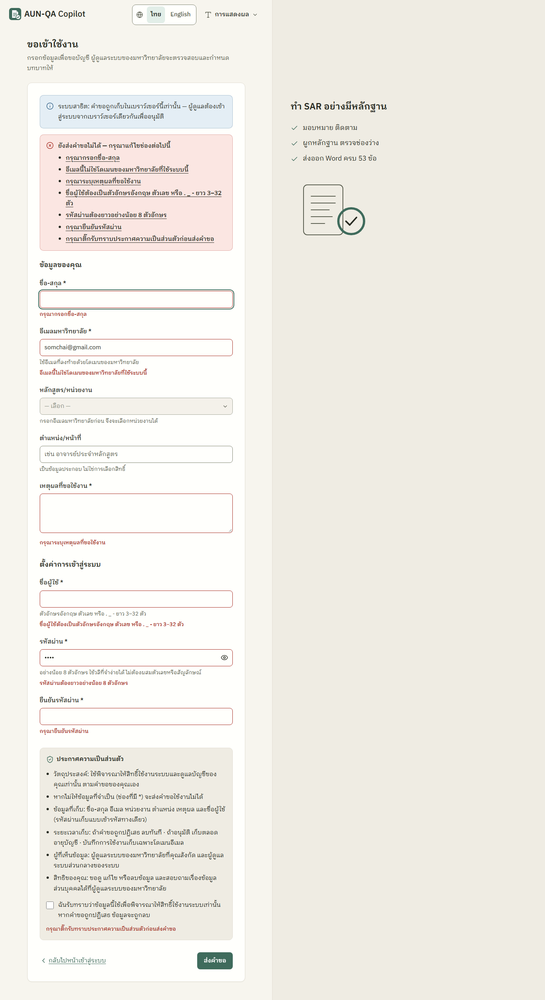
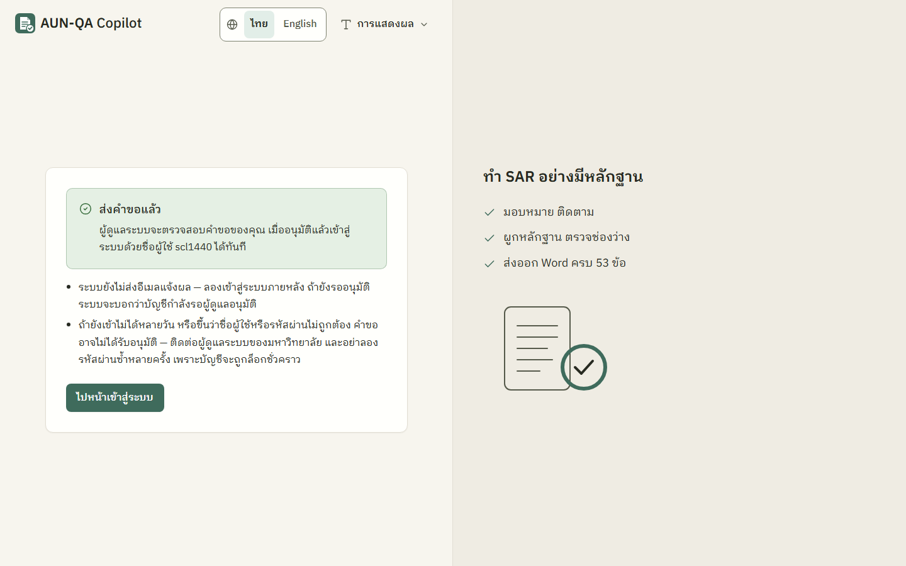
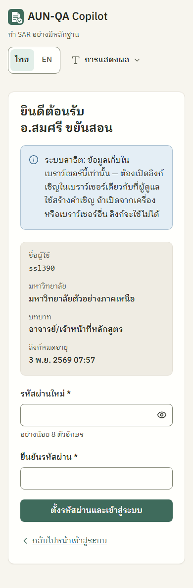
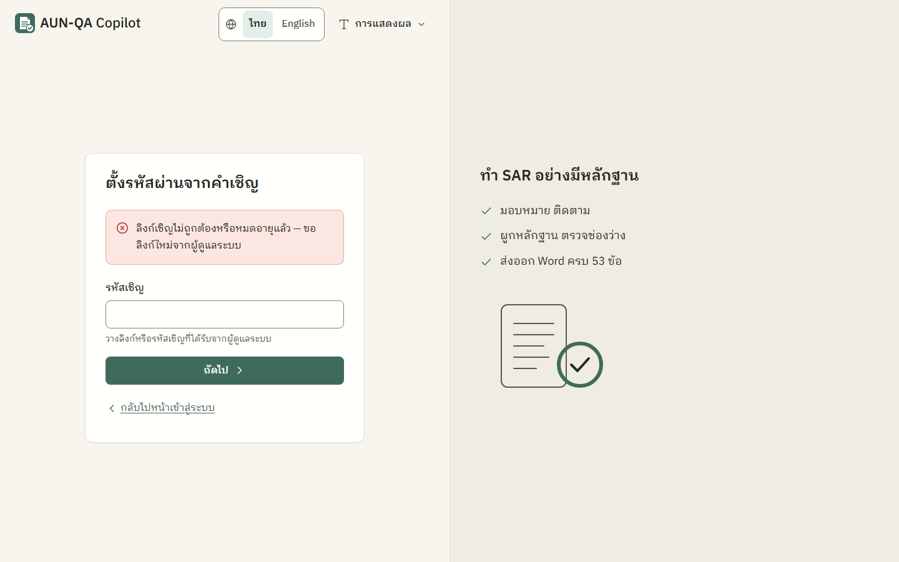

# คู่มือผู้ใช้ใหม่ (ยังไม่มีบัญชี)

> สำหรับคนที่ยังเข้าสู่ระบบไม่ได้ เพราะยังไม่มีชื่อผู้ใช้และรหัสผ่าน
> ข้อมูลในตัวอย่างทั้งหมดเป็นข้อมูลสมมติ อีเมลของมหาวิทยาลัยเดโม่ลงท้ายด้วย `@sample-uni.example`

ผู้ใช้ใหม่เข้าระบบได้ 2 ทาง เลือกตามสิ่งที่คุณมี

| คุณมีอะไร | ใช้ทางไหน | ปุ่มในหน้าเข้าสู่ระบบ | ใครกำหนดบทบาท |
|---|---|---|---|
| ไม่มีอะไรเลย แต่มีอีเมลของมหาวิทยาลัย | [ขอเข้าใช้งาน](#1-ขอเข้าใช้งาน) แล้วรอผู้ดูแลอนุมัติ | **"ขอเข้าใช้งาน"** | ผู้ดูแลมหาวิทยาลัยเลือกตอนอนุมัติ |
| ได้ลิงก์หรือรหัสเชิญจากผู้ดูแล | [รับคำเชิญ](#2-รับคำเชิญและตั้งรหัสผ่าน) ตั้งรหัสผ่านแล้วเข้าได้ทันที | **"มีรหัสเชิญ"** | ผู้ดูแลกำหนดไว้แล้วตอนเชิญ |

ทั้งสองปุ่มอยู่ใต้ปุ่ม "เข้าสู่ระบบ" หลังเส้นคั่น "หรือ"

> **ข้อจำกัดของระบบสาธิต (ต้องรู้):** ข้อมูลทุกอย่างเก็บใน **เบราว์เซอร์เครื่องนั้น** (localStorage) คำขอเข้าใช้งานและลิงก์เชิญจึงใช้ได้เฉพาะ **เบราว์เซอร์เดียวกับที่ผู้ดูแลใช้** ถ้าส่งคำขอจากเครื่องหนึ่ง ผู้ดูแลที่ใช้อีกเครื่องจะไม่เห็นคำขอ และลิงก์เชิญที่เปิดจากเครื่องอื่นจะขึ้นว่า "ลิงก์ไม่ถูกต้องหรือหมดอายุแล้ว" ทั้งสองหน้ามีป้าย "ระบบสาธิต" บอกเรื่องนี้ไว้

---

## 1. ขอเข้าใช้งาน
หน้า `/request-access` (กด **"ขอเข้าใช้งาน"** ในหน้าเข้าสู่ระบบ)

### กรอกฟอร์ม
**ส่วน "ข้อมูลของคุณ"**
1. **ชื่อ-สกุล** * (ไม่เกิน 100 ตัวอักษร)
2. **อีเมลมหาวิทยาลัย** * ต้องลงท้ายด้วยโดเมนของมหาวิทยาลัยที่ใช้ระบบนี้ เมื่อกรอกถูกแล้วกดออกจากช่อง ระบบจะแสดงชื่อมหาวิทยาลัยใต้ช่อง (เช่น อีเมล `somchai.t@sample-uni.example`) ถ้าใช้อีเมลอื่น เช่น Gmail จะขึ้นว่า "อีเมลนี้ไม่ใช่โดเมนของมหาวิทยาลัยที่ใช้ระบบนี้"
3. **หลักสูตร/หน่วยงาน** (ไม่บังคับ) เลือกได้หลังกรอกอีเมลถูกแล้ว มีทั้งคณะ หลักสูตร และ "อื่น ๆ (ทั้งมหาวิทยาลัย)" — ใช้ช่วยผู้ดูแลเลือกขอบเขตให้
4. **ตำแหน่ง/หน้าที่** (ไม่บังคับ) เป็นข้อมูลประกอบเท่านั้น **ไม่ใช่การเลือกสิทธิ์** ฟอร์มนี้ไม่มีช่องเลือกบทบาท ผู้ดูแลเป็นคนกำหนดให้
5. **เหตุผลที่ขอใช้งาน** * (ไม่เกิน 500 ตัวอักษร)

**ส่วน "ตั้งค่าการเข้าสู่ระบบ"**
6. **ชื่อผู้ใช้** * ตัวอักษรอังกฤษ ตัวเลข หรือ `. _ -` ยาว 3–32 ตัว (ห้ามซ้ำกับคนอื่น)
7. **รหัสผ่าน** * อย่างน้อย 8 ตัวอักษร ใช้วลีที่จำง่ายได้ ไม่ต้องผสมตัวเลขหรือสัญลักษณ์ (กดรูปตาเพื่อดูสิ่งที่พิมพ์)
8. **ยืนยันรหัสผ่าน** *

**ประกาศความเป็นส่วนตัว** อ่านกล่องท้ายฟอร์ม (วัตถุประสงค์ ข้อมูลที่เก็บ ระยะเวลาเก็บ ผู้ที่เห็น สิทธิของคุณ) แล้วติ๊ก "ฉันรับทราบ…" จากนั้นกด **"ส่งคำขอ"**

### ถ้ากรอกไม่ครบหรือผิด
ด้านบนฟอร์มขึ้นกล่องแดง "ยังส่งคำขอไม่ได้ — กรุณาแก้ไขช่องต่อไปนี้" พร้อมรายการช่องที่ผิด กดรายการเพื่อไปที่ช่องนั้นได้ ใต้ช่องที่ผิดมีข้อความบอกเหตุผล พิมพ์แก้แล้วข้อความของช่องนั้นหายเอง ค่าที่กรอกไว้ไม่หาย

### หลังส่งคำขอ
ขึ้นกล่อง **"ส่งคำขอแล้ว"** บอกชื่อผู้ใช้ของคุณ

- **ระบบยังไม่ส่งอีเมลแจ้งผล** ให้ลองเข้าสู่ระบบภายหลังด้วยชื่อผู้ใช้และรหัสผ่านที่ตั้งไว้
- ถ้ายังรออนุมัติ หน้าเข้าสู่ระบบจะบอก **"บัญชีนี้กำลังรอผู้ดูแลอนุมัติ — เมื่ออนุมัติแล้วจะเข้าสู่ระบบได้"**
- เมื่ออนุมัติแล้ว เข้าสู่ระบบได้ทันที และจะเห็นแจ้งเตือน "บัญชีของคุณได้รับอนุมัติแล้ว" ที่กระดิ่ง
- ถ้าผ่านไปหลายวันยังเข้าไม่ได้ หรือขึ้น "ชื่อผู้ใช้หรือรหัสผ่านไม่ถูกต้อง" คำขออาจไม่ได้รับอนุมัติ (ระบบไม่บอกตรง ๆ เพื่อไม่เปิดเผยว่ามีบัญชีนี้หรือไม่) ให้ติดต่อผู้ดูแลระบบของมหาวิทยาลัย **อย่าลองรหัสผ่านซ้ำหลายครั้ง** เพราะผิดครบ 5 ครั้งบัญชีจะถูกล็อก 5 นาที
- ถ้าคำขอถูกปฏิเสธ ข้อมูลของคุณจะถูกลบออกจากระบบ ส่งคำขอใหม่ได้ (ใช้ชื่อผู้ใช้เดิมได้)

---

## 2. รับคำเชิญและตั้งรหัสผ่าน
ผู้ดูแลจะส่ง **ลิงก์เชิญ** (รูปแบบ `…/invite#t=…`) หรือ **รหัสเชิญ** ให้คุณทางช่องทางของหน่วยงาน ลิงก์หมดอายุใน 7 วัน และใช้ได้ครั้งเดียว

### วิธีที่ 1: เปิดลิงก์
1. เปิดลิงก์ **ในเบราว์เซอร์เดียวกับที่ผู้ดูแลใช้สร้างคำเชิญ** (ข้อจำกัดของระบบสาธิต)
2. หน้าจอขึ้น **"ยินดีต้อนรับ <ชื่อของคุณ>"** พร้อมสรุป ชื่อผู้ใช้ · มหาวิทยาลัย · บทบาท · วันที่ลิงก์หมดอายุ ตรวจว่าถูกต้อง
3. ตั้ง **รหัสผ่านใหม่** (อย่างน้อย 8 ตัวอักษร) และ **ยืนยันรหัสผ่าน**
4. กด **"ตั้งรหัสผ่านและเข้าสู่ระบบ"** → ระบบพาเข้าหน้าหลักทันที พร้อมข้อความ "ตั้งรหัสผ่านเรียบร้อย ยินดีต้อนรับ"

### วิธีที่ 2: มีแต่รหัสเชิญ
1. หน้าเข้าสู่ระบบ → กด **"มีรหัสเชิญ"** (หน้า `/invite`)
2. หัวข้อ "ตั้งรหัสผ่านจากคำเชิญ" → วางลิงก์หรือรหัสเชิญในช่อง **"รหัสเชิญ"** → กด **"ถัดไป"**
3. ทำต่อเหมือนวิธีที่ 1 ข้อ 2–4

### ถ้าลิงก์ใช้ไม่ได้
ขึ้นข้อความเดียวเสมอ **"ลิงก์เชิญไม่ถูกต้องหรือหมดอายุแล้ว — ขอลิงก์ใหม่จากผู้ดูแลระบบ"** สาเหตุที่เป็นไปได้
- เปิดจากเครื่องหรือเบราว์เซอร์อื่นที่ไม่ใช่ของผู้ดูแล (ข้อจำกัดของระบบสาธิต)
- เกิน 7 วัน หรือเคยใช้ลิงก์นี้ตั้งรหัสผ่านไปแล้ว
- ผู้ดูแลกด "สร้างลิงก์ใหม่" (ลิงก์เก่าใช้ไม่ได้ทันที) หรือยกเลิกคำเชิญ
- บัญชีผู้ดูแลที่เชิญคุณถูกระงับ

---

## 3. หลังเข้าสู่ระบบครั้งแรก
- อ่าน [ภาพรวม หัวข้อ 5](00-overview.md#5-หน้าตาและการใช้งานพื้นฐาน) เรื่องแถบบน เมนูผู้ใช้ และกระดิ่ง
- อ่านคู่มือตามบทบาทที่ได้รับ (ดูตารางใน [README](README.md)) ถ้าเมนูที่ต้องใช้ไม่มี แปลว่าบทบาทหรือขอบเขตยังไม่ตรงงาน ให้แจ้งผู้ดูแลมหาวิทยาลัย

## ปัญหาที่พบบ่อย
| อาการ | สาเหตุ | วิธีแก้ |
|---|---|---|
| เลือกหลักสูตร/หน่วยงานไม่ได้ (ช่องเป็นสีเทา) | ยังไม่ได้กรอกอีเมลมหาวิทยาลัย หรืออีเมลไม่ตรงโดเมน | กรอกอีเมลให้ถูกแล้วกดออกจากช่อง |
| ส่งคำขอไม่ได้ "Username นี้ถูกใช้แล้ว" หรือ "อีเมลนี้ถูกใช้แล้ว" | มีคนใช้ชื่อผู้ใช้หรืออีเมลนี้อยู่ (ไม่สนตัวพิมพ์ใหญ่เล็ก) | เลือกชื่อผู้ใช้อื่น ถ้าอีเมลซ้ำ ให้ติดต่อผู้ดูแล — อาจมีบัญชีของคุณอยู่แล้ว |
| เข้าสู่ระบบแล้วขึ้น "กำลังรอผู้ดูแลอนุมัติ" | ผู้ดูแลยังไม่ได้อนุมัติ | รอ แล้วลองใหม่ภายหลัง |
| ขึ้น "บัญชีนี้ถูกระงับการใช้งาน" | ผู้ดูแลระงับบัญชี | ติดต่อผู้ดูแลระบบของมหาวิทยาลัย |
| ลิงก์เชิญขึ้นว่าไม่ถูกต้อง ทั้งที่เพิ่งได้รับ | เปิดคนละเบราว์เซอร์กับผู้ดูแล (ระบบสาธิต) | เปิดในเบราว์เซอร์เดียวกับผู้ดูแล หรือขอให้ผู้ดูแลกด "สร้างลิงก์ใหม่" |
