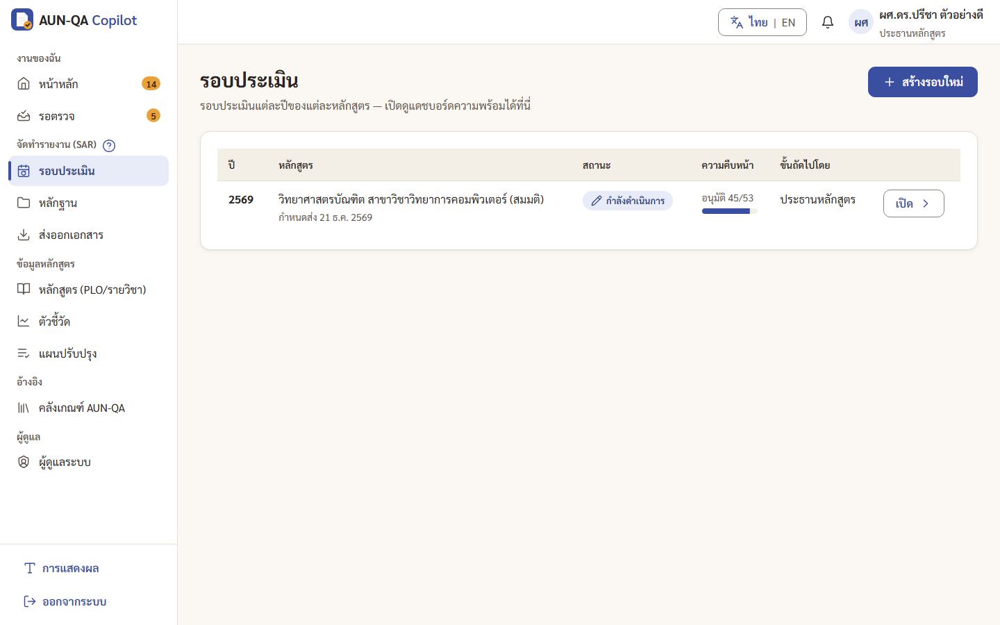
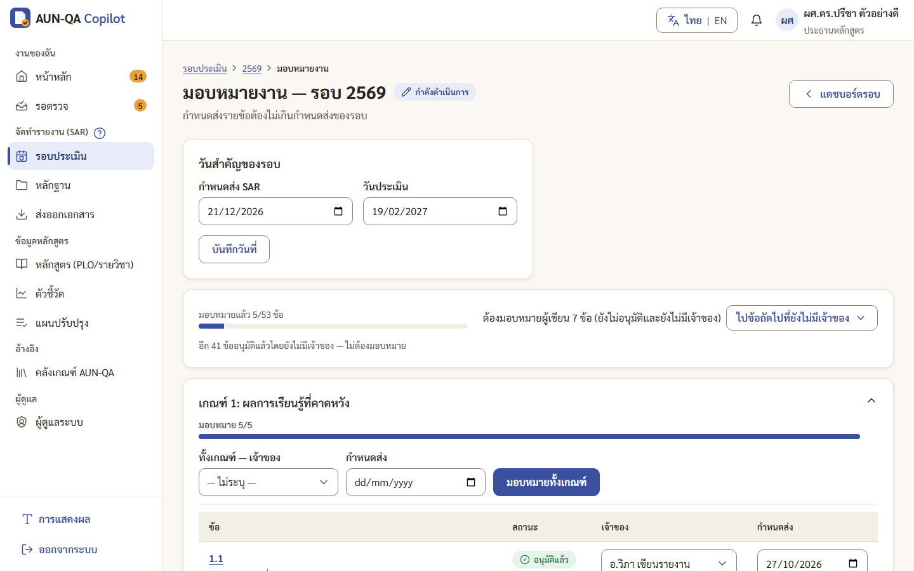
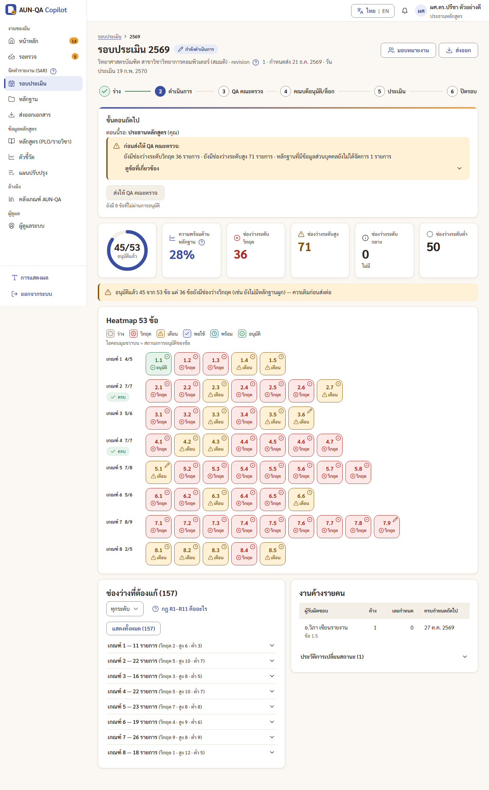
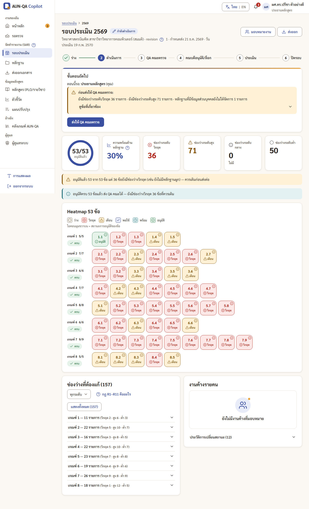
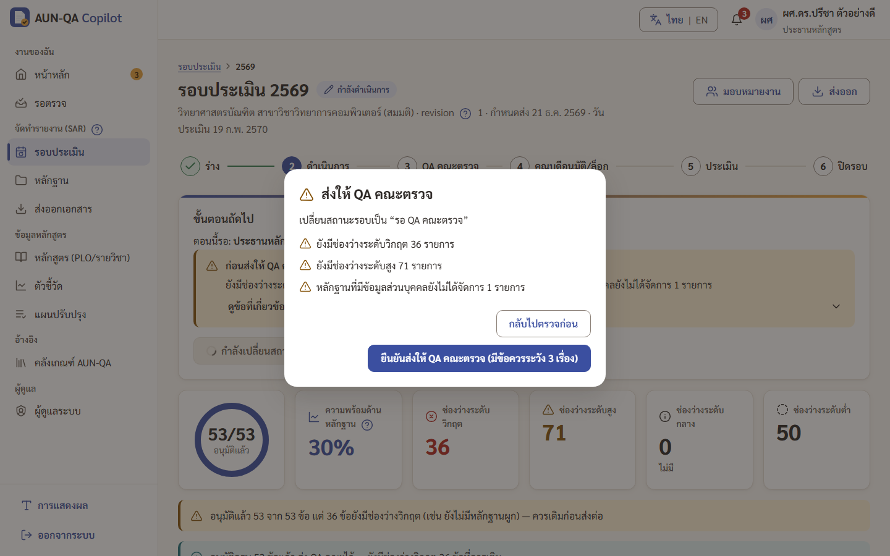
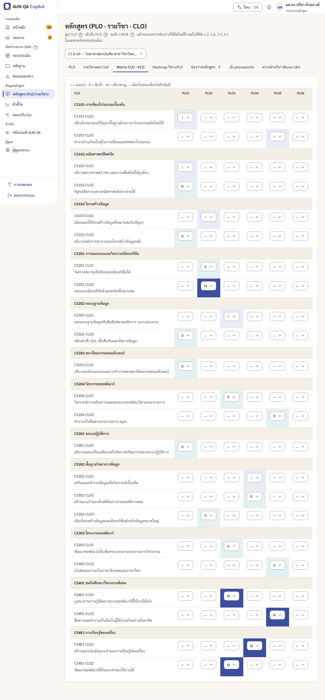
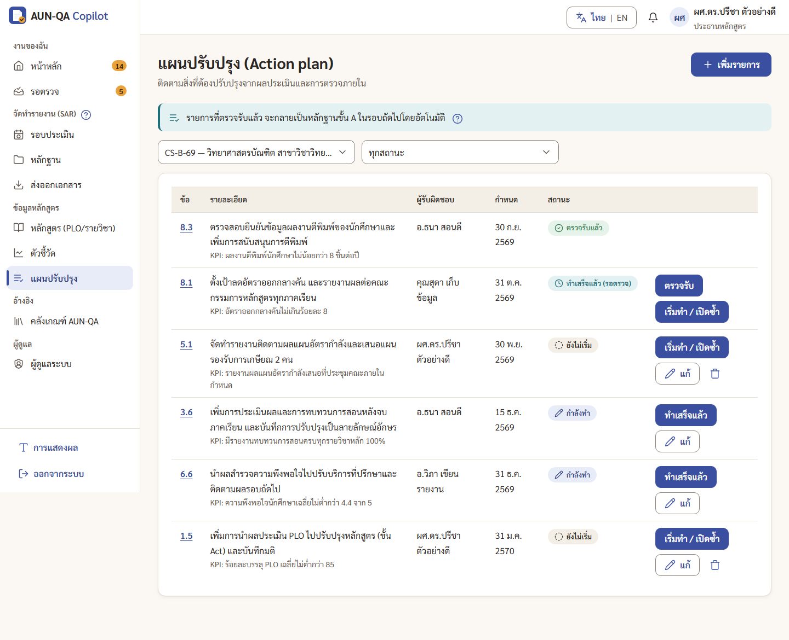

# คู่มือประธานหลักสูตร (programme_chair)

> บัญชีทดสอบ: `chair1` / `demo1234` — ผศ.ดร.ปรีชา ตัวอย่างดี ประธานหลักสูตร CS-B-69
> อ่าน [ภาพรวม](00-overview.md) ก่อน ถ้ายังไม่รู้จักคำว่า SAR, PDCA, หลักฐาน `E-x.x-nn`

ประธานหลักสูตรเป็นคนขับเคลื่อนรอบประเมินของหลักสูตร: เปิดรอบ แบ่งงาน ติดตาม ตรวจ อนุมัติ และส่งต่อให้ QA คณะ

## ทำอะไรได้ / ทำอะไรไม่ได้
| ทำได้ | ทำไม่ได้ |
|---|---|
| สร้างรอบประเมิน และเริ่มดำเนินการรอบ | อนุมัติข้อที่ตัวเองเป็นผู้เขียนล่าสุด (ต้องให้คนอื่นเขียนหรือส่งตรวจ) |
| มอบหมายเจ้าของและกำหนดส่งรายข้อ/ทั้งเกณฑ์ | อนุมัติระดับคณะ หรืออนุมัติสุดท้าย/ล็อก (เป็นงานของ QA คณะและคณบดี) |
| เขียน SAR ได้ทุกข้อ ใช้ AI ให้คะแนนตนเอง | ให้คะแนนทางการหรือ verdict (เป็นงานของกรรมการ) |
| ตรวจ อนุมัติ หรือส่งกลับแก้ไขรายข้อ | มอบหมายกรรมการ หรือเริ่มการประเมิน |
| ส่งรอบให้ QA คณะตรวจ | แก้อะไรในรอบที่ล็อกแล้ว |
| จัดการหลักฐาน ยืนยันหลักฐาน ตัวชี้วัด ข้อมูลหลักสูตร | จัดการผู้ใช้ |
| สร้าง/ตรวจรับแผนปรับปรุง ปิดรอบหลังประเมินแล้ว | |
| ดู audit log ของหลักสูตร ส่งออกเอกสาร | |

## เมนูที่เห็น
หน้าหลัก · รอตรวจ · รอบประเมิน · หลักฐาน · ส่งออกเอกสาร · หลักสูตร · ตัวชี้วัด · แผนปรับปรุง · คลังเกณฑ์ AUN-QA · ผู้ดูแลระบบ (เฉพาะแท็บ Audit log)

## เริ่มจากหน้าหลัก
หน้าหลัก (`/app`) แสดง "สิ่งที่ต้องทำตอนนี้" ของประธาน เช่น "ตรวจ 5 ข้อ", "มอบหมายผู้เขียน 7 ข้อที่ยังไม่มีเจ้าของ", "ดูหลักฐานที่มี PII" กดปุ่มในการ์ดเพื่อไปทำงานนั้นทันที

---

## 1. สร้างรอบประเมินใหม่
1. เมนู **รอบประเมิน** (`/app/cycles`) → กด **"+ สร้างรอบใหม่"**
2. กรอกปีการศึกษา (เช่น 2570) เลือกหลักสูตร ถ้ามีรอบก่อนหน้า เลือก "คัดลอกจากรอบ" ได้ และกำหนดส่ง (ถ้ามี)
3. กด **"สร้างรอบ"** → ขึ้นข้อความ "สร้างรอบ 2570 แล้ว — มี 53 ข้อพร้อมให้มอบหมาย" แล้วพาไปหน้ารอบ
4. รอบใหม่อยู่สถานะ **"ร่าง"** มอบหมายงานก่อน (ข้อ 2) แล้วกลับมาที่แดชบอร์ดรอบ กด **"เริ่ม/กลับไปดำเนินการ"** (หน้าหลักจะมีการ์ด "เริ่มดำเนินการรอบ" ให้)

- ถ้าสร้างปีที่มีอยู่แล้ว จะขึ้น "มีรอบปีนี้อยู่แล้ว"
- แผนปรับปรุงที่ทำเสร็จและตรวจรับแล้วจากรอบก่อน จะถูกนำมาเป็นหลักฐานขั้น A (ชื่อ "ผลดำเนินการตามแผนปรับปรุง ข้อ x.x") และผูกกับข้อเดิมในรอบใหม่ให้อัตโนมัติ

## 2. มอบหมายเจ้าของและกำหนดส่ง
1. จากการ์ด "มอบหมายงาน" ในหน้าหลัก หรือแดชบอร์ดรอบ → ปุ่ม **"มอบหมายงาน"** (`/app/cycles/{รอบ}/assign`)
2. ด้านบน: กล่อง "วันสำคัญของรอบ" ใส่วันส่งและวันประเมิน แล้วกด "บันทึกวันที่"
3. แถบสรุปบอกว่ามอบหมายแล้วกี่ข้อ ยังต้องมอบหมายกี่ข้อ ปุ่ม "ไปข้อถัดไปที่ยังไม่มีเจ้าของ" พาไปข้อที่ต้องทำ
4. แต่ละเกณฑ์มี 2 แบบ
   - **ทั้งเกณฑ์:** เลือกเจ้าของและกำหนดส่งในแถวบนสุด แล้วกด "มอบหมายทั้งเกณฑ์"
   - **รายข้อ:** เลือกชื่อในช่อง "เจ้าของ" และวันที่ในช่อง "กำหนดส่ง" ของข้อนั้น
5. เปลี่ยนแล้วจะขึ้น "บันทึกแล้ว" ข้างช่องทันที ไม่ต้องกดบันทึกเพิ่ม ผู้ได้รับมอบหมายเห็นงานที่หน้าหลักของตัวเอง

> ตัวอย่างเดโม่: มอบหมายข้อ 3.6, 5.1, 7.9 ให้ "อ.วิภา เขียนรายงาน" (`staff1`)

## 3. ติดตามความคืบหน้าที่แดชบอร์ดรอบ
เปิดจากการ์ดรอบในหน้าหลัก หรือเมนูรอบประเมิน → กดรอบ (`/app/cycles/{รอบ}`)
- **เส้นขั้นตอน 6 ขั้น** บอกว่ารอบอยู่ตรงไหน
- **กล่อง "ขั้นตอนถัดไป"** บอก "ตอนนี้รอ: ใคร" พร้อมคำเตือน และปุ่มที่คุณกดได้
- **วงแหวน "อนุมัติแล้ว n/53"** และตัวเลขช่องว่างแต่ละระดับ (วิกฤต สูง กลาง ต่ำ) กดตัวเลขเพื่อกรองได้
- ประโยคสรุป เช่น "อนุมัติแล้ว 45 จาก 53 ข้อ แต่ 36 ข้อยังมีช่องว่างวิกฤต — ควรเติมก่อนส่งต่อ"
- **Heatmap 53 ช่อง** สีตามระดับความพร้อม พร้อมไอคอนและคำสถานะ (ไม่ต้องดูสีอย่างเดียว) ไอคอนมุมขวาบนบอกว่าอนุมัติแล้ว กดช่องเพื่อเปิดข้อนั้น
- **ช่องว่างที่ต้องแก้** จัดกลุ่มตามเกณฑ์ พับไว้ กด "แสดงทั้งหมด" เพื่อกางทุกกลุ่ม ปุ่ม "กฎ R1–R11 คืออะไร" อธิบายกฎทั้งหมด
- **งานค้างรายคน** และประวัติการเปลี่ยนสถานะ

## 4. ตรวจและอนุมัติรายข้อ
1. เมนู **รอตรวจ** (`/app/review`) หรือการ์ด "ตรวจ n ข้อ" ในหน้าหลัก
2. ตารางบอกข้อ เจ้าของ วันที่ส่ง และสรุป (หลักฐานกี่ชิ้น กี่คำ คะแนนตนเอง ช่องว่างวิกฤต/สูง)
3. กด **"เปิดอ่าน"** (แนะนำ) เพื่ออ่านในหน้าข้อ แล้วกด **"อนุมัติข้อนี้"** หรือ **"ส่งกลับแก้ไข"** ที่แถบล่าง
4. หลังกด จะมีข้อความพร้อมปุ่ม **"เปิดข้อถัดไปในคิว →"** ไม่ต้องกลับไปหน้ารอตรวจเอง
5. ส่งกลับแก้ไข **ต้องเขียนเหตุผล** ผู้เขียนจะเห็นเหตุผลนี้ทั้งในการ์ดหน้าหลัก ในกล่องใต้หัวเรื่องของข้อ และในแท็บประวัติ

- อนุมัติจากแถวในตารางได้เลย แต่ถ้าข้อนั้นยังมีช่องว่างวิกฤต ระบบจะถามยืนยันก่อน
- แถวที่ขึ้น "คุณเขียนเอง" ไม่มีปุ่มอนุมัติ เพราะผู้เขียนล่าสุดอนุมัติเองไม่ได้ ให้มอบหมายผู้อื่นปรับหรือส่งตรวจ
- ระบบไม่มีปุ่มอนุมัติทีละหลายข้อ ตั้งใจให้อ่านก่อนอนุมัติ

## 5. ส่งรอบให้ QA คณะตรวจ
1. เมื่ออนุมัติครบ 53 ข้อ แดชบอร์ดรอบจะแสดง "อนุมัติครบ 53 ข้อแล้ว ส่ง QA คณะได้" และปุ่ม **"ส่งให้ QA คณะตรวจ"** ใช้ได้ (ถ้ายังไม่ครบ ปุ่มบอกว่าขาดกี่ข้อ)
2. กดปุ่ม → กล่องยืนยันแสดงข้อควรระวัง เช่น ช่องว่างวิกฤต/สูง หลักฐานที่มี PII ค้าง ข้อที่ยังไม่ให้คะแนนตนเอง
3. ถ้าอยากเติมก่อน กด **"กลับไปตรวจก่อน"** (ปุ่มนี้ถูกเลือกไว้ กด Enter ติดมือจะไม่ส่ง) ถ้าพร้อมแล้ว กด "ยืนยันส่งให้ QA คณะตรวจ…"
4. QA คณะได้รับแจ้งเตือนทันที

**ถ้า QA คณะหรือคณบดีส่งกลับ:** รอบเป็น "ส่งกลับแก้ไข" อ่านเหตุผลในแจ้งเตือนหรือประวัติบนแดชบอร์ด แล้วกด **"เริ่ม/กลับไปดำเนินการ"** เพื่อแก้ และส่งใหม่ตามข้อ 5

## 6. เขียน SAR เอง (ถ้าจำเป็น)
ประธานเขียนได้ทุกข้อ วิธีเหมือนอาจารย์ ดู [คู่มืออาจารย์ หัวข้อ 2](11-lecturer.md#2-เขียน-sar-ข้อที่ได้รับมอบหมาย-ทีละขั้น)
แต่จำไว้ว่า **ข้อที่คุณเขียนเองล่าสุด คุณอนุมัติไม่ได้** หน้าข้อจะขึ้นข้อความเตือนนี้ ให้มอบหมายผู้อื่นตรวจหรือส่งตรวจแทน

## 7. หลักฐาน ตัวชี้วัด ข้อมูลหลักสูตร
- **หลักฐาน** (`/app/evidence`): เพิ่ม ค้นหา ยืนยันหลักฐาน และจัดการหลักฐานที่มี PII ดูวิธีใน [คู่มืออาจารย์ หัวข้อ 1](11-lecturer.md#1-เพิ่มหลักฐาน) ประธานมีปุ่มเพิ่มเติมในหน้ารายละเอียดหลักฐาน: **"ยืนยันว่าตรวจสอบหลักฐานแล้ว"** (ต้องผูกอย่างน้อย 1 ข้อ และจัดการ PII แล้ว)
- **ตัวชี้วัด** (`/app/metrics`): ดู [คู่มือเจ้าหน้าที่ข้อมูล](12-data-staff.md)
- **หลักสูตร** (`/app/curriculum`): จัดการ PLO รายวิชา CLO ระดับ I/R/M ดูช่องว่างของหลักสูตรและผังวิชาบังคับก่อน ดู [คู่มืออาจารย์ หัวข้อ 4](11-lecturer.md#4-ข้อมูลหลักสูตร-plo--รายวิชา--clo)

## 8. แผนปรับปรุงหลังได้ผลประเมิน
1. เมื่อกรรมการส่งผลแล้ว (รอบ "ประเมินแล้ว") เปิดเมนู **แผนปรับปรุง** (`/app/actions`)
2. กล่อง **"สร้างจากข้อเสนอแนะของกรรมการ (AFI)"** กดปุ่มรอบที่ต้องการ ระบบสร้างรายการจาก AFI ให้ (กดซ้ำไม่สร้างซ้ำ)
3. หรือกด **"เพิ่มรายการ"** เพื่อเพิ่มเอง: เลือกข้อ รายละเอียดสิ่งที่จะทำ ผู้รับผิดชอบ กำหนดเสร็จ ตัวชี้วัดความสำเร็จ
4. สถานะเดินตามลำดับ: **ยังไม่เริ่ม → กำลังทำ → ทำเสร็จแล้ว (รอตรวจ) → ตรวจรับแล้ว**
5. เมื่อผู้รับผิดชอบทำเสร็จ ประธานหรือ QA คณะกด **ตรวจรับ** (ผู้รับผิดชอบตรวจรับงานตัวเองไม่ได้) รายการที่ตรวจรับแล้วจะเป็นหลักฐานขั้น A ในรอบถัดไปโดยอัตโนมัติ

## 9. ปิดรอบ
หลังกรรมการส่งผล หน้าหลักมีการ์ด **"ปิดรอบ"** → แดชบอร์ดรอบ → กด "ปิดรอบ"
กล่องยืนยันจะเตือนถ้ายังไม่มีแผนปรับปรุงจาก AFI ของรอบนี้ (หรือบอกว่ามีแล้วกี่รายการ) เมื่อปิดแล้วผลประเมินแก้ไม่ได้ และแดชบอร์ดขึ้น "รอบนี้ปิดแล้ว — ดูผลประเมิน / ส่งออกเอกสาร"

## 10. ส่งออกเอกสาร
เมนู **ส่งออกเอกสาร** (`/app/export`) เลือกหลักสูตรและรอบ
- **SAR (.docx)** ไฟล์ Word ครบ 53 ข้อ มีปก สารบัญ ภาคผนวกดัชนีหลักฐาน รหัส `[E-…]` เป็นลิงก์ในเอกสาร (เปิดแล้ว Word ถามอัปเดต field ให้ตอบ "ใช่") มี "ไฟล์สำรอง (.doc)" ด้วย
- **ดัชนีหลักฐาน (.xlsx)** และ **Appendix A (.xlsx)** (คะแนนประเมินตนเองรายข้อ) หรือรวมทั้งสองในไฟล์เดียว
- **Appendix B/D** ของกรรมการ ใช้ได้เมื่อรอบประเมินเสร็จแล้ว
- ถ้ารอบยังไม่ล็อก จะขึ้นเตือน "รอบนี้ยังไม่ล็อก เนื้อหาในไฟล์เป็นฉบับร่างล่าสุด" และถ้ามีคำแปลที่ยังไม่ยืนยันจะบอกข้อที่ต้องตรวจ

---

## เคล็ดลับ
- เริ่มทุกวันจากหน้าหลัก การ์ดแรกคืองานที่เร่งที่สุด
- ใช้ "มอบหมายทั้งเกณฑ์" กับเกณฑ์ที่คนเดียวรับผิดชอบ ประหยัดเวลามาก
- ก่อนส่ง QA คณะ ดูกลุ่ม "ช่องว่างที่ต้องแก้" ระดับวิกฤตก่อน ส่วนใหญ่คือข้อที่ยังไม่มีหลักฐานผูก (R1)
- ใช้ "เปิดข้อถัดไปในคิว →" หลังอนุมัติ ไล่ตรวจได้ต่อเนื่อง
- ตัวเลข "ความพร้อมด้านหลักฐาน %" กด (?) เพื่อดูวิธีคิด ตัวเลขที่บอกความคืบหน้าตรงที่สุดคือ "อนุมัติแล้ว n/53"

## ปัญหาที่พบบ่อย
| อาการ | สาเหตุ | วิธีแก้ |
|---|---|---|
| ไม่มีปุ่มอนุมัติ ขึ้น "คุณเขียนเอง" | คุณเป็นผู้เขียนล่าสุดของข้อนั้น | มอบหมายผู้อื่นให้ตรวจ/ส่งตรวจ หรือส่งกลับแก้ไขให้เจ้าของข้อ |
| ปุ่ม "ส่งให้ QA คณะตรวจ" กดไม่ได้ | ยังอนุมัติไม่ครบ 53 ข้อ | ดูข้อความใต้ปุ่มว่าขาดกี่ข้อ แล้วไปที่รอตรวจ |
| อนุมัติครบแล้วแต่ยังมีคำเตือนวิกฤต | มีข้อที่อนุมัติแล้วแต่ยังไม่มีหลักฐานผูก | ผูกหลักฐานให้ข้อนั้น หรือส่งต่อโดยรับทราบความเสี่ยง (ระบบเตือนแต่ไม่บังคับ) |
| หน้ามอบหมายบอกบางข้อ "อนุมัติแล้วโดยยังไม่มีเจ้าของ" | ข้อในข้อมูลเดโม่ที่อนุมัติไปก่อนแล้ว | ไม่ต้องมอบหมาย นับเฉพาะข้อที่ยังเขียนได้ |
| แก้อะไรไม่ได้เลยในรอบ | รอบถูกล็อกหรืออยู่ระหว่างตรวจ | รอผล หรือขอให้คณบดีเปิด revision ใหม่ (ได้เฉพาะก่อนเริ่มการประเมิน) |
| ส่งกลับแก้ไขไม่ได้ ปุ่มยืนยันกดไม่ได้ | ยังไม่ได้เขียนเหตุผล | เขียนเหตุผลก่อน ผู้เขียนจะเห็นข้อความนี้ |
