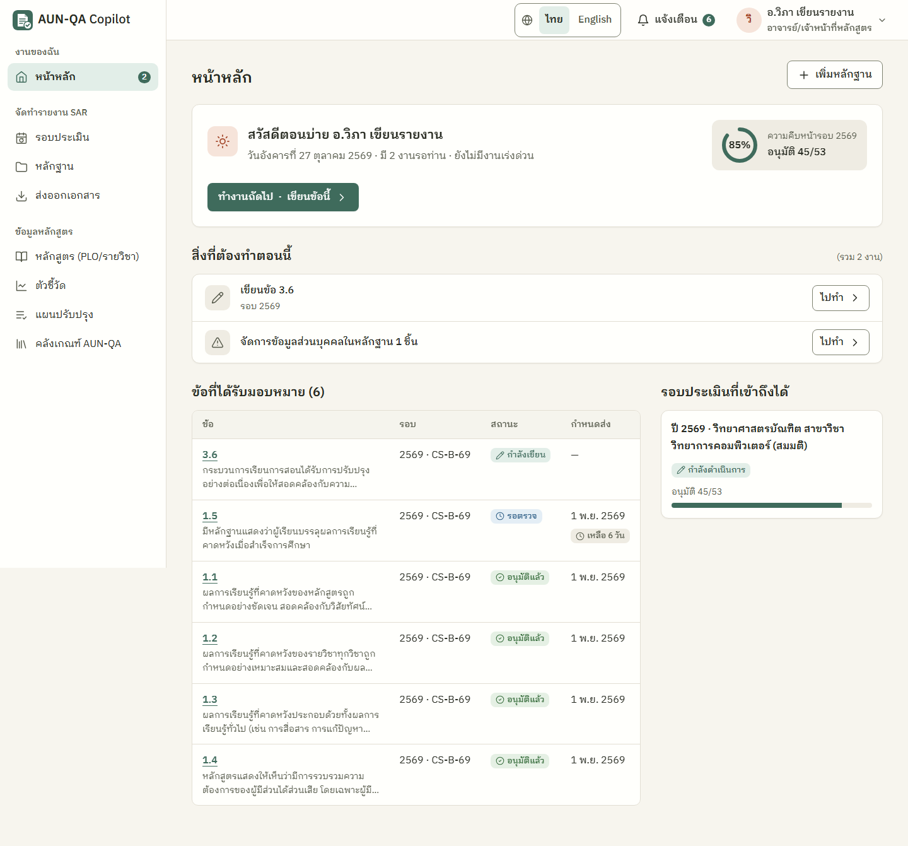
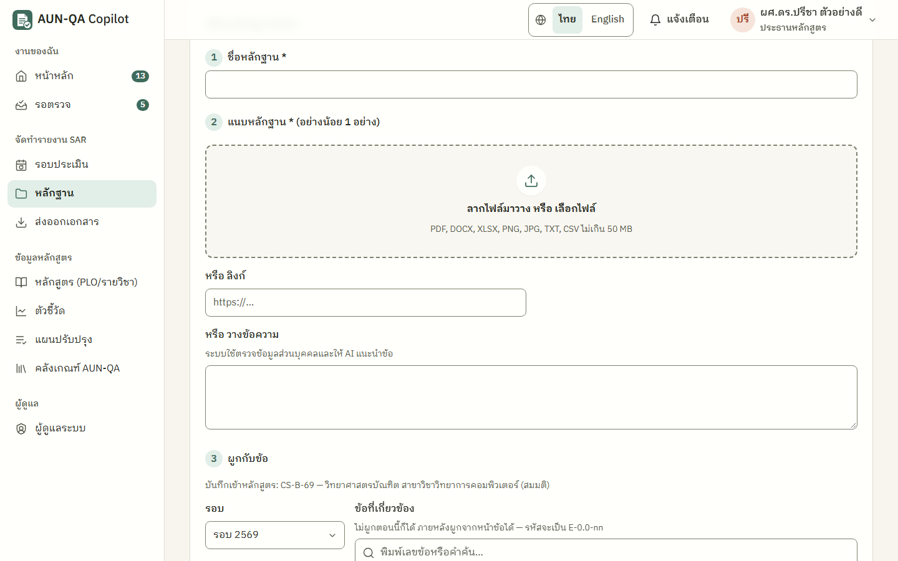
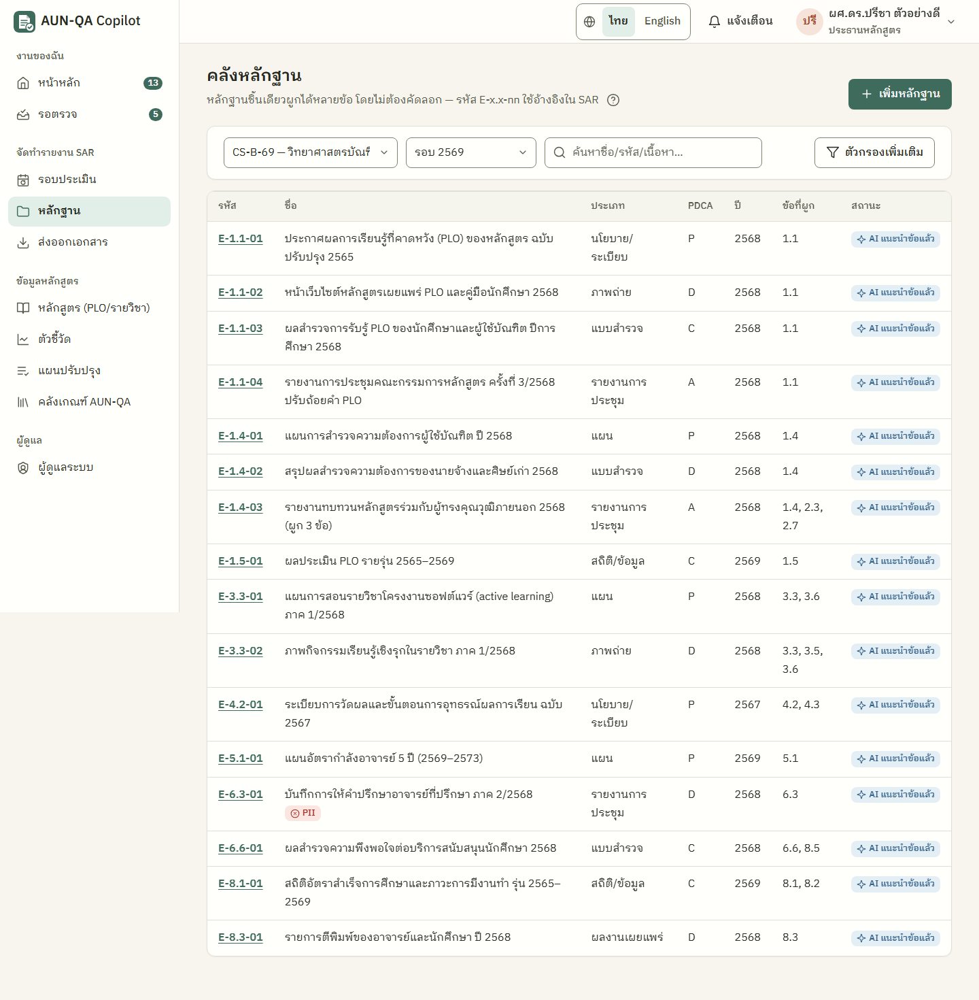
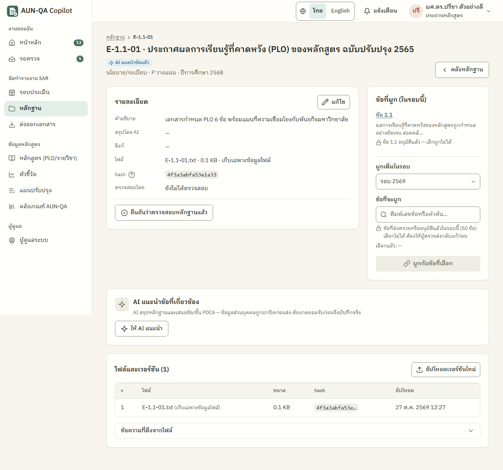
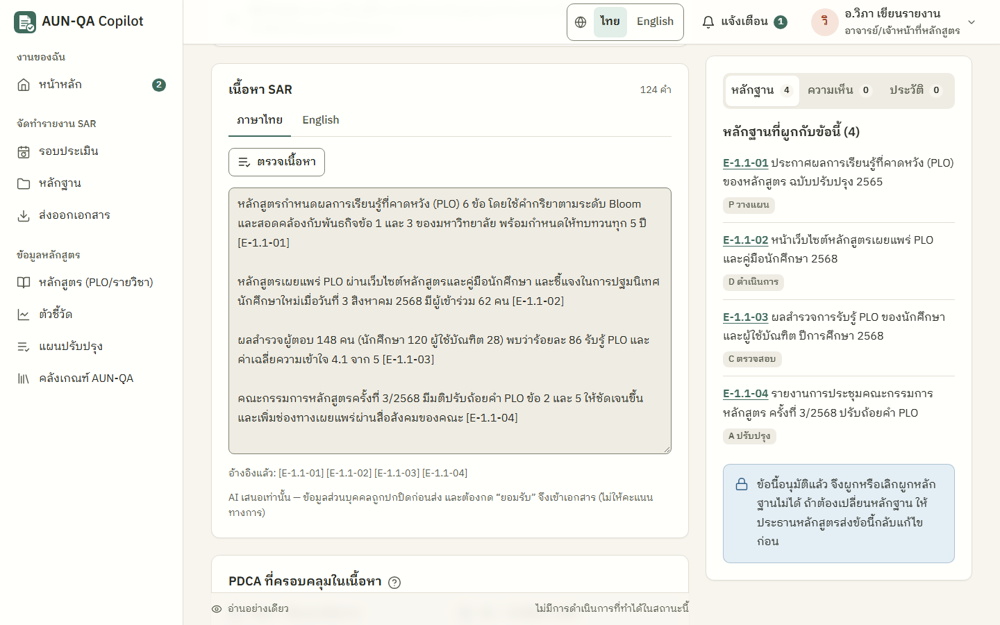
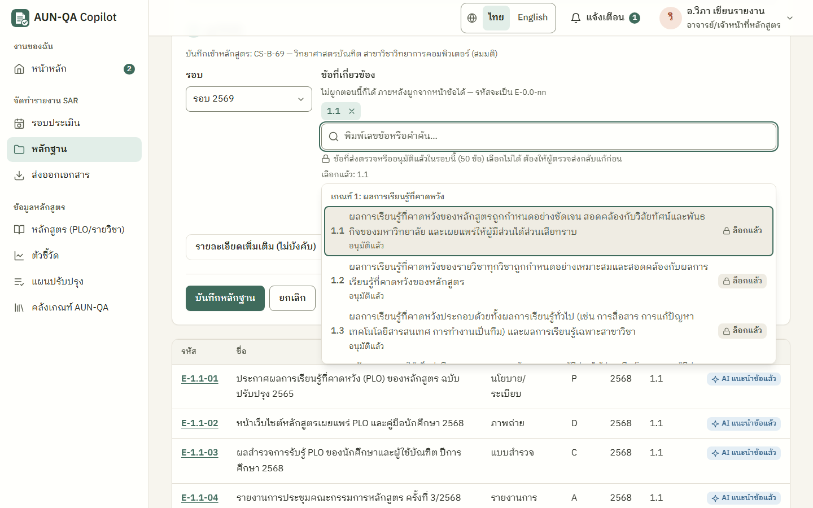
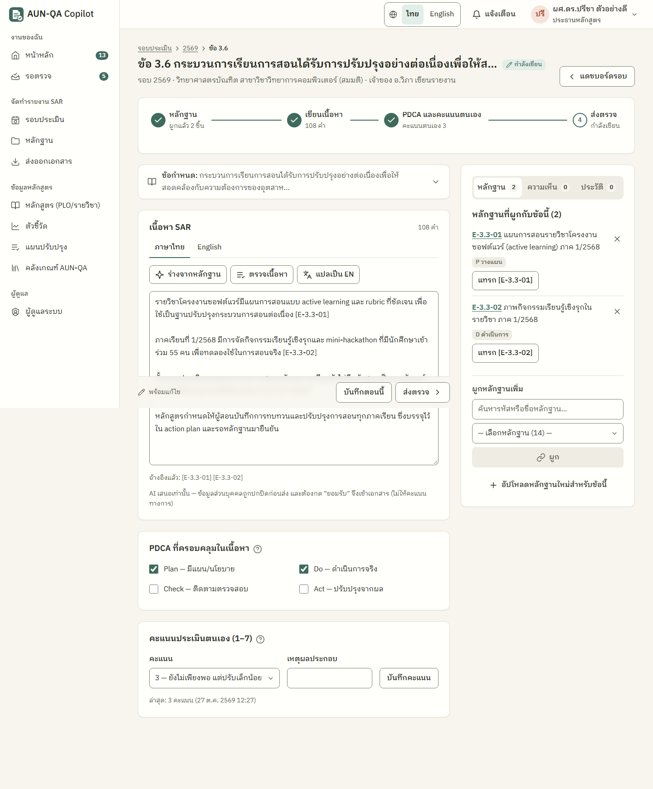
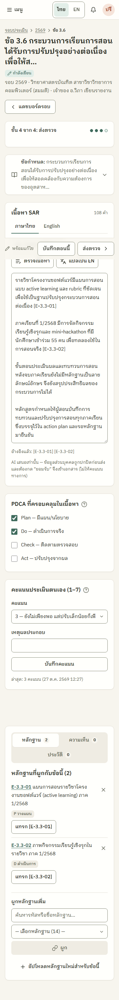
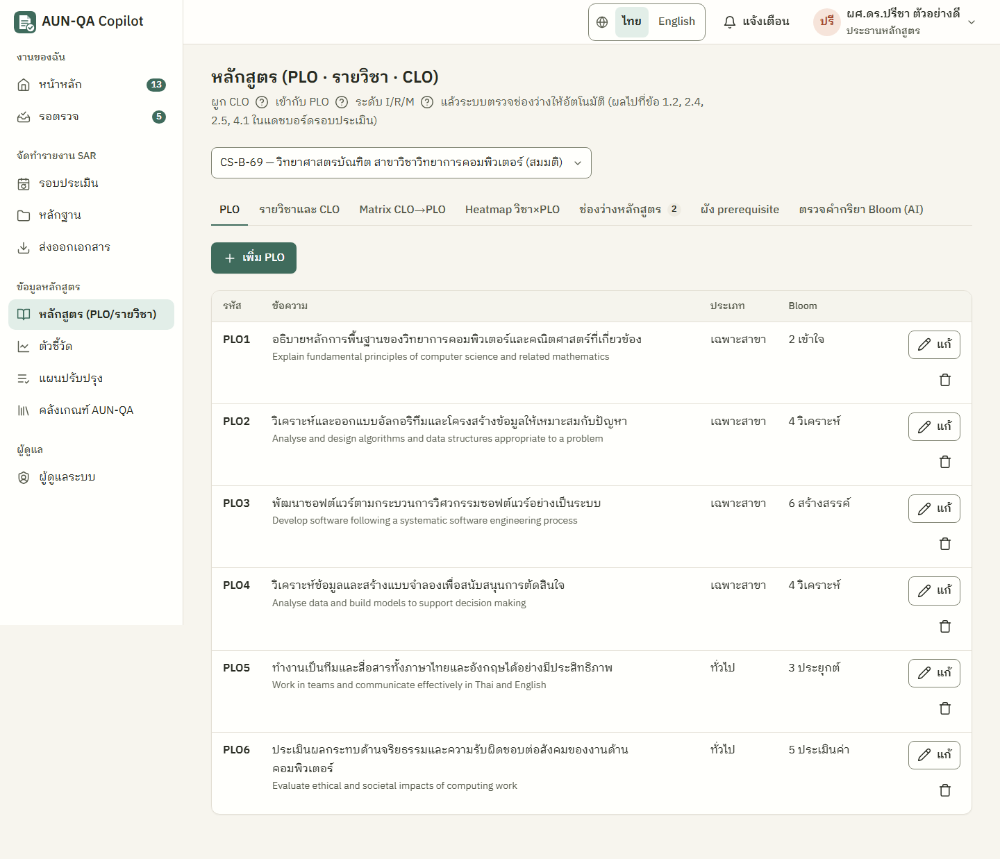

# คู่มืออาจารย์ประจำหลักสูตร (programme_staff)

> บัญชีทดสอบ: `staff1` (อ.วิภา เขียนรายงาน) และ `lect1` (อ.ธนา สอนดี) หลักสูตร CS-B-69 · `lect2` (อ.มาลี วิจัยเด่น) หลักสูตร DS-M-69 — รหัสผ่าน `demo1234`
> อ่าน [ภาพรวม](00-overview.md) ก่อน ถ้ายังไม่รู้จักคำว่า SAR, PDCA, หลักฐาน `E-x.x-nn`

อาจารย์เป็นผู้เขียน SAR ข้อที่ประธานหลักสูตรมอบหมาย และช่วยเก็บหลักฐานของหลักสูตร

## ทำอะไรได้ / ทำอะไรไม่ได้
| ทำได้ | ทำไม่ได้ |
|---|---|
| เขียน SAR **เฉพาะข้อที่ได้รับมอบหมาย** (ไทย/อังกฤษ) | เขียนหรือแก้ข้อที่ไม่ได้รับมอบหมาย (เปิดอ่านได้) |
| ใช้ AI ร่าง ตรวจ แปล | อนุมัติข้อใด ๆ หรือส่งรอบให้ QA คณะ |
| ติ๊ก PDCA และให้คะแนนประเมินตนเองข้อของตน | สร้างรอบหรือมอบหมายงาน |
| ส่งตรวจ แก้ตามที่ถูกส่งกลับ | ยืนยันหลักฐาน (เป็นงานของประธาน/QA คณะ) |
| เพิ่มหลักฐาน ผูกหลักฐานกับข้อ ให้ AI แนะนำข้อ | เพิ่มความเห็นใหม่ในแท็บความเห็น (อ่านได้) |
| แก้ข้อมูลหลักสูตร (PLO รายวิชา CLO) | กรอกตัวชี้วัด |
| อัปเดตแผนปรับปรุงที่ตัวเองรับผิดชอบ | ตรวจรับแผนปรับปรุง |

## เมนูที่เห็น
หน้าหลัก · รอบประเมิน · หลักฐาน · ส่งออกเอกสาร · หลักสูตร · ตัวชี้วัด (ดูอย่างเดียว) · แผนปรับปรุง · คลังเกณฑ์ AUN-QA

## เริ่มจากหน้าหลัก
เมื่อประธานมอบหมายข้อให้ คุณได้แจ้งเตือน "คุณได้รับมอบหมายข้อ …" (กดแล้วไปหน้าข้อนั้น) และหน้าหลักมีแถว **"เขียนข้อ x.x"** (บอกวันที่เหลือถึงกำหนดส่ง) แต่ละแถวมีปุ่ม **"ไปทำ"** ปุ่มเขียว **"ทำงานถัดไป"** ในการ์ดทักทายพาไปข้อแรกที่ควรทำ ถ้าได้รับหลายข้อ จะรวมเป็นแถวเดียว "เขียนอีก n ข้อ (ใกล้สุด …)" ด้านล่างมีตาราง "ข้อที่ได้รับมอบหมาย" (เรียงจากต้องแก้ → กำลังเขียน → รอตรวจ → อนุมัติแล้ว) ถ้าข้อใดถูกส่งกลับ แถว "แก้ไขข้อ x.x ตามที่ถูกส่งกลับ" จะขึ้นป้าย **"เร่งด่วน"**

ถ้ายังไม่มีข้อที่ได้รับมอบหมาย จะขึ้นว่า "เมื่อประธานหลักสูตรมอบหมายข้อให้ งานจะขึ้นที่นี่ทันที ระหว่างนี้คุณเพิ่มหลักฐานเข้าคลังไว้ก่อนได้" พร้อมปุ่ม "เพิ่มหลักฐาน"

---

## 1. เพิ่มหลักฐาน
ทางที่เร็วที่สุด (ทดสอบแล้ว ใช้ประมาณ 1.5–2 นาที)
1. หน้าหลัก → กด **"เพิ่มหลักฐาน"** (หรือเมนู หลักฐาน → "+ เพิ่มหลักฐาน") ฟอร์มจะเปิดทันที
2. **ช่อง 1 ชื่อหลักฐาน** เช่น "รายงานการประชุมกรรมการหลักสูตร ครั้งที่ 1/2569"
3. **ช่อง 2 แนบหลักฐาน** อย่างน้อย 1 อย่าง: ลากไฟล์มาวาง/เลือกไฟล์ (PDF, DOCX, XLSX, PNG, JPG, TXT, CSV ไม่เกิน 50 MB) หรือใส่ลิงก์ (ขึ้นต้น `https://`) หรือวางข้อความ
4. **ช่อง 3 ผูกกับข้อ** ระบบเลือกรอบให้แล้ว พิมพ์เลขข้อหรือคำค้น เช่น `3.6` แล้วคลิกข้อที่ต้องการ (เลือกได้หลายข้อ เป็นป้ายที่ลบได้) ข้อที่ส่งตรวจหรืออนุมัติแล้วมีป้าย **"ล็อกแล้ว"** เลือกไม่ได้ (ดู[ด้านล่าง](#ข้อที่ล็อกแล้ว-ผูกหลักฐานไม่ได้))
5. (ไม่บังคับ) กาง "รายละเอียดเพิ่มเติม" เพื่อใส่คำอธิบาย ประเภท ขั้น PDCA ปีการศึกษา — ค่าเริ่มต้นคือ ประเภท "อื่น ๆ" ขั้น D ปีปัจจุบัน **ควรเลือกขั้น PDCA ให้ถูก** เพราะใช้ตรวจกฎ R2
6. กด **"บันทึกหลักฐาน"** → ขึ้น "เพิ่มหลักฐาน E-1.1-01 แล้ว" และแถวใหม่ถูกไฮไลต์ในตาราง

สิ่งที่อาจเกิดขึ้น
- **กรอกไม่ครบ:** ด้านบนฟอร์มขึ้นกล่องสรุปจุดที่ต้องแก้ และมีข้อความใต้ช่องที่ผิด พิมพ์แก้แล้วข้อความใต้ช่องนั้นหายเอง ค่าที่กรอกไว้ไม่หาย (สลับภาษา ธีม หรือขนาดตัวอักษรกลางฟอร์มก็ไม่หาย)
- **ไฟล์ซ้ำ:** ระบบถามว่าต้องการสร้างซ้ำหรือไม่ (ตรวจจาก hash ของไฟล์)
- **พบข้อมูลส่วนบุคคล:** ขึ้นกล่อง "พบข้อมูลส่วนบุคคล" และหลักฐานติดป้าย PII ดูวิธีจัดการด้านล่าง
- **ไฟล์ใหญ่กว่า 1 MB:** ขึ้นว่าระบบเดโม่เก็บเฉพาะชื่อไฟล์ ขนาด และ hash ไม่เก็บตัวไฟล์
- **ไม่ผูกข้อ:** บันทึกได้ รหัสจะเป็น `E-0.0-nn` ผูกภายหลังจากหน้าข้อได้

### ค้นหาและดูหลักฐาน
เมนู **หลักฐาน** (`/app/evidence`) กรองด้วยหลักสูตร รอบ ค้นหาชื่อ/รหัส/เนื้อหา และ "ตัวกรองเพิ่มเติม" (ปี ประเภท PDCA ข้อ เฉพาะที่พบ PII) กดรหัสเพื่อเปิดรายละเอียด

หน้ารายละเอียด (`/app/evidence/{id}`) มีข้อมูลไฟล์ hash ข้อที่ผูก (ผูกเพิ่มได้) เวอร์ชันไฟล์ (อัปโหลดเวอร์ชันใหม่ได้) และปุ่ม **"ให้ AI แนะนำ"** ซึ่งเสนอข้อและขั้น PDCA ที่เกี่ยวข้อง ติ๊กข้อที่เห็นด้วยแล้วกด "ยอมรับข้อที่เลือก" จึงผูกจริง

### ข้อที่ล็อกแล้ว ผูกหลักฐานไม่ได้
ข้อที่ **ส่งตรวจแล้ว** (รอประธานตรวจ) หรือ **อนุมัติแล้ว** ถือว่าเนื้อหาและหลักฐานถูกล็อก เพื่อให้สิ่งที่ประธานอ่านและอนุมัติไม่ถูกเปลี่ยนภายหลัง ระบบกันทุกทาง
| ที่ไหน | สิ่งที่เห็น |
|---|---|
| หน้าเขียนข้อ แท็บหลักฐาน | ไม่มีปุ่ม × เลิกผูก ไม่มีช่องผูกเพิ่ม และไม่มีลิงก์ "อัปโหลดหลักฐานใหม่สำหรับข้อนี้" มีกล่องเหตุผลแทน เช่น "ข้อนี้อนุมัติแล้ว จึงผูกหรือเลิกผูกหลักฐานไม่ได้ ถ้าต้องเปลี่ยนหลักฐาน ให้ประธานหลักสูตรส่งข้อนี้กลับแก้ไขก่อน" หรือ "ข้อนี้ส่งตรวจแล้ว จึงผูกหรือเลิกผูกหลักฐานไม่ได้ระหว่างรอประธานหลักสูตรตรวจ" |
| หน้ารายละเอียดหลักฐาน | แถวข้อที่ล็อกขึ้น "ข้อ x.x อนุมัติแล้ว — เลิกผูกไม่ได้" ไม่มีปุ่ม × · ในช่อง "ผูกเพิ่ม" ข้อที่ล็อกมีป้าย "ล็อกแล้ว" เลือกไม่ได้ |
| ฟอร์มเพิ่มหลักฐาน | ข้อที่ล็อกมีป้าย "ล็อกแล้ว" เลือกไม่ได้ ใต้ช่องบอก "ข้อที่ส่งตรวจหรืออนุมัติแล้วในรอบนี้ (n ข้อ) เลือกไม่ได้ ต้องให้ผู้ตรวจส่งกลับแก้ก่อน" · ถ้าเปิดฟอร์มจากลิงก์ที่ระบุข้อที่ล็อกไว้ จะขึ้น "ผูกไม่ได้: x.x — …" ให้กด "เอาข้อ x.x ออก" ก่อนบันทึก |

ทางแก้: ถ้าต้องเปลี่ยนหลักฐานจริง ขอให้ประธานหลักสูตรกด "ส่งกลับแก้ไข" ที่ข้อนั้น เมื่อข้อกลับเป็น "ส่งกลับแก้ไข" ปุ่มผูก/เลิกผูกจะกลับมา (หมายเหตุ: การอัปโหลด **เวอร์ชันใหม่ของไฟล์** ในหลักฐานที่ข้อที่อนุมัติแล้วอ้างอยู่ ยังทำได้ — ระวังอย่าเปลี่ยนเนื้อหาสำคัญโดยไม่แจ้งประธาน)

### จัดการหลักฐานที่มีข้อมูลส่วนบุคคล
1. หน้าหลักจะมีการ์ด "ดูหลักฐานที่มี PII" กดแล้วไปหน้าหลักฐานที่กรองไว้แล้ว
2. เปิดหลักฐาน → แถบสีแดงบอกว่าพบอะไร เช่น เลขบัตรประชาชน
3. แก้ที่ต้นฉบับ (ปิดบังหรือลบส่วนนั้น) แล้วอัปโหลดเวอร์ชันใหม่ หรือแก้คำอธิบาย
4. กด **"ทำเครื่องหมายว่าจัดการแล้ว"** แล้วเขียนว่าทำอะไร เช่น "ปกปิดเลขบัตรในต้นฉบับแล้ว"

## 2. เขียน SAR ข้อที่ได้รับมอบหมาย (ทีละขั้น)
เปิดจากการ์ด "เขียนข้อนี้" หรือตาราง "ข้อที่ได้รับมอบหมาย" ในหน้าหลัก (`/app/sections/{รอบ}::{ข้อ}`)

หน้าข้อมีเส้นขั้นตอน 4 ขั้นด้านบน: **① หลักฐาน → ② เขียนเนื้อหา → ③ PDCA และคะแนนตนเอง → ④ ส่งตรวจ** กดที่ขั้นเพื่อเลื่อนไปส่วนนั้น ขั้นที่เสร็จแล้วจะมีเครื่องหมายถูก

**ขั้น ① ผูกหลักฐาน** (แผงขวา แท็บ "หลักฐาน")
1. พิมพ์รหัสหรือชื่อในช่องค้นหา แล้วเลือกจากรายการ กด **"ผูก"**
2. ยังไม่มีหลักฐาน? กด **"+ อัปโหลดหลักฐานใหม่สำหรับข้อนี้"** ฟอร์มจะเปิดพร้อมเลือกรอบและข้อนี้ไว้ให้
3. หลักฐานที่ผูกแล้วมีปุ่ม **"แทรก [E-…]"** เพื่อใส่รหัสอ้างอิงลงในเนื้อหาโดยไม่ต้องพิมพ์เอง

**ขั้น ② เขียนเนื้อหา**
1. เปิด "ข้อกำหนด" ที่พับไว้ด้านบนเพื่ออ่านคำอธิบายภาษาคน ตัวอย่างหลักฐาน และ "วิธีถึงระดับ 4"
2. เลือกแท็บ **ภาษาไทย** หรือ **English** แล้วพิมพ์ในกล่อง ระบบบันทึกเองระหว่างพิมพ์
3. ทุกประโยคที่อ้างข้อเท็จจริง ให้ใส่รหัสหลักฐาน เช่น `[E-3.6-01]` ถ้าใส่รหัสที่ไม่มี จะขึ้นเตือนสีแดงพร้อมรายการรหัสที่อ้างได้ และบันทึกไม่ได้จนกว่าจะแก้
4. ใช้ AI ช่วยได้ (แถบเหนือกล่อง)
   - **"ร่างจากหลักฐาน"** — ร่างจากหลักฐานที่ผูก ผลแสดงใต้กล่อง ถ้าไม่มีหลักฐานผูกจะร่างไม่ได้ เลือก "ต่อท้ายข้อความเดิม" หรือ "แทนที่ทั้งหมด" แล้วกด **"ยอมรับและใส่ในเอกสาร"** (แทนที่แล้วกู้คืนได้จากแท็บประวัติ)
   - **"ตรวจเนื้อหา"** — บอกประเด็นที่ข้อกำหนดถามแต่ยังไม่ได้ตอบ ประโยคที่ไม่มีหลักฐาน และข้อเสนอ กด "รับทราบ"
   - **"แปลเป็น EN" / "แปลเป็น TH"** — แปลจากอีกภาษาของข้อนี้ (ไม่เกิน 8,000 ตัวอักษรต่อครั้ง)
5. ในโหมดในเครื่อง (offline) ร่างจะเป็น **โครงร่างหัวข้อ** จากหลักฐานที่ผูก พร้อมรายการที่ยังขาด เช่น "ยังขาด Check/Act" ให้ใช้เป็นจุดเริ่มแล้วเขียนต่อเอง การแปลจะแทนเฉพาะศัพท์ AUN-QA และขึ้นกล่อง "ข้อความส่วนนี้มาจากคำแปลอัตโนมัติแบบแทนศัพท์" ให้แปลประโยคที่เหลือให้ครบแล้วกด **"ยืนยันว่าตรวจคำแปลแล้ว"**

**ขั้น ③ PDCA และคะแนนตนเอง**
1. ติ๊กขั้น PDCA ที่เนื้อหาและหลักฐานครอบคลุม (Plan / Do / Check / Act)
2. เลือก **คะแนนประเมินตนเอง 1–7** ใส่เหตุผล แล้วกด **"บันทึกคะแนน"** (กด (?) เพื่อดูความหมายแต่ละระดับ) ถ้าให้ 4 ขึ้นไปแต่ยังขาดหลักฐานหรือขั้น Check/Act ระบบจะเตือน (กฎ R10)

**ขั้น ④ ส่งตรวจ**
1. กด **"ส่งตรวจ"** ที่แถบล่าง ระบบบันทึกก่อน แล้วเปิดรายการตรวจก่อนส่ง: มีเนื้อหากี่คำ ผูกหลักฐานกี่ชิ้น อ้างอิงครบไหม ให้คะแนนตนเองแล้วไหม และช่องว่างสำคัญอื่น เช่น "ข้อ 3.6 เนื้อหาสั้นเกินไป (… คำ ต้องการอย่างน้อย 100)"
2. ถ้ามีจุดที่ควรเติม ปุ่ม **"กลับไปเติมก่อน"** ถูกเลือกไว้ (กด Enter ติดมือจะไม่ส่ง) ถ้าพร้อมแล้วกด "ยืนยันส่งตรวจ"
3. ส่งแล้วขึ้น "ส่งตรวจข้อ 3.6 แล้ว — ประธานหลักสูตรได้รับแจ้งเตือน" พร้อมปุ่ม **"ไปข้อถัดไปของฉัน →"**
4. หลังส่ง ข้อนั้นแก้ไม่ได้ และผูก/เลิกผูกหลักฐานไม่ได้ จนกว่าจะถูกส่งกลับ (เนื้อหาว่างส่งไม่ได้)

บนมือถือ เส้นขั้นตอนย่อเป็น "ขั้น n จาก 4" และปุ่มบันทึก/ส่งตรวจติดขอบล่าง

## 3. แก้ข้อที่ถูกส่งกลับ
1. ได้แจ้งเตือน "ข้อ x.x ถูกส่งกลับแก้: <เหตุผล>" ที่กระดิ่ง และหน้าหลักมีแถว **"แก้ไขข้อ x.x ตามที่ถูกส่งกลับ"** ป้าย "เร่งด่วน"
2. กดแจ้งเตือน หรือปุ่ม **"ไปทำ"** ในแถวนั้น → หน้าข้อ ใต้หัวเรื่องมีกล่องบอกว่า ใครส่งกลับ เมื่อไหร่ และเหตุผล (ดูประวัติการตรวจทั้งหมดได้ที่แท็บ "ประวัติ") ถ้าประธานเขียนความเห็นไว้ แจ้งเตือน "มีความเห็นใหม่ที่ข้อ x.x" จะพามาที่แท็บ "ความเห็น" ให้เลย
3. แก้ตามเหตุผล แล้วส่งตรวจใหม่ตามขั้น ④

## 4. ข้อมูลหลักสูตร (PLO / รายวิชา / CLO)
เมนู **หลักสูตร** (`/app/curriculum`) มีแท็บ: PLO · รายวิชาและ CLO · Matrix CLO→PLO · Heatmap วิชา×PLO · ช่องว่างหลักสูตร · ผัง prerequisite · ตรวจคำกริยา Bloom (AI)
- เพิ่ม/แก้ PLO รายวิชา CLO และกำหนดระดับที่วิชาส่งเสริม PLO: **I** แนะนำ · **R** ฝึกซ้ำ · **M** เชี่ยวชาญ
- แท็บ "ช่องว่างหลักสูตร" บอกปัญหา เช่น PLO ที่ไม่มีวิชารับผิดชอบ หรือไม่มีวิธีวัดผล ซึ่งจะไปขึ้นเป็นช่องว่าง R7 ในข้อที่เกี่ยวข้องของ SAR
- แท็บ "ตรวจคำกริยา Bloom (AI)" ตรวจว่าคำกริยาใน PLO/CLO วัดได้และตรงระดับ Bloom ที่ระบุไหม AI เสนอเท่านั้น ต้องกดแก้ PLO/CLO เอง

## 5. แผนปรับปรุงที่รับผิดชอบ
เมื่อประธานมอบหมายแผนปรับปรุงให้ คุณได้แจ้งเตือน กดแล้วไปที่เมนู **แผนปรับปรุง** (`/app/actions`) แถวของงานนั้นถูกไฮไลต์
1. กด **"เริ่มทำ"** → สถานะ "กำลังทำ"
2. ทำเสร็จแล้วกด **"ทำเสร็จแล้ว"** → ใส่สรุปผลที่ทำได้ (ไม่บังคับ) → "ยืนยันทำเสร็จแล้ว" สถานะ "ทำเสร็จแล้ว (รอตรวจ)"
3. รอประธานหรือ QA คณะ **ตรวจรับ** (คุณตรวจรับงานตัวเองไม่ได้) ถ้ายังไม่ผ่าน ผู้ตรวจกด "กลับไปทำต่อ" สถานะกลับเป็นกำลังทำ เมื่อตรวจรับแล้วคุณได้แจ้งเตือน

---

## เคล็ดลับ
- ทำตามเส้นขั้นตอน 1→4 จะไม่ต้องเดาลำดับ ผูกหลักฐานก่อนกด AI ร่าง เพราะ AI ร่างจากหลักฐานที่ผูกเท่านั้น
- ใช้ปุ่ม "แทรก [E-…]" แทนการพิมพ์รหัสเอง จะไม่พิมพ์ผิด
- เขียนให้ครบวงจร PDCA โดยเฉพาะ **Check** (ติดตามผลอย่างไร) และ **Act** (ปรับปรุงอะไรจากผล) เพราะเป็นจุดที่ทำให้ได้ระดับ 4
- ข้อความบันทึกเอง แต่ถ้าอยากมั่นใจ กด "บันทึกตอนนี้" ที่แถบล่าง
- อยากดูฉบับเก่า? แท็บ "ประวัติ" มีทุกเวอร์ชันและกู้คืนได้

## ปัญหาที่พบบ่อย
| อาการ | สาเหตุ | วิธีแก้ |
|---|---|---|
| กล่องเขียนเป็นอ่านอย่างเดียว | ข้อนี้ไม่ใช่ของคุณ หรือส่งตรวจแล้ว/อนุมัติแล้ว หรือรอบล็อกแล้ว | ดูข้อความเหตุผลใต้หัวเรื่อง ถ้าต้องแก้ ขอให้ประธานส่งกลับ |
| บันทึกไม่ได้ "อ้างหลักฐานที่ไม่มีในรอบนี้" | รหัส `[E-…]` ผิด หรือหลักฐานยังไม่ได้ผูกกับรอบนี้ | แก้รหัสตามรายการที่ระบบแสดง หรือผูกหลักฐานก่อน |
| ปุ่ม "ร่างจากหลักฐาน" ได้ผลว่าง | ยังไม่ได้ผูกหลักฐาน | ผูกหลักฐานในแท็บหลักฐานก่อน |
| ร่างของ AI เป็นแค่หัวข้อ | ใช้โหมดในเครื่อง (offline) | ใช้เป็นโครงแล้วเขียนต่อ หรือให้ผู้ดูแลตั้งค่า Claude |
| ปุ่มแปลกดไม่ได้ ขึ้นว่ายาวเกิน | เนื้อหาเกิน 8,000 ตัวอักษร | แปลเอง หรือแบ่งแปลทีละช่วง |
| ขึ้น "ข้อนี้ถูกแก้จากที่อื่น" | เปิดข้อเดียวกันสองแท็บ หรือประธานเปลี่ยนเจ้าของ/กำหนดส่ง | กด "คัดลอกข้อความของฉันก่อน" แล้ว "ยืนยันโหลดฉบับล่าสุด" |
| ฟอร์มหลักฐานบันทึกไม่ได้ | ไม่มีชื่อ หรือไม่ได้แนบไฟล์/ลิงก์/ข้อความ | ดูข้อความสรุปด้านบนฟอร์มและใต้ช่อง |
| ไฟล์ถูกปฏิเสธ | ชนิดไฟล์ไม่รองรับ หรือใหญ่เกิน 50 MB | แปลงเป็น PDF/DOCX/XLSX/PNG/JPG/TXT/CSV |
| ไม่มีปุ่ม × เลิกผูก / ไม่มีช่องผูกหลักฐานในหน้าข้อ | ข้อนั้นส่งตรวจหรืออนุมัติแล้ว (หลักฐานล็อก) | อ่านกล่องเหตุผลในแท็บหลักฐาน ถ้าต้องเปลี่ยน ขอให้ประธานส่งข้อกลับแก้ไขก่อน |
| เลือกข้อในฟอร์มหลักฐานไม่ได้ มีป้าย "ล็อกแล้ว" | ข้อนั้นส่งตรวจหรืออนุมัติแล้ว | บันทึกหลักฐานโดยไม่ผูกข้อนั้น หรือรอให้ข้อถูกส่งกลับ |
| ขึ้น "ผูกไม่ได้: x.x …" ตอนกดบันทึกหลักฐาน | ฟอร์มเปิดจากลิงก์ที่ระบุข้อที่ล็อก หรือข้อเพิ่งถูกส่งตรวจระหว่างกรอก | กด "เอาข้อ x.x ออก" ที่ป้ายข้อนั้น แล้วบันทึกอีกครั้ง |
| ขึ้นพบข้อมูลส่วนบุคคล ทั้งที่ไม่มี | ตัวเลขยาวในชื่อหรือข้อความ (เช่น เลข 13 หลัก) ถูกมองว่าเป็นเลขบัตร | ระบบตั้งใจระวังไว้ก่อน ตรวจแล้วกด "ทำเครื่องหมายว่าจัดการแล้ว" พร้อมเหตุผล |
