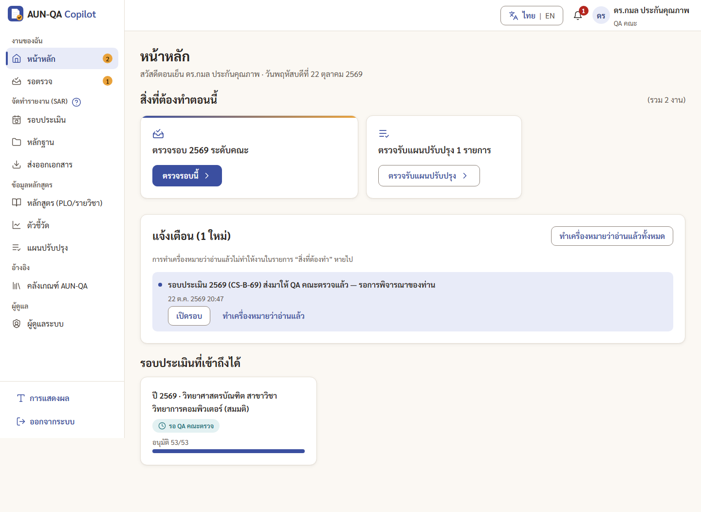
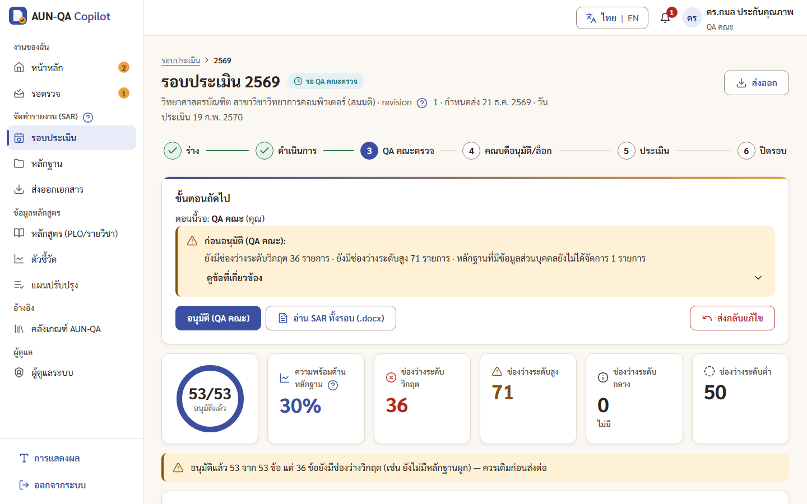
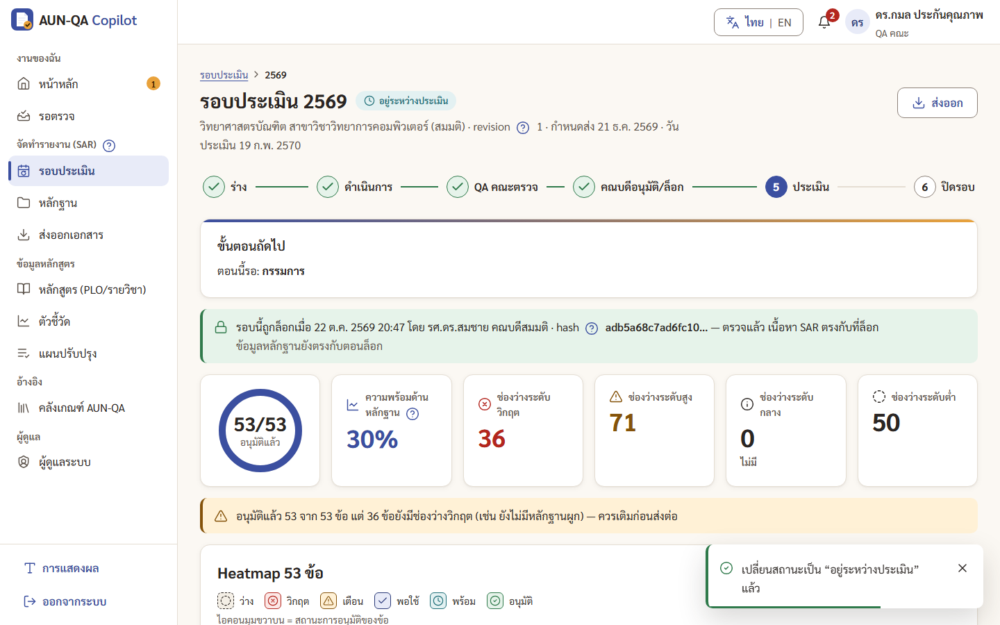

# คู่มือ QA คณะ (faculty_qa)

> บัญชีทดสอบ: `fqa1` / `demo1234` — ดร.กมล ประกันคุณภาพ (ขอบเขตทั้งคณะ)
> อ่าน [ภาพรวม](00-overview.md) ก่อน ถ้ายังไม่รู้จักคำว่า SAR, ช่องว่าง (gap), hash

งาน QA คณะเป็นด่านตรวจระดับคณะก่อนถึงคณบดี และเป็นผู้เปิดขั้นการประเมินให้กรรมการ

## ทำอะไรได้ / ทำอะไรไม่ได้
| ทำได้ | ทำไม่ได้ |
|---|---|
| ตรวจรอบที่หลักสูตรส่งมา แล้ว "อนุมัติ (QA คณะ)" หรือ "ส่งกลับแก้ไข" | เขียนหรือแก้ SAR ให้คะแนนตนเอง |
| เพิ่มความเห็นในหน้าข้อ ใช้ AI "ตรวจเนื้อหา" | อนุมัติสุดท้ายและล็อก (เป็นงานของคณบดี) |
| ยืนยันหลักฐาน | เพิ่มหรือแก้หลักฐาน |
| มอบหมายกรรมการประเมิน และ "เริ่มการประเมิน" | ให้คะแนนกรรมการหรือ verdict |
| ตรวจรับแผนปรับปรุง ปิดรอบหลังประเมินแล้ว | สร้างรอบหรือมอบหมายผู้เขียน |
| ดู audit log ของคณะ ส่งออกเอกสาร | จัดการผู้ใช้ |

## เมนูที่เห็น
หน้าหลัก · รอตรวจ · รอบประเมิน · หลักฐาน · ส่งออกเอกสาร · หลักสูตร · ตัวชี้วัด · แผนปรับปรุง · คลังเกณฑ์ AUN-QA · ผู้ดูแลระบบ (เฉพาะแท็บ Audit log)

## เริ่มจากหน้าหลัก
เมื่อประธานหลักสูตรส่งรอบมา คุณจะได้แจ้งเตือน "ส่งมาให้ QA คณะตรวจแล้ว" และการ์ด **"ตรวจรอบ 2569 ระดับคณะ"** ในหน้าหลัก ถ้ายังไม่มีรอบมา หน้าหลักจะขึ้นว่า "ยังไม่มีรอบที่รอการพิจารณาของคุณ — จะมีแจ้งเตือนเมื่อหลักสูตรส่งรอบมา"

---

## 1. ตรวจรอบระดับคณะ
1. กดการ์ด **"ตรวจรอบนี้"** (หรือเมนู รอตรวจ → การ์ดรอบ → "เปิดแดชบอร์ดเพื่อพิจารณา") ไปที่แดชบอร์ดรอบ (`/app/cycles/{รอบ}`)
2. กล่อง "ขั้นตอนถัดไป" บอก "ตอนนี้รอ: QA คณะ (คุณ)" พร้อมคำเตือน เช่น ช่องว่างวิกฤต/สูง หลักฐานที่มี PII ค้าง กด "ดูข้อที่เกี่ยวข้อง" เพื่อดูรายการข้อ
3. กด **"อ่าน SAR ทั้งรอบ (.docx)"** เพื่อดาวน์โหลดเล่ม Word ครบ 53 ข้อมาอ่าน (หรือกดช่อง heatmap เพื่อเปิดอ่านทีละข้อ)
4. ระหว่างอ่านในหน้าข้อ เพิ่มความเห็นได้ที่แผงขวา แท็บ **"ความเห็น"**
5. ตัดสินใจ
   - **"อนุมัติ (QA คณะ)"** → กล่องยืนยันแสดงข้อควรระวังอีกครั้ง ปุ่ม "กลับไปตรวจก่อน" ถูกเลือกไว้ ถ้าแน่ใจกด "ยืนยันอนุมัติ (QA คณะ)…" คณบดีได้รับแจ้งเตือน
   - **"ส่งกลับแก้ไข"** (ปุ่มสีแดง อยู่ขวาสุด) → ต้องเขียนเหตุผล เช่น "เกณฑ์ 4 ยังขาดหลักฐานการทวนสอบ" ประธานหลักสูตรได้รับแจ้งเตือนพร้อมเหตุผล

## 2. มอบหมายกรรมการประเมิน
ทำหลังคณบดีล็อกรอบแล้ว (หรือเตรียมไว้ก่อนก็ได้)
1. แดชบอร์ดรอบ → **"มอบหมายงาน"** (`/app/cycles/{รอบ}/assign`)
2. กล่อง **"กรรมการประเมิน"** เลือกผู้ใช้ แล้วกดเพิ่ม กรรมการจะเห็นเฉพาะรอบที่ได้รับมอบหมายเท่านั้น
3. ใส่ "วันประเมิน" ในกล่องวันสำคัญของรอบได้ (กรรมการเห็นวันนี้ในงานของตัวเอง)

> ข้อมูลเดโม่: `assess1` ถูกมอบหมายให้รอบ 2569 ไว้แล้ว

## 3. เริ่มการประเมิน
1. หลังคณบดีอนุมัติสุดท้ายและล็อก คุณได้แจ้งเตือน และหน้าหลักมีการ์ด **"เริ่มการประเมิน"**
2. กดการ์ด → แดชบอร์ดรอบ → **"เริ่มการประเมิน"** → ยืนยัน (ถ้ายังไม่มีกรรมการ ระบบเตือน "ยังไม่ได้มอบหมายกรรมการประเมิน" และการ์ดจะพาไปหน้ามอบหมาย)
3. สถานะรอบเป็น **"อยู่ระหว่างประเมิน"** กรรมการได้รับแจ้งเตือนทันที

## 4. หลังกรรมการส่งผล
- อ่านผลได้ที่แดชบอร์ดรอบ → **"ดูผลประเมิน"** และส่งออก Appendix B/D ที่หน้า ส่งออกเอกสาร
- **ตรวจรับแผนปรับปรุง:** เมนู แผนปรับปรุง (หน้าหลักมีการ์ด "ตรวจรับแผนปรับปรุง" เมื่อมีรายการที่ทำเสร็จแล้ว) → กดตรวจรับรายการสถานะ "ทำเสร็จแล้ว (รอตรวจ)" → ยืนยัน รายการนั้นจะเป็นหลักฐานขั้น A ในรอบถัดไป
- **ปิดรอบ:** การ์ด "ปิดรอบ" → แดชบอร์ดรอบ → "ปิดรอบ" กล่องยืนยันเตือนถ้ายังไม่มีแผนปรับปรุงจากข้อเสนอแนะ (AFI) ของรอบนี้

## 5. ยืนยันหลักฐาน
เปิดหลักฐาน (`/app/evidence/{id}`) → **"ยืนยันว่าตรวจสอบหลักฐานแล้ว"** ได้เมื่อหลักฐานผูกอย่างน้อย 1 ข้อ และจัดการข้อมูลส่วนบุคคลแล้ว

## 6. ดู audit log
เมนู **ผู้ดูแลระบบ** → แท็บ **Audit log** กรองตามการกระทำ ผู้ทำ หรือเป้าหมาย และ "ดาวน์โหลด CSV" ได้

---

## เคล็ดลับ
- ใช้ปุ่ม "อ่าน SAR ทั้งรอบ (.docx)" อ่านเป็นเล่มเร็วกว่าเปิดทีละข้อ แล้วค่อยเปิดข้อที่สงสัยจาก heatmap
- กลุ่ม "ช่องว่างที่ต้องแก้" ระดับวิกฤตบนแดชบอร์ดคือรายการที่ควรถามหลักสูตรก่อนอนุมัติ
- ส่งกลับแก้ไขพร้อมเหตุผลที่ชัด ระบุเกณฑ์/ข้อ จะช่วยให้หลักสูตรแก้ได้ตรงจุด

## ปัญหาที่พบบ่อย
| อาการ | สาเหตุ | วิธีแก้ |
|---|---|---|
| หน้าหลักว่าง ไม่มีงาน | หลักสูตรยังไม่ได้ส่งรอบ | รอแจ้งเตือน หรือดูสถานะที่เมนู รอบประเมิน คอลัมน์ "ขั้นถัดไปโดย" |
| ไม่มีปุ่มอนุมัติในแดชบอร์ด | รอบไม่ได้อยู่สถานะ "รอ QA คณะตรวจ" | ดู "ตอนนี้รอ: ใคร" ในกล่องขั้นตอนถัดไป |
| "เริ่มการประเมิน" ขึ้นคำเตือนยังไม่มีกรรมการ | ยังไม่ได้มอบหมายกรรมการ | ไปหน้ามอบหมายงาน กล่องกรรมการประเมิน |
| ไม่มีปุ่ม "ให้ AI แนะนำ" ในหน้าหลักฐาน | QA คณะไม่ได้แก้หลักฐาน | ใช้ AI "ตรวจเนื้อหา" ในหน้าข้อแทน |
| ตรวจรับแผนปรับปรุงไม่ได้ | รายการยังไม่ "ทำเสร็จแล้ว" หรือคุณเป็นผู้รับผิดชอบเอง | รอผู้รับผิดชอบ หรือให้ประธานตรวจรับ |
