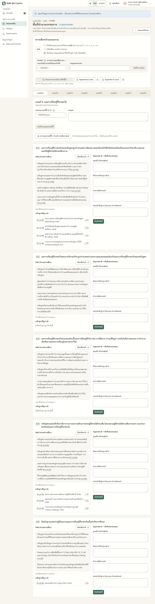
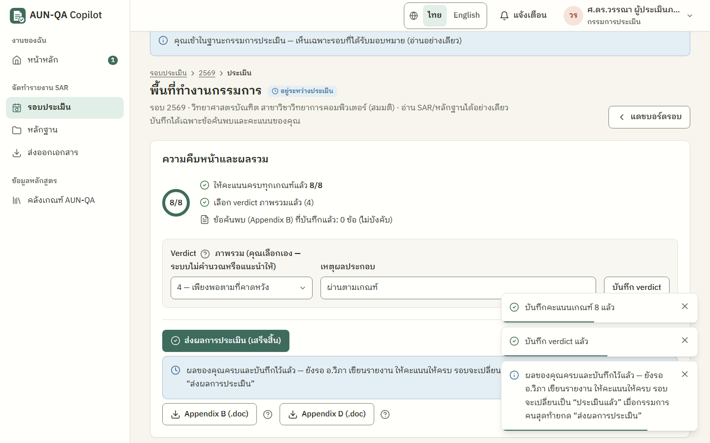

# คู่มือกรรมการประเมิน (assessor)

> บัญชีทดสอบ: `assess1` / `demo1234` — ศ.ดร.วรรณา ผู้ประเมินภายนอก (ได้รับมอบหมายเฉพาะรอบ 2569)
> อ่าน [ภาพรวม](00-overview.md) ก่อน ถ้ายังไม่รู้จักสเกล 1–7 และคำว่า verdict, AFI, Appendix B/D

กรรมการอ่าน SAR และหลักฐานของหลักสูตร บันทึกข้อค้นพบ ให้คะแนน **รายเกณฑ์** ทั้ง 8 เกณฑ์ และเลือก **verdict** (ผลสรุปภาพรวม) เอง

## ทำอะไรได้ / ทำอะไรไม่ได้
| ทำได้ | ทำไม่ได้ |
|---|---|
| อ่าน SAR หลักฐาน และคะแนนประเมินตนเองของหลักสูตร **เฉพาะรอบที่ได้รับมอบหมาย** | แก้ SAR หลักฐาน หรือคะแนนตนเองของหลักสูตร (อ่านอย่างเดียว) |
| บันทึกข้อค้นพบรายข้อ (Appendix B) | เห็นรอบอื่นหรือหลักสูตรอื่น |
| ให้คะแนนรายเกณฑ์ 1–7 พร้อมเหตุผล | เริ่มการประเมินเอง (QA คณะหรือผู้ดูแลเป็นคนเริ่ม) |
| เลือก verdict และส่งผลการประเมิน | แก้ผลหลังส่งแล้ว |
| ใช้ AI สรุปเกณฑ์และร่างคำถามสัมภาษณ์ | ให้ AI ให้คะแนนแทน (AI ไม่ให้คะแนนหรือ verdict) |
| เพิ่มความเห็น ส่งออก Appendix B/D | |

## เมนูที่เห็น
หน้าหลัก · รอบประเมิน · หลักฐาน · ส่งออกเอกสาร · คลังเกณฑ์ AUN-QA
ทุกหน้ามีแถบด้านบน **"คุณเข้าในฐานะกรรมการประเมิน — เห็นเฉพาะรอบที่ได้รับมอบหมาย (อ่านอย่างเดียว)"**

## เริ่มจากหน้าหลัก
เมื่อ QA คณะหรือผู้ดูแลมหาวิทยาลัยกด "เริ่มการประเมิน" คุณได้แจ้งเตือน "เปิดให้ประเมิน…" (กดแล้วไปพื้นที่ทำงานกรรมการทันที) และหน้าหลักมีงานประเมินรอบนั้น พร้อมปุ่ม "ทำงานถัดไป" ถ้ายังไม่เริ่ม หน้าหลักขึ้นว่า "ยังไม่มีรอบที่เปิดให้ประเมิน — คุณจะได้รับแจ้งเตือนเมื่อ QA คณะเริ่มการประเมิน"

---

## 1. เปิดพื้นที่ทำงานกรรมการ
กดแจ้งเตือน หรือ "ทำงานถัดไป" / "ไปทำ" ในหน้าหลัก (หรือหน้ารอบ → ปุ่ม **"พื้นที่ทำงานกรรมการ"**) (`/app/cycles/{รอบ}/assess`)
- ด้านบน: กล่อง **"ความคืบหน้าและผลรวม"** บอก "ให้คะแนน… n/8" verdict และข้อค้นพบที่บันทึกแล้ว ช่อง verdict ปุ่ม **"ส่งผลการประเมิน (เสร็จสิ้น)"** และปุ่ม Appendix B / Appendix D (.doc)
- ถัดมา: แท็บ **เกณฑ์ 1 … เกณฑ์ 8** แท็บที่ให้คะแนนแล้วมีเครื่องหมายถูก

## 2. ประเมินทีละเกณฑ์
ในแต่ละแท็บเกณฑ์
1. อ่านทุกข้อของเกณฑ์: เนื้อหา SAR (อ่านอย่างเดียว) หลักฐานที่ผูก (กดเปิดได้) และ "ประเมินตนเอง: n คะแนน" ของหลักสูตร
2. (ไม่บังคับ) กด **"AI สรุปเกณฑ์นี้ + ร่างคำถามสัมภาษณ์"** ได้สรุปรายข้อ จุดแข็ง ข้อกังวล และคำถาม 5W1H แยกกลุ่มผู้ให้ข้อมูล (อาจารย์ นักศึกษา ศิษย์เก่า นายจ้าง) — AI ช่วยสรุปและเสนอคำถามเท่านั้น ไม่ให้คะแนน
3. (ไม่บังคับ) บันทึก **ข้อค้นพบ (Appendix B)** รายข้อ: จุดแข็ง · สิ่งที่ควรปรับปรุง (AFI) · คำถามสัมภาษณ์ · แหล่งหลักฐานที่ต้องตรวจ แล้วกดบันทึก
4. เลือก **คะแนนเกณฑ์** 1–7 (ตัวเลือกมีชื่อระดับภาษาไทย) ใส่เหตุผล แล้วกด **"บันทึกคะแนนเกณฑ์นี้"**
5. ขึ้น "บันทึกแล้ว" และปุ่ม **"ไปเกณฑ์ n →"** กดเพื่อไปเกณฑ์ถัดไป
6. เกณฑ์ 8 ปุ่มจะเป็น **"ไปสรุปผลและเลือก verdict ↓"** พาขึ้นไปที่กล่อง verdict

> คะแนนของกรรมการบันทึกแยกจากคะแนนประเมินตนเองของหลักสูตร ไม่เขียนทับกัน

## 3. เลือก verdict และส่งผล
1. ในกล่องความคืบหน้า เลือก **verdict** 1–7 ใส่เหตุผล แล้วกด **"บันทึก verdict"** — ระบบไม่คำนวณค่าเฉลี่ยให้ เพราะคู่มือ AUN-QA ให้ตัดสินแบบองค์รวม
2. เมื่อครบ 8 เกณฑ์และมี verdict แล้ว งานในหน้าหลักเปลี่ยนเป็น "เลือก verdict และส่งผลประเมิน" และปุ่ม **"ส่งผลการประเมิน (เสร็จสิ้น)"** ใช้ได้ (ถ้ายังไม่ครบ ใต้ปุ่มบอก "ยังขาด: …")
3. กดส่ง → กล่องยืนยัน
   - **กรรมการคนเดียว:** หัวข้อ "ส่งผลการประเมิน" — เมื่อส่งแล้วรอบจะเป็น "ประเมินแล้ว" แก้ผลไม่ได้ และหลักสูตรจะเห็นข้อค้นพบ คะแนน และ verdict ของกรรมการ
   - **กรรมการหลายคน:** หัวข้อ **"ส่งผลการประเมินของคุณ"** บอกว่า "รอบนี้มีกรรมการ n คน คะแนนและ verdict ของคุณบันทึกไว้แล้ว รอบจะเปลี่ยนเป็น 'ประเมินแล้ว' เมื่อกรรมการทุกคนให้คะแนนครบ — ถ้าคุณเป็นคนสุดท้าย รอบจะเปลี่ยนทันที…"
4. กด **"ยืนยันส่งผลการประเมิน"**
   - ถ้าคุณเป็นคนเดียวหรือคนสุดท้าย: ขึ้น "ส่งผลการประเมินแล้ว" รอบเป็น "ประเมินแล้ว" ผู้ที่ปิดรอบได้ (ผู้ดูแลมหาวิทยาลัย ประธาน QA คณะ) และหลักสูตรได้รับแจ้งเตือน
   - ถ้ายังมีกรรมการคนอื่นให้คะแนนไม่ครบ: ใต้ปุ่มขึ้นกล่องสีฟ้า **"ผลของคุณครบและบันทึกไว้แล้ว — ยังรอ <ชื่อกรรมการ> ให้คะแนนให้ครบ รอบจะเปลี่ยนเป็น 'ประเมินแล้ว' เมื่อกรรมการคนสุดท้ายกด 'ส่งผลการประเมิน'"** ไม่ต้องทำอะไรเพิ่ม คะแนนของคุณไม่หาย

> **ข้อจำกัดตอนนี้ (กรรมการหลายคน):** ระบบยังไม่เก็บสถานะ "ส่งผลแล้ว" รายคน กล่อง "ยังรอ …" จะหายเมื่อรีเฟรชหน้าหรือกลับมาใหม่ และกรรมการคนอื่นไม่ได้รับแจ้งเตือนว่ามีคนรออยู่ — ตกลงกันในคณะกรรมการว่าใครเป็นคนกดส่งคนสุดท้าย หรือแจ้งกันนอกระบบ

## 4. ส่งออกเอกสารของกรรมการ
- **Appendix B (.doc)** ข้อค้นพบรายข้อ และ **Appendix D (.doc)** รายงานผลการประเมิน ดาวน์โหลดได้จากกล่องด้านบนของพื้นที่ทำงาน
- หลักสูตรและผู้เกี่ยวข้องดาวน์โหลดได้ที่หน้า ส่งออกเอกสาร หลังประเมินเสร็จ

---

## เคล็ดลับ
- อ่าน "ประเมินตนเอง" ของหลักสูตรควบคู่กับหลักฐาน ข้อที่ให้ตนเองสูงแต่หลักฐานไม่ครบควรตั้งคำถามสัมภาษณ์
- ใช้ AI ร่างคำถาม 5W1H เป็นจุดเริ่ม แล้วปรับให้ตรงกับที่จะถามจริงในวันลงพื้นที่
- ข้อค้นพบไม่บังคับ แต่ AFI ที่บันทึกไว้จะถูกนำไปสร้างแผนปรับปรุงของหลักสูตรโดยตรง จึงควรเขียนให้นำไปทำได้จริง

## ปัญหาที่พบบ่อย
| อาการ | สาเหตุ | วิธีแก้ |
|---|---|---|
| ขึ้น "รอบนี้ยังไม่เข้าสู่ขั้นการประเมิน" | QA คณะหรือผู้ดูแลยังไม่กดเริ่มการประเมิน | รอแจ้งเตือน |
| ปุ่มส่งผลกดไม่ได้ | ยังให้คะแนนไม่ครบ 8 เกณฑ์ หรือยังไม่มี verdict | อ่านข้อความ "ยังขาด: …" ใต้ปุ่ม |
| กดส่งแล้วขึ้น "ยังรอ … ให้คะแนนให้ครบ" รอบยังไม่เป็น "ประเมินแล้ว" | รอบนี้มีกรรมการหลายคน และยังมีคนให้คะแนนไม่ครบ | ไม่ต้องทำอะไร ผลของคุณบันทึกแล้ว รอบจะเปลี่ยนเมื่อกรรมการคนสุดท้ายกดส่ง |
| พิมพ์ในหน้าข้อไม่ได้ | กรรมการอ่าน SAR ได้อย่างเดียว | บันทึกสิ่งที่พบในช่องข้อค้นพบของพื้นที่ทำงานกรรมการ |
| ไม่เห็นรอบอื่น | กรรมการเห็นเฉพาะรอบที่ได้รับมอบหมาย | ขอให้ QA คณะมอบหมายรอบที่ต้องประเมิน |
| แก้คะแนนหลังส่งไม่ได้ | ส่งผลแล้ว รอบเป็น "ประเมินแล้ว" | ติดต่อ QA คณะ (ระบบไม่มีการเปิดแก้ผลหลังส่ง) |
