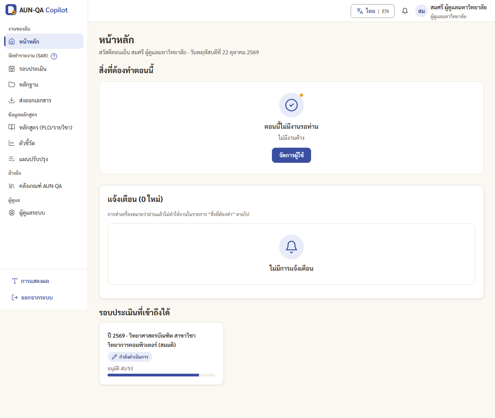

# คู่มือผู้ดูแลมหาวิทยาลัย (uni_admin)

> บัญชีทดสอบ: `uadmin` / `demo1234` — สมศรี ผู้ดูแลมหาวิทยาลัย (มหาวิทยาลัยตัวอย่างภาคเหนือ)
> บัญชี `uadmin2` เป็นผู้ดูแลของ "มหาวิทยาลัยทดสอบภาคใต้" ใช้สาธิตว่าแต่ละมหาวิทยาลัยมองไม่เห็นข้อมูลของกัน
> อ่าน [ภาพรวม](00-overview.md) ก่อน

ผู้ดูแลมหาวิทยาลัยดูแลบัญชีผู้ใช้และบทบาท และช่วยเปิด/ปิดขั้นตอนสำคัญของรอบประเมิน

## ทำอะไรได้ / ทำอะไรไม่ได้
| ทำได้ | ทำไม่ได้ |
|---|---|
| เพิ่ม/ลบผู้ใช้ เพิ่ม/ถอนบทบาทพร้อมขอบเขต | เขียน SAR อัปโหลดหลักฐาน กรอกตัวชี้วัด |
| สร้างรอบประเมิน | มอบหมายผู้เขียนรายข้อ (เป็นงานของประธาน) |
| มอบหมายกรรมการ และ "เริ่มการประเมิน" | อนุมัติรายข้อ อนุมัติระดับคณะ อนุมัติสุดท้าย |
| ปิดรอบหลังกรรมการส่งผล | ให้คะแนนหรือ verdict |
| ดู audit log ทั้งมหาวิทยาลัย ดาวน์โหลด CSV | เห็นข้อมูลของมหาวิทยาลัยอื่น |
| รีเซ็ตข้อมูลเดโม่ | ใช้ AI |
| ดูทุกหน้าของมหาวิทยาลัยตน (อ่านอย่างเดียว) | |

## เมนูที่เห็น
หน้าหลัก · รอบประเมิน · หลักฐาน · ส่งออกเอกสาร · หลักสูตร · ตัวชี้วัด · แผนปรับปรุง · คลังเกณฑ์ AUN-QA · ผู้ดูแลระบบ (แท็บ ผู้ใช้และบทบาท · Audit log · ข้อมูลเดโม่)

## เริ่มจากหน้าหลัก
ถ้าไม่มีงานค้าง หน้าหลักขึ้น "ตอนนี้ไม่มีงานรอท่าน" พร้อมปุ่ม **"จัดการผู้ใช้"** เมื่อถึงคิว จะมีการ์ด เช่น "เริ่มการประเมิน" (หลังคณบดีล็อก) และ "ปิดรอบ" (หลังกรรมการส่งผล)

---

## 1. จัดการผู้ใช้และบทบาท
เมนู **ผู้ดูแลระบบ** (`/app/admin`) → แท็บ **"ผู้ใช้และบทบาท"**

**เพิ่มผู้ใช้**
1. กด **"เพิ่มผู้ใช้"**
2. กรอกชื่อผู้ใช้ รหัสผ่าน (อย่างน้อย 8 ตัวอักษร) ชื่อ-สกุล อีเมล
3. เลือก **บทบาท** และ **ขอบเขต** (ทั้งมหาวิทยาลัย / คณะ / หลักสูตร / รอบ) แล้วกด "บันทึก"
4. ชื่อผู้ใช้ซ้ำไม่ได้ (ไม่สนตัวพิมพ์ใหญ่เล็ก)

**เพิ่มหรือถอนบทบาท**
- คอลัมน์ "เพิ่มบทบาท" ของแต่ละคน: เลือกบทบาทและขอบเขต แล้วกด "เพิ่ม" (คนเดียวมีได้หลายบทบาท)
- กดปุ่ม × บนป้ายบทบาทเพื่อถอน

**ลบผู้ใช้** กด "ลบ" ในแถว แล้ว "ยืนยันลบ" (ลบบัญชีตัวเองไม่ได้)

### ขอบเขตที่ควรใช้กับแต่ละบทบาท
| บทบาท | ขอบเขตที่ถูก |
|---|---|
| ประธานหลักสูตร, อาจารย์ประจำหลักสูตร | หลักสูตร |
| เจ้าหน้าที่ข้อมูล, QA คณะ, คณบดี | คณะ |
| กรรมการประเมิน | **รอบ** (กรรมการเห็นเฉพาะรอบที่ระบุ ถ้าใช้ขอบเขตอื่นจะไม่เห็นอะไรเลย) |
| ผู้ดูแลมหาวิทยาลัย | ทั้งมหาวิทยาลัย |

## 2. สร้างรอบประเมิน
ทำได้เหมือนประธานหลักสูตร: เมนู รอบประเมิน → "+ สร้างรอบใหม่" → ปีการศึกษา หลักสูตร (คัดลอกจากรอบก่อนได้) → "สร้างรอบ" ระบบสร้าง 53 ข้อให้ จากนั้นประธานหลักสูตรเป็นผู้มอบหมายผู้เขียน และประธาน (หรือคุณ) กด "เริ่ม/กลับไปดำเนินการ" ที่แดชบอร์ดรอบ ดู [คู่มือประธาน หัวข้อ 1](10-programme-chair.md#1-สร้างรอบประเมินใหม่)

## 3. มอบหมายกรรมการและเริ่มการประเมิน
1. หลังคณบดีล็อกรอบ คุณได้แจ้งเตือนและการ์ด **"เริ่มการประเมิน"**
2. ถ้ายังไม่มีกรรมการ: แดชบอร์ดรอบ → "มอบหมายงาน" → กล่อง **"กรรมการประเมิน"** เลือกผู้ใช้แล้วเพิ่ม
3. แดชบอร์ดรอบ → **"เริ่มการประเมิน"** → ยืนยัน กรรมการได้รับแจ้งเตือน

รายละเอียดเหมือน [คู่มือ QA คณะ หัวข้อ 3](13-faculty-qa.md#3-เริ่มการประเมิน)

## 4. ปิดรอบ
1. หลังกรรมการส่งผล หน้าหลักมีการ์ด **"ปิดรอบ"** พร้อมข้อความ "ตรวจผลและสร้างแผนปรับปรุงจากข้อเสนอแนะ (AFI) ก่อนปิดรอบ"
2. แดชบอร์ดรอบ → **"ปิดรอบ"** → กล่องยืนยันบอกว่ามีแผนปรับปรุงจากรอบนี้แล้วกี่รายการ หรือเตือนถ้ายังไม่มี
3. ยืนยัน → แดชบอร์ดขึ้น "รอบนี้ปิดแล้ว — ดูผลประเมิน / ส่งออกเอกสาร" ผลประเมินแก้ไม่ได้อีก

## 5. Audit log
แท็บ **Audit log**: ตารางเวลา ผู้ทำ การกระทำ เป้าหมาย (300 รายการล่าสุด) พิมพ์กรองได้ และกด **"ดาวน์โหลด CSV"** ไม่มีปุ่มแก้หรือลบรายการ

## 6. รีเซ็ตข้อมูลเดโม่
แท็บ **"ข้อมูลเดโม่"** → **"รีเซ็ตข้อมูลเดโม่"** → "ยืนยันล้างและสร้างข้อมูลเดโม่ใหม่"
- ล้างข้อมูลทั้งหมดในเบราว์เซอร์นี้ (รอบ หลักฐาน SAR **audit log** และผู้ใช้ที่เพิ่มเอง) แล้วสร้างข้อมูลสมมติชุดเริ่มต้นใหม่ **ย้อนกลับไม่ได้**
- ทุกคนต้องเข้าสู่ระบบใหม่
- ใช้ก่อนเริ่มสาธิตทุกครั้ง เพื่อให้ตัวเลขตรงกับคู่มือ

---

## เคล็ดลับ
- ให้ขอบเขตแคบที่สุดที่ทำงานได้ เช่น อาจารย์ = หลักสูตรเดียว
- ทดสอบการแยกข้อมูลข้ามมหาวิทยาลัย: เข้า `uadmin2` จะไม่เห็นรอบ หลักฐาน หรือผู้ใช้ของมหาวิทยาลัยตัวอย่างภาคเหนือเลย
- คอลัมน์ "ขั้นถัดไปโดย" ในเมนู รอบประเมิน บอกว่าแต่ละรอบรอใครอยู่

## ปัญหาที่พบบ่อย
| อาการ | สาเหตุ | วิธีแก้ |
|---|---|---|
| เพิ่มผู้ใช้ไม่ได้ "Username นี้ถูกใช้แล้ว" | ชื่อซ้ำ (ไม่สนตัวพิมพ์) | ใช้ชื่ออื่น |
| กรรมการเข้าแล้วไม่เห็นรอบ | ให้บทบาทกรรมการโดยขอบเขตไม่ใช่ "รอบ" | ถอนบทบาทแล้วเพิ่มใหม่ ขอบเขตเป็นรอบที่ต้องประเมิน |
| ผู้ใช้ใหม่บ่นว่าไม่มีเมนูที่ต้องใช้ | บทบาทหรือขอบเขตไม่ตรงงาน | ตรวจป้ายบทบาทในตาราง แล้วเพิ่มบทบาทที่ขาด |
| ปุ่มเริ่มการประเมินไม่มี | รอบยังไม่ถูกคณบดีล็อก | ดู "ตอนนี้รอ: ใคร" บนแดชบอร์ดรอบ |
| audit log หายหมด | เพิ่งรีเซ็ตข้อมูลเดโม่ | เป็นพฤติกรรมของโหมดเดโม่ (ระบบจริงต้องปิดฟังก์ชันนี้) |
