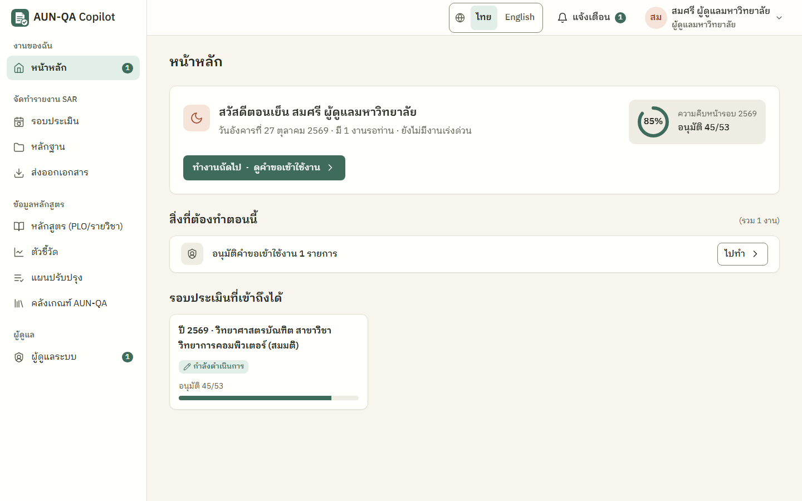
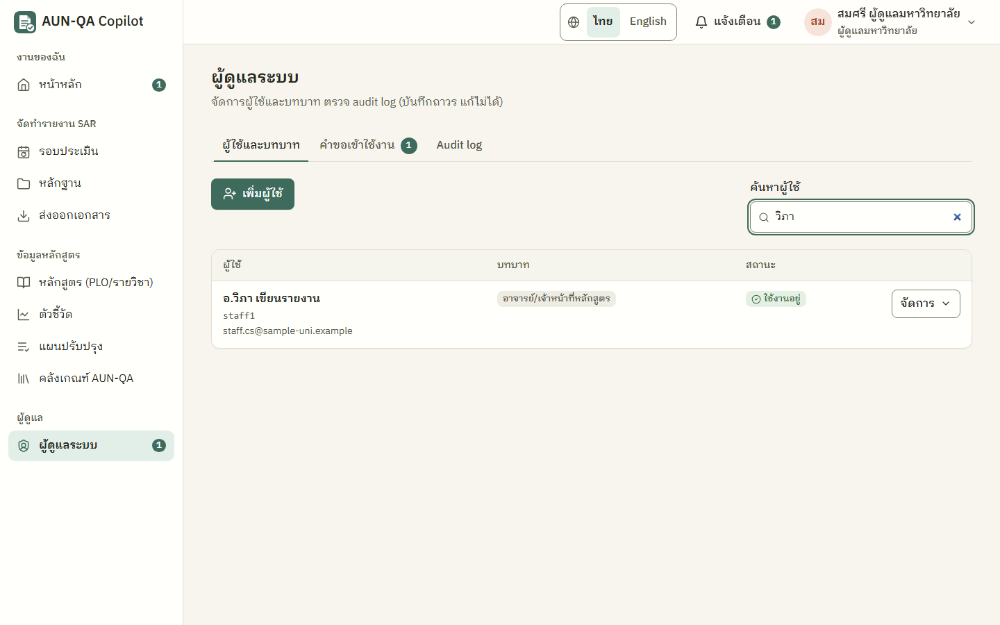
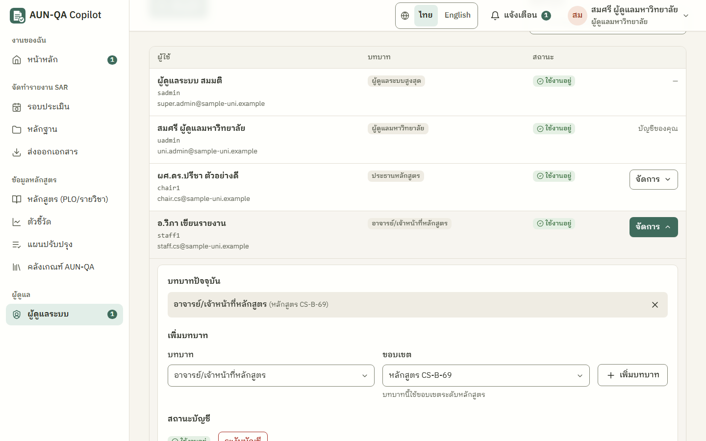
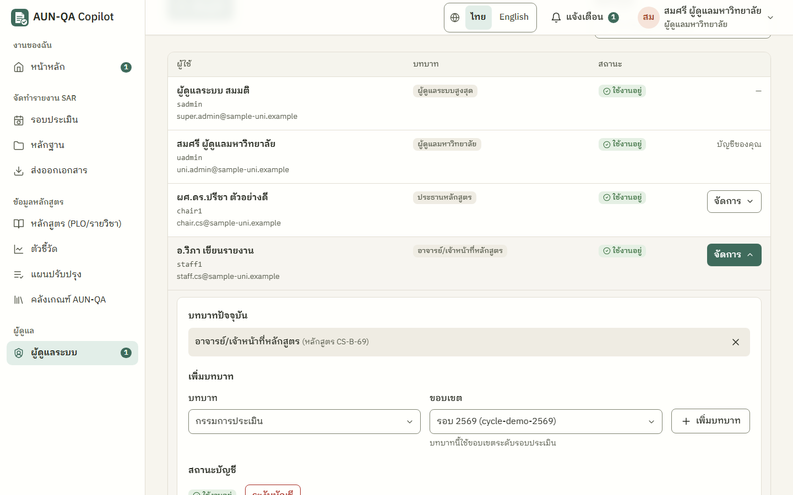
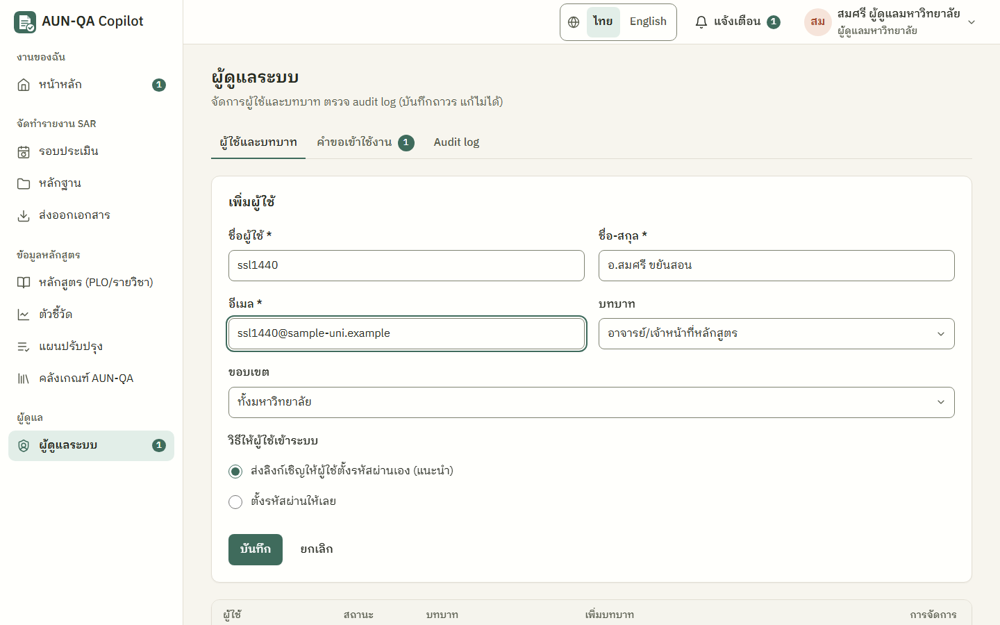
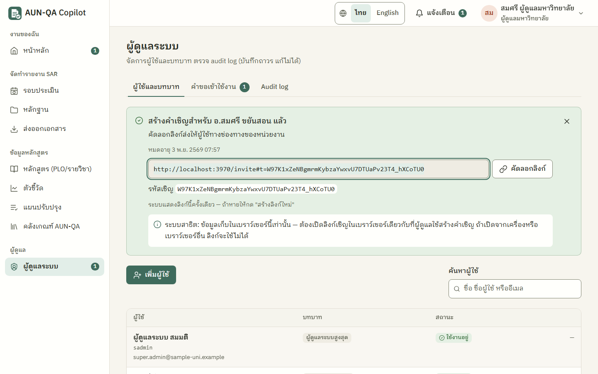
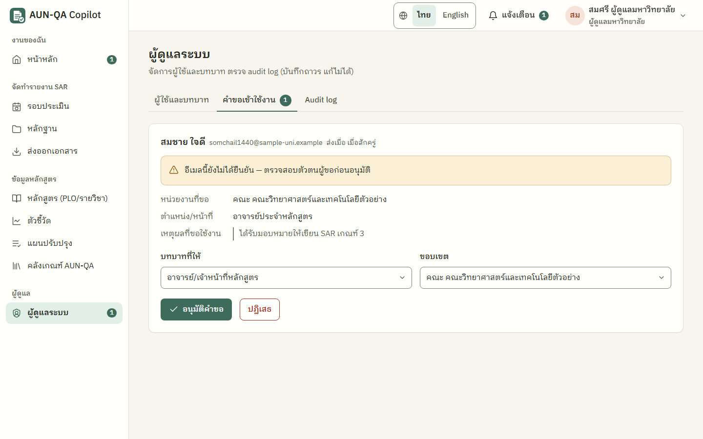
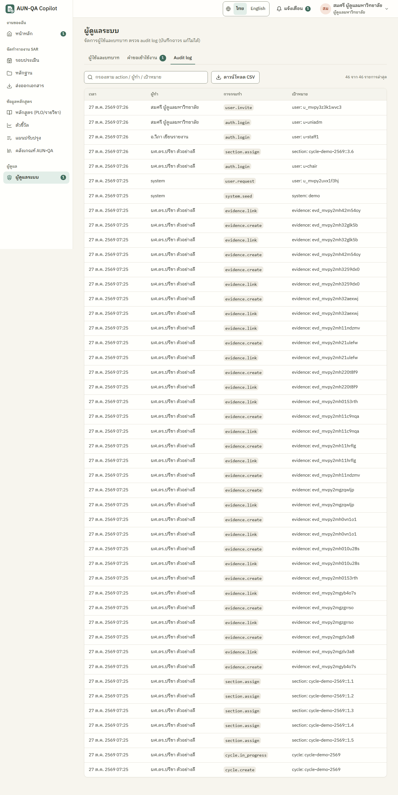

# คู่มือผู้ดูแลมหาวิทยาลัย (uni_admin)

> บัญชีทดสอบ: `uadmin` / `demo1234` — สมศรี ผู้ดูแลมหาวิทยาลัย (มหาวิทยาลัยตัวอย่างภาคเหนือ)
> บัญชี `uadmin2` เป็นผู้ดูแลของ "มหาวิทยาลัยทดสอบภาคใต้" ใช้สาธิตว่าแต่ละมหาวิทยาลัยมองไม่เห็นข้อมูลของกัน
> อ่าน [ภาพรวม](00-overview.md) ก่อน · ฝั่งผู้ใช้ใหม่ที่ขอเข้าใช้งาน/รับคำเชิญ ดู [คู่มือผู้ใช้ใหม่](01-new-user.md)

ผู้ดูแลมหาวิทยาลัยรับผู้ใช้ใหม่เข้าระบบ (เชิญ หรืออนุมัติคำขอ) กำหนดบทบาทและขอบเขต ระงับบัญชี และช่วยเปิด/ปิดขั้นตอนสำคัญของรอบประเมิน

## ทำอะไรได้ / ทำอะไรไม่ได้
| ทำได้ | ทำไม่ได้ |
|---|---|
| เชิญผู้ใช้ด้วยลิงก์/รหัสเชิญ หรือเพิ่มผู้ใช้พร้อมตั้งรหัสผ่านให้ | ลบบัญชีที่เคยใช้งานแล้ว (ใช้ "ระงับบัญชี" แทน) |
| อนุมัติหรือปฏิเสธคำขอเข้าใช้งาน | แก้บัญชีของตัวเอง หรือบัญชีผู้ดูแลระบบสูงสุด |
| เพิ่ม/ถอนบทบาทพร้อมขอบเขต (ระบบบังคับขอบเขตให้ตรงบทบาท) | ให้บทบาทผู้ดูแลระบบสูงสุด |
| ระงับบัญชี / เปิดใช้อีกครั้ง · สร้างลิงก์เชิญใหม่ / ยกเลิกคำเชิญ | รีเซ็ตข้อมูลเดโม่ (เฉพาะผู้ดูแลระบบสูงสุด) |
| สร้างรอบประเมิน | มอบหมายผู้เขียนรายข้อ (เป็นงานของประธาน) |
| มอบหมายกรรมการ และ "เริ่มการประเมิน" | อนุมัติรายข้อ อนุมัติระดับคณะ อนุมัติสุดท้าย |
| ปิดรอบหลังกรรมการส่งผล | ให้คะแนนหรือ verdict · ใช้ AI |
| ดู audit log ทั้งมหาวิทยาลัย ดาวน์โหลด CSV | เห็นข้อมูลของมหาวิทยาลัยอื่น |
| ดูทุกหน้าของมหาวิทยาลัยตน (อ่านอย่างเดียว) | เขียน SAR อัปโหลดหลักฐาน กรอกตัวชี้วัด |

## เมนูที่เห็น
หน้าหลัก · รอบประเมิน · หลักฐาน · ส่งออกเอกสาร · หลักสูตร · ตัวชี้วัด · แผนปรับปรุง · คลังเกณฑ์ AUN-QA · **ผู้ดูแลระบบ** (แท็บ **ผู้ใช้และบทบาท** · **คำขอเข้าใช้งาน** มีตัวเลขบอกจำนวนที่รออยู่ · **Audit log**)

ตัวเลขข้างเมนู "ผู้ดูแลระบบ" คือจำนวนคำขอที่รออนุมัติ บนมือถือแท็บใช้ชื่อสั้น "ผู้ใช้ · คำขอ · Audit log"

## เริ่มจากหน้าหลัก
การ์ดทักทายบอกว่ามีกี่งานรอ และปุ่ม **"ทำงานถัดไป"** พาไปงานแรก เช่น มีคำขอใหม่จะเห็นแถว **"อนุมัติคำขอเข้าใช้งาน n รายการ"** และปุ่ม "ทำงานถัดไป · ดูคำขอเข้าใช้งาน" ไปที่แท็บคำขอทันที เมื่อถึงคิวของรอบประเมิน จะมีงาน "เริ่มการประเมินรอบ …" (หลังคณบดีล็อก) และ "ปิดรอบ … หลังได้รับผลประเมิน" (หลังกรรมการส่งผล) ถ้าไม่มีงาน หน้าหลักขึ้นว่าไม่มีงานค้าง พร้อมปุ่ม "จัดการผู้ใช้"

แจ้งเตือนที่ผู้ดูแลได้รับ (กดแล้วไปหน้านั้นเลย)
| แจ้งเตือน | ไปที่ |
|---|---|
| "มีคำขอเข้าใช้งานใหม่จาก …" | ผู้ดูแลระบบ → แท็บคำขอเข้าใช้งาน |
| "… ตั้งรหัสผ่านและเริ่มใช้งานแล้ว" (ผู้ที่คุณเชิญ) | ผู้ดูแลระบบ → แท็บผู้ใช้และบทบาท |
| รอบถูกล็อก / กรรมการส่งผลแล้ว | หน้ารอบประเมินนั้น |

---

## 1. ตารางผู้ใช้และแผง "จัดการ"
เมนู **ผู้ดูแลระบบ** (`/app/admin`) → แท็บ **"ผู้ใช้และบทบาท"**

ตารางมี 4 คอลัมน์: **ผู้ใช้** (ชื่อ ชื่อผู้ใช้ อีเมล) · **บทบาท** (ชี้ที่ป้ายเพื่อดูขอบเขต) · **สถานะ** · ปุ่ม **"จัดการ"**
- หาคนเร็ว ๆ ด้วยช่อง **"ค้นหาผู้ใช้"** (พิมพ์ชื่อ ชื่อผู้ใช้ หรืออีเมล ไม่สนตัวพิมพ์ใหญ่เล็ก) ถ้าไม่เจอขึ้น "ไม่พบผู้ใช้ที่ตรงกับคำค้น"
- แถวของคุณขึ้นว่า "บัญชีของคุณ" และแถวผู้ดูแลระบบสูงสุดขึ้น "—" (ไม่มีปุ่มจัดการ เพราะแก้ไม่ได้)
- จอแคบ (หรือขยายตัวอักษรใหญ่) ตารางจะเรียงเป็นการ์ดทีละคน ปุ่มยังครบ
- ผู้ที่ส่งคำขอและยังรออนุมัติ **ไม่อยู่ในตารางนี้** ดูที่แท็บคำขอเข้าใช้งาน

กด **"จัดการ"** ที่แถวใด แผงจะเปิดใต้แถวนั้น (เปิดได้ทีละคน) มี 3 ส่วน

**บทบาทปัจจุบัน** — บทบาทพร้อมขอบเขตในวงเล็บ กด × เพื่อถอน → ระบบถามยืนยัน มีปุ่ม **"เก็บบทบาทไว้"** และ **"ยืนยันถอนบทบาท"** ถ้าเป็นบทบาทสุดท้าย ระบบเตือนว่า "ผู้ใช้จะใช้งานระบบไม่ได้จนกว่าจะเพิ่มบทบาทใหม่"

**เพิ่มบทบาท** — เลือก **บทบาท** แล้วเลือก **ขอบเขต** (ช่องขอบเขตแสดงเฉพาะระดับที่ใช้ได้กับบทบาทนั้น ใต้ช่องบอก "บทบาทนี้ใช้ขอบเขตระดับ…") แล้วกด **"เพิ่มบทบาท"** คนเดียวมีได้หลายบทบาท ถ้าเพิ่มซ้ำ ระบบบอกว่า "ผู้ใช้มีบทบาทนี้ในขอบเขตนี้อยู่แล้ว" บัญชีที่ถูกระงับเพิ่มบทบาทไม่ได้ ("เปิดใช้บัญชีก่อน จึงจะเพิ่มบทบาทได้")

**สถานะบัญชี** — ปุ่มเปลี่ยนตามสถานะ: ใช้งานอยู่ = "ระงับบัญชี" · ระงับ = "เปิดใช้อีกครั้ง" · รอตั้งรหัสผ่าน = "สร้างลิงก์ใหม่" และ "ยกเลิกคำเชิญ" (ดูหัวข้อ [3](#3-จัดการคำเชิญที่ยังไม่ได้ใช้) และ [5](#5-ระงับบัญชี-และเปิดใช้อีกครั้ง))

ปิดแผงด้วยปุ่ม **"ปิดแผงจัดการ"** ท้ายแผง (หรือกด "จัดการ" แถวเดิมอีกครั้ง) — กด Esc ไม่ปิดแผงนี้

### สถานะบัญชี 4 แบบ
| ป้าย | ความหมาย | อยู่ที่ไหน |
|---|---|---|
| ใช้งานอยู่ | เข้าสู่ระบบได้ตามบทบาท | ตารางผู้ใช้ |
| รอตั้งรหัสผ่าน | ถูกเชิญแล้ว แต่ยังไม่ได้ตั้งรหัสผ่านจากลิงก์ | ตารางผู้ใช้ |
| รออนุมัติ | ส่งคำขอเข้าใช้งาน รอผู้ดูแลตัดสิน | แท็บคำขอเข้าใช้งาน |
| ระงับ | เข้าสู่ระบบไม่ได้ ข้อมูลและงานที่มอบหมายยังอยู่ | ตารางผู้ใช้ |

### ขอบเขตที่ใช้กับแต่ละบทบาท (ระบบบังคับ)
ระบบให้เลือกได้เฉพาะคู่ที่ถูกต้อง ทั้งตอนอนุมัติคำขอ เพิ่มผู้ใช้ และเพิ่มบทบาท จับคู่ผิดบันทึกไม่ได้

| บทบาท | ขอบเขตที่ต้องใช้ |
|---|---|
| ประธานหลักสูตร, อาจารย์/เจ้าหน้าที่หลักสูตร | หลักสูตร |
| เจ้าหน้าที่ข้อมูล, QA คณะ, คณบดี | คณะ |
| กรรมการประเมิน | **รอบประเมิน** (เช่น "รอบ 2569 · CS-B-69") — กรรมการเห็นเฉพาะรอบที่ระบุ ถ้ายังไม่มีรอบ ช่องจะขึ้น "ยังไม่มีรอบประเมินให้เลือก" |
| ผู้ดูแลมหาวิทยาลัย | ทั้งมหาวิทยาลัย |

## 2. เพิ่มผู้ใช้ (แนะนำ: ส่งลิงก์เชิญ)
1. แท็บผู้ใช้และบทบาท → กด **"เพิ่มผู้ใช้"**
2. กรอก **ชื่อผู้ใช้** * (อังกฤษ ตัวเลข หรือ `. _ -` ยาว 3–32 ตัว) · **ชื่อ-สกุล** * · **อีเมล** *
3. เลือก **บทบาท** และ **ขอบเขต** (ตามตารางด้านบน)
4. หัวข้อ **"วิธีให้ผู้ใช้เข้าระบบ"** เลือก
   - **ส่งลิงก์เชิญให้ผู้ใช้ตั้งรหัสผ่านเอง (แนะนำ)** — ค่าเริ่มต้น คุณไม่ต้องรู้รหัสผ่านของผู้ใช้
   - **ตั้งรหัสผ่านให้เลย** — มีช่องรหัสผ่าน (8–128 ตัวอักษร) บัญชีใช้งานได้ทันที ต้องแจ้งรหัสให้ผู้ใช้เอง
5. กด **"บันทึก"**

ถ้ากรอกไม่ครบ ด้านบนฟอร์มขึ้น "ยังบันทึกไม่ได้ — กรุณาแก้ไขช่องต่อไปนี้" พร้อมรายการช่องที่ผิด ชื่อผู้ใช้หรืออีเมลซ้ำ (ไม่สนตัวพิมพ์ใหญ่เล็ก) จะขึ้น "Username นี้ถูกใช้แล้ว" / "อีเมลนี้ถูกใช้แล้ว"

### ผลการเชิญ
เมื่อเลือกโหมดเชิญ เหนือตารางจะมีกล่อง **"สร้างคำเชิญสำหรับ … แล้ว"**
- ช่อง **ลิงก์เชิญ** + ปุ่ม **"คัดลอกลิงก์"** (ถ้าคัดลอกอัตโนมัติไม่ได้ ระบบเลือกข้อความให้ กด Ctrl+C)
- **รหัสเชิญ** (ใช้แทนลิงก์ได้ ผู้ใช้วางที่หน้า "มีรหัสเชิญ")
- วันเวลาหมดอายุ (7 วันนับจากสร้าง)
- **ระบบแสดงลิงก์นี้ครั้งเดียว** ปิดกล่องหรือออกจากหน้าแล้วจะดูอีกไม่ได้ ถ้าหายให้กด "สร้างลิงก์ใหม่"
- ส่งลิงก์ให้ผู้ใช้ทางช่องทางของหน่วยงาน แถวของผู้ใช้ในตารางขึ้นสถานะ "รอตั้งรหัสผ่าน" เมื่อผู้ใช้ตั้งรหัสแล้ว คุณได้แจ้งเตือนและสถานะเปลี่ยนเป็น "ใช้งานอยู่"

> **ข้อจำกัดของระบบสาธิต:** ข้อมูลเก็บในเบราว์เซอร์นี้เท่านั้น **ผู้ถูกเชิญต้องเปิดลิงก์ในเบราว์เซอร์เดียวกับที่คุณใช้สร้างคำเชิญ** ถ้าเปิดจากเครื่องหรือเบราว์เซอร์อื่น ลิงก์จะใช้ไม่ได้ (กล่องผลเชิญและหน้า `/invite` มีป้ายบอกเรื่องนี้) ตอนสาธิตให้คัดลอกลิงก์ → ออกจากระบบ → วางลิงก์ในแท็บเดิม

## 3. จัดการคำเชิญที่ยังไม่ได้ใช้
เปิด "จัดการ" ของแถวที่ขึ้น "รอตั้งรหัสผ่าน" → ส่วนสถานะบัญชี
- **"สร้างลิงก์ใหม่"** — ได้ลิงก์และรหัสเชิญชุดใหม่ (อายุ 7 วันใหม่) **ลิงก์เก่าใช้ไม่ได้ทันที** ใช้เมื่อผู้ใช้ทำลิงก์หาย ลิงก์หมดอายุ หรือคุณปิดกล่องผลเชิญไปแล้ว
- **"ยกเลิกคำเชิญ"** — ระบบถามยืนยัน ปุ่ม **"เก็บคำเชิญไว้"** / **"ยืนยันยกเลิกคำเชิญ"** ยกเลิกแล้วลิงก์ใช้ไม่ได้และรายชื่อนี้ถูกลบ (นี่คือการลบเพียงแบบเดียวที่ทำได้ เพราะบัญชียังไม่เคยใช้งาน)

## 4. อนุมัติหรือปฏิเสธคำขอเข้าใช้งาน
แท็บ **"คำขอเข้าใช้งาน"** (หรือกดแจ้งเตือน "มีคำขอเข้าใช้งานใหม่จาก …" / งาน "อนุมัติคำขอเข้าใช้งาน" บนหน้าหลัก)

แต่ละคำขอเป็นการ์ด: ชื่อ · อีเมล · ส่งเมื่อ · **หน่วยงานที่ขอ** · ตำแหน่ง/หน้าที่ (ถ้ากรอก) · **เหตุผลที่ขอใช้งาน** และป้ายเตือน **"อีเมลนี้ยังไม่ได้ยืนยัน — ตรวจสอบตัวตนผู้ขอก่อนอนุมัติ"** (ระบบยังไม่ส่งอีเมลยืนยัน จึงต้องตรวจตัวตนเองนอกระบบ เช่น สอบถามหน่วยงานต้นสังกัด)

**อนุมัติ**
1. เลือก **"บทบาทที่ให้"** (ค่าเริ่มต้น "อาจารย์/เจ้าหน้าที่หลักสูตร") — ผู้ขอเลือกบทบาทเองไม่ได้ คุณเป็นคนกำหนด
2. เลือก **"ขอบเขต"**
   - ถ้าผู้ขอเลือกหลักสูตรมา และบทบาทเป็นระดับหลักสูตร ระบบเลือกหลักสูตรนั้นไว้ให้
   - ถ้าผู้ขอเลือกคณะ หรือ "อื่น ๆ (ทั้งมหาวิทยาลัย)" หรือระดับไม่ตรงกับบทบาท ช่องจะขึ้น **"— เลือกขอบเขต —"** ต้องเลือกเอง (ระบบไม่เดาให้ เพื่อไม่ให้สิทธิ์กว้างเกิน)
3. กด **"อนุมัติคำขอ"** → ขึ้น "อนุมัติแล้ว — <ชื่อ> เข้าสู่ระบบได้ทันที" การ์ดหายและตัวเลขที่แท็บลดลง ผู้ขอได้แจ้งเตือนว่าบัญชีได้รับอนุมัติ
   - ถ้ายังไม่เลือกขอบเขต ขึ้นข้อความแดงใต้ช่อง "กรุณาเลือกขอบเขตให้ตรงกับบทบาทก่อนอนุมัติ"

**ปฏิเสธ**
1. กด **"ปฏิเสธ"** → กล่องยืนยันบอกว่า "ข้อมูลผู้ขอจะถูกลบออกจากระบบ" ใส่เหตุผลได้ (ไม่บังคับ)
2. กด **"ยืนยันปฏิเสธ"** (หรือ **"ยังไม่ปฏิเสธ"** เพื่อกลับ) → "ปฏิเสธคำขอแล้ว — ลบข้อมูลผู้ขอออกจากระบบ"
3. ระบบไม่ส่งข้อความแจ้งผู้ขอ (ไม่มีอีเมล) ถ้าจำเป็นให้แจ้งทางช่องทางของหน่วยงาน ผู้ขอส่งคำขอใหม่ได้

ไม่มีคำขอค้าง แท็บจะขึ้น "ไม่มีคำขอรออนุมัติ"

## 5. ระงับบัญชี และเปิดใช้อีกครั้ง
ใช้แทนการลบ เมื่อคนย้ายงาน ลาออก หรือต้องหยุดสิทธิ์ชั่วคราว
1. "จัดการ" → **"ระงับบัญชี"** → กล่องยืนยัน "ผู้ใช้จะเข้าสู่ระบบไม่ได้ งานที่มอบหมายไว้ยังอยู่ และเปิดใช้อีกครั้งได้ภายหลัง" → **"ยืนยันระงับ"**
2. ผู้ใช้ที่ถูกระงับ ถ้าใส่รหัสผ่านถูก จะเห็น "บัญชีนี้ถูกระงับการใช้งาน กรุณาติดต่อผู้ดูแลระบบของมหาวิทยาลัย"
3. เปิดคืน: "จัดการ" → **"เปิดใช้อีกครั้ง"** → **"ยืนยันเปิดใช้"** ผู้ใช้เข้าได้ตามบทบาทเดิม
   - ถ้าบัญชีนั้นเป็นผู้ดูแล (เชิญคนอื่นได้) กล่องยืนยันจะเตือนเพิ่มว่า **คำเชิญที่บัญชีนั้นเคยออกไว้และยังไม่หมดอายุจะกลับมาใช้ได้** — ถ้าไม่ต้องการ ให้ยกเลิกคำเชิญนั้นในตาราง (ระหว่างที่ผู้ดูแลคนนั้นถูกระงับ ลิงก์เชิญของเขาใช้ไม่ได้)

ระงับบัญชีตัวเองหรือบัญชีผู้ดูแลระบบสูงสุดไม่ได้ (ไม่มีปุ่ม)

---

## 6. สร้างรอบประเมิน
ทำได้เหมือนประธานหลักสูตร: เมนู รอบประเมิน → "สร้างรอบใหม่" → ปีการศึกษา หลักสูตร (คัดลอกจากรอบก่อนได้) → "สร้างรอบ" ระบบสร้าง 53 ข้อให้ จากนั้นประธานหลักสูตรเป็นผู้มอบหมายผู้เขียน และกด "เริ่ม/กลับไปดำเนินการ" ที่แดชบอร์ดรอบ ดู [คู่มือประธาน หัวข้อ 1](10-programme-chair.md#1-สร้างรอบประเมินใหม่)

## 7. มอบหมายกรรมการและเริ่มการประเมิน
1. หลังคณบดีล็อกรอบ คุณได้แจ้งเตือน และหน้าหลักมีงาน **"เริ่มการประเมินรอบ …"**
2. ถ้ายังไม่มีกรรมการ: หน้ารอบ → ปุ่ม **"มอบหมายกรรมการ"** มุมขวาบน → การ์ด **"มอบหมายกรรมการประเมิน"** เลือกผู้ใช้ → **"มอบหมายเข้ารอบนี้"** ระบบเพิ่มบทบาทกรรมการของรอบนี้ให้เอง (รายชื่อที่เลือกได้คือผู้ใช้ที่มีบทบาทกรรมการประเมินอยู่แล้ว ถ้าเป็นกรรมการคนใหม่ ให้เชิญ/เพิ่มผู้ใช้ด้วยบทบาทกรรมการประเมินก่อน)
3. หน้ารอบ → **"เริ่มการประเมิน"** → ยืนยัน กรรมการได้รับแจ้งเตือน

รายละเอียดเหมือน [คู่มือ QA คณะ หัวข้อ 2–3](13-faculty-qa.md#2-มอบหมายกรรมการประเมิน)

## 8. ปิดรอบ
1. หลังกรรมการ **ทุกคน** ส่งผล หน้าหลักมีงาน **"ปิดรอบ … หลังได้รับผลประเมิน"**
2. หน้ารอบ → **"ปิดรอบ"** → กล่องยืนยันบอกว่ามีแผนปรับปรุงจากรอบนี้แล้วกี่รายการ หรือเตือนถ้ายังไม่มี
3. ยืนยัน → หน้ารอบขึ้น "รอบนี้ปิดแล้ว — ดูผลประเมิน / ส่งออกเอกสาร" ผลประเมินแก้ไม่ได้อีก

## 9. Audit log
แท็บ **Audit log**: ตารางเวลา ผู้ทำ การกระทำ เป้าหมาย (300 รายการล่าสุด) พิมพ์กรองได้ และกด **"ดาวน์โหลด CSV"** ไม่มีปุ่มแก้หรือลบรายการ การอนุมัติ/ปฏิเสธคำขอ การเชิญ การระงับ/เปิดใช้ และการเปลี่ยนบทบาทถูกบันทึกที่นี่ทั้งหมด

## 10. รีเซ็ตข้อมูลเดโม่
ผู้ดูแลมหาวิทยาลัย **ไม่มี** แท็บนี้แล้ว ต้องใช้บัญชีผู้ดูแลระบบสูงสุด (`sadmin`) ดู [คู่มือผู้ดูแลระบบสูงสุด หัวข้อ 3](17-super-admin.md#3-รีเซ็ตข้อมูลเดโม่)

---

## เคล็ดลับ
- ให้ขอบเขตแคบที่สุดที่ทำงานได้ เช่น อาจารย์ = หลักสูตรเดียว
- ใช้โหมด "ส่งลิงก์เชิญ" เป็นหลัก ผู้ดูแลไม่ต้องรู้หรือส่งรหัสผ่านของคนอื่น
- ก่อนอนุมัติคำขอ ตรวจตัวตนผู้ขอนอกระบบเสมอ (อีเมลยังไม่ได้ยืนยัน)
- คนที่ไม่ใช้ระบบแล้ว ให้ระงับ ไม่ต้องถอนบทบาททั้งหมด จะได้เปิดคืนง่าย
- ทดสอบการแยกข้อมูลข้ามมหาวิทยาลัย: เข้า `uadmin2` จะไม่เห็นรอบ หลักฐาน ผู้ใช้ หรือคำขอของมหาวิทยาลัยตัวอย่างภาคเหนือเลย
- คอลัมน์ "ขั้นถัดไปโดย" ในเมนู รอบประเมิน บอกว่าแต่ละรอบรอใครอยู่

## ปัญหาที่พบบ่อย
| อาการ | สาเหตุ | วิธีแก้ |
|---|---|---|
| เพิ่มผู้ใช้ไม่ได้ "Username นี้ถูกใช้แล้ว" | ชื่อซ้ำ (ไม่สนตัวพิมพ์) | ใช้ชื่ออื่น |
| กดอนุมัติคำขอแล้วขึ้น "กรุณาเลือกขอบเขต…" | ช่องขอบเขตยังเป็น "— เลือกขอบเขต —" | เลือกขอบเขตให้ตรงบทบาทแล้วกดอีกครั้ง |
| ไม่มีขอบเขตให้เลือกตอนให้บทบาทกรรมการ | ยังไม่มีรอบประเมิน | สร้างรอบก่อน แล้วค่อยให้บทบาท |
| ผู้ถูกเชิญบอกว่าลิงก์ "ไม่ถูกต้องหรือหมดอายุ" | เปิดคนละเบราว์เซอร์ (ระบบสาธิต) / เกิน 7 วัน / ใช้แล้ว / ถูกออกลิงก์ใหม่ | ให้เปิดในเบราว์เซอร์เดียวกับคุณ หรือกด "สร้างลิงก์ใหม่" |
| ปิดกล่องผลเชิญไปแล้ว หาลิงก์ไม่เจอ | ระบบแสดงลิงก์ครั้งเดียว | "จัดการ" → "สร้างลิงก์ใหม่" |
| คำขอที่ผู้ใช้บอกว่าส่งแล้ว ไม่มีในแท็บคำขอ | ผู้ขอส่งจากเบราว์เซอร์อื่น (ระบบสาธิต) หรือส่งคนละมหาวิทยาลัย | ให้ส่งจากเบราว์เซอร์ที่คุณใช้ |
| เพิ่มบทบาทไม่ได้ "เปิดใช้บัญชีก่อน…" | บัญชีถูกระงับ | กด "เปิดใช้อีกครั้ง" ก่อน |
| กรรมการเข้าแล้วไม่เห็นรอบ | ไม่ได้มอบหมายเข้ารอบ | หน้ารอบ → "มอบหมายกรรมการ" |
| ผู้ใช้ใหม่บ่นว่าไม่มีเมนูที่ต้องใช้ | บทบาทหรือขอบเขตไม่ตรงงาน | ชี้ที่ป้ายบทบาทในตารางเพื่อดูขอบเขต แล้วเพิ่มบทบาทที่ขาด |
| ปุ่มเริ่มการประเมินไม่มี | รอบยังไม่ถูกคณบดีล็อก | ดู "ตอนนี้รอ: ใคร" บนหน้ารอบ |
| ไม่เห็นแท็บ "ข้อมูลเดโม่" | เป็นสิทธิ์ของผู้ดูแลระบบสูงสุดเท่านั้น | ใช้บัญชี `sadmin` |
