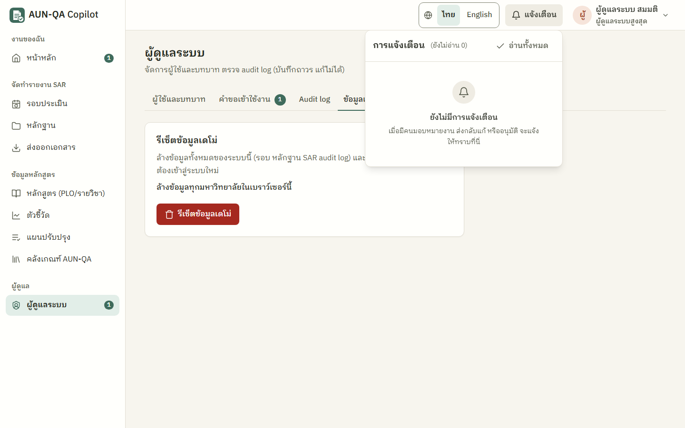
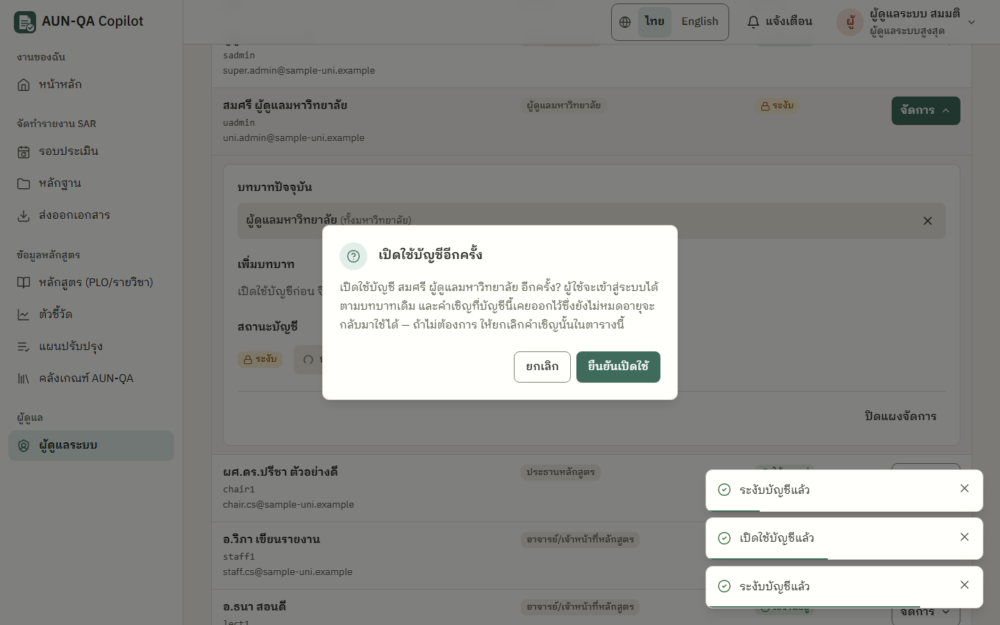
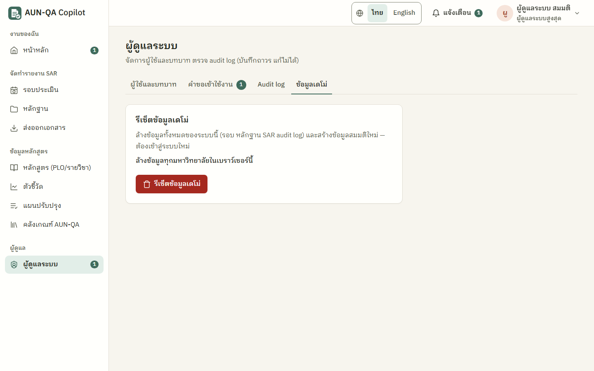

# คู่มือผู้ดูแลระบบสูงสุด (super_admin)

> บัญชีทดสอบ: `sadmin` / `demo1234` — ผู้ดูแลระบบ สมมติ
> อ่าน [ภาพรวม](00-overview.md) และ [คู่มือผู้ดูแลมหาวิทยาลัย](16-uni-admin.md) ก่อน หน้าจอที่ใช้ส่วนใหญ่เป็นหน้าเดียวกัน

> **หมายเหตุ:** บทบาทนี้ถูกทดสอบเล่นจริงเฉพาะเรื่องระงับ/เปิดใช้บัญชีผู้ดูแลมหาวิทยาลัย และแท็บข้อมูลเดโม่ ส่วนอื่นอ้างอิงจากกฎสิทธิ์ในโค้ดและหน้าผู้ดูแลระบบที่ใช้ร่วมกับผู้ดูแลมหาวิทยาลัย

ผู้ดูแลระบบสูงสุดคือผู้ดูแลแพลตฟอร์ม เป็นบทบาทเดียวที่ **มองเห็นข้อมูลข้ามมหาวิทยาลัยได้** และเป็นบทบาทเดียวที่ **รีเซ็ตข้อมูลเดโม่ได้** ใช้สำหรับงานดูแลระบบ ไม่ได้ใช้ทำงานประกันคุณภาพประจำวัน

## ทำอะไรได้ / ทำอะไรไม่ได้
| ทำได้ | ทำไม่ได้ |
|---|---|
| อ่านข้อมูลได้ทุกมหาวิทยาลัย | สร้างรอบ มอบหมายงาน/กรรมการ เริ่มการประเมิน หรือปิดรอบ (ใช้ผู้ดูแลมหาวิทยาลัย) |
| จัดการผู้ใช้และบทบาท รวมถึงบัญชีผู้ดูแลมหาวิทยาลัย (ระงับ/เปิดใช้ เพิ่ม/ถอนบทบาท) | เขียน SAR อัปโหลดหลักฐาน กรอกตัวชี้วัด |
| เชิญผู้ใช้ อนุมัติ/ปฏิเสธคำขอเข้าใช้งาน (เห็นคำขอทุกมหาวิทยาลัย) | อนุมัติใด ๆ ในรอบประเมิน ให้คะแนน หรือ verdict |
| ให้บทบาทผู้ดูแลระบบสูงสุดแก่ผู้อื่น (ผู้ดูแลมหาวิทยาลัยให้ไม่ได้) | ระงับหรือแก้บัญชีของตัวเอง |
| ดู audit log ดาวน์โหลด CSV | ใช้ AI |
| **รีเซ็ตข้อมูลเดโม่ (เฉพาะบทบาทนี้)** | |

## เมนูที่เห็น
หน้าหลัก · รอบประเมิน · หลักฐาน · ส่งออกเอกสาร · หลักสูตร · ตัวชี้วัด · แผนปรับปรุง · คลังเกณฑ์ AUN-QA · ผู้ดูแลระบบ (แท็บ ผู้ใช้และบทบาท · คำขอเข้าใช้งาน · Audit log · **ข้อมูลเดโม่**)

หน้าหลักโดยทั่วไปไม่มีงานในลำดับขั้นของรอบประเมิน งานที่จะขึ้นคือ "อนุมัติคำขอเข้าใช้งาน n รายการ" เมื่อมีคำขอค้าง กระดิ่งแจ้งเตือนมักว่าง ("ยังไม่มีการแจ้งเตือน")

---

## 1. จัดการผู้ใช้
เมนู **ผู้ดูแลระบบ** (`/app/admin`) → แท็บ **"ผู้ใช้และบทบาท"** วิธีเชิญ เพิ่มผู้ใช้ ใช้แผง "จัดการ" เพิ่ม/ถอนบทบาท และระงับ/เปิดใช้ เหมือน [คู่มือผู้ดูแลมหาวิทยาลัย หัวข้อ 1–5](16-uni-admin.md#1-ตารางผู้ใช้และแผง-จัดการ) ต่างกันตรงนี้
- แถวผู้ดูแลมหาวิทยาลัยมีปุ่ม "จัดการ" ให้คุณ (ผู้ดูแลมหาวิทยาลัยแก้บัญชีของคุณไม่ได้)
- **ระงับผู้ดูแลมหาวิทยาลัย** → ลิงก์เชิญที่ผู้ดูแลคนนั้นออกไว้จะใช้ไม่ได้ระหว่างถูกระงับ ตอน **เปิดใช้อีกครั้ง** กล่องยืนยันจะเตือนว่า "คำเชิญที่บัญชีนี้เคยออกไว้ซึ่งยังไม่หมดอายุจะกลับมาใช้ได้" ถ้าไม่ต้องการ ให้ยกเลิกคำเชิญนั้นในตาราง
- ในเวอร์ชันนี้ ตารางผู้ใช้และตัวเลือกขอบเขตแสดงเฉพาะมหาวิทยาลัยที่บัญชี `sadmin` สังกัด (มหาวิทยาลัยตัวอย่างภาคเหนือ) ถ้าต้องจัดการผู้ใช้ของมหาวิทยาลัยอื่น ให้ใช้บัญชีผู้ดูแลของมหาวิทยาลัยนั้น เช่น `uadmin2`

## 2. คำขอเข้าใช้งานจากทุกมหาวิทยาลัย
แท็บ **"คำขอเข้าใช้งาน"** แสดงคำขอทุกมหาวิทยาลัย การ์ดของมหาวิทยาลัยอื่นมีชื่อมหาวิทยาลัยกำกับ ตัวเลือกขอบเขตเป็นของมหาวิทยาลัยที่ผู้ขอสังกัด วิธีอนุมัติ/ปฏิเสธเหมือน [คู่มือผู้ดูแลมหาวิทยาลัย หัวข้อ 4](16-uni-admin.md#4-อนุมัติหรือปฏิเสธคำขอเข้าใช้งาน) (อ้างอิงจากโค้ด ยังไม่ได้ทดสอบเล่นจริงข้ามมหาวิทยาลัย)

## 3. รีเซ็ตข้อมูลเดโม่
แท็บ **"ข้อมูลเดโม่"** → **"รีเซ็ตข้อมูลเดโม่"** → กล่องยืนยัน "ข้อมูลที่แก้ไขทั้งหมดจะหาย และย้อนกลับไม่ได้" → **"ยืนยันล้างและสร้างข้อมูลเดโม่ใหม่"** → "รีเซ็ตเรียบร้อย กรุณาเข้าสู่ระบบใหม่"
- **ระวัง:** ล้างข้อมูลทั้งหมดในเบราว์เซอร์นี้ของทุกมหาวิทยาลัย (รอบ หลักฐาน SAR **audit log** ผู้ใช้ที่เพิ่มเอง คำขอ และคำเชิญที่ค้าง) แล้วสร้างข้อมูลสมมติชุดเริ่มต้นใหม่ ย้อนกลับไม่ได้
- ทุกคนต้องเข้าสู่ระบบใหม่
- ใช้ก่อนเริ่มสาธิตทุกครั้ง เพื่อให้ตัวเลขตรงกับคู่มือ

## 4. ตรวจ audit log
แท็บ **Audit log** กรองและ "ดาวน์โหลด CSV" ได้ เหมือนผู้ดูแลมหาวิทยาลัย

---

## เคล็ดลับ
- ใช้บัญชีนี้ให้น้อยที่สุด งานประจำของแต่ละมหาวิทยาลัยให้ผู้ดูแลมหาวิทยาลัยทำ
- ใช้ร่วมกับ `uadmin2` เพื่อสาธิตการแยกข้อมูล: `sadmin` อ่านได้ทุกมหาวิทยาลัย แต่ `uadmin2` เห็นเฉพาะของตัวเอง

## ปัญหาที่พบบ่อย
| อาการ | สาเหตุ | วิธีแก้ |
|---|---|---|
| ไม่มีปุ่มสร้างรอบหรือเริ่มการประเมิน | บทบาทนี้ไม่มีสิทธิ์ทำงานในลำดับขั้นของรอบ | ใช้บัญชีผู้ดูแลมหาวิทยาลัย หรือเพิ่มบทบาทนั้นให้บัญชี |
| ไม่พบหน้าจัดการมหาวิทยาลัย/เกณฑ์ | เวอร์ชันนี้ยังไม่มีหน้าจอสำหรับงานนี้ | ข้อมูลมหาวิทยาลัยและเกณฑ์มาจากข้อมูลตั้งต้นของระบบ |
| ตารางผู้ใช้ไม่มีผู้ใช้ของมหาวิทยาลัยอื่น | หน้าผู้ใช้แสดงตามมหาวิทยาลัยที่บัญชีสังกัด | ใช้บัญชีผู้ดูแลของมหาวิทยาลัยนั้น |
| ผู้ดูแลมหาวิทยาลัยบอกว่าไม่เห็นแท็บข้อมูลเดโม่ | ตั้งใจ — รีเซ็ตเป็นสิทธิ์ของบทบาทนี้เท่านั้น | รีเซ็ตด้วยบัญชี `sadmin` |
