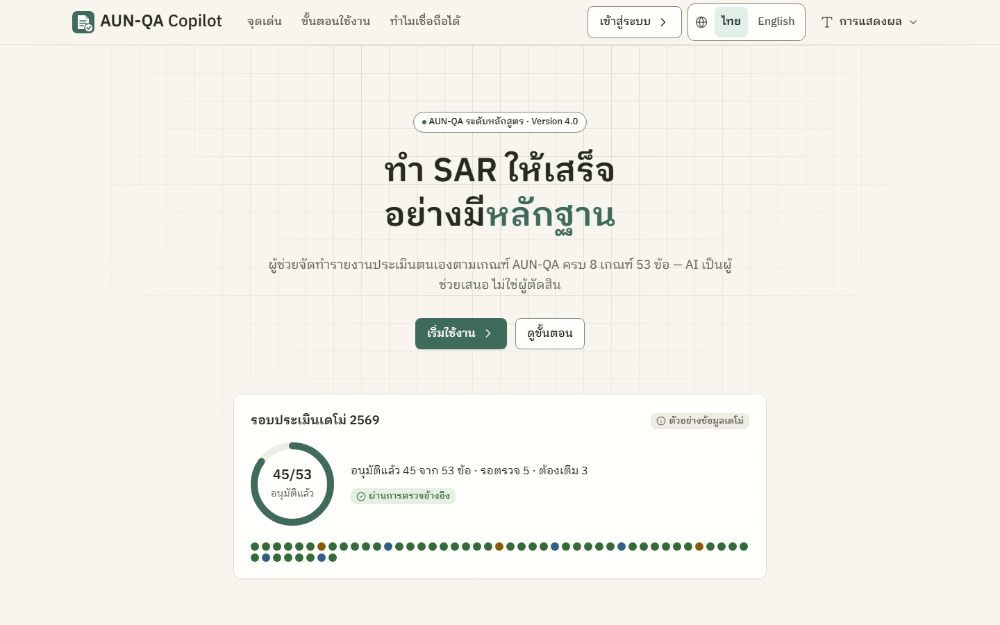

# คู่มือใช้งาน AUN-QA Copilot

ผู้ช่วยจัดทำรายงานประเมินตนเอง (SAR) และหลักฐาน ตามเกณฑ์ AUN-QA ระดับหลักสูตร ฉบับ 4.0 — 8 เกณฑ์ 53 ข้อ
**AI เป็นผู้ช่วยเสนอ ไม่ใช่ผู้ตัดสิน** · ข้อมูลทั้งหมดในเดโม่เป็นข้อมูลสมมติ

## เริ่มอ่านตรงไหนดี
| ถ้าคุณคือ… | อ่านไฟล์นี้ | ใช้เวลาประมาณ |
|---|---|---|
| ทุกคน (อ่านก่อน) | [00 ภาพรวมระบบ ตั้งแต่ต้นจนจบ](00-overview.md) | 15 นาที |
| ผู้ใช้ใหม่ที่ยังไม่มีบัญชี (ขอเข้าใช้งาน / ได้ลิงก์เชิญ) | [01 ผู้ใช้ใหม่](01-new-user.md) | 5 นาที |
| ประธานหลักสูตร | [10 ประธานหลักสูตร](10-programme-chair.md) | 15 นาที |
| อาจารย์ประจำหลักสูตร (ผู้เขียน SAR) | [11 อาจารย์ประจำหลักสูตร](11-lecturer.md) | 10 นาที |
| เจ้าหน้าที่ข้อมูล / เจ้าหน้าที่หลักสูตร | [12 เจ้าหน้าที่ข้อมูล](12-data-staff.md) | 10 นาที |
| งานประกันคุณภาพคณะ | [13 QA คณะ](13-faculty-qa.md) | 8 นาที |
| คณบดี | [14 คณบดี](14-dean.md) | 5 นาที |
| กรรมการประเมิน | [15 กรรมการประเมิน](15-assessor.md) | 8 นาที |
| ผู้ดูแลมหาวิทยาลัย (รวมการเชิญ/อนุมัติผู้ใช้) | [16 ผู้ดูแลมหาวิทยาลัย](16-uni-admin.md) | 12 นาที |
| ผู้ดูแลระบบสูงสุด | [17 ผู้ดูแลระบบสูงสุด](17-super-admin.md) | 5 นาที |
| เจอศัพท์ที่ไม่รู้จัก | [90 อภิธานศัพท์ ไทย–อังกฤษ](90-glossary.md) | — |

## ทางลัด
- **เปิดเดโม่บนเครื่อง:** [ภาพรวม หัวข้อ 6](00-overview.md#6-วิธีเปิดเดโม่บนเครื่องตัวเอง) — `cd eduflow-next` → `npm install` → `npm run dev` → เปิด http://localhost:3000
- **บัญชีทดสอบ:** รหัสผ่านทุกบัญชี `demo1234` — `chair1` ประธาน · `staff1` / `lect1` / `lect2` อาจารย์ · `data1` เจ้าหน้าที่ข้อมูล · `fqa1` QA คณะ · `dean1` คณบดี · `assess1` กรรมการ · `uadmin` / `uadmin2` ผู้ดูแลมหาวิทยาลัย · `sadmin` ผู้ดูแลระบบสูงสุด (คนเดียวที่รีเซ็ตข้อมูลเดโม่ได้)
- **สาธิตครบรอบ 10 ขั้น:** [ภาพรวม หัวข้อ 7](00-overview.md#7-เส้นทางสาธิตแนะนำ)
- **ปรับขนาดตัวอักษร / ธีมมืด / ภาษา:** [ภาพรวม หัวข้อ 5](00-overview.md#5-หน้าตาและการใช้งานพื้นฐาน) — กดชื่อมุมขวาบน → "การแสดงผล" · ปุ่ม "ไทย │ English" ที่แถบบน
- **เชิญหรืออนุมัติผู้ใช้ใหม่:** [ผู้ดูแลมหาวิทยาลัย หัวข้อ 2–5](16-uni-admin.md#2-เพิ่มผู้ใช้-แนะนำ-ส่งลิงก์เชิญ)
- **ใครทำอะไรเมื่อไหร่:** [ภาพรวม หัวข้อ 3](00-overview.md#3-วงจรรอบประเมินทั้งหมด-และใครทำอะไรเมื่อไหร่)
- **ข้อจำกัดของเดโม่ (ต้องรู้):** [ภาพรวม หัวข้อ 8](00-overview.md#8-ข้อจำกัดของเดโม่)
- **ใช้ไม่ได้ / ติดปัญหา:** [ภาพรวม หัวข้อ 9](00-overview.md#9-คำถามที่พบบ่อยและการแก้ปัญหา) และตาราง "ปัญหาที่พบบ่อย" ท้ายคู่มือแต่ละบทบาท

## หน้าจอหลักของระบบ
| หน้า | path | ใครใช้บ่อย |
|---|---|---|
| หน้าแรก | `/` | ทุกคน (ยังไม่เข้าสู่ระบบ) |
| เข้าสู่ระบบ | `/login` | ทุกคน |
| ขอเข้าใช้งาน | `/request-access` | ผู้ใช้ใหม่ที่ยังไม่มีบัญชี |
| รับคำเชิญ ตั้งรหัสผ่าน | `/invite` (ลิงก์ `/invite#t=…`) | ผู้ได้รับเชิญ |
| หน้าหลัก "สิ่งที่ต้องทำตอนนี้" | `/app` | ทุกคน |
| รอตรวจ | `/app/review` | ประธาน QA คณะ คณบดี |
| รอบประเมิน / แดชบอร์ดรอบ | `/app/cycles`, `/app/cycles/{รอบ}` | ทุกคน |
| มอบหมายงาน | `/app/cycles/{รอบ}/assign` | ประธาน (กรรมการ: QA คณะ ผู้ดูแล) |
| เขียนข้อ SAR | `/app/sections/{รอบ}::{ข้อ}` | อาจารย์ ประธาน |
| พื้นที่ทำงานกรรมการ / ผลประเมิน | `/app/cycles/{รอบ}/assess` | กรรมการ |
| คลังหลักฐาน / รายละเอียดหลักฐาน | `/app/evidence`, `/app/evidence/{id}` | ทุกคน |
| หลักสูตร (PLO/รายวิชา/CLO) | `/app/curriculum` | ประธาน อาจารย์ |
| ตัวชี้วัด | `/app/metrics` | เจ้าหน้าที่ข้อมูล ประธาน |
| แผนปรับปรุง | `/app/actions` | ประธาน QA คณะ ผู้รับผิดชอบแผน |
| ส่งออกเอกสาร | `/app/export` | ประธาน ทุกคน |
| คลังเกณฑ์ AUN-QA | `/app/requirements` | ทุกคน |
| ผู้ดูแลระบบ | `/app/admin` | ผู้ดูแลมหาวิทยาลัย (ผู้ใช้และบทบาท · คำขอเข้าใช้งาน · Audit log) · ผู้ดูแลระบบสูงสุด (+ ข้อมูลเดโม่) · ประธาน QA คณะ คณบดี (เฉพาะ Audit log) |

## เกี่ยวกับคู่มือนี้
- ปรับปรุงล่าสุด 27 ต.ค. 2569 ให้ตรงกับระบบหลังงานปรับดีไซน์และระบบรับผู้ใช้ใหม่ (TASK-0002, สาขา `feat/TASK-0002-saas-redesign`) เขียนจากโค้ดจริงและผลทดสอบเล่นจริงทุกบทบาท ผู้ดูแลระบบสูงสุดทดสอบเฉพาะบางเรื่อง (ระบุในคู่มือของบทบาทนั้น)
- ภาพหน้าจออยู่ที่ `.agents/screenshots/TASK-0002/` (ไฟล์ `final-*` ดูรายการใน `INDEX.md` ของโฟลเดอร์นั้น) ถ่ายจาก build สุดท้าย เดสก์ท็อป 1440 px และมือถือ 390 px ภาษาไทย ธีมสว่าง
- ตัวเลขในตัวอย่าง (เช่น วิกฤต 36, อนุมัติ 45/53) เป็นค่าของข้อมูลเดโม่ตอนเริ่ม อาจต่างไปหลังกดใช้งาน
- ประวัติการเปลี่ยนแปลงของระบบดูที่ [CHANGELOG.md](../../CHANGELOG.md)
