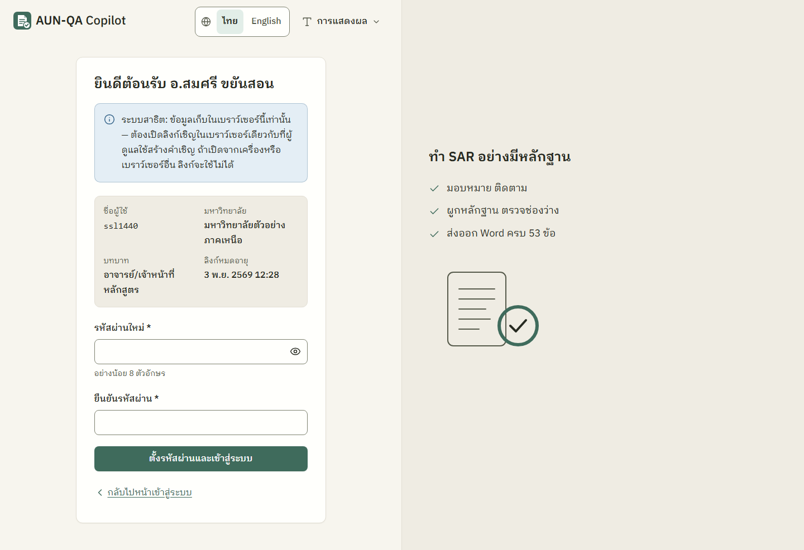
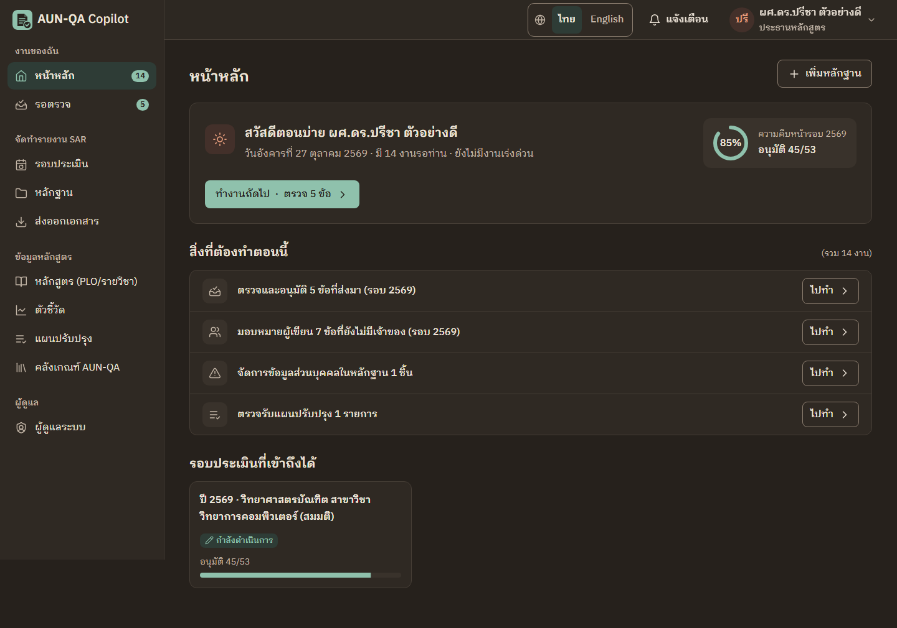
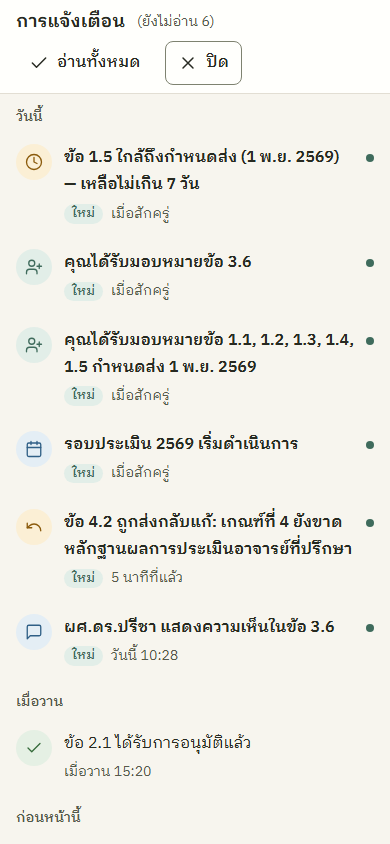
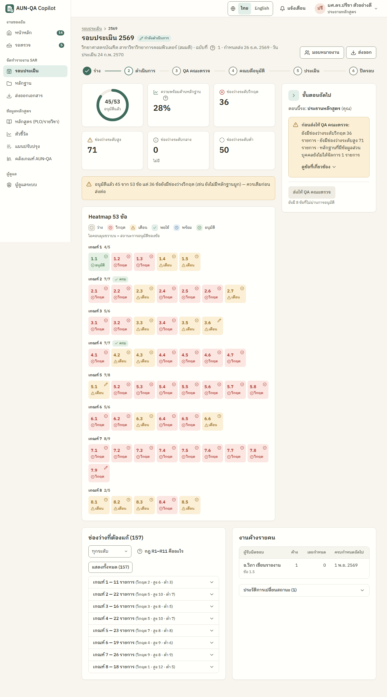
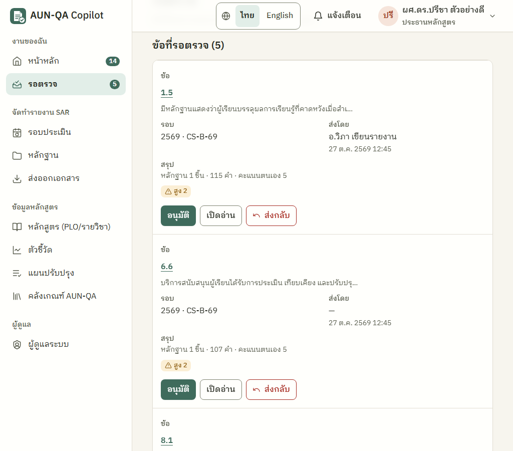
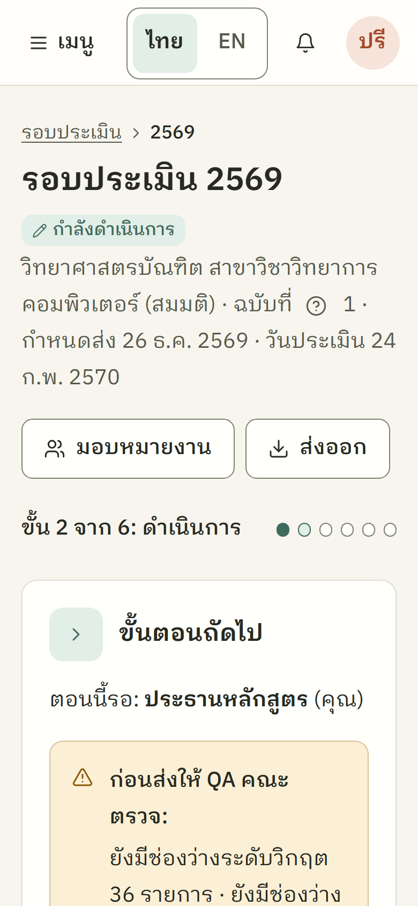
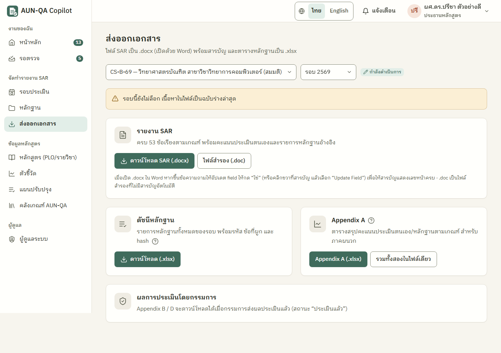

# บทที่ 4 ผลการวิจัย

<!-- TASK-0001 (B6 เขียนใหม่, D3 อัปเดตตามระบบสุดท้าย 2026-10-23) · TASK-0002 (เฟส 10, 2026-10-27): ภาพหน้าจอชุดใหม่ .agents/screenshots/TASK-0002/final-* (HEAD b7a4b4a), ผลทดสอบสุดท้าย, ผลตรวจความมั่นคงปลอดภัยและส่วนติดต่อผู้ใช้ระยะ R · ตัวเลขทุกตัวมาจากรายงานจริงหรือการรันซ้ำที่ระบุใน comment source เท่านั้น -->

บทนี้นำเสนอผลการพัฒนาระบบ ผลการทดสอบ และผลการประเมิน ตามวัตถุประสงค์ข้อที่ 1–4 ในบทที่ 1 ผลที่ยังไม่ได้เก็บข้อมูลจะระบุไว้อย่างชัดเจน

## 4.1 ผลการพัฒนาระบบ

### 4.1.1 สถานะของโมดูล

ผู้วิจัยพัฒนาระบบ AUN-QA Copilot เป็นเว็บแอปพลิเคชันด้วย Next.js มีหน้าจอ 19 หน้า ได้แก่ หน้าแรก หน้าเข้าสู่ระบบ หน้าขอเข้าใช้งาน หน้ารับคำเชิญ และหน้าทำงาน 15 หน้า และมี Route Handler 1 จุด (`/api/ai`) สถานะของแต่ละโมดูลเทียบกับความต้องการในตารางที่ 3.3 สรุปดังตารางที่ 4.1

<!-- source: นับไฟล์ page.tsx ใน eduflow-next/app (19 ไฟล์ — เพิ่ม app/request-access และ app/invite ในระยะ R) โดย thesis-writer 2026-10-27 -->

Table: ตารางที่ 4.1 สถานะการพัฒนาของแต่ละโมดูล

| รหัส | โมดูล | สถานะ | สิ่งที่ทำได้ / ข้อจำกัด |
|---|---|---|---|
| M1 | ผู้ใช้และองค์กร | พัฒนาแล้ว | เข้าสู่ระบบ 8 บทบาท ชื่อผู้ใช้ไม่แยกตัวพิมพ์ เซสชันมีอายุและใช้ร่วมกันทุกแท็บ รับผู้ใช้ใหม่ได้ 3 ทาง (เชิญด้วยลิงก์ ขอเข้าใช้งานแล้วผู้ดูแลอนุมัติ และผู้ดูแลตั้งรหัสผ่านให้) บัญชี 4 สถานะ ระงับแทนการลบ บทบาทผูกกับระดับขอบเขตที่อนุญาต ผู้ดูแลระบบยังจัดการผู้ใช้ของมหาวิทยาลัยอื่นผ่านหน้าจอไม่ได้ และระบบยังไม่ส่งอีเมล |
| M2 | คลังเกณฑ์ | พัฒนาแล้ว | 8 เกณฑ์ 53 ข้อ ค้นหาภาษาไทยและอังกฤษ ข้อความภาษาอังกฤษบางข้อเรียบเรียงใกล้เคียงต้นฉบับ ไม่ใช่ข้อความตรงตัว |
| M3 | รอบการประเมิน | พัฒนาแล้ว | สร้างรอบพร้อม 53 ข้อ มอบหมายรายข้อหรือทั้งเกณฑ์ กำหนดส่ง |
| M4 | การจับคู่หลักสูตร | พัฒนาแล้ว | PLO รายวิชา CLO เมทริกซ์ I/R/M แผนภาพความร้อน ช่องว่างหลักสูตร ผังวิชาที่ต้องเรียนก่อน ยังไม่มีการนำเข้าข้อมูลหลักสูตรจาก Excel |
| M5 | คลังหลักฐาน | พัฒนาแล้ว | รหัส E-ข้อ-ลำดับ ผูกหลายข้อ ตรวจไฟล์ซ้ำด้วย SHA-256 สแกนข้อมูลส่วนบุคคลจากข้อความและชื่อไฟล์ ข้อที่ส่งตรวจหรืออนุมัติแล้วผูกหรือเลิกผูกหลักฐานไม่ได้ ไฟล์ PDF DOCX XLSX และรูปภาพยังไม่ถูกดึงข้อความจึงแสดงว่า "ยังไม่ได้สแกน" |
| M6 | ตัวชี้วัด | พัฒนาแล้ว | ตารางและกราฟแนวโน้มพร้อมเส้นเป้าหมายและค่าเทียบเคียง นำเข้าตัวชี้วัดและข้อมูลรายรุ่นจากแม่แบบ Excel |
| M7 | ผลสำรวจ | ยังไม่พัฒนา | อยู่ในลำดับ Should |
| M8 | ตัวแก้ไข SAR | พัฒนาแล้ว | เนื้อหาไทยและอังกฤษ PDCA ตรวจรหัสหลักฐานขณะพิมพ์ ให้คะแนนตนเอง บันทึกอัตโนมัติและเวอร์ชัน แปลด้วย AI-4 ตรวจรายการก่อนส่ง แสดงเหตุผลที่ถูกส่งกลับ ตรวจความขัดแย้งในการบันทึก และล็อกเนื้อหาเมื่อส่งตรวจหรืออนุมัติแล้ว |
| M9 | การวิเคราะห์ช่องว่าง | พัฒนาแล้ว | กฎ R1–R11 แผงความพร้อม 53 ช่อง ร้อยละความพร้อม งานค้าง และคำเตือนก่อนเปลี่ยนสถานะ |
| M10 | ลำดับงานการอนุมัติ | พัฒนาแล้ว | เครื่องสถานะ การแยกผู้เขียนกับผู้อนุมัติ คณบดีส่งกลับได้ ล็อกพร้อมค่าแฮชและตรวจซ้ำได้ เปิดรอบแก้ไขใหม่ หน้ารอบแสดงผู้ส่งกลับ เวลา และเหตุผล |
| M11 | การส่งออก | พัฒนาแล้ว | SAR เป็นไฟล์ DOCX จริง (สำรองเป็น .doc) ดัชนีหลักฐานและ Appendix A เป็น .xlsx Appendix B และ D เป็น .doc ยังไม่มี PDF และยังไม่ตรงแม่แบบของมหาวิทยาลัยใดโดยเฉพาะ |
| M12 | พื้นที่ทำงานกรรมการ | พัฒนาแล้ว | อ่าน SAR อย่างเดียว ข้อค้นพบรายข้อ คะแนนรายเกณฑ์ verdict ที่กรรมการเลือกเอง AI-9 ยังไม่มีสถานะการส่งผลรายกรรมการ |
| M14 | แผนปรับปรุง | พัฒนาแล้ว | สร้างจาก AFI สถานะ open → in_progress → done → verified ผลที่เสร็จแล้วกลายเป็นหลักฐานขั้น A ในรอบถัดไป |
| M16 | การแจ้งเตือน | พัฒนาแล้ว | แผงแจ้งเตือนจากกระดิ่ง จัดกลุ่มตามวัน กดแล้วไปหน้าปลายทาง 7 ชนิด ข้อความภาษาอังกฤษทุกจุด แจ้งบทบาทถัดไปทุกครั้งที่รอบเปลี่ยนสถานะ และรายการ "สิ่งที่ต้องทำตอนนี้" ตามบทบาท ยังไม่ส่งอีเมล |
| M17 | บันทึกการตรวจสอบ | พัฒนาแล้ว | บันทึกแบบเพิ่มต่อท้าย รวมการกระทำด้านบัญชีผู้ใช้ทุกชนิด กรองและส่งออก CSV |
| AI | บริการปัญญาประดิษฐ์ | พัฒนาแล้ว 6 ฟีเจอร์ | AI-1, AI-2, AI-3, AI-4, AI-7, AI-9 ทำงานแบบออฟไลน์ เส้นทาง Claude พัฒนาแล้วแต่ยังไม่เคยเรียก API จริง |
| - | การแสดงผลและภาษา | พัฒนาแล้ว | โหมดสว่าง มืด และตามเครื่อง (ค่าเริ่มต้นสว่าง) ขนาดตัวอักษร 3 ระดับ ภาษาไทยและอังกฤษเลือกครั้งเดียวใช้ทุกหน้าและทุกแท็บ ข้อความแจ้งข้อผิดพลาดจากชั้นตรรกะบางส่วนและข้อมูลตัวอย่างยังเป็นภาษาไทย |
| - | ฐานข้อมูล PostgreSQL และ RLS | ยังไม่พัฒนา | รุ่นต้นแบบใช้ localStorage |

<!-- source: .agents/board/TASK-0001.md Log A2, A3, B2, B3, C1, C2, U2-B, U3 fix, D-sec fix; .agents/board/TASK-0002.md Log R2-B1–B5, R2-F1–F15, Backlog หลัง TASK-0002 (P12, super_admin ข้ามมหาวิทยาลัย); CHANGELOG.md (root); ADR-AUTH-001 A3, A6 -->

เมื่อสิ้นระยะ B ตัวแทนปัญญาประดิษฐ์บทบาทนักวิจัย (researcher) ประเมินความครอบคลุมของสเปกโดยให้น้ำหนักรายการที่ทำแล้ว 1 ทำบางส่วน 0.5 และยังไม่ทำ 0 ได้ระดับ Must ร้อยละ 87.5 (14 จาก 16 รายการ) และระดับ Should ร้อยละ 43.8 (3.5 จาก 8 รายการ) รายการระดับ Must ที่ยังขาดในขณะนั้นคือ AI-4 (ยังไม่ทำ) การส่งออก (ยังไม่ใช่ DOCX จริง) และการตัดข้อมูลส่วนบุคคล (ยังไม่มีการรู้จำชื่อบุคคล) ระยะ C พัฒนา AI-4 และการส่งออก DOCX จนครบ ส่วนการตัดข้อมูลส่วนบุคคลยังเป็นบางส่วน เมื่อคำนวณซ้ำด้วยเกณฑ์เดิม ระดับ Must เป็น 15.5 จาก 16 รายการ หรือร้อยละ 96.9 ส่วนระดับ Should ไม่เปลี่ยน ตัวเลขนี้นับการมีฟีเจอร์ตามสเปกเท่านั้น ไม่ได้วัดว่าระบบแก้ปัญหาของผู้ใช้ได้จริง และยังไม่มีผู้ใช้จริงยืนยันความต้องการ ความสามารถที่เพิ่มในระยะ R (การรับผู้ใช้ใหม่และการแจ้งเตือนแบบมีปลายทาง) ไม่ได้นำมาคำนวณซ้ำ

<!-- source: .agents/research/TASK-0001-coverage.md หัวข้อ 1.1–1.2 (researcher 2026-10-21, ก่อนระยะ C); การคำนวณซ้ำโดย thesis-writer 2026-10-23: AI-4 0→1 (Log C1), M11 0.5→1 (Log C1 exportSarDocx), PII redaction คง 0.5 (B-6 ใน TASK-0001-security.md) -->

### 4.1.2 หน้าจอของระบบ

ภาพหน้าจอในหัวข้อนี้ถ่ายจากระบบที่สร้างเป็นรุ่นใช้งานจริงของโค้ดฉบับสุดท้ายในระยะ R ด้วย Playwright บนหน้าจอกว้าง 1440 พิกเซล ยกเว้นรูปที่ระบุความกว้างอื่น และใช้ข้อมูลสมมติทั้งหมด ชื่อบุคคล อีเมล และหลักสูตรในภาพเป็นข้อมูลสาธิต ไม่ใช่บุคคลหรือหลักสูตรจริง ลิงก์และรหัสเชิญในภาพเป็นค่าของเครื่องพัฒนาที่ใช้ไม่ได้ภายนอก แถบเมนูด้านซ้ายในภาพเต็มหน้าสิ้นสุดที่ความสูงของจอ และแถบปุ่มที่ติดขอบล่างของจออาจปรากฏกลางภาพ ซึ่งเกิดจากวิธีถ่ายภาพแบบเต็มหน้า ไม่ใช่ข้อบกพร่อง

<!-- source: .agents/screenshots/TASK-0002/INDEX.md หัวข้อ Re-check 3 (HEAD b7a4b4a, server :3980 — ทุกไฟล์ final-* เป็นของ build นี้) และหมายเหตุภาพเต็มหน้า -->

หน้าเข้าสู่ระบบในรูปที่ 4.1 มีปุ่มภาษาแบบแบ่งช่อง "ไทย │ English" และปุ่ม "การแสดงผล" ที่มีข้อความอยู่ด้านบน ใต้ปุ่มเข้าสู่ระบบมีทางเข้าใหม่ 2 ทาง คือ "ขอเข้าใช้งาน" และ "มีรหัสเชิญ" และด้านล่างมีรายการบัญชีทดสอบที่พับเก็บได้

หน้าขอเข้าใช้งานในรูปที่ 4.2 มีป้ายแจ้งว่าเป็นระบบสาธิตที่เก็บคำขอในเบราว์เซอร์นี้เท่านั้น ฟอร์มแบ่งเป็นข้อมูลของผู้ขอและการตั้งค่าการเข้าสู่ระบบ ช่องหน่วยงานเลือกได้หลังกรอกอีเมลของมหาวิทยาลัย ช่องตำแหน่งระบุว่าเป็นข้อมูลประกอบ ไม่ใช่การเลือกสิทธิ์ และฟอร์มไม่มีช่องเลือกบทบาท ก่อนปุ่มส่งมีประกาศความเป็นส่วนตัว 6 ข้อ และช่องทำเครื่องหมายรับทราบ

ผู้ถูกเชิญที่เปิดลิงก์เชิญจะพบหน้ารับคำเชิญในรูปที่ 4.3 ซึ่งทักทายด้วยชื่อ สรุปชื่อผู้ใช้ มหาวิทยาลัย บทบาท และวันหมดอายุของลิงก์ และให้ตั้งรหัสผ่านอย่างน้อย 8 ตัวอักษร เมื่อตั้งรหัสผ่านแล้วระบบพาเข้าสู่ระบบทันที

หน้าหลักของประธานหลักสูตรในรูปที่ 4.4 มีแถบด้านบนที่ทุกปุ่มมีข้อความ ได้แก่ ปุ่มภาษา ปุ่มแจ้งเตือน และเมนูผู้ใช้ที่แสดงชื่อและบทบาท เมนูด้านซ้ายจัดเป็น 4 กลุ่มพร้อมตัวนับงาน การ์ดทักทายบอกวันที่และจำนวนงาน พร้อมวงแสดงความคืบหน้าของรอบและปุ่ม "ทำงานถัดไป" ใต้การ์ดเป็นรายการ "สิ่งที่ต้องทำตอนนี้" แถวละหนึ่งงานพร้อมปุ่ม "ไปทำ"

รูปที่ 4.5 คือหน้าเดียวกันในโหมดมืดแบบอบอุ่นสลัว ซึ่งใช้พื้นสีน้ำตาลถ่านและตัวอักษรสีครีมแทนสีดำและสีขาว

เมนูผู้ใช้ในรูปที่ 4.6 รวมการตั้งค่าขนาดตัวอักษร (ปกติ ใหญ่ ใหญ่มาก) ธีม (สว่าง มืด ตามเครื่อง) เอฟเฟกต์ และปุ่มออกจากระบบไว้ในที่เดียว

เมื่อกดปุ่มแจ้งเตือน แผงรายการในรูปที่ 4.7 เปิดใต้กระดิ่ง หัวแผงบอกจำนวนที่ยังไม่อ่านและมีปุ่ม "อ่านทั้งหมด" รายการจัดกลุ่มตามวัน รายการที่ยังไม่อ่านมีป้าย "ใหม่" ตัวหนา และจุดสี วันที่ในข้อความแสดงเป็นปีพุทธศักราช และกดรายการแล้วระบบพาไปหน้าของงานนั้น

บนหน้าจอกว้าง 390 พิกเซล แผงแจ้งเตือนเปลี่ยนเป็นแผงเต็มจอที่มีปุ่ม "ปิด" ดังรูปที่ 4.8

{width=45%}

แผงของรอบการประเมินในรูปที่ 4.9 แสดงแถบขั้นตอนของรอบ ตัวเลขสรุป แผนภาพความร้อน 53 ช่องซึ่งแสดงสถานะด้วยสี ไอคอน และข้อความร่วมกัน และรายการช่องว่างตามกฎ R1–R11 จำนวนช่องว่างระดับวิกฤตในภาพมาจากข้อมูลสาธิตที่ตั้งใจให้มีช่องว่าง

ตัวแก้ไข SAR รายข้อในรูปที่ 4.10 แบ่งเป็น 2 คอลัมน์ คอลัมน์ซ้ายเป็นข้อกำหนด แถบขั้นตอน และกล่องเขียนเนื้อหาแยกแท็บภาษาไทยและอังกฤษ คอลัมน์ขวาเป็นแท็บหลักฐาน ความเห็น และประวัติ และมีแถบปุ่มบันทึกและส่งตรวจติดขอบล่างของจอ

ฟอร์มเพิ่มหลักฐานในรูปที่ 4.11 ใช้ช่องค้นหาข้อเกณฑ์ที่พิมพ์เลขข้อหรือคำแล้วเลือกเป็นป้าย ข้อที่ส่งตรวจหรืออนุมัติแล้วในรอบนั้นถูกทำเครื่องหมายว่าล็อกและเลือกไม่ได้

หน้าหลักสูตรในรูปที่ 4.12 มีแท็บย่อยสำหรับ PLO รายวิชาและ CLO เมทริกซ์ แผนภาพความร้อน ช่องว่างหลักสูตร และผังวิชาที่ต้องเรียนก่อน

หน้าผู้ดูแลมี 3 แท็บสำหรับผู้ดูแลมหาวิทยาลัย ได้แก่ ผู้ใช้และบทบาท คำขอเข้าใช้งาน (พร้อมตัวนับ) และบันทึกการตรวจสอบ ส่วนแท็บข้อมูลสาธิตแสดงเฉพาะผู้ดูแลระบบ รูปที่ 4.13 คือแท็บคำขอเข้าใช้งาน การ์ดคำขอแสดงข้อมูลผู้ขอ คำเตือนว่าอีเมลยังไม่ได้ยืนยัน ช่องเลือกบทบาทและขอบเขตที่กรองตามบทบาท และปุ่มอนุมัติคำขอกับปุ่มปฏิเสธ

เมื่อผู้ดูแลเชิญผู้ใช้ ระบบแสดงผลการเชิญในรูปที่ 4.14 ประกอบด้วยลิงก์เชิญพร้อมปุ่มคัดลอก รหัสเชิญ วันหมดอายุ ข้อความว่าระบบแสดงลิงก์นี้ครั้งเดียว และป้ายระบบสาธิตที่บอกว่าต้องเปิดลิงก์ในเบราว์เซอร์เดียวกับผู้ดูแล

ตารางผู้ใช้ในรูปที่ 4.15 มี 4 คอลัมน์ คือ ผู้ใช้ บทบาท สถานะ และปุ่ม "จัดการ" ซึ่งเปิดแผงจัดการรายคนที่มีบทบาทปัจจุบัน การเพิ่มบทบาทพร้อมขอบเขต และสถานะบัญชี (ระงับหรือเปิดใช้) แถวของผู้ดูแลระบบและบัญชีของผู้ใช้เองไม่มีปุ่มจัดการ และไม่มีปุ่มลบบัญชีที่เคยใช้งาน

เมื่อกรอบของตารางแคบกว่าความกว้างที่ตารางต้องใช้ ตารางเปลี่ยนเป็นการ์ดที่มีป้ายหัวคอลัมน์กำกับแต่ละค่า และปุ่มอยู่ท้ายการ์ด รูปที่ 4.16 คือหน้ารอตรวจของประธานหลักสูตรที่ความกว้าง 1024 พิกเซล

รูปที่ 4.17 คือแผงของรอบบนหน้าจอกว้าง 390 พิกเซลที่ขนาดตัวอักษร "ใหญ่มาก" (125%) ซึ่งไม่มีการเลื่อนแนวนอนและไม่มีข้อความถูกตัด

{width=45%}

หน้าส่งออกในรูปที่ 4.18 ให้ดาวน์โหลด SAR เป็น .docx ดัชนีหลักฐานเป็น .xlsx และ Appendix A

หน้าจออื่น ได้แก่ รายการตรวจก่อนส่งข้อ คำเตือนก่อนคณบดีอนุมัติสุดท้ายและล็อกรอบ พื้นที่ทำงานกรรมการ และหน้าตัวชี้วัด ทำงานตามที่อธิบายในบทที่ 3 แต่ไม่ได้นำภาพมาแสดง เพราะชุดภาพหน้าจอสุดท้ายไม่มีภาพของสถานะเหล่านั้น หรือภาพเต็มหน้ายาวเกินกว่าจะอ่านได้เมื่อพิมพ์

[ต้องการข้อมูล: ภาพผลร่าง SAR ของ AI-2 และผลแปลของ AI-4 ที่แสดงป้ายโหมดออฟไลน์และธงการตรวจหลังประมวลผล — ชุดภาพหน้าจอสุดท้ายยังไม่มีภาพนี้]

### 4.1.3 ผลการเดินลำดับงานด้วยข้อมูลสาธิต

ข้อมูลสาธิตประกอบด้วยเนื้อหา SAR 53 ข้อ ซึ่งอนุมัติแล้ว 45 ข้อ รอตรวจ 5 ข้อ และกำลังร่าง 3 ข้อ ข้อมูลหลักสูตร 6 PLO 12 รายวิชา 23 CLO และแผนปรับปรุง 6 รายการ ข้อมูลหลักสูตรตั้งใจให้ PLO6 ไม่มีรายวิชารับผิดชอบและ PLO4 ไม่มีวิธีวัดผล เพื่อให้กฎ R7 แสดงผลได้ <!-- source: .agents/board/TASK-0001.md Log db-engineer B1 -->

ในการทดลองใช้ระยะ U ตัวแทนผู้ทดลองใช้เดินรอบสาธิตปีการศึกษา 2569 ครบ 10 ขั้น ผ่าน 7 บทบาท และทุกครั้งที่รอบเปลี่ยนสถานะ บทบาทถัดไปได้รับแจ้งเตือน <!-- source: .agents/playtest/TASK-0001-roles-u3.md -->

ในระยะ R ตัวแทนผู้ทดลองใช้เดินลำดับงานครบวงจรอีกครั้งบนข้อมูลที่เริ่มใหม่ โดยผู้ดูแลมหาวิทยาลัยสร้างกรรมการคนใหม่ ประธานมอบหมาย 3 ข้อ อาจารย์เขียน ผูกหลักฐาน และส่ง ประธานให้ความเห็นและส่งกลับ อาจารย์แก้และส่งใหม่ ประธานอนุมัติและส่งรอบให้ QA คณะ QA คณะส่งกลับ ประธานอ่านเหตุผลบนหน้ารอบแล้วทำตาม 3 ขั้นและส่งใหม่ QA คณะอนุมัติ คณบดีล็อก QA คณะกดแจ้งเตือนไปมอบหมายกรรมการคนใหม่และเริ่มการประเมิน กรรมการ 2 คนให้คะแนน ประธานดูผล สร้างแผนปรับปรุง อาจารย์ดำเนินการ ประธานตรวจรับ และส่งออก SAR เป็นไฟล์ .docx ทุกขั้นเริ่มจากการกดแจ้งเตือน จุดที่ติดเล็กน้อยคือกรรมการคนแรกกดส่งผลก่อนคนที่สองให้คะแนนครบ ซึ่งระบบยังไม่มีสถานะการส่งผลรายกรรมการ (ข้อค้นพบ P12) นอกจากนี้ผู้ทดลองใช้ทดสอบการขอเข้าใช้งาน การเชิญ การระงับ การกดแจ้งเตือนครบ 17 ชนิดที่สร้างได้ ซึ่งพาไปปลายทางถูกต้องทุกชนิด การแก้ที่อยู่หน้าเพื่อเข้าหน้าที่ไม่มีสิทธิ์ และการใช้แป้นพิมพ์อย่างเดียว ตลอดการทดลองไม่พบข้อผิดพลาดในคอนโซลของเบราว์เซอร์

<!-- source: .agents/reviews/TASK-0002-playtest.md Re-check ภารกิจ R1–R6 (R4 smoke ครบวงจร 8 บทบาท), BUG-0002-P12, รอบแรก ภารกิจ 1–22 และ "ตารางปลายทางแจ้งเตือนที่กดจริง" (17 ชนิด) -->

## 4.2 ผลการทดสอบระบบ

### 4.2.1 ผลการตรวจชนิดข้อมูลและการสร้างระบบ

ผู้วิจัยรันคำสั่ง `npx tsc --noEmit` ในโฟลเดอร์ `eduflow-next` บนโค้ดฉบับสุดท้ายเมื่อวันที่ 27 ตุลาคม 2569 ไม่พบข้อผิดพลาด การสร้างระบบด้วย `next build` สำเร็จในรอบทดสอบสุดท้ายของผู้ทดสอบ

<!-- source: thesis-writer รัน `npx tsc --noEmit` ใน eduflow-next/ ที่ HEAD 9dee963 วันที่ 2026-10-27 → TSC_EXIT=0; next build: Log qa-tester เฟส 6 สุดท้าย (server :3980 = build ของ HEAD b7a4b4a) และ Log R2-F14 "npm run build ผ่าน" — โค้ดใน eduflow-next ไม่เปลี่ยนหลัง b7a4b4a (commit หลังจากนั้นเป็น docs) -->

### 4.2.2 ผลการทดสอบหน่วยและการทดสอบร่วม

ผู้วิจัยรันชุดทดสอบ Vitest ด้วยคำสั่ง `npm test` ในโฟลเดอร์ `eduflow-next` เมื่อวันที่ 27 ตุลาคม 2569 ผลคือไฟล์ทดสอบผ่าน 30 จาก 30 ไฟล์ และกรณีทดสอบผ่าน 837 จาก 837 กรณี ไม่มีกรณีที่ไม่ผ่าน รายละเอียดดังตารางที่ 4.2 ไฟล์ที่เพิ่มในระยะ R มี 8 ไฟล์ ได้แก่ account-guards, data-label-i18n, facade-guard, notification-target, onboarding, phase7-fixes, security-r2b3 และ ui-cleanup

Table: ตารางที่ 4.2 ผลการทดสอบด้วย Vitest จำแนกตามไฟล์ทดสอบ

| ไฟล์ทดสอบ | ขอบเขต | จำนวนกรณี | ผ่าน |
|---|---|---|---|
| gap.test.ts | กฎช่องว่างและความพร้อม | 39 | 39 |
| workflow.test.ts | เครื่องสถานะ การล็อก ค่าแฮช | 21 | 21 |
| evidence-sar.test.ts | หลักฐาน รหัส การผูก และ SAR | 26 | 26 |
| rbac-ai-audit.test.ts | สิทธิ์ บริการ AI และบันทึกการตรวจสอบ | 33 | 33 |
| pii-text.test.ts | การสแกนและตัดข้อมูลส่วนบุคคล | 21 | 21 |
| review-fixes.test.ts | การแก้ข้อค้นพบจากการตรวจโค้ดระยะ A | 7 | 7 |
| phase-b2-smoke.test.ts | ทดสอบภาพรวมระยะ B | 3 | 3 |
| curriculum.test.ts | การจับคู่หลักสูตร R7 และ AI-7 | 18 | 18 |
| action-plan.test.ts | แผนปรับปรุงและหลักฐานขั้น A | 9 | 9 |
| assessor-lock.test.ts | กรรมการประเมิน การล็อก และ AI-9 | 14 | 14 |
| claude-provider.test.ts | ตัวให้บริการ Claude การสลับไปออฟไลน์ และการตรวจหลังประมวลผล | 13 | 13 |
| ai-route.test.ts | Route Handler `/api/ai` | 17 | 17 |
| phase-b-fixes.test.ts | การแก้ข้อค้นพบระยะ B | 7 | 7 |
| phase-b-review-fixes.test.ts | การแก้ข้อค้นพบระยะ B (ต่อ) | 6 | 6 |
| judgement-table.test.ts | ตารางคำตัดสินที่ต้องตัดและไม่ต้องตัด | 49 | 49 |
| ai7-ai1-trust.test.ts | การไม่เชื่อค่าที่ระบบรู้อยู่แล้วจากผล AI | 2 | 2 |
| phase-c1.test.ts | AI-4 อภิธานศัพท์ การนำเข้าตัวชี้วัดและข้อมูลรายรุ่น การส่งออก DOCX | 83 | 83 |
| phase-c-review-fixes.test.ts | การแก้ข้อค้นพบระยะ C | 41 | 41 |
| phase-u.test.ts | เซสชัน ชื่อผู้ใช้ รายการงาน การแจ้งเตือนบทบาทถัดไป การตรวจก่อนเปลี่ยนสถานะ | 47 | 47 |
| contrast.test.ts | โทเคนสีชุด Earth 34 ตัวทั้งสองธีม และความต่างสี 42 คู่ × 2 ธีมตาม WCAG ระดับ AA | 132 | 132 |
| u3-fix.test.ts | ความขัดแย้งในการบันทึกและเหตุผลที่ส่งกลับ | 12 | 12 |
| security-dsec.test.ts | การแก้ข้อค้นพบจากการตรวจความมั่นคงปลอดภัยระยะ D | 50 | 50 |
| onboarding.test.ts | การเชิญ คำขอเข้าใช้งาน การอนุมัติและปฏิเสธ การระงับ รหัสผ่าน 8–128 ตัวอักษร | 37 | 37 |
| notification-target.test.ts | ปลายทางและข้อความภาษาอังกฤษของแจ้งเตือน N1–N14 และการแปลงปลายทางเป็นที่อยู่หน้า | 33 | 33 |
| account-guards.test.ts | ผู้ใช้ที่ไม่อยู่ในสถานะใช้งานเขียนข้อมูลและรับแจ้งเตือนไม่ได้ | 17 | 17 |
| security-r2b3.test.ts | การแก้ข้อค้นพบจากการตรวจความมั่นคงปลอดภัยระยะ R (S-01 ถึง S-07) | 23 | 23 |
| ui-cleanup.test.ts | ไม่เหลือ CSS เดิม คลาสที่อนุญาต 27 ชื่อ และรุ่นของไลบรารี | 29 | 29 |
| phase7-fixes.test.ts | การแก้ข้อค้นพบจากการตรวจส่วนติดต่อผู้ใช้และการทดลองใช้ เช่น บทบาทกับขอบเขต และการล็อกหลักฐาน | 18 | 18 |
| facade-guard.test.ts | ฟังก์ชันภายในที่ไม่ตรวจสิทธิ์ต้องไม่ออกจาก `@/lib/api` และตารางบทบาทกับขอบเขตแก้ไขไม่ได้ | 24 | 24 |
| data-label-i18n.test.ts | ป้ายหัวคอลัมน์ในโหมดการ์ดทุกตัวมีคำแปลภาษาอังกฤษ | 6 | 6 |
| รวม | | 837 | 837 |

<!-- source: ผลรัน `npm test` (vitest run, Vitest 3.2.7) โดย thesis-writer 2026-10-27 ใน eduflow-next/ ที่ HEAD 9dee963 — "Test Files 30 passed (30) · Tests 837 passed (837)" ตรงกับ Log qa-tester "ผลเฟส 6 สุดท้ายของ TASK-0002" (30 files / 837); จำนวนต่อไฟล์จากผลรันเดียวกัน; ขอบเขตรายไฟล์จาก Log qa-tester Q2a, Q2b, Q1, เฟส 6 และ backend-dev R2-B3–B5 -->

จำนวนกรณีทดสอบเพิ่มขึ้นตามรอบการพัฒนา ดังตารางที่ 4.3

Table: ตารางที่ 4.3 จำนวนกรณีทดสอบ Vitest ที่ผ่านในแต่ละรอบการพัฒนา

| ระยะ | เหตุการณ์ | กรณีทดสอบที่ผ่าน |
|---|---|---|
| A | เขียนชุดทดสอบแรก | 140/140 |
| A | แก้ข้อค้นพบจากการตรวจโค้ด | 147/147 |
| B | พัฒนาตรรกะระยะ B | 150/150 |
| B | เพิ่มการทดสอบของระยะ B | 204/204 |
| B | แก้ข้อค้นพบการตรวจโค้ดรอบที่ 1 | 234/234 |
| B | แก้ข้อค้นพบที่เหลือ (R2-1, R2-2, R2-3) | 285/285 |
| C | เพิ่มการทดสอบของระยะ C | 368/368 |
| C | แก้ข้อค้นพบการตรวจโค้ดระยะ C | 409/409 |
| U | เพิ่มการทดสอบของระยะ U | 516/516 |
| U | แก้ข้อค้นพบจากการตรวจระยะ U | 528/528 |
| D | แก้ข้อค้นพบจากการตรวจความมั่นคงปลอดภัย | 578/578 |
| R | ปรับชุดทดสอบความต่างสีและฟอนต์สำหรับ Tailwind CSS | 638/638 |
| R | เพิ่มการทดสอบการรับผู้ใช้ใหม่ ปลายทางแจ้งเตือน และโทเคนชุด Earth | 707/707 |
| R | เพิ่มการทดสอบผู้ใช้ที่ไม่อยู่ในสถานะใช้งาน | 737/737 |
| R | ทดสอบหลังแก้ข้อค้นพบจากการตรวจโค้ดและความมั่นคงปลอดภัย | 789/789 |
| R | แก้ข้อค้นพบจากการตรวจส่วนติดต่อผู้ใช้และการทดลองใช้รอบที่ 1 | 807/807 |
| R | ป้องกันฟังก์ชันภายในหลุดออกจาก `@/lib/api` | 831/831 |
| R | แปลป้ายหัวคอลัมน์ในโหมดการ์ด (ผลสุดท้าย) | 837/837 |

<!-- source: .agents/board/TASK-0001.md Progress Checklist (A4 … D-sec "578 tests"); .agents/board/TASK-0002.md Log qa-tester Q0 (22 files / 638), Q2b/Q2a (24 ไฟล์ / 707), Q2c (25 ไฟล์ / 737), เฟส 6 (27 files / 789), หลังรอบแก้เฟส 7 รอบ 1 (807), R2-B5 (831), เฟส 6 สุดท้าย (837) -->

### 4.2.3 ผลการทดสอบตามสถานการณ์ผู้ใช้และเกณฑ์การยอมรับของส่วนติดต่อผู้ใช้

ชุดทดสอบ Playwright ของโค้ดฉบับสุดท้ายมี 178 กรณีใน 12 ไฟล์ ผู้ทดสอบรันบนเบราว์เซอร์ Chromium กับระบบที่สร้างเป็นรุ่นใช้งานจริงเมื่อวันที่ 27 ตุลาคม 2569 จำนวน 2 รอบติดกัน ทั้งสองรอบผ่าน 176 กรณี ข้าม 2 กรณี และไม่มีกรณีที่ไม่ผ่าน และรันไฟล์ทดสอบที่เพิ่มล่าสุดซ้ำ 3 ครั้งเพื่อตรวจความไม่เสถียร ผ่าน 39 จาก 39 ครั้ง รายละเอียดดังตารางที่ 4.4

Table: ตารางที่ 4.4 ผลการทดสอบด้วย Playwright จำแนกตามไฟล์ทดสอบ

| ไฟล์ทดสอบ | ขอบเขต | จำนวนกรณี | ผ่าน | ข้าม |
|---|---|---|---|---|
| flows-a.spec.ts | E2E-01 ถึง E2E-07 | 8 | 7 | 1 |
| flows-b.spec.ts | E2E-08 ถึง E2E-14 | 8 | 7 | 1 |
| ui-u.spec.ts | เกณฑ์การยอมรับของส่วนติดต่อผู้ใช้ (ขนาดตัวอักษร การเลื่อนแนวนอน เป้าหมายการกด โฟกัสทั้งสองธีม การลดการเคลื่อนไหว ฟอนต์) และการทดสอบถดถอย | 30 | 30 | 0 |
| regress-u1b.spec.ts | งานของกรรมการและการปิดรอบ ตัวนับงาน การรักษางานเมื่อออกจากระบบ | 5 | 5 | 0 |
| regress-u3fix.spec.ts | ข้อบกพร่องที่แก้ในระยะ U เช่น การบันทึกจากสองแท็บ เหตุผลที่ส่งกลับ | 16 | 16 | 0 |
| theme.spec.ts | ธีมเริ่มต้นสว่าง การสลับธีมผ่านเมนูผู้ใช้ ไม่กระพริบ และไม่มีการเลื่อนแนวนอนในโหมดมืด | 19 | 19 | 0 |
| shell-r2.spec.ts | แถบด้านบนไม่มีปุ่มไอคอนเดี่ยว ปุ่มภาษา เมนูผู้ใช้ แผงแจ้งเตือน และลูกเล่นเมื่อลดการเคลื่อนไหว | 33 | 33 | 0 |
| onboarding.spec.ts | เชิญจนเข้าสู่ระบบ ขอเข้าใช้งานจนอนุมัติหรือปฏิเสธ ระงับและเปิดใช้ รหัสผ่านสั้น และการกดแจ้งเตือนไปปลายทาง | 14 | 14 | 0 |
| security-fixes.spec.ts | การแก้ข้อค้นพบด้านความมั่นคงปลอดภัยที่หน้าจอ | 4 | 4 | 0 |
| phase7-fixes.spec.ts | การแก้ข้อค้นพบจากการตรวจส่วนติดต่อผู้ใช้และการทดลองใช้รอบที่ 1 | 17 | 17 | 0 |
| fix-r2f13.spec.ts | การแก้ข้อค้นพบรอบที่ 2 เช่น ปุ่มในตารางรอตรวจ | 11 | 11 | 0 |
| fix-r2f14-f15.spec.ts | ปุ่มในทุกตารางอยู่ในกรอบที่หลายความกว้างและขนาดตัวอักษร 125% และป้ายการ์ดภาษาอังกฤษ | 13 | 13 | 0 |
| รวม | | 178 | 176 | 2 |

<!-- source: Log qa-tester "ผลเฟส 6 สุดท้ายของ TASK-0002" (HEAD b7a4b4a, server :3980): `E2E_PORT=3980 E2E_REUSE=1 npx playwright test` รอบ 1 → 176 passed / 2 skipped / 0 failed (4.6m) · รอบ 2 → 176/2/0 (3.9m) · `--repeat-each=3` fix-r2f14-f15 → 39/39; จำนวนต่อไฟล์จาก `npx playwright test --list` ที่ thesis-writer รัน 2026-10-27 (Total: 178 tests in 12 files) — thesis-writer ไม่ได้รัน e2e ซ้ำเอง เพราะการสร้างระบบใหม่จะเขียนทับ .next ของเซิร์ฟเวอร์ที่ผู้ทดสอบเปิดไว้ -->

สถานการณ์ E2E-01 ถึง E2E-14 ในตารางที่ 3.12 ผ่านทั้งหมด โดยมีข้อสังเกต 3 ประการ (1) E2E-01 ทดสอบการเพิ่มผู้ใช้ประธานหลักสูตรด้วยโหมดตั้งรหัสผ่านให้ ส่วนการสร้างหลักสูตรใหม่ผ่านหน้าจอ (E2E-01b) ถูกข้ามเพราะระบบยังไม่มีหน้าจอนี้ (2) E2E-12 ทดสอบว่ากรรมการไม่มีปุ่มหรือช่องแก้เนื้อหา ส่วนการเรียก API โดยตรงแล้วได้รหัส 403 (E2E-12b) ถูกข้ามเพราะระบบไม่มี HTTP endpoint สำหรับเขียนข้อมูล การปฏิเสธที่ชั้นตรรกะครอบคลุมด้วยไฟล์ assessor-lock.test.ts แทน และ (3) E2E-06 ใช้ตัวให้บริการออฟไลน์ การทดสอบการตัดเซสชันของผู้ถูกระงับข้ามแท็บทำผ่าน Playwright ไม่ได้ เพราะในเบราว์เซอร์เดียว การเข้าสู่ระบบของผู้ดูแลจะทำให้แท็บเดิมออกจากระบบอยู่แล้ว จึงทดสอบด้วย Vitest แทน <!-- source: e2e/flows-a.spec.ts test.skip E2E-01b, e2e/flows-b.spec.ts test.skip E2E-12b; Log qa-tester C3b, Q2d ("ทดสอบ session ข้ามแท็บของผู้ถูกระงับใน e2e ไม่ได้ (ใช้ unit test)") -->

### 4.2.4 ผลการตรวจโค้ด

การตรวจโค้ดดำเนินการทุกระยะ โดยรวมรายการตรวจด้านความปลอดภัยไว้ด้วย ผลสรุปดังตารางที่ 4.5

Table: ตารางที่ 4.5 ผลการตรวจโค้ดแต่ละรอบ

| รอบ | ขอบเขต | ผล | ข้อค้นพบสำคัญ |
|---|---|---|---|
| ระยะ A | 102 ไฟล์ | APPROVE | blocker 0, major 0, minor 10, nit 2 |
| ระยะ B รอบที่ 1 | 54 ไฟล์ | CHANGES_REQUESTED | major 1 (การจำกัดอัตราของ `/api/ai` ถูกข้ามได้และไม่ตรวจรูปแบบผลลัพธ์), minor 7, nit 2 |
| ระยะ B รอบที่ 2 | 18 ไฟล์ | APPROVE | ปิดข้อค้นพบรอบที่ 1 เปิดใหม่ minor 2 และ nit 1 เกี่ยวกับตัวกรองคำตัดสินภาษาไทย ซึ่งแก้ต่อภายหลัง |
| ระยะ C รอบที่ 1 | 34 ไฟล์ | CHANGES_REQUESTED | major 1 (เอกสาร DOCX ไม่ตัดอักขระควบคุมที่ XML ไม่อนุญาต), minor 7, nit 4 |
| ระยะ C รอบที่ 2 | 11 ไฟล์ | CHANGES_REQUESTED | major 1 (ป้ายคำแปลออฟไลน์หลุดเข้าเนื้อหา SAR) |
| ระยะ C รอบที่ 3 | การแก้รอบที่ 2 | CHANGES_REQUESTED | major 1 (นิพจน์ปกติขาดเครื่องหมาย `\` ทำให้ตัดอักษร s ตัวแรกของคำแปล) แก้ 1 ตัวอักษรพร้อมการทดสอบ ผ่าน 409/409 |
| ระยะ U รอบที่ 1 | 81 ไฟล์ | CHANGES_REQUESTED | major 2 (การต่ออายุเซสชันไม่ครอบทุกฟอร์ม และสถานะเซสชันสิ้นสุดจากแท็บอื่นยังใช้งานเมนูได้), minor 4, nit 2 |
| ระยะ U รอบที่ 2 | ส่วนเซสชัน กล่องโต้ตอบ และการบันทึก | APPROVE | ปิด U-1 ถึง U-7 เหลือ minor 2 ซึ่งแก้แล้วและยืนยันด้วยการทดสอบ |
| ระยะ R | 44 commit, 290 ไฟล์ | APPROVE | blocker 0, major 0, minor 6, nit 3 เช่น ฟังก์ชันยกเลิกคำเชิญที่ไม่ตรวจสิทธิ์หลุดออกจาก `@/lib/api` และข้อความแจ้งข้อผิดพลาดใหม่บางข้อไม่มีคำแปล ข้อความแจ้งเตือนภาษาไทยเดิมไม่ถูกแก้แม้แต่ตัวอักษรเดียว |

<!-- source: .agents/reviews/TASK-0001-review.md (Phase A–U round 2); .agents/reviews/TASK-0002-review.md (Verdict APPROVE, 44 commit, 290 ไฟล์, Findings 1–9: minor 6 nit 3, "messageTh ไม่เปลี่ยน") -->

ประเด็นสำคัญจากการตรวจโค้ด ได้แก่ (1) ชั้นตรรกะตรวจสิทธิ์ทุกการเขียน และส่วนหน้าจอไม่เรียกฟังก์ชันเขียนข้อมูลดิบโดยตรง (2) ไม่พบกุญแจ API ในชุดไฟล์ฝั่งเบราว์เซอร์ที่สร้างแล้ว (3) เอกสารที่ส่งออกเข้ารหัสอักขระของข้อมูลผู้ใช้ทุกช่อง (4) บริการ AI ไม่เรียกฟังก์ชันเปลี่ยนสถานะหรือให้คะแนน และ (5) ไม่เหลือการใช้ `dangerouslySetInnerHTML` หรือ `innerHTML` ในโค้ดส่วนหน้าจอและชั้นตรรกะ ในระยะ B ผู้ตรวจทดลองข้อความ 17 ประโยคกับตัวกรองคำตัดสิน พบทั้งคำที่เลี่ยงตัวกรองได้และการตัดเกินข้อเท็จจริง จึงเพิ่มการทดสอบแบบตารางทั้งกรณีที่ต้องตัดและไม่ต้องตัด 49 กรณี ในระยะ R ผู้ตรวจเขียนสคริปต์สแกนทุกฟังก์ชันที่เขียนข้อมูลว่ามีการตรวจว่าผู้กระทำยังอยู่ในสถานะใช้งานหรือไม่ และยืนยันว่าข้อมูลเดิมใน localStorage ใช้ต่อได้โดยไม่ต้องแปลงโครงสร้าง <!-- source: .agents/reviews/TASK-0001-review.md หัวข้อ Security, Phase B "ตรวจ JUDGEMENT_RE"; TASK-0002-review.md "requireActiveActor (~72 จุด)", "ข้อมูลเดิมใน localStorage" -->

### 4.2.5 ผลการตรวจความมั่นคงปลอดภัยและการคุ้มครองข้อมูลส่วนบุคคล

ในระยะ D ผู้ตรวจความมั่นคงปลอดภัยตรวจทั้งระบบตามเกณฑ์ในหัวข้อ 3.3.14 ได้ผล **PASS ในขอบเขตการสาธิต** ซึ่งไม่ได้ติดตั้งบนเซิร์ฟเวอร์ โดยมีเงื่อนไขว่าหากนำระบบขึ้นให้บุคคลภายนอกเข้าถึง ข้อจำกัด B-1 ถึง B-4 จะกลายเป็นความรุนแรงระดับสูง และผลจะเป็น FAIL จนกว่าจะแก้ ข้อค้นพบแบ่งเป็น 2 กลุ่ม ดังตารางที่ 4.6

Table: ตารางที่ 4.6 ข้อค้นพบจากการตรวจความมั่นคงปลอดภัยระยะ D และการดำเนินการ

| รหัส | ระดับ | ข้อค้นพบ | การดำเนินการ |
|---|---|---|---|
| A-1 | Medium | ตัวกรองคำตัดสินใช้เฉพาะ AI-3 และ AI-9 ข้อความร่าง SAR ของ AI-2 ไม่ผ่านตัวกรอง | ขยายตัวกรองไปยัง AI-1, AI-2 และ AI-7 ส่วน AI-4 ติดธง |
| A-2 | Medium | นิพจน์ปกติตรวจข้อมูลส่วนบุคคลไม่จับเลขไทย เบอร์ +66 ตัวคั่นจุด และอีเมลแบบ [at] จากการทดลอง 24 รูปแบบ ไม่จับ 16 รูปแบบ ซึ่งบางรูปแบบ เช่น ชื่อบุคคล อยู่ในข้อจำกัด B-6 | แปลงอักขระก่อนตรวจ ขยายรูปแบบ และเพิ่มการทดสอบ 37 กรณี |
| A-3 | Low | คำสั่งไม่ประกาศว่าข้อความนำเข้าเป็นข้อมูล | เพิ่มกฎในคำสั่งรุ่น claude-v2 |
| A-4 | Low | ไฟล์ผลทดสอบที่ไม่ควรเก็บอยู่ในสาขาหลักของคลังโค้ด | ส่งให้เจ้าของโครงการตัดสิน |
| A-5 | Low | ไฟล์ Excel แบบบีบอัดที่ขยายตัวผิดปกติทำให้แท็บค้าง | ตรวจขนาดหลังแตกไฟล์ก่อนอ่าน |
| A-6 | Low | ชื่อไฟล์ไม่ถูกสแกนข้อมูลส่วนบุคคล | สแกนชื่อไฟล์ด้วย |
| A-7 | Low | ไลบรารี uuid รุ่นเก่าที่ ExcelJS ใช้มีช่องโหว่ แต่ระบบไม่ได้ใช้ในรูปแบบที่ถูกโจมตีได้ | เลื่อนเป็นงานในอนาคต |
| B-1 ถึง B-10 | High 4, Medium 4, Low 2 (เมื่อขึ้นใช้งานจริง) | ข้อจำกัดเชิงสถาปัตยกรรม เช่น การตรวจสิทธิ์อยู่ในเบราว์เซอร์ Route Handler ไม่ยืนยันตัวตน และ Next.js 14.2.35 มีช่องโหว่ระดับ critical | บันทึกเป็นข้อจำกัดและงานในอนาคต (หัวข้อ 5.3) |

<!-- source: .agents/reviews/TASK-0001-security.md (Verdict, ตาราง A และ B, คำสั่งที่รันจริง); .agents/board/TASK-0001.md Log backend-dev "D-sec fix กลุ่ม A" -->

ผู้ตรวจรัน `npm audit --omit=dev` ในระยะ D พบ 5 รายการ ได้แก่ Next.js 14.2.35 ระดับ critical postcss และ brace-expansion ระดับ high และ exceljs กับ uuid ระดับ moderate การแก้ช่องโหว่ของ Next.js ต้องเปลี่ยนเป็นรุ่น 16 ซึ่งผู้วิจัยไม่ทำในงานนี้เนื่องจากเป็นการเปลี่ยนรุ่นหลักที่มีความเสี่ยงสูง ผู้ตรวจยังค้นหากุญแจ API ในคลังโค้ดและไฟล์ที่สร้างแล้ว พบเฉพาะค่าปลอมในไฟล์ทดสอบ และตรวจไฟล์ SAR ที่ส่งออกไม่พบข้อมูลส่วนบุคคล <!-- source: .agents/reviews/TASK-0001-security.md "คำสั่งที่รันจริง" และ B-4 -->

ในระยะ R ผู้ตรวจความมั่นคงปลอดภัยตรวจระบบรับผู้ใช้ใหม่ 3 รอบ รอบแรกได้ผล **PASS WITH FIXES** คือไม่มีข้อค้นพบระดับ Critical หรือ High มีระดับ Medium 1 ข้อ Low 6 ข้อ และข้อจำกัดเชิงสถาปัตยกรรมฝั่งเบราว์เซอร์ 16 ข้อ หลังผู้พัฒนาแก้ การตรวจซ้ำครั้งที่ 1 ได้ผล **PASS** โดยปิดข้อค้นพบทั้งหมด และการตรวจซ้ำครั้งที่ 2 หลังรอบแก้จากการทดลองใช้ได้ผล **PASS** พบข้อใหม่ระดับ Low 2 ข้อ ข้อค้นพบและการดำเนินการสรุปดังตารางที่ 4.7 ผู้ตรวจยืนยันทุกข้อด้วยสคริปต์ทดลองโจมตี ซึ่งในการตรวจซ้ำครั้งสุดท้ายผ่าน 34 จาก 34 สคริปต์ dependency ใหม่ 8 ตัวของส่วนติดต่อผู้ใช้ไม่เพิ่มช่องโหว่ในส่วนที่ใช้งานจริง

Table: ตารางที่ 4.7 ข้อค้นพบจากการตรวจความมั่นคงปลอดภัยระยะ R และการดำเนินการ

| รหัส | ระดับ | ข้อค้นพบ | การดำเนินการ |
|---|---|---|---|
| S-01 | Medium | ปฏิเสธคำขอแล้วแถวผู้ใช้ถูกลบ แต่ชื่อผู้ขอยังค้างในแจ้งเตือนของผู้ดูแล ขัดกับประกาศความเป็นส่วนตัวที่บอกว่าลบทันที | ใส่คีย์ให้แจ้งเตือนคำขอ และลบแจ้งเตือนนั้นจากผู้รับทุกคนเมื่อปฏิเสธ |
| S-02 | Low | ประกาศความเป็นส่วนตัวไม่ระบุว่าผู้ดูแลระบบส่วนกลางเห็นคำขอด้วย | แก้ข้อความประกาศทั้งภาษาไทยและอังกฤษ |
| S-03 | Low | แท็บที่เปิดค้างของผู้ถูกระงับยังอ่านข้อมูลได้จนกว่าจะโหลดหน้าใหม่ แม้การเขียนถูกปฏิเสธครบ | ยอมรับเป็นข้อจำกัดของรุ่นต้นแบบ (ข-09) |
| S-04 | Low | คำเชิญยังใช้ได้หลังผู้เชิญถูกระงับ | ตรวจว่าผู้เชิญยังใช้งานและมีสิทธิ์ ณ เวลาที่ใช้ลิงก์ |
| S-05 | Low | ฟังก์ชันยกเลิกคำเชิญที่ไม่ตรวจสิทธิ์หลุดออกจาก `@/lib/api` | ย้ายไปไฟล์ภายใน |
| S-06 | Low | ฟังก์ชันอนุมัติ ระงับ และสร้างผู้ใช้คืนค่าแฮชรหัสผ่านให้หน้าจอ | คืนข้อมูลโดยไม่มีรหัสผ่าน |
| S-07 | Low | ไม่มีการยืนยันอีเมล ผู้อนุมัติเห็นเพียงชื่อและอีเมล | เพิ่มคำเตือน "อีเมลนี้ยังไม่ได้ยืนยัน" บนการ์ดคำขอ |
| S-08 | Low | หลักฐานที่ข้อที่อนุมัติแล้วอ้างถึงยังอัปโหลดไฟล์รุ่นใหม่หรือเปลี่ยนชื่อได้ | ผู้ออกแบบตัดสินไม่ล็อก และบันทึกเป็นข้อจำกัด (หัวข้อ 5.3) |
| S-09 | Low | ฟังก์ชันเขียนข้อมูลภายในที่ไม่ตรวจสิทธิ์ 5 ตัวออกจาก `@/lib/api` (มีมาก่อนระยะ R) เช่น ใช้ปลดล็อกรอบได้โดยไม่มีผู้กระทำ | เปลี่ยนการส่งออกฟังก์ชันเป็นรายชื่อที่อนุญาต และเพิ่มการทดสอบ |

<!-- source: .agents/reviews/TASK-0002-security.md Verdict รอบแรก (PASS WITH FIXES: Medium 1, Low 6, Info 3, (ข) 16), Re-check (PASS, S-01..S-07 closed, S-03 accepted-limitation, probe 26/26), Re-check 2 (PASS, S-08, S-09 ใหม่, probe 34/34), "Dependency ใหม่ 8 ตัว"; .agents/board/TASK-0002.md Log backend-dev R2-B5 (S-09 facade allow-list), Backlog orchestrator (S-08 ไม่ล็อก) -->

### 4.2.6 ผลการตรวจส่วนติดต่อผู้ใช้และการทดลองใช้โดยตัวแทนปัญญาประดิษฐ์

ผลในหัวข้อนี้ได้จากวิธีในหัวข้อ 3.6.4 ซึ่งเป็นการประเมินโดยตัวแทนปัญญาประดิษฐ์ **ไม่ใช่ผลจากผู้ใช้จริง** ในระยะ U ผู้ตรวจส่วนติดต่อผู้ใช้วัดค่าก่อนการออกแบบใหม่ (U0) และหลังพัฒนาตามข้อกำหนด (U3) ได้ผลดังตารางที่ 4.8

Table: ตารางที่ 4.8 ผลการตรวจส่วนติดต่อผู้ใช้ก่อนและหลังการออกแบบใหม่ในระยะ U

| รายการ | ก่อน (U0) | หลัง (U3) |
|---|---|---|
| ข้อค้นพบ | blocker 2, major 8 | blocker 0, major 1 (แก้แล้วในรอบแก้ไข), ข้อค้นพบของ U0 ปิดทั้งหมด |
| ฟอนต์ที่โหลดจริง | ข้อความหลักใช้ฟอนต์ที่ไม่มีอักขระไทย และ Sarabun โหลดเพียงน้ำหนักเดียว | Sarabun น้ำหนัก 400, 600 และ 700 ทุกหน้า |
| ข้อความที่เล็กกว่า 13 พิกเซล | 17–598 องค์ประกอบต่อหน้า | 0 ทุกหน้า |
| การเลื่อนแนวนอน | พบในหน้าแรก หน้าเข้าสู่ระบบ และตัวแก้ไข SAR | 0 จาก 59 การวัด (หน้า × ขนาดจอ) |
| ความต่างสี | ตัวอักษรสีขาวบนสีกลางในแผนภาพความร้อน | สุ่ม 120 องค์ประกอบจาก 10 หน้า ไม่ต่ำกว่า 4.5:1 ทุกองค์ประกอบ |
| การตรวจการเข้าถึงด้วย axe-core | - | 0 ข้อผิดพลาดใน 4 หน้าที่ตรวจ |

<!-- source: .agents/reviews/TASK-0001-ui-u3.md; .agents/board/TASK-0001.md Log ui-inspector U3 และ Debrief C6; ADR-UI-001 "บริบท" -->

ผู้ทดลองใช้เปรียบเทียบจำนวนการกระทำและจุดที่ต้องเดาของแต่ละบทบาทก่อนและหลังการออกแบบใหม่ในระยะ U ดังตารางที่ 4.9

Table: ตารางที่ 4.9 จำนวนการกระทำต่อภารกิจก่อนและหลังการออกแบบใหม่ในระยะ U (ประเมินโดยตัวแทนปัญญาประดิษฐ์)

| บทบาท | ภารกิจ | ก่อน (U0) | หลัง (U3) | เวลาโดยประมาณของมนุษย์ |
|---|---|---|---|---|
| อาจารย์ | อัปโหลดหลักฐานและผูก 1 ข้อจากหน้าหลัก | 5 คลิก มีจุดที่ทำให้ผิดพลาด 5 จุด ประมาณ 2–4 นาที | 7 การกระทำ จุดที่ต้องเดา 0–1 จุด | 1.5–2 นาที |
| อาจารย์ | รับงาน ผูกหลักฐาน ให้ AI ร่าง ระบุ PDCA และคะแนน แล้วส่ง | 16 คลิก ต้องเดาลำดับ | 12 การกระทำ จุดที่ต้องเดา 0 จุด | 6–10 นาที (ส่วนใหญ่เป็นเวลาเขียน) |
| ประธานหลักสูตร | ตรวจ 8 ข้อ (ส่งกลับ 1 อนุมัติ 7) แล้วส่ง QA คณะ | 10 คลิกต่อ 5 ข้อ ผ่าน 3 หน้า | 25 การกระทำ และส่ง QA คณะ 3 การกระทำ | 10–20 นาที (ส่วนใหญ่เป็นเวลาอ่าน) |
| QA คณะ | รู้ว่ามีรอบรอและอนุมัติระดับคณะ | ไม่มีการแจ้งเตือน หน้าหลักว่าง | 3 การกระทำ | 1 นาทีและเวลาอ่าน |
| คณบดี | อนุมัติสุดท้ายและล็อก | ไม่มีคำเตือน ปุ่มอยู่ติดกัน | 3 การกระทำ พร้อมคำเตือนก่อนล็อก | 1 นาที |
| กรรมการประเมิน | ให้คะแนน 8 เกณฑ์ เลือก verdict และส่ง | ไม่มีการแจ้งเตือน ปุ่มไม่บอกเหตุที่ใช้ไม่ได้ | 38 การกระทำ ปุ่มส่งบอกสิ่งที่ยังขาด | 15–25 นาที |
| ผู้ดูแลมหาวิทยาลัย | ปิดรอบ | ไม่มีรายการงาน | 3 การกระทำ | น้อยกว่า 1 นาที |

<!-- source: .agents/playtest/TASK-0001-roles-u3.md ตาราง "ก่อน/หลัง ต่อ role" และ "ตัวเลขจริงจากรอบนี้" -->

ภารกิจแรกในตารางที่ 4.9 คือเกณฑ์การยอมรับ AC-14 ของระยะ U ซึ่งกำหนดให้ผู้ใช้ใหม่อัปโหลดหลักฐานและผูก 1 ข้อได้ภายใน 3 นาทีและไม่เกิน 6 การกระทำ ผลในระยะ U3 ผ่านด้านเวลาและจุดที่ต้องเดา แต่จำนวนการกระทำเป็น 7 จึงผ่านแบบมีเงื่อนไข ผู้วิจัยแก้โดยเพิ่มปุ่ม "เพิ่มหลักฐาน" บนหน้าหลักซึ่งเปิดฟอร์มทันที หลังแก้ การทดสอบ Playwright ยืนยันว่าภารกิจนี้ใช้ 6 การกระทำ <!-- source: .agents/playtest/TASK-0001-roles-u3.md; Log qa-tester U3 fix regression -->

ในระยะ R ผู้ตรวจส่วนติดต่อผู้ใช้ตรวจของจริงหลังพัฒนาครบ และตรวจซ้ำหลังรอบแก้แต่ละรอบ ผลการตรวจครั้งสุดท้ายเทียบเกณฑ์การยอมรับแสดงในตารางที่ 4.10

Table: ตารางที่ 4.10 ผลการตรวจส่วนติดต่อผู้ใช้ครั้งสุดท้ายในระยะ R

| รายการ | วิธีวัด | ผล |
|---|---|---|
| ความต่างสีของโทเคน | ชุดทดสอบคำนวณ 42 คู่ × 2 ธีม จากไฟล์ CSS | ผ่านทุกคู่ (132 กรณีทดสอบ) |
| ความต่างสีบนหน้าจริง | วัดทุกองค์ประกอบที่มีข้อความ 23,066 องค์ประกอบใน 38 หน้า × 2 ธีม × 3 ความกว้าง (รอบแรก) และวัดซ้ำทุกรอบ | ต่ำกว่าเกณฑ์ 0 องค์ประกอบ ค่าต่ำสุด 4.81:1 (สว่าง) และ 5.45:1 (มืด) วงโฟกัสต่ำสุด 5.12:1 |
| การตรวจการเข้าถึงด้วย axe-core (WCAG 2 A/AA, 2.1 AA, 2.2 AA) | 70 ชุด (หน้า × ความกว้าง × ธีม) | ข้อผิดพลาด 0 |
| ฟอนต์ที่โหลดจริง | ทุกหน้าทุกธีม | IBM Plex Sans Thai Looped น้ำหนัก 400, 500 และ 600 เท่านั้น ไม่มีคำขอไปยัง Google Fonts |
| ข้อความเล็กกว่า 13 พิกเซล และการเลื่อนแนวนอนทั้งหน้า | ทุกหน้า × 2 ธีม × 1440, 768, 390 พิกเซล | 0 และ 0 |
| ขนาดตัวอักษร 125% ระยะห่างข้อความตาม WCAG 1.4.12 และจอ 360 พิกเซล | 6 หน้า × 2 ธีม | ไม่มีการเลื่อนแนวนอน ข้อความถูกตัด หรือปุ่มล้น |
| สถานะไม่พึ่งสี | ภาพขาวดำของแผงรอบ หน้ารอตรวจ คลังหลักฐาน และแผงแจ้งเตือน | แยกได้ด้วยไอคอนและคำทุกจุด |
| ปุ่มในตารางถูกซ่อน | 14 มุมมองตาราง × 7 ความกว้าง × ขนาดตัวอักษร 100% และ 125% × 2 ธีม และโหมดภาษาอังกฤษ รวม 476 มุมมอง | 0 มุมมอง และป้ายภาษาไทยในโหมดภาษาอังกฤษ 0 |
| ลูกเล่นและการลดการเคลื่อนไหว | ค้นกฎ CSS และภาพเคลื่อนไหวที่ทำงานอยู่ | ไม่มีการยกการ์ดเมื่อชี้ ไม่มีภาพเคลื่อนไหวแบบวน และไม่มีภาพเคลื่อนไหวเมื่อลดการเคลื่อนไหว |

<!-- source: .agents/reviews/TASK-0002-ui.md รอบแรก "ผลตาม AC ฝั่ง UI" (23,066 element, 4.81/5.45, focus 5.12, AC-07, AC-31), Re-check 3 (axe: recheck2-axe 20 + checks 10 + recheck3-axe 40 = 70 ชุด violations 0; recheck3-tables 476 views issues 0; ฟอนต์; <13px/h-scroll 0); Log qa-tester Q2a (contrast.test 132) -->

การตรวจส่วนติดต่อผู้ใช้และการทดลองใช้ในระยะ R วนแก้ 3 รอบ จำนวนข้อค้นพบแต่ละรอบสรุปดังตารางที่ 4.11

Table: ตารางที่ 4.11 ข้อค้นพบจากการตรวจส่วนติดต่อผู้ใช้และการทดลองใช้ในระยะ R แต่ละรอบ

| รอบ | การตรวจส่วนติดต่อผู้ใช้ | การทดลองใช้ | การแก้ไข |
|---|---|---|---|
| ตรวจครั้งแรก | ISSUES: major 1 (ตารางผู้ใช้แน่นจนข้อความถูกตัด) minor 9 | ISSUES: major 5 (เลิกผูกหลักฐานจากข้อที่อนุมัติแล้วได้ บทบาทกับขอบเขตจับคู่แบบใดก็ได้ QA คณะไม่มีทางไปมอบหมายกรรมการ เหตุผลที่ส่งกลับไม่อยู่บนหน้ารอบ และลิงก์เชิญไม่บอกว่าใช้ได้เฉพาะเบราว์เซอร์เดียวกัน) minor 21 | รอบแก้ที่ 1 ทั้งชั้นตรรกะและหน้าจอ |
| ตรวจซ้ำครั้งที่ 1 | ISSUES: major 1 (การแก้คอลัมน์ไม่ตัดบรรทัดทำให้ปุ่มในตารางรอตรวจถูกซ่อน) minor 6 | PASS: major เดิมปิดครบ minor ใหม่ 4 | รอบแก้ที่ 2 |
| ตรวจซ้ำครั้งที่ 2 | ISSUES: major 2 (ตารางที่ขนาดตัวอักษร 125% และตารางแผนปรับปรุงที่ 1024 พิกเซลซ่อนปุ่ม) minor 2 | - | รอบแก้ที่ 3 เปลี่ยนเป็น Container Query และแปลป้ายการ์ด |
| ตรวจซ้ำครั้งที่ 3 | PASS: major 0 minor ใหม่ 1 (การ์ดคอลัมน์เดียวบนกรอบกว้าง) ซึ่งเลื่อนเป็นงานต่อไป | - | - |

<!-- source: .agents/reviews/TASK-0002-ui.md (รอบแรก ISSUES major 1 minor 9; Re-check major 1 + minor 6; Re-check 2 major 2 + minor 2 ใหม่ + m6; Re-check 3 PASS, N11); .agents/reviews/TASK-0002-playtest.md (รอบแรก major 5: P1, P2, P3, U1, U2 · minor 11 bug + 10 UX; Re-check PASS minor ใหม่ 4); .agents/board/TASK-0002.md Progress "วนแก้ 3 รอบ (R2-B4/F10/F11 → R2-F13 → R2-F14/F15)" -->

ข้อค้นพบระดับ major ข้อแรกของการทดลองใช้มีมาตั้งแต่ก่อนระยะ R ผู้วิจัยแก้โดยล็อกการผูกหลักฐานทั้งที่หน้าจอและชั้นตรรกะ และผู้ทดลองใช้ยืนยันว่าทดลองทั้ง 6 ทางแล้วไม่มีทางใดเปลี่ยนหลักฐานของข้อที่ส่งตรวจหรืออนุมัติแล้วได้ และทุกทางบอกเหตุผลกับวิธีแก้ ผู้ตรวจส่วนติดต่อผู้ใช้ยังประเมินจากมุมของผู้ใช้วัย 45–60 ปีขึ้นไปว่าหน้าหลักบอกได้ทันทีว่าต้องทำอะไรต่อ ปุ่มบนแถบด้านบนมีคำทุกปุ่ม และการขยายตัวอักษรเป็น 125% ไม่ทำให้หน้าใดพัง ส่วนหน้าที่ยังหนักสำหรับผู้ใช้กลุ่มนี้คือหน้าตัวชี้วัดที่ข้อมูลยาวมาก <!-- source: .agents/reviews/TASK-0002-playtest.md BUG-0002-P1 ("มีมาก่อนบน master"), Re-check R1, "สิ่งที่ทำงานดีเพิ่ม"; TASK-0002-ui.md "ประเมินด้วยสายตาผู้ใช้อาจารย์/ผู้บริหารวัย 45–60+", m6 -->

## 4.3 ผลการประเมิน

### 4.3.1 ผลการประเมินด้านเวลาและความครบถ้วน

Table: ตารางที่ 4.12 เวลาที่ใช้เขียน SAR ต่อข้อ เทียบระบบกับวิธีเดิม

| ผู้ทดสอบ | วิธีเดิม (นาที) | ระบบ (นาที) | ผลต่าง (ร้อยละ) |
|---|---|---|---|
| [ต้องการข้อมูล] | [ต้องการข้อมูล] | [ต้องการข้อมูล] | [ต้องการข้อมูล] |

ร้อยละของข้อที่ครบ PDCA ก่อนและหลังใช้การวิเคราะห์ช่องว่าง [ต้องการข้อมูล: ผลการเปรียบเทียบก่อนและหลัง]

เวลาโดยประมาณในตารางที่ 4.9 และในหัวข้อ 4.1.3 เป็นการประมาณของตัวแทนปัญญาประดิษฐ์ ไม่ใช่เวลาที่วัดจากผู้ใช้จริง จึงไม่ใช้แทนผลในตารางที่ 4.12

### 4.3.2 ผลการประเมินความถูกต้องของปัญญาประดิษฐ์

ผลการทดสอบหน่วยยืนยันพฤติกรรมของการตรวจหลังประมวลผลในกรณีที่กำหนด เช่น ผลจาก Claude แบบจำลองที่ใส่ตัวเลขนอกข้อมูลนำเข้าและรหัสหลักฐานปลอมถูกตัดหรือติดธง และบันทึกเป็น AiRun คำแปลที่ขาดรหัสหลักฐานหรือตัวเลขถูกติดธง และประโยคเชิงตัดสินในผลของ AI-1, AI-2 และ AI-7 ถูกตัดออก <!-- source: ผลรัน vitest ไฟล์ claude-provider.test.ts, phase-c1.test.ts, security-dsec.test.ts (2026-10-27) --> อย่างไรก็ตาม ผลดังกล่าวเป็นการทดสอบตรรกะ ไม่ใช่การวัดความถูกต้องกับชุดข้อมูลประเมิน และเส้นทาง Claude ยังไม่เคยเรียก API จริงเนื่องจากไม่มีกุญแจ API ผู้วิจัยจึงยังไม่รายงานความแม่นยำของ Claude <!-- source: .agents/board/TASK-0001.md Log B2 "ติดขัด/ต้องให้คนอื่น", Log C1 ข้อ (3), Log qa-tester C3b -->

Table: ตารางที่ 4.13 ผลการประเมินความถูกต้องของปัญญาประดิษฐ์

| ตัวชี้วัด | ตัวให้บริการ | ขนาดชุดข้อมูล | ผล | เป้าหมาย |
|---|---|---|---|---|
| ความถูกต้องของการอ้างหลักฐาน | ออฟไลน์ / Claude | [ต้องการข้อมูล] | [ต้องการข้อมูล] | ร้อยละ 100 |
| ตัวเลขที่ไม่มีในข้อมูลนำเข้า | ออฟไลน์ / Claude | [ต้องการข้อมูล] | [ต้องการข้อมูล] | 0 |
| ความแม่นยำการติดป้าย 3 อันดับแรก (AI-1) | ออฟไลน์ / Claude | [ต้องการข้อมูล] | [ต้องการข้อมูล] | ไม่น้อยกว่าร้อยละ 80 |
| ความแม่นยำการจำแนกระดับบลูม (AI-7) | ออฟไลน์ / Claude | [ต้องการข้อมูล] | [ต้องการข้อมูล] | ไม่น้อยกว่าร้อยละ 75 |
| คะแนนคุณภาพร่างจากผู้เชี่ยวชาญ (1–5) | ออฟไลน์ / Claude | [ต้องการข้อมูล] | [ต้องการข้อมูล] | ไม่น้อยกว่า 3.5 |

### 4.3.3 ผลการประเมินความสามารถในการใช้งานและความพึงพอใจ

Table: ตารางที่ 4.14 คะแนน SUS ของผู้ทดสอบ

| ผู้ทดสอบ | บทบาท | คะแนน SUS |
|---|---|---|
| [ต้องการข้อมูล] | [ต้องการข้อมูล] | [ต้องการข้อมูล] |
| ค่าเฉลี่ย (n = [ต้องการข้อมูล]) | | [ต้องการข้อมูล] |

Table: ตารางที่ 4.15 ผลการประเมินความพึงพอใจ

| รายการประเมิน | ค่าเฉลี่ย | ส่วนเบี่ยงเบนมาตรฐาน | ระดับ |
|---|---|---|---|
| [ต้องการข้อมูล: รายการข้อคำถามในแบบสอบถาม] | [ต้องการข้อมูล] | [ต้องการข้อมูล] | [ต้องการข้อมูล] |
| รวม (n = [ต้องการข้อมูล]) | [ต้องการข้อมูล] | [ต้องการข้อมูล] | [ต้องการข้อมูล] |

[ต้องการข้อมูล: ผลการทดสอบการยอมรับ (UAT) กับอาจารย์ 3–5 คน และข้อเสนอแนะจากผู้ทดสอบ โดยไม่ระบุตัวตน]
