# บทที่ 4 ผลการวิจัย

<!-- TASK-0001 (B6 เขียนใหม่, D3 อัปเดตตามระบบสุดท้าย 2026-10-23) · ตัวเลขทุกตัวมาจากรายงานจริงหรือการรันซ้ำที่ระบุใน comment source เท่านั้น -->

บทนี้นำเสนอผลการพัฒนาระบบ ผลการทดสอบ และผลการประเมิน ตามวัตถุประสงค์ข้อที่ 1–4 ในบทที่ 1 ผลที่ยังไม่ได้เก็บข้อมูลจะระบุไว้อย่างชัดเจน

## 4.1 ผลการพัฒนาระบบ

### 4.1.1 สถานะของโมดูล

ผู้วิจัยพัฒนาระบบ AUN-QA Copilot เป็นเว็บแอปพลิเคชันด้วย Next.js มีหน้าจอ 17 หน้า (หน้าแรก หน้าเข้าสู่ระบบ และหน้าทำงาน 15 หน้า) และ Route Handler 1 จุด (`/api/ai`) สถานะของแต่ละโมดูลเทียบกับความต้องการในตารางที่ 3.2 สรุปดังตารางที่ 4.1

<!-- source: นับไฟล์ page.tsx ใน eduflow-next/app (17 ไฟล์) โดย thesis-writer 2026-10-23 -->

Table: ตารางที่ 4.1 สถานะการพัฒนาของแต่ละโมดูล

| รหัส | โมดูล | สถานะ | สิ่งที่ทำได้ / ข้อจำกัด |
|---|---|---|---|
| M1 | ผู้ใช้และองค์กร | พัฒนาแล้ว | เข้าสู่ระบบ 8 บทบาท ชื่อผู้ใช้ไม่แยกตัวพิมพ์ เซสชันมีอายุและใช้ร่วมกันทุกแท็บ จัดการผู้ใช้และบทบาท ห้ามแก้บทบาทของตนเอง ผู้ดูแลระบบยังจัดการมหาวิทยาลัยอื่นผ่านหน้าจอไม่ได้ |
| M2 | คลังเกณฑ์ | พัฒนาแล้ว | 8 เกณฑ์ 53 ข้อ ค้นหาภาษาไทยและอังกฤษ ข้อความภาษาอังกฤษบางข้อเรียบเรียงใกล้เคียงต้นฉบับ ไม่ใช่ข้อความตรงตัว |
| M3 | รอบการประเมิน | พัฒนาแล้ว | สร้างรอบพร้อม 53 ข้อ มอบหมายรายข้อหรือทั้งเกณฑ์ กำหนดส่ง |
| M4 | การจับคู่หลักสูตร | พัฒนาแล้ว | PLO รายวิชา CLO เมทริกซ์ I/R/M แผนภาพความร้อน ช่องว่างหลักสูตร ผังวิชาที่ต้องเรียนก่อน ยังไม่มีการนำเข้าข้อมูลหลักสูตรจาก Excel |
| M5 | คลังหลักฐาน | พัฒนาแล้ว | รหัส E-ข้อ-ลำดับ ผูกหลายข้อ ตรวจไฟล์ซ้ำด้วย SHA-256 สแกนข้อมูลส่วนบุคคลจากข้อความและชื่อไฟล์ ไฟล์ PDF DOCX XLSX และรูปภาพยังไม่ถูกดึงข้อความจึงแสดงว่า "ยังไม่ได้สแกน" |
| M6 | ตัวชี้วัด | พัฒนาแล้ว | ตารางและกราฟแนวโน้มพร้อมเส้นเป้าหมายและค่าเทียบเคียง นำเข้าตัวชี้วัดและข้อมูลรายรุ่นจากแม่แบบ Excel |
| M7 | ผลสำรวจ | ยังไม่พัฒนา | อยู่ในลำดับ Should |
| M8 | ตัวแก้ไข SAR | พัฒนาแล้ว | เนื้อหาไทยและอังกฤษ PDCA ตรวจรหัสหลักฐานขณะพิมพ์ ให้คะแนนตนเอง บันทึกอัตโนมัติและเวอร์ชัน แปลด้วย AI-4 ตรวจรายการก่อนส่ง แสดงเหตุผลที่ถูกส่งกลับ และตรวจความขัดแย้งในการบันทึก |
| M9 | การวิเคราะห์ช่องว่าง | พัฒนาแล้ว | กฎ R1–R11 แผงความพร้อม 53 ช่อง ร้อยละความพร้อม งานค้าง และคำเตือนก่อนเปลี่ยนสถานะ |
| M10 | ลำดับงานการอนุมัติ | พัฒนาแล้ว | เครื่องสถานะ การแยกผู้เขียนกับผู้อนุมัติ คณบดีส่งกลับได้ ล็อกพร้อมค่าแฮชและตรวจซ้ำได้ เปิดรอบแก้ไขใหม่ |
| M11 | การส่งออก | พัฒนาแล้ว | SAR เป็นไฟล์ DOCX จริง (สำรองเป็น .doc) ดัชนีหลักฐานและ Appendix A เป็น .xlsx Appendix B และ D เป็น .doc ยังไม่มี PDF และยังไม่ตรงแม่แบบของมหาวิทยาลัยใดโดยเฉพาะ |
| M12 | พื้นที่ทำงานกรรมการ | พัฒนาแล้ว | อ่าน SAR อย่างเดียว ข้อค้นพบรายข้อ คะแนนรายเกณฑ์ verdict ที่กรรมการเลือกเอง AI-9 |
| M14 | แผนปรับปรุง | พัฒนาแล้ว | สร้างจาก AFI สถานะ open → in_progress → done → verified ผลที่เสร็จแล้วกลายเป็นหลักฐานขั้น A ในรอบถัดไป |
| M16 | การแจ้งเตือน | พัฒนาแล้ว | แจ้งเตือนในระบบ เตือนกำหนดส่ง แจ้งบทบาทถัดไปทุกครั้งที่รอบเปลี่ยนสถานะ และรายการ "สิ่งที่ต้องทำตอนนี้" ตามบทบาท ยังไม่ส่งอีเมล |
| M17 | บันทึกการตรวจสอบ | พัฒนาแล้ว | บันทึกแบบเพิ่มต่อท้าย กรองและส่งออก CSV |
| AI | บริการปัญญาประดิษฐ์ | พัฒนาแล้ว 6 ฟีเจอร์ | AI-1, AI-2, AI-3, AI-4, AI-7, AI-9 ทำงานแบบออฟไลน์ เส้นทาง Claude พัฒนาแล้วแต่ยังไม่เคยเรียก API จริง |
| - | ภาษาอังกฤษในส่วนติดต่อผู้ใช้ | พัฒนาบางส่วน | เมนูและหน้าจอหลักแปลแล้ว ข้อความแจ้งข้อผิดพลาดจากชั้นตรรกะบางส่วนและข้อมูลตัวอย่างยังเป็นภาษาไทย |
| - | ฐานข้อมูล PostgreSQL และ RLS | ยังไม่พัฒนา | รุ่นต้นแบบใช้ localStorage |

<!-- source: .agents/board/TASK-0001.md Log A2, A3, B2, B3, C1, C2, U2-B, U3 fix, D-sec fix และ Re-scope; "API for frontend" (Phase C/U additions); docs/guide/00-overview.md หัวข้อ 8; Found Issues ของ docs-writer D0.5 (#2–#4) -->

เมื่อสิ้นระยะ B ตัวแทนปัญญาประดิษฐ์บทบาทนักวิจัย (researcher) ประเมินความครอบคลุมของสเปกโดยให้น้ำหนักรายการที่ทำแล้ว 1 ทำบางส่วน 0.5 และยังไม่ทำ 0 ได้ระดับ Must ร้อยละ 87.5 (14 จาก 16 รายการ) และระดับ Should ร้อยละ 43.8 (3.5 จาก 8 รายการ) รายการระดับ Must ที่ยังขาดในขณะนั้นคือ AI-4 (ยังไม่ทำ) การส่งออก (ยังไม่ใช่ DOCX จริง) และการตัดข้อมูลส่วนบุคคล (ยังไม่มีการรู้จำชื่อบุคคล) ระยะ C พัฒนา AI-4 และการส่งออก DOCX จนครบ ส่วนการตัดข้อมูลส่วนบุคคลยังเป็นบางส่วน เมื่อคำนวณซ้ำด้วยเกณฑ์เดิม ระดับ Must เป็น 15.5 จาก 16 รายการ หรือร้อยละ 96.9 ส่วนระดับ Should ไม่เปลี่ยน ตัวเลขนี้นับการมีฟีเจอร์ตามสเปกเท่านั้น ไม่ได้วัดว่าระบบแก้ปัญหาของผู้ใช้ได้จริง และยังไม่มีผู้ใช้จริงยืนยันความต้องการ

<!-- source: .agents/research/TASK-0001-coverage.md หัวข้อ 1.1–1.2 (researcher 2026-10-21, ก่อนระยะ C); การคำนวณซ้ำโดย thesis-writer 2026-10-23: AI-4 0→1 (Log C1), M11 0.5→1 (Log C1 exportSarDocx), PII redaction คง 0.5 (B-6 ใน TASK-0001-security.md) -->

### 4.1.2 หน้าจอของระบบ

ภาพหน้าจอในหัวข้อนี้ถ่ายจากระบบที่สร้างเป็นรุ่นใช้งานจริงของโค้ดฉบับสุดท้าย บนหน้าจอกว้าง 1440 พิกเซล (ยกเว้นรูปที่ 4.13 ซึ่งกว้าง 390 พิกเซล) ด้วยข้อมูลสมมติทั้งหมด ชื่อบุคคลและหลักสูตรในภาพเป็นข้อมูลสาธิต ไม่ใช่บุคคลหรือหลักสูตรจริง

<!-- source: .agents/screenshots/final/INDEX.md (ui-inspector D0, 2026-10-22, HEAD 512d184) -->

หน้าเข้าสู่ระบบในรูปที่ 4.1 แบ่งเป็นแผงแบรนด์สีเข้มทางซ้ายซึ่งมีตัวปรับขนาดตัวอักษร 3 ระดับและปุ่มสลับภาษา กับฟอร์มเข้าสู่ระบบทางขวา

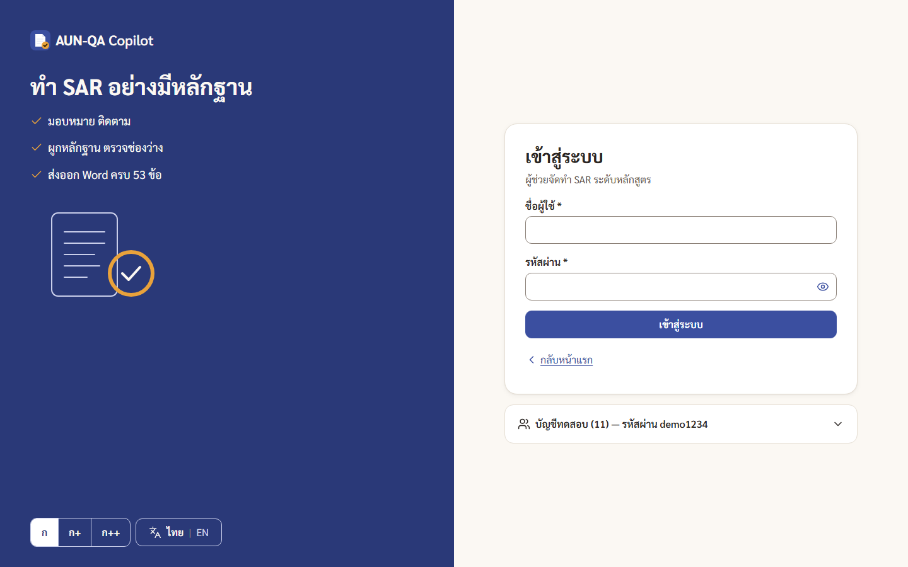

เมื่อเข้าสู่ระบบ ผู้ใช้พบหน้าหลักที่แสดง "สิ่งที่ต้องทำตอนนี้" ตามบทบาท รูปที่ 4.2 คือหน้าหลักของประธานหลักสูตร การ์ดแรกคืองานเร่งที่สุด (ตรวจและอนุมัติ 5 ข้อที่ส่งมา) ตามด้วยการมอบหมายผู้เขียน 7 ข้อที่ยังไม่มีเจ้าของ และการจัดการหลักฐานที่มีข้อมูลส่วนบุคคล แต่ละการ์ดมีปุ่มพาไปหน้าทำงานโดยตรง เมนูด้านซ้ายจัดกลุ่มเป็น งานของฉัน จัดทำรายงาน ข้อมูลหลักสูตร อ้างอิง และผู้ดูแล

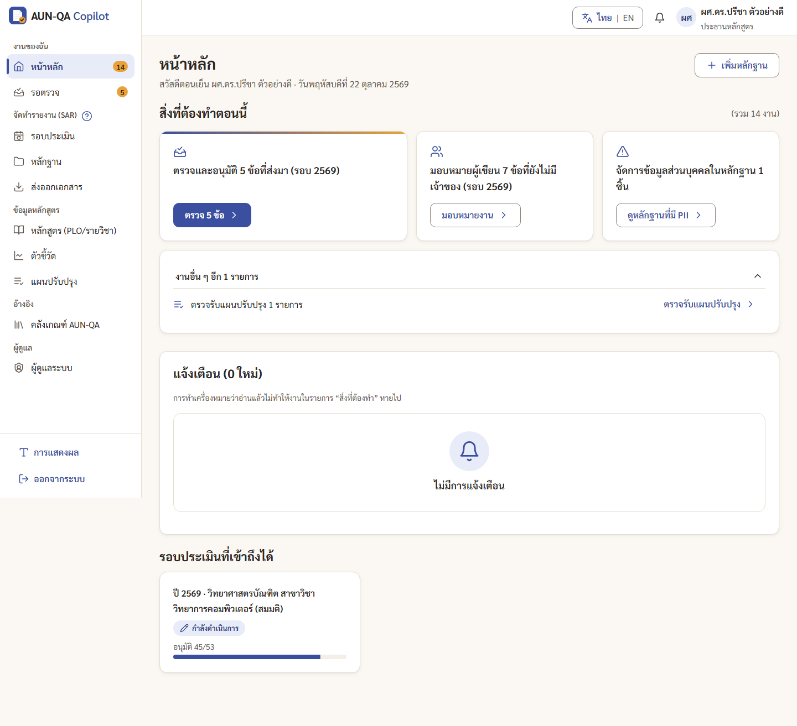

แผงความพร้อมของรอบแสดงแผนภาพความร้อน 53 ช่องในรูปที่ 4.3 แต่ละช่องแสดงสถานะด้วยสี ไอคอน และข้อความร่วมกัน และมีไอคอนที่มุมช่องเมื่อข้อนั้นอนุมัติแล้ว ทำให้แยกได้ว่าข้อที่อนุมัติแล้วยังมีช่องว่างอยู่หรือไม่

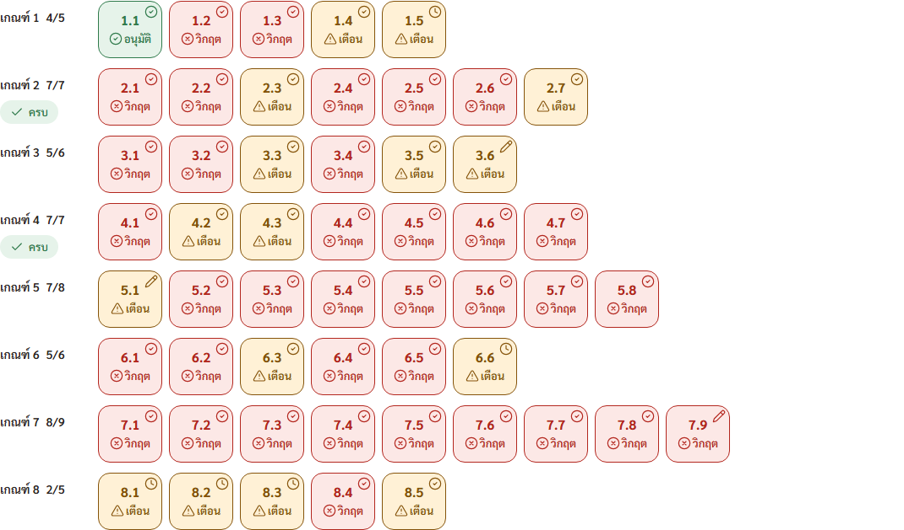

ตัวแก้ไข SAR รายข้อในรูปที่ 4.4 มีแถบขั้นตอน 4 ขั้น (หลักฐาน เขียนเนื้อหา PDCA และคะแนนตนเอง ส่งตรวจ) กล่องเขียนเนื้อหาแยกแท็บภาษาไทยและอังกฤษ ปุ่ม AI สำหรับร่างจากหลักฐาน ตรวจเนื้อหา และแปล รายการ PDCA ที่ครอบคลุม คะแนนประเมินตนเอง และแผงหลักฐานที่ผูกกับข้อทางขวา แถบบันทึกและส่งตรวจที่ปรากฏกลางภาพเป็นแถบที่ติดขอบล่างของจอ ซึ่งเกิดจากวิธีถ่ายภาพแบบเต็มหน้า ไม่ใช่ข้อบกพร่อง

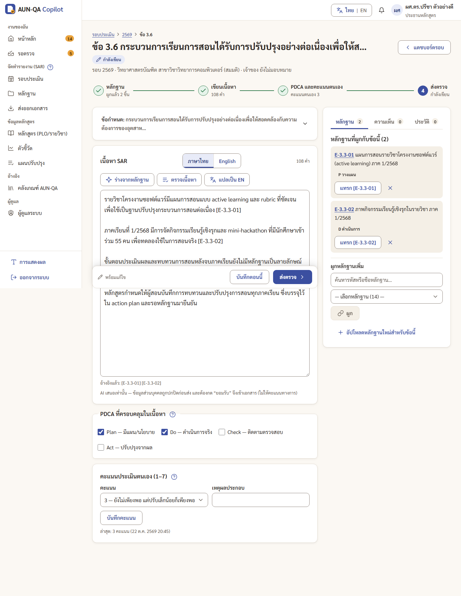

ก่อนส่งข้อให้ตรวจ ระบบแสดงรายการตรวจในรูปที่ 4.5 ได้แก่ จำนวนคำ จำนวนหลักฐานที่ผูก ประโยคที่ไม่อ้างหลักฐาน คะแนนตนเอง และขั้น PDCA ที่ยังขาด โดยโฟกัสปุ่ม "กลับไปเติมก่อน" เป็นค่าเริ่มต้น

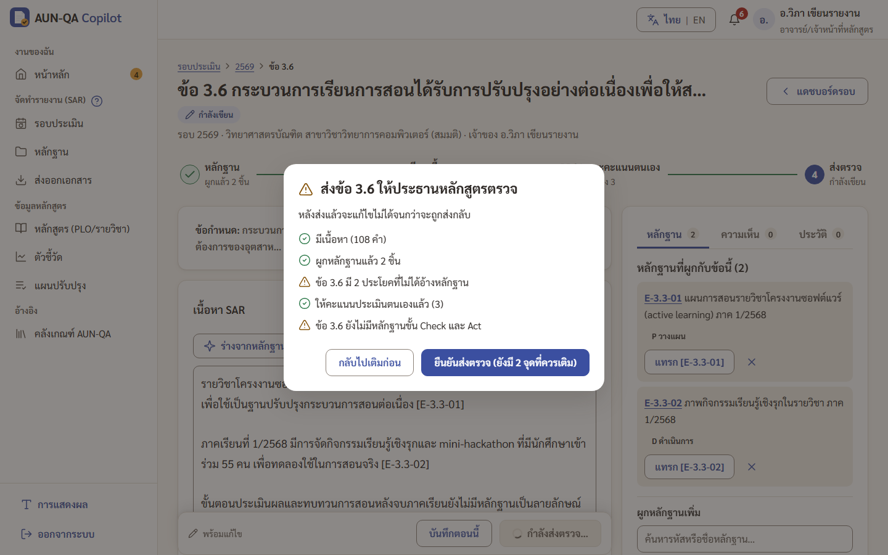

ฟอร์มเพิ่มหลักฐานในรูปที่ 4.6 แบ่งเป็น 3 ขั้น และใช้ช่องค้นหาข้อเกณฑ์ที่พิมพ์เลขข้อหรือคำแล้วเลือกเป็นป้าย แทนรายการเลือกหลายรายการแบบเดิม ฟอร์มแจ้งล่วงหน้าว่ารหัสหลักฐานจะเป็นรูปแบบใด

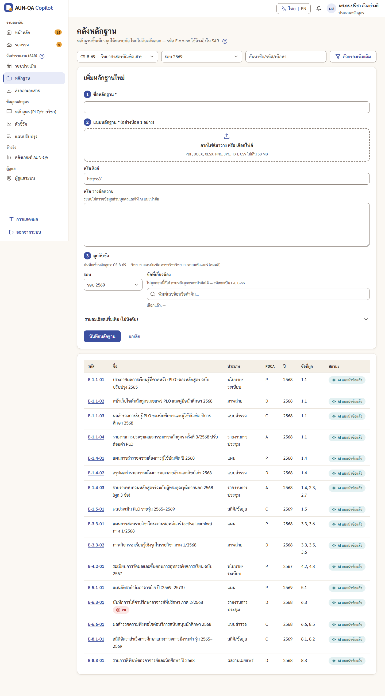

หน้าหลักสูตรมีแท็บย่อยสำหรับ PLO เมทริกซ์ CLO กับ PLO แผนภาพความร้อนรายวิชากับ PLO ช่องว่างหลักสูตร และผังวิชาที่ต้องเรียนก่อน รูปที่ 4.7 คือแผนภาพความร้อนรายวิชากับ PLO ซึ่งแสดงระดับ I, R และ M เป็นตัวอักษรพร้อมจำนวนวิชาต่อ PLO

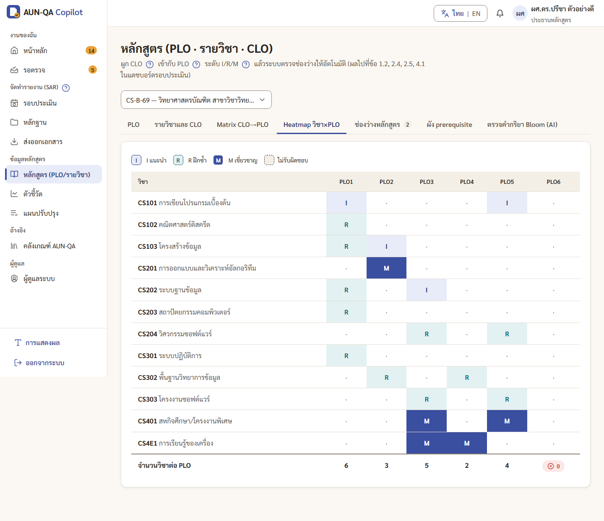

หน้าตัวชี้วัดในรูปที่ 4.8 มีกล่องนำเข้าข้อมูลจาก Excel อยู่ส่วนบนของหน้า และกราฟแนวโน้มของตัวชี้วัดเกณฑ์ที่ 8 ย้อนหลัง 3–5 ปีพร้อมชื่อแกนและหน่วย

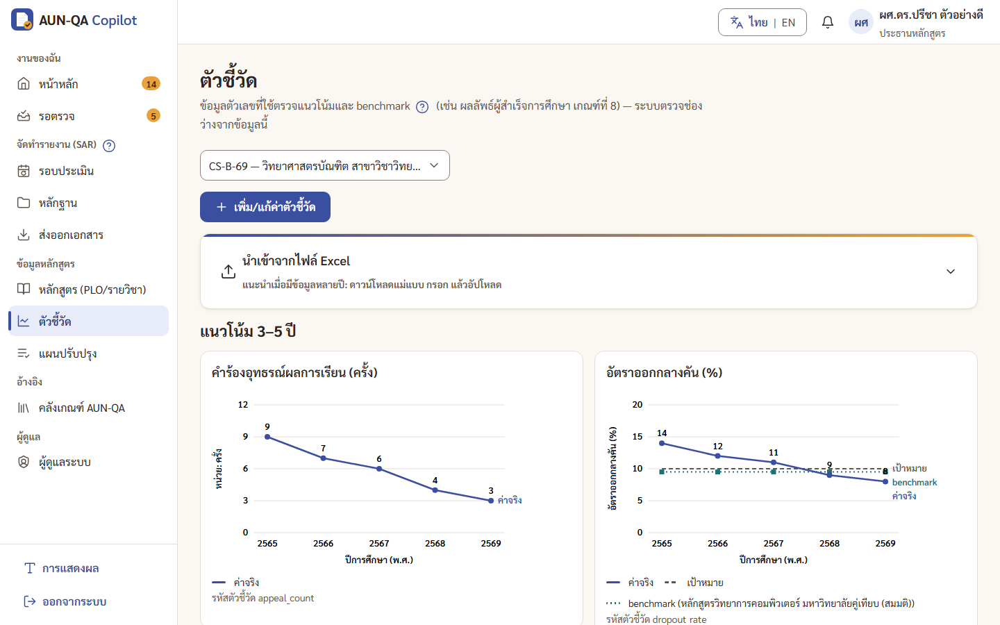

ก่อนคณบดีอนุมัติสุดท้ายและล็อกรอบ ระบบแสดงคำเตือนในรูปที่ 4.9 ได้แก่ ช่องว่างระดับวิกฤต 36 รายการ ระดับสูง 71 รายการ และหลักฐานที่มีข้อมูลส่วนบุคคลค้าง 1 รายการ ปุ่มยืนยันระบุจำนวนข้อควรระวัง และปุ่ม "กลับไปตรวจก่อน" เป็นค่าเริ่มต้น ตัวเลขนี้มาจากข้อมูลสาธิตซึ่งตั้งใจให้มีช่องว่างเพื่อแสดงการทำงานของกฎ

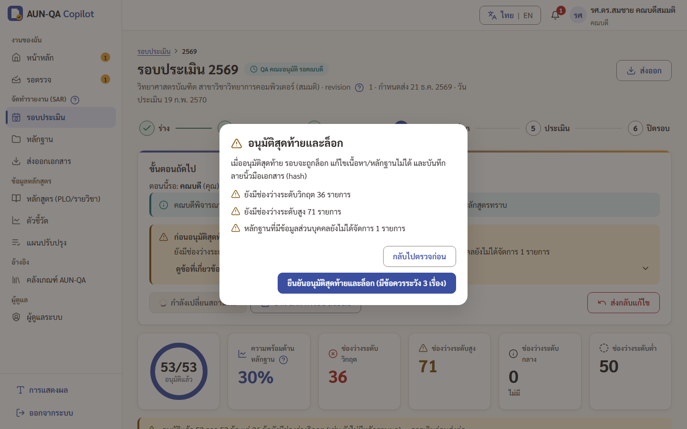

หลังล็อก แผงของรอบในรูปที่ 4.10 แสดงแถบขั้นตอนถึงขั้นที่ 5 พร้อมเวลาล็อก ค่าแฮช และผลตรวจว่าเนื้อหาตรงกับที่ล็อก

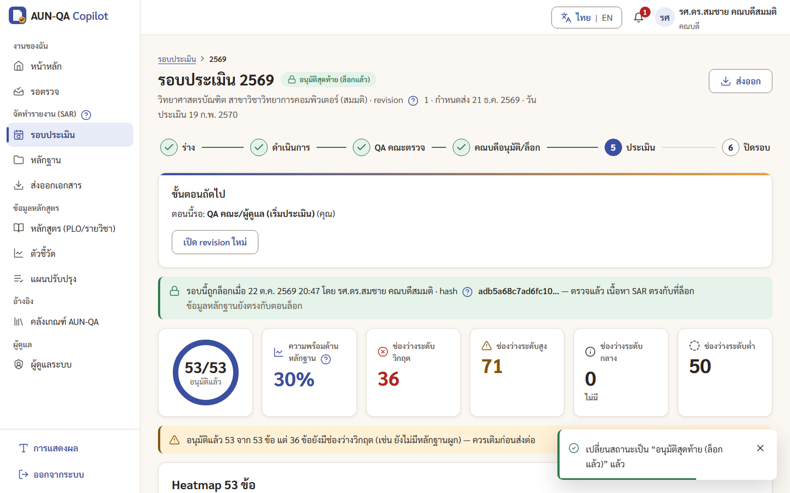

พื้นที่ทำงานของกรรมการในรูปที่ 4.11 แสดงความคืบหน้าการให้คะแนน 0 จาก 8 เกณฑ์ ส่วน verdict ไฟล์ Appendix B และ D และแท็บเกณฑ์ 1–8 กรรมการอ่าน SAR ได้อย่างเดียว

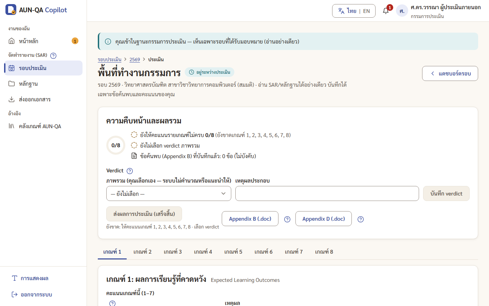

หน้าส่งออกในรูปที่ 4.12 ให้ดาวน์โหลด SAR เป็น .docx ดัชนีหลักฐานเป็น .xlsx และ Appendix A

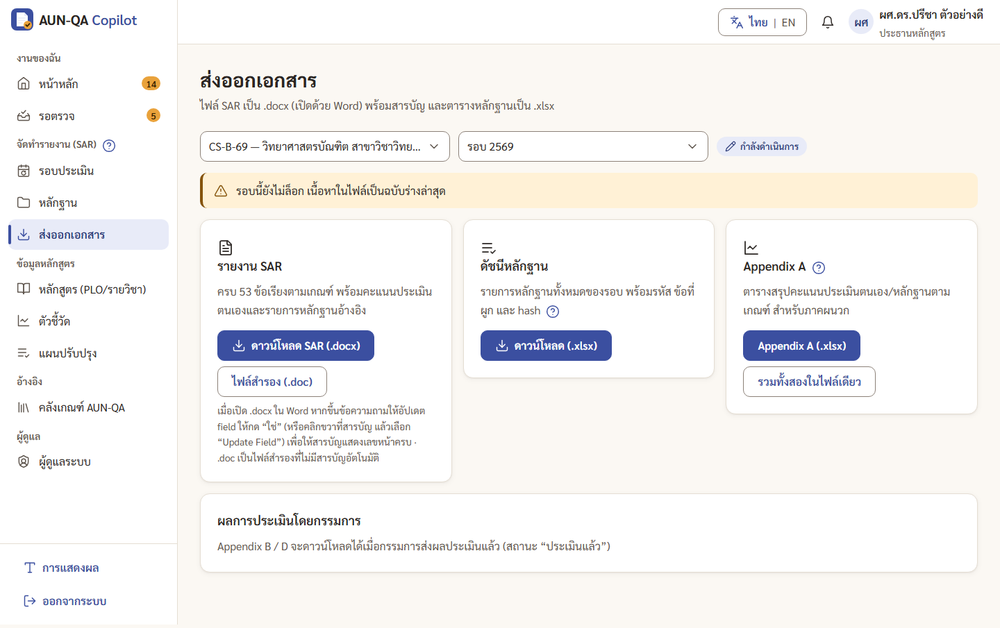

บนหน้าจอกว้าง 390 พิกเซล เมนูด้านซ้ายเปลี่ยนเป็นปุ่มเปิดลิ้นชัก และการ์ดงานเรียงซ้อนแนวตั้งดังรูปที่ 4.13

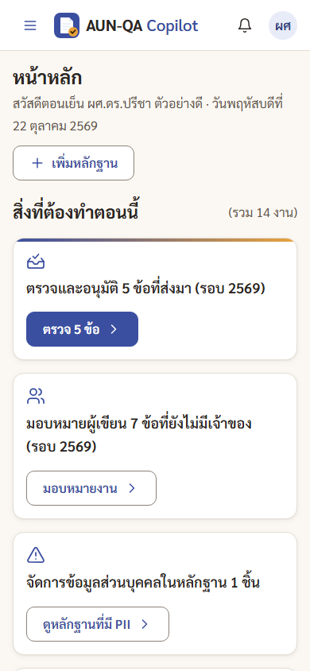{width=45%}

[ต้องการข้อมูล: ภาพผลร่าง SAR ของ AI-2 และผลแปลของ AI-4 ที่แสดงป้ายโหมดออฟไลน์และธงการตรวจหลังประมวลผล — ชุดภาพหน้าจอสุดท้ายยังไม่มีภาพนี้]

### 4.1.3 ผลการเดินลำดับงานด้วยข้อมูลสาธิต

ข้อมูลสาธิตประกอบด้วยเนื้อหา SAR 53 ข้อ ซึ่งอนุมัติแล้ว 45 ข้อ รอตรวจ 5 ข้อ และกำลังร่าง 3 ข้อ ข้อมูลหลักสูตร 6 PLO 12 รายวิชา 23 CLO และแผนปรับปรุง 6 รายการ ข้อมูลหลักสูตรตั้งใจให้ PLO6 ไม่มีรายวิชารับผิดชอบและ PLO4 ไม่มีวิธีวัดผล เพื่อให้กฎ R7 แสดงผลได้ <!-- source: .agents/board/TASK-0001.md Log db-engineer B1 -->

ในการทดลองใช้ระยะ U ตัวแทนผู้ทดลองใช้เดินรอบสาธิตปีการศึกษา 2569 ครบ 10 ขั้น ผ่าน 7 บทบาท ได้แก่ ประธานมอบหมายข้อ อาจารย์เขียนและส่ง ประธานส่งกลับ 1 ข้อและอนุมัติ อาจารย์แก้และส่งใหม่ ประธานส่งให้ QA คณะ QA คณะอนุมัติ คณบดีอนุมัติและล็อก QA คณะเริ่มการประเมิน กรรมการให้คะแนน 8 เกณฑ์ เลือก verdict และส่งผล ผู้ดูแลมหาวิทยาลัยปิดรอบ และประธานสร้างรอบปีการศึกษา 2570 ทุกบทบาทเริ่มจากการ์ดแรกในหน้าหลักและถึงหน้าทำงานใน 1 คลิก และทุกครั้งที่รอบเปลี่ยนสถานะ บทบาทถัดไปได้รับแจ้งเตือน ภาพหน้าจอชุดสุดท้ายถ่ายจากการเดินลำดับงานเดียวกันผ่านหน้าจอจริงอีกครั้งหลังแก้ข้อบกพร่องทั้งหมด <!-- source: .agents/playtest/TASK-0001-roles-u3.md บรรทัดสรุปการเดินรอบและ "สิ่งที่ทำงานดี"; .agents/screenshots/final/INDEX.md -->

## 4.2 ผลการทดสอบระบบ

### 4.2.1 ผลการตรวจชนิดข้อมูลและการสร้างระบบ

ผู้วิจัยรันคำสั่ง `npx tsc --noEmit` ในโฟลเดอร์ `eduflow-next` เมื่อวันที่ 23 ตุลาคม 2569 ไม่พบข้อผิดพลาด และการสร้างระบบด้วย `npm run build` (`next build`) ซึ่งรันเป็นขั้นแรกของชุดทดสอบ Playwright ในวันเดียวกันสำเร็จ

<!-- source: thesis-writer รัน `npx tsc --noEmit` (exit 0) และ `npm run e2e` (webServer = npm run build && next start -p 3917; exit 0) ใน eduflow-next/ วันที่ 2026-10-23 -->

### 4.2.2 ผลการทดสอบหน่วยและการทดสอบร่วม

ผู้วิจัยรันชุดทดสอบ Vitest ด้วยคำสั่ง `npx vitest run` ในโฟลเดอร์ `eduflow-next` เมื่อวันที่ 23 ตุลาคม 2569 ผลคือไฟล์ทดสอบผ่าน 22 จาก 22 ไฟล์ และกรณีทดสอบผ่าน 578 จาก 578 กรณี ไม่มีกรณีที่ไม่ผ่าน รายละเอียดดังตารางที่ 4.2

Table: ตารางที่ 4.2 ผลการทดสอบด้วย Vitest จำแนกตามไฟล์ทดสอบ

| ไฟล์ทดสอบ | ขอบเขต | จำนวนกรณี | ผ่าน |
|---|---|---|---|
| gap.test.ts | กฎช่องว่างและความพร้อม | 39 | 39 |
| workflow.test.ts | เครื่องสถานะ การล็อก ค่าแฮช | 21 | 21 |
| evidence-sar.test.ts | หลักฐาน รหัส การผูก และ SAR | 26 | 26 |
| rbac-ai-audit.test.ts | สิทธิ์ บริการ AI และบันทึกการตรวจสอบ | 33 | 33 |
| pii-text.test.ts | การสแกนและตัดข้อมูลส่วนบุคคล | 21 | 21 |
| review-fixes.test.ts | การแก้ข้อค้นพบจากการตรวจโค้ดระยะ A | 7 | 7 |
| phase-b2-smoke.test.ts | ทดสอบภาพรวมระยะ B | 3 | 3 |
| curriculum.test.ts | การจับคู่หลักสูตร R7 และ AI-7 | 18 | 18 |
| action-plan.test.ts | แผนปรับปรุงและหลักฐานขั้น A | 9 | 9 |
| assessor-lock.test.ts | กรรมการประเมิน การล็อก และ AI-9 | 14 | 14 |
| claude-provider.test.ts | ตัวให้บริการ Claude การสลับไปออฟไลน์ และการตรวจหลังประมวลผล | 13 | 13 |
| ai-route.test.ts | Route Handler `/api/ai` | 17 | 17 |
| phase-b-fixes.test.ts | การแก้ข้อค้นพบระยะ B | 7 | 7 |
| phase-b-review-fixes.test.ts | การแก้ข้อค้นพบระยะ B (ต่อ) | 6 | 6 |
| judgement-table.test.ts | ตารางคำตัดสินที่ต้องตัดและไม่ต้องตัด | 49 | 49 |
| ai7-ai1-trust.test.ts | การไม่เชื่อค่าที่ระบบรู้อยู่แล้วจากผล AI | 2 | 2 |
| phase-c1.test.ts | AI-4 อภิธานศัพท์ การนำเข้าตัวชี้วัดและข้อมูลรายรุ่น การส่งออก DOCX | 83 | 83 |
| phase-c-review-fixes.test.ts | การแก้ข้อค้นพบระยะ C | 41 | 41 |
| phase-u.test.ts | เซสชัน ชื่อผู้ใช้ รายการงาน การแจ้งเตือนบทบาทถัดไป การตรวจก่อนเปลี่ยนสถานะ | 47 | 47 |
| contrast.test.ts | ความต่างสีของโทเคนการออกแบบตาม WCAG ระดับ AA | 60 | 60 |
| u3-fix.test.ts | ความขัดแย้งในการบันทึกและเหตุผลที่ส่งกลับ | 12 | 12 |
| security-dsec.test.ts | การแก้ข้อค้นพบจากการตรวจความมั่นคงปลอดภัย (ตัวกรองคำตัดสิน การตรวจข้อมูลส่วนบุคคล การป้องกันไฟล์บีบอัด) | 50 | 50 |
| รวม | | 578 | 578 |

<!-- source: ผลรัน `npx vitest run` (Vitest 3.2.7) โดย thesis-writer 2026-10-23 ใน eduflow-next/ — "Test Files 22 passed (22) · Tests 578 passed (578)"; ตรงกับ .agents/board/TASK-0001.md Progress D-sec "578 tests"; ขอบเขตรายไฟล์จาก Log qa-tester/backend-dev และชื่อไฟล์ -->

จำนวนกรณีทดสอบเพิ่มขึ้นตามรอบการพัฒนา ดังตารางที่ 4.3

Table: ตารางที่ 4.3 จำนวนกรณีทดสอบ Vitest ที่ผ่านในแต่ละรอบการพัฒนา

| ระยะ | เหตุการณ์ | กรณีทดสอบที่ผ่าน |
|---|---|---|
| A | เขียนชุดทดสอบแรก | 140/140 |
| A | แก้ข้อค้นพบจากการตรวจโค้ด | 147/147 |
| B | พัฒนาตรรกะระยะ B | 150/150 |
| B | เพิ่มการทดสอบของระยะ B | 204/204 |
| B | แก้ข้อค้นพบการตรวจโค้ดรอบที่ 1 | 234/234 |
| B | แก้ข้อค้นพบที่เหลือ (R2-1, R2-2, R2-3) | 285/285 |
| C | เพิ่มการทดสอบของระยะ C | 368/368 |
| C | แก้ข้อค้นพบการตรวจโค้ดระยะ C | 409/409 |
| U | เพิ่มการทดสอบของระยะ U | 516/516 |
| U | แก้ข้อค้นพบจากการตรวจระยะ U | 528/528 |
| D | แก้ข้อค้นพบจากการตรวจความมั่นคงปลอดภัย | 578/578 |

<!-- source: .agents/board/TASK-0001.md Progress Checklist (A4, A5b, B2, B4, B5, C3a, C4 "409/409", U2 "516 unit", U3 "528 unit", D-sec "578 tests") และ Log ที่เกี่ยวข้อง -->

### 4.2.3 ผลการทดสอบตามสถานการณ์ผู้ใช้และเกณฑ์การยอมรับของส่วนติดต่อผู้ใช้

ผู้วิจัยรันชุดทดสอบ Playwright ด้วยคำสั่ง `npm run e2e` ในโฟลเดอร์ `eduflow-next` เมื่อวันที่ 23 ตุลาคม 2569 บนเบราว์เซอร์ Chromium ระบบรันทั้งหมด 56 กรณี ผ่าน 54 กรณี ข้าม 2 กรณี และไม่มีกรณีที่ไม่ผ่าน ดังตารางที่ 4.4

Table: ตารางที่ 4.4 ผลการทดสอบด้วย Playwright จำแนกตามไฟล์ทดสอบ

| ไฟล์ทดสอบ | ขอบเขต | จำนวนกรณี | ผ่าน | ข้าม |
|---|---|---|---|---|
| flows-a.spec.ts | E2E-01 ถึง E2E-07 | 8 | 7 | 1 |
| flows-b.spec.ts | E2E-08 ถึง E2E-14 | 8 | 7 | 1 |
| ui-u.spec.ts | เกณฑ์การยอมรับของส่วนติดต่อผู้ใช้ (ขนาดตัวอักษร การเลื่อนแนวนอน เป้าหมายการกด โฟกัส การลดการเคลื่อนไหว ฟอนต์) และการทดสอบถดถอยของข้อบกพร่องที่แก้แล้ว | 20 | 20 | 0 |
| regress-u1b.spec.ts | งานของกรรมการและการปิดรอบ ตัวนับงาน การรักษางานเมื่อออกจากระบบ | 5 | 5 | 0 |
| regress-u3fix.spec.ts | ข้อบกพร่องที่แก้ในระยะ U เช่น การบันทึกจากสองแท็บ เหตุผลที่ส่งกลับ เซสชันสิ้นสุดจากแท็บอื่น | 15 | 15 | 0 |
| รวม | | 56 | 54 | 2 |

<!-- source: ผลรัน `npm run e2e` (Playwright 1.64.1) โดย thesis-writer 2026-10-23 — "Running 56 tests using 4 workers … 2 skipped · 54 passed (1.8m)" exit 0; จำนวนต่อไฟล์นับจากบรรทัดผลของแต่ละ test; ขอบเขตจาก Log qa-tester C3b, U2-Q, U3 fix regression -->

สถานการณ์ E2E-01 ถึง E2E-14 ในตารางที่ 3.8 ผ่านทั้งหมด โดยมีข้อสังเกต 3 ประการ (1) E2E-01 ทดสอบเฉพาะการเพิ่มผู้ใช้ประธานหลักสูตร ส่วนการสร้างหลักสูตรใหม่ผ่านหน้าจอ (E2E-01b) ถูกข้ามเพราะระบบยังไม่มีหน้าจอนี้ (2) E2E-12 ทดสอบว่ากรรมการไม่มีปุ่มหรือช่องแก้เนื้อหา ส่วนการเรียก API โดยตรงแล้วได้รหัส 403 (E2E-12b) ถูกข้ามเพราะระบบไม่มี HTTP endpoint สำหรับเขียนข้อมูล การปฏิเสธที่ชั้นตรรกะครอบคลุมด้วยไฟล์ assessor-lock.test.ts แทน และ (3) E2E-06 ใช้ตัวให้บริการออฟไลน์ <!-- source: e2e/flows-a.spec.ts:39 test.skip E2E-01b, e2e/flows-b.spec.ts:124 test.skip E2E-12b; Log qa-tester C3b -->

### 4.2.4 ผลการตรวจโค้ด

การตรวจโค้ดดำเนินการทุกระยะ โดยรวมรายการตรวจด้านความปลอดภัยไว้ด้วย ผลสรุปดังตารางที่ 4.5

Table: ตารางที่ 4.5 ผลการตรวจโค้ดแต่ละรอบ

| รอบ | ขอบเขต | ผล | ข้อค้นพบสำคัญ |
|---|---|---|---|
| ระยะ A | 102 ไฟล์ | APPROVE | blocker 0, major 0, minor 10, nit 2 |
| ระยะ B รอบที่ 1 | 54 ไฟล์ | CHANGES_REQUESTED | major 1 (การจำกัดอัตราของ `/api/ai` ถูกข้ามได้และไม่ตรวจรูปแบบผลลัพธ์), minor 7, nit 2 |
| ระยะ B รอบที่ 2 | 18 ไฟล์ | APPROVE | ปิดข้อค้นพบรอบที่ 1 เปิดใหม่ minor 2 และ nit 1 เกี่ยวกับตัวกรองคำตัดสินภาษาไทย ซึ่งแก้ต่อภายหลัง |
| ระยะ C รอบที่ 1 | 34 ไฟล์ | CHANGES_REQUESTED | major 1 (เอกสาร DOCX ไม่ตัดอักขระควบคุมที่ XML ไม่อนุญาต), minor 7, nit 4 |
| ระยะ C รอบที่ 2 | 11 ไฟล์ | CHANGES_REQUESTED | major 1 (ป้ายคำแปลออฟไลน์หลุดเข้าเนื้อหา SAR) |
| ระยะ C รอบที่ 3 | การแก้รอบที่ 2 | CHANGES_REQUESTED | major 1 (นิพจน์ปกติขาดเครื่องหมาย `\` ทำให้ตัดอักษร s ตัวแรกของคำแปล) แก้ 1 ตัวอักษรพร้อมการทดสอบ ผ่าน 409/409 |
| ระยะ U รอบที่ 1 | 81 ไฟล์ | CHANGES_REQUESTED | major 2 (การต่ออายุเซสชันไม่ครอบทุกฟอร์ม และสถานะเซสชันสิ้นสุดจากแท็บอื่นยังใช้งานเมนูได้), minor 4, nit 2 |
| ระยะ U รอบที่ 2 | ส่วนเซสชัน กล่องโต้ตอบ และการบันทึก | APPROVE | ปิด U-1 ถึง U-7 เหลือ minor 2 ซึ่งแก้แล้วและยืนยันด้วยการทดสอบ |

<!-- source: .agents/reviews/TASK-0001-review.md (Phase A, B, B round 2, C, C round 2, C round 3, U, U round 2); .agents/board/TASK-0001.md Progress C4 ("C3-1 … orchestrator แก้ 1 ตัวอักษร + เทสต์ (409/409)") และ Log frontend-dev U2-1/U2-2 -->

ประเด็นสำคัญจากการตรวจโค้ด ได้แก่ (1) ชั้นตรรกะตรวจสิทธิ์ทุกการเขียน และส่วนหน้าจอไม่เรียกฟังก์ชันเขียนข้อมูลดิบโดยตรง (2) ไม่พบกุญแจ API ในชุดไฟล์ฝั่งเบราว์เซอร์ที่สร้างแล้ว (3) เอกสารที่ส่งออกเข้ารหัสอักขระของข้อมูลผู้ใช้ทุกช่อง (4) บริการ AI ไม่เรียกฟังก์ชันเปลี่ยนสถานะหรือให้คะแนน และ (5) ไม่เหลือการใช้ `dangerouslySetInnerHTML` หรือ `innerHTML` ในโค้ดส่วนหน้าจอและชั้นตรรกะ ในระยะ B ผู้ตรวจทดลองข้อความ 17 ประโยคกับตัวกรองคำตัดสิน พบทั้งคำที่เลี่ยงตัวกรองได้ (เช่น "เพียงพอ" "ถือว่าผ่าน") และการตัดเกินข้อเท็จจริง (เช่น "ความพึงพอใจอยู่ในระดับ 4.51 จาก 5") จึงเพิ่มการทดสอบแบบตารางทั้งกรณีที่ต้องตัดและไม่ต้องตัด 49 กรณี <!-- source: .agents/reviews/TASK-0001-review.md หัวข้อ Security, Phase B "ตรวจ JUDGEMENT_RE", Phase U "ตรวจตามโฟกัส" (XSS) -->

### 4.2.5 ผลการตรวจความมั่นคงปลอดภัยและการคุ้มครองข้อมูลส่วนบุคคล

ในระยะ D ผู้ตรวจความมั่นคงปลอดภัยตรวจทั้งระบบตามเกณฑ์ในหัวข้อ 3.3.11 ได้ผล **PASS ในขอบเขตการสาธิต** ซึ่งไม่ได้ติดตั้งบนเซิร์ฟเวอร์ โดยมีเงื่อนไขว่าหากนำระบบขึ้นให้บุคคลภายนอกเข้าถึง ข้อจำกัด B-1 ถึง B-4 จะกลายเป็นความรุนแรงระดับสูง และผลจะเป็น FAIL จนกว่าจะแก้ ข้อค้นพบแบ่งเป็น 2 กลุ่ม ดังตารางที่ 4.6

Table: ตารางที่ 4.6 ข้อค้นพบจากการตรวจความมั่นคงปลอดภัยและการดำเนินการ

| รหัส | ระดับ | ข้อค้นพบ | การดำเนินการ |
|---|---|---|---|
| A-1 | Medium | ตัวกรองคำตัดสินใช้เฉพาะ AI-3 และ AI-9 ข้อความร่าง SAR ของ AI-2 ไม่ผ่านตัวกรอง | ขยายตัวกรองไปยัง AI-1, AI-2 และ AI-7 ส่วน AI-4 ติดธง |
| A-2 | Medium | นิพจน์ปกติตรวจข้อมูลส่วนบุคคลไม่จับเลขไทย เบอร์ +66 ตัวคั่นจุด และอีเมลแบบ [at] จากการทดลอง 24 รูปแบบ ไม่จับ 16 รูปแบบ ซึ่งบางรูปแบบ เช่น ชื่อบุคคล อยู่ในข้อจำกัด B-6 | แปลงอักขระก่อนตรวจ ขยายรูปแบบ และเพิ่มการทดสอบ 37 กรณี |
| A-3 | Low | คำสั่งไม่ประกาศว่าข้อความนำเข้าเป็นข้อมูล | เพิ่มกฎในคำสั่งรุ่น claude-v2 |
| A-4 | Low | ไฟล์ผลทดสอบที่ไม่ควรเก็บอยู่ในสาขาหลักของคลังโค้ด | ส่งให้เจ้าของโครงการตัดสิน |
| A-5 | Low | ไฟล์ Excel แบบบีบอัดที่ขยายตัวผิดปกติทำให้แท็บค้าง | ตรวจขนาดหลังแตกไฟล์ก่อนอ่าน |
| A-6 | Low | ชื่อไฟล์ไม่ถูกสแกนข้อมูลส่วนบุคคล | สแกนชื่อไฟล์ด้วย |
| A-7 | Low | ไลบรารี uuid รุ่นเก่าที่ ExcelJS ใช้มีช่องโหว่ แต่ระบบไม่ได้ใช้ในรูปแบบที่ถูกโจมตีได้ | เลื่อนเป็นงานในอนาคต |
| B-1 ถึง B-10 | High 4, Medium 4, Low 2 (เมื่อขึ้นใช้งานจริง) | ข้อจำกัดเชิงสถาปัตยกรรม เช่น การตรวจสิทธิ์อยู่ในเบราว์เซอร์ Route Handler ไม่ยืนยันตัวตน และ Next.js 14.2.35 มีช่องโหว่ระดับ critical | บันทึกเป็นข้อจำกัดและงานในอนาคต (หัวข้อ 5.3) |

<!-- source: .agents/reviews/TASK-0001-security.md (Verdict, ตาราง A และ B, คำสั่งที่รันจริง); .agents/board/TASK-0001.md Log backend-dev "D-sec fix กลุ่ม A" (37 กรณี PII, 578 tests) และ [orchestrator] หลัง Debrief Phase U (A-4 = เจ้าของ, A-7 + B-4 = งานอนาคต) -->

ผู้ตรวจรัน `npm audit --omit=dev` พบ 5 รายการ ได้แก่ Next.js 14.2.35 ระดับ critical postcss และ brace-expansion ระดับ high และ exceljs กับ uuid ระดับ moderate การแก้ช่องโหว่ของ Next.js ต้องเปลี่ยนเป็นรุ่น 16 ซึ่งผู้วิจัยไม่ทำในงานนี้เนื่องจากเป็นการเปลี่ยนรุ่นหลักที่มีความเสี่ยงสูง ผู้ตรวจยังค้นหากุญแจ API ในคลังโค้ดและไฟล์ที่สร้างแล้ว พบเฉพาะค่าปลอมในไฟล์ทดสอบ และตรวจไฟล์ SAR ที่ส่งออกไม่พบข้อมูลส่วนบุคคล <!-- source: .agents/reviews/TASK-0001-security.md "คำสั่งที่รันจริง" และ B-4 -->

### 4.2.6 ผลการตรวจส่วนติดต่อผู้ใช้และการทดลองใช้โดยตัวแทนปัญญาประดิษฐ์

ผลในหัวข้อนี้ได้จากวิธีในหัวข้อ 3.6.4 ซึ่งเป็นการประเมินโดยตัวแทนปัญญาประดิษฐ์ **ไม่ใช่ผลจากผู้ใช้จริง** ผู้ตรวจส่วนติดต่อผู้ใช้วัดค่าก่อนการออกแบบใหม่ (U0) และหลังพัฒนาตามข้อกำหนด (U3) ได้ผลดังตารางที่ 4.7

Table: ตารางที่ 4.7 ผลการตรวจส่วนติดต่อผู้ใช้ก่อนและหลังการออกแบบใหม่

| รายการ | ก่อน (U0) | หลัง (U3) |
|---|---|---|
| ข้อค้นพบ | blocker 2, major 8 | blocker 0, major 1 (แก้แล้วในรอบแก้ไข), ข้อค้นพบของ U0 ปิดทั้งหมด |
| ฟอนต์ที่โหลดจริง | ข้อความหลักใช้ฟอนต์ที่ไม่มีอักขระไทย และ Sarabun โหลดเพียงน้ำหนักเดียว | Sarabun น้ำหนัก 400, 600 และ 700 ทุกหน้า |
| ข้อความที่เล็กกว่า 13 พิกเซล | 17–598 องค์ประกอบต่อหน้า | 0 ทุกหน้า |
| การเลื่อนแนวนอน | พบในหน้าแรก หน้าเข้าสู่ระบบ และตัวแก้ไข SAR | 0 จาก 59 การวัด (หน้า × ขนาดจอ) |
| ความต่างสี | ตัวอักษรสีขาวบนสีกลางในแผนภาพความร้อน | สุ่ม 120 องค์ประกอบจาก 10 หน้า ไม่ต่ำกว่า 4.5:1 ทุกองค์ประกอบ |
| การตรวจการเข้าถึงด้วย axe-core | - | 0 ข้อผิดพลาดใน 4 หน้าที่ตรวจ |

<!-- source: .agents/reviews/TASK-0001-ui-u3.md (Verdict, "สรุปฟอนต์ที่ใช้จริง" — "< 13px 0 ทุกหน้า (U0: 17–598 ต่อหน้า)", AC-01 สุ่ม 120 element); .agents/board/TASK-0001.md Log ui-inspector U3 (59 หน้า×ขนาด h-scroll 0, axe 0 violation 4 หน้า) และ Debrief C6 (รายการ U0 B1, B2, M2–M4, M7, M8); ADR-UI-001 "บริบท" -->

ผู้ทดลองใช้เปรียบเทียบจำนวนการกระทำและจุดที่ต้องเดาของแต่ละบทบาทก่อนและหลังการออกแบบใหม่ ดังตารางที่ 4.8

Table: ตารางที่ 4.8 จำนวนการกระทำต่อภารกิจก่อนและหลังการออกแบบใหม่ (ประเมินโดยตัวแทนปัญญาประดิษฐ์)

| บทบาท | ภารกิจ | ก่อน (U0) | หลัง (U3) | เวลาโดยประมาณของมนุษย์ |
|---|---|---|---|---|
| อาจารย์ | อัปโหลดหลักฐานและผูก 1 ข้อจากหน้าหลัก | 5 คลิก มีจุดที่ทำให้ผิดพลาด 5 จุด ประมาณ 2–4 นาที | 7 การกระทำ จุดที่ต้องเดา 0–1 จุด | 1.5–2 นาที |
| อาจารย์ | รับงาน ผูกหลักฐาน ให้ AI ร่าง ระบุ PDCA และคะแนน แล้วส่ง | 16 คลิก ต้องเดาลำดับ | 12 การกระทำ จุดที่ต้องเดา 0 จุด | 6–10 นาที (ส่วนใหญ่เป็นเวลาเขียน) |
| ประธานหลักสูตร | ตรวจ 8 ข้อ (ส่งกลับ 1 อนุมัติ 7) แล้วส่ง QA คณะ | 10 คลิกต่อ 5 ข้อ ผ่าน 3 หน้า | 25 การกระทำ และส่ง QA คณะ 3 การกระทำ | 10–20 นาที (ส่วนใหญ่เป็นเวลาอ่าน) |
| QA คณะ | รู้ว่ามีรอบรอและอนุมัติระดับคณะ | ไม่มีการแจ้งเตือน หน้าหลักว่าง | 3 การกระทำ | 1 นาทีและเวลาอ่าน |
| คณบดี | อนุมัติสุดท้ายและล็อก | ไม่มีคำเตือน ปุ่มอยู่ติดกัน | 3 การกระทำ พร้อมคำเตือนก่อนล็อก | 1 นาที |
| กรรมการประเมิน | ให้คะแนน 8 เกณฑ์ เลือก verdict และส่ง | ไม่มีการแจ้งเตือน ปุ่มไม่บอกเหตุที่ใช้ไม่ได้ | 38 การกระทำ ปุ่มส่งบอกสิ่งที่ยังขาด | 15–25 นาที |
| ผู้ดูแลมหาวิทยาลัย | ปิดรอบ | ไม่มีรายการงาน | 3 การกระทำ | น้อยกว่า 1 นาที |

<!-- source: .agents/playtest/TASK-0001-roles-u3.md ตาราง "ก่อน/หลัง ต่อ role" และ "ตัวเลขจริงจากรอบนี้" -->

ภารกิจแรกในตารางที่ 4.8 คือเกณฑ์การยอมรับ AC-14 ซึ่งกำหนดให้ผู้ใช้ใหม่อัปโหลดหลักฐานและผูก 1 ข้อได้ภายใน 3 นาทีและไม่เกิน 6 การกระทำ ผลในระยะ U3 ผ่านด้านเวลาและจุดที่ต้องเดา แต่จำนวนการกระทำเป็น 7 จึงผ่านแบบมีเงื่อนไข ผู้วิจัยแก้โดยเพิ่มปุ่ม "เพิ่มหลักฐาน" บนหน้าหลักซึ่งเปิดฟอร์มทันที หลังแก้ การทดสอบ Playwright ยืนยันว่าภารกิจนี้ใช้ 6 การกระทำ ข้อค้นพบอื่นจากการทดลองใช้ ได้แก่ เหตุผลที่ประธานส่งกลับไม่ปรากฏในหน้าข้อ (major) การบันทึกจากสองแท็บทับกันโดยไม่เตือน และกราฟตัวชี้วัดแสดงเลขแกนที่ไม่ปัดเศษ ทั้งหมดได้รับการแก้ในรอบแก้ไขเดียวกันและมีการทดสอบถดถอยในไฟล์ regress-u3fix.spec.ts ผู้ทดลองใช้ยังยืนยันว่าข้อบกพร่อง P1–P10 จากระยะ U0 ทำซ้ำไม่ได้แล้ว และงานที่พิมพ์ไม่หายใน 4 สถานการณ์ ได้แก่ โหลดหน้าใหม่ทันที ส่งทันทีหลังแก้ ออกจากระบบจากแท็บอื่น และเซสชันหมดอายุ <!-- source: .agents/playtest/TASK-0001-roles-u3.md (ตัดสิน AC, P1–P10, Bugs ใหม่, UX Issues, สิ่งที่ทำงานดี); Log qa-tester U3 fix regression ("AC-14 ×2 (staff1 6 action …)") -->

เมื่อสิ้นระยะ D ผู้ตรวจส่วนติดต่อผู้ใช้ถ่ายภาพหน้าจอชุดสุดท้าย 50 ภาพ (หน้าจอกว้าง 1440 พิกเซล 46 ภาพ และ 390 พิกเซล 4 ภาพ) และสุ่มตรวจการถดถอย ไม่พบหน้าที่เลื่อนแนวนอน ไม่พบอีโมจิ และไม่พบข้อความที่มองเห็นได้ซึ่งเล็กกว่า 13 พิกเซล <!-- source: .agents/screenshots/final/INDEX.md "ตรวจ regression"; Log ui-inspector D0 -->

## 4.3 ผลการประเมิน

### 4.3.1 ผลการประเมินด้านเวลาและความครบถ้วน

Table: ตารางที่ 4.9 เวลาที่ใช้เขียน SAR ต่อข้อ เทียบระบบกับวิธีเดิม

| ผู้ทดสอบ | วิธีเดิม (นาที) | ระบบ (นาที) | ผลต่าง (ร้อยละ) |
|---|---|---|---|
| [ต้องการข้อมูล] | [ต้องการข้อมูล] | [ต้องการข้อมูล] | [ต้องการข้อมูล] |

ร้อยละของข้อที่ครบ PDCA ก่อนและหลังใช้การวิเคราะห์ช่องว่าง [ต้องการข้อมูล: ผลการเปรียบเทียบก่อนและหลัง]

เวลาโดยประมาณในตารางที่ 4.8 เป็นการประมาณของตัวแทนปัญญาประดิษฐ์ ไม่ใช่เวลาที่วัดจากผู้ใช้จริง จึงไม่ใช้แทนผลในตารางที่ 4.9

### 4.3.2 ผลการประเมินความถูกต้องของปัญญาประดิษฐ์

ผลการทดสอบหน่วยยืนยันพฤติกรรมของการตรวจหลังประมวลผลในกรณีที่กำหนด เช่น ผลจาก Claude แบบจำลองที่ใส่ตัวเลขนอกข้อมูลนำเข้าและรหัสหลักฐานปลอมถูกตัดหรือติดธง และบันทึกเป็น AiRun คำแปลที่ขาดรหัสหลักฐานหรือตัวเลขถูกติดธง และประโยคเชิงตัดสินในผลของ AI-1, AI-2 และ AI-7 ถูกตัดออก <!-- source: ผลรัน vitest ไฟล์ claude-provider.test.ts, phase-c1.test.ts, security-dsec.test.ts (2026-10-23) --> อย่างไรก็ตาม ผลดังกล่าวเป็นการทดสอบตรรกะ ไม่ใช่การวัดความถูกต้องกับชุดข้อมูลประเมิน และเส้นทาง Claude ยังไม่เคยเรียก API จริงเนื่องจากไม่มีกุญแจ API ผู้วิจัยจึงยังไม่รายงานความแม่นยำของ Claude <!-- source: .agents/board/TASK-0001.md Log B2 "ติดขัด/ต้องให้คนอื่น", Log C1 ข้อ (3), Log qa-tester C3b ("ยังไม่เคยเรียก Claude จริง") -->

Table: ตารางที่ 4.10 ผลการประเมินความถูกต้องของปัญญาประดิษฐ์

| ตัวชี้วัด | ตัวให้บริการ | ขนาดชุดข้อมูล | ผล | เป้าหมาย |
|---|---|---|---|---|
| ความถูกต้องของการอ้างหลักฐาน | ออฟไลน์ / Claude | [ต้องการข้อมูล] | [ต้องการข้อมูล] | ร้อยละ 100 |
| ตัวเลขที่ไม่มีในข้อมูลนำเข้า | ออฟไลน์ / Claude | [ต้องการข้อมูล] | [ต้องการข้อมูล] | 0 |
| ความแม่นยำการติดป้าย 3 อันดับแรก (AI-1) | ออฟไลน์ / Claude | [ต้องการข้อมูล] | [ต้องการข้อมูล] | ไม่น้อยกว่าร้อยละ 80 |
| ความแม่นยำการจำแนกระดับบลูม (AI-7) | ออฟไลน์ / Claude | [ต้องการข้อมูล] | [ต้องการข้อมูล] | ไม่น้อยกว่าร้อยละ 75 |
| คะแนนคุณภาพร่างจากผู้เชี่ยวชาญ (1–5) | ออฟไลน์ / Claude | [ต้องการข้อมูล] | [ต้องการข้อมูล] | ไม่น้อยกว่า 3.5 |

### 4.3.3 ผลการประเมินความสามารถในการใช้งานและความพึงพอใจ

Table: ตารางที่ 4.11 คะแนน SUS ของผู้ทดสอบ

| ผู้ทดสอบ | บทบาท | คะแนน SUS |
|---|---|---|
| [ต้องการข้อมูล] | [ต้องการข้อมูล] | [ต้องการข้อมูล] |
| ค่าเฉลี่ย (n = [ต้องการข้อมูล]) | | [ต้องการข้อมูล] |

Table: ตารางที่ 4.12 ผลการประเมินความพึงพอใจ

| รายการประเมิน | ค่าเฉลี่ย | ส่วนเบี่ยงเบนมาตรฐาน | ระดับ |
|---|---|---|---|
| [ต้องการข้อมูล: รายการข้อคำถามในแบบสอบถาม] | [ต้องการข้อมูล] | [ต้องการข้อมูล] | [ต้องการข้อมูล] |
| รวม (n = [ต้องการข้อมูล]) | [ต้องการข้อมูล] | [ต้องการข้อมูล] | [ต้องการข้อมูล] |

[ต้องการข้อมูล: ผลการทดสอบการยอมรับ (UAT) กับอาจารย์ 3–5 คน และข้อเสนอแนะจากผู้ทดสอบ โดยไม่ระบุตัวตน]
