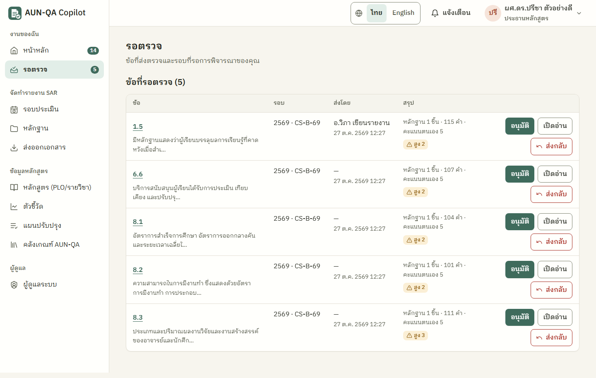
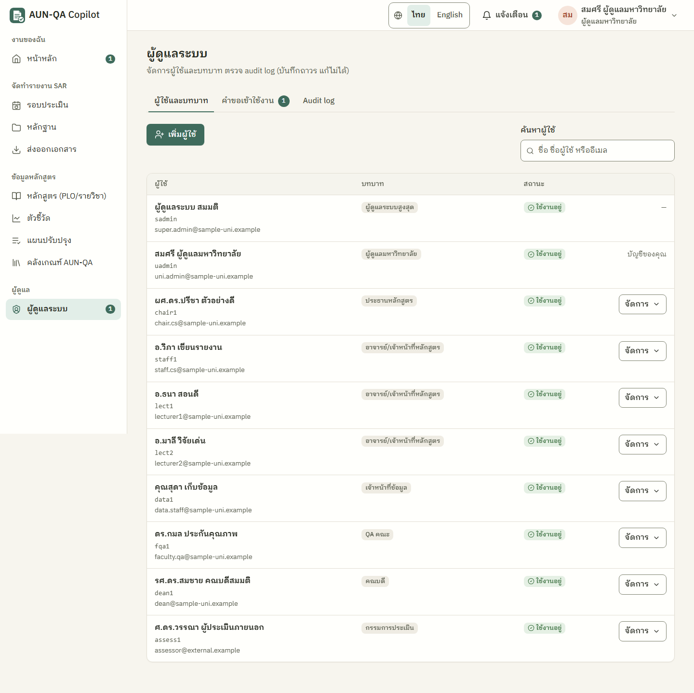

# ภาคผนวก

<!-- TASK-0001 (B6 เขียนใหม่, D3 อัปเดต 2026-10-23) · source: .agents/board/TASK-0001.md หัวข้อ "API for frontend (A2)", "Phase B/C/U additions", Log frontend-dev, db-engineer A1; docs/guide/** (docs-writer D0.5); .agents/screenshots/final/INDEX.md · TASK-0002 (2026-10-27): ภาพจาก .agents/screenshots/TASK-0002/final-*, ฟังก์ชันบัญชี/แจ้งเตือนตาม ADR-AUTH-001 A3 -->

## ภาคผนวก ก คู่มือการใช้งานระบบ

คู่มือการใช้งานฉบับเต็มแยกตามบทบาทอยู่ในโฟลเดอร์ `docs/guide/` ของโครงการ ประกอบด้วยภาพรวมระบบ คู่มือราย 8 บทบาท และอภิธานศัพท์ ภาคผนวกนี้สรุปเฉพาะส่วนสำคัญ

### ก.1 บัญชีผู้ใช้สาธิต

ระบบมีบัญชีสาธิตสำหรับทุกบทบาท ซึ่งเป็นข้อมูลสมมติทั้งหมด หน้าเข้าสู่ระบบมีรายการ "บัญชีทดสอบ" แบบพับเก็บได้ให้เลือกเติมชื่อผู้ใช้อัตโนมัติ (ส่วนล่างของรูปที่ 4.1) ชื่อผู้ใช้ไม่แยกตัวพิมพ์เล็กใหญ่

Table: ตารางที่ ก.1 บัญชีผู้ใช้สาธิต

| ชื่อผู้ใช้ | บทบาท |
|---|---|
| sadmin | ผู้ดูแลระบบ |
| uadmin | ผู้ดูแลมหาวิทยาลัย |
| uadmin2 | ผู้ดูแลมหาวิทยาลัยแห่งที่สอง (ใช้ทดสอบการแยกข้อมูล) |
| chair1 | ประธานหลักสูตร |
| staff1, lect1, lect2 | อาจารย์ผู้รับผิดชอบข้อ |
| data1 | เจ้าหน้าที่ข้อมูล |
| fqa1 | QA คณะ |
| dean1 | คณบดี |
| assess1 | กรรมการประเมินของรอบสาธิตปีการศึกษา 2569 |

### ก.2 ลำดับการใช้งานหลัก

1. **เข้าสู่ระบบ** ที่หน้า `/login` แล้วระบบพาไปหน้าหลัก (`/app`) ซึ่งแสดงการ์ดทักทาย ปุ่ม "ทำงานถัดไป" รายการ "สิ่งที่ต้องทำตอนนี้" ตามบทบาท และรอบที่เข้าถึงได้ แต่ละแถวพาไปหน้าทำงานได้ใน 1 คลิก ผู้ที่ยังไม่มีบัญชีกด "ขอเข้าใช้งาน" เพื่อกรอกคำขอ หรือกด "มีรหัสเชิญ" หรือเปิดลิงก์เชิญเพื่อตั้งรหัสผ่าน การแจ้งเตือนเปิดจากปุ่ม "แจ้งเตือน" บนแถบด้านบน และการตั้งค่าขนาดตัวอักษร ธีม และการออกจากระบบอยู่ในเมนูผู้ใช้ ส่วนภาษาเปลี่ยนได้จากปุ่ม "ไทย │ English"
2. **สร้างรอบและมอบหมาย** ประธานหลักสูตรสร้างรอบที่หน้ารายการรอบ (`/app/cycles`) ซึ่งสร้าง 53 ข้อให้อัตโนมัติ แล้วมอบหมายเจ้าของและกำหนดส่งรายข้อหรือทั้งเกณฑ์ที่หน้ามอบหมาย
3. **แนบหลักฐาน** ที่หน้าคลังหลักฐาน (`/app/evidence`) หรือปุ่ม "เพิ่มหลักฐาน" บนหน้าหลัก กรอกฟอร์ม 3 ขั้น เลือกไฟล์ ลิงก์ หรือข้อความ ระบุชนิด ขั้น PDCA ปีการศึกษา และค้นหาข้อที่เกี่ยวข้องด้วยเลขข้อ ถ้าพบข้อมูลส่วนบุคคล ระบบแสดงกล่องเตือน
4. **นำเข้าตัวชี้วัด** ที่หน้าตัวชี้วัด (`/app/metrics`) ดาวน์โหลดแม่แบบ Excel กรอกข้อมูล อัปโหลดเพื่อดูตัวอย่างและผลตรวจรายแถว แล้วยืนยันนำเข้า ข้อมูลรายรุ่นเก็บเฉพาะค่ารวมต่อรุ่น
5. **เขียน SAR** ที่ตัวแก้ไขรายข้อ (`/app/sections/{รอบ}::{ข้อ}`) เขียนเนื้อหาและ PDCA อ้างหลักฐานด้วยรูปแบบ `[E-1.1-01]` ระบบเตือนทันทีเมื่ออ้างรหัสที่ไม่มีอยู่ กดปุ่มให้ AI ร่าง ตรวจ หรือแปลได้ และต้องกดยอมรับก่อนผลของ AI จะเข้าเอกสาร คำแปลจากโหมดออฟไลน์ต้องกดยืนยันว่าตรวจแล้ว
6. **ติดตามความพร้อม** ที่แผงความพร้อมของรอบ (`/app/cycles/{รอบ}`) ซึ่งแสดงแถบขั้นตอนของรอบ แผนภาพความร้อน 53 ช่อง ร้อยละความพร้อม และช่องว่างตามกฎ R1–R11 จัดกลุ่มตามเกณฑ์
7. **ส่งตรวจและอนุมัติ** อาจารย์ส่งข้อให้ประธานตรวจหลังผ่านรายการตรวจก่อนส่ง ประธานตรวจที่หน้ารอตรวจ (`/app/review`) ดังรูปที่ ก.1 แล้วอนุมัติรายข้อ (ยกเว้นข้อที่ตนเขียนล่าสุด) หรือส่งกลับพร้อมเหตุผล ซึ่งแสดงในหน้าข้อของผู้เขียน เมื่ออนุมัติครบจึงส่งรอบให้ QA คณะ QA คณะอนุมัติหรือส่งกลับ และคณบดีอนุมัติสุดท้ายซึ่งล็อกรอบ ทุกการเปลี่ยนสถานะแสดงคำเตือนก่อนยืนยัน
8. **ประเมิน** QA คณะหรือผู้ดูแลมหาวิทยาลัยมอบหมายกรรมการและเริ่มการประเมิน กรรมการบันทึกข้อค้นพบ ให้คะแนนครบ 8 เกณฑ์ เลือก verdict และส่งผลที่หน้า `/app/cycles/{รอบ}/assess`
9. **ส่งออก** ที่หน้า `/app/export` ได้ไฟล์ SAR (.docx และ .doc สำรอง) ดัชนีหลักฐานและ Appendix A (.xlsx) และ Appendix B และ D หลังประเมินเสร็จ เมื่อเปิดไฟล์ DOCX ครั้งแรก Word จะถามให้อัปเดตสารบัญ
10. **แผนปรับปรุง** ที่หน้า `/app/actions` สร้างรายการจาก AFI ติดตามสถานะ และตรวจรับ
11. **ผู้ดูแล** ที่หน้า `/app/admin` เชิญหรือเพิ่มผู้ใช้ อนุมัติหรือปฏิเสธคำขอเข้าใช้งาน เพิ่มหรือถอนบทบาทพร้อมขอบเขต ระงับหรือเปิดใช้บัญชี และดูและส่งออกบันทึกการตรวจสอบ ส่วนการรีเซ็ตข้อมูลสาธิตทำได้เฉพาะผู้ดูแลระบบ
12. **ออกจากระบบ** ระบบบันทึกงานที่ค้างก่อนออก ถ้าบันทึกไม่ได้จะถามว่าจะกลับไปแก้หรือออกโดยไม่บันทึก

หน้าผู้ดูแลในรูปที่ ก.2 แบ่งเป็นแท็บผู้ใช้และบทบาท คำขอเข้าใช้งาน บันทึกการตรวจสอบ และข้อมูลสาธิต (เฉพาะผู้ดูแลระบบ) แท็บผู้ใช้มีปุ่ม "เพิ่มผู้ใช้" ช่องค้นหา และตารางที่แสดงบทบาทกับสถานะของแต่ละผู้ใช้

## ภาคผนวก ข ตัวอย่าง API

### ข.1 ฟังก์ชันของชั้นตรรกะ

ส่วนหน้าจอเรียกชั้นตรรกะผ่านจุดเดียวคือ `@/lib/api` ทุกฟังก์ชันที่เขียนข้อมูลรับผู้กระทำ (`actor`) และโยนข้อผิดพลาด `AunqaError` ที่มีรหัส เช่น `forbidden`, `locked`, `invalid`, `not_found`, `duplicate`, `bad_transition`, `citation_invalid`, `ai_disabled`, `conflict` ตัวอย่างฟังก์ชันหลักดังตารางที่ ข.1

Table: ตารางที่ ข.1 ตัวอย่างฟังก์ชันหลักของชั้นตรรกะ

| กลุ่ม | ฟังก์ชัน | หน้าที่ |
|---|---|---|
| รอบ | `createCycle(actor, {programmeId, academicYear, ...})` | สร้างรอบพร้อม 53 ข้อ |
| รอบ | `assignSections(actor, cycleId, reqIds, ownerUserId, due?)` | มอบหมายข้อ |
| ลำดับงาน | `transitionCycle(actor, cycleId, to, note?)` | เปลี่ยนสถานะรอบตามตารางการเปลี่ยนสถานะและแจ้งเตือนบทบาทถัดไป |
| ลำดับงาน | `getTransitionPreflight(user, cycleId, to)` | คืนเงื่อนไขที่ยังไม่ผ่านและคำเตือนก่อนเปลี่ยนสถานะ โดยไม่เขียนข้อมูล |
| ลำดับงาน | `verifySnapshot(cycleId)` | ตรวจค่าแฮชของรอบที่ล็อก |
| งานของฉัน | `listMyTodos(user)` | รายการงานที่ต้องทำตามบทบาท 15 ชนิด |
| SAR | `saveSection(actor, cycleId, reqId, input, reason, {baseUpdatedAt?})` | บันทึกเนื้อหา ตรวจรหัสหลักฐาน และปฏิเสธด้วย `conflict` เมื่อถูกบันทึกจากที่อื่นหลังเปิดหน้า |
| SAR | `setSelfRating(actor, cycleId, reqId, score)` | ให้คะแนนตนเอง 1–7 |
| หลักฐาน | `createEvidence(actor, {...})` | สร้างหลักฐาน ตรวจไฟล์ซ้ำ สแกนข้อมูลส่วนบุคคล |
| หลักฐาน | `linkEvidence(actor, evidenceId, cycleId, reqIds)` | ผูกหลักฐานกับหลายข้อ |
| ช่องว่าง | `getReadiness(user, cycleId)` | ร้อยละความพร้อม แผนภาพความร้อน และรายการช่องว่าง |
| ตัวชี้วัด | `previewMetricImport(actor, programmeId, file)` / `commitMetricImport(actor, previewId)` | ตรวจไฟล์ Excel รายแถวแล้วยืนยันนำเข้าเฉพาะแถวที่ผ่าน |
| ตัวชี้วัด | `importCohortFile(actor, programmeId, file, {dryRun?})` | คำนวณตัวชี้วัดรายรุ่นและเก็บเฉพาะค่ารวม |
| AI | `runSarDrafter(actor, cycleId, reqId, 'th' \| 'en')` | ร่าง SAR (AI-2) คืน AiRun |
| AI | `runTranslate(actor, sectionId, 'en' \| 'th')` | แปล SAR (AI-4) คืน AiRun |
| AI | `acceptAiRun(actor, runId, opts)` | ยอมรับผลของ AI เข้าเอกสาร |
| กรรมการ | `setCriterionRating(actor, cycleId, criterionNo, score)` | คะแนนกรรมการรายเกณฑ์ |
| กรรมการ | `setVerdict(actor, cycleId, verdict)` | verdict ที่กรรมการเลือก |
| ส่งออก | `exportSarDocx(user, cycleId)` | ไฟล์ SAR (.docx) |
| บัญชี | `inviteUser(actor, {username, email, fullName, roles})` | สร้างบัญชีสถานะ invited และคืนโทเคนเชิญครั้งเดียว |
| บัญชี | `reissueInvitation(actor, userId)` / `cancelInvitation(actor, userId)` | ออกลิงก์เชิญใหม่ / ยกเลิกคำเชิญ |
| บัญชี | `peekInvitation(token)` / `acceptInvitation(token, password)` | อ่านสรุปคำเชิญ / ตั้งรหัสผ่านและเข้าสู่ระบบ (ลิงก์ที่ใช้ไม่ได้ตอบข้อความเดียว) |
| บัญชี | `submitAccessRequest({fullName, email, username, password, ...})` | ส่งคำขอเข้าใช้งาน (อ่านเฉพาะฟิลด์ที่อนุญาต ได้สถานะ pending และไม่มีบทบาท) |
| บัญชี | `approveAccessRequest(actor, userId, roles)` / `rejectAccessRequest(actor, userId, note?)` | อนุมัติพร้อมกำหนดบทบาท / ปฏิเสธและลบข้อมูลผู้ขอ |
| บัญชี | `setUserStatus(actor, userId, 'active' \| 'suspended')` | ระงับหรือเปิดใช้บัญชี |
| แจ้งเตือน | `listNotifications(user)` / `markRead(user, id)` | อ่านรายการแจ้งเตือน / ทำเครื่องหมายว่าอ่าน ปลายทางแปลงด้วย `notificationHref` ฝั่งหน้าจอ |

### ข.2 Route Handler `/api/ai`

Table: ตารางที่ ข.2 เมธอดและผลตอบกลับของ Route Handler `/api/ai`

| เมธอด | หน้าที่ | ผลตอบกลับ |
|---|---|---|
| GET | ตรวจว่าเซิร์ฟเวอร์มีกุญแจ API หรือไม่ | `{"available": true}` หรือ `{"available": false}` |
| POST | ส่งงาน AI (`task`, `input`) ไปยัง Claude | 200 พร้อม `output` และ `model` หรือรหัสข้อผิดพลาด ได้แก่ 503 (ไม่มีกุญแจ API) 403 (ต้นทางหรือส่วนหัวไม่ถูกต้อง) 429 (เกินอัตราการเรียกหรือเกินงบรายวัน) 413 (คำขอใหญ่เกิน) 400 (งานหรือข้อมูลนำเข้าไม่ถูกต้อง) 502 (เรียก Claude ไม่สำเร็จหรือผลลัพธ์ผิดรูปแบบ) |

<!-- source: .agents/board/TASK-0001.md "API for frontend (A2)" และ Phase B/C/U additions; docs/diagrams/INDEX.md (seq-ai-route: 503/403/429 rate + daily budget/413/400/502); .agents/reviews/TASK-0001-review.md Phase B round 2 (tests/ai-route.test.ts) -->

## ภาคผนวก ค กรณีทดสอบ (Test Case)

สรุปจำนวนกรณีทดสอบรายไฟล์อยู่ในตารางที่ 4.2 (Vitest 30 ไฟล์ 837 กรณี) และตารางที่ 4.4 (Playwright 12 ไฟล์ 178 กรณี) กรณีทดสอบหน่วยและการทดสอบร่วมอยู่ในโฟลเดอร์ `eduflow-next/tests/` รันซ้ำได้ด้วยคำสั่ง `npx vitest run` ส่วนกรณีทดสอบผ่านเบราว์เซอร์อยู่ในโฟลเดอร์ `eduflow-next/e2e/` รันซ้ำได้ด้วยคำสั่ง `npm run e2e` ซึ่งสร้างระบบและเปิดเซิร์ฟเวอร์ให้เอง

[ต้องการข้อมูล: ตารางกรณีทดสอบฉบับเต็ม (รหัส ชื่อ ขั้นตอน ผลที่คาด ผลจริง) ส่งออกจาก Vitest และ Playwright โดย qa-tester]

## ภาคผนวก ง แบบสอบถามและแบบประเมิน

[ต้องการข้อมูล: แบบสอบถาม SUS ฉบับที่ใช้จริง แบบสอบถามความพึงพอใจ แบบให้คะแนนคุณภาพร่างของผู้เชี่ยวชาญ และใบงานสำหรับการจับเวลา]

## ประวัติผู้วิจัย

[ต้องการข้อมูล: ชื่อ-นามสกุล ประวัติการศึกษา และผลงานของผู้วิจัย] [ต้องตรวจสอบกับคู่มือสาขา: สาขาบังคับให้มีประวัติผู้วิจัยหรือไม่]
