# คำสั่งสำหรับ Gemini — จัดทำเล่มวิจัยจากเนื้อหาด้านล่าง

คุณคือผู้ช่วยจัดรูปแบบเอกสารวิชาการภาษาไทย หน้าที่ของคุณคือ **นำเนื้อหาด้านล่างไปจัดทำเป็นเล่มวิจัยใน Google Docs**
โดยไม่เปลี่ยนสาระสำคัญ

## รูปแบบที่ต้องใช้
- ฟอนต์ TH Sarabun New ขนาด 16 pt (ชื่อบท 18 pt ตัวหนา จัดกึ่งกลาง, หัวข้อ 1.1 = 16 pt ตัวหนา, หัวข้อ 1.1.1 = 16 pt ธรรมดา) [ต้องตรวจสอบกับคู่มือสาขา]
- ระยะขอบ: บน 1.5 นิ้ว, ซ้าย 1.5 นิ้ว, ล่าง 1 นิ้ว, ขวา 1 นิ้ว / ระยะบรรทัด 1 เท่า
- จัดข้อความแบบกระจายไทย ย่อหน้าบรรทัดแรก 0.5 นิ้ว
- ขึ้นบทใหม่ (บทที่ 1–5) ที่หน้าใหม่เสมอ
- ลำดับส่วนนำ: ปกนอก → ปกใน → ใบรับรอง → บทคัดย่อ → Abstract → กิตติกรรมประกาศ → สารบัญ → สารบัญตาราง → สารบัญรูป → คำอธิบายสัญลักษณ์และคำย่อ; เลขหน้าส่วนนำ ก ข ค / เนื้อหาเริ่ม 1 ที่บทที่ 1 มุมบนขวา
- เลขหัวข้อตามที่ให้มา (1.1, 1.2.1 ...) / เลขรูปและตารางตามบท (รูปที่ 3.1, ตารางที่ 4.2)
- คำบรรยายรูปอยู่ใต้รูป คำบรรยายตารางอยู่เหนือตาราง (บรรทัด `Table: ...` คือคำบรรยายตาราง)
- สร้างสารบัญ สารบัญตาราง และสารบัญรูป
- บรรณานุกรมตามรูปแบบ APA 7th

## Diagram
บล็อก ```mermaid``` คือโค้ด diagram ให้แปลงเป็นรูป (เช่นผ่าน mermaid.live) แล้ววางแทนบล็อก พร้อมคำบรรยายรูปที่อยู่ด้านบนบล็อก (ย้ายคำบรรยายไปไว้ใต้รูป)
- ห้ามลบบรรทัด `%%{init: …}%%` ที่มี themeCSS `.edge-pattern-dashed` (แก้บั๊กเส้นประของ mermaid 12.2.0 — ถ้าลบ เส้น include/extend/dependency จะกลายเป็นเส้นทึบ)
- รูปที่มีหมายเหตุ "(จัดวางในหน้าแนวนอน)" ให้วางรูปและคำบรรยายในหน้าแนวนอนแยก [ต้องตรวจสอบกับคู่มือสาขา]
- รูปภาพหน้าจอ `` ใช้ไฟล์ภาพจากโฟลเดอร์นั้นในโปรเจกต์ (thesis.docx มีภาพฝังอยู่แล้ว)

## ข้อห้าม
- ห้ามแต่งข้อมูล ตัวเลข ผลการทดลอง หรือแหล่งอ้างอิงขึ้นใหม่
- ข้อความที่มีป้าย [ต้องตรวจสอบ...] [ต้องตรวจสอบกับคู่มือสาขา...] [ต้องการข้อมูล...] [ต้องการอ้างอิง] [TODO...] ให้คงไว้และไฮไลต์สีเหลือง
- ข้อความใน comment `<!-- source: ... -->` คือที่มาของตัวเลข ไม่ต้องแสดงในเล่ม แต่ห้ามเปลี่ยนตัวเลข
- ปรับภาษาได้เฉพาะให้เป็นภาษาวิชาการที่ถูกต้อง สละสลวย โดยความหมายเดิม

## เมื่อเสร็จ
สรุปสั้น ๆ ว่าปรับภาษาจุดใด และมีป้ายที่ยังค้างกี่จุด

---
_สร้างเมื่อ 2026-10-23 จากไฟล์ใน thesis/chapters/_

---
title: "ระบบผู้ช่วยจัดทำรายงานการประเมินตนเองระดับหลักสูตรตามเกณฑ์ AUN-QA ด้วยปัญญาประดิษฐ์ (AUN-QA Copilot) [ต้องตรวจสอบ: ชื่อเรื่องที่อาจารย์ที่ปรึกษาอนุมัติ]"
subtitle: "AUN-QA Copilot: An AI-Assisted Web Application for Programme-Level Self-Assessment Report Preparation [ต้องตรวจสอบ: ชื่อเรื่องภาษาอังกฤษที่อนุมัติ]"
author: "[ต้องการข้อมูล: ชื่อ-นามสกุลผู้วิจัย (ไม่ใส่คำนำหน้า) และรหัสนักศึกษา]"
date: "[ต้องการข้อมูล: ภาควิชา คณะ มหาวิทยาลัย และปีการศึกษา]"
lang: th-TH
---


# บทคัดย่อ

<!-- TASK-0001: เขียนหลังบทที่ 1–5 (D3 อัปเดต 2026-10-23 ตามตัวเลขในบทที่ 4) · ผลการประเมินผู้ใช้ยังไม่มี จึงติดป้าย -->
<!-- [ต้องตรวจสอบกับคู่มือสาขา: ความยาวบทคัดย่อไม่เกิน 1 หน้า] ถ้าเกินให้ตัดประโยคผลการประเมินโดยตัวแทนปัญญาประดิษฐ์ออกก่อน -->

**ชื่อเรื่อง** ระบบผู้ช่วยจัดทำรายงานการประเมินตนเองระดับหลักสูตรตามเกณฑ์ AUN-QA ด้วยปัญญาประดิษฐ์ (AUN-QA Copilot) [ต้องตรวจสอบ: ชื่อเรื่องที่อนุมัติ]

**ผู้วิจัย** [ต้องการข้อมูล: ชื่อ-นามสกุลและรหัสนักศึกษา]

**อาจารย์ที่ปรึกษา** [ต้องการข้อมูล: ชื่ออาจารย์ที่ปรึกษา]

**ประเภท** [ต้องการข้อมูล: เช่น โครงงานปริญญาตรี หลักสูตร สาขา คณะ มหาวิทยาลัย ปีการศึกษา]

**คำสำคัญ** AUN-QA, รายงานการประเมินตนเอง, ประกันคุณภาพการศึกษา, แบบจำลองภาษาขนาดใหญ่, การวิเคราะห์ช่องว่าง

งานวิจัยนี้มีวัตถุประสงค์เพื่อพัฒนาเว็บแอปพลิเคชันสำหรับจัดการเอกสารและหลักฐานประกันคุณภาพระดับหลักสูตรตามเกณฑ์ AUN-QA ฉบับที่ 4.0 จำนวน 8 เกณฑ์ 53 ข้อ พัฒนาระบบปัญญาประดิษฐ์ช่วยร่างรายงานการประเมินตนเอง (SAR) จากหลักฐานที่มีอยู่จริง พัฒนาระบบวิเคราะห์ช่องว่างตามวงจร PDCA และระบบลำดับงานการอนุมัติพร้อมการควบคุมสิทธิ์และบันทึกการตรวจสอบ และประเมินประสิทธิภาพของระบบ ระบบพัฒนาด้วย Next.js และ TypeScript แบบแบ่งระยะ 5 ระยะ ประกอบด้วยคลังหลักฐานที่ผูกหลักฐานหนึ่งชิ้นกับหลายข้อ ตรวจไฟล์ซ้ำ และสแกนข้อมูลส่วนบุคคล ตัวแก้ไข SAR สองภาษา กฎวิเคราะห์ช่องว่าง 11 ข้อ เครื่องสถานะของรอบการประเมินที่ล็อกพร้อมค่าแฮช พื้นที่ทำงานของกรรมการ การนำเข้าตัวชี้วัดจาก Excel การส่งออก SAR เป็นไฟล์ DOCX และบริการปัญญาประดิษฐ์ 6 ฟีเจอร์ รวมถึงการแปลภาษาไทยและอังกฤษ ซึ่งตัดข้อมูลส่วนบุคคลก่อนส่ง ตรวจรหัสหลักฐาน ตัวเลข และประโยคเชิงตัดสินหลังประมวลผล และต้องให้ผู้ใช้กดยอมรับก่อนนำเข้าเอกสาร โดยปัญญาประดิษฐ์ไม่สามารถให้คะแนนหรือเปลี่ยนสถานะเอกสารได้ ส่วนติดต่อผู้ใช้ได้รับการออกแบบใหม่สำหรับผู้ใช้วัยทำงานโดยใช้ WCAG 2.2 ระดับ AA เป็นแนวทาง ผลการทดสอบด้วย Vitest ผ่าน 578 จาก 578 กรณี การทดสอบผ่านเบราว์เซอร์ด้วย Playwright ผ่าน 54 กรณีและข้าม 2 กรณีโดยมีเหตุผล การตรวจชนิดข้อมูลไม่พบข้อผิดพลาด การตรวจโค้ดรอบสุดท้ายได้ผลอนุมัติ และการตรวจความมั่นคงปลอดภัยผ่านในขอบเขตการสาธิต โดยมีข้อจำกัดว่าการตรวจสิทธิ์และข้อมูลยังอยู่ในเบราว์เซอร์ การประเมินส่วนติดต่อผู้ใช้โดยตัวแทนปัญญาประดิษฐ์พบว่าข้อความที่เล็กกว่า 13 พิกเซลลดเหลือ 0 ทุกหน้า และทุกบทบาทเริ่มงานจากหน้าหลักได้ใน 1 คลิก ส่วนผลการประเมินด้านเวลา ความถูกต้องของปัญญาประดิษฐ์ ความสามารถในการใช้งาน และความพึงพอใจของผู้ใช้จริง [ต้องการข้อมูล: ผลการประเมินกับผู้ใช้และผู้เชี่ยวชาญ]

# Abstract

**Title** AUN-QA Copilot: An AI-Assisted Web Application for Programme-Level Self-Assessment Report Preparation [ต้องตรวจสอบ: approved English title]

**Author** [ต้องการข้อมูล: author name and student ID]

**Advisor** [ต้องการข้อมูล: advisor name]

**Academic Paper** [ต้องการข้อมูล: degree, programme, faculty, university, academic year]

**Keywords** AUN-QA, self-assessment report, quality assurance, large language model, gap analysis

This research aimed to develop a web application for managing programme-level quality assurance documents and evidence according to the AUN-QA Version 4.0 framework, which comprises 8 criteria and 53 requirements; to develop an AI assistant that drafts Self-Assessment Report (SAR) sections from existing evidence, together with a PDCA-based gap analysis; to develop a review and approval workflow with role-based access control and an audit log; and to evaluate the system. The system was developed with Next.js and TypeScript in five iterative phases. It provided an evidence repository in which one piece of evidence could be linked to multiple requirements, with duplicate-file detection and personal data scanning; a bilingual SAR editor; eleven gap-analysis rules; an assessment-cycle state machine that locked approved cycles with a snapshot hash; an assessor workspace; Excel import of programme metrics; SAR export to DOCX; and six AI features, including Thai–English translation. Every AI request was redacted for personal data before being sent, every output was post-checked for evidence codes, numbers, and judgement statements, and every result required explicit user acceptance. The AI could not assign ratings or change document states. The user interface was redesigned for working-age academic staff, using WCAG 2.2 Level AA as a guideline. All 578 of 578 Vitest test cases passed, 54 Playwright browser tests passed with 2 skipped for documented reasons, type checking reported no errors, the final code review was approved, and the security audit passed within the scope of a local demonstration, with the limitation that access control and data storage remained in the browser. An agent-based interface evaluation found that text smaller than 13 pixels was eliminated on every page and that every role could start its work from the home page in one click. The evaluation of time savings, AI accuracy, usability, and satisfaction with real users [ต้องการข้อมูล: evaluation results with users and experts].

# กิตติกรรมประกาศ

[ต้องการข้อมูล: กิตติกรรมประกาศ — ไม่เกิน 1 หน้า ไม่ระบุวันที่ ไม่ใส่คำนำหน้านามผู้เขียน และลงชื่อผู้วิจัยท้ายข้อความ]

# คำอธิบายสัญลักษณ์และคำย่อ

Table: ตารางที่ 0.1 คำย่อที่ใช้ในเล่ม [ต้องตรวจสอบกับคู่มือสาขา: การกำหนดเลขตารางในส่วนนำ]

| คำย่อ | คำเต็ม |
|---|---|
| ADR | Architecture Decision Record |
| AFI | Areas for Improvement |
| AI | Artificial Intelligence |
| API | Application Programming Interface |
| ASVS | Application Security Verification Standard |
| AUN-QA | ASEAN University Network Quality Assurance |
| CLO | Course Learning Outcomes |
| DOCX | Office Open XML Document (ไฟล์ Microsoft Word) |
| E2E | End-to-End Test |
| ELO | Expected Learning Outcomes |
| LLM | Large Language Model |
| NER | Named Entity Recognition |
| OBE | Outcome-Based Education |
| OWASP | Open Worldwide Application Security Project |
| PDCA | Plan–Do–Check–Act |
| PDPA | Personal Data Protection Act (พระราชบัญญัติคุ้มครองข้อมูลส่วนบุคคล พ.ศ. 2562) |
| PII | Personally Identifiable Information |
| PLO | Programme Learning Outcomes |
| RBAC | Role-Based Access Control |
| RLS | Row-Level Security |
| SAR | Self-Assessment Report |
| SUS | System Usability Scale |
| UAT | User Acceptance Testing |
| UI | User Interface |
| WCAG | Web Content Accessibility Guidelines |


# บทที่ 1 บทนำ

<!-- TASK-0001: เขียนใหม่จากโครงเดิม (EduFlow) เป็น AUN-QA Copilot · source: .agents/spec/AUN-QA_Copilot_Spec.md หัวข้อ 1, 2, 14 -->

## 1.1 ความเป็นมาและความสำคัญของปัญหา

การประกันคุณภาพการศึกษาระดับหลักสูตรเป็นภารกิจที่สถาบันอุดมศึกษาของไทยต้องดำเนินการอย่างต่อเนื่อง สถาบันอุดมศึกษาของไทยต้องจัดให้มีระบบประกันคุณภาพหลักสูตร (กฎกระทรวงมาตรฐานหลักสูตรการศึกษาระดับอุดมศึกษา พ.ศ. 2565, 2565) [ต้องตรวจสอบ: ข้อในกฎกระทรวงมาตรฐานหลักสูตรการศึกษาระดับอุดมศึกษา พ.ศ. 2565 ที่กล่าวถึงการประกันคุณภาพ] และหลายสถาบันเลือกใช้เกณฑ์ของเครือข่ายมหาวิทยาลัยอาเซียน (ASEAN University Network Quality Assurance: AUN-QA) (บรรณกร แซ่ลิ่ม, 2567) เกณฑ์ AUN-QA ระดับหลักสูตร ฉบับที่ 4.0 เผยแพร่ในเดือนตุลาคม 2563 และประกอบด้วยเกณฑ์ 8 ด้าน ตั้งแต่ผลการเรียนรู้ที่คาดหวัง (Expected Learning Outcomes) จนถึงผลผลิตและผลลัพธ์ (Output and Outcomes) (ASEAN University Network [AUN], 2020)

ในการประเมินตามเกณฑ์ AUN-QA หลักสูตรต้องจัดทำรายงานการประเมินตนเอง (Self-Assessment Report: SAR) ที่อธิบายการดำเนินงานรายข้อพร้อมหลักฐานประกอบ และให้คะแนนตนเองตามสเกล 1–7 ก่อนที่คณะกรรมการประเมินจะอ่านเอกสาร (Desktop Assessment) และลงพื้นที่ตรวจ (Site Visit) (AUN, 2020, pp. 43, 50–52, 57) งานวิจัยในประเทศไทยชี้ว่าการเก็บรวบรวมข้อมูลและหลักฐานเพื่อจัดทำรายงานประกันคุณภาพเป็นภาระของบุคลากร จึงมีการพัฒนาระบบสารสนเทศเพื่อช่วยเก็บและติดตามข้อมูล เช่น ระบบสารสนเทศเพื่องานประกันคุณภาพการศึกษาของพิสิฐ เมธาภัทร (2549) และระบบควบคุมงานประกันคุณภาพการศึกษาภายในระดับหลักสูตรออนไลน์ของอนุพล สิงขรเขตต์ และคณะ (2560) นอกจากนี้ การวิเคราะห์ผลการประเมินตามเกณฑ์ AUN-QA ของ 9 หลักสูตรในคณะศิลปศาสตร์ มหาวิทยาลัยสงขลานครินทร์ ปีการศึกษา 2564 พบว่าคะแนนรวมอยู่ระหว่าง 3.71–3.88 และไม่มีหลักสูตรใดถึงค่าเป้าหมาย 4.00 โดยเกณฑ์ที่มีความต้องการพัฒนาสูงสุดคือเกณฑ์ที่ 8 ผลผลิตและผลลัพธ์ (บรรณกร แซ่ลิ่ม, 2567)

จากการศึกษาสภาพปัญหา ผู้วิจัยสรุปปัญหาในการจัดทำ SAR ได้ 4 ประการ ได้แก่ (1) หลักฐานกระจายอยู่หลายแหล่ง ตั้งชื่อไม่เป็นระบบ และหลักฐานชิ้นเดียวที่ใช้ได้หลายข้อมักถูกคัดลอกซ้ำ (2) SAR เขียนโดยหลายคนในหลายไฟล์ ทำให้ติดตามได้ยากว่าข้อใดเสร็จหรือยังขาดสิ่งใด (3) การเขียนมักไม่ครบวงจรคุณภาพ PDCA โดยเฉพาะขั้นตรวจสอบ (Check) และขั้นปรับปรุง (Act) และ (4) ผู้เขียนต้องแปล SAR เป็นภาษาอังกฤษ [ต้องการข้อมูล: ผลสัมภาษณ์ผู้ใช้ 3–5 คนเพื่อยืนยันปัญหา ตามแผนในสเปกหัวข้อ 15 สัปดาห์ที่ 1 — ยังไม่ได้ดำเนินการ] ในขณะเดียวกัน แบบจำลองภาษาขนาดใหญ่ (Large Language Model: LLM) ถูกนำมาใช้ประเมินเอกสารประกันคุณภาพในต่างประเทศ เช่น งานของ Sulton et al. (2026) ที่ใช้ LLM ประเมินตัวบ่งชี้คุณภาพ และงานของ Tumthong et al. (2026) ที่ใช้ LLM ช่วยตัดสินการจับคู่ผลการเรียนรู้รายวิชากับผลการเรียนรู้ของหลักสูตรตามเกณฑ์ AUN-QA แต่ LLM มีความเสี่ยงต่อการสร้างข้อความที่ไม่มีหลักฐานรองรับ (hallucination) (Ji et al., 2023) การนำ LLM มาช่วยเขียน SAR จึงต้องมีกลไกควบคุมให้ทุกข้อความอ้างอิงหลักฐานที่มีอยู่จริง

โครงงานนี้เดิมพัฒนาเป็นระบบ EduFlow สำหรับโรงเรียน ซึ่งมีส่วนที่ให้ครูเปิดชั้นเรียนสอนพิเศษและรับชำระเงินจากนักเรียน ผู้วิจัยยกเลิกแนวทางดังกล่าวเพื่อหลีกเลี่ยงประเด็นผลประโยชน์ทับซ้อนระหว่างครูกับนักเรียนในความรับผิดชอบ และเพื่อให้ขอบเขตโครงงานชัดเจนขึ้น แล้วปรับเป้าหมายมาเป็นเว็บแอปพลิเคชันช่วยอาจารย์ประจำหลักสูตรเตรียม SAR และหลักฐานตามเกณฑ์ AUN-QA ฉบับที่ 4.0 ภายใต้ชื่อ AUN-QA Copilot โดยใช้โครงสร้างโครงการเดิม (Next.js และ TypeScript) ต่อ และออกแบบส่วนติดต่อผู้ใช้ใหม่ทั้งระบบในภายหลังให้เหมาะกับผู้ใช้ที่เป็นอาจารย์และบุคลากร

## 1.2 วัตถุประสงค์ของการวิจัย

1. เพื่อพัฒนาเว็บแอปพลิเคชันสำหรับจัดการเอกสารและหลักฐานประกันคุณภาพระดับหลักสูตรตามเกณฑ์ AUN-QA ฉบับที่ 4.0 ครบ 8 เกณฑ์ 53 ข้อ
2. เพื่อพัฒนาระบบปัญญาประดิษฐ์ช่วยร่าง SAR จากหลักฐานที่มีอยู่จริง และระบบวิเคราะห์ช่องว่าง (Gap Analysis) ตามวงจร PDCA
3. เพื่อพัฒนาระบบลำดับงาน (Workflow) การส่งตรวจ แก้ไข และอนุมัติ พร้อมการควบคุมสิทธิ์ตามบทบาทและบันทึกการตรวจสอบ (Audit Log)
4. เพื่อประเมินประสิทธิภาพของระบบด้านเวลาที่ใช้เตรียมเอกสาร ความถูกต้องของปัญญาประดิษฐ์ และความพึงพอใจของผู้ใช้

## 1.3 ขอบเขตของการวิจัย

### 1.3.1 ขอบเขตด้านเนื้อหาและเกณฑ์

ระบบรองรับการประกันคุณภาพระดับหลักสูตร (Programme Level) ตามเกณฑ์ AUN-QA ฉบับที่ 4.0 จำนวน 8 เกณฑ์ 53 ข้อ ตามแบบประเมินตนเองใน Appendix A ของคู่มือ (AUN, 2020, pp. 63–67) ไม่รวมการประกันคุณภาพระดับสถาบัน ส่วนติดต่อผู้ใช้เป็นภาษาไทยเป็นหลัก และเนื้อหา SAR เขียนได้ทั้งภาษาไทยและภาษาอังกฤษ

### 1.3.2 ขอบเขตด้านผู้ใช้

ผู้ใช้แบ่งเป็น 8 บทบาท ได้แก่ ผู้ดูแลระบบ ผู้ดูแลมหาวิทยาลัย ประธานหลักสูตร อาจารย์ผู้รับผิดชอบข้อ เจ้าหน้าที่ข้อมูล เจ้าหน้าที่ประกันคุณภาพระดับคณะ (QA คณะ) คณบดี และกรรมการประเมิน แต่ละบทบาทมีสิทธิ์ตามตารางที่ 3.1 ในบทที่ 3

### 1.3.3 ขอบเขตด้านฟังก์ชัน

ระบบที่พัฒนาครอบคลุมการจัดการผู้ใช้และองค์กร คลังเกณฑ์ 53 ข้อ รอบการประเมินและการมอบหมาย คลังหลักฐาน การบันทึกและนำเข้าตัวชี้วัดของเกณฑ์ที่ 8 จากไฟล์ Excel การจับคู่หลักสูตร (PLO/CLO) ตัวแก้ไข SAR สองภาษา การวิเคราะห์ช่องว่างตามกฎ R1–R11 ลำดับงานการอนุมัติและการล็อกรอบ พื้นที่ทำงานของกรรมการประเมิน แผนปรับปรุง การแจ้งเตือนและรายการงานที่ต้องทำตามบทบาท บันทึกการตรวจสอบ การส่งออกเอกสาร SAR เป็นไฟล์ DOCX และบริการปัญญาประดิษฐ์ 6 ฟีเจอร์ที่ผ่านการตัดข้อมูลส่วนบุคคลและการตรวจหลังประมวลผล รวมถึงการแปลภาษาไทยและอังกฤษ รายละเอียดสถานะของแต่ละโมดูลแสดงในตารางที่ 4.1

### 1.3.4 สิ่งที่ระบบไม่ทำ

ระบบไม่ใช่ระบบรับรองคุณภาพ และไม่ออกผลการประเมินแทนคณะกรรมการ ปัญญาประดิษฐ์ในระบบไม่ให้คะแนนทางการ ไม่อนุมัติ และไม่เปลี่ยนสถานะเอกสาร ระบบไม่แทนที่ระบบ CHE QA Online และไม่เป็นระบบทะเบียนนักศึกษา งานวิจัยนี้พัฒนาเป็นรุ่นต้นแบบสำหรับสาธิตบนเครื่องของผู้ใช้ ไม่ได้ติดตั้งบนเซิร์ฟเวอร์ให้บุคคลภายนอกเข้าใช้ และยังไม่มีฐานข้อมูลฝั่งเซิร์ฟเวอร์ งานที่กำหนดไว้เป็นงานในอนาคต ได้แก่ การเชื่อมต่อระบบทะเบียนจริง การประกันคุณภาพระดับสถาบัน แอปพลิเคชันบนอุปกรณ์เคลื่อนที่ และระบบชำระเงิน

### 1.3.5 ขอบเขตด้านข้อมูล

ข้อมูลทั้งหมดที่ใช้พัฒนาและทดสอบเป็นข้อมูลสมมติ ได้แก่ มหาวิทยาลัยสมมติ 2 แห่ง หลักสูตรสมมติ 2 หลักสูตร บัญชีผู้ใช้สาธิตทุกบทบาท หลักฐานตัวอย่าง และตัวชี้วัดย้อนหลัง 5 ปี ไม่มีข้อมูลส่วนบุคคลของบุคคลจริง <!-- source: .agents/board/TASK-0001.md Log db-engineer A1, B1 -->

## 1.4 ประโยชน์ที่คาดว่าจะได้รับ

1. หลักสูตรมีคลังหลักฐานกลางที่มีรหัสหลักฐานไม่ซ้ำ และหลักฐานชิ้นเดียวผูกกับหลายข้อได้โดยไม่ต้องคัดลอก
2. ประธานหลักสูตรเห็นความพร้อมของ SAR รายข้อและช่องว่างที่ยังขาดก่อนส่งให้คณะกรรมการ
3. ผู้เขียนได้ร่าง SAR ที่อ้างอิงรหัสหลักฐานจริง โดยมนุษย์ยังเป็นผู้ตัดสินใจยอมรับทุกครั้ง
4. กระบวนการส่งตรวจและอนุมัติเป็นไปตามลำดับที่กำหนด ตรวจสอบย้อนหลังได้จากบันทึกการตรวจสอบ
5. ผู้วิจัยได้แนวทางการออกแบบระบบที่นำปัญญาประดิษฐ์มาใช้กับเอกสารประกันคุณภาพโดยควบคุมข้อมูลส่วนบุคคลและความถูกต้องของข้อความ

## 1.5 นิยามศัพท์เฉพาะ

Table: ตารางที่ 1.1 นิยามศัพท์เฉพาะที่ใช้ในงานวิจัย

| คำศัพท์ | ความหมาย |
|---|---|
| AUN-QA | เกณฑ์ประกันคุณภาพของเครือข่ายมหาวิทยาลัยอาเซียน (ASEAN University Network Quality Assurance) ในงานนี้หมายถึงระดับหลักสูตร ฉบับที่ 4.0 |
| รายงานการประเมินตนเอง (SAR) | เอกสารที่หลักสูตรเขียนอธิบายการดำเนินงานตามเกณฑ์รายข้อพร้อมหลักฐาน (Self-Assessment Report) |
| ข้อกำหนด (Requirement) | ข้อย่อยของเกณฑ์ AUN-QA เช่น ข้อ 1.1 ระบบมีทั้งหมด 53 ข้อ |
| ELO / PLO | ผลการเรียนรู้ที่คาดหวังของหลักสูตร (Expected / Programme Learning Outcomes) |
| CLO | ผลการเรียนรู้ระดับรายวิชา (Course Learning Outcomes) |
| PDCA | วงจรคุณภาพ วางแผน–ปฏิบัติ–ตรวจสอบ–ปรับปรุง (Plan–Do–Check–Act) |
| AFI | ข้อเสนอแนะเพื่อการพัฒนาจากคณะกรรมการ (Areas for Improvement) |
| หลักฐาน (Evidence) | เอกสาร ไฟล์ ลิงก์ หรือข้อความที่ใช้ยืนยันการดำเนินงาน มีรหัสรูปแบบ E-ข้อ-ลำดับ เช่น E-1.4-02 |
| รอบการประเมิน (Assessment Cycle) | การจัดทำ SAR ของหลักสูตรในปีการศึกษาหนึ่ง ประกอบด้วย 53 ข้อ |
| การวิเคราะห์ช่องว่าง (Gap Analysis) | การตรวจด้วยกฎว่าข้อใดยังขาดหลักฐาน ขาดขั้น PDCA หรือขาดข้อมูลที่เกณฑ์ต้องการ |
| ข้อมูลส่วนบุคคล (PII) | ข้อมูลที่ระบุตัวบุคคลได้ (Personally Identifiable Information) เช่น เลขประจำตัวประชาชน อีเมล หมายเลขโทรศัพท์ |
| การตัดข้อมูลส่วนบุคคล (Redaction) | การแทนข้อมูลส่วนบุคคลด้วยสัญลักษณ์ก่อนส่งข้อความให้ปัญญาประดิษฐ์ |
| การตรวจหลังประมวลผล (Post-check) | การตรวจผลลัพธ์ของปัญญาประดิษฐ์ว่ารหัสหลักฐานมีอยู่จริง ตัวเลขทุกตัวปรากฏในข้อมูลนำเข้า และไม่มีประโยคเชิงให้คะแนนหรือตัดสิน |
| การตรวจก่อนเปลี่ยนสถานะ (Preflight) | การแสดงคำเตือนก่อนส่งต่อหรืออนุมัติรอบ เช่น จำนวนช่องว่างระดับวิกฤต หลักฐานที่มีข้อมูลส่วนบุคคลค้าง และคำแปลที่ยังไม่ได้ตรวจ |
| ความขัดแย้งในการบันทึก (Save Conflict) | กรณีที่ข้อ SAR เดียวกันถูกบันทึกจากหน้าต่างอื่นหลังจากผู้ใช้เปิดหน้า ระบบปฏิเสธการบันทึกทับและให้ผู้ใช้เลือกวิธีจัดการ |
| Grounded generation | การสร้างข้อความโดยใช้ข้อเท็จจริงจากหลักฐานที่ส่งให้เท่านั้น และอ้างอิงแหล่งที่มาทุกประโยค |
| แบบจำลองภาษาขนาดใหญ่ (LLM) | แบบจำลองปัญญาประดิษฐ์ที่สร้างข้อความจากข้อความนำเข้า (Large Language Model) |


# บทที่ 2 เอกสารและงานวิจัยที่เกี่ยวข้อง

<!-- TASK-0001: เขียนใหม่ · source: .agents/research/standards/thesis-th.md หัวข้อ 6, .agents/spec/AUN-QA_Copilot_Spec.md หัวข้อ 2, 7, 13 -->

ในบทนี้ผู้วิจัยนำเสนอแนวคิดและทฤษฎีที่ใช้เป็นฐานของระบบ ได้แก่ เกณฑ์ AUN-QA ฉบับที่ 4.0 การศึกษาที่มุ่งผลลัพธ์ อนุกรมวิธานของบลูม การใช้แบบจำลองภาษาขนาดใหญ่อย่างมีหลักฐานรองรับ การคุ้มครองข้อมูลส่วนบุคคล และมาตรฐานความมั่นคงปลอดภัยและการเข้าถึงได้ จากนั้นอธิบายเทคโนโลยีที่ใช้พัฒนา และทบทวนงานวิจัยที่เกี่ยวข้อง

## 2.1 แนวคิดและทฤษฎีที่เกี่ยวข้อง

### 2.1.1 เกณฑ์ AUN-QA ระดับหลักสูตร ฉบับที่ 4.0

คู่มือการประเมิน AUN-QA ระดับหลักสูตร ฉบับที่ 4.0 เผยแพร่โดยสำนักเลขาธิการเครือข่ายมหาวิทยาลัยอาเซียนในเดือนตุลาคม 2563 กำหนดเกณฑ์ระดับหลักสูตร 8 เกณฑ์ และจัดเป็น 3 กลุ่ม คือ กลุ่มหลักสูตร (Programme) เกณฑ์ที่ 1–4 กลุ่มทรัพยากร (Resources) เกณฑ์ที่ 5–7 และกลุ่มผลลัพธ์ (Results) เกณฑ์ที่ 8 (AUN, 2020, p. 13) แบบประเมินตนเองใน Appendix A มีข้อย่อยรวม 53 ข้อ (AUN, 2020, pp. 63–67) ดังตารางที่ 2.1

Table: ตารางที่ 2.1 เกณฑ์ AUN-QA ระดับหลักสูตร ฉบับที่ 4.0 และจำนวนข้อที่ระบบรองรับ

| เกณฑ์ | ชื่อภาษาอังกฤษ | ชื่อภาษาไทย | จำนวนข้อ | กลุ่ม |
|---|---|---|---|---|
| 1 | Expected Learning Outcomes | ผลการเรียนรู้ที่คาดหวัง | 5 | หลักสูตร (Programme) |
| 2 | Programme Structure and Content | โครงสร้างและเนื้อหาหลักสูตร | 7 | หลักสูตร (Programme) |
| 3 | Teaching and Learning Approach | แนวทางการเรียนการสอน | 6 | หลักสูตร (Programme) |
| 4 | Student Assessment | การวัดและประเมินผลผู้เรียน | 7 | หลักสูตร (Programme) |
| 5 | Academic Staff | อาจารย์ | 8 | ทรัพยากร (Resources) |
| 6 | Student Support Services | การบริการสนับสนุนผู้เรียน | 6 | ทรัพยากร (Resources) |
| 7 | Facilities and Infrastructure | สิ่งอำนวยความสะดวกและโครงสร้างพื้นฐาน | 9 | ทรัพยากร (Resources) |
| 8 | Output and Outcomes | ผลผลิตและผลลัพธ์ | 5 | ผลลัพธ์ (Results) |
| | รวม | | 53 | |

<!-- source: AUN (2020) Table 1.1 p. 13 (กลุ่ม) และ Appendix A pp. 63–67 (5+7+6+7+8+6+9+5 = 53) ตาม .agents/research/TASK-0001-references.md ข้อ 1–2; ตรงกับ seed ในระบบ (Log db-engineer A1) -->

การให้คะแนนใช้สเกล 1–7 ตั้งแต่ระดับ 1 ไม่เพียงพออย่างยิ่ง (Absolutely Inadequate) จนถึงระดับ 7 ดีเยี่ยม (Excellent) ซึ่งคู่มือขยายความว่าเป็นแบบอย่างระดับโลกหรือแนวปฏิบัติชั้นนำ โดยระดับ 4 หมายถึงเพียงพอตามที่คาดหวัง (Adequate as Expected) คะแนนรายเกณฑ์ใช้เฉพาะจำนวนเต็ม และผลสรุปโดยรวม (Overall Verdict) ตัดสินแบบองค์รวม ไม่ใช้ค่าเฉลี่ยเลขคณิต (AUN, 2020, pp. 57–59) หลักการนี้ส่งผลต่อการออกแบบระบบโดยตรง กล่าวคือ ระบบไม่มีฟังก์ชันคำนวณ verdict และให้กรรมการเป็นผู้เลือกเอง

กระบวนการประเมินตามคู่มือเริ่มจากหลักสูตรส่ง SAR ให้คณะกรรมการล่วงหน้า คณะกรรมการอ่านเอกสาร (Desktop Assessment) และวางแผนการประเมินในแบบฟอร์ม Appendix B ซึ่งบันทึกจุดแข็ง คำถามสัมภาษณ์ แหล่งหลักฐาน และข้อเสนอแนะเพื่อการพัฒนารายข้อ จากนั้นลงพื้นที่ (Site Visit) และสรุปผลในรายงาน Appendix D ส่วนหลักสูตรประเมินตนเองรายข้อด้วยแบบ Appendix A (AUN, 2020, pp. 43, 50–52, 62–67)

### 2.1.2 วงจรคุณภาพ PDCA

วงจร PDCA ประกอบด้วยการวางแผน (Plan) การปฏิบัติ (Do) การตรวจสอบ (Check) และการปรับปรุง (Act) คู่มือ AUN-QA ฉบับที่ 4.0 ระบุว่าแนวคิด PDCA หรือวงจรเดมมิง (Deming Cycle) ถูกฝังไว้ในเกณฑ์ทั้ง 8 ข้อ และใช้เป็นกรอบในการเขียน SAR และการประเมิน (AUN, 2020, pp. 13, 41, 47) ระบบนี้นำวงจร PDCA มาใช้สองทาง คือ (1) หลักฐานทุกชิ้นระบุขั้น PDCA และ (2) กฎวิเคราะห์ช่องว่าง R2 ตรวจว่าข้อใดยังไม่มีหลักฐานขั้น Check หรือ Act

### 2.1.3 การศึกษาที่มุ่งผลลัพธ์และความสอดคล้องเชิงโครงสร้าง

การศึกษาที่มุ่งผลลัพธ์ (Outcome-Based Education: OBE) ให้หลักสูตรกำหนดผลการเรียนรู้ระดับหลักสูตร (PLO) แล้วถ่ายทอดสู่ผลการเรียนรู้ระดับรายวิชา (CLO) โดยวิธีสอนและวิธีวัดผลต้องสอดคล้องกับผลลัพธ์ที่กำหนด ซึ่งเรียกว่าความสอดคล้องเชิงโครงสร้าง (Constructive Alignment) (AUN, 2020, pp. 16, 20; Biggs, 1996) ระบบนำแนวคิดนี้มาสร้างเมทริกซ์ความสัมพันธ์ระหว่างรายวิชากับ PLO ในระดับ I (Introduce) R (Reinforce) และ M (Master) และตรวจหา PLO ที่ไม่มีรายวิชารับผิดชอบหรือไม่มีวิธีวัดผล

### 2.1.4 อนุกรมวิธานของบลูม

อนุกรมวิธานของบลูม (Bloom's Taxonomy) จัดระดับการเรียนรู้ด้านพุทธิพิสัยเป็นลำดับขั้น และนิยมใช้คำกริยาที่วัดได้กำกับผลการเรียนรู้แต่ละระดับ (Anderson & Krathwohl, 2001) เกณฑ์ข้อ 1.1 ของ AUN-QA กำหนดให้ผลการเรียนรู้ที่คาดหวังเขียนตามอนุกรมวิธานการเรียนรู้ที่เป็นที่ยอมรับ (AUN, 2020, p. 63) Diab and Sartawi (2017) จำแนกคำถามและข้อความผลการเรียนรู้ตามระดับของบลูมด้วยการวัดความคล้ายของคำกริยา 775 คำ ได้ค่า macro precision ร้อยละ 97 และ F1 ร้อยละ 90 แนวทางที่ใช้พจนานุกรมคำกริยาเช่นนี้เป็นพื้นฐานของฟีเจอร์ตรวจคำกริยา PLO/CLO (AI-7) แบบออฟไลน์ในระบบ

### 2.1.5 แบบจำลองภาษาขนาดใหญ่และการสร้างข้อความที่มีหลักฐานรองรับ

LLM สามารถสร้างข้อความที่อ่านลื่นไหลแต่ไม่ตรงกับแหล่งข้อมูล ซึ่งเรียกว่าการหลอน (Hallucination) Ji et al. (2023) สำรวจปัญหานี้ในงานสร้างภาษาธรรมชาติ และแยกความไม่ซื่อตรงต่อแหล่งข้อมูลออกเป็นประเภทต่าง ๆ การวัดว่าข้อความมีแหล่งที่มารองรับหรือไม่มีกรอบแนวคิด Attributable to Identified Sources (AIS) ของ Rashkin et al. (2021) ซึ่งให้มนุษย์ตัดสินสองขั้น ส่วน Gao et al. (2023) เสนอชุดประเมิน ALCE ที่วัดความถูกต้องและคุณภาพของการอ้างอิงในข้อความที่ LLM สร้าง และ Es et al. (2023) เสนอ RAGAS สำหรับวัดความซื่อตรง (Faithfulness) ของระบบที่ค้นคืนเอกสารมาประกอบการสร้างข้อความ

แนวคิดเหล่านี้นำมาใช้ในระบบสองชั้น ชั้นแรกคือคำสั่ง (Prompt) ที่กำหนดให้ใช้ข้อเท็จจริงจากหลักฐานเท่านั้นและอ้างรหัสหลักฐานทุกประโยค ชั้นที่สองคือการตรวจหลังประมวลผลในโค้ด ซึ่งตัดรหัสหลักฐานที่ไม่มีอยู่ในรอบการประเมินและติดธงตัวเลขที่ไม่ปรากฏในข้อมูลนำเข้า เพื่อไม่ให้ความถูกต้องขึ้นกับคำสั่งเพียงอย่างเดียว

ความเสี่ยงอีกประการของ LLM คือการแทรกคำสั่ง (Prompt Injection) ซึ่งเกิดเมื่อข้อความนำเข้าเปลี่ยนพฤติกรรมหรือผลลัพธ์ของ LLM โดยไม่ตั้งใจ รวมถึงการแทรกทางอ้อมเมื่อ LLM รับข้อความจากแหล่งภายนอก เช่น เว็บไซต์หรือไฟล์ (OWASP Gen AI Security Project, 2025) ระบบนี้ส่งข้อความจากไฟล์หลักฐานที่ผู้ใช้อัปโหลดให้ LLM จึงกำหนดในคำสั่งว่าข้อความนำเข้าเป็นข้อมูลไม่ใช่คำสั่ง และใช้การตรวจหลังประมวลผลในโค้ดเป็นตัวบังคับหลัก

### 2.1.6 การคุ้มครองข้อมูลส่วนบุคคล

พระราชบัญญัติคุ้มครองข้อมูลส่วนบุคคล พ.ศ. 2562 กำหนดหน้าที่ของผู้ควบคุมและผู้ประมวลผลข้อมูลส่วนบุคคล (พระราชบัญญัติคุ้มครองข้อมูลส่วนบุคคล พ.ศ. 2562, 2562) ผู้วิจัยออกแบบโดยสมมติให้มหาวิทยาลัยเป็นผู้ควบคุมข้อมูล และระบบเป็นผู้ประมวลผลข้อมูล [ต้องตรวจสอบ: ให้ผู้เชี่ยวชาญด้านกฎหมายยืนยันบทบาทตามพระราชบัญญัติ] ระบบจึงสแกนหลักฐานหาข้อมูลส่วนบุคคล ตัดข้อมูลส่วนบุคคลก่อนส่งข้อความให้ LLM และใช้ข้อมูลสมมติเท่านั้นในงานวิจัยนี้

เมื่อระบบส่งข้อความให้ LLM ที่ให้บริการจากต่างประเทศ การส่งข้อมูลส่วนบุคคลไปต่างประเทศต้องเป็นไปตามมาตรา 28 ซึ่งกำหนดให้ประเทศปลายทางมีมาตรฐานการคุ้มครองข้อมูลส่วนบุคคลที่เพียงพอ หรือใช้มาตรการคุ้มครองที่เหมาะสมตามมาตรา 29 เช่น ข้อสัญญามาตรฐาน และประกาศของคณะกรรมการคุ้มครองข้อมูลส่วนบุคคลตามสองมาตรานี้มีผลตั้งแต่วันที่ 24 มีนาคม 2567 (Tilleke & Gibbins, 2024) ข้อมูลส่วนนี้ผู้วิจัยใช้เป็นแนวทางในการออกแบบเท่านั้น ไม่ใช่ข้อวินิจฉัยทางกฎหมาย

### 2.1.7 มาตรฐานความมั่นคงปลอดภัยและการเข้าถึงได้

ผู้วิจัยใช้มาตรฐาน 3 ชุดเป็นเกณฑ์ตรวจระบบ ได้แก่ (1) OWASP Top 10:2021 ซึ่งจัดกลุ่มความเสี่ยงของเว็บแอปพลิเคชัน 10 หมวด เช่น A01 การควบคุมการเข้าถึงที่บกพร่อง (Broken Access Control) A03 การแทรกคำสั่ง (Injection) และ A07 ความบกพร่องของการระบุและยืนยันตัวตน (OWASP Foundation, 2021b) ทั้งนี้ OWASP เผยแพร่ฉบับ 2025 แล้ว แต่การตรวจในงานนี้ใช้ฉบับ 2021 (2) มาตรฐานการตรวจสอบความมั่นคงปลอดภัยของแอปพลิเคชัน (Application Security Verification Standard: ASVS) ฉบับ 4.0.3 ระดับ 1 (OWASP Foundation, 2021a) และ (3) แนวทางการเข้าถึงเนื้อหาเว็บ (Web Content Accessibility Guidelines: WCAG) ฉบับ 2.2 ระดับ AA ซึ่งเป็นข้อแนะนำของ W3C ลงวันที่ 12 ธันวาคม 2567 (Campbell et al., 2024) ใช้เป็นเกณฑ์ความต่างสี ขนาดตัวอักษร ขนาดเป้าหมายการกด และการแสดงโฟกัสในการออกแบบส่วนติดต่อผู้ใช้

## 2.2 เทคโนโลยีที่ใช้ในการพัฒนา

ผู้วิจัยเลือกเทคโนโลยีโดยยึดหลักใช้โครงสร้างของระบบเดิมต่อให้มากที่สุดเพื่อลดเวลาพัฒนา และเพิ่มไลบรารีใหม่เฉพาะที่จำเป็น (ไลบรารี docx สำหรับส่งออก SAR) รุ่นที่ใช้แสดงในตารางที่ 3.6 รายละเอียดดังนี้

1. **Next.js (App Router) และ React** เป็นเฟรมเวิร์กสำหรับพัฒนาเว็บแอปพลิเคชันที่รวมส่วนหน้าจอและส่วนเซิร์ฟเวอร์ในโครงการเดียว Route Handler ของ Next.js ใช้สร้างตัวจัดการคำขอของเส้นทางด้วย Web Request และ Response API และเรียก API ภายนอกโดยอ่านกุญแจจากตัวแปรสภาพแวดล้อมฝั่งเซิร์ฟเวอร์ได้ (Vercel, 2024) ระบบจึงใช้ Route Handler เป็นจุดเดียวที่เรียก API ภายนอก เพื่อเก็บกุญแจ API ไว้ฝั่งเซิร์ฟเวอร์
2. **TypeScript** เป็นตัวตรวจชนิดข้อมูลแบบสถิต (Static Type Checker) ที่แจ้งข้อผิดพลาดก่อนรันโปรแกรม (Microsoft, n.d.-a) ช่วยให้สัญญาข้อมูล (Contract) ระหว่างส่วนตรรกะกับส่วนหน้าจอตรงกัน
3. **Web Storage (localStorage/sessionStorage)** เป็นกลไกของเบราว์เซอร์สำหรับเก็บข้อมูลแบบคู่กุญแจกับค่า โดย localStorage คงอยู่หลังปิดเบราว์เซอร์ ส่วน sessionStorage แยกตามแท็บ (MDN contributors, n.d.) ระบบใช้ localStorage เป็นที่เก็บข้อมูลและเซสชันในรุ่นต้นแบบ เนื่องจากยังไม่มีบริการฐานข้อมูลจริง ผู้วิจัยออกแบบชั้นจัดเก็บข้อมูลให้ย้ายไปยัง PostgreSQL ได้ภายหลัง
4. **Claude API ของ Anthropic** เป็น REST API ที่ให้บริการ LLM ผ่าน Messages API (Anthropic, n.d.) ระบบเรียกผ่าน Route Handler เมื่อเซิร์ฟเวอร์มีกุญแจ API หากไม่มีกุญแจหรือเรียกไม่สำเร็จ ระบบใช้ตัวให้บริการแบบออฟไลน์ที่ทำงานด้วยกฎและแม่แบบแทน
5. **Vitest** เป็นเฟรมเวิร์กทดสอบที่ทำงานบน Vite (Vitest, n.d.) ผู้วิจัยใช้ทดสอบหน่วย (Unit Test) และทดสอบร่วม (Integration Test) ของโค้ด TypeScript
6. **Playwright** เป็นเฟรมเวิร์กทดสอบแบบครบวงจร (End-to-End Test) สำหรับเว็บแอปพลิเคชัน (Microsoft, n.d.-b) ผู้วิจัยใช้ทดสอบสถานการณ์ผู้ใช้ผ่านเบราว์เซอร์จริง และวัดคุณลักษณะของหน้าจอ เช่น ขนาดตัวอักษรและการเลื่อนแนวนอน
7. **ExcelJS** เป็นไลบรารีจัดการไฟล์ Excel (ExcelJS, n.d.) ใช้สร้างไฟล์ดัชนีหลักฐาน Appendix A และแม่แบบนำเข้าข้อมูล รวมถึงอ่านไฟล์ตัวชี้วัดที่ผู้ใช้นำเข้า
8. **docx** เป็นไลบรารีสร้างไฟล์ .docx ด้วย JavaScript และ TypeScript ที่ทำงานได้ทั้งบน Node และเบราว์เซอร์ (dolanmiu, n.d.) ใช้ส่งออก SAR เป็นไฟล์ Word จริง
9. **Mermaid** ใช้เขียนแผนภาพจากข้อความและโค้ด (Mermaid, n.d.) ผู้วิจัยใช้เขียนแผนภาพ UML และแปลงเป็นรูปภาพด้วย mermaid-cli

## 2.3 งานวิจัยที่เกี่ยวข้อง

ผู้วิจัยทบทวนงานที่เกี่ยวข้อง 8 งาน แบ่งเป็น 2 กลุ่ม คือ ระบบสารสนเทศเพื่องานประกันคุณภาพในประเทศไทย และการใช้ LLM กับเอกสารประกันคุณภาพหรือผลการเรียนรู้ สรุปดังตารางที่ 2.2

Table: ตารางที่ 2.2 สรุปงานวิจัยที่เกี่ยวข้อง จุดเด่น และช่องว่าง

| งาน | สาระสำคัญและผลที่รายงาน | ช่องว่างเมื่อเทียบกับงานนี้ |
|---|---|---|
| พิสิฐ เมธาภัทร (2549) | ระบบเครือข่ายเก็บและแสดงข้อมูลประกันคุณภาพตามตัวบ่งชี้ ผลประเมินความพึงพอใจสูงกว่า 4.00 ทุกด้าน (ไม่ระบุจำนวนผู้ตอบ) | เป็นที่เก็บข้อมูล ไม่ช่วยเขียนรายงานและไม่วิเคราะห์ช่องว่าง |
| อนุพล สิงขรเขตต์ และคณะ (2560) | ระบบควบคุมงานประกันคุณภาพระดับหลักสูตรออนไลน์ พัฒนาตามแบบจำลอง ADDIE ด้วย PHP และ MySQL ผู้เชี่ยวชาญ 3 คนประเมินประสิทธิภาพเฉลี่ย 4.42 ผู้ใช้ 20 คนพึงพอใจเฉลี่ย 4.62 | ติดตามความคืบหน้าได้ แต่ไม่ผูกหลักฐานกับข้อเกณฑ์แบบหลายต่อหลาย และไม่มีปัญญาประดิษฐ์ |
| บรรณกร แซ่ลิ่ม (2567) | วิเคราะห์รายงาน AUN-QA 9 หลักสูตร คะแนนรวม 3.71–3.88 ไม่มีหลักสูตรถึง 4.00 ความต้องการพัฒนาสูงสุดคือเกณฑ์ที่ 8 | เป็นงานวิเคราะห์ผล ไม่ได้พัฒนาเครื่องมือ |
| Muangsanam (2025) | วิเคราะห์ความสัมพันธ์ของข้อมูลเพื่อจัดทำ SAR ระดับหลักสูตรตามเกณฑ์ AUN-QA ฉบับที่ 4.0 จากการสัมภาษณ์ผู้เกี่ยวข้อง 30 คน และเสนอแบบจำลองข้อมูลพร้อมคุณลักษณะของระบบ 4 ด้าน | เสนอแบบจำลองข้อมูล ไม่ได้พัฒนาระบบที่ช่วยเขียนหรือตรวจ SAR |
| Tumthong et al. (2026) | ใช้ GPT-4 ช่วยตัดสินการจับคู่ CLO กับ PLO ตามเกณฑ์ AUN-QA ฉบับที่ 4.0 ของหลักสูตรวิศวกรรมเมคคาทรอนิกส์ จำนวน 120 การตัดสิน ได้ precision 0.89 recall 0.85 F1 0.87 และ Cohen's kappa 0.81 | ครอบคลุมเฉพาะการจับคู่หลักสูตร ไม่ใช่การร่าง SAR จากหลักฐาน |
| Sulton et al. (2026) | ใช้ LLM โอเพนเวต 3 ตัวประเมินตัวบ่งชี้ 19 ข้อเทียบผู้ประเมินที่ได้รับรอง Qwen 3.5 ได้ MAE 0.605 RMSE 0.769 และอยู่ในช่วง ±1 ร้อยละ 100 ใช้เวลา 32.5 วินาทีต่อตัวบ่งชี้ | ใช้ LLM เป็นผู้ประเมิน ไม่ใช่ผู้ช่วยร่างที่มนุษย์อนุมัติ และไม่ใช่เกณฑ์ AUN-QA |
| Verbeken et al. (2026) | จำแนกเอกสารรายวิชา 4,684 ฉบับด้วย LLM ปรับคำสั่ง 5 รอบจนสอดคล้องกับผู้เชี่ยวชาญร้อยละ 87 | ต้นแบบวิธีวัดความสอดคล้องกับผู้เชี่ยวชาญ แต่ไม่เกี่ยวกับการเขียน SAR |
| Diab and Sartawi (2017) | จำแนกผลการเรียนรู้ตามระดับบลูมด้วยคำกริยา 775 คำ macro precision ร้อยละ 97 F1 ร้อยละ 90 | ภาษาอังกฤษ ไม่รองรับคำกริยาภาษาไทย |

<!-- source: .agents/research/standards/thesis-th.md หัวข้อ 6.1 (R2–R7); Muangsanam (2025) และ Tumthong et al. (2026) จาก .agents/research/TASK-0001-references.md ข้อ 13 — ตัวเลขทั้งหมดคัดจากที่ researcher เปิดอ่าน -->

**ส่วนที่เหมือนและส่วนที่ต่าง** งานนี้เหมือนงานของพิสิฐ เมธาภัทร (2549) และอนุพล สิงขรเขตต์ และคณะ (2560) ในแง่เป็นระบบสารสนเทศสำหรับงานประกันคุณภาพที่ติดตามความคืบหน้าและแบ่งสิทธิ์ผู้ใช้ และใช้แนวทางวัดผลด้วยผู้เชี่ยวชาญและแบบสอบถามความพึงพอใจคล้ายกัน ส่วนที่ต่างมี 4 ประการ ได้แก่ (1) ผูกหลักฐานกับข้อเกณฑ์ AUN-QA ฉบับที่ 4.0 แบบหลายต่อหลายพร้อมรหัสหลักฐานและการตรวจไฟล์ซ้ำ (2) วิเคราะห์ช่องว่างตาม PDCA ด้วยกฎ 10 ข้อ (3) ใช้ LLM เป็นผู้ช่วยร่างและตรวจ SAR ที่ต้องอ้างหลักฐานจริง โดยมนุษย์ยอมรับก่อนเข้าเอกสาร และ (4) แยกบทบาทผู้เขียน ผู้ตรวจ และกรรมการด้วยลำดับงานที่บังคับในโค้ด เมื่อเทียบกับ Sulton et al. (2026) ซึ่งใช้ LLM เป็นผู้ประเมิน ระบบนี้ห้าม LLM ให้คะแนนทางการโดยเด็ดขาด ส่วนงานของ Tumthong et al. (2026) ซึ่งใกล้เคียงกับฟีเจอร์ตรวจหลักสูตรของระบบนี้มากที่สุด ใช้ LLM ช่วยตัดสินการจับคู่ CLO กับ PLO และวัดความสอดคล้องกับผู้เชี่ยวชาญ ขณะที่ระบบนี้ตรวจช่องว่างของหลักสูตรด้วยกฎ และตรวจคำกริยาตามระดับบลูมด้วยพจนานุกรม

จากการสืบค้นของผู้วิจัย พบงานที่ใช้ LLM ในบริบทของเกณฑ์ AUN-QA ในประเทศไทยสำหรับการจับคู่ผลการเรียนรู้ของหลักสูตรแล้ว (Tumthong et al., 2026) แต่ยังไม่พบงานที่ใช้ LLM ร่าง SAR แบบมีหลักฐานรองรับร่วมกับการแยกบทบาทผู้ร่างและผู้ตรวจ อย่างไรก็ตาม การสืบค้นดังกล่าวใช้เครื่องมือค้นเว็บ 2 รอบ ไม่ใช่การทบทวนวรรณกรรมอย่างเป็นระบบ [ต้องตรวจสอบ: ค้นซ้ำในฐานข้อมูล TCI, ThaiJO และ Scopus โดยตรงก่อนยืนยันช่องว่างงานวิจัย]


# บทที่ 3 วิธีดำเนินการวิจัย

<!-- TASK-0001 (B6 เขียนใหม่, D3 อัปเดตตามระบบสุดท้าย 2026-10-23) · source: .agents/spec/AUN-QA_Copilot_Spec.md หัวข้อ 3, 4, 7, 9, 11, 12, 16, 17; .agents/board/TASK-0001.md (Progress Checklist + Log ทุกระยะ); docs/diagrams/INDEX.md (ชุด D1 รูปที่ 3.1–3.20); .agents/decisions/ADR-UI-001-redesign.md; .agents/reviews/TASK-0001-security.md; eduflow-next/lib/api/rbac.ts -->

บทนี้อธิบายขั้นตอนการพัฒนา การวิเคราะห์ความต้องการ การออกแบบระบบ เครื่องมือที่ใช้ แผนการทดสอบ และเครื่องมือวัดผล [ต้องตรวจสอบกับคู่มือสาขา: บางคู่มือให้การวิเคราะห์และออกแบบระบบอยู่ในบทที่ 4]

## 3.1 ขั้นตอนการดำเนินงาน

ผู้วิจัยพัฒนาระบบแบบแบ่งระยะและวนรอบ (Phased and Iterative) โดยยึดสเปกของระบบเป็นแหล่งความจริงเดียว แต่ละระยะผ่านขั้นตอนพัฒนา ตรวจโค้ด ทดสอบ และแก้ไขก่อนเริ่มระยะถัดไป ดังนี้

1. **ระยะ A (MVP)** พัฒนาแกนที่สาธิตได้ครบลำดับงาน ได้แก่ ผู้ใช้และองค์กร คลังเกณฑ์ 53 ข้อ รอบการประเมินและการมอบหมาย คลังหลักฐาน ตัวแก้ไข SAR การวิเคราะห์ช่องว่าง ลำดับงานการอนุมัติและการล็อก การแจ้งเตือน บันทึกการตรวจสอบ ปัญญาประดิษฐ์แบบออฟไลน์ (AI-1, AI-2, AI-3) พร้อมการตัดข้อมูลส่วนบุคคลและการตรวจหลังประมวลผล การส่งออกเอกสารเบื้องต้น และตารางตัวชี้วัดเกณฑ์ที่ 8
2. **ระยะ B** เพิ่มการจับคู่หลักสูตร (PLO/CLO) กราฟตัวชี้วัด พื้นที่ทำงานของกรรมการประเมิน แผนปรับปรุง ตัวให้บริการ Claude ผ่าน Route Handler ฟีเจอร์ AI-7 และ AI-9 ข้อมูลสาธิตที่เดินลำดับงานถึงการล็อกได้ และแก้ไขข้อค้นพบจากการตรวจโค้ด
3. **ระยะ C** ปิดความต้องการระดับ Must ที่ยังขาดจากการประเมินความครอบคลุมของสเปก ได้แก่ การแปลภาษาไทยและอังกฤษ (AI-4) การนำเข้าตัวชี้วัดและข้อมูลรายรุ่นจากไฟล์ Excel การส่งออก SAR เป็นไฟล์ DOCX จริง และชุดทดสอบ Playwright สำหรับสถานการณ์ผู้ใช้หลัก
4. **ระยะ U (ออกแบบส่วนติดต่อผู้ใช้ใหม่)** ผู้วิจัยกำหนดให้ออกแบบให้เสร็จก่อนลงมือพัฒนา โดยเริ่มจากประเมินส่วนติดต่อผู้ใช้เดิม (U0) เขียนข้อกำหนดการออกแบบใน ADR-UI-001 (U1) ตรวจข้อกำหนดก่อนพัฒนา (U1b) พัฒนาตามข้อกำหนด (U2) และตรวจของจริงเทียบเกณฑ์การยอมรับ (U3) รายละเอียดในหัวข้อ 3.3.10
5. **ระยะ D** ตรวจความมั่นคงปลอดภัยและการคุ้มครองข้อมูลส่วนบุคคลทั้งระบบ แก้ข้อค้นพบกลุ่มที่ต้องแก้ก่อนส่ง ถ่ายภาพหน้าจอชุดสุดท้าย เขียนคู่มือการใช้งานราย 8 บทบาท ปรับแผนภาพ UML ทั้งชุดให้ตรงกับโค้ดสุดท้าย และปรับปรุงเล่มวิจัย
6. **การตรวจและทดสอบทุกระยะ** ตรวจชนิดข้อมูลด้วย `tsc --noEmit` สร้างระบบด้วย `next build` รันชุดทดสอบด้วย Vitest ตั้งแต่ระยะ C รันชุดทดสอบ Playwright และตรวจโค้ดจนได้ผล APPROVE ก่อนรวมงาน ระยะที่เปลี่ยนหน้าจอต้องผ่านการตรวจส่วนติดต่อผู้ใช้และการทดลองใช้โดยไม่มีข้อค้นพบระดับ blocker หรือ major

ในการพัฒนา ผู้วิจัยใช้ผู้ช่วยเขียนโปรแกรมที่เป็นปัญญาประดิษฐ์ซึ่งแบ่งบทบาทเป็นผู้วางแผน ผู้ออกแบบ ผู้พัฒนา ผู้ตรวจโค้ด ผู้ตรวจความมั่นคงปลอดภัย ผู้ทดสอบ ผู้ตรวจส่วนติดต่อผู้ใช้ และผู้ทดลองใช้ โดยผู้วิจัยกำหนดขอบเขตและอนุมัติแผน [ต้องตรวจสอบกับคู่มือสาขา: ข้อกำหนดการเปิดเผยการใช้ปัญญาประดิษฐ์ในการพัฒนาโครงงานและการเขียนเล่ม]

## 3.2 การศึกษาและวิเคราะห์ความต้องการ

### 3.2.1 ผู้ใช้และสิทธิ์

ระบบควบคุมสิทธิ์ตามบทบาท (Role-Based Access Control: RBAC) โดยตรวจสิทธิ์ที่ชั้นตรรกะทุกครั้งที่มีการเขียนข้อมูล ไม่ใช่เพียงซ่อนปุ่มบนหน้าจอ ทุกบทบาทยกเว้นผู้ดูแลระบบเห็นเฉพาะข้อมูลของมหาวิทยาลัยตนเอง สิทธิ์หลักของแต่ละบทบาทสรุปดังตารางที่ 3.1

Table: ตารางที่ 3.1 บทบาทผู้ใช้และสิทธิ์หลักในระบบ

| บทบาท | สิทธิ์หลัก |
|---|---|
| ผู้ดูแลระบบ (super_admin) | จัดการมหาวิทยาลัยและผู้ใช้ ดูบันทึกการตรวจสอบ |
| ผู้ดูแลมหาวิทยาลัย (uni_admin) | จัดการผู้ใช้ในมหาวิทยาลัย สร้างรอบ มอบหมายกรรมการ เริ่มการประเมิน ปิดรอบ ดูบันทึกการตรวจสอบ |
| ประธานหลักสูตร (programme_chair) | สร้างรอบและมอบหมายข้อ เขียน SAR ทุกข้อ ตรวจ อนุมัติ และส่งกลับรายข้อ จัดการหลักฐาน ตัวชี้วัด หลักสูตร และแผนปรับปรุง ใช้ AI ให้คะแนนตนเอง ส่งรอบให้ตรวจ |
| อาจารย์ผู้รับผิดชอบข้อ (programme_staff) | เขียน SAR และให้คะแนนตนเองเฉพาะข้อที่ได้รับมอบหมาย จัดการหลักฐานและข้อมูลหลักสูตร ใช้ AI |
| เจ้าหน้าที่ข้อมูล (data_staff) | จัดการหลักฐาน บันทึกและนำเข้าตัวชี้วัดจากไฟล์ Excel ใช้ AI เฉพาะการตรวจข้อมูล |
| QA คณะ (faculty_qa) | ตรวจและส่งกลับ ยืนยันหลักฐาน อนุมัติระดับคณะ มอบหมายกรรมการ เริ่มการประเมิน ปิดรอบ ยืนยันผลแผนปรับปรุง ใช้ AI |
| คณบดี (dean) | ตรวจและส่งกลับ อนุมัติสุดท้ายและล็อกรอบ เปิดรอบแก้ไขใหม่ |
| กรรมการประเมิน (assessor) | อ่าน SAR และหลักฐานของรอบที่ได้รับมอบหมายเท่านั้น ให้คะแนนรายเกณฑ์ บันทึกข้อค้นพบ เลือก verdict ใช้ AI สรุปเกณฑ์ |

<!-- source: eduflow-next/lib/api/rbac.ts POLICY; docs/guide/00-overview.md หัวข้อ 3 (บทบาท 8 แบบ, ลำดับงานทั้งรอบ) -->

### 3.2.2 ความต้องการเชิงหน้าที่

ความต้องการเชิงหน้าที่ (Functional Requirements) แบ่งเป็นโมดูลตามสเปกของระบบ ซึ่งจัดลำดับความสำคัญแบบ Must, Should, Could และ Won't สรุปดังตารางที่ 3.2

Table: ตารางที่ 3.2 ความต้องการเชิงหน้าที่จำแนกตามโมดูล

| รหัส | โมดูล | ความต้องการหลัก | ลำดับความสำคัญ |
|---|---|---|---|
| M1 | ผู้ใช้และองค์กร | เข้าสู่ระบบ จัดการมหาวิทยาลัย คณะ หลักสูตร ผู้ใช้ และบทบาท | Must |
| M2 | คลังเกณฑ์ | แสดงเกณฑ์ 8 ด้าน 53 ข้อ ค้นหาได้ทั้งภาษาไทยและอังกฤษ | Must |
| M3 | รอบการประเมิน | สร้างรอบที่มี 53 ข้ออัตโนมัติ มอบหมายเจ้าของข้อและกำหนดส่ง | Must |
| M4 | การจับคู่หลักสูตร | จัดการ PLO รายวิชา CLO เมทริกซ์ I/R/M และตรวจช่องว่างของหลักสูตร | Must |
| M5 | คลังหลักฐาน | อัปโหลด กำหนดรหัส ผูกหลายข้อ ตรวจไฟล์ซ้ำ สแกนข้อมูลส่วนบุคคล | Must |
| M6 | ตัวชี้วัด | บันทึกและนำเข้าตัวชี้วัดเกณฑ์ที่ 8 รายปีพร้อมค่าเป้าหมายและค่าเทียบเคียง แสดงกราฟแนวโน้ม | Must |
| M8 | ตัวแก้ไข SAR | เขียนรายข้อสองภาษา PDCA อ้างรหัสหลักฐาน ให้คะแนนตนเอง บันทึกอัตโนมัติและเวอร์ชัน แปลด้วย AI | Must |
| M9 | การวิเคราะห์ช่องว่าง | กฎตรวจช่องว่างและแผงความพร้อม (Heatmap 53 ช่อง) | Must |
| M10 | ลำดับงานการอนุมัติ | สถานะตามเครื่องสถานะ ล็อกรอบและบันทึกค่าแฮช | Must |
| M11 | การส่งออก | SAR ดัชนีหลักฐาน และ Appendix A | Must |
| M12 | พื้นที่ทำงานกรรมการ | Appendix B คะแนนรายเกณฑ์ verdict และ Appendix D | Should |
| M14 | แผนปรับปรุง | สร้างจาก AFI ติดตามสถานะ และนำผลกลับเป็นหลักฐานรอบถัดไป | Should |
| M16 | การแจ้งเตือน | แจ้งงานและกำหนดส่งภายในระบบ | Must |
| M17 | บันทึกการตรวจสอบ | บันทึกทุกการเขียน อนุมัติ และให้คะแนนแบบเพิ่มต่อท้ายเท่านั้น | Must |
| AI | บริการปัญญาประดิษฐ์ | ตัดข้อมูลส่วนบุคคล ตรวจหลังประมวลผล บันทึกการเรียก และให้มนุษย์ยอมรับ | Must |

<!-- source: .agents/spec/AUN-QA_Copilot_Spec.md หัวข้อ 5 และ 14 -->

### 3.2.3 ความต้องการที่ไม่ใช่เชิงหน้าที่

Table: ตารางที่ 3.3 ความต้องการที่ไม่ใช่เชิงหน้าที่ตามสเปกของระบบ

| หมวด | ข้อกำหนด |
|---|---|
| ประสิทธิภาพ | หน้าแผงความพร้อมแสดงผลภายใน 2 วินาทีสำหรับข้อมูล 1 หลักสูตร ร่าง AI ภายใน 30 วินาที |
| ไฟล์ | ไม่เกิน 50 MB ต่อไฟล์ ชนิด PDF, DOCX, XLSX, PNG, JPG |
| การใช้งาน | ผู้ใช้ใหม่อัปโหลดหลักฐานและผูก 1 ข้อได้ภายใน 3 นาทีโดยไม่ใช้คู่มือ |
| การเข้าถึง | ความต่างสีตาม WCAG 2.2 ระดับ AA (Campbell et al., 2024) และใช้งานด้วยแป้นพิมพ์ได้ |
| ภาษา | ส่วนติดต่อผู้ใช้ภาษาไทยและอังกฤษ |
| การดูแลรักษา | TypeScript แบบเข้มงวด ความครอบคลุมของการทดสอบกฎทางธุรกิจไม่น้อยกว่าร้อยละ 80 |
| ความปลอดภัย | ตรวจสิทธิ์ทุกการเขียน แยกข้อมูลรายมหาวิทยาลัย ป้องกัน XSS จำกัดอัตราการเรียก API |

<!-- source: .agents/spec/AUN-QA_Copilot_Spec.md หัวข้อ 12 — เป็นข้อกำหนด ยังไม่ได้วัดทุกข้อ (ดูบทที่ 4) · รุ่น WCAG ตาม .agents/research/TASK-0001-references.md ข้อ 45 -->

### 3.2.4 แผนภาพยูสเคส

แผนภาพยูสเคส (Use Case Diagram) แบ่งเป็น 4 รูปตามกลุ่มผู้ใช้ เนื่องจากผู้กระทำ 8 บทบาทในรูปเดียวทำให้ตัวอักษรเล็กจนอ่านไม่ได้เมื่อพิมพ์ลงกระดาษ A4 รูปที่ 3.1 คืองานเขียน SAR ฝั่งหลักสูตร ประธานหลักสูตรจัดการรอบและมอบหมายข้อ ส่งรอบให้ตรวจ และส่งออกเล่ม SAR เป็นไฟล์ DOCX ประธานและอาจารย์ผู้รับผิดชอบข้อเขียน SAR รายข้อและให้คะแนนตนเอง โดยการร่าง SAR ด้วย AI (AI-2) และการแปล SAR ระหว่างภาษาไทยกับภาษาอังกฤษด้วย AI (AI-4) เป็นส่วนขยาย (extend) ของการเขียน SAR

**รูปที่ 3.1 แผนภาพยูสเคสงานเขียน SAR ฝั่งหลักสูตร**

```mermaid
%% source: eduflow-next/lib/api/rbac.ts:37-46 (POLICY programme_chair/programme_staff); ai.service.ts:144-167,235-282 (AI-2, AI-4); export-docx.ts:83 (exportSarDocx) | task: TASK-0001 | updated: 2026-10-23
%%{init: {"themeCSS": "g{--mermaid-usecase-font-size: 20px; --mermaid-usecase-actor-font-size: 20px} .edgeLabel, .edgeLabel *{font-size: 18px !important} .edge-pattern-dashed{stroke-dasharray: 4 4 !important}"}}%%
usecase-beta
direction LR
actor Chair("ประธานหลักสูตร")
actor Staff("อาจารย์ผู้รับผิดชอบข้อ")
systemBoundary AUNQA_Copilot
  UC1("จัดการรอบและมอบหมายข้อ")
  UC2("เขียน SAR รายข้อ")
  UC3("ร่าง SAR ด้วย AI")
  UC4("แปล SAR TH/EN ด้วย AI")
  UC5("ให้คะแนนตนเอง")
  UC6("ส่งรอบให้ตรวจ")
  UC7("ส่งออกเล่ม SAR (DOCX)")
end
Chair --> UC1
Chair --> UC2
Staff --> UC2
Chair --> UC5
Staff --> UC5
Chair --> UC6
Chair --> UC7
UC3 ..> : extend UC2
UC4 ..> : extend UC2
```

รูปที่ 3.2 คือข้อมูลประกอบ SAR ซึ่งเป็นส่วนหนึ่งของระบบเดียวกับรูปที่ 3.1 แต่แยกรูปเพื่อให้อ่านได้ ประธาน อาจารย์ และเจ้าหน้าที่ข้อมูลแนบและจัดการหลักฐาน ซึ่งรวม (include) การสแกนข้อมูลส่วนบุคคลเสมอ และมีการติดป้ายหลักฐานด้วย AI (AI-1) เป็นส่วนขยาย การบันทึกตัวชี้วัดมีการนำเข้าจากไฟล์ Excel เป็นส่วนขยาย การจัดการหลักสูตร PLO/CLO มีการตรวจคำกริยาตามระดับบลูมด้วย AI (AI-7) เป็นส่วนขยาย และประธานจัดการแผนปรับปรุง รูปนี้จัดวางในหน้าแนวนอนเพื่อให้ตัวอักษรอ่านได้

**รูปที่ 3.2 แผนภาพยูสเคสการจัดการข้อมูลประกอบ SAR** (จัดวางในหน้าแนวนอน)

```mermaid
%% source: eduflow-next/lib/api/rbac.ts:37-49 (POLICY programme_chair/programme_staff/data_staff: evidence.write, metric.write, curriculum.write, action.write); evidence.store.ts:149; ai.service.ts:115,285 (AI-1, AI-7); metrics-import.ts:207,350 | task: TASK-0001 | updated: 2026-10-23
%%{init: {"themeCSS": "g{--mermaid-usecase-font-size: 20px; --mermaid-usecase-actor-font-size: 20px} .edgeLabel, .edgeLabel *{font-size: 18px !important} .edge-pattern-dashed{stroke-dasharray: 4 4 !important}"}}%%
usecase-beta
direction LR
actor Chair("ประธานหลักสูตร")
actor Staff("อาจารย์ผู้รับผิดชอบข้อ")
actor Data("เจ้าหน้าที่ข้อมูล")
systemBoundary AUNQA_Copilot
  UC1("แนบและจัดการหลักฐาน")
  UC2("สแกน PII ในหลักฐาน")
  UC3("ติดป้ายหลักฐานด้วย AI")
  UC4("บันทึกตัวชี้วัด")
  UC5("นำเข้าตัวชี้วัดจาก Excel")
  UC6("จัดการหลักสูตร PLO/CLO")
  UC7("ตรวจคำกริยา Bloom ด้วย AI")
  UC8("จัดการแผนปรับปรุง")
end
Chair --> UC1
Staff --> UC1
Data --> UC1
Chair --> UC4
Data --> UC4
Chair --> UC6
Staff --> UC6
Chair --> UC8
Staff --> UC8
UC1 ..> : include UC2
UC3 ..> : extend UC1
UC5 ..> : extend UC4
UC7 ..> : extend UC6
```

รูปที่ 3.3 คือฝั่งผู้ตรวจและผู้อนุมัติ QA คณะตรวจและส่งกลับ SAR รายข้อ ยืนยันหลักฐาน อนุมัติระดับคณะ มอบหมายกรรมการ ปิดรอบ และยืนยันผลแผนปรับปรุง คณบดีอนุมัติสุดท้ายและล็อกรอบ ซึ่งรวมการสร้างค่าแฮชของสแนปช็อต (Snapshot Hash) เปิดรอบแก้ไขใหม่ (Revision) และส่งรอบกลับแก้ไข ซึ่งต้องระบุหมายเหตุทุกครั้ง

**รูปที่ 3.3 แผนภาพยูสเคสฝั่งผู้ตรวจและผู้อนุมัติ**

```mermaid
%% source: eduflow-next/lib/api/rbac.ts:50-55 (POLICY faculty_qa/dean), eduflow-next/lib/api/workflow.ts:27-38 (CYCLE_TRANSITIONS: revision_requested ต้องมีหมายเหตุ), 181-229, 299-316 (openRevision) | task: TASK-0001 | updated: 2026-10-23
%%{init: {"themeCSS": "g{--mermaid-usecase-font-size: 20px; --mermaid-usecase-actor-font-size: 20px} .edgeLabel, .edgeLabel *{font-size: 18px !important} .edge-pattern-dashed{stroke-dasharray: 4 4 !important}"}}%%
usecase-beta
direction LR
actor QA("QA คณะ")
actor Dean("คณบดี")
systemBoundary AUNQA_Copilot
  UC1("ตรวจและส่งกลับ SAR รายข้อ")
  UC2("ยืนยันหลักฐาน")
  UC3("อนุมัติระดับคณะ")
  UC4("อนุมัติสุดท้ายและล็อกรอบ")
  UC5("สร้าง snapshot hash")
  UC6("เปิด revision ใหม่")
  UC7("มอบหมายกรรมการ")
  UC8("ปิดรอบประเมิน")
  UC9("ยืนยันผลแผนปรับปรุง")
  UC10("ส่งรอบกลับแก้ไข")
end
QA --> UC1
Dean --> UC1
QA --> UC2
QA --> UC3
QA --> UC7
QA --> UC8
QA --> UC9
Dean --> UC4
Dean --> UC6
QA --> UC10
Dean --> UC10
UC4 ..> : include UC5
```

รูปที่ 3.4 คือฝั่งการประเมินและผู้ดูแล กรรมการประเมินประเมินรายเกณฑ์และบันทึกข้อค้นพบ เลือก verdict และใช้การสรุปเกณฑ์ด้วย AI (AI-9) เป็นส่วนขยาย ผู้ดูแลมหาวิทยาลัยสร้างรอบ มอบหมายกรรมการ ปิดรอบ และจัดการผู้ใช้ ผู้ดูแลระบบจัดการผู้ใช้และมหาวิทยาลัย และดูบันทึกการตรวจสอบ

**รูปที่ 3.4 แผนภาพยูสเคสฝั่งการประเมินและผู้ดูแล**

```mermaid
%% source: eduflow-next/lib/api/rbac.ts:32-36,56-58 (POLICY uni_admin/super_admin/assessor), eduflow-next/lib/api/assessor.store.ts | task: TASK-0001 | updated: 2026-10-23
%%{init: {"themeCSS": "g{--mermaid-usecase-font-size: 20px; --mermaid-usecase-actor-font-size: 20px} .edgeLabel, .edgeLabel *{font-size: 18px !important} .edge-pattern-dashed{stroke-dasharray: 4 4 !important}"}}%%
usecase-beta
direction LR
actor Assessor("กรรมการประเมิน")
actor UniAdmin("ผู้ดูแลมหาวิทยาลัย")
actor Super("ผู้ดูแลระบบ")
systemBoundary AUNQA_Copilot
  UC1("ประเมินรายเกณฑ์และบันทึกข้อค้นพบ")
  UC2("สรุปเกณฑ์ด้วย AI")
  UC3("เลือก verdict")
  UC4("สร้างรอบประเมิน")
  UC5("มอบหมายกรรมการ")
  UC6("ปิดรอบประเมิน")
  UC7("จัดการผู้ใช้")
  UC8("จัดการมหาวิทยาลัย")
  UC9("ดูบันทึกตรวจสอบ")
end
Assessor --> UC1
Assessor --> UC3
UniAdmin --> UC4
UniAdmin --> UC5
UniAdmin --> UC6
UniAdmin --> UC7
UniAdmin --> UC9
Super --> UC7
Super --> UC8
Super --> UC9
UC2 ..> : extend UC1
```

หมายเหตุสำหรับรูปที่ 3.1–3.4: ป้าย include และ extend หมายถึงความสัมพันธ์ «include» และ «extend» ตามมาตรฐาน UML เนื่องจากเครื่องมือ Mermaid ไม่แสดงเครื่องหมาย « » เส้นความสัมพันธ์ระหว่างผู้กระทำกับยูสเคสมีหัวลูกศรซึ่งเป็นข้อจำกัดของเครื่องมือ (UML ปกติเป็นเส้นไม่มีหัว) ทุกบทบาทเข้าสู่ระบบ ดูหน้า "สิ่งที่ต้องทำตอนนี้" และอ่านข้อมูลได้ตามสิทธิ์ แต่ไม่ได้วาดไว้เพื่อลดความแน่นของรูป ยูสเคส "…ด้วย AI" ใช้ได้เฉพาะบทบาทที่มีสิทธิ์ใช้ AI ตามตารางที่ 3.1

### 3.2.5 แผนภาพกิจกรรม

รูปที่ 3.5 เป็นแผนภาพกิจกรรม (Activity Diagram) แบบแบ่งช่องตามบทบาท (Swimlane) 4 ช่อง แสดงการจัดทำและอนุมัติ SAR ตั้งแต่ประธานหลักสูตรสร้างรอบและมอบหมายข้อ อาจารย์เขียนและส่งข้อ ประธานตรวจรายข้อจนอนุมัติครบ แล้วส่งให้ QA คณะและคณบดีตามลำดับ เมื่อคณบดีอนุมัติ ระบบล็อกรอบและบันทึกค่าแฮช

**รูปที่ 3.5 แผนภาพกิจกรรมการจัดทำและอนุมัติรายงานการประเมินตนเอง**

```mermaid
%% source: eduflow-next/lib/api/workflow.ts:27-48 (CYCLE/SECTION_TRANSITIONS), 181-229 (transitionCycle: ทุกข้ออนุมัติ, lock + snapshotHash), 318-365 (transitionSection); sar.store.ts:159-184 (submit/approve/return); cycle.store.ts:33,130 (createCycle, assignSections) | task: TASK-0001 | updated: 2026-10-22
%%{init: {"themeVariables": {"fontSize": "22px"}, "flowchart": {"nodeSpacing": 15, "rankSpacing": 18, "padding": 4}}}%%
swimlane-beta TB
  subgraph Chair["ประธานหลักสูตร"]
    S@{ shape: f-circ, label: "เริ่ม" }
    A1[สร้างรอบ มอบหมายข้อ]
    A2[ตรวจข้อ]
    D1@{ shape: diam, label: "อนุมัติ?" }
    D2@{ shape: diam, label: "ครบ?" }
    W[รอข้อถัดไป]
    A3[ส่งรอบให้ QA]
  end
  subgraph Lecturer["อาจารย์"]
    L1[เขียน/แก้ SAR แนบหลักฐาน]
    L2[ส่งข้อให้ตรวจ]
    L3[แก้ตามข้อเสนอแนะ]
  end
  subgraph QA["QA คณะ"]
    Q1[ตรวจรอบ]
    D3@{ shape: diam, label: "อนุมัติ?" }
  end
  subgraph Dean["คณบดี"]
    N1[ตรวจรอบ]
    D4@{ shape: diam, label: "อนุมัติ?" }
    N2[อนุมัติสุดท้าย ล็อก + hash]
    E@{ shape: fr-circ, label: "สิ้นสุด" }
  end
  S --> A1 --> L1 --> L2 --> A2 --> D1
  D1 -- "[ส่งกลับ]" --> L3
  D1 -- "[อนุมัติ]" --> D2
  D2 -- "[ยังไม่ครบ]" --> W
  W --> A2
  D2 -- "[ครบ]" --> A3 --> Q1 --> D3
  D3 -- "[ส่งกลับ]" --> L3
  D3 -- "[อนุมัติ]" --> N1 --> D4
  D4 -- "[ส่งกลับ]" --> L3
  D4 -- "[อนุมัติ]" --> N2 --> E
  L3 --> L2
```

หมายเหตุสำหรับรูปที่ 3.5: การส่งกลับทุกระดับ (ประธาน QA คณะ และคณบดี) ไปที่กิจกรรม "แก้ตามข้อเสนอแนะ" แล้วส่งข้อใหม่ กิจกรรม "รอข้อถัดไป" หมายถึงประธานตรวจข้ออื่นต่อจนครบ 53 ข้อ การส่งกลับระดับรอบต้องมีหมายเหตุ และระบบแจ้งเตือนบทบาทถัดไปอัตโนมัติ ก่อนเปลี่ยนสถานะรอบ หน้าจอแสดงคำเตือนจากการตรวจก่อนเปลี่ยนสถานะ (Preflight) ซึ่งไม่ได้วาดเป็นกิจกรรมแยก

รูปที่ 3.6 แสดงกิจกรรมหลังล็อกรอบ QA คณะเริ่มการประเมิน กรรมการแต่ละคนให้คะแนนครบ 8 เกณฑ์ เลือก verdict และส่งผล จากนั้นรอบถูกปิด และประธานหลักสูตรสร้างแผนปรับปรุงจากข้อเสนอแนะเพื่อการพัฒนา (AFI) ของกรรมการ

**รูปที่ 3.6 แผนภาพกิจกรรมการประเมินโดยกรรมการ การปิดรอบ และการสร้างแผนปรับปรุง**

```mermaid
%% source: eduflow-next/lib/api/cycle.store.ts:183 (assignAssessor); workflow.ts:27-38,195-212 (under_assessment → assessed: กรรมการทุกคนครบ 8 เกณฑ์ + มี verdict), 231-288 (notifyCycleChange); assessor.store.ts:64-135 (upsertFinding, setCriterionRating, setVerdict); action.store.ts:135-200 (setActionStatus, createActionsFromAfi) | task: TASK-0001 | updated: 2026-10-22
%%{init: {"themeVariables": {"fontSize": "22px"}, "flowchart": {"nodeSpacing": 15, "rankSpacing": 18, "padding": 4}}}%%
swimlane-beta TB
  subgraph QA["QA คณะ / ผู้ดูแลมหาวิทยาลัย"]
    S@{ shape: f-circ, label: "เริ่ม" }
    Q1[มอบหมายกรรมการ เริ่มประเมิน]
    Q2[ปิดรอบ]
  end
  subgraph Assessor["กรรมการประเมิน"]
    R1[ให้คะแนน 8 เกณฑ์ บันทึกข้อค้นพบ]
    R2[เลือก verdict กดส่งผล]
    D1@{ shape: diam, label: "ครบทุกคน?" }
    R3[รอกรรมการคนอื่น]
  end
  subgraph Chair["ประธานหลักสูตร"]
    C1[สร้างแผนปรับปรุงจาก AFI]
    C2[ดำเนินการตามแผน]
    E@{ shape: fr-circ, label: "สิ้นสุด" }
  end
  S --> Q1 --> R1 --> R2 --> D1
  D1 -- "[ยังไม่ครบ]" --> R3
  R3 --> R2
  D1 -- "[ครบ]" --> Q2 --> C1 --> C2 --> E
```

หมายเหตุสำหรับรูปที่ 3.6: การส่งผลคือการเรียก `transitionCycle(..., 'assessed')` ซึ่งผ่านได้เมื่อกรรมการให้คะแนนครบ 8 เกณฑ์และมี verdict หากยังไม่ครบ กรรมการคนนั้นรอแล้วกดส่งผลใหม่ ผลการดำเนินการตามแผนที่ตรวจรับแล้วกลายเป็นหลักฐานขั้น Act ในรอบถัดไปอัตโนมัติ

## 3.3 การออกแบบระบบ

### 3.3.1 แผนภาพลำดับ

แผนภาพลำดับ (Sequence Diagram) ในรูปที่ 3.7 แสดงการอัปโหลดหลักฐาน ระบบตรวจชนิดและขนาดไฟล์ก่อน จากนั้นตรวจสิทธิ์ คำนวณค่าแฮช SHA-256 เพื่อหาไฟล์ซ้ำ สแกนข้อมูลส่วนบุคคล สร้างรหัสหลักฐานที่ไม่ซ้ำในหลักสูตร บันทึกข้อมูล และบันทึกการตรวจสอบ หากผู้ใช้ระบุข้อและรอบ ระบบผูกหลักฐานกับข้อนั้นทันที

**รูปที่ 3.7 แผนภาพลำดับการอัปโหลดหลักฐาน**

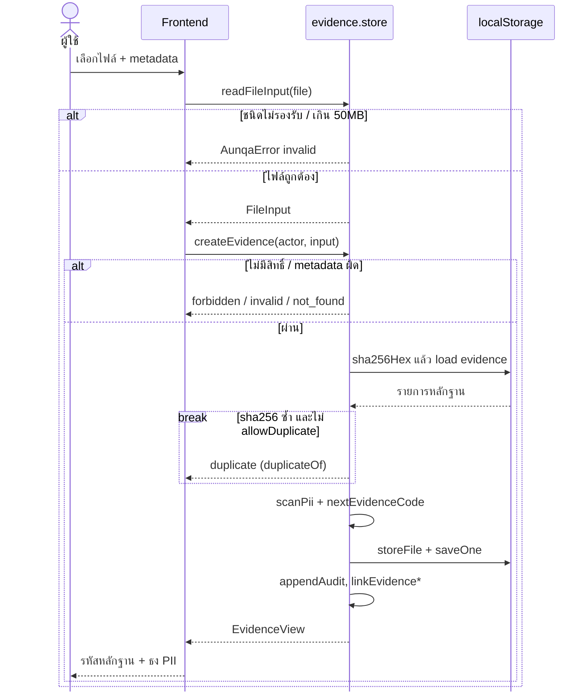

หมายเหตุสำหรับรูปที่ 3.7: การผูกหลักฐานทำเมื่อผู้ใช้ระบุข้อและรอบ การสแกนข้อมูลส่วนบุคคลตรวจชื่อหลักฐาน คำอธิบาย ข้อความที่ดึงจากไฟล์ และชื่อไฟล์ โดยแปลงเลขไทยและอักขระเต็มความกว้างเป็นอักขระ ASCII ก่อนตรวจ เมื่อพบไฟล์ซ้ำ การทำงานหยุดที่จุดนั้น และถ้าผู้ใช้ยืนยันว่าต้องการเก็บซ้ำ ระบบจึงสร้างหลักฐานใหม่อีกครั้งโดยอนุญาตไฟล์ซ้ำ

รูปที่ 3.8 แสดงขั้นตอนของบริการปัญญาประดิษฐ์ระดับบริการ โดยใช้การร่าง SAR (AI-2) และการแปล (AI-4) เป็นตัวอย่าง บริการตรวจสิทธิ์ ตรวจว่ารอบยังแก้ไขได้ ตัดข้อมูลส่วนบุคคล แล้วส่งให้ตัวให้บริการ ผลลัพธ์ทุกกรณีผ่านการตรวจหลังประมวลผลและบันทึกเป็น AiRun ที่ยังไม่ถูกยอมรับ เมื่อผู้ใช้กดยอมรับ ระบบบันทึกเนื้อหาผ่านฟังก์ชันบันทึก SAR ปกติซึ่งตรวจสิทธิ์ การล็อก และรหัสหลักฐานอีกครั้ง

**รูปที่ 3.8 แผนภาพลำดับบริการปัญญาประดิษฐ์ (การร่างและการแปล SAR)**

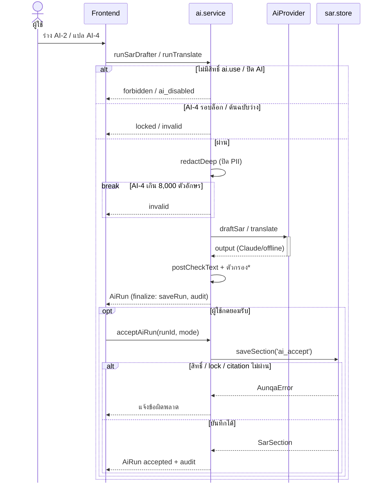

หมายเหตุสำหรับรูปที่ 3.8: ตัวกรองของ AI-2 ตัดประโยคเชิงให้คะแนนหรือตัดสินออก ส่วน AI-4 ตรวจว่ารหัสหลักฐาน `[E-…]` และตัวเลขในคำแปลครบตามต้นฉบับ และติดธงประโยคตัดสินที่เพิ่มขึ้นมาโดยไม่ตัดออก เนื่องจากเป็นเนื้อหาของผู้ใช้เอง ฟีเจอร์ AI-1, AI-3, AI-7 และ AI-9 ใช้โครงเดียวกัน คำแปลที่ได้จากตัวให้บริการออฟไลน์ถูกตั้งธง "ต้องตรวจคำแปล" เมื่อยอมรับ รายละเอียดการเรียกตัวให้บริการแสดงในรูปที่ 3.9 และบริการ AI เปลี่ยนสถานะหรือให้คะแนนไม่ได้ เนื่องจากโมดูลบริการ AI ไม่เรียกฟังก์ชันเปลี่ยนสถานะ

รูปที่ 3.9 แสดงการทำงานของตัวให้บริการ Claude ฝั่งเบราว์เซอร์ Route Handler `/api/ai` และ Messages API ของ Anthropic Route Handler ตรวจตามลำดับ คือ มีกุญแจ API หรือไม่ ต้นทางและส่วนหัวของคำขอถูกต้องหรือไม่ อัตราการเรียกต่อผู้เรียกและรวมต่อนาทีเกินหรือไม่ ขนาดและรูปแบบของคำขอถูกต้องหรือไม่ จากนั้นตัดข้อมูลส่วนบุคคลซ้ำ สร้างคำสั่งรุ่น claude-v2 ตรวจงบการเรียกรายวัน แล้วจึงเรียก Anthropic โดยกำหนดเวลารอ 60 วินาที

**รูปที่ 3.9 แผนภาพลำดับการเรียก Claude ผ่าน Route Handler และการสลับไปใช้ตัวให้บริการออฟไลน์**

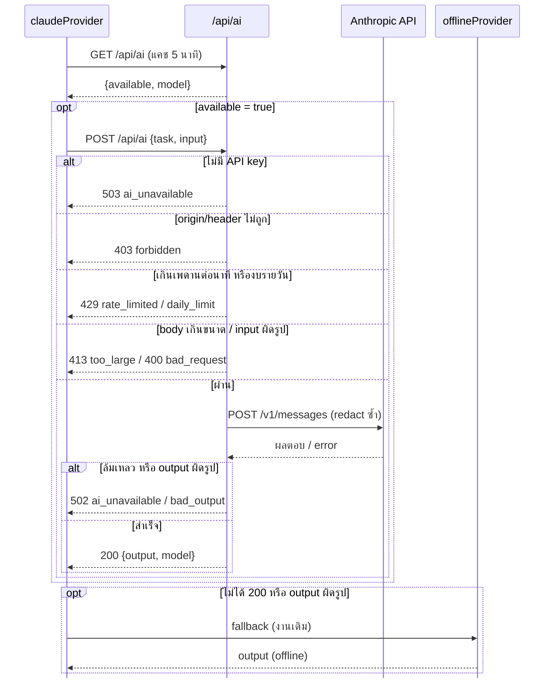

หมายเหตุสำหรับรูปที่ 3.9: รหัสตอบกลับ 429 มีสองกรณีที่แยกกันในโค้ด คือเกินอัตราการเรียกก่อนอ่านเนื้อคำขอ และเกินงบรายวันหลังตรวจข้อมูลนำเข้า แต่รวมไว้ในกิ่งเดียวเพื่อความกระชับ ทุกกรณีที่ไม่ได้รหัส 200 ฝั่งเบราว์เซอร์สลับไปใช้ตัวให้บริการออฟไลน์เสมอ ระบบจึงสาธิตได้แม้ไม่มีกุญแจ API

รูปที่ 3.10 แสดงการรักษางานที่ยังไม่บันทึกเมื่อเซสชันสิ้นสุด 3 กรณี คือ (ก) ผู้ใช้กดออกจากระบบ (ข) เซสชันหมดอายุ และ (ค) ผู้ใช้ออกจากระบบหรือเข้าสู่ระบบเป็นบุคคลอื่นจากแท็บอื่น ทุกกรณีเรียกการบันทึกงานที่ค้างทั้งหมด (flushAll) ก่อน และการบันทึกแต่ละข้อส่งเวลาบันทึกล่าสุดที่หน้าถืออยู่ (`baseUpdatedAt`) ไปด้วย

**รูปที่ 3.10 แผนภาพลำดับการออกจากระบบ การหมดอายุของเซสชัน และการตรวจความขัดแย้งในการบันทึก**

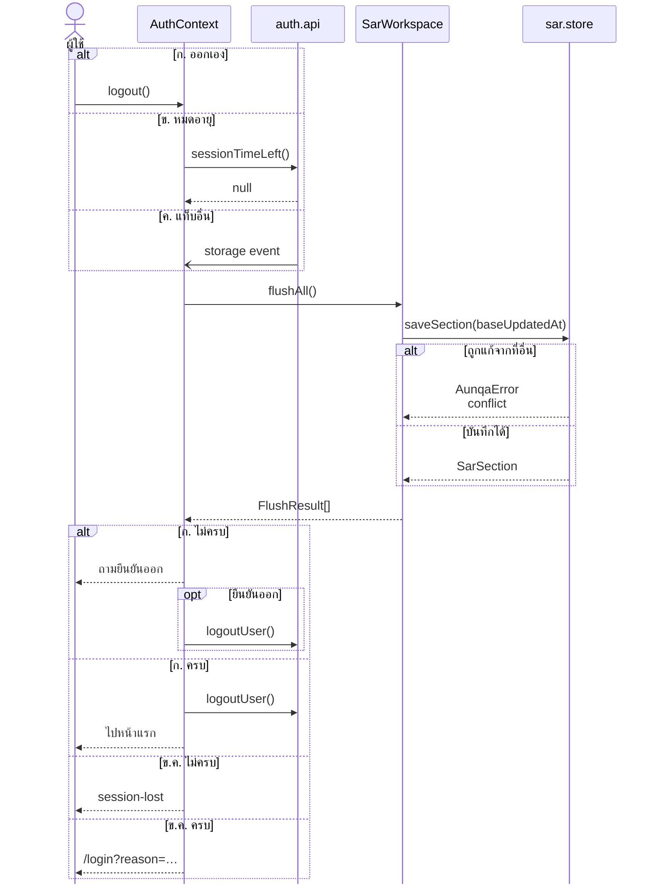

หมายเหตุสำหรับรูปที่ 3.10: AuthContext ตรวจเวลาที่เหลือของเซสชันทุก 30 วินาที เซสชันหมดอายุเมื่อไม่มีการใช้งาน 4 ชั่วโมงหรือครบ 12 ชั่วโมงนับจากเข้าสู่ระบบ และเตือนก่อนหมดอายุ 5 นาที กรณี (ค) รับรู้ผ่านเหตุการณ์ storage ของเบราว์เซอร์ สถานะ session-lost คือหน้าที่อ่านได้อย่างเดียวพร้อมปุ่มคัดลอกข้อความ การบันทึกถูกปฏิเสธด้วยรหัส conflict เมื่อเวลาบันทึกล่าสุดของข้อนั้นใหม่กว่า `baseUpdatedAt`

### 3.3.2 แผนภาพสถานะ

แผนภาพสถานะ (State Diagram) ในรูปที่ 3.11 แสดงสถานะของรอบการประเมิน ระบบอนุญาตให้เปลี่ยนสถานะได้เฉพาะตามตารางการเปลี่ยนสถานะ (`CYCLE_TRANSITIONS`) เท่านั้น การส่งตรวจต้องอนุมัติครบทุกข้อ การส่งกลับต้องมีหมายเหตุ และการอนุมัติสุดท้ายจะล็อกรอบพร้อมบันทึกค่าแฮช หลังล็อก คณบดีเปิดรอบแก้ไขใหม่ได้โดยต้องระบุหมายเหตุ และเลขรุ่นของรอบเพิ่มขึ้นหนึ่ง

**รูปที่ 3.11 แผนภาพสถานะของรอบการประเมิน**

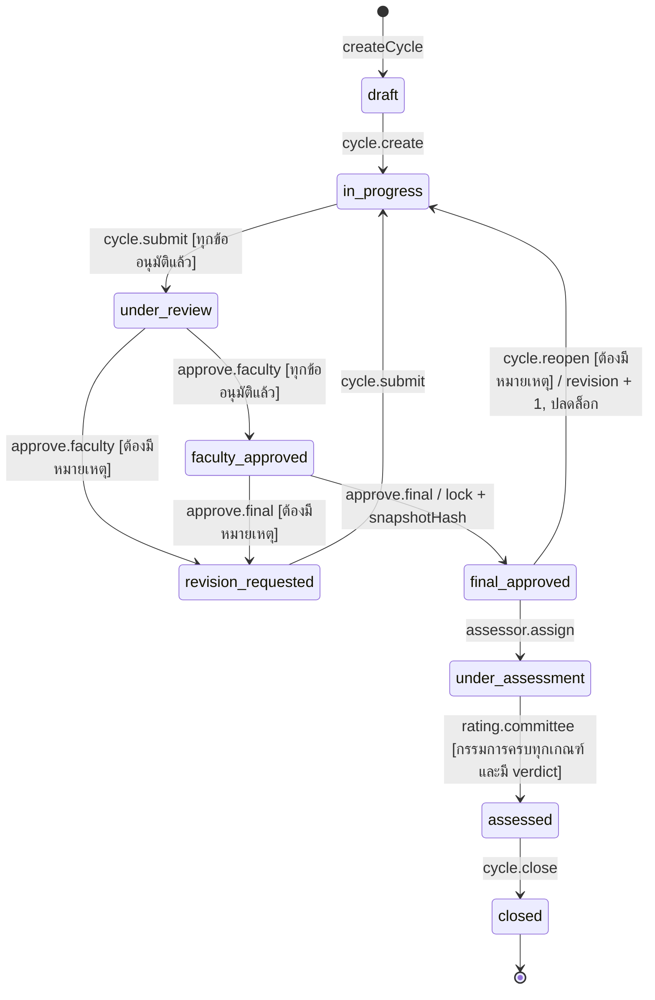

รูปที่ 3.12 แสดงสถานะของ SAR รายข้อ ผู้อนุมัติต้องไม่ใช่ผู้บันทึกเนื้อหาล่าสุดของข้อนั้น เพื่อแยกหน้าที่ผู้เขียนกับผู้อนุมัติ แผนภาพนี้ไม่มีสถานะสิ้นสุด เนื่องจากโค้ดอนุญาตให้ข้อที่อนุมัติแล้วถูกส่งกลับเพื่อแก้ไขได้

**รูปที่ 3.12 แผนภาพสถานะของรายงานการประเมินตนเองรายข้อ**

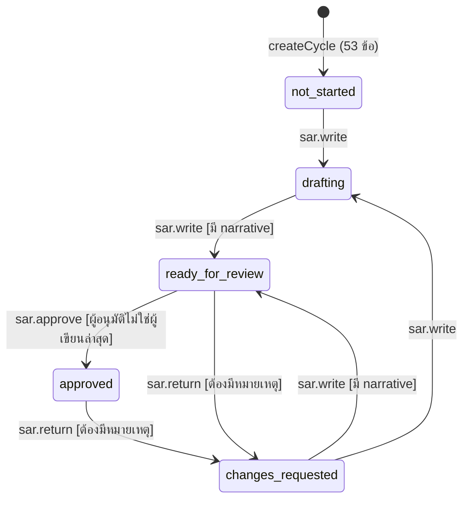

### 3.3.3 แผนภาพความสัมพันธ์ของข้อมูล

แผนภาพความสัมพันธ์ของข้อมูล (ER Diagram) แบ่งเป็น 4 รูป รูปที่ 3.13 แสดงแกนของระบบ ได้แก่ องค์กร ผู้ใช้และบทบาท รอบการประเมิน SAR รายข้อ และเวอร์ชันของเนื้อหา

**รูปที่ 3.13 แผนภาพความสัมพันธ์ของข้อมูลแกนหลัก**

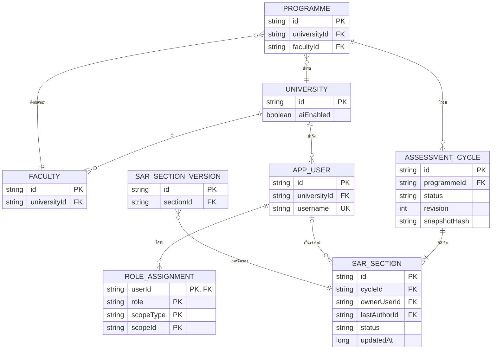

รูปที่ 3.14 แสดงข้อมูลการอนุมัติ การประเมิน และแผนปรับปรุง ได้แก่ เหตุการณ์การตรวจ (Review Event) คะแนน ข้อค้นพบของกรรมการ verdict รายการแผนปรับปรุง และการแจ้งเตือน

**รูปที่ 3.14 แผนภาพความสัมพันธ์ของข้อมูลการอนุมัติ การประเมิน และแผนปรับปรุง**

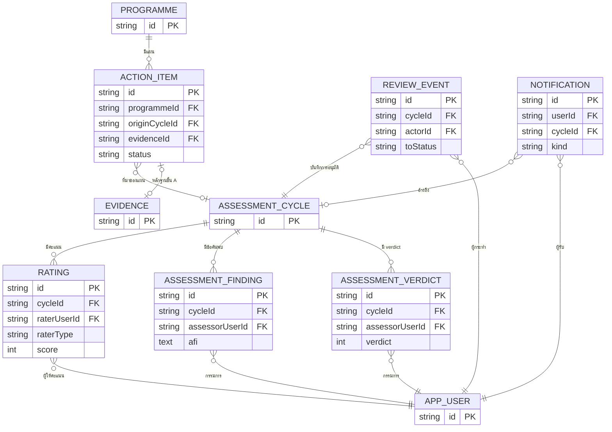

รูปที่ 3.15 แสดงข้อมูลหลักฐาน ไฟล์และเวอร์ชันของไฟล์ การผูกหลักฐานกับข้อ การเรียก AI บันทึกการตรวจสอบ และตัวชี้วัด ความสัมพันธ์แบบหลายต่อหลายระหว่างหลักฐานกับข้อเกณฑ์แยกเป็นตาราง EVIDENCE_LINK

**รูปที่ 3.15 แผนภาพความสัมพันธ์ของข้อมูลหลักฐาน การเรียกปัญญาประดิษฐ์ และตัวชี้วัด**

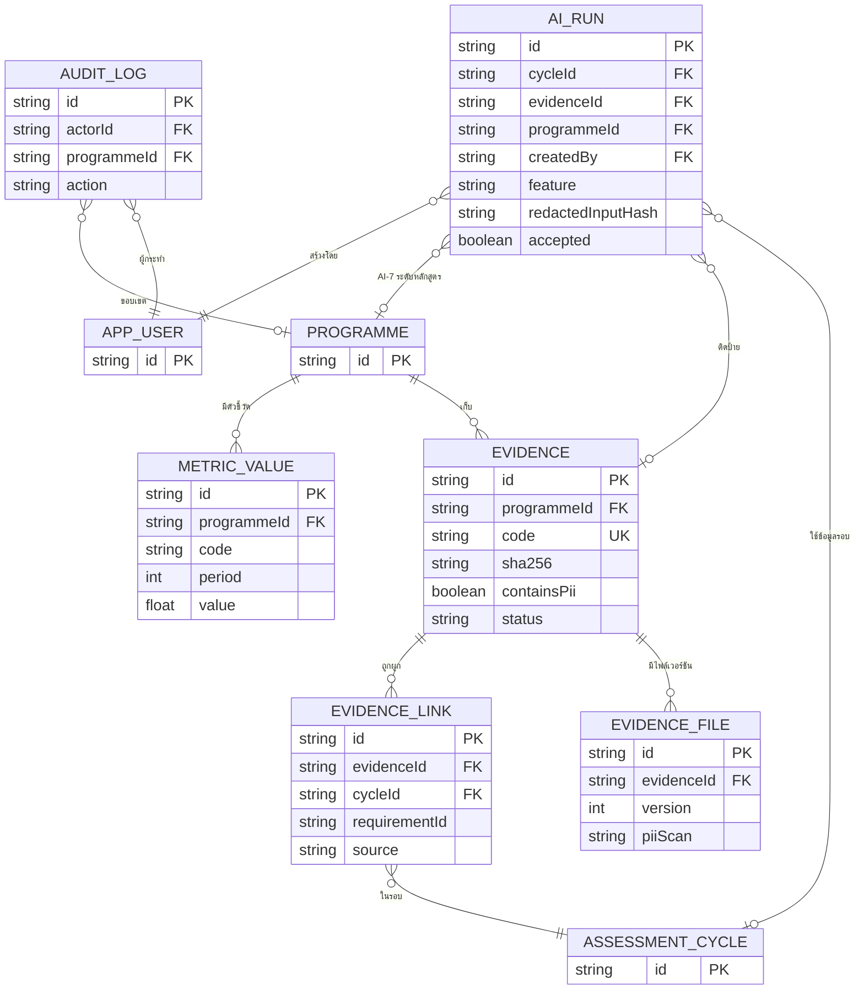

รูปที่ 3.16 แสดงข้อมูลหลักสูตร ได้แก่ PLO รายวิชา CLO วิธีสอนและวิธีวัดผล ตารางเชื่อม CLO กับ PLO และตารางวิชาที่ต้องเรียนก่อน

**รูปที่ 3.16 แผนภาพความสัมพันธ์ของข้อมูลหลักสูตร**

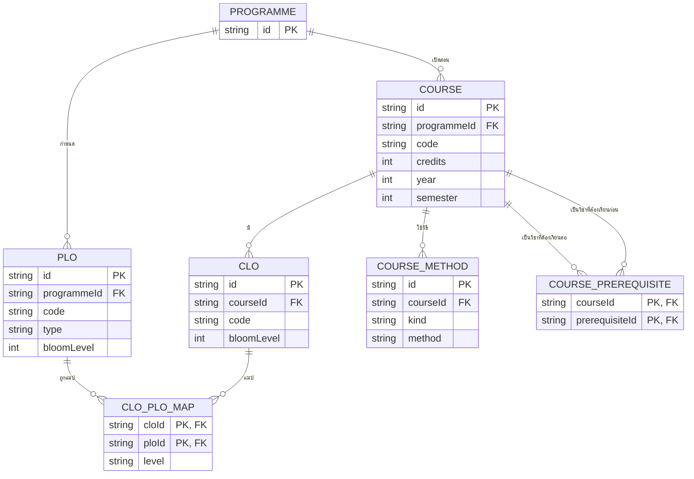

หมายเหตุสำหรับรูปที่ 3.13–3.16: สัญลักษณ์ `||--o{` หมายถึงหนึ่งต่อศูนย์หรือมาก `|o--o{` หมายถึงศูนย์หรือหนึ่งต่อศูนย์หรือมาก และ `||--|{` หมายถึงหนึ่งต่อหนึ่งหรือมาก กล่องที่มีเฉพาะ `id PK` คือตารางจากรูปอื่นซึ่งวาดไว้เพื่อแสดงกุญแจนอก แผนภาพแสดงเฉพาะกุญแจหลัก กุญแจนอก และแอตทริบิวต์สำคัญ ฟิลด์ `requirementId` และ `criterionNo` อ้างข้อมูลเกณฑ์ AUN-QA ซึ่งเป็นค่าคงที่ในโค้ด จึงไม่มีเส้นกุญแจนอก ระบบรุ่นต้นแบบเก็บข้อมูลเป็น JSON ใน localStorage (คีย์ขึ้นต้นด้วย `aunqa_`) แผนภาพนี้จึงเป็นโครงสร้างเชิงตรรกะสำหรับย้ายไป PostgreSQL ในอนาคต โดย ROLE_ASSIGNMENT และ COURSE_PREREQUISITE ในโค้ดปัจจุบันฝังอยู่ในฟิลด์ `AppUser.roles` และ `Course.prerequisiteIds` ตามลำดับ ตัวอักษรในรูปที่ 3.13, 3.14 และ 3.16 มีขนาดประมาณ 7 พอยต์เมื่อพิมพ์ และการวางหน้าแนวนอนไม่ช่วยขยาย เนื่องจากสัดส่วนของรูปใกล้เคียงสี่เหลี่ยมจัตุรัส [ต้องตรวจสอบกับคู่มือสาขา: ขนาดตัวอักษรขั้นต่ำในแผนภาพ หากต้องการอย่างน้อย 8 พอยต์ต้องแยกรูปเพิ่มหรือย้ายไปภาคผนวก]

### 3.3.4 แผนภาพคลาส

แผนภาพคลาส (Class Diagram) ระดับการออกแบบแบ่งเป็น 3 รูป รูปที่ 3.17 แสดงบริการ AI (`AiService`) ซึ่งให้บริการ AI-1, AI-2, AI-3, AI-4, AI-7 และ AI-9 โดยเรียกตัวให้บริการผ่านส่วนต่อประสาน `AiProvider` ที่มีสองแบบคือ Claude และออฟไลน์ และใช้โมดูลตัดข้อมูลส่วนบุคคล โมดูลตรวจหลังประมวลผล และอภิธานศัพท์ AUN-QA สำหรับการแปล

**รูปที่ 3.17 แผนภาพคลาสของบริการปัญญาประดิษฐ์**

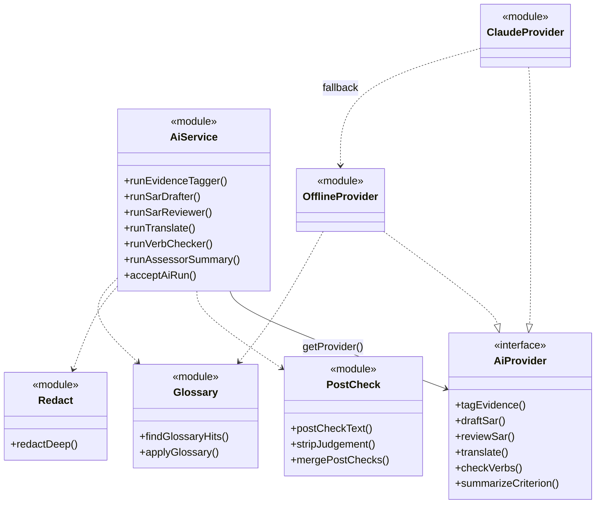

รูปที่ 3.18 แสดงโมดูลลำดับงานกับที่เก็บข้อมูล ได้แก่ การเปลี่ยนสถานะ SAR รอบ แผนปรับปรุง การแจ้งเตือน การตรวจก่อนเปลี่ยนสถานะ รายการงานที่ต้องทำ และชนิดข้อผิดพลาด `AunqaError` จุดสำคัญคือ `AiService` ไม่พึ่งพาฟังก์ชันเปลี่ยนสถานะของรอบหรือข้อ จึงบังคับกฎ "AI เปลี่ยนสถานะไม่ได้" ด้วยโครงสร้างโค้ด

**รูปที่ 3.18 แผนภาพคลาสของลำดับงานและที่เก็บข้อมูล**

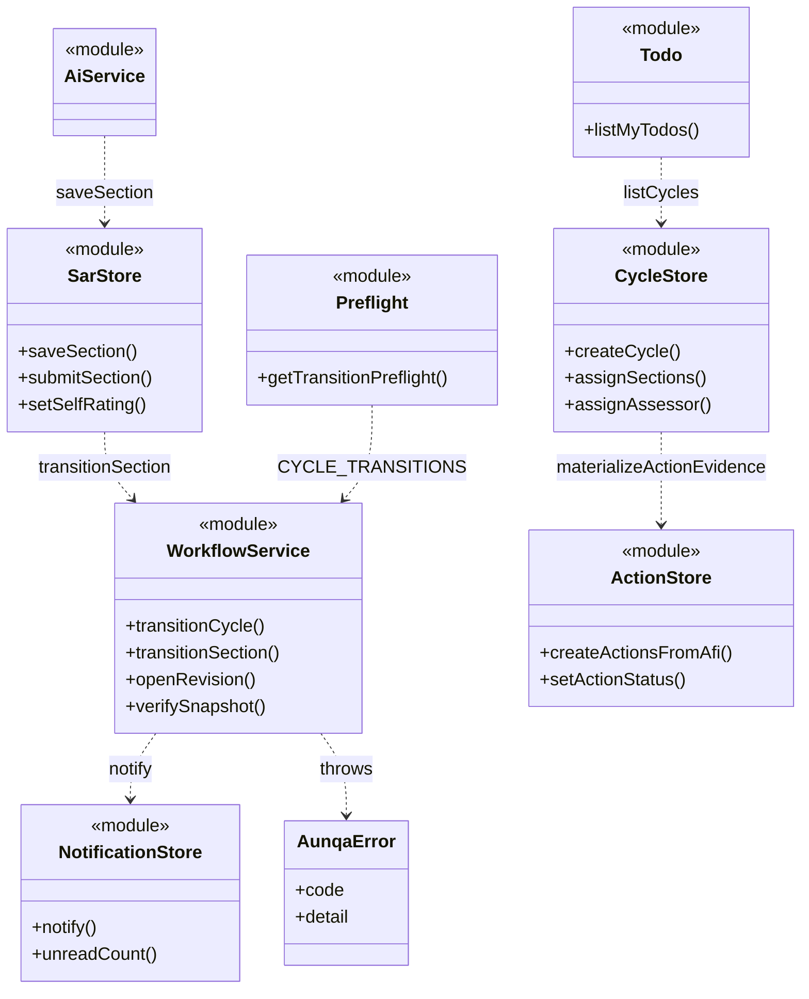

รูปที่ 3.19 แสดงโมดูลสนับสนุน ได้แก่ คลังหลักฐาน การสแกนข้อมูลส่วนบุคคล การนำเข้าตัวชี้วัดซึ่งตรวจขนาดไฟล์บีบอัดก่อนอ่าน งานของกรรมการ การควบคุมสิทธิ์ บันทึกการตรวจสอบ และชั้นจัดเก็บข้อมูล รูปนี้จัดวางในหน้าแนวนอนเพื่อให้ตัวอักษรอ่านได้

**รูปที่ 3.19 แผนภาพคลาสของโมดูลสนับสนุน** (จัดวางในหน้าแนวนอน)

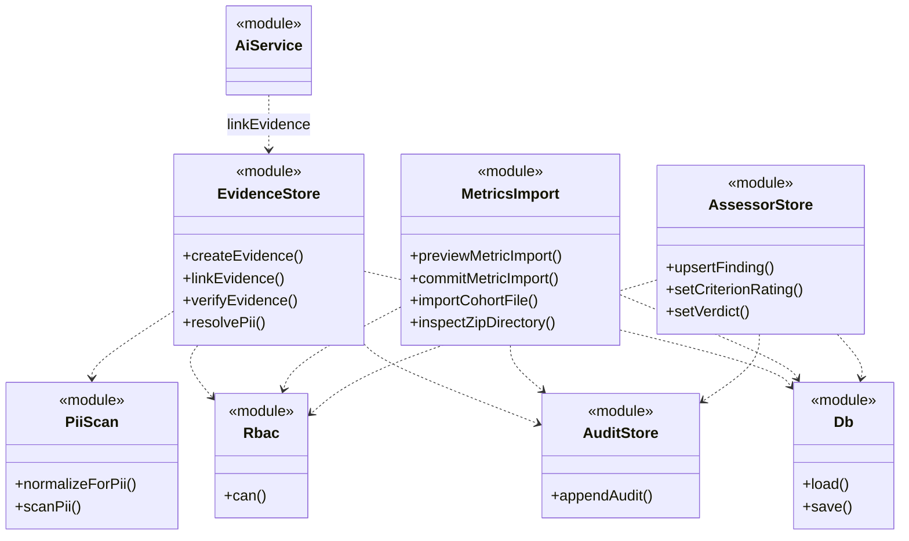

หมายเหตุสำหรับรูปที่ 3.17–3.19: โค้ดจริงเป็นโมดูลของฟังก์ชัน ไม่ใช่คลาส จึงใช้ตัวกำกับ «module» กล่องว่างคือโมดูลจากรูปอื่น และแสดงเฉพาะการพึ่งพาหลัก

### 3.3.5 สถาปัตยกรรมระบบ

รูปที่ 3.20 แสดงสถาปัตยกรรมเชิงกายภาพของรุ่นต้นแบบ ส่วนหน้าจอและชั้นตรรกะทำงานในเบราว์เซอร์และเก็บข้อมูลกับเซสชันใน localStorage ส่วนเซิร์ฟเวอร์ Next.js มี Route Handler `/api/ai` เพียงจุดเดียวที่ถือกุญแจ API จำกัดอัตราการเรียกและงบรายวัน และเรียก Messages API ของ Anthropic ผ่าน HTTPS

**รูปที่ 3.20 แผนภาพการติดตั้งระบบ (ประยุกต์จาก UML Deployment Diagram)**

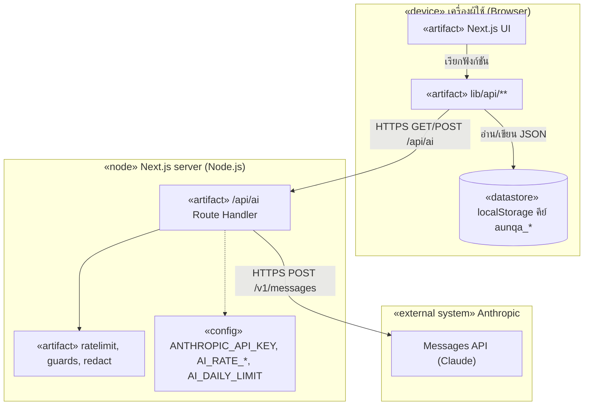

หมายเหตุ: แผนภาพนี้ใช้สัญลักษณ์ประยุกต์จาก UML Deployment Diagram เนื่องจาก Mermaid ไม่มีแผนภาพชนิดนี้โดยตรง รุ่นต้นแบบยังไม่มีเซิร์ฟเวอร์ฐานข้อมูล ข้อมูลและเซสชันอยู่ใน localStorage ของเบราว์เซอร์ และตัวนับอัตราการเรียกกับงบรายวันอยู่ในหน่วยความจำของโปรเซสเดียว

### 3.3.6 การออกแบบการวิเคราะห์ช่องว่าง

การวิเคราะห์ช่องว่างใช้กฎ 11 ข้อที่เขียนเป็นฟังก์ชันบริสุทธิ์ (Pure Function) จึงทดสอบแยกได้และไม่ต้องพึ่ง AI ดังตารางที่ 3.4 กฎ R1–R10 มาจากสเปกของระบบ ส่วน R11 เพิ่มในระยะ C เพื่อเตือนคำแปลที่ยังไม่ได้ตรวจ ผลของกฎใช้คำนวณระดับสีของแผงความพร้อม 53 ช่อง ร้อยละความพร้อมของรอบ และคำเตือนก่อนเปลี่ยนสถานะ

Table: ตารางที่ 3.4 กฎการวิเคราะห์ช่องว่าง R1–R11

| กฎ | สิ่งที่ตรวจ | ระดับ |
|---|---|---|
| R1 | ข้อนี้ไม่มีหลักฐานผูก | Critical |
| R2 | มีหลักฐานแต่ไม่มีขั้น Check หรือ Act | High |
| R3 | ตัวชี้วัดที่ข้อนี้ต้องใช้มีข้อมูลน้อยกว่า 3 ปี | High |
| R4 | เนื้อหาว่างหรือน้อยกว่า 100 คำ | Medium |
| R5 | หลักฐานเก่ากว่าจำนวนปีที่กำหนด | Medium |
| R6 | หลักฐานติดธงข้อมูลส่วนบุคคลที่ยังไม่จัดการ | High |
| R7 | PLO ไม่มีรายวิชารับผิดชอบหรือไม่มีวิธีวัด วิชาไม่ผูก PLO หรือวิชาที่ต้องเรียนก่อนวนซ้ำ | High |
| R8 | ไม่มีค่าเทียบเคียงในข้อที่เกณฑ์ต้องการ (6.6, 8.1–8.3, 8.5) | Medium |
| R9 | ประโยคในเนื้อหาไม่มีการอ้างหลักฐาน | Low |
| R10 | ให้คะแนนตนเองตั้งแต่ 4 ขึ้นไปแต่ R1 หรือ R2 ยังเปิดอยู่ | High |
| R11 | คำแปลที่ได้จากตัวให้บริการออฟไลน์ยังไม่ได้ตรวจยืนยัน | Medium |

<!-- source: .agents/spec/AUN-QA_Copilot_Spec.md M9; eduflow-next/lib/api/gap.ts; R7 ตาม Log B2; R11 ตาม Log backend-dev C4 fix (C-8: ธง needsTranslationReview + gap R11 medium) -->

### 3.3.7 การออกแบบบริการปัญญาประดิษฐ์

บริการปัญญาประดิษฐ์ยึดหลัก 4 ข้อ คือ AI เป็นผู้ช่วยไม่ใช่ผู้ประเมิน ทุกข้อความต้องมีหลักฐานรองรับ ผลลัพธ์เป็นข้อเสนอที่มนุษย์ต้องกดยอมรับ และทุกการเรียกถูกบันทึกเป็น AiRun พร้อมชื่อแบบจำลองที่ตอบจริง ข้อห้ามของ AI บังคับในโค้ดดังตารางที่ 3.5

Table: ตารางที่ 3.5 ข้อห้ามของปัญญาประดิษฐ์และวิธีบังคับในระบบ

| ข้อห้าม | วิธีบังคับ |
|---|---|
| ให้คะแนนทางการหรือ verdict | คะแนนกรรมการรับจากบทบาทกรรมการเท่านั้น ส่วนต่อประสานของตัวให้บริการไม่มีเมธอดให้คะแนน และตัวกรองคำตัดสินตัดประโยคเชิงให้คะแนนหรือตัดสินออกจากผลของ AI-1, AI-2, AI-3, AI-7 และ AI-9 ส่วน AI-4 ติดธงโดยไม่ตัด |
| อนุมัติหรือเปลี่ยนสถานะ | บริการ AI ไม่เรียกฟังก์ชันเปลี่ยนสถานะ ผลที่ยอมรับแล้วบันทึกผ่านฟังก์ชันปกติที่ตรวจสิทธิ์และการล็อก |
| สร้างตัวเลข | ตัวเลขในผลลัพธ์ต้องปรากฏในข้อมูลนำเข้า ไม่เช่นนั้นถูกติดธงหรือตัดออก ส่วนคำแปลต้องมีตัวเลขครบเท่าต้นฉบับ |
| อ้างหลักฐานที่ไม่มี | รหัส `[E-…]` ทุกตัวต้องมีอยู่ในรอบนั้น ไม่เช่นนั้นถูกตัดออก |
| เห็นข้อมูลส่วนบุคคล | ตัดเลขประจำตัวประชาชน รหัสนักศึกษา อีเมล และหมายเลขโทรศัพท์ด้วยนิพจน์ปกติก่อนส่ง โดยแปลงเลขไทยและอักขระเต็มความกว้างก่อนตรวจ รองรับรูปแบบ +66 และตัวคั่นหลายแบบ และตัดซ้ำที่เซิร์ฟเวอร์ |
| ทำตามคำสั่งที่แฝงในหลักฐาน | คำสั่งรุ่น claude-v2 ประกาศว่าข้อความนำเข้าเป็นข้อมูลไม่ใช่คำสั่ง และการตรวจหลังประมวลผลในโค้ดเป็นตัวบังคับหลัก |

<!-- source: eduflow-next/lib/api/ai.service.ts, lib/api/ai/postcheck.ts, lib/utils/pii.ts ตาม Log backend-dev "D-sec fix กลุ่ม A" (A-1 judgementFilter ครอบ AI-1/2/7, A-2 normalizeForPii, A-3 prompt) -->

ฟีเจอร์ AI ที่พัฒนาแล้วมี 6 รายการ ได้แก่ AI-1 สรุปและติดป้ายหลักฐาน AI-2 ร่าง SAR AI-3 ตรวจ SAR AI-4 แปล SAR ระหว่างภาษาไทยกับอังกฤษ AI-7 ตรวจคำกริยาของ PLO/CLO ตามระดับบลูม และ AI-9 สรุปเกณฑ์และเสนอคำถามสัมภาษณ์สำหรับกรรมการ ทุกฟีเจอร์มีตัวให้บริการแบบออฟไลน์ที่ทำงานได้โดยไม่ต้องมีกุญแจ API ซึ่งให้ผลเป็นโครงร่างจากกฎและแม่แบบ และผลของ AI ระบุชัดว่าได้จากโหมดใด

### 3.3.8 การออกแบบการแปล การนำเข้าข้อมูล และการส่งออกเอกสาร

ความสามารถที่เพิ่มในระยะ C ออกแบบดังนี้

1. **การแปล (AI-4)** แปลเนื้อหา SAR ของข้อนั้นจากอีกภาษาหนึ่ง ข้อความผ่านการตัดข้อมูลส่วนบุคคล แล้วจำกัดความยาวไม่เกิน 8,000 ตัวอักษรหลังตัด ใช้อภิธานศัพท์ AUN-QA 55 คู่เพื่อให้ศัพท์เฉพาะคงที่ ตรวจหลังประมวลผลว่ารหัสหลักฐานและตัวเลขครบเท่าต้นฉบับ ผู้ใช้เทียบต้นฉบับกับคำแปลแล้วเลือกต่อท้ายหรือแทนที่ คำแปลจากตัวให้บริการออฟไลน์แทนเฉพาะศัพท์ในอภิธานศัพท์ จึงถูกตั้งธงต้องตรวจคำแปลและเกิดช่องว่าง R11 จนกว่าผู้ใช้กดยืนยันว่าตรวจแล้ว ระบบไม่ขอแปลข้อในรอบที่แก้ไขไม่ได้
2. **การนำเข้าตัวชี้วัด** ใช้แม่แบบ Excel ที่ระบบสร้างให้ และทำงานสองขั้น คือแสดงตัวอย่างพร้อมผลตรวจรายแถว (รหัสตัวชี้วัด ปี ค่าร้อยละ 0–100 ค่าติดลบ ปีซ้ำ) แล้วจึงยืนยันบันทึกเฉพาะแถวที่ผ่าน ตัวอย่างใช้ได้ครั้งเดียว เฉพาะผู้ที่สร้าง และหมดอายุใน 30 นาที
3. **การนำเข้าข้อมูลรายรุ่น** อ่านเฉพาะคอลัมน์รุ่น สถานะ และจำนวนปีที่ใช้ศึกษา แล้วคำนวณอัตราการสำเร็จการศึกษาตามเวลา อัตราการออกกลางคัน และเวลาเฉลี่ยในการสำเร็จการศึกษาต่อรุ่น ระบบเก็บเฉพาะค่ารวมต่อรุ่น ไม่เก็บข้อมูลรายบุคคลหรือชื่อไฟล์ และถ้ามีแถวผิดแม้แถวเดียวจะไม่นำเข้าข้อมูลใดเลย ไฟล์ Excel ทุกชนิดถูกตรวจขนาดหลังแตกไฟล์บีบอัดก่อนอ่าน เพื่อป้องกันไฟล์บีบอัดที่ขยายตัวผิดปกติ
4. **การส่งออก SAR เป็น DOCX** สร้างไฟล์ Word จริงด้วยไลบรารี docx ประกอบด้วยปก สารบัญ บทสรุป ส่วนที่ 1–4 เกณฑ์ 1–8 รายข้อ และภาคผนวกดัชนีหลักฐาน รหัส `[E-…]` เป็นลิงก์ภายในเอกสาร ใช้ฟอนต์ TH Sarabun New และมีเลขหน้า ข้อความของผู้ใช้ถูกตัดอักขระควบคุมที่ XML ไม่อนุญาตก่อนส่งให้ไลบรารี ระบบยังคงการส่งออกแบบ .doc ไว้เป็นทางเลือกสำรอง

<!-- source: .agents/board/TASK-0001.md "Phase C additions (C1)" และ Log backend-dev C4 fix (C-1 xmlSafe, C-2 assertCycleWritable, C-4 เพดาน 8,000, C-5, C-8 R11); Log backend-dev D-sec (A-5 inspectZipDirectory) -->

### 3.3.9 การออกแบบการจัดการเซสชันและการบันทึกพร้อมกัน

ผลการทดลองใช้ในระยะ U พบความเสี่ยงที่งานเขียนจะหายหรือถูกเขียนทับเมื่อผู้ใช้เปิดหลายแท็บ ออกจากระบบจากแท็บอื่น หรือเซสชันหมดอายุ ผู้วิจัยจึงออกแบบดังนี้ (1) เก็บเซสชันใน localStorage เพื่อให้ทุกแท็บใช้เซสชันเดียวกัน กำหนดอายุเมื่อไม่ใช้งาน 4 ชั่วโมงและอายุสูงสุด 12 ชั่วโมง ไม่ขยายอายุสูงสุด และต่ออายุเมื่อมีกิจกรรมไม่เกินนาทีละครั้ง (2) ชื่อผู้ใช้ไม่แยกตัวพิมพ์เล็กใหญ่ (3) ก่อนออกจากระบบทุกกรณีให้บันทึกงานที่ค้าง หากบันทึกไม่ได้ให้ผู้ใช้เลือกกลับไปแก้หรือยืนยันออก (4) แท็บที่เซสชันสิ้นสุดจากที่อื่นเปลี่ยนเป็นอ่านอย่างเดียว เมนูถูกซ่อน แต่ยังคัดลอกข้อความที่ค้างได้ และ (5) การบันทึกข้อ SAR ส่งเวลาบันทึกล่าสุดที่หน้าถืออยู่ไปตรวจ ถ้าข้อนั้นถูกบันทึกจากที่อื่นหลังจากเปิดหน้า ระบบปฏิเสธด้วยรหัส conflict โดยไม่เขียนเนื้อหา เวอร์ชัน หรือบันทึกการตรวจสอบ แล้วให้ผู้ใช้เลือกโหลดฉบับล่าสุดหรือคัดลอกข้อความของตนก่อน ลำดับการทำงานแสดงในรูปที่ 3.10

<!-- source: ADR-UI-001 ข้อ 6.2 B1 และ 6.4; .agents/board/TASK-0001.md "Phase U additions (U2-B)" และ "U3 fix — รายการรวม" (U3P-2 conflict) -->

### 3.3.10 การออกแบบส่วนติดต่อผู้ใช้

ผู้ใช้หลักของระบบคืออาจารย์และบุคลากรอายุ 30 ปีขึ้นไป ผู้วิจัยจึงออกแบบส่วนติดต่อผู้ใช้ใหม่ทั้งระบบในระยะ U โดยแยกการออกแบบออกจากการพัฒนา ขั้นตอนมีดังนี้

1. **ประเมินของเดิม (U0)** ตัวแทนตรวจส่วนติดต่อผู้ใช้ตรวจทุกหน้า และตัวแทนทดลองใช้เล่นระบบทุกบทบาท พบปัญหาระดับ blocker 2 ข้อและ major 8 ข้อจากการตรวจส่วนติดต่อผู้ใช้ เช่น ฟอนต์ภาษาไทยไม่ถูกโหลดจริง ตัวอักษรขนาด 10–13.6 พิกเซลเกือบทั้งระบบ และปุ่มสูง 30 พิกเซล และพบปัญหาระดับ major 6 ข้อกับข้อบกพร่อง P1–P10 จากการทดลองใช้ เช่น บทบาทถัดไปไม่ได้รับแจ้งเตือน และงานที่พิมพ์หายเมื่อโหลดหน้าใหม่ทันที
2. **เขียนข้อกำหนดการออกแบบ (U1)** ในเอกสารบันทึกการตัดสินใจ ADR-UI-001 พร้อมไฟล์ประกอบ 3 ไฟล์ ได้แก่ โทเคนการออกแบบ (Design Tokens) รายการส่วนประกอบพร้อมทุกสถานะ และโครงหน้าจอรายหน้า รวมถึงเกณฑ์การยอมรับที่วัดได้ AC-01 ถึง AC-21
3. **ตรวจข้อกำหนดก่อนพัฒนา (U1b)** ผู้ตรวจส่วนติดต่อผู้ใช้และผู้ทดลองใช้ให้ผล PASS-WITH-CHANGES ทั้งคู่ ผู้ออกแบบแก้ข้อกำหนดครบก่อนเริ่มพัฒนา
4. **พัฒนาตามข้อกำหนดเท่านั้น (U2)** และ **ตรวจของจริงเทียบเกณฑ์ (U3)** ผลแสดงในหัวข้อ 4.2.6

ทิศทางการออกแบบชื่อ "ห้องทำงานวิชาการที่อบอุ่นและเป็นระเบียบ" (Warm Academic Workspace) มีข้อกำหนดสำคัญ ได้แก่ (1) สีหลักครามเข้ม (#3B4FA0) ใช้กับสิ่งที่กดได้เท่านั้น พื้นสีทราย (#FBF8F3) และสีเน้นอำพัน (#E9A23B) ไม่เกินร้อยละ 10 ของพื้นที่ (2) ฟอนต์ Sarabun ตระกูลเดียวที่น้ำหนัก 400, 600 และ 700 ข้อความทั่วไปไม่เล็กกว่า 16 พิกเซล และยกเว้นเป็น 14 หรือ 13 พิกเซลเฉพาะคลาสที่กำหนด (3) เป้าหมายการกดสูงไม่น้อยกว่า 44 พิกเซล วงโฟกัสหนา 3 พิกเซล และความต่างสีผ่านระดับ AA (4) สถานะแสดงด้วยสี ไอคอน และข้อความร่วมกัน ไม่พึ่งสีอย่างเดียว (5) ลูกเล่นใช้ CSS และ SVG เท่านั้น ไม่เพิ่มไลบรารี และลดการเคลื่อนไหวเมื่อผู้ใช้ตั้งค่า prefers-reduced-motion (6) เมนูด้านข้างจัดกลุ่ม และเปลี่ยนเป็นลิ้นชักบนมือถือ (7) หน้าหลักแสดง "สิ่งที่ต้องทำตอนนี้" ตามบทบาท ซึ่งคำนวณจากงานจริง 15 ชนิด เช่น ข้อที่ต้องเขียน ข้อที่รอตรวจ รอบที่รออนุมัติ และหลักฐานที่มีข้อมูลส่วนบุคคลค้าง (8) ก่อนส่งต่อหรืออนุมัติรอบ หน้าจอแสดงคำเตือนจากการตรวจก่อนเปลี่ยนสถานะ เช่น จำนวนช่องว่างระดับวิกฤตและระดับสูง และโฟกัสปุ่ม "กลับไปตรวจก่อน" เป็นค่าเริ่มต้น และ (9) ผู้ใช้ปรับขนาดตัวอักษรได้ 3 ระดับ สิ่งที่ตัดสินใจไม่ทำ ได้แก่ โหมดมืด การอนุมัติเป็นชุด เพราะส่งเสริมการอนุมัติโดยไม่อ่าน และไลบรารีภาพเคลื่อนไหว

<!-- source: .agents/decisions/ADR-UI-001-redesign.md (ทางเลือกที่พิจารณา, การตัดสินใจ, ข้อ 1, 4, 6.2, 7.4, Changelog U1b); .agents/board/TASK-0001.md Progress Checklist U0 ("ui-audit 2B/8M, playtest 6M + bug P1–P10"), U1b ("PASS-WITH-CHANGES ×2"), Log architect U1/U1b-fix; Log backend-dev U2-B (TodoKind 15 ชนิด) -->

### 3.3.11 การออกแบบด้านความปลอดภัยและข้อมูลส่วนบุคคล

ระบบใช้มาตรการดังนี้ (1) ตรวจสิทธิ์ทุกการเขียนข้อมูลและแยกข้อมูลรายมหาวิทยาลัย (2) สแกนข้อมูลส่วนบุคคลในหลักฐาน รวมถึงชื่อไฟล์ และแสดงเป็นช่องว่างระดับ High จนกว่าจะจัดการ (3) บันทึกการตรวจสอบแบบเพิ่มต่อท้ายโดยไม่มีฟังก์ชันแก้หรือลบ และป้องกันการแทรกสูตรเมื่อส่งออก CSV (4) ไม่แสดง HTML จากผู้ใช้โดยตรง เข้ารหัสอักขระในเอกสาร .doc และตัดอักขระควบคุมในเอกสาร DOCX (5) Route Handler `/api/ai` ตรวจต้นทางและส่วนหัว จำกัดอัตราต่อหมายเลข IP 20 ครั้งต่อนาที (เมื่อตั้งค่าให้เชื่อข้อมูลจาก proxy ไม่เช่นนั้นทุกคำขอใช้ตัวนับเดียวกัน) และรวม 60 ครั้งต่อนาที จำกัดงบรายวัน 500 ครั้ง จำกัดขนาดคำขอ ตรวจรูปแบบผลลัพธ์ก่อนส่งกลับ และไม่บันทึกข้อความของผู้ใช้หรือกุญแจลงล็อก (6) การนำเข้าข้อมูลรายรุ่นเก็บเฉพาะค่ารวม และ (7) ใช้ข้อมูลสมมติเท่านั้น ค่าขีดจำกัดใน (5) เป็นค่าเริ่มต้นที่ปรับได้ด้วยตัวแปรสภาพแวดล้อม

การตรวจความมั่นคงปลอดภัยทั้งระบบในระยะ D ใช้ OWASP Top 10:2021 หมวด A01, A03, A04, A05, A06 และ A07 ร่วมกับ ASVS 4.0.3 ระดับ 1 หมวด V2, V5, V12 และ V14 (OWASP Foundation, 2021a, 2021b) และความเสี่ยง LLM01 การแทรกคำสั่ง (OWASP Gen AI Security Project, 2025) ผลการตรวจและข้อจำกัดที่เหลืออยู่แสดงในหัวข้อ 4.2.5 และ 5.3 ข้อจำกัดสำคัญของรุ่นต้นแบบคือการตรวจสิทธิ์ทั้งหมดอยู่ในเบราว์เซอร์ จึงป้องกันการใช้งานผิดผ่านหน้าจอได้ แต่ยังไม่ใช่การป้องกันผู้โจมตี

<!-- source: lib/api/ai/ratelimit.ts (ค่าเริ่มต้น AI_RATE_PER_IP 20, AI_RATE_GLOBAL 60, AI_DAILY_LIMIT 500); .agents/reviews/TASK-0001-security.md (เกณฑ์, สิ่งที่ตรวจแล้วผ่าน); Log security-auditor D-sec -->

## 3.4 เครื่องมือที่ใช้ในการพัฒนา

Table: ตารางที่ 3.6 เครื่องมือและรุ่นที่ใช้ในการพัฒนา

| เครื่องมือ | รุ่น | การใช้งาน |
|---|---|---|
| Next.js | 14.2.35 | เฟรมเวิร์กเว็บแอปพลิเคชันและ Route Handler |
| React | 18.3.1 | ส่วนติดต่อผู้ใช้ |
| TypeScript | 5.9.3 | ภาษาพัฒนาและการตรวจชนิดข้อมูล |
| Vitest | 3.2.7 | การทดสอบหน่วยและการทดสอบร่วม |
| Playwright | 1.64.1 | การทดสอบแบบครบวงจรผ่านเบราว์เซอร์ Chromium และการวัดคุณลักษณะของหน้าจอ |
| ExcelJS | 4.4.0 | อ่านและเขียนไฟล์ .xlsx |
| docx | 9.13.0 | ส่งออก SAR เป็นไฟล์ .docx |
| Node.js | 24.16.0 | สภาพแวดล้อมรันบนเครื่องพัฒนา |
| mermaid-cli | 12.0.0 (mermaid 12.2.0) | แปลงแผนภาพ UML เป็นรูปภาพ |
| Claude API | แบบจำลองค่าเริ่มต้น `claude-sonnet-5-5` คำสั่งรุ่น claude-v2 | LLM เมื่อเซิร์ฟเวอร์มีกุญแจ API |

<!-- source: eduflow-next/package-lock.json ตาม .agents/research/TASK-0001-references.md "เวอร์ชันจาก lockfile" (อ่าน 2026-10-22); `node -v` = v24.16.0 (thesis-writer รัน 2026-10-23); docs/diagrams/INDEX.md; eduflow-next/lib/api/ai/prompts.ts (DEFAULT_CLAUDE_MODEL, CLAUDE_PROMPT_VERSION) -->

## 3.5 แผนการทดสอบระบบ

### 3.5.1 ระดับการทดสอบ

Table: ตารางที่ 3.7 ระดับการทดสอบและขอบเขต

| ระดับ | เครื่องมือ | ขอบเขต |
|---|---|---|
| การทดสอบหน่วย | Vitest | กฎ R1–R11 เครื่องสถานะ รหัสหลักฐาน การสแกนข้อมูลส่วนบุคคล การตรวจหลังประมวลผล ตัวกรองคำตัดสิน อภิธานศัพท์ การนำเข้าข้อมูล ความต่างสีของโทเคนการออกแบบ |
| การทดสอบร่วม | Vitest (จำลอง localStorage) | ลำดับงานตั้งแต่สร้างรอบถึงล็อกและประเมิน สิทธิ์ข้ามมหาวิทยาลัย บันทึกการตรวจสอบ Route Handler `/api/ai` เซสชัน รายการงาน การตรวจก่อนเปลี่ยนสถานะ ความขัดแย้งในการบันทึก การส่งออก DOCX |
| การทดสอบตามสถานการณ์ผู้ใช้ | Playwright | สถานการณ์ E2E-01 ถึง E2E-14 ตามตารางที่ 3.8 |
| การทดสอบเกณฑ์การยอมรับของส่วนติดต่อผู้ใช้ | Playwright | ขนาดตัวอักษร การเลื่อนแนวนอนที่ 390, 768 และ 1440 พิกเซล ขนาดเป้าหมายการกด วงโฟกัส การลดการเคลื่อนไหว ฟอนต์ที่โหลดจริง และการทดสอบถดถอยของข้อบกพร่องที่แก้แล้ว |
| การประเมิน AI | ชุดข้อมูลประเมินและสคริปต์ | ตัวชี้วัดในตารางที่ 3.9 |
| ความปลอดภัย | การตรวจโค้ดทุกระยะ และการตรวจทั้งระบบในระยะ D | สิทธิ์ การแยกข้อมูล XSS ความลับ Route Handler การตัดข้อมูลส่วนบุคคล ไลบรารีที่มีช่องโหว่ (`npm audit`) |
| การตรวจส่วนติดต่อผู้ใช้และการทดลองใช้ | ตัวแทนปัญญาประดิษฐ์ (หัวข้อ 3.6.4) | ทุกหน้าและทุกบทบาท เทียบเกณฑ์ AC-01 ถึง AC-21 |
| การทดสอบการยอมรับ | อาจารย์ 3–5 คน | ทำงานตามโจทย์และตอบแบบสอบถาม |

เกณฑ์ผ่านของแต่ละรอบพัฒนาคือ `tsc --noEmit` ไม่มีข้อผิดพลาด `next build` สำเร็จ การทดสอบ Vitest และ Playwright ผ่านทั้งหมด (ยกเว้นกรณีที่ข้ามโดยระบุเหตุผล) และการตรวจโค้ดได้ผล APPROVE โดยไม่มีข้อค้นพบระดับ blocker หรือ major ระยะที่เปลี่ยนหน้าจอต้องไม่มีข้อค้นพบระดับ blocker หรือ major จากการตรวจส่วนติดต่อผู้ใช้และการทดลองใช้

### 3.5.2 สถานการณ์ทดสอบหลัก

Table: ตารางที่ 3.8 สถานการณ์ทดสอบหลัก (E2E)

| รหัส | สถานการณ์ | ผลที่คาดหวัง |
|---|---|---|
| E2E-01 | ผู้ดูแลมหาวิทยาลัยสร้างหลักสูตรและเพิ่มประธาน | ประธานเข้าสู่ระบบแล้วเห็นหลักสูตร |
| E2E-02 | ประธานสร้างรอบปีการศึกษาใหม่ | มี 53 ข้อ |
| E2E-03 | มอบหมายเกณฑ์ที่ 1 ให้อาจารย์ A | อาจารย์ A เห็นเฉพาะ 5 ข้อในงานของฉัน |
| E2E-04 | อาจารย์ A อัปโหลดหลักฐานและผูกข้อ 1.1 กับ 2.1 | หลักฐานปรากฏทั้งสองข้อ รหัสไม่ซ้ำ |
| E2E-05 | อัปโหลดไฟล์ที่มีเลขประจำตัวประชาชนปลอม | ติดธงข้อมูลส่วนบุคคลและเกิดช่องว่าง R6 |
| E2E-06 | ใช้ AI ร่างข้อ 1.4 | รหัสหลักฐานทุกตัวเปิดได้ ไม่มีตัวเลขนอกข้อมูลนำเข้า |
| E2E-07 | ให้คะแนนตนเอง 5 ทั้งที่ไม่มีหลักฐานขั้น C/A | เกิดช่องว่าง R10 |
| E2E-08 | QA คณะส่งกลับแก้ | สถานะ revision_requested และอาจารย์ได้รับการแจ้งเตือน |
| E2E-09 | คณบดีอนุมัติ | รอบถูกล็อก แก้ไขไม่ได้ มีค่าแฮช |
| E2E-10 | ส่งออก SAR | 53 ข้อเรียงถูกต้อง ดัชนีหลักฐานตรงกัน |
| E2E-11 | ผู้ใช้มหาวิทยาลัย X เปิดหลักฐานของมหาวิทยาลัย Y | ถูกปฏิเสธ |
| E2E-12 | กรรมการพยายามแก้เนื้อหา SAR | ไม่มีปุ่มและชั้นตรรกะปฏิเสธ |
| E2E-13 | กรรมการให้คะแนนและเลือก verdict | คะแนนตนเองเดิมไม่เปลี่ยน |
| E2E-14 | นำเข้าไฟล์ข้อมูลรุ่นนักศึกษา | ค่าที่คำนวณตรงกับการคำนวณมือ ไม่เก็บไฟล์ดิบ |

<!-- source: .agents/spec/AUN-QA_Copilot_Spec.md หัวข้อ 16.2 -->

## 3.6 เครื่องมือวัดผลและการเก็บข้อมูลการประเมิน

### 3.6.1 ตัวชี้วัดและเป้าหมาย

การประเมินตามวัตถุประสงค์ข้อที่ 4 ใช้เครื่องมือและเป้าหมายตามตารางที่ 3.9

Table: ตารางที่ 3.9 ตัวชี้วัด วิธีวัด และเป้าหมายของการประเมินระบบ

| ด้าน | ตัวชี้วัด | วิธีวัด | เป้าหมาย |
|---|---|---|---|
| ประสิทธิภาพด้านเวลา | เวลาเขียน SAR 1 ข้อ เทียบระบบกับ Word และ Drive | ให้ผู้ทดสอบเขียน 2 ข้อด้วยทั้งสองวิธีและจับเวลา | ลดลงอย่างน้อยร้อยละ 30 |
| ความครบถ้วน | ร้อยละของข้อที่ครบ PDCA | เทียบก่อนและหลังใช้การวิเคราะห์ช่องว่าง | เพิ่มขึ้น |
| ความถูกต้องของ AI | ความถูกต้องของการอ้างหลักฐาน จำนวนตัวเลขที่ไม่มีในข้อมูลนำเข้า ความแม่นยำการติดป้าย 3 อันดับแรก ความแม่นยำการจำแนกระดับบลูม | ชุดข้อมูลประเมิน 20–30 ข้อ | ร้อยละ 100, 0, ไม่น้อยกว่าร้อยละ 80, ไม่น้อยกว่าร้อยละ 75 ตามลำดับ |
| คุณภาพร่าง | คะแนนความใช้ได้ 1–5 | อาจารย์ด้านประกันคุณภาพ 2–3 คน | ค่าเฉลี่ยไม่น้อยกว่า 3.5 |
| ความสามารถในการใช้งาน | คะแนน SUS | แบบสอบถาม SUS 10 ข้อ | ไม่น้อยกว่า 68 |
| ความพึงพอใจ | ค่าเฉลี่ยมาตราส่วน 5 ระดับ | แบบสอบถาม | ไม่น้อยกว่า 4.00 |
| ความปลอดภัย | ผลสถานการณ์ E2E-11 และ E2E-12 | ทดสอบอัตโนมัติ | ผ่านทั้งหมด |

<!-- source: .agents/spec/AUN-QA_Copilot_Spec.md หัวข้อ 7.5 และ 17 -->

### 3.6.2 แบบสอบถาม

**แบบวัดความสามารถในการใช้งาน (System Usability Scale: SUS)** ของ Brooke (1996) เป็นแบบสอบถาม 10 ข้อ ตอบ 5 ระดับ และรายงานเป็นคะแนนรวม 0–100 โดยไม่แปลผลรายข้อ วิธีคำนวณคือ ข้อคี่นำคะแนนที่ตอบลบ 1 ข้อคู่นำ 5 ลบคะแนนที่ตอบ รวมทุกข้อแล้วคูณ 2.5 (Brooke, 1996 อ้างถึงใน Sauro, 2011) ค่าเฉลี่ยของผลิตภัณฑ์จำนวนมากอยู่ที่ 68 (MeasuringU, n.d.) เป้าหมาย 68 จึงหมายถึงไม่ต่ำกว่าค่าเฉลี่ย ไม่ได้หมายถึงใช้งานง่ายมาก เนื่องจากไม่พบ SUS ฉบับภาษาไทยที่ผ่านการตรวจความตรงจากการสืบค้น ผู้วิจัยจะแปล SUS เป็นภาษาไทยเอง และให้ผู้เชี่ยวชาญ [ต้องการข้อมูล: จำนวนผู้เชี่ยวชาญ] คนตรวจความตรงเชิงเนื้อหาก่อนใช้

**แบบสอบถามความพึงพอใจ** ใช้มาตราส่วนประมาณค่า 5 ระดับของ Likert (1932) รายงานจำนวนผู้ตอบ ค่าเฉลี่ย ส่วนเบี่ยงเบนมาตรฐาน และระดับการแปลผล ผู้วิจัยกำหนดเกณฑ์แปลผลแบบช่วงเท่ากัน ความกว้างอันตรภาคชั้นเท่ากับ (คะแนนสูงสุด − คะแนนต่ำสุด) ÷ จำนวนระดับ = (5 − 1) ÷ 5 = 0.80 ได้ช่วง 1.00–1.80 น้อยที่สุด 1.81–2.60 น้อย 2.61–3.40 ปานกลาง 3.41–4.20 มาก และ 4.21–5.00 มากที่สุด

### 3.6.3 การประเมินความถูกต้องของ AI

การประเมินความถูกต้องของ AI ใช้แนวคิดคุณภาพการอ้างอิงของ Gao et al. (2023) และ Rashkin et al. (2021) สำหรับความถูกต้องของการอ้างหลักฐาน และใช้ความแม่นยำเทียบผู้เชี่ยวชาญตามแนวของ Diab and Sartawi (2017) สำหรับการจำแนกระดับบลูม ผลจะรายงานแยกตามตัวให้บริการ (ออฟไลน์และ Claude) พร้อมขนาดชุดข้อมูล จำนวนผู้ตัดสิน และรุ่นของแบบจำลอง ชุดข้อมูลประเมินควรมีกรณีการแทรกคำสั่งผ่านเนื้อหาหลักฐานด้วย

### 3.6.4 การประเมินส่วนติดต่อผู้ใช้โดยตัวแทนปัญญาประดิษฐ์

ก่อนการทดสอบกับผู้ใช้จริง ผู้วิจัยใช้ตัวแทนปัญญาประดิษฐ์ 2 บทบาทประเมินส่วนติดต่อผู้ใช้บนระบบที่สร้างเป็นรุ่นใช้งานจริง (Production Build) ในโหมดอ่านอย่างเดียว ได้แก่ (1) **ผู้ตรวจส่วนติดต่อผู้ใช้** ใช้สคริปต์ Playwright เปิดทุกหน้าที่ความกว้าง 390, 768 และ 1440 พิกเซล ถ่ายภาพหน้าจอ และวัดค่าเชิงปริมาณ ได้แก่ ฟอนต์ที่โหลดจริง ขนาดตัวอักษรที่มองเห็น การเลื่อนแนวนอน ความต่างสีจากการสุ่มองค์ประกอบ และผลตรวจการเข้าถึงด้วย axe-core และ (2) **ผู้ทดลองใช้** เดินรอบการประเมินสาธิตครบทุกบทบาทตั้งแต่มอบหมายข้อจนปิดรอบ รวมถึงกรณีผิดปกติ เช่น โหลดหน้าใหม่ เปิดสองแท็บ ออกจากระบบจากแท็บอื่น เซสชันหมดอายุ และเครือข่ายช้า แล้วนับจำนวนการกระทำและจุดที่ผู้ใช้ต้องเดา

ผลจากวิธีนี้เป็นการประเมินเชิงคุณภาพเพื่อหาปัญหาก่อนทดสอบกับผู้ใช้ **ไม่ใช่ผลจากผู้ใช้จริง** สคริปต์คลิกเร็วกว่ามนุษย์ จึงใช้จำนวนการกระทำเป็นตัวชี้วัดหลัก และ "เวลาโดยประมาณของมนุษย์" ประมาณจากความยาวข้อความบนหน้าจอร่วมกับเวลาประมาณ 3–5 วินาทีต่อการกระทำ ผลนี้ไม่ใช้แทนคะแนน SUS หรือผลการทดสอบการยอมรับ

<!-- source: .agents/reviews/TASK-0001-ui-u3.md (วิธี, สคริปต์ shoot/ac/verify/en); .agents/playtest/TASK-0001-roles-u3.md (บรรทัด "ข้อจำกัด: สคริปต์คลิกเร็วกว่าคน…") -->

### 3.6.5 กลุ่มผู้ให้ข้อมูลและการพิทักษ์สิทธิ์

**กลุ่มผู้ให้ข้อมูล** [ต้องการข้อมูล: จำนวน บทบาท และวิธีคัดเลือกผู้ทดสอบและผู้เชี่ยวชาญ] เนื่องจากกลุ่มตัวอย่างมีขนาดเล็ก ผลจะรายงานเป็นค่าเฉลี่ยร่วมกับค่ารายบุคคลหรือช่วงคะแนน โดยไม่ทดสอบนัยสำคัญทางสถิติ

**การพิทักษ์สิทธิ์ผู้ให้ข้อมูล** ข้อมูลในระบบทั้งหมดเป็นข้อมูลสมมติ ผู้ทดสอบไม่ต้องใช้ข้อมูลจริงของหลักสูตร และผลแบบสอบถามจะไม่ระบุตัวตน [ต้องตรวจสอบกับคู่มือสาขา: ต้องขอรับรองจริยธรรมการวิจัยในมนุษย์สำหรับแบบสอบถามหรือไม่]


# บทที่ 4 ผลการวิจัย

<!-- TASK-0001 (B6 เขียนใหม่, D3 อัปเดตตามระบบสุดท้าย 2026-10-23) · ตัวเลขทุกตัวมาจากรายงานจริงหรือการรันซ้ำที่ระบุใน comment source เท่านั้น -->

บทนี้นำเสนอผลการพัฒนาระบบ ผลการทดสอบ และผลการประเมิน ตามวัตถุประสงค์ข้อที่ 1–4 ในบทที่ 1 ผลที่ยังไม่ได้เก็บข้อมูลจะระบุไว้อย่างชัดเจน

## 4.1 ผลการพัฒนาระบบ

### 4.1.1 สถานะของโมดูล

ผู้วิจัยพัฒนาระบบ AUN-QA Copilot เป็นเว็บแอปพลิเคชันด้วย Next.js มีหน้าจอ 17 หน้า (หน้าแรก หน้าเข้าสู่ระบบ และหน้าทำงาน 15 หน้า) และ Route Handler 1 จุด (`/api/ai`) สถานะของแต่ละโมดูลเทียบกับความต้องการในตารางที่ 3.2 สรุปดังตารางที่ 4.1

<!-- source: นับไฟล์ page.tsx ใน eduflow-next/app (17 ไฟล์) โดย thesis-writer 2026-10-23 -->

Table: ตารางที่ 4.1 สถานะการพัฒนาของแต่ละโมดูล

| รหัส | โมดูล | สถานะ | สิ่งที่ทำได้ / ข้อจำกัด |
|---|---|---|---|
| M1 | ผู้ใช้และองค์กร | พัฒนาแล้ว | เข้าสู่ระบบ 8 บทบาท ชื่อผู้ใช้ไม่แยกตัวพิมพ์ เซสชันมีอายุและใช้ร่วมกันทุกแท็บ จัดการผู้ใช้และบทบาท ห้ามแก้บทบาทของตนเอง ผู้ดูแลระบบยังจัดการมหาวิทยาลัยอื่นผ่านหน้าจอไม่ได้ |
| M2 | คลังเกณฑ์ | พัฒนาแล้ว | 8 เกณฑ์ 53 ข้อ ค้นหาภาษาไทยและอังกฤษ ข้อความภาษาอังกฤษบางข้อเรียบเรียงใกล้เคียงต้นฉบับ ไม่ใช่ข้อความตรงตัว |
| M3 | รอบการประเมิน | พัฒนาแล้ว | สร้างรอบพร้อม 53 ข้อ มอบหมายรายข้อหรือทั้งเกณฑ์ กำหนดส่ง |
| M4 | การจับคู่หลักสูตร | พัฒนาแล้ว | PLO รายวิชา CLO เมทริกซ์ I/R/M แผนภาพความร้อน ช่องว่างหลักสูตร ผังวิชาที่ต้องเรียนก่อน ยังไม่มีการนำเข้าข้อมูลหลักสูตรจาก Excel |
| M5 | คลังหลักฐาน | พัฒนาแล้ว | รหัส E-ข้อ-ลำดับ ผูกหลายข้อ ตรวจไฟล์ซ้ำด้วย SHA-256 สแกนข้อมูลส่วนบุคคลจากข้อความและชื่อไฟล์ ไฟล์ PDF DOCX XLSX และรูปภาพยังไม่ถูกดึงข้อความจึงแสดงว่า "ยังไม่ได้สแกน" |
| M6 | ตัวชี้วัด | พัฒนาแล้ว | ตารางและกราฟแนวโน้มพร้อมเส้นเป้าหมายและค่าเทียบเคียง นำเข้าตัวชี้วัดและข้อมูลรายรุ่นจากแม่แบบ Excel |
| M7 | ผลสำรวจ | ยังไม่พัฒนา | อยู่ในลำดับ Should |
| M8 | ตัวแก้ไข SAR | พัฒนาแล้ว | เนื้อหาไทยและอังกฤษ PDCA ตรวจรหัสหลักฐานขณะพิมพ์ ให้คะแนนตนเอง บันทึกอัตโนมัติและเวอร์ชัน แปลด้วย AI-4 ตรวจรายการก่อนส่ง แสดงเหตุผลที่ถูกส่งกลับ และตรวจความขัดแย้งในการบันทึก |
| M9 | การวิเคราะห์ช่องว่าง | พัฒนาแล้ว | กฎ R1–R11 แผงความพร้อม 53 ช่อง ร้อยละความพร้อม งานค้าง และคำเตือนก่อนเปลี่ยนสถานะ |
| M10 | ลำดับงานการอนุมัติ | พัฒนาแล้ว | เครื่องสถานะ การแยกผู้เขียนกับผู้อนุมัติ คณบดีส่งกลับได้ ล็อกพร้อมค่าแฮชและตรวจซ้ำได้ เปิดรอบแก้ไขใหม่ |
| M11 | การส่งออก | พัฒนาแล้ว | SAR เป็นไฟล์ DOCX จริง (สำรองเป็น .doc) ดัชนีหลักฐานและ Appendix A เป็น .xlsx Appendix B และ D เป็น .doc ยังไม่มี PDF และยังไม่ตรงแม่แบบของมหาวิทยาลัยใดโดยเฉพาะ |
| M12 | พื้นที่ทำงานกรรมการ | พัฒนาแล้ว | อ่าน SAR อย่างเดียว ข้อค้นพบรายข้อ คะแนนรายเกณฑ์ verdict ที่กรรมการเลือกเอง AI-9 |
| M14 | แผนปรับปรุง | พัฒนาแล้ว | สร้างจาก AFI สถานะ open → in_progress → done → verified ผลที่เสร็จแล้วกลายเป็นหลักฐานขั้น A ในรอบถัดไป |
| M16 | การแจ้งเตือน | พัฒนาแล้ว | แจ้งเตือนในระบบ เตือนกำหนดส่ง แจ้งบทบาทถัดไปทุกครั้งที่รอบเปลี่ยนสถานะ และรายการ "สิ่งที่ต้องทำตอนนี้" ตามบทบาท ยังไม่ส่งอีเมล |
| M17 | บันทึกการตรวจสอบ | พัฒนาแล้ว | บันทึกแบบเพิ่มต่อท้าย กรองและส่งออก CSV |
| AI | บริการปัญญาประดิษฐ์ | พัฒนาแล้ว 6 ฟีเจอร์ | AI-1, AI-2, AI-3, AI-4, AI-7, AI-9 ทำงานแบบออฟไลน์ เส้นทาง Claude พัฒนาแล้วแต่ยังไม่เคยเรียก API จริง |
| - | ภาษาอังกฤษในส่วนติดต่อผู้ใช้ | พัฒนาบางส่วน | เมนูและหน้าจอหลักแปลแล้ว ข้อความแจ้งข้อผิดพลาดจากชั้นตรรกะบางส่วนและข้อมูลตัวอย่างยังเป็นภาษาไทย |
| - | ฐานข้อมูล PostgreSQL และ RLS | ยังไม่พัฒนา | รุ่นต้นแบบใช้ localStorage |

<!-- source: .agents/board/TASK-0001.md Log A2, A3, B2, B3, C1, C2, U2-B, U3 fix, D-sec fix และ Re-scope; "API for frontend" (Phase C/U additions); docs/guide/00-overview.md หัวข้อ 8; Found Issues ของ docs-writer D0.5 (#2–#4) -->

เมื่อสิ้นระยะ B ตัวแทนปัญญาประดิษฐ์บทบาทนักวิจัย (researcher) ประเมินความครอบคลุมของสเปกโดยให้น้ำหนักรายการที่ทำแล้ว 1 ทำบางส่วน 0.5 และยังไม่ทำ 0 ได้ระดับ Must ร้อยละ 87.5 (14 จาก 16 รายการ) และระดับ Should ร้อยละ 43.8 (3.5 จาก 8 รายการ) รายการระดับ Must ที่ยังขาดในขณะนั้นคือ AI-4 (ยังไม่ทำ) การส่งออก (ยังไม่ใช่ DOCX จริง) และการตัดข้อมูลส่วนบุคคล (ยังไม่มีการรู้จำชื่อบุคคล) ระยะ C พัฒนา AI-4 และการส่งออก DOCX จนครบ ส่วนการตัดข้อมูลส่วนบุคคลยังเป็นบางส่วน เมื่อคำนวณซ้ำด้วยเกณฑ์เดิม ระดับ Must เป็น 15.5 จาก 16 รายการ หรือร้อยละ 96.9 ส่วนระดับ Should ไม่เปลี่ยน ตัวเลขนี้นับการมีฟีเจอร์ตามสเปกเท่านั้น ไม่ได้วัดว่าระบบแก้ปัญหาของผู้ใช้ได้จริง และยังไม่มีผู้ใช้จริงยืนยันความต้องการ

<!-- source: .agents/research/TASK-0001-coverage.md หัวข้อ 1.1–1.2 (researcher 2026-10-21, ก่อนระยะ C); การคำนวณซ้ำโดย thesis-writer 2026-10-23: AI-4 0→1 (Log C1), M11 0.5→1 (Log C1 exportSarDocx), PII redaction คง 0.5 (B-6 ใน TASK-0001-security.md) -->

### 4.1.2 หน้าจอของระบบ

ภาพหน้าจอในหัวข้อนี้ถ่ายจากระบบที่สร้างเป็นรุ่นใช้งานจริงของโค้ดฉบับสุดท้าย บนหน้าจอกว้าง 1440 พิกเซล (ยกเว้นรูปที่ 4.13 ซึ่งกว้าง 390 พิกเซล) ด้วยข้อมูลสมมติทั้งหมด ชื่อบุคคลและหลักสูตรในภาพเป็นข้อมูลสาธิต ไม่ใช่บุคคลหรือหลักสูตรจริง

<!-- source: .agents/screenshots/final/INDEX.md (ui-inspector D0, 2026-10-22, HEAD 512d184) -->

หน้าเข้าสู่ระบบในรูปที่ 4.1 แบ่งเป็นแผงแบรนด์สีเข้มทางซ้ายซึ่งมีตัวปรับขนาดตัวอักษร 3 ระดับและปุ่มสลับภาษา กับฟอร์มเข้าสู่ระบบทางขวา


เมื่อเข้าสู่ระบบ ผู้ใช้พบหน้าหลักที่แสดง "สิ่งที่ต้องทำตอนนี้" ตามบทบาท รูปที่ 4.2 คือหน้าหลักของประธานหลักสูตร การ์ดแรกคืองานเร่งที่สุด (ตรวจและอนุมัติ 5 ข้อที่ส่งมา) ตามด้วยการมอบหมายผู้เขียน 7 ข้อที่ยังไม่มีเจ้าของ และการจัดการหลักฐานที่มีข้อมูลส่วนบุคคล แต่ละการ์ดมีปุ่มพาไปหน้าทำงานโดยตรง เมนูด้านซ้ายจัดกลุ่มเป็น งานของฉัน จัดทำรายงาน ข้อมูลหลักสูตร อ้างอิง และผู้ดูแล


แผงความพร้อมของรอบแสดงแผนภาพความร้อน 53 ช่องในรูปที่ 4.3 แต่ละช่องแสดงสถานะด้วยสี ไอคอน และข้อความร่วมกัน และมีไอคอนที่มุมช่องเมื่อข้อนั้นอนุมัติแล้ว ทำให้แยกได้ว่าข้อที่อนุมัติแล้วยังมีช่องว่างอยู่หรือไม่


ตัวแก้ไข SAR รายข้อในรูปที่ 4.4 มีแถบขั้นตอน 4 ขั้น (หลักฐาน เขียนเนื้อหา PDCA และคะแนนตนเอง ส่งตรวจ) กล่องเขียนเนื้อหาแยกแท็บภาษาไทยและอังกฤษ ปุ่ม AI สำหรับร่างจากหลักฐาน ตรวจเนื้อหา และแปล รายการ PDCA ที่ครอบคลุม คะแนนประเมินตนเอง และแผงหลักฐานที่ผูกกับข้อทางขวา แถบบันทึกและส่งตรวจที่ปรากฏกลางภาพเป็นแถบที่ติดขอบล่างของจอ ซึ่งเกิดจากวิธีถ่ายภาพแบบเต็มหน้า ไม่ใช่ข้อบกพร่อง


ก่อนส่งข้อให้ตรวจ ระบบแสดงรายการตรวจในรูปที่ 4.5 ได้แก่ จำนวนคำ จำนวนหลักฐานที่ผูก ประโยคที่ไม่อ้างหลักฐาน คะแนนตนเอง และขั้น PDCA ที่ยังขาด โดยโฟกัสปุ่ม "กลับไปเติมก่อน" เป็นค่าเริ่มต้น


ฟอร์มเพิ่มหลักฐานในรูปที่ 4.6 แบ่งเป็น 3 ขั้น และใช้ช่องค้นหาข้อเกณฑ์ที่พิมพ์เลขข้อหรือคำแล้วเลือกเป็นป้าย แทนรายการเลือกหลายรายการแบบเดิม ฟอร์มแจ้งล่วงหน้าว่ารหัสหลักฐานจะเป็นรูปแบบใด


หน้าหลักสูตรมีแท็บย่อยสำหรับ PLO เมทริกซ์ CLO กับ PLO แผนภาพความร้อนรายวิชากับ PLO ช่องว่างหลักสูตร และผังวิชาที่ต้องเรียนก่อน รูปที่ 4.7 คือแผนภาพความร้อนรายวิชากับ PLO ซึ่งแสดงระดับ I, R และ M เป็นตัวอักษรพร้อมจำนวนวิชาต่อ PLO


หน้าตัวชี้วัดในรูปที่ 4.8 มีกล่องนำเข้าข้อมูลจาก Excel อยู่ส่วนบนของหน้า และกราฟแนวโน้มของตัวชี้วัดเกณฑ์ที่ 8 ย้อนหลัง 3–5 ปีพร้อมชื่อแกนและหน่วย


ก่อนคณบดีอนุมัติสุดท้ายและล็อกรอบ ระบบแสดงคำเตือนในรูปที่ 4.9 ได้แก่ ช่องว่างระดับวิกฤต 36 รายการ ระดับสูง 71 รายการ และหลักฐานที่มีข้อมูลส่วนบุคคลค้าง 1 รายการ ปุ่มยืนยันระบุจำนวนข้อควรระวัง และปุ่ม "กลับไปตรวจก่อน" เป็นค่าเริ่มต้น ตัวเลขนี้มาจากข้อมูลสาธิตซึ่งตั้งใจให้มีช่องว่างเพื่อแสดงการทำงานของกฎ


หลังล็อก แผงของรอบในรูปที่ 4.10 แสดงแถบขั้นตอนถึงขั้นที่ 5 พร้อมเวลาล็อก ค่าแฮช และผลตรวจว่าเนื้อหาตรงกับที่ล็อก


พื้นที่ทำงานของกรรมการในรูปที่ 4.11 แสดงความคืบหน้าการให้คะแนน 0 จาก 8 เกณฑ์ ส่วน verdict ไฟล์ Appendix B และ D และแท็บเกณฑ์ 1–8 กรรมการอ่าน SAR ได้อย่างเดียว


หน้าส่งออกในรูปที่ 4.12 ให้ดาวน์โหลด SAR เป็น .docx ดัชนีหลักฐานเป็น .xlsx และ Appendix A


บนหน้าจอกว้าง 390 พิกเซล เมนูด้านซ้ายเปลี่ยนเป็นปุ่มเปิดลิ้นชัก และการ์ดงานเรียงซ้อนแนวตั้งดังรูปที่ 4.13

{width=45%}

[ต้องการข้อมูล: ภาพผลร่าง SAR ของ AI-2 และผลแปลของ AI-4 ที่แสดงป้ายโหมดออฟไลน์และธงการตรวจหลังประมวลผล — ชุดภาพหน้าจอสุดท้ายยังไม่มีภาพนี้]

### 4.1.3 ผลการเดินลำดับงานด้วยข้อมูลสาธิต

ข้อมูลสาธิตประกอบด้วยเนื้อหา SAR 53 ข้อ ซึ่งอนุมัติแล้ว 45 ข้อ รอตรวจ 5 ข้อ และกำลังร่าง 3 ข้อ ข้อมูลหลักสูตร 6 PLO 12 รายวิชา 23 CLO และแผนปรับปรุง 6 รายการ ข้อมูลหลักสูตรตั้งใจให้ PLO6 ไม่มีรายวิชารับผิดชอบและ PLO4 ไม่มีวิธีวัดผล เพื่อให้กฎ R7 แสดงผลได้ <!-- source: .agents/board/TASK-0001.md Log db-engineer B1 -->

ในการทดลองใช้ระยะ U ตัวแทนผู้ทดลองใช้เดินรอบสาธิตปีการศึกษา 2569 ครบ 10 ขั้น ผ่าน 7 บทบาท ได้แก่ ประธานมอบหมายข้อ อาจารย์เขียนและส่ง ประธานส่งกลับ 1 ข้อและอนุมัติ อาจารย์แก้และส่งใหม่ ประธานส่งให้ QA คณะ QA คณะอนุมัติ คณบดีอนุมัติและล็อก QA คณะเริ่มการประเมิน กรรมการให้คะแนน 8 เกณฑ์ เลือก verdict และส่งผล ผู้ดูแลมหาวิทยาลัยปิดรอบ และประธานสร้างรอบปีการศึกษา 2570 ทุกบทบาทเริ่มจากการ์ดแรกในหน้าหลักและถึงหน้าทำงานใน 1 คลิก และทุกครั้งที่รอบเปลี่ยนสถานะ บทบาทถัดไปได้รับแจ้งเตือน ภาพหน้าจอชุดสุดท้ายถ่ายจากการเดินลำดับงานเดียวกันผ่านหน้าจอจริงอีกครั้งหลังแก้ข้อบกพร่องทั้งหมด <!-- source: .agents/playtest/TASK-0001-roles-u3.md บรรทัดสรุปการเดินรอบและ "สิ่งที่ทำงานดี"; .agents/screenshots/final/INDEX.md -->

## 4.2 ผลการทดสอบระบบ

### 4.2.1 ผลการตรวจชนิดข้อมูลและการสร้างระบบ

ผู้วิจัยรันคำสั่ง `npx tsc --noEmit` ในโฟลเดอร์ `eduflow-next` เมื่อวันที่ 23 ตุลาคม 2569 ไม่พบข้อผิดพลาด และการสร้างระบบด้วย `npm run build` (`next build`) ซึ่งรันเป็นขั้นแรกของชุดทดสอบ Playwright ในวันเดียวกันสำเร็จ

<!-- source: thesis-writer รัน `npx tsc --noEmit` (exit 0) และ `npm run e2e` (webServer = npm run build && next start -p 3917; exit 0) ใน eduflow-next/ วันที่ 2026-10-23 -->

### 4.2.2 ผลการทดสอบหน่วยและการทดสอบร่วม

ผู้วิจัยรันชุดทดสอบ Vitest ด้วยคำสั่ง `npx vitest run` ในโฟลเดอร์ `eduflow-next` เมื่อวันที่ 23 ตุลาคม 2569 ผลคือไฟล์ทดสอบผ่าน 22 จาก 22 ไฟล์ และกรณีทดสอบผ่าน 578 จาก 578 กรณี ไม่มีกรณีที่ไม่ผ่าน รายละเอียดดังตารางที่ 4.2

Table: ตารางที่ 4.2 ผลการทดสอบด้วย Vitest จำแนกตามไฟล์ทดสอบ

| ไฟล์ทดสอบ | ขอบเขต | จำนวนกรณี | ผ่าน |
|---|---|---|---|
| gap.test.ts | กฎช่องว่างและความพร้อม | 39 | 39 |
| workflow.test.ts | เครื่องสถานะ การล็อก ค่าแฮช | 21 | 21 |
| evidence-sar.test.ts | หลักฐาน รหัส การผูก และ SAR | 26 | 26 |
| rbac-ai-audit.test.ts | สิทธิ์ บริการ AI และบันทึกการตรวจสอบ | 33 | 33 |
| pii-text.test.ts | การสแกนและตัดข้อมูลส่วนบุคคล | 21 | 21 |
| review-fixes.test.ts | การแก้ข้อค้นพบจากการตรวจโค้ดระยะ A | 7 | 7 |
| phase-b2-smoke.test.ts | ทดสอบภาพรวมระยะ B | 3 | 3 |
| curriculum.test.ts | การจับคู่หลักสูตร R7 และ AI-7 | 18 | 18 |
| action-plan.test.ts | แผนปรับปรุงและหลักฐานขั้น A | 9 | 9 |
| assessor-lock.test.ts | กรรมการประเมิน การล็อก และ AI-9 | 14 | 14 |
| claude-provider.test.ts | ตัวให้บริการ Claude การสลับไปออฟไลน์ และการตรวจหลังประมวลผล | 13 | 13 |
| ai-route.test.ts | Route Handler `/api/ai` | 17 | 17 |
| phase-b-fixes.test.ts | การแก้ข้อค้นพบระยะ B | 7 | 7 |
| phase-b-review-fixes.test.ts | การแก้ข้อค้นพบระยะ B (ต่อ) | 6 | 6 |
| judgement-table.test.ts | ตารางคำตัดสินที่ต้องตัดและไม่ต้องตัด | 49 | 49 |
| ai7-ai1-trust.test.ts | การไม่เชื่อค่าที่ระบบรู้อยู่แล้วจากผล AI | 2 | 2 |
| phase-c1.test.ts | AI-4 อภิธานศัพท์ การนำเข้าตัวชี้วัดและข้อมูลรายรุ่น การส่งออก DOCX | 83 | 83 |
| phase-c-review-fixes.test.ts | การแก้ข้อค้นพบระยะ C | 41 | 41 |
| phase-u.test.ts | เซสชัน ชื่อผู้ใช้ รายการงาน การแจ้งเตือนบทบาทถัดไป การตรวจก่อนเปลี่ยนสถานะ | 47 | 47 |
| contrast.test.ts | ความต่างสีของโทเคนการออกแบบตาม WCAG ระดับ AA | 60 | 60 |
| u3-fix.test.ts | ความขัดแย้งในการบันทึกและเหตุผลที่ส่งกลับ | 12 | 12 |
| security-dsec.test.ts | การแก้ข้อค้นพบจากการตรวจความมั่นคงปลอดภัย (ตัวกรองคำตัดสิน การตรวจข้อมูลส่วนบุคคล การป้องกันไฟล์บีบอัด) | 50 | 50 |
| รวม | | 578 | 578 |

<!-- source: ผลรัน `npx vitest run` (Vitest 3.2.7) โดย thesis-writer 2026-10-23 ใน eduflow-next/ — "Test Files 22 passed (22) · Tests 578 passed (578)"; ตรงกับ .agents/board/TASK-0001.md Progress D-sec "578 tests"; ขอบเขตรายไฟล์จาก Log qa-tester/backend-dev และชื่อไฟล์ -->

จำนวนกรณีทดสอบเพิ่มขึ้นตามรอบการพัฒนา ดังตารางที่ 4.3

Table: ตารางที่ 4.3 จำนวนกรณีทดสอบ Vitest ที่ผ่านในแต่ละรอบการพัฒนา

| ระยะ | เหตุการณ์ | กรณีทดสอบที่ผ่าน |
|---|---|---|
| A | เขียนชุดทดสอบแรก | 140/140 |
| A | แก้ข้อค้นพบจากการตรวจโค้ด | 147/147 |
| B | พัฒนาตรรกะระยะ B | 150/150 |
| B | เพิ่มการทดสอบของระยะ B | 204/204 |
| B | แก้ข้อค้นพบการตรวจโค้ดรอบที่ 1 | 234/234 |
| B | แก้ข้อค้นพบที่เหลือ (R2-1, R2-2, R2-3) | 285/285 |
| C | เพิ่มการทดสอบของระยะ C | 368/368 |
| C | แก้ข้อค้นพบการตรวจโค้ดระยะ C | 409/409 |
| U | เพิ่มการทดสอบของระยะ U | 516/516 |
| U | แก้ข้อค้นพบจากการตรวจระยะ U | 528/528 |
| D | แก้ข้อค้นพบจากการตรวจความมั่นคงปลอดภัย | 578/578 |

<!-- source: .agents/board/TASK-0001.md Progress Checklist (A4, A5b, B2, B4, B5, C3a, C4 "409/409", U2 "516 unit", U3 "528 unit", D-sec "578 tests") และ Log ที่เกี่ยวข้อง -->

### 4.2.3 ผลการทดสอบตามสถานการณ์ผู้ใช้และเกณฑ์การยอมรับของส่วนติดต่อผู้ใช้

ผู้วิจัยรันชุดทดสอบ Playwright ด้วยคำสั่ง `npm run e2e` ในโฟลเดอร์ `eduflow-next` เมื่อวันที่ 23 ตุลาคม 2569 บนเบราว์เซอร์ Chromium ระบบรันทั้งหมด 56 กรณี ผ่าน 54 กรณี ข้าม 2 กรณี และไม่มีกรณีที่ไม่ผ่าน ดังตารางที่ 4.4

Table: ตารางที่ 4.4 ผลการทดสอบด้วย Playwright จำแนกตามไฟล์ทดสอบ

| ไฟล์ทดสอบ | ขอบเขต | จำนวนกรณี | ผ่าน | ข้าม |
|---|---|---|---|---|
| flows-a.spec.ts | E2E-01 ถึง E2E-07 | 8 | 7 | 1 |
| flows-b.spec.ts | E2E-08 ถึง E2E-14 | 8 | 7 | 1 |
| ui-u.spec.ts | เกณฑ์การยอมรับของส่วนติดต่อผู้ใช้ (ขนาดตัวอักษร การเลื่อนแนวนอน เป้าหมายการกด โฟกัส การลดการเคลื่อนไหว ฟอนต์) และการทดสอบถดถอยของข้อบกพร่องที่แก้แล้ว | 20 | 20 | 0 |
| regress-u1b.spec.ts | งานของกรรมการและการปิดรอบ ตัวนับงาน การรักษางานเมื่อออกจากระบบ | 5 | 5 | 0 |
| regress-u3fix.spec.ts | ข้อบกพร่องที่แก้ในระยะ U เช่น การบันทึกจากสองแท็บ เหตุผลที่ส่งกลับ เซสชันสิ้นสุดจากแท็บอื่น | 15 | 15 | 0 |
| รวม | | 56 | 54 | 2 |

<!-- source: ผลรัน `npm run e2e` (Playwright 1.64.1) โดย thesis-writer 2026-10-23 — "Running 56 tests using 4 workers … 2 skipped · 54 passed (1.8m)" exit 0; จำนวนต่อไฟล์นับจากบรรทัดผลของแต่ละ test; ขอบเขตจาก Log qa-tester C3b, U2-Q, U3 fix regression -->

สถานการณ์ E2E-01 ถึง E2E-14 ในตารางที่ 3.8 ผ่านทั้งหมด โดยมีข้อสังเกต 3 ประการ (1) E2E-01 ทดสอบเฉพาะการเพิ่มผู้ใช้ประธานหลักสูตร ส่วนการสร้างหลักสูตรใหม่ผ่านหน้าจอ (E2E-01b) ถูกข้ามเพราะระบบยังไม่มีหน้าจอนี้ (2) E2E-12 ทดสอบว่ากรรมการไม่มีปุ่มหรือช่องแก้เนื้อหา ส่วนการเรียก API โดยตรงแล้วได้รหัส 403 (E2E-12b) ถูกข้ามเพราะระบบไม่มี HTTP endpoint สำหรับเขียนข้อมูล การปฏิเสธที่ชั้นตรรกะครอบคลุมด้วยไฟล์ assessor-lock.test.ts แทน และ (3) E2E-06 ใช้ตัวให้บริการออฟไลน์ <!-- source: e2e/flows-a.spec.ts:39 test.skip E2E-01b, e2e/flows-b.spec.ts:124 test.skip E2E-12b; Log qa-tester C3b -->

### 4.2.4 ผลการตรวจโค้ด

การตรวจโค้ดดำเนินการทุกระยะ โดยรวมรายการตรวจด้านความปลอดภัยไว้ด้วย ผลสรุปดังตารางที่ 4.5

Table: ตารางที่ 4.5 ผลการตรวจโค้ดแต่ละรอบ

| รอบ | ขอบเขต | ผล | ข้อค้นพบสำคัญ |
|---|---|---|---|
| ระยะ A | 102 ไฟล์ | APPROVE | blocker 0, major 0, minor 10, nit 2 |
| ระยะ B รอบที่ 1 | 54 ไฟล์ | CHANGES_REQUESTED | major 1 (การจำกัดอัตราของ `/api/ai` ถูกข้ามได้และไม่ตรวจรูปแบบผลลัพธ์), minor 7, nit 2 |
| ระยะ B รอบที่ 2 | 18 ไฟล์ | APPROVE | ปิดข้อค้นพบรอบที่ 1 เปิดใหม่ minor 2 และ nit 1 เกี่ยวกับตัวกรองคำตัดสินภาษาไทย ซึ่งแก้ต่อภายหลัง |
| ระยะ C รอบที่ 1 | 34 ไฟล์ | CHANGES_REQUESTED | major 1 (เอกสาร DOCX ไม่ตัดอักขระควบคุมที่ XML ไม่อนุญาต), minor 7, nit 4 |
| ระยะ C รอบที่ 2 | 11 ไฟล์ | CHANGES_REQUESTED | major 1 (ป้ายคำแปลออฟไลน์หลุดเข้าเนื้อหา SAR) |
| ระยะ C รอบที่ 3 | การแก้รอบที่ 2 | CHANGES_REQUESTED | major 1 (นิพจน์ปกติขาดเครื่องหมาย `\` ทำให้ตัดอักษร s ตัวแรกของคำแปล) แก้ 1 ตัวอักษรพร้อมการทดสอบ ผ่าน 409/409 |
| ระยะ U รอบที่ 1 | 81 ไฟล์ | CHANGES_REQUESTED | major 2 (การต่ออายุเซสชันไม่ครอบทุกฟอร์ม และสถานะเซสชันสิ้นสุดจากแท็บอื่นยังใช้งานเมนูได้), minor 4, nit 2 |
| ระยะ U รอบที่ 2 | ส่วนเซสชัน กล่องโต้ตอบ และการบันทึก | APPROVE | ปิด U-1 ถึง U-7 เหลือ minor 2 ซึ่งแก้แล้วและยืนยันด้วยการทดสอบ |

<!-- source: .agents/reviews/TASK-0001-review.md (Phase A, B, B round 2, C, C round 2, C round 3, U, U round 2); .agents/board/TASK-0001.md Progress C4 ("C3-1 … orchestrator แก้ 1 ตัวอักษร + เทสต์ (409/409)") และ Log frontend-dev U2-1/U2-2 -->

ประเด็นสำคัญจากการตรวจโค้ด ได้แก่ (1) ชั้นตรรกะตรวจสิทธิ์ทุกการเขียน และส่วนหน้าจอไม่เรียกฟังก์ชันเขียนข้อมูลดิบโดยตรง (2) ไม่พบกุญแจ API ในชุดไฟล์ฝั่งเบราว์เซอร์ที่สร้างแล้ว (3) เอกสารที่ส่งออกเข้ารหัสอักขระของข้อมูลผู้ใช้ทุกช่อง (4) บริการ AI ไม่เรียกฟังก์ชันเปลี่ยนสถานะหรือให้คะแนน และ (5) ไม่เหลือการใช้ `dangerouslySetInnerHTML` หรือ `innerHTML` ในโค้ดส่วนหน้าจอและชั้นตรรกะ ในระยะ B ผู้ตรวจทดลองข้อความ 17 ประโยคกับตัวกรองคำตัดสิน พบทั้งคำที่เลี่ยงตัวกรองได้ (เช่น "เพียงพอ" "ถือว่าผ่าน") และการตัดเกินข้อเท็จจริง (เช่น "ความพึงพอใจอยู่ในระดับ 4.51 จาก 5") จึงเพิ่มการทดสอบแบบตารางทั้งกรณีที่ต้องตัดและไม่ต้องตัด 49 กรณี <!-- source: .agents/reviews/TASK-0001-review.md หัวข้อ Security, Phase B "ตรวจ JUDGEMENT_RE", Phase U "ตรวจตามโฟกัส" (XSS) -->

### 4.2.5 ผลการตรวจความมั่นคงปลอดภัยและการคุ้มครองข้อมูลส่วนบุคคล

ในระยะ D ผู้ตรวจความมั่นคงปลอดภัยตรวจทั้งระบบตามเกณฑ์ในหัวข้อ 3.3.11 ได้ผล **PASS ในขอบเขตการสาธิต** ซึ่งไม่ได้ติดตั้งบนเซิร์ฟเวอร์ โดยมีเงื่อนไขว่าหากนำระบบขึ้นให้บุคคลภายนอกเข้าถึง ข้อจำกัด B-1 ถึง B-4 จะกลายเป็นความรุนแรงระดับสูง และผลจะเป็น FAIL จนกว่าจะแก้ ข้อค้นพบแบ่งเป็น 2 กลุ่ม ดังตารางที่ 4.6

Table: ตารางที่ 4.6 ข้อค้นพบจากการตรวจความมั่นคงปลอดภัยและการดำเนินการ

| รหัส | ระดับ | ข้อค้นพบ | การดำเนินการ |
|---|---|---|---|
| A-1 | Medium | ตัวกรองคำตัดสินใช้เฉพาะ AI-3 และ AI-9 ข้อความร่าง SAR ของ AI-2 ไม่ผ่านตัวกรอง | ขยายตัวกรองไปยัง AI-1, AI-2 และ AI-7 ส่วน AI-4 ติดธง |
| A-2 | Medium | นิพจน์ปกติตรวจข้อมูลส่วนบุคคลไม่จับเลขไทย เบอร์ +66 ตัวคั่นจุด และอีเมลแบบ [at] จากการทดลอง 24 รูปแบบ ไม่จับ 16 รูปแบบ ซึ่งบางรูปแบบ เช่น ชื่อบุคคล อยู่ในข้อจำกัด B-6 | แปลงอักขระก่อนตรวจ ขยายรูปแบบ และเพิ่มการทดสอบ 37 กรณี |
| A-3 | Low | คำสั่งไม่ประกาศว่าข้อความนำเข้าเป็นข้อมูล | เพิ่มกฎในคำสั่งรุ่น claude-v2 |
| A-4 | Low | ไฟล์ผลทดสอบที่ไม่ควรเก็บอยู่ในสาขาหลักของคลังโค้ด | ส่งให้เจ้าของโครงการตัดสิน |
| A-5 | Low | ไฟล์ Excel แบบบีบอัดที่ขยายตัวผิดปกติทำให้แท็บค้าง | ตรวจขนาดหลังแตกไฟล์ก่อนอ่าน |
| A-6 | Low | ชื่อไฟล์ไม่ถูกสแกนข้อมูลส่วนบุคคล | สแกนชื่อไฟล์ด้วย |
| A-7 | Low | ไลบรารี uuid รุ่นเก่าที่ ExcelJS ใช้มีช่องโหว่ แต่ระบบไม่ได้ใช้ในรูปแบบที่ถูกโจมตีได้ | เลื่อนเป็นงานในอนาคต |
| B-1 ถึง B-10 | High 4, Medium 4, Low 2 (เมื่อขึ้นใช้งานจริง) | ข้อจำกัดเชิงสถาปัตยกรรม เช่น การตรวจสิทธิ์อยู่ในเบราว์เซอร์ Route Handler ไม่ยืนยันตัวตน และ Next.js 14.2.35 มีช่องโหว่ระดับ critical | บันทึกเป็นข้อจำกัดและงานในอนาคต (หัวข้อ 5.3) |

<!-- source: .agents/reviews/TASK-0001-security.md (Verdict, ตาราง A และ B, คำสั่งที่รันจริง); .agents/board/TASK-0001.md Log backend-dev "D-sec fix กลุ่ม A" (37 กรณี PII, 578 tests) และ [orchestrator] หลัง Debrief Phase U (A-4 = เจ้าของ, A-7 + B-4 = งานอนาคต) -->

ผู้ตรวจรัน `npm audit --omit=dev` พบ 5 รายการ ได้แก่ Next.js 14.2.35 ระดับ critical postcss และ brace-expansion ระดับ high และ exceljs กับ uuid ระดับ moderate การแก้ช่องโหว่ของ Next.js ต้องเปลี่ยนเป็นรุ่น 16 ซึ่งผู้วิจัยไม่ทำในงานนี้เนื่องจากเป็นการเปลี่ยนรุ่นหลักที่มีความเสี่ยงสูง ผู้ตรวจยังค้นหากุญแจ API ในคลังโค้ดและไฟล์ที่สร้างแล้ว พบเฉพาะค่าปลอมในไฟล์ทดสอบ และตรวจไฟล์ SAR ที่ส่งออกไม่พบข้อมูลส่วนบุคคล <!-- source: .agents/reviews/TASK-0001-security.md "คำสั่งที่รันจริง" และ B-4 -->

### 4.2.6 ผลการตรวจส่วนติดต่อผู้ใช้และการทดลองใช้โดยตัวแทนปัญญาประดิษฐ์

ผลในหัวข้อนี้ได้จากวิธีในหัวข้อ 3.6.4 ซึ่งเป็นการประเมินโดยตัวแทนปัญญาประดิษฐ์ **ไม่ใช่ผลจากผู้ใช้จริง** ผู้ตรวจส่วนติดต่อผู้ใช้วัดค่าก่อนการออกแบบใหม่ (U0) และหลังพัฒนาตามข้อกำหนด (U3) ได้ผลดังตารางที่ 4.7

Table: ตารางที่ 4.7 ผลการตรวจส่วนติดต่อผู้ใช้ก่อนและหลังการออกแบบใหม่

| รายการ | ก่อน (U0) | หลัง (U3) |
|---|---|---|
| ข้อค้นพบ | blocker 2, major 8 | blocker 0, major 1 (แก้แล้วในรอบแก้ไข), ข้อค้นพบของ U0 ปิดทั้งหมด |
| ฟอนต์ที่โหลดจริง | ข้อความหลักใช้ฟอนต์ที่ไม่มีอักขระไทย และ Sarabun โหลดเพียงน้ำหนักเดียว | Sarabun น้ำหนัก 400, 600 และ 700 ทุกหน้า |
| ข้อความที่เล็กกว่า 13 พิกเซล | 17–598 องค์ประกอบต่อหน้า | 0 ทุกหน้า |
| การเลื่อนแนวนอน | พบในหน้าแรก หน้าเข้าสู่ระบบ และตัวแก้ไข SAR | 0 จาก 59 การวัด (หน้า × ขนาดจอ) |
| ความต่างสี | ตัวอักษรสีขาวบนสีกลางในแผนภาพความร้อน | สุ่ม 120 องค์ประกอบจาก 10 หน้า ไม่ต่ำกว่า 4.5:1 ทุกองค์ประกอบ |
| การตรวจการเข้าถึงด้วย axe-core | - | 0 ข้อผิดพลาดใน 4 หน้าที่ตรวจ |

<!-- source: .agents/reviews/TASK-0001-ui-u3.md (Verdict, "สรุปฟอนต์ที่ใช้จริง" — "< 13px 0 ทุกหน้า (U0: 17–598 ต่อหน้า)", AC-01 สุ่ม 120 element); .agents/board/TASK-0001.md Log ui-inspector U3 (59 หน้า×ขนาด h-scroll 0, axe 0 violation 4 หน้า) และ Debrief C6 (รายการ U0 B1, B2, M2–M4, M7, M8); ADR-UI-001 "บริบท" -->

ผู้ทดลองใช้เปรียบเทียบจำนวนการกระทำและจุดที่ต้องเดาของแต่ละบทบาทก่อนและหลังการออกแบบใหม่ ดังตารางที่ 4.8

Table: ตารางที่ 4.8 จำนวนการกระทำต่อภารกิจก่อนและหลังการออกแบบใหม่ (ประเมินโดยตัวแทนปัญญาประดิษฐ์)

| บทบาท | ภารกิจ | ก่อน (U0) | หลัง (U3) | เวลาโดยประมาณของมนุษย์ |
|---|---|---|---|---|
| อาจารย์ | อัปโหลดหลักฐานและผูก 1 ข้อจากหน้าหลัก | 5 คลิก มีจุดที่ทำให้ผิดพลาด 5 จุด ประมาณ 2–4 นาที | 7 การกระทำ จุดที่ต้องเดา 0–1 จุด | 1.5–2 นาที |
| อาจารย์ | รับงาน ผูกหลักฐาน ให้ AI ร่าง ระบุ PDCA และคะแนน แล้วส่ง | 16 คลิก ต้องเดาลำดับ | 12 การกระทำ จุดที่ต้องเดา 0 จุด | 6–10 นาที (ส่วนใหญ่เป็นเวลาเขียน) |
| ประธานหลักสูตร | ตรวจ 8 ข้อ (ส่งกลับ 1 อนุมัติ 7) แล้วส่ง QA คณะ | 10 คลิกต่อ 5 ข้อ ผ่าน 3 หน้า | 25 การกระทำ และส่ง QA คณะ 3 การกระทำ | 10–20 นาที (ส่วนใหญ่เป็นเวลาอ่าน) |
| QA คณะ | รู้ว่ามีรอบรอและอนุมัติระดับคณะ | ไม่มีการแจ้งเตือน หน้าหลักว่าง | 3 การกระทำ | 1 นาทีและเวลาอ่าน |
| คณบดี | อนุมัติสุดท้ายและล็อก | ไม่มีคำเตือน ปุ่มอยู่ติดกัน | 3 การกระทำ พร้อมคำเตือนก่อนล็อก | 1 นาที |
| กรรมการประเมิน | ให้คะแนน 8 เกณฑ์ เลือก verdict และส่ง | ไม่มีการแจ้งเตือน ปุ่มไม่บอกเหตุที่ใช้ไม่ได้ | 38 การกระทำ ปุ่มส่งบอกสิ่งที่ยังขาด | 15–25 นาที |
| ผู้ดูแลมหาวิทยาลัย | ปิดรอบ | ไม่มีรายการงาน | 3 การกระทำ | น้อยกว่า 1 นาที |

<!-- source: .agents/playtest/TASK-0001-roles-u3.md ตาราง "ก่อน/หลัง ต่อ role" และ "ตัวเลขจริงจากรอบนี้" -->

ภารกิจแรกในตารางที่ 4.8 คือเกณฑ์การยอมรับ AC-14 ซึ่งกำหนดให้ผู้ใช้ใหม่อัปโหลดหลักฐานและผูก 1 ข้อได้ภายใน 3 นาทีและไม่เกิน 6 การกระทำ ผลในระยะ U3 ผ่านด้านเวลาและจุดที่ต้องเดา แต่จำนวนการกระทำเป็น 7 จึงผ่านแบบมีเงื่อนไข ผู้วิจัยแก้โดยเพิ่มปุ่ม "เพิ่มหลักฐาน" บนหน้าหลักซึ่งเปิดฟอร์มทันที หลังแก้ การทดสอบ Playwright ยืนยันว่าภารกิจนี้ใช้ 6 การกระทำ ข้อค้นพบอื่นจากการทดลองใช้ ได้แก่ เหตุผลที่ประธานส่งกลับไม่ปรากฏในหน้าข้อ (major) การบันทึกจากสองแท็บทับกันโดยไม่เตือน และกราฟตัวชี้วัดแสดงเลขแกนที่ไม่ปัดเศษ ทั้งหมดได้รับการแก้ในรอบแก้ไขเดียวกันและมีการทดสอบถดถอยในไฟล์ regress-u3fix.spec.ts ผู้ทดลองใช้ยังยืนยันว่าข้อบกพร่อง P1–P10 จากระยะ U0 ทำซ้ำไม่ได้แล้ว และงานที่พิมพ์ไม่หายใน 4 สถานการณ์ ได้แก่ โหลดหน้าใหม่ทันที ส่งทันทีหลังแก้ ออกจากระบบจากแท็บอื่น และเซสชันหมดอายุ <!-- source: .agents/playtest/TASK-0001-roles-u3.md (ตัดสิน AC, P1–P10, Bugs ใหม่, UX Issues, สิ่งที่ทำงานดี); Log qa-tester U3 fix regression ("AC-14 ×2 (staff1 6 action …)") -->

เมื่อสิ้นระยะ D ผู้ตรวจส่วนติดต่อผู้ใช้ถ่ายภาพหน้าจอชุดสุดท้าย 50 ภาพ (หน้าจอกว้าง 1440 พิกเซล 46 ภาพ และ 390 พิกเซล 4 ภาพ) และสุ่มตรวจการถดถอย ไม่พบหน้าที่เลื่อนแนวนอน ไม่พบอีโมจิ และไม่พบข้อความที่มองเห็นได้ซึ่งเล็กกว่า 13 พิกเซล <!-- source: .agents/screenshots/final/INDEX.md "ตรวจ regression"; Log ui-inspector D0 -->

## 4.3 ผลการประเมิน

### 4.3.1 ผลการประเมินด้านเวลาและความครบถ้วน

Table: ตารางที่ 4.9 เวลาที่ใช้เขียน SAR ต่อข้อ เทียบระบบกับวิธีเดิม

| ผู้ทดสอบ | วิธีเดิม (นาที) | ระบบ (นาที) | ผลต่าง (ร้อยละ) |
|---|---|---|---|
| [ต้องการข้อมูล] | [ต้องการข้อมูล] | [ต้องการข้อมูล] | [ต้องการข้อมูล] |

ร้อยละของข้อที่ครบ PDCA ก่อนและหลังใช้การวิเคราะห์ช่องว่าง [ต้องการข้อมูล: ผลการเปรียบเทียบก่อนและหลัง]

เวลาโดยประมาณในตารางที่ 4.8 เป็นการประมาณของตัวแทนปัญญาประดิษฐ์ ไม่ใช่เวลาที่วัดจากผู้ใช้จริง จึงไม่ใช้แทนผลในตารางที่ 4.9

### 4.3.2 ผลการประเมินความถูกต้องของปัญญาประดิษฐ์

ผลการทดสอบหน่วยยืนยันพฤติกรรมของการตรวจหลังประมวลผลในกรณีที่กำหนด เช่น ผลจาก Claude แบบจำลองที่ใส่ตัวเลขนอกข้อมูลนำเข้าและรหัสหลักฐานปลอมถูกตัดหรือติดธง และบันทึกเป็น AiRun คำแปลที่ขาดรหัสหลักฐานหรือตัวเลขถูกติดธง และประโยคเชิงตัดสินในผลของ AI-1, AI-2 และ AI-7 ถูกตัดออก <!-- source: ผลรัน vitest ไฟล์ claude-provider.test.ts, phase-c1.test.ts, security-dsec.test.ts (2026-10-23) --> อย่างไรก็ตาม ผลดังกล่าวเป็นการทดสอบตรรกะ ไม่ใช่การวัดความถูกต้องกับชุดข้อมูลประเมิน และเส้นทาง Claude ยังไม่เคยเรียก API จริงเนื่องจากไม่มีกุญแจ API ผู้วิจัยจึงยังไม่รายงานความแม่นยำของ Claude <!-- source: .agents/board/TASK-0001.md Log B2 "ติดขัด/ต้องให้คนอื่น", Log C1 ข้อ (3), Log qa-tester C3b ("ยังไม่เคยเรียก Claude จริง") -->

Table: ตารางที่ 4.10 ผลการประเมินความถูกต้องของปัญญาประดิษฐ์

| ตัวชี้วัด | ตัวให้บริการ | ขนาดชุดข้อมูล | ผล | เป้าหมาย |
|---|---|---|---|---|
| ความถูกต้องของการอ้างหลักฐาน | ออฟไลน์ / Claude | [ต้องการข้อมูล] | [ต้องการข้อมูล] | ร้อยละ 100 |
| ตัวเลขที่ไม่มีในข้อมูลนำเข้า | ออฟไลน์ / Claude | [ต้องการข้อมูล] | [ต้องการข้อมูล] | 0 |
| ความแม่นยำการติดป้าย 3 อันดับแรก (AI-1) | ออฟไลน์ / Claude | [ต้องการข้อมูล] | [ต้องการข้อมูล] | ไม่น้อยกว่าร้อยละ 80 |
| ความแม่นยำการจำแนกระดับบลูม (AI-7) | ออฟไลน์ / Claude | [ต้องการข้อมูล] | [ต้องการข้อมูล] | ไม่น้อยกว่าร้อยละ 75 |
| คะแนนคุณภาพร่างจากผู้เชี่ยวชาญ (1–5) | ออฟไลน์ / Claude | [ต้องการข้อมูล] | [ต้องการข้อมูล] | ไม่น้อยกว่า 3.5 |

### 4.3.3 ผลการประเมินความสามารถในการใช้งานและความพึงพอใจ

Table: ตารางที่ 4.11 คะแนน SUS ของผู้ทดสอบ

| ผู้ทดสอบ | บทบาท | คะแนน SUS |
|---|---|---|
| [ต้องการข้อมูล] | [ต้องการข้อมูล] | [ต้องการข้อมูล] |
| ค่าเฉลี่ย (n = [ต้องการข้อมูล]) | | [ต้องการข้อมูล] |

Table: ตารางที่ 4.12 ผลการประเมินความพึงพอใจ

| รายการประเมิน | ค่าเฉลี่ย | ส่วนเบี่ยงเบนมาตรฐาน | ระดับ |
|---|---|---|---|
| [ต้องการข้อมูล: รายการข้อคำถามในแบบสอบถาม] | [ต้องการข้อมูล] | [ต้องการข้อมูล] | [ต้องการข้อมูล] |
| รวม (n = [ต้องการข้อมูล]) | [ต้องการข้อมูล] | [ต้องการข้อมูล] | [ต้องการข้อมูล] |

[ต้องการข้อมูล: ผลการทดสอบการยอมรับ (UAT) กับอาจารย์ 3–5 คน และข้อเสนอแนะจากผู้ทดสอบ โดยไม่ระบุตัวตน]


# บทที่ 5 สรุป อภิปรายผล และข้อเสนอแนะ

<!-- TASK-0001 (B6 เขียนใหม่, D3 อัปเดต 2026-10-23) · ไม่มีตัวเลขใหม่ที่ไม่ปรากฏในบทที่ 4 · ข้อจำกัดจาก .agents/reviews/TASK-0001-security.md กลุ่ม B, docs/guide/00-overview.md หัวข้อ 8 และ backlog ใน .agents/board/TASK-0001.md -->

## 5.1 สรุปผลการวิจัย

ผู้วิจัยสรุปผลตามวัตถุประสงค์ทีละข้อดังนี้

1. **วัตถุประสงค์ข้อที่ 1 พัฒนาเว็บแอปพลิเคชันจัดการเอกสารและหลักฐานตามเกณฑ์ AUN-QA ฉบับที่ 4.0 ครบ 8 เกณฑ์ 53 ข้อ** ระบบรองรับคลังเกณฑ์ 53 ข้อ การสร้างรอบที่มี 53 ข้ออัตโนมัติ การมอบหมายรายข้อ คลังหลักฐานที่มีรหัสไม่ซ้ำ ผูกหลายข้อได้ ตรวจไฟล์ซ้ำ และสแกนข้อมูลส่วนบุคคล การจับคู่หลักสูตร ตัวชี้วัดพร้อมการนำเข้าจาก Excel และการส่งออก SAR เป็นไฟล์ DOCX ดัชนีหลักฐาน และ Appendix A ตามตารางที่ 4.1 ส่วนติดต่อผู้ใช้ได้รับการออกแบบใหม่ทั้งระบบตามเกณฑ์การยอมรับที่วัดได้ ข้อจำกัดคือยังไม่มีการส่งออก PDF และไฟล์ที่ส่งออกยังไม่ตรงแม่แบบของมหาวิทยาลัยใดโดยเฉพาะ
2. **วัตถุประสงค์ข้อที่ 2 พัฒนาระบบ AI ช่วยร่าง SAR จากหลักฐานจริง และระบบวิเคราะห์ช่องว่างตาม PDCA** ระบบมีฟีเจอร์ AI 6 รายการ (AI-1, AI-2, AI-3, AI-4, AI-7, AI-9) ที่ผ่านการตัดข้อมูลส่วนบุคคล การตรวจหลังประมวลผล ตัวกรองคำตัดสิน การบันทึก AiRun และการยอมรับโดยมนุษย์ และมีกฎวิเคราะห์ช่องว่าง R1–R11 พร้อมแผงความพร้อม 53 ช่องและคำเตือนก่อนเปลี่ยนสถานะ ฟีเจอร์ทั้งหมดทำงานด้วยตัวให้บริการแบบออฟไลน์ ส่วนเส้นทาง Claude พัฒนาและทดสอบด้วยการจำลองแล้ว แต่ยังไม่ได้เรียก API จริง
3. **วัตถุประสงค์ข้อที่ 3 พัฒนาระบบลำดับงานพร้อมการควบคุมสิทธิ์และบันทึกการตรวจสอบ** ระบบบังคับการเปลี่ยนสถานะตามตารางการเปลี่ยนสถานะ แยกผู้เขียนกับผู้อนุมัติ ล็อกรอบพร้อมค่าแฮช ควบคุมสิทธิ์ 8 บทบาท แจ้งเตือนบทบาทถัดไป และบันทึกการตรวจสอบแบบเพิ่มต่อท้าย ผลการทดสอบด้วย Vitest ผ่าน 578 จาก 578 กรณี ผลการทดสอบด้วย Playwright ผ่าน 54 กรณีและข้าม 2 กรณีโดยมีเหตุผล การตรวจโค้ดรอบสุดท้ายได้ผล APPROVE และการตรวจความมั่นคงปลอดภัยได้ผล PASS ในขอบเขตการสาธิต (ตารางที่ 4.2, 4.4, 4.5 และ 4.6)
4. **วัตถุประสงค์ข้อที่ 4 ประเมินประสิทธิภาพด้านเวลา ความถูกต้องของ AI และความพึงพอใจ** การประเมินกับผู้ใช้จริงและผู้เชี่ยวชาญยังไม่ได้ดำเนินการ [ต้องการข้อมูล: ผลการประเมินด้านเวลา ความถูกต้องของ AI SUS และความพึงพอใจตามตารางที่ 4.9–4.12] ผลที่มีในขณะนี้คือการประเมินส่วนติดต่อผู้ใช้และการทดลองใช้โดยตัวแทนปัญญาประดิษฐ์ (ตารางที่ 4.7 และ 4.8) ซึ่งเป็นผลเชิงคุณภาพ และไม่ใช้แทนผลจากผู้ใช้จริง

## 5.2 อภิปรายผล

ผลการพัฒนาแสดงว่าการบังคับกฎของ AI ด้วยโครงสร้างโค้ดทำได้จริงและทดสอบได้ บริการ AI ไม่พึ่งพาฟังก์ชันเปลี่ยนสถานะ ส่วนต่อประสานของตัวให้บริการไม่มีเมธอดให้คะแนน และผลที่ยอมรับแล้วบันทึกผ่านฟังก์ชันปกติที่ตรวจสิทธิ์และการล็อก แนวทางนี้สอดคล้องกับข้อกังวลเรื่องการหลอนของ LLM ที่ Ji et al. (2023) สำรวจไว้ และแตกต่างจากงานของ Sulton et al. (2026) ที่ใช้ LLM เป็นผู้ประเมินตัวบ่งชี้โดยตรง ระบบนี้วาง LLM เป็นผู้ช่วยร่างและตรวจ โดยการให้คะแนนและ verdict เป็นของกรรมการเท่านั้น ซึ่งตรงกับหลักการตัดสิน verdict แบบองค์รวมของคู่มือ AUN-QA (AUN, 2020, pp. 57–59)

อย่างไรก็ตาม การตรวจความมั่นคงปลอดภัยพบว่าตัวกรองคำตัดสินถูกใช้กับเพียงบางฟีเจอร์ และข้อความร่าง SAR ของ AI-2 ซึ่งเป็นข้อความที่เข้าเอกสารโดยตรงไม่ผ่านตัวกรองนี้ (ตารางที่ 4.6 ข้อ A-1) ข้อค้นพบนี้แสดงว่ากฎที่บังคับในโค้ดต้องตรวจให้ครบทุกเส้นทางที่ AI คืนข้อความ ไม่ใช่เฉพาะฟีเจอร์ที่ถูกตรวจในแต่ละรอบ และการตรวจตัวเลขหลังประมวลผลเพียงอย่างเดียวไม่สามารถกันประโยคเชิงให้คะแนนได้ เนื่องจากตัวเลขระดับคะแนน 1–7 มักปรากฏอยู่ในข้อมูลนำเข้าอยู่แล้ว

เมื่อเทียบกับระบบประกันคุณภาพของไทยในบทที่ 2 (พิสิฐ เมธาภัทร, 2549; อนุพล สิงขรเขตต์ และคณะ, 2560) ระบบนี้เพิ่มความสามารถด้านการผูกหลักฐานแบบหลายต่อหลาย การวิเคราะห์ช่องว่างตาม PDCA และการแยกบทบาทในลำดับงาน การวิเคราะห์ช่องว่างด้วยกฎ R2 และ R10 ตอบปัญหาการเขียนที่ขาดหลักฐานขั้น Check และ Act ซึ่งคู่มือกำหนดให้เป็นส่วนหนึ่งของทุกเกณฑ์ (AUN, 2020, p. 13) และระดับ 4 ต้องมีหลักฐานว่าดำเนินการครบและให้ผลสม่ำเสมอ (AUN, 2020, p. 57) เมื่อเทียบกับ Tumthong et al. (2026) ที่ใช้ LLM ช่วยจับคู่ CLO กับ PLO ระบบนี้ใช้กฎตรวจช่องว่างของหลักสูตรซึ่งให้ผลแน่นอนและทดสอบได้ แต่ยังไม่ได้วัดความสอดคล้องกับผู้เชี่ยวชาญ ผู้วิจัยยังสรุปไม่ได้ว่าระบบช่วยลดเวลาหรือเพิ่มคุณภาพ SAR จริง จนกว่าจะได้ผลการประเมินในตารางที่ 4.9–4.12 [ต้องการข้อมูล: อภิปรายผลการประเมินเทียบเป้าหมายในตารางที่ 3.9 และเทียบกับอนุพล สิงขรเขตต์ และคณะ (2560)]

ผลการออกแบบส่วนติดต่อผู้ใช้ใหม่แสดงว่าการเขียนข้อกำหนดและเกณฑ์การยอมรับที่วัดได้ก่อนพัฒนา แล้วตรวจข้อกำหนดก่อนลงมือ ช่วยให้แก้ปัญหาที่พบในการประเมินครั้งแรกได้ครบ (ตารางที่ 4.7) และลดจำนวนการกระทำและจุดที่ต้องเดาของหลายบทบาท (ตารางที่ 4.8) ส่วนที่ได้ผลชัดคือการบอกงานที่ต้องทำตามบทบาทบนหน้าหลักและการแจ้งเตือนบทบาทถัดไป ซึ่งทำให้ QA คณะ คณบดี กรรมการ และผู้ดูแลมหาวิทยาลัยรู้ว่ามีงานรออยู่ ทั้งที่ก่อนออกแบบใหม่ไม่มีสิ่งใดบอก อย่างไรก็ตาม ผลนี้มาจากตัวแทนปัญญาประดิษฐ์ที่ใช้สคริปต์ เวลาที่รายงานเป็นการประมาณ และยังต้องยืนยันด้วยการทดสอบกับอาจารย์และบุคลากรจริง

ประเด็นที่พบระหว่างการตรวจโค้ดคือการตัดคำตัดสินในภาษาไทยด้วยนิพจน์ปกติทำได้ยาก เนื่องจากประโยคภาษาไทยไม่มีเครื่องหมายแบ่งประโยคที่ชัดเจน การตัดหนึ่งครั้งอาจทำให้ข้อความหายทั้งย่อหน้า และคำแปลภาษาไทยของสเกล AUN-QA เช่น "เพียงพอ" ใช้เลี่ยงตัวกรองได้ ตัวกรองยังต้องรู้บริบทของฟีเจอร์ เช่น คำว่า "ระดับ" ในฟีเจอร์ตรวจคำกริยาหมายถึงระดับบลูม ไม่ใช่คะแนน ผู้วิจัยจึงใช้การทดสอบแบบตารางทั้งกรณีที่ต้องตัดและไม่ต้องตัด และถือว่าตัวกรองนี้เป็นชั้นเสริมจากคำสั่งและการตรวจโดยมนุษย์ ไม่ใช่การป้องกันชั้นเดียว

## 5.3 ข้อจำกัดของระบบ

ข้อจำกัดของระบบแบ่งเป็น 4 กลุ่ม ดังนี้

**ก. ข้อจำกัดเชิงสถาปัตยกรรมและความมั่นคงปลอดภัย** (ยอมรับได้ในการสาธิต แต่ต้องแก้ก่อนใช้งานจริง)

1. การยืนยันตัวตน เซสชัน และการตรวจสิทธิ์ทำงานในเบราว์เซอร์ทั้งหมด และข้อมูลทุกอย่างอยู่ใน localStorage ผู้ใช้ที่เปิดเครื่องมือของเบราว์เซอร์จึงแก้บทบาทหรือข้อมูลของมหาวิทยาลัยอื่นได้ และเซสชันถูกอ่านได้ด้วย JavaScript ทุกตัวบนต้นทางเดียวกัน ข้อมูลยังไม่ข้ามเครื่องหรือข้ามเบราว์เซอร์ (B-1)
2. รหัสผ่านถูกแปลงค่าแฮชด้วย SHA-256 ที่ใช้ค่าเกลือคงที่ร่วมกันทุกบัญชีและทำในเบราว์เซอร์ บัญชีสาธิตใช้รหัสผ่านเดียวกัน และการล็อกบัญชีเมื่อใส่รหัสผิดเก็บใน localStorage ซึ่งผู้ใช้ลบเองได้ (B-2)
3. Route Handler `/api/ai` ไม่ตรวจตัวตนผู้เรียก ตัวนับอัตราการเรียกและงบรายวันอยู่ในหน่วยความจำของโปรเซสเดียว รีสตาร์ตแล้วหาย และถ้าไม่ตั้งค่าให้เชื่อ proxy ผู้ใช้ทุกคนใช้ตัวนับเดียวกัน (B-3)
4. Next.js 14.2.35 มีช่องโหว่ระดับ critical ที่แก้ได้ด้วยการเปลี่ยนเป็นรุ่น 16 เท่านั้น และไลบรารีอื่นมีช่องโหว่ระดับ high และ moderate (B-4, A-7)
5. ยังไม่ตั้งส่วนหัวความปลอดภัย เช่น CSP และ HSTS และยังไม่บังคับ HTTPS (B-5)
6. การตัดข้อมูลส่วนบุคคลใช้นิพจน์ปกติอย่างเดียว ยังไม่มีการรู้จำชื่อบุคคล (Named Entity Recognition: NER) และไฟล์ PDF DOCX XLSX และรูปภาพยังไม่ถูกดึงข้อความมาสแกน ชื่อบุคคลในหลักฐานจึงอาจถูกส่งให้ LLM (B-6)
7. บันทึกการตรวจสอบเพิ่มต่อท้ายได้อย่างเดียวในระดับโค้ด แต่อยู่ใน localStorage จึงแก้หรือลบได้ ไม่มีห่วงโซ่ค่าแฮช และการรีเซ็ตข้อมูลสาธิตล้างบันทึกทั้งหมด (B-7)
8. ยังไม่มีมาตรการตามพระราชบัญญัติคุ้มครองข้อมูลส่วนบุคคลหลายข้อ ได้แก่ การเข้ารหัสข้อมูลที่จัดเก็บ ระยะเวลาเก็บรักษา การสำรองข้อมูล การให้เจ้าของข้อมูลขอรับหรือลบข้อมูลของตน และข้อตกลงการประมวลผลข้อมูลกับมหาวิทยาลัยและผู้ให้บริการ LLM ซึ่งเป็นการส่งข้อมูลไปต่างประเทศ (B-8)
9. ตัวชี้วัดรายรุ่นไม่ปิดค่าเมื่อรุ่นมีจำนวนคนน้อย ซึ่งอาจระบุตัวบุคคลได้ (B-9)
10. การแทรกคำสั่งผ่านเนื้อหาหลักฐานป้องกันได้ไม่ทั้งหมดตามธรรมชาติของ LLM ระบบลดความเสี่ยงด้วยการตรวจหลังประมวลผลและการยืนยันโดยมนุษย์ (B-10)

**ข. ข้อจำกัดด้านฟีเจอร์**

1. ยังไม่มีผลสำรวจ (M7) การสรุปผลสำรวจด้วย AI (AI-6) การเสนอระดับคะแนนที่ติดป้ายว่าเป็นข้อเสนอของ AI (AI-5) การวิเคราะห์ข้อสอบกับ CLO (AI-8) และมุมมองระดับคณะ
2. ยังไม่มีการนำเข้าข้อมูลหลักสูตรจาก Excel การส่งออก PDF และแม่แบบ SAR ของมหาวิทยาลัยเฉพาะ ไฟล์ขนาดใหญ่เก็บเฉพาะชื่อ ขนาด และค่าแฮช และการแจ้งเตือนยังไม่ส่งอีเมล
3. อาจารย์ผู้รับผิดชอบข้ออ่านความเห็นได้แต่ตอบกลับผ่านหน้าจอไม่ได้ แม้ชั้นตรรกะรองรับการตอบกลับแล้ว
4. ผู้ดูแลระบบจัดการมหาวิทยาลัยอื่นผ่านหน้าจอไม่ได้ เนื่องจากหน้าผู้ดูแลแสดงเฉพาะผู้ใช้ของมหาวิทยาลัยตนเอง
5. ในโหมดภาษาอังกฤษ ข้อความแจ้งข้อผิดพลาดจากชั้นตรรกะบางส่วนยังเป็นภาษาไทย และความยาวขั้นต่ำของรหัสผ่านในหน้าจอกับชั้นตรรกะยังไม่ตรงกัน
6. การตรวจความขัดแย้งในการบันทึกใช้เวลาระดับมิลลิวินาที และที่เก็บข้อมูลคืนการอ้างอิงถึงข้อมูลในหน่วยความจำแคช เมื่อย้ายไปฐานข้อมูลควรใช้ตัวนับรุ่นของข้อมูลแทน
7. การตรวจคำกริยาบลูมใช้พจนานุกรมและการจับคู่ข้อความย่อย อาจติดธงเกินในคำภาษาไทยบางคำ และการแทนศัพท์ในการแปลแบบออฟไลน์ทำได้เฉพาะคำในอภิธานศัพท์

**ค. ข้อจำกัดด้านการทดสอบและการประเมิน**

1. เส้นทาง Claude ยังไม่เคยเรียก API จริง และยังไม่มีชุดข้อมูลประเมินความถูกต้องของ AI
2. ยังไม่ได้ประเมินกับผู้ใช้จริง ผลการประเมินส่วนติดต่อผู้ใช้มาจากตัวแทนปัญญาประดิษฐ์เท่านั้น
3. สถานการณ์ E2E-01b และ E2E-12b ถูกข้าม เนื่องจากระบบไม่มีหน้าจอสร้างหลักสูตรและไม่มี HTTP endpoint สำหรับเขียนข้อมูล
4. ความต้องการของผู้ใช้ได้มาจากเอกสารและงานวิจัย ยังไม่ได้สัมภาษณ์ผู้ใช้จริง

**ง. ข้อจำกัดของเล่มและแผนภาพ**

1. แผนภาพความสัมพันธ์ของข้อมูล 3 รูปมีตัวอักษรประมาณ 7 พอยต์เมื่อพิมพ์ ซึ่งอาจเล็กกว่าที่สาขากำหนด
2. รูปแบบเล่มใช้ค่ากลางจากคู่มือหลายสถาบัน เนื่องจากยังไม่ได้รับคู่มือของสาขา

## 5.4 ปัญหาและอุปสรรค และแนวทางแก้ไข

Table: ตารางที่ 5.1 ปัญหา อุปสรรค และแนวทางแก้ไข

| ปัญหาและอุปสรรค | แนวทางแก้ไข |
|---|---|
| ต้องเปลี่ยนหัวข้อโครงงานกลางทางจากระบบโรงเรียนเป็นระบบประกันคุณภาพ | ใช้โครงสร้างโครงการเดิมต่อ ยึดสเปกเป็นแหล่งความจริงเดียว และแบ่งงานเป็นระยะ A, B, C, U และ D |
| ไม่มีบริการฐานข้อมูลและกุญแจ API ระหว่างพัฒนา | ออกแบบชั้นจัดเก็บข้อมูลให้ย้ายไป PostgreSQL ได้ และพัฒนาตัวให้บริการออฟไลน์ให้ระบบสาธิตได้เสมอ |
| ข้อมูลสาธิตเริ่มต้นว่าง ทำให้สาธิตลำดับงานถึงการล็อกได้ยาก | เพิ่มข้อมูลสาธิตเนื้อหา 53 ข้อ และแยกชุดข้อมูลทดสอบแบบว่างกับแบบมีข้อมูล |
| การตรวจโค้ดพบว่าการจำกัดอัตราของ `/api/ai` ถูกข้ามได้ | ไม่เชื่อส่วนหัว x-forwarded-for เพิ่มขีดจำกัดรวมต่อนาทีและต่อวัน และตรวจรูปแบบข้อมูลเข้าและออก |
| ตัวกรองคำตัดสินภาษาไทยเลี่ยงได้หรือตัดเกิน และไม่ครอบทุกฟีเจอร์ | ปรับนิพจน์ปกติให้รู้บริบทของฟีเจอร์ ขยายไปทุกฟีเจอร์ที่คืนข้อความ และเพิ่มการทดสอบแบบตาราง |
| เอกสาร DOCX เสียเมื่อข้อความมีอักขระควบคุม และป้ายคำแปลออฟไลน์หลุดเข้าเนื้อหา SAR | ตัดอักขระที่ XML ไม่อนุญาตก่อนสร้างเอกสาร และแยกป้ายออกจากข้อความคำแปล ใช้ธงและกฎ R11 แทน |
| เครื่องมือแก้ไฟล์ทำให้เครื่องหมาย `\` ในนิพจน์ปกติหายไป จนเกิดข้อบกพร่องที่ตัดตัวอักษรของคำแปล | แก้นิพจน์ปกติด้วยเครื่องมือแก้ไขที่ไม่ตีความอักขระพิเศษ แล้วตรวจซ้ำด้วยการค้นหาและการทดลองรันทันที |
| ส่วนติดต่อผู้ใช้เดิมมีปัญหาฟอนต์ไทย ตัวอักษรเล็ก และบทบาทผู้ตรวจไม่รู้ว่ามีงานรอ | ออกแบบใหม่โดยเขียนข้อกำหนดและเกณฑ์การยอมรับให้เสร็จและตรวจก่อนพัฒนา |
| งานที่พิมพ์เสี่ยงหายหรือถูกเขียนทับเมื่อเปิดหลายแท็บหรือเซสชันสิ้นสุด | บันทึกงานที่ค้างก่อนออกจากระบบ ตรวจความขัดแย้งในการบันทึก และเปลี่ยนแท็บที่เซสชันสิ้นสุดเป็นอ่านอย่างเดียว |
| การตรวจความมั่นคงปลอดภัยพบว่าการตัดข้อมูลส่วนบุคคลไม่จับรูปแบบที่พบบ่อยในเอกสารไทย | แปลงเลขไทยและอักขระเต็มความกว้างก่อนตรวจ เพิ่มรูปแบบ และเพิ่มการทดสอบทั้งกรณีที่ต้องจับและไม่ต้องจับ |
| ยังไม่ทราบรูปแบบเล่มของสาขา | ใช้ค่ากลางจากคู่มือหลายสถาบันและติดป้ายจุดที่ต้องยืนยันกับคู่มือสาขา |

## 5.5 ข้อเสนอแนะ

### 5.5.1 ข้อเสนอแนะในการพัฒนาต่อ

1. ย้ายข้อมูลไป PostgreSQL พร้อม Row-Level Security ตามมหาวิทยาลัย ตรวจสิทธิ์ซ้ำที่ API ทุกจุด ใช้คุกกี้เซสชันแบบ HttpOnly Secure และ SameSite พร้อมป้องกัน CSRF แปลงค่าแฮชรหัสผ่านด้วย Argon2id หรือ bcrypt ฝั่งเซิร์ฟเวอร์ และใช้ตัวนับรุ่นของข้อมูลในการตรวจความขัดแย้งในการบันทึก
2. ตรวจตัวตนที่ Route Handler `/api/ai` ผูกโควตากับผู้ใช้และมหาวิทยาลัย ย้ายตัวนับไปที่เก็บข้อมูลกลาง และตรวจการเปิดใช้ AI ของมหาวิทยาลัยฝั่งเซิร์ฟเวอร์
3. เขียนบันทึกการตัดสินใจและอัปเกรด Next.js เป็นรุ่น 16 แล้วรันการทดสอบถดถอยทั้งหมด ใส่ `npm audit` ในกระบวนการตรวจอัตโนมัติ และตั้งส่วนหัวความปลอดภัยกับ HTTPS
4. เพิ่มการดึงข้อความจาก PDF DOCX และภาพ การรู้จำชื่อบุคคลภาษาไทยก่อนเรียก LLM และวัดความครบถ้วนของการตัดข้อมูลส่วนบุคคลด้วยชุดข้อมูลทดสอบ
5. เก็บไฟล์ในที่เก็บที่เข้ารหัสพร้อมลิงก์ที่มีอายุสั้น กำหนดระยะเวลาเก็บรักษา สำรองข้อมูล ให้เจ้าของข้อมูลขอรับหรือลบข้อมูลได้ ปิดค่าตัวชี้วัดของรุ่นที่มีคนน้อย และทำข้อตกลงการประมวลผลข้อมูลกับมหาวิทยาลัยและผู้ให้บริการ LLM
6. ทำบันทึกการตรวจสอบที่ห้ามแก้ไขหรือลบในฐานข้อมูลพร้อมห่วงโซ่ค่าแฮช และบันทึกหมายเลข IP จริงจากเซิร์ฟเวอร์
7. พัฒนาฟีเจอร์ที่ยังขาด ได้แก่ การตอบกลับความเห็นของอาจารย์ หน้าจัดการมหาวิทยาลัยของผู้ดูแลระบบ การแปลข้อความแจ้งข้อผิดพลาด ผลสำรวจ (M7) AI-5 AI-6 AI-8 มุมมองระดับคณะ การนำเข้าข้อมูลหลักสูตร และการส่งออกตามแม่แบบของมหาวิทยาลัย
8. สร้างชุดข้อมูลประเมิน AI ตามหัวข้อ 3.6 รวมกรณีการแทรกคำสั่ง และทดสอบเส้นทาง Claude กับ API จริง
9. งานที่กำหนดเป็นงานในอนาคต ได้แก่ การเชื่อมต่อระบบทะเบียนจริง การประกันคุณภาพระดับสถาบัน แอปพลิเคชันบนอุปกรณ์เคลื่อนที่ และเกณฑ์ชุดอื่นเช่นมาตรฐานการศึกษาขั้นพื้นฐาน พ.ศ. 2561

### 5.5.2 ข้อเสนอแนะในการนำไปใช้

1. ระบบรุ่นนี้เหมาะสำหรับสาธิตบนเครื่องเดียว ไม่ควรเปิดให้บุคคลภายนอกเข้าถึงผ่านอินเทอร์เน็ตจนกว่าจะแก้ข้อจำกัดกลุ่ม ก ข้อ 1–4
2. ก่อนเปิดใช้ Claude API จริง ควรตั้งค่าขีดจำกัดการเรียกรายวัน ตั้งการแจ้งเตือนงบประมาณที่ผู้ให้บริการ และประเมินความถูกต้องกับชุดข้อมูลประเมินก่อน
3. หลักสูตรควรเก็บหลักฐานต่อเนื่องตลอดปีการศึกษา และใช้แผงความพร้อมติดตามช่องว่างก่อนถึงกำหนดส่ง
4. ผลของ AI เป็นข้อเสนอเท่านั้น ผู้ใช้ต้องตรวจทุกครั้งก่อนกดยอมรับ โดยเฉพาะคำแปลจากโหมดออฟไลน์ซึ่งแทนเฉพาะศัพท์เฉพาะ
5. ควรทดสอบการยอมรับกับอาจารย์และบุคลากรจริงตามแผนในหัวข้อ 3.6 ก่อนนำไปใช้ในวงกว้าง


# บรรณานุกรม

<!-- source: .agents/research/TASK-0001-references.md (researcher D2, เข้าถึงแหล่ง 2026-10-22) ตาราง A–E และ "แหล่งอ้างอิงสำหรับเล่ม" · รูปแบบตาม .agents/research/standards/thesis-th.md หัวข้อ 5 · ไทยก่อนอังกฤษ · ตัด "วันที่เข้าถึง" ออกตาม APA 7 · ป้ายที่เหลือ = จุดที่ researcher ยืนยันได้จากแหล่งรองเท่านั้น -->

กฎกระทรวงมาตรฐานหลักสูตรการศึกษาระดับอุดมศึกษา พ.ศ. 2565. (2565, 31 มีนาคม). *ราชกิจจานุเบกษา*. เล่ม 139 ตอนที่ 20 ก. หน้า 12–19. [ต้องตรวจสอบ: เปิดราชกิจจานุเบกษายืนยันเล่ม ตอน และหน้า]

บรรณกร แซ่ลิ่ม. (2567). แนวทางการพัฒนาคุณภาพระดับหลักสูตรตามเกณฑ์ AUN-QA คณะศิลปศาสตร์ มหาวิทยาลัยสงขลานครินทร์. *วารสารมนุษยศาสตร์และสังคมศาสตร์ มหาวิทยาลัยมหาสารคาม, 43*(1). https://so03.tci-thaijo.org/index.php/humsujournal/article/view/266983

พระราชบัญญัติคุ้มครองข้อมูลส่วนบุคคล พ.ศ. 2562. (2562, 27 พฤษภาคม). *ราชกิจจานุเบกษา*. เล่ม 136 ตอนที่ 69 ก.

พิสิฐ เมธาภัทร. (2549). ระบบสารสนเทศเพื่องานประกันคุณภาพการศึกษา. *Information Technology Journal KMUTNB, 2*(1). https://ph01.tci-thaijo.org/index.php/IT_Journal/article/view/74090

อนุพล สิงขรเขตต์, เปรมปรีดา ทองลา, ปัชญาภรณ์ เธียรประดิษฐ์ และรัตน์ฟ้า เภกะสุต. (2560). ระบบควบคุมงานประกันคุณภาพการศึกษาภายในระดับหลักสูตรออนไลน์ กรณีศึกษา คณะวิทยาการจัดการ มหาวิทยาลัยราชภัฏรำไพพรรณี. *วารสารวิจัยและพัฒนา มหาวิทยาลัยราชภัฏสวนสุนันทา, 9*(1 ฉบับพิเศษ). https://so05.tci-thaijo.org/index.php/irdssru/article/view/213882

Anderson, L. W., & Krathwohl, D. R. (2001). *A taxonomy for learning, teaching, and assessing: A revision of Bloom's taxonomy of educational objectives*. Longman. [ต้องตรวจสอบ: สำนักพิมพ์และสถานะผู้แต่งหรือบรรณาธิการจากหน้าลิขสิทธิ์ของเล่ม]

Anthropic. (n.d.). *API overview*. Claude Docs. https://platform.claude.com/docs/en/api/overview

ASEAN University Network. (2020). *Guide to AUN-QA assessment at programme level version 4.0*. AUN Secretariat. https://www.aunsec.org/application/files/2816/7290/3752/Guide_to_AUN-QA_Assessment_at_Programme_Level_Version_4.0_4.pdf

Biggs, J. (1996). Enhancing teaching through constructive alignment. *Higher Education, 32*(3), 347–364. https://doi.org/10.1007/BF00138871

Brooke, J. (1996). SUS: A "quick and dirty" usability scale. In P. W. Jordan, B. Thomas, B. A. Weerdmeester, & I. L. McClelland (Eds.), *Usability evaluation in industry* (pp. 189–194). Taylor & Francis. [ต้องตรวจสอบ: เลขหน้าจากตัวเล่ม]

Campbell, A., Adams, C., Bradley Montgomery, R., Cooper, M., & Kirkpatrick, A. (Eds.). (2024). *Web content accessibility guidelines (WCAG) 2.2*. W3C. https://www.w3.org/TR/WCAG22/

Diab, S., & Sartawi, B. (2017). Classification of questions and learning outcome statements (LOS) into Bloom's taxonomy (BT) by similarity measurements towards extracting of learning outcome from learning material. *International Journal of Managing Information Technology, 9*(2), 1–12. https://doi.org/10.5121/ijmit.2017.9201

dolanmiu. (n.d.). *docx* [Computer software]. GitHub. https://github.com/dolanmiu/docx

Es, S., James, J., Espinosa-Anke, L., & Schockaert, S. (2023). *Ragas: Automated evaluation of retrieval augmented generation* (arXiv:2309.15217). arXiv. https://arxiv.org/abs/2309.15217

ExcelJS. (n.d.). *ExcelJS* [Computer software]. GitHub. https://github.com/exceljs/exceljs

Gao, T., Yen, H., Yu, J., & Chen, D. (2023). *Enabling large language models to generate text with citations* (arXiv:2305.14627). arXiv. https://arxiv.org/abs/2305.14627

Ji, Z., Lee, N., Frieske, R., Yu, T., Su, D., Xu, Y., Ishii, E., Bang, Y. J., Madotto, A., & Fung, P. (2023). Survey of hallucination in natural language generation. *ACM Computing Surveys, 55*(12), 1–38. https://doi.org/10.1145/3571730

Likert, R. (1932). A technique for the measurement of attitudes. *Archives of Psychology, 140*, 1–55.

MDN contributors. (n.d.). *Web Storage API*. MDN Web Docs. https://developer.mozilla.org/en-US/docs/Web/API/Web_Storage_API

MeasuringU. (n.d.). *5 ways to interpret a SUS score*. https://measuringu.com/interpret-sus-score/

Mermaid. (n.d.). *About Mermaid*. https://mermaid.js.org/intro/

Microsoft. (n.d.-a). *The basics*. TypeScript handbook. https://www.typescriptlang.org/docs/handbook/2/basic-types.html

Microsoft. (n.d.-b). *Installation*. Playwright. https://playwright.dev/docs/intro

Muangsanam, P. (2025). Analysis of data relationships for internal quality assurance at the program level based on AUN-QA criteria. *Journal of Information Science Research and Practice, 43*(4), 20–39. https://doi.org/10.14456/jiskku.2025.22 [ต้องตรวจสอบ: ถ้าบทความเป็นภาษาไทย ให้ลงชื่อเรื่องและชื่อผู้แต่งภาษาไทย]

OWASP Foundation. (2021a). *OWASP application security verification standard 4.0.3*. https://github.com/OWASP/ASVS/releases/tag/v4.0.3_release

OWASP Foundation. (2021b). *OWASP Top 10:2021*. https://top10.owasp.org/2021

OWASP Gen AI Security Project. (2025). *LLM01:2025 prompt injection*. https://genai.owasp.org/llmrisk/llm01-prompt-injection/

Rashkin, H., Nikolaev, V., Lamm, M., Aroyo, L., Collins, M., Das, D., Petrov, S., Tomar, G. S., Turc, I., & Reitter, D. (2021). *Measuring attribution in natural language generation models* (arXiv:2112.12870). arXiv. https://doi.org/10.48550/arXiv.2112.12870

Sauro, J. (2011, February 3). *Measuring usability with the System Usability Scale (SUS)*. MeasuringU. https://measuringu.com/sus/

Sulton, M. A., Karlita, T., Surapati, N. B., Nurmaida, F. P., Althaf, F. A., Mahardhika, Y. M., Lestari, P. E. W., & Rizki, A. B. (2026). Automated Tri Dharma quality assessment for academic accreditation using Qwen, Mistral, and DeepSeek. *Equilibrium: Jurnal Pendidikan, 14*(2), 308–317. https://doi.org/10.26618/3zghgz16

Tilleke & Gibbins. (2024, January 4). *Thailand unveils regulations for cross-border personal data transfer*. https://www.tilleke.com/insights/thailand-unveils-regulations-for-cross-border-personal-data-transfer

Tumthong, S., Samakthai, N., & Tasatanattakool, P. (2026). Evaluating LLM-assisted CLO–PLO alignment decisions for AUN-QA–aligned curriculum mapping. *International Journal of Modern Education and Computer Science, 18*(3), 121–134. https://doi.org/10.5815/ijmecs.2026.03.08 [ต้องตรวจสอบ: เลขปีที่ (volume) 18 อนุมานจาก URL ของวารสาร]

Verbeken, B. F., Van den Broeck, J., De Cleyn, I., Van Luchene, S., Engels, N., Algaba, A., & Ginis, V. (2026). *Scalable classification of course information sheets using large language models: A reusable institutional method for academic quality assurance* (arXiv:2603.13562). arXiv. https://arxiv.org/abs/2603.13562

Vercel. (2024). *Route handlers* (Next.js 14 documentation). https://nextjs.org/docs/14/app/building-your-application/routing/route-handlers

Vitest. (n.d.). *Getting started*. https://vitest.dev/guide/


# ภาคผนวก

<!-- TASK-0001 (B6 เขียนใหม่, D3 อัปเดต 2026-10-23) · source: .agents/board/TASK-0001.md หัวข้อ "API for frontend (A2)", "Phase B/C/U additions", Log frontend-dev, db-engineer A1; docs/guide/** (docs-writer D0.5); .agents/screenshots/final/INDEX.md -->

## ภาคผนวก ก คู่มือการใช้งานระบบ

คู่มือการใช้งานฉบับเต็มแยกตามบทบาทอยู่ในโฟลเดอร์ `docs/guide/` ของโครงการ ประกอบด้วยภาพรวมระบบ คู่มือราย 8 บทบาท และอภิธานศัพท์ ภาคผนวกนี้สรุปเฉพาะส่วนสำคัญ

### ก.1 บัญชีผู้ใช้สาธิต

ระบบมีบัญชีสาธิตสำหรับทุกบทบาท ซึ่งเป็นข้อมูลสมมติทั้งหมด หน้าเข้าสู่ระบบมีรายการบัญชีสาธิตให้เลือกเติมชื่อผู้ใช้อัตโนมัติดังรูปที่ ก.1 ชื่อผู้ใช้ไม่แยกตัวพิมพ์เล็กใหญ่

Table: ตารางที่ ก.1 บัญชีผู้ใช้สาธิต

| ชื่อผู้ใช้ | บทบาท |
|---|---|
| sadmin | ผู้ดูแลระบบ |
| uadmin | ผู้ดูแลมหาวิทยาลัย |
| uadmin2 | ผู้ดูแลมหาวิทยาลัยแห่งที่สอง (ใช้ทดสอบการแยกข้อมูล) |
| chair1 | ประธานหลักสูตร |
| staff1, lect1, lect2 | อาจารย์ผู้รับผิดชอบข้อ |
| data1 | เจ้าหน้าที่ข้อมูล |
| fqa1 | QA คณะ |
| dean1 | คณบดี |
| assess1 | กรรมการประเมินของรอบสาธิตปีการศึกษา 2569 |


### ก.2 ลำดับการใช้งานหลัก

1. **เข้าสู่ระบบ** ที่หน้า `/login` แล้วระบบพาไปหน้าหลัก (`/app`) ซึ่งแสดง "สิ่งที่ต้องทำตอนนี้" ตามบทบาท การแจ้งเตือน และรอบที่เข้าถึงได้ การ์ดแต่ละใบพาไปหน้าทำงานได้ใน 1 คลิก
2. **สร้างรอบและมอบหมาย** ประธานหลักสูตรสร้างรอบที่หน้ารายการรอบ (`/app/cycles`) ซึ่งสร้าง 53 ข้อให้อัตโนมัติ แล้วมอบหมายเจ้าของและกำหนดส่งรายข้อหรือทั้งเกณฑ์ที่หน้ามอบหมาย
3. **แนบหลักฐาน** ที่หน้าคลังหลักฐาน (`/app/evidence`) หรือปุ่ม "เพิ่มหลักฐาน" บนหน้าหลัก กรอกฟอร์ม 3 ขั้น เลือกไฟล์ ลิงก์ หรือข้อความ ระบุชนิด ขั้น PDCA ปีการศึกษา และค้นหาข้อที่เกี่ยวข้องด้วยเลขข้อ ถ้าพบข้อมูลส่วนบุคคล ระบบแสดงกล่องเตือน
4. **นำเข้าตัวชี้วัด** ที่หน้าตัวชี้วัด (`/app/metrics`) ดาวน์โหลดแม่แบบ Excel กรอกข้อมูล อัปโหลดเพื่อดูตัวอย่างและผลตรวจรายแถว แล้วยืนยันนำเข้า ข้อมูลรายรุ่นเก็บเฉพาะค่ารวมต่อรุ่น
5. **เขียน SAR** ที่ตัวแก้ไขรายข้อ (`/app/sections/{รอบ}::{ข้อ}`) เขียนเนื้อหาและ PDCA อ้างหลักฐานด้วยรูปแบบ `[E-1.1-01]` ระบบเตือนทันทีเมื่ออ้างรหัสที่ไม่มีอยู่ กดปุ่มให้ AI ร่าง ตรวจ หรือแปลได้ และต้องกดยอมรับก่อนผลของ AI จะเข้าเอกสาร คำแปลจากโหมดออฟไลน์ต้องกดยืนยันว่าตรวจแล้ว
6. **ติดตามความพร้อม** ที่แผงความพร้อมของรอบ (`/app/cycles/{รอบ}`) ซึ่งแสดงแถบขั้นตอนของรอบ แผนภาพความร้อน 53 ช่อง ร้อยละความพร้อม และช่องว่างตามกฎ R1–R11 จัดกลุ่มตามเกณฑ์
7. **ส่งตรวจและอนุมัติ** อาจารย์ส่งข้อให้ประธานตรวจหลังผ่านรายการตรวจก่อนส่ง ประธานตรวจที่หน้ารอตรวจ (`/app/review`) ดังรูปที่ ก.2 แล้วอนุมัติรายข้อ (ยกเว้นข้อที่ตนเขียนล่าสุด) หรือส่งกลับพร้อมเหตุผล ซึ่งแสดงในหน้าข้อของผู้เขียน เมื่ออนุมัติครบจึงส่งรอบให้ QA คณะ QA คณะอนุมัติหรือส่งกลับ และคณบดีอนุมัติสุดท้ายซึ่งล็อกรอบ ทุกการเปลี่ยนสถานะแสดงคำเตือนก่อนยืนยัน
8. **ประเมิน** QA คณะหรือผู้ดูแลมหาวิทยาลัยมอบหมายกรรมการและเริ่มการประเมิน กรรมการบันทึกข้อค้นพบ ให้คะแนนครบ 8 เกณฑ์ เลือก verdict และส่งผลที่หน้า `/app/cycles/{รอบ}/assess`
9. **ส่งออก** ที่หน้า `/app/export` ได้ไฟล์ SAR (.docx และ .doc สำรอง) ดัชนีหลักฐานและ Appendix A (.xlsx) และ Appendix B และ D หลังประเมินเสร็จ เมื่อเปิดไฟล์ DOCX ครั้งแรก Word จะถามให้อัปเดตสารบัญ
10. **แผนปรับปรุง** ที่หน้า `/app/actions` สร้างรายการจาก AFI ติดตามสถานะ และตรวจรับ
11. **ผู้ดูแล** ที่หน้า `/app/admin` จัดการผู้ใช้และบทบาท ดูและส่งออกบันทึกการตรวจสอบ และรีเซ็ตข้อมูลสาธิต
12. **ออกจากระบบ** ระบบบันทึกงานที่ค้างก่อนออก ถ้าบันทึกไม่ได้จะถามว่าจะกลับไปแก้หรือออกโดยไม่บันทึก

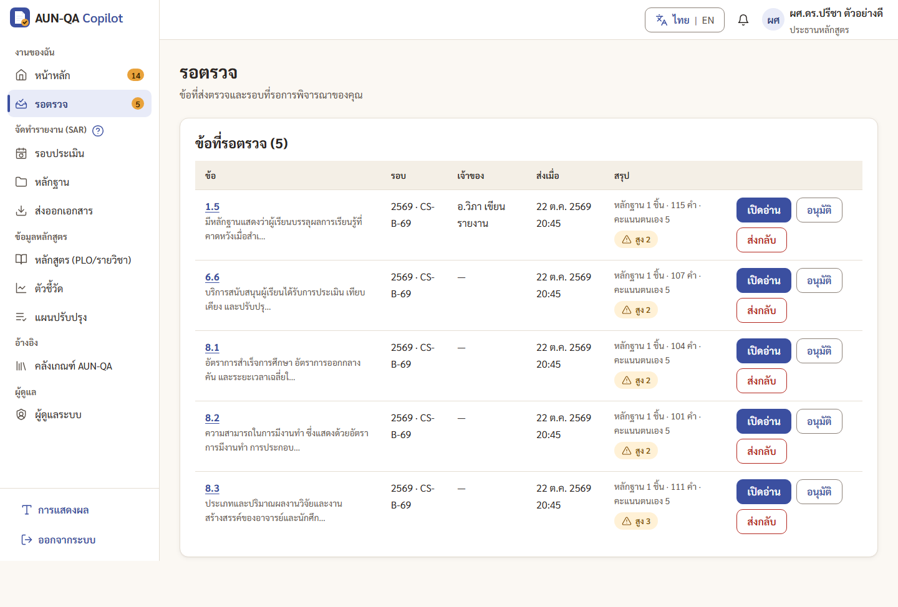

หน้าผู้ดูแลในรูปที่ ก.3 แบ่งเป็นแท็บผู้ใช้และบทบาท บันทึกการตรวจสอบ และข้อมูลสาธิต แต่ละผู้ใช้แสดงบทบาทพร้อมขอบเขต

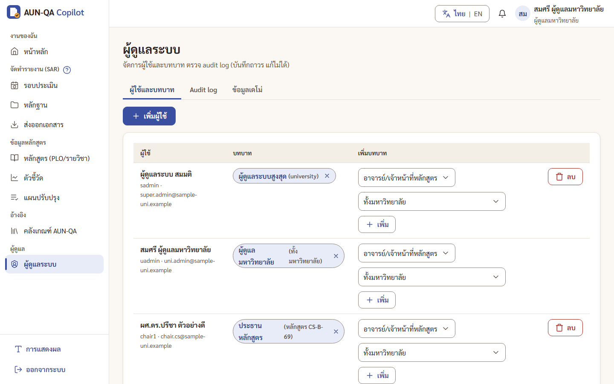

## ภาคผนวก ข ตัวอย่าง API

### ข.1 ฟังก์ชันของชั้นตรรกะ

ส่วนหน้าจอเรียกชั้นตรรกะผ่านจุดเดียวคือ `@/lib/api` ทุกฟังก์ชันที่เขียนข้อมูลรับผู้กระทำ (`actor`) และโยนข้อผิดพลาด `AunqaError` ที่มีรหัส เช่น `forbidden`, `locked`, `invalid`, `not_found`, `duplicate`, `bad_transition`, `citation_invalid`, `ai_disabled`, `conflict` ตัวอย่างฟังก์ชันหลักดังตารางที่ ข.1

Table: ตารางที่ ข.1 ตัวอย่างฟังก์ชันหลักของชั้นตรรกะ

| กลุ่ม | ฟังก์ชัน | หน้าที่ |
|---|---|---|
| รอบ | `createCycle(actor, {programmeId, academicYear, ...})` | สร้างรอบพร้อม 53 ข้อ |
| รอบ | `assignSections(actor, cycleId, reqIds, ownerUserId, due?)` | มอบหมายข้อ |
| ลำดับงาน | `transitionCycle(actor, cycleId, to, note?)` | เปลี่ยนสถานะรอบตามตารางการเปลี่ยนสถานะและแจ้งเตือนบทบาทถัดไป |
| ลำดับงาน | `getTransitionPreflight(user, cycleId, to)` | คืนเงื่อนไขที่ยังไม่ผ่านและคำเตือนก่อนเปลี่ยนสถานะ โดยไม่เขียนข้อมูล |
| ลำดับงาน | `verifySnapshot(cycleId)` | ตรวจค่าแฮชของรอบที่ล็อก |
| งานของฉัน | `listMyTodos(user)` | รายการงานที่ต้องทำตามบทบาท 15 ชนิด |
| SAR | `saveSection(actor, cycleId, reqId, input, reason, {baseUpdatedAt?})` | บันทึกเนื้อหา ตรวจรหัสหลักฐาน และปฏิเสธด้วย `conflict` เมื่อถูกบันทึกจากที่อื่นหลังเปิดหน้า |
| SAR | `setSelfRating(actor, cycleId, reqId, score)` | ให้คะแนนตนเอง 1–7 |
| หลักฐาน | `createEvidence(actor, {...})` | สร้างหลักฐาน ตรวจไฟล์ซ้ำ สแกนข้อมูลส่วนบุคคล |
| หลักฐาน | `linkEvidence(actor, evidenceId, cycleId, reqIds)` | ผูกหลักฐานกับหลายข้อ |
| ช่องว่าง | `getReadiness(user, cycleId)` | ร้อยละความพร้อม แผนภาพความร้อน และรายการช่องว่าง |
| ตัวชี้วัด | `previewMetricImport(actor, programmeId, file)` / `commitMetricImport(actor, previewId)` | ตรวจไฟล์ Excel รายแถวแล้วยืนยันนำเข้าเฉพาะแถวที่ผ่าน |
| ตัวชี้วัด | `importCohortFile(actor, programmeId, file, {dryRun?})` | คำนวณตัวชี้วัดรายรุ่นและเก็บเฉพาะค่ารวม |
| AI | `runSarDrafter(actor, cycleId, reqId, 'th' \| 'en')` | ร่าง SAR (AI-2) คืน AiRun |
| AI | `runTranslate(actor, sectionId, 'en' \| 'th')` | แปล SAR (AI-4) คืน AiRun |
| AI | `acceptAiRun(actor, runId, opts)` | ยอมรับผลของ AI เข้าเอกสาร |
| กรรมการ | `setCriterionRating(actor, cycleId, criterionNo, score)` | คะแนนกรรมการรายเกณฑ์ |
| กรรมการ | `setVerdict(actor, cycleId, verdict)` | verdict ที่กรรมการเลือก |
| ส่งออก | `exportSarDocx(user, cycleId)` | ไฟล์ SAR (.docx) |

### ข.2 Route Handler `/api/ai`

Table: ตารางที่ ข.2 เมธอดและผลตอบกลับของ Route Handler `/api/ai`

| เมธอด | หน้าที่ | ผลตอบกลับ |
|---|---|---|
| GET | ตรวจว่าเซิร์ฟเวอร์มีกุญแจ API หรือไม่ | `{"available": true}` หรือ `{"available": false}` |
| POST | ส่งงาน AI (`task`, `input`) ไปยัง Claude | 200 พร้อม `output` และ `model` หรือรหัสข้อผิดพลาด ได้แก่ 503 (ไม่มีกุญแจ API) 403 (ต้นทางหรือส่วนหัวไม่ถูกต้อง) 429 (เกินอัตราการเรียกหรือเกินงบรายวัน) 413 (คำขอใหญ่เกิน) 400 (งานหรือข้อมูลนำเข้าไม่ถูกต้อง) 502 (เรียก Claude ไม่สำเร็จหรือผลลัพธ์ผิดรูปแบบ) |

<!-- source: .agents/board/TASK-0001.md "API for frontend (A2)" และ Phase B/C/U additions; docs/diagrams/INDEX.md (seq-ai-route: 503/403/429 rate + daily budget/413/400/502); .agents/reviews/TASK-0001-review.md Phase B round 2 (tests/ai-route.test.ts) -->

## ภาคผนวก ค กรณีทดสอบ (Test Case)

สรุปจำนวนกรณีทดสอบรายไฟล์อยู่ในตารางที่ 4.2 (Vitest 22 ไฟล์ 578 กรณี) และตารางที่ 4.4 (Playwright 5 ไฟล์ 56 กรณี) กรณีทดสอบหน่วยและการทดสอบร่วมอยู่ในโฟลเดอร์ `eduflow-next/tests/` รันซ้ำได้ด้วยคำสั่ง `npx vitest run` ส่วนกรณีทดสอบผ่านเบราว์เซอร์อยู่ในโฟลเดอร์ `eduflow-next/e2e/` รันซ้ำได้ด้วยคำสั่ง `npm run e2e` ซึ่งสร้างระบบและเปิดเซิร์ฟเวอร์ให้เอง

[ต้องการข้อมูล: ตารางกรณีทดสอบฉบับเต็ม (รหัส ชื่อ ขั้นตอน ผลที่คาด ผลจริง) ส่งออกจาก Vitest และ Playwright โดย qa-tester]

## ภาคผนวก ง แบบสอบถามและแบบประเมิน

[ต้องการข้อมูล: แบบสอบถาม SUS ฉบับที่ใช้จริง แบบสอบถามความพึงพอใจ แบบให้คะแนนคุณภาพร่างของผู้เชี่ยวชาญ และใบงานสำหรับการจับเวลา]

## ประวัติผู้วิจัย

[ต้องการข้อมูล: ชื่อ-นามสกุล ประวัติการศึกษา และผลงานของผู้วิจัย] [ต้องตรวจสอบกับคู่มือสาขา: สาขาบังคับให้มีประวัติผู้วิจัยหรือไม่]

