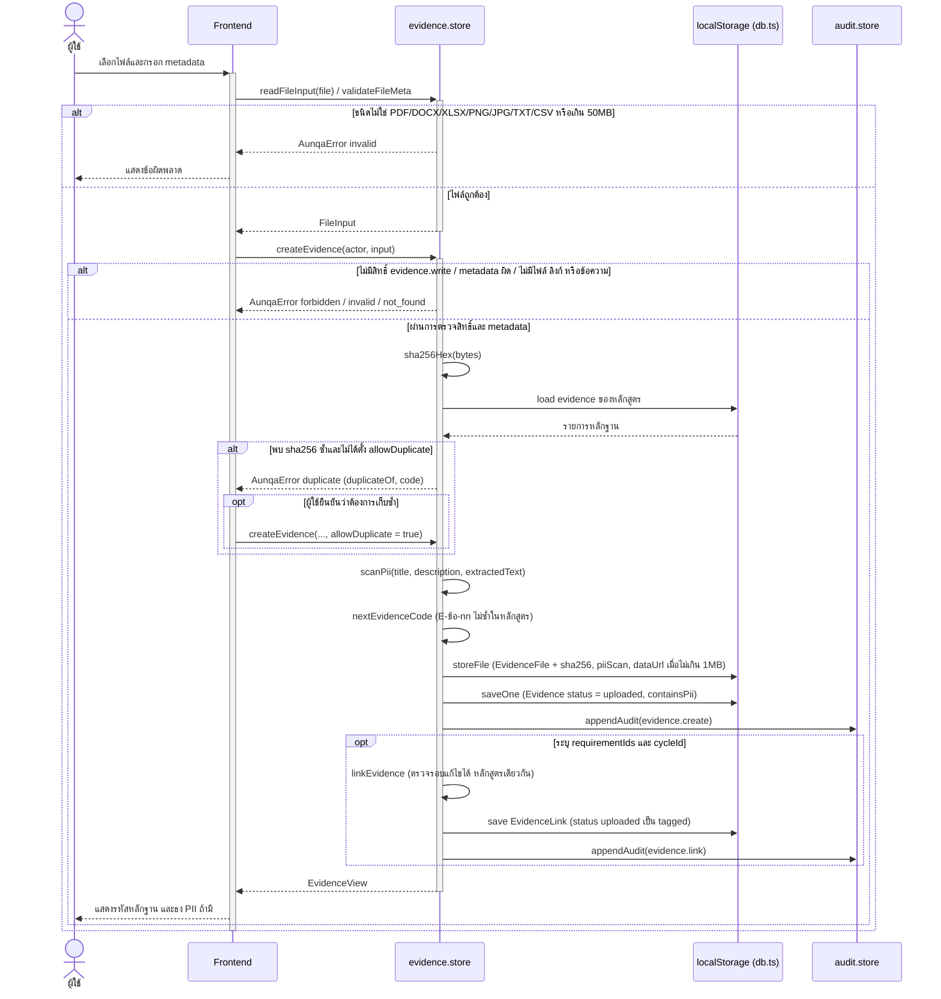
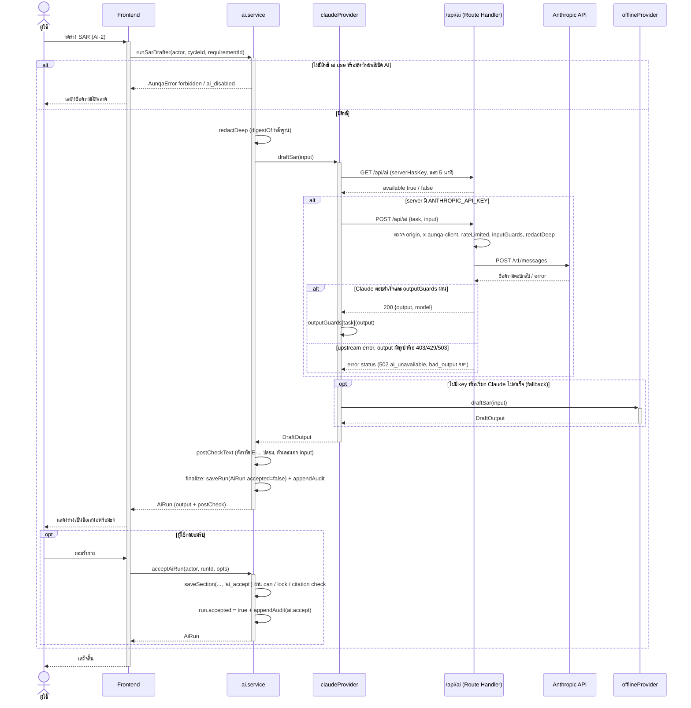
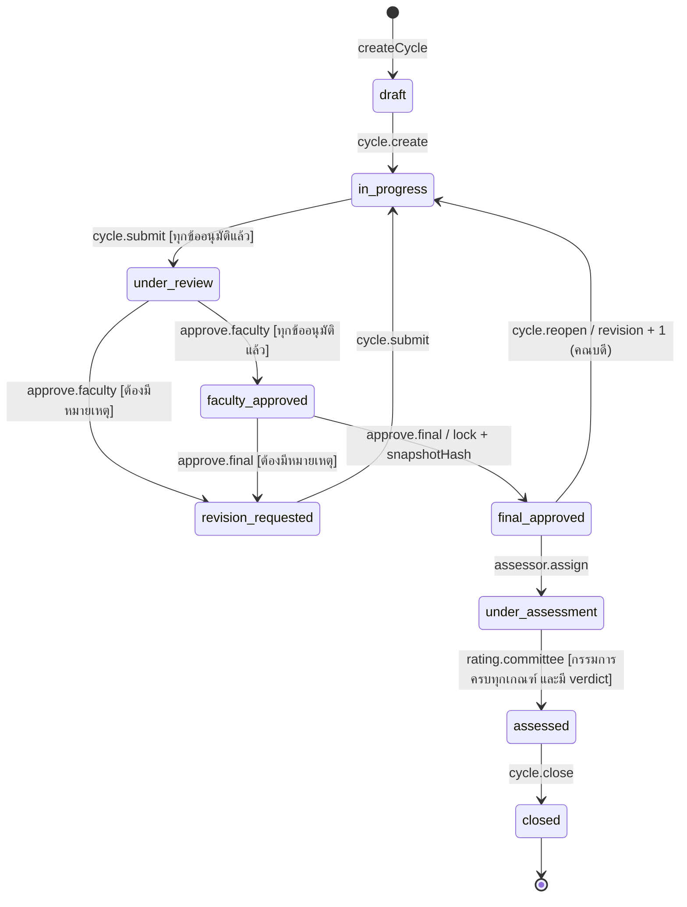
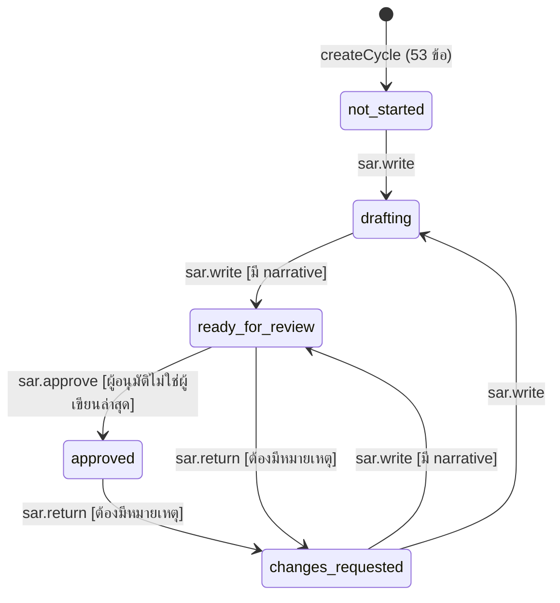
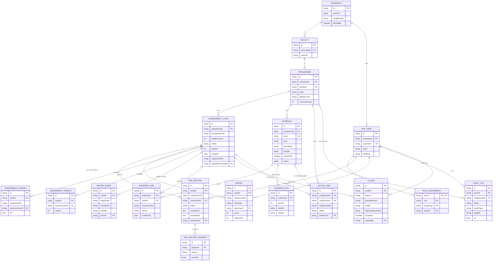
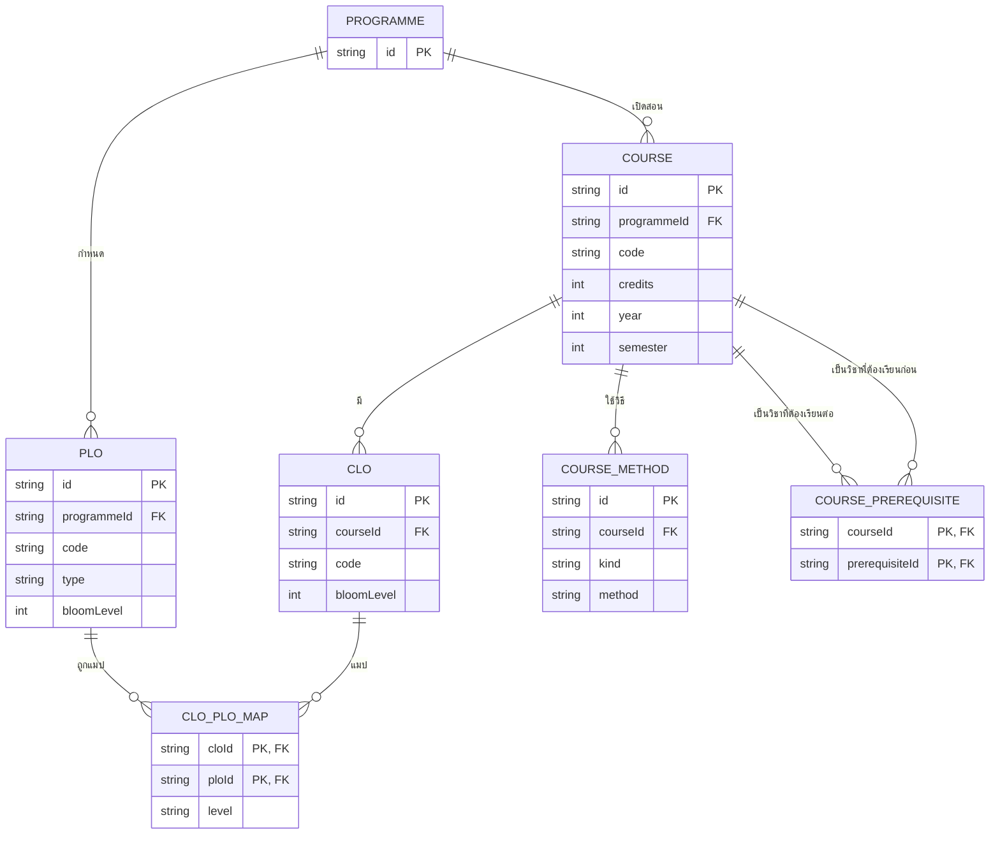
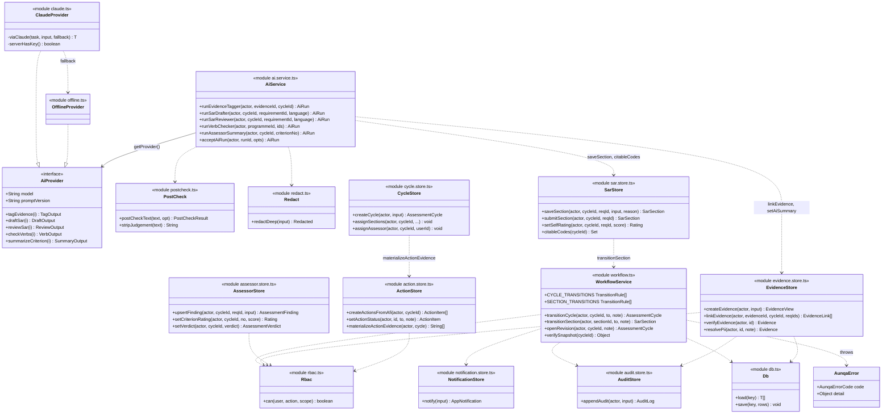
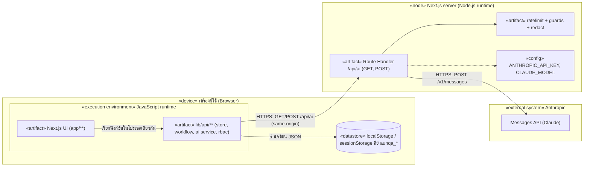

# คำสั่งสำหรับ Gemini — จัดทำเล่มวิจัยจากเนื้อหาด้านล่าง

คุณคือผู้ช่วยจัดรูปแบบเอกสารวิชาการภาษาไทย หน้าที่ของคุณคือ **นำเนื้อหาด้านล่างไปจัดทำเป็นเล่มวิจัยใน Google Docs**
โดยไม่เปลี่ยนสาระสำคัญ

## รูปแบบที่ต้องใช้
- ฟอนต์ TH Sarabun New ขนาด 16 pt (ชื่อบท 18 pt ตัวหนา จัดกึ่งกลาง, หัวข้อ 1.1 = 16 pt ตัวหนา, หัวข้อ 1.1.1 = 16 pt ธรรมดา) [ต้องตรวจสอบกับคู่มือสาขา]
- ระยะขอบ: บน 1.5 นิ้ว, ซ้าย 1.5 นิ้ว, ล่าง 1 นิ้ว, ขวา 1 นิ้ว / ระยะบรรทัด 1 เท่า
- จัดข้อความแบบกระจายไทย ย่อหน้าบรรทัดแรก 0.5 นิ้ว
- ขึ้นบทใหม่ (บทที่ 1–5) ที่หน้าใหม่เสมอ
- ลำดับส่วนนำ: ปกนอก → ปกใน → ใบรับรอง → บทคัดย่อ → Abstract → กิตติกรรมประกาศ → สารบัญ → สารบัญตาราง → สารบัญรูป → คำอธิบายสัญลักษณ์และคำย่อ; เลขหน้าส่วนนำ ก ข ค / เนื้อหาเริ่ม 1 ที่บทที่ 1 มุมบนขวา
- เลขหัวข้อตามที่ให้มา (1.1, 1.2.1 ...) / เลขรูปและตารางตามบท (รูปที่ 3.1, ตารางที่ 4.2)
- คำบรรยายรูปอยู่ใต้รูป คำบรรยายตารางอยู่เหนือตาราง (บรรทัด `Table: ...` คือคำบรรยายตาราง)
- สร้างสารบัญ สารบัญตาราง และสารบัญรูป
- บรรณานุกรมตามรูปแบบ APA 7th

## Diagram
บล็อก ```mermaid``` คือโค้ด diagram ให้แปลงเป็นรูป (เช่นผ่าน mermaid.live) แล้ววางแทนบล็อก พร้อมคำบรรยายรูปที่อยู่ด้านบนบล็อก (ย้ายคำบรรยายไปไว้ใต้รูป)

## ข้อห้าม
- ห้ามแต่งข้อมูล ตัวเลข ผลการทดลอง หรือแหล่งอ้างอิงขึ้นใหม่
- ข้อความที่มีป้าย [ต้องตรวจสอบ...] [ต้องตรวจสอบกับคู่มือสาขา...] [ต้องการข้อมูล...] [ต้องการอ้างอิง] [TODO...] ให้คงไว้และไฮไลต์สีเหลือง
- ข้อความใน comment `<!-- source: ... -->` คือที่มาของตัวเลข ไม่ต้องแสดงในเล่ม แต่ห้ามเปลี่ยนตัวเลข
- ปรับภาษาได้เฉพาะให้เป็นภาษาวิชาการที่ถูกต้อง สละสลวย โดยความหมายเดิม

## เมื่อเสร็จ
สรุปสั้น ๆ ว่าปรับภาษาจุดใด และมีป้ายที่ยังค้างกี่จุด

---
_สร้างเมื่อ 2026-10-21 จากไฟล์ใน thesis/chapters/_

---
title: "ระบบผู้ช่วยจัดทำรายงานการประเมินตนเองระดับหลักสูตรตามเกณฑ์ AUN-QA ด้วยปัญญาประดิษฐ์ (AUN-QA Copilot) [ต้องตรวจสอบ: ชื่อเรื่องที่อาจารย์ที่ปรึกษาอนุมัติ]"
subtitle: "AUN-QA Copilot: An AI-Assisted Web Application for Programme-Level Self-Assessment Report Preparation [ต้องตรวจสอบ: ชื่อเรื่องภาษาอังกฤษที่อนุมัติ]"
author: "[ต้องการข้อมูล: ชื่อ-นามสกุลผู้วิจัย (ไม่ใส่คำนำหน้า) และรหัสนักศึกษา]"
date: "[ต้องการข้อมูล: ภาควิชา คณะ มหาวิทยาลัย และปีการศึกษา]"
lang: th-TH
---


# บทคัดย่อ

<!-- TASK-0001: เขียนหลังบทที่ 1–5 · ผลการประเมินผู้ใช้ยังไม่มี จึงติดป้าย -->

**ชื่อเรื่อง** ระบบผู้ช่วยจัดทำรายงานการประเมินตนเองระดับหลักสูตรตามเกณฑ์ AUN-QA ด้วยปัญญาประดิษฐ์ (AUN-QA Copilot) [ต้องตรวจสอบ: ชื่อเรื่องที่อนุมัติ]

**ผู้วิจัย** [ต้องการข้อมูล: ชื่อ-นามสกุลและรหัสนักศึกษา]

**อาจารย์ที่ปรึกษา** [ต้องการข้อมูล: ชื่ออาจารย์ที่ปรึกษา]

**ประเภท** [ต้องการข้อมูล: เช่น โครงงานปริญญาตรี หลักสูตร สาขา คณะ มหาวิทยาลัย ปีการศึกษา]

**คำสำคัญ** AUN-QA, รายงานการประเมินตนเอง, ประกันคุณภาพการศึกษา, แบบจำลองภาษาขนาดใหญ่, การวิเคราะห์ช่องว่าง

งานวิจัยนี้มีวัตถุประสงค์เพื่อพัฒนาเว็บแอปพลิเคชันสำหรับจัดการเอกสารและหลักฐานประกันคุณภาพระดับหลักสูตรตามเกณฑ์ AUN-QA ฉบับที่ 4.0 จำนวน 8 เกณฑ์ 53 ข้อ พัฒนาระบบปัญญาประดิษฐ์ช่วยร่างรายงานการประเมินตนเอง (SAR) จากหลักฐานที่มีอยู่จริง พัฒนาระบบวิเคราะห์ช่องว่างตามวงจร PDCA และระบบลำดับงานการอนุมัติพร้อมการควบคุมสิทธิ์และบันทึกการตรวจสอบ และประเมินประสิทธิภาพของระบบ ระบบพัฒนาด้วย Next.js และ TypeScript แบบแบ่งระยะ ประกอบด้วยคลังหลักฐานที่ผูกหลักฐานหนึ่งชิ้นกับหลายข้อ ตรวจไฟล์ซ้ำ และสแกนข้อมูลส่วนบุคคล ตัวแก้ไข SAR กฎวิเคราะห์ช่องว่าง 10 ข้อ เครื่องสถานะของรอบการประเมินที่ล็อกพร้อมค่าแฮช พื้นที่ทำงานของกรรมการ และบริการปัญญาประดิษฐ์ 5 ฟีเจอร์ ซึ่งตัดข้อมูลส่วนบุคคลก่อนส่ง ตรวจรหัสหลักฐานและตัวเลขหลังประมวลผล และต้องให้ผู้ใช้กดยอมรับก่อนนำเข้าเอกสาร โดยปัญญาประดิษฐ์ไม่สามารถให้คะแนนหรือเปลี่ยนสถานะเอกสารได้ ผลการทดสอบด้วย Vitest ผ่าน 285 จาก 285 กรณี การตรวจชนิดข้อมูลไม่พบข้อผิดพลาด และการตรวจโค้ดรอบสุดท้ายได้ผลอนุมัติ ส่วนผลการประเมินด้านเวลา ความถูกต้องของปัญญาประดิษฐ์ ความสามารถในการใช้งาน และความพึงพอใจของผู้ใช้ [ต้องการข้อมูล: ผลการประเมินกับผู้ใช้และผู้เชี่ยวชาญ]

# Abstract

**Title** AUN-QA Copilot: An AI-Assisted Web Application for Programme-Level Self-Assessment Report Preparation [ต้องตรวจสอบ: approved English title]

**Author** [ต้องการข้อมูล: author name and student ID]

**Advisor** [ต้องการข้อมูล: advisor name]

**Academic Paper** [ต้องการข้อมูล: degree, programme, faculty, university, academic year]

**Keywords** AUN-QA, self-assessment report, quality assurance, large language model, gap analysis

This research aimed to develop a web application for managing programme-level quality assurance documents and evidence according to the AUN-QA Version 4.0 framework, which comprises 8 criteria and 53 requirements; to develop an AI assistant that drafts Self-Assessment Report (SAR) sections from existing evidence, together with a PDCA-based gap analysis; to develop a review and approval workflow with role-based access control and an audit log; and to evaluate the system. The system was developed iteratively with Next.js and TypeScript. It provided an evidence repository in which one piece of evidence could be linked to multiple requirements, with duplicate-file detection and personal data scanning; a SAR editor; ten gap-analysis rules; an assessment-cycle state machine that locked approved cycles with a snapshot hash; an assessor workspace; and five AI features. Every AI request was redacted for personal data before being sent, every output was post-checked for evidence codes and numbers that did not appear in the input, and every result required explicit user acceptance. The AI could not assign ratings or change document states. All 285 of 285 Vitest test cases passed, type checking reported no errors, and the final code review was approved. The evaluation of time savings, AI accuracy, usability, and user satisfaction [ต้องการข้อมูล: evaluation results with users and experts].

# กิตติกรรมประกาศ

[ต้องการข้อมูล: กิตติกรรมประกาศ — ไม่เกิน 1 หน้า ไม่ระบุวันที่ ไม่ใส่คำนำหน้านามผู้เขียน และลงชื่อผู้วิจัยท้ายข้อความ]

# คำอธิบายสัญลักษณ์และคำย่อ

Table: ตารางที่ 0.1 คำย่อที่ใช้ในเล่ม [ต้องตรวจสอบกับคู่มือสาขา: การกำหนดเลขตารางในส่วนนำ]

| คำย่อ | คำเต็ม |
|---|---|
| AFI | Areas for Improvement |
| AI | Artificial Intelligence |
| API | Application Programming Interface |
| AUN-QA | ASEAN University Network Quality Assurance |
| CLO | Course Learning Outcomes |
| ELO | Expected Learning Outcomes |
| LLM | Large Language Model |
| OBE | Outcome-Based Education |
| PDCA | Plan–Do–Check–Act |
| PII | Personally Identifiable Information |
| PLO | Programme Learning Outcomes |
| RBAC | Role-Based Access Control |
| RLS | Row-Level Security |
| SAR | Self-Assessment Report |
| SUS | System Usability Scale |
| UAT | User Acceptance Testing |


# บทที่ 1 บทนำ

<!-- TASK-0001: เขียนใหม่จากโครงเดิม (EduFlow) เป็น AUN-QA Copilot · source: .agents/spec/AUN-QA_Copilot_Spec.md หัวข้อ 1, 2, 14 -->

## 1.1 ความเป็นมาและความสำคัญของปัญหา

การประกันคุณภาพการศึกษาระดับหลักสูตรเป็นภารกิจที่สถาบันอุดมศึกษาของไทยต้องดำเนินการอย่างต่อเนื่อง โดยมหาวิทยาลัยสามารถเลือกใช้ระบบประกันคุณภาพหลักสูตรได้หลายระบบ [ต้องการอ้างอิง: กฎกระทรวงมาตรฐานหลักสูตรการศึกษาระดับอุดมศึกษา พ.ศ. 2565 และประกาศที่เกี่ยวข้อง] หนึ่งในระบบที่มหาวิทยาลัยไทยนำมาใช้อย่างแพร่หลายคือเกณฑ์ของเครือข่ายมหาวิทยาลัยอาเซียน (ASEAN University Network Quality Assurance: AUN-QA) ระดับหลักสูตร ฉบับที่ 4.0 ซึ่งเผยแพร่ในเดือนตุลาคม 2563 และประกอบด้วยเกณฑ์ 8 ด้าน ตั้งแต่ผลการเรียนรู้ที่คาดหวัง (Expected Learning Outcomes) จนถึงผลผลิตและผลลัพธ์ (Output and Outcomes) (ASEAN University Network [AUN], 2020)

ในการประเมินตามเกณฑ์ AUN-QA หลักสูตรต้องจัดทำรายงานการประเมินตนเอง (Self-Assessment Report: SAR) ที่อธิบายการดำเนินงานรายข้อพร้อมหลักฐานประกอบ และให้คะแนนตนเองตามสเกล 1–7 ก่อนที่คณะกรรมการประเมินจะอ่านเอกสารและลงพื้นที่ตรวจ (AUN, 2020) [ต้องตรวจสอบ: เลขหน้าของสเกล 1–7 และกระบวนการประเมินในคู่มือ] งานวิจัยในประเทศไทยชี้ว่าการเก็บรวบรวมข้อมูลและหลักฐานเพื่อจัดทำรายงานประกันคุณภาพเป็นภาระของบุคลากร จึงมีการพัฒนาระบบสารสนเทศเพื่อช่วยเก็บและติดตามข้อมูล เช่น ระบบสารสนเทศเพื่องานประกันคุณภาพการศึกษาของพิสิฐ เมธาภัทร (2549) และระบบควบคุมงานประกันคุณภาพการศึกษาภายในระดับหลักสูตรออนไลน์ของอนุพล สิงขรเขตต์ และคณะ (2562) นอกจากนี้ การวิเคราะห์ผลการประเมินตามเกณฑ์ AUN-QA ของ 9 หลักสูตรในคณะศิลปศาสตร์ มหาวิทยาลัยสงขลานครินทร์ ปีการศึกษา 2564 พบว่าคะแนนรวมอยู่ระหว่าง 3.71–3.88 และไม่มีหลักสูตรใดถึงค่าเป้าหมาย 4.00 โดยเกณฑ์ที่มีความต้องการพัฒนาสูงสุดคือเกณฑ์ที่ 8 ผลผลิตและผลลัพธ์ (บรรณกร แซ่ลิ่ม, 2567)

จากการศึกษาสภาพปัญหา ผู้วิจัยสรุปปัญหาในการจัดทำ SAR ได้ 4 ประการ ได้แก่ (1) หลักฐานกระจายอยู่หลายแหล่ง ตั้งชื่อไม่เป็นระบบ และหลักฐานชิ้นเดียวที่ใช้ได้หลายข้อมักถูกคัดลอกซ้ำ (2) SAR เขียนโดยหลายคนในหลายไฟล์ ทำให้ติดตามได้ยากว่าข้อใดเสร็จหรือยังขาดสิ่งใด (3) การเขียนมักไม่ครบวงจรคุณภาพ PDCA โดยเฉพาะขั้นตรวจสอบ (Check) และขั้นปรับปรุง (Act) และ (4) ผู้เขียนต้องแปล SAR เป็นภาษาอังกฤษ [ต้องการข้อมูล: ผลสัมภาษณ์ผู้ใช้ 3–5 คนเพื่อยืนยันปัญหา ตามแผนในสเปกหัวข้อ 15 สัปดาห์ที่ 1 — ยังไม่ได้ดำเนินการ] ในขณะเดียวกัน แบบจำลองภาษาขนาดใหญ่ (Large Language Model: LLM) ถูกนำมาใช้ประเมินเอกสารประกันคุณภาพในต่างประเทศ เช่น งานของ Sulton et al. (2026) ที่ใช้ LLM ประเมินตัวบ่งชี้คุณภาพ แต่ LLM มีความเสี่ยงต่อการสร้างข้อความที่ไม่มีหลักฐานรองรับ (hallucination) (Ji et al., 2022) การนำ LLM มาช่วยเขียน SAR จึงต้องมีกลไกควบคุมให้ทุกข้อความอ้างอิงหลักฐานที่มีอยู่จริง

โครงงานนี้เดิมพัฒนาเป็นระบบ EduFlow สำหรับโรงเรียน ซึ่งมีส่วนที่ให้ครูเปิดชั้นเรียนสอนพิเศษและรับชำระเงินจากนักเรียน ผู้วิจัยยกเลิกแนวทางดังกล่าวเนื่องจากขัดต่อจรรยาบรรณวิชาชีพครูและเสี่ยงต่อการผิดระเบียบ [ต้องการอ้างอิง: ระเบียบหรือข้อบังคับที่เกี่ยวข้อง] แล้วปรับเป้าหมายมาเป็นเว็บแอปพลิเคชันช่วยอาจารย์ประจำหลักสูตรเตรียม SAR และหลักฐานตามเกณฑ์ AUN-QA ฉบับที่ 4.0 ภายใต้ชื่อ AUN-QA Copilot โดยยังคงโครงสร้างส่วนหน้าจอ (frontend) และรูปแบบการแสดงผลของระบบเดิม

## 1.2 วัตถุประสงค์ของการวิจัย

1. เพื่อพัฒนาเว็บแอปพลิเคชันสำหรับจัดการเอกสารและหลักฐานประกันคุณภาพระดับหลักสูตรตามเกณฑ์ AUN-QA ฉบับที่ 4.0 ครบ 8 เกณฑ์ 53 ข้อ
2. เพื่อพัฒนาระบบปัญญาประดิษฐ์ช่วยร่าง SAR จากหลักฐานที่มีอยู่จริง และระบบวิเคราะห์ช่องว่าง (Gap Analysis) ตามวงจร PDCA
3. เพื่อพัฒนาระบบลำดับงาน (Workflow) การส่งตรวจ แก้ไข และอนุมัติ พร้อมการควบคุมสิทธิ์ตามบทบาทและบันทึกการตรวจสอบ (Audit Log)
4. เพื่อประเมินประสิทธิภาพของระบบด้านเวลาที่ใช้เตรียมเอกสาร ความถูกต้องของปัญญาประดิษฐ์ และความพึงพอใจของผู้ใช้

## 1.3 ขอบเขตของการวิจัย

### 1.3.1 ขอบเขตด้านเนื้อหาและเกณฑ์

ระบบรองรับการประกันคุณภาพระดับหลักสูตร (Programme Level) ตามเกณฑ์ AUN-QA ฉบับที่ 4.0 จำนวน 8 เกณฑ์ 53 ข้อ [ต้องตรวจสอบ: ยืนยันจำนวน 53 ข้อจาก Appendix A ของคู่มือ AUN-QA ฉบับที่ 4.0] ไม่รวมการประกันคุณภาพระดับสถาบัน ส่วนติดต่อผู้ใช้เป็นภาษาไทยเป็นหลัก และเนื้อหา SAR เขียนได้ทั้งภาษาไทยและภาษาอังกฤษ

### 1.3.2 ขอบเขตด้านผู้ใช้

ผู้ใช้แบ่งเป็น 8 บทบาท ได้แก่ ผู้ดูแลระบบ ผู้ดูแลมหาวิทยาลัย ประธานหลักสูตร อาจารย์ผู้รับผิดชอบข้อ เจ้าหน้าที่ข้อมูล เจ้าหน้าที่ประกันคุณภาพระดับคณะ (QA คณะ) คณบดี และกรรมการประเมิน แต่ละบทบาทมีสิทธิ์ตามตารางที่ 3.1 ในบทที่ 3

### 1.3.3 ขอบเขตด้านฟังก์ชัน

ระบบที่พัฒนาครอบคลุมการจัดการผู้ใช้และองค์กร คลังเกณฑ์ 53 ข้อ รอบการประเมินและการมอบหมาย คลังหลักฐาน การบันทึกตัวชี้วัดของเกณฑ์ที่ 8 การจับคู่หลักสูตร (PLO/CLO) ตัวแก้ไข SAR การวิเคราะห์ช่องว่างตามกฎ R1–R10 ลำดับงานการอนุมัติและการล็อกรอบ พื้นที่ทำงานของกรรมการประเมิน แผนปรับปรุง การแจ้งเตือน บันทึกการตรวจสอบ การส่งออกเอกสาร และบริการปัญญาประดิษฐ์ที่ผ่านการตัดข้อมูลส่วนบุคคลและการตรวจหลังประมวลผล รายละเอียดสถานะของแต่ละโมดูลแสดงในตารางที่ 4.1

### 1.3.4 สิ่งที่ระบบไม่ทำ

ระบบไม่ใช่ระบบรับรองคุณภาพ และไม่ออกผลการประเมินแทนคณะกรรมการ ปัญญาประดิษฐ์ในระบบไม่ให้คะแนนทางการ ไม่อนุมัติ และไม่เปลี่ยนสถานะเอกสาร ระบบไม่แทนที่ระบบ CHE QA Online และไม่เป็นระบบทะเบียนนักศึกษา งานที่กำหนดไว้เป็นงานในอนาคต ได้แก่ การเชื่อมต่อระบบทะเบียนจริง การประกันคุณภาพระดับสถาบัน แอปพลิเคชันบนอุปกรณ์เคลื่อนที่ และระบบชำระเงิน

### 1.3.5 ขอบเขตด้านข้อมูล

ข้อมูลทั้งหมดที่ใช้พัฒนาและทดสอบเป็นข้อมูลสมมติ ได้แก่ มหาวิทยาลัยสมมติ 2 แห่ง หลักสูตรสมมติ 2 หลักสูตร บัญชีผู้ใช้สาธิตทุกบทบาท หลักฐานตัวอย่าง และตัวชี้วัดย้อนหลัง 5 ปี ไม่มีข้อมูลส่วนบุคคลของบุคคลจริง <!-- source: .agents/board/TASK-0001.md Log db-engineer A1, B1 -->

## 1.4 ประโยชน์ที่คาดว่าจะได้รับ

1. หลักสูตรมีคลังหลักฐานกลางที่มีรหัสหลักฐานไม่ซ้ำ และหลักฐานชิ้นเดียวผูกกับหลายข้อได้โดยไม่ต้องคัดลอก
2. ประธานหลักสูตรเห็นความพร้อมของ SAR รายข้อและช่องว่างที่ยังขาดก่อนส่งให้คณะกรรมการ
3. ผู้เขียนได้ร่าง SAR ที่อ้างอิงรหัสหลักฐานจริง โดยมนุษย์ยังเป็นผู้ตัดสินใจยอมรับทุกครั้ง
4. กระบวนการส่งตรวจและอนุมัติเป็นไปตามลำดับที่กำหนด ตรวจสอบย้อนหลังได้จากบันทึกการตรวจสอบ
5. ผู้วิจัยได้แนวทางการออกแบบระบบที่นำปัญญาประดิษฐ์มาใช้กับเอกสารประกันคุณภาพโดยควบคุมข้อมูลส่วนบุคคลและความถูกต้องของข้อความ

## 1.5 นิยามศัพท์เฉพาะ

Table: ตารางที่ 1.1 นิยามศัพท์เฉพาะที่ใช้ในงานวิจัย

| คำศัพท์ | ความหมาย |
|---|---|
| AUN-QA | เกณฑ์ประกันคุณภาพของเครือข่ายมหาวิทยาลัยอาเซียน (ASEAN University Network Quality Assurance) ในงานนี้หมายถึงระดับหลักสูตร ฉบับที่ 4.0 |
| รายงานการประเมินตนเอง (SAR) | เอกสารที่หลักสูตรเขียนอธิบายการดำเนินงานตามเกณฑ์รายข้อพร้อมหลักฐาน (Self-Assessment Report) |
| ข้อกำหนด (Requirement) | ข้อย่อยของเกณฑ์ AUN-QA เช่น ข้อ 1.1 ระบบมีทั้งหมด 53 ข้อ |
| ELO / PLO | ผลการเรียนรู้ที่คาดหวังของหลักสูตร (Expected / Programme Learning Outcomes) |
| CLO | ผลการเรียนรู้ระดับรายวิชา (Course Learning Outcomes) |
| PDCA | วงจรคุณภาพ วางแผน–ปฏิบัติ–ตรวจสอบ–ปรับปรุง (Plan–Do–Check–Act) |
| AFI | ข้อเสนอแนะเพื่อการพัฒนาจากคณะกรรมการ (Areas for Improvement) |
| หลักฐาน (Evidence) | เอกสาร ไฟล์ ลิงก์ หรือข้อความที่ใช้ยืนยันการดำเนินงาน มีรหัสรูปแบบ E-ข้อ-ลำดับ เช่น E-1.4-02 |
| รอบการประเมิน (Assessment Cycle) | การจัดทำ SAR ของหลักสูตรในปีการศึกษาหนึ่ง ประกอบด้วย 53 ข้อ |
| การวิเคราะห์ช่องว่าง (Gap Analysis) | การตรวจด้วยกฎว่าข้อใดยังขาดหลักฐาน ขาดขั้น PDCA หรือขาดข้อมูลที่เกณฑ์ต้องการ |
| ข้อมูลส่วนบุคคล (PII) | ข้อมูลที่ระบุตัวบุคคลได้ (Personally Identifiable Information) เช่น เลขประจำตัวประชาชน อีเมล หมายเลขโทรศัพท์ |
| การตัดข้อมูลส่วนบุคคล (Redaction) | การแทนข้อมูลส่วนบุคคลด้วยสัญลักษณ์ก่อนส่งข้อความให้ปัญญาประดิษฐ์ |
| การตรวจหลังประมวลผล (Post-check) | การตรวจผลลัพธ์ของปัญญาประดิษฐ์ว่ารหัสหลักฐานมีอยู่จริงและตัวเลขทุกตัวปรากฏในข้อมูลนำเข้า |
| Grounded generation | การสร้างข้อความโดยใช้ข้อเท็จจริงจากหลักฐานที่ส่งให้เท่านั้น และอ้างอิงแหล่งที่มาทุกประโยค |
| แบบจำลองภาษาขนาดใหญ่ (LLM) | แบบจำลองปัญญาประดิษฐ์ที่สร้างข้อความจากข้อความนำเข้า (Large Language Model) |


# บทที่ 2 เอกสารและงานวิจัยที่เกี่ยวข้อง

<!-- TASK-0001: เขียนใหม่ · source: .agents/research/standards/thesis-th.md หัวข้อ 6, .agents/spec/AUN-QA_Copilot_Spec.md หัวข้อ 2, 7, 13 -->

ในบทนี้ผู้วิจัยนำเสนอแนวคิดและทฤษฎีที่ใช้เป็นฐานของระบบ ได้แก่ เกณฑ์ AUN-QA ฉบับที่ 4.0 การศึกษาที่มุ่งผลลัพธ์ อนุกรมวิธานของบลูม การใช้แบบจำลองภาษาขนาดใหญ่อย่างมีหลักฐานรองรับ และการคุ้มครองข้อมูลส่วนบุคคล จากนั้นอธิบายเทคโนโลยีที่ใช้พัฒนา และทบทวนงานวิจัยที่เกี่ยวข้อง

## 2.1 แนวคิดและทฤษฎีที่เกี่ยวข้อง

### 2.1.1 เกณฑ์ AUN-QA ระดับหลักสูตร ฉบับที่ 4.0

คู่มือการประเมิน AUN-QA ระดับหลักสูตร ฉบับที่ 4.0 เผยแพร่โดยสำนักเลขาธิการเครือข่ายมหาวิทยาลัยอาเซียนในเดือนตุลาคม 2563 กำหนดเกณฑ์ระดับหลักสูตร 8 เกณฑ์ (AUN, 2020) ผู้วิจัยจัดกลุ่มเกณฑ์ตามที่ระบุในสเปกของระบบเป็น 3 กลุ่ม คือ กลุ่มการออกแบบหลักสูตร (เกณฑ์ที่ 1–4) กลุ่มทรัพยากร (เกณฑ์ที่ 5–7) และกลุ่มผลผลิต (เกณฑ์ที่ 8) ดังตารางที่ 2.1 [ต้องตรวจสอบ: จำนวนข้อรายเกณฑ์และการจัดกลุ่มกับ Appendix A ของคู่มือ]

Table: ตารางที่ 2.1 เกณฑ์ AUN-QA ระดับหลักสูตร ฉบับที่ 4.0 และจำนวนข้อที่ระบบรองรับ

| เกณฑ์ | ชื่อภาษาอังกฤษ | ชื่อภาษาไทย | จำนวนข้อ | กลุ่ม |
|---|---|---|---|---|
| 1 | Expected Learning Outcomes | ผลการเรียนรู้ที่คาดหวัง | 5 | การออกแบบ |
| 2 | Programme Structure and Content | โครงสร้างและเนื้อหาหลักสูตร | 7 | การออกแบบ |
| 3 | Teaching and Learning Approach | แนวทางการเรียนการสอน | 6 | การออกแบบ |
| 4 | Student Assessment | การวัดและประเมินผลผู้เรียน | 7 | การออกแบบ |
| 5 | Academic Staff | อาจารย์ | 8 | ทรัพยากร |
| 6 | Student Support Services | การบริการสนับสนุนผู้เรียน | 6 | ทรัพยากร |
| 7 | Facilities and Infrastructure | สิ่งอำนวยความสะดวกและโครงสร้างพื้นฐาน | 9 | ทรัพยากร |
| 8 | Output and Outcomes | ผลผลิตและผลลัพธ์ | 5 | ผลผลิต |
| | รวม | | 53 | |

<!-- source: จำนวนข้อ 5/7/6/7/8/6/9/5 จาก seed ในระบบ (.agents/board/TASK-0001.md Log db-engineer A1) ตรงกับสเปกหัวข้อ 2.1 -->

การให้คะแนนใช้สเกล 1–7 ตั้งแต่ระดับ 1 ไม่เพียงพออย่างยิ่ง (Absolutely Inadequate) จนถึงระดับ 7 ดีเยี่ยม (Excellent) โดยระดับ 4 หมายถึงเพียงพอตามที่คาดหวัง (Adequate as Expected) คะแนนทางการรายงานเป็นรายเกณฑ์ และผลสรุปโดยรวม (Overall Verdict) ตัดสินแบบองค์รวมโดยไม่ใช้ค่าเฉลี่ย (AUN, 2020) [ต้องตรวจสอบ: ข้อความเรื่องสเกลและ verdict แบบองค์รวมกับเลขหน้าในคู่มือ] หลักการนี้ส่งผลต่อการออกแบบระบบโดยตรง กล่าวคือ ระบบไม่มีฟังก์ชันคำนวณ verdict และให้กรรมการเป็นผู้เลือกเอง

กระบวนการประเมินตามคู่มือเริ่มจากหลักสูตรส่ง SAR ให้คณะกรรมการล่วงหน้า คณะกรรมการอ่านเอกสาร (Desktop Assessment) และวางแผนการประเมินในแบบฟอร์ม Appendix B ซึ่งบันทึกจุดแข็ง คำถามสัมภาษณ์ แหล่งหลักฐาน และข้อเสนอแนะเพื่อการพัฒนารายข้อ จากนั้นลงพื้นที่ (Site Visit) และสรุปผลในรายงาน Appendix D ส่วนหลักสูตรประเมินตนเองรายข้อด้วยแบบ Appendix A (AUN, 2020) [ต้องตรวจสอบ: ชื่อและเนื้อหาของ Appendix A, B, D ในคู่มือ]

### 2.1.2 วงจรคุณภาพ PDCA

วงจร PDCA ประกอบด้วยการวางแผน (Plan) การปฏิบัติ (Do) การตรวจสอบ (Check) และการปรับปรุง (Act) ในเกณฑ์ AUN-QA ฉบับที่ 4.0 แต่ละเกณฑ์มีข้อที่เกี่ยวกับการปรับปรุงอย่างต่อเนื่อง [ต้องการอ้างอิง: แหล่งทฤษฎี PDCA] ระบบนี้นำวงจร PDCA มาใช้สองทาง คือ (1) หลักฐานทุกชิ้นระบุขั้น PDCA และ (2) กฎวิเคราะห์ช่องว่าง R2 ตรวจว่าข้อใดยังไม่มีหลักฐานขั้น Check หรือ Act

### 2.1.3 การศึกษาที่มุ่งผลลัพธ์และความสอดคล้องเชิงโครงสร้าง

การศึกษาที่มุ่งผลลัพธ์ (Outcome-Based Education: OBE) ให้หลักสูตรกำหนดผลการเรียนรู้ระดับหลักสูตร (PLO) แล้วถ่ายทอดสู่ผลการเรียนรู้ระดับรายวิชา (CLO) โดยวิธีสอนและวิธีวัดผลต้องสอดคล้องกับผลลัพธ์ที่กำหนด ซึ่งเรียกว่าความสอดคล้องเชิงโครงสร้าง (Constructive Alignment) [ต้องการอ้างอิง: แหล่งทฤษฎี OBE และ Constructive Alignment] ระบบนำแนวคิดนี้มาสร้างเมทริกซ์ความสัมพันธ์ระหว่างรายวิชากับ PLO ในระดับ I (Introduce) R (Reinforce) และ M (Master) และตรวจหา PLO ที่ไม่มีรายวิชารับผิดชอบหรือไม่มีวิธีวัดผล

### 2.1.4 อนุกรมวิธานของบลูม

อนุกรมวิธานของบลูม (Bloom's Taxonomy) จัดระดับการเรียนรู้ด้านพุทธิพิสัยเป็นลำดับขั้น และนิยมใช้คำกริยาที่วัดได้กำกับผลการเรียนรู้แต่ละระดับ [ต้องการอ้างอิง: แหล่งต้นฉบับอนุกรมวิธานของบลูมฉบับปรับปรุง] Diab and Sartawi (2017) จำแนกคำถามและข้อความผลการเรียนรู้ตามระดับของบลูมด้วยการวัดความคล้ายของคำกริยา 775 คำ ได้ค่า macro precision ร้อยละ 97 และ F1 ร้อยละ 90 แนวทางที่ใช้พจนานุกรมคำกริยาเช่นนี้เป็นพื้นฐานของฟีเจอร์ตรวจคำกริยา PLO/CLO (AI-7) แบบออฟไลน์ในระบบ

### 2.1.5 แบบจำลองภาษาขนาดใหญ่และการสร้างข้อความที่มีหลักฐานรองรับ

LLM สามารถสร้างข้อความที่อ่านลื่นไหลแต่ไม่ตรงกับแหล่งข้อมูล ซึ่งเรียกว่าการหลอน (Hallucination) Ji et al. (2022) [ต้องตรวจสอบ: ปีที่อ้าง 2022 (arXiv) หรือ 2023 (ACM Computing Surveys)] สำรวจปัญหานี้ในงานสร้างภาษาธรรมชาติ และแยกความไม่ซื่อตรงต่อแหล่งข้อมูลออกเป็นประเภทต่าง ๆ การวัดว่าข้อความมีแหล่งที่มารองรับหรือไม่มีกรอบแนวคิด Attributable to Identified Sources (AIS) ของ Rashkin et al. (2021) ซึ่งให้มนุษย์ตัดสินสองขั้น ส่วน Gao et al. (2023) เสนอชุดประเมิน ALCE ที่วัดความถูกต้องและคุณภาพของการอ้างอิงในข้อความที่ LLM สร้าง และ Es et al. (2023) เสนอ RAGAS สำหรับวัดความซื่อตรง (Faithfulness) ของระบบที่ค้นคืนเอกสารมาประกอบการสร้างข้อความ

แนวคิดเหล่านี้นำมาใช้ในระบบสองชั้น ชั้นแรกคือคำสั่ง (Prompt) ที่กำหนดให้ใช้ข้อเท็จจริงจากหลักฐานเท่านั้นและอ้างรหัสหลักฐานทุกประโยค ชั้นที่สองคือการตรวจหลังประมวลผลในโค้ด ซึ่งตัดรหัสหลักฐานที่ไม่มีอยู่ในรอบการประเมินและติดธงตัวเลขที่ไม่ปรากฏในข้อมูลนำเข้า เพื่อไม่ให้ความถูกต้องขึ้นกับคำสั่งเพียงอย่างเดียว

### 2.1.6 การคุ้มครองข้อมูลส่วนบุคคล

พระราชบัญญัติคุ้มครองข้อมูลส่วนบุคคล พ.ศ. 2562 กำหนดหน้าที่ของผู้ควบคุมและผู้ประมวลผลข้อมูลส่วนบุคคล [ต้องการอ้างอิง: พ.ร.บ.คุ้มครองข้อมูลส่วนบุคคล พ.ศ. 2562 ฉบับราชกิจจานุเบกษา] ในบริบทของระบบนี้ มหาวิทยาลัยมีฐานะผู้ควบคุมข้อมูล และระบบมีฐานะผู้ประมวลผลข้อมูล [ต้องตรวจสอบ: ให้ผู้เชี่ยวชาญด้านกฎหมายยืนยัน] ระบบจึงสแกนหลักฐานหาข้อมูลส่วนบุคคล ตัดข้อมูลส่วนบุคคลก่อนส่งข้อความให้ LLM และใช้ข้อมูลสมมติเท่านั้นในงานวิจัยนี้

## 2.2 เทคโนโลยีที่ใช้ในการพัฒนา

ผู้วิจัยเลือกเทคโนโลยีโดยยึดหลักใช้โครงสร้างของระบบเดิมต่อให้มากที่สุด เพื่อคงรูปแบบส่วนหน้าจอเดิมและลดเวลาพัฒนา รายละเอียดดังนี้

1. **Next.js (App Router) และ React** เป็นเฟรมเวิร์กสำหรับพัฒนาเว็บแอปพลิเคชันที่รวมส่วนหน้าจอและส่วนเซิร์ฟเวอร์ในโครงการเดียว ระบบใช้ Route Handler ของ Next.js เป็นจุดเดียวที่เรียก API ภายนอก เพื่อเก็บกุญแจ API ไว้ฝั่งเซิร์ฟเวอร์ [ต้องการอ้างอิง: เอกสารทางการของ Next.js]
2. **TypeScript** เพิ่มการตรวจชนิดข้อมูลขณะคอมไพล์ ช่วยให้สัญญาข้อมูล (Contract) ระหว่างส่วนตรรกะกับส่วนหน้าจอตรงกัน [ต้องการอ้างอิง: เอกสารทางการของ TypeScript]
3. **Web Storage (localStorage/sessionStorage)** ใช้เป็นที่เก็บข้อมูลในรุ่นต้นแบบ เนื่องจากยังไม่มีบริการฐานข้อมูลจริง ผู้วิจัยออกแบบชั้นจัดเก็บข้อมูลให้ย้ายไปยัง PostgreSQL ได้ภายหลัง [ต้องการอ้างอิง: เอกสาร Web Storage API]
4. **Claude API ของ Anthropic** เป็น LLM ที่ระบบเรียกผ่าน Route Handler เมื่อเซิร์ฟเวอร์มีกุญแจ API หากไม่มีกุญแจ ระบบใช้ตัวให้บริการแบบออฟไลน์ที่ทำงานด้วยกฎและแม่แบบแทน [ต้องการอ้างอิง: เอกสาร Anthropic API]
5. **Vitest** เป็นเครื่องมือทดสอบหน่วย (Unit Test) สำหรับโครงการ TypeScript [ต้องการอ้างอิง: เอกสารทางการของ Vitest]
6. **ExcelJS** ใช้สร้างไฟล์ดัชนีหลักฐานและ Appendix A ในรูปแบบ .xlsx [ต้องการอ้างอิง: เอกสาร ExcelJS]
7. **Mermaid** ใช้เขียนแผนภาพ UML ในรูปข้อความและแปลงเป็นรูปภาพด้วย mermaid-cli [ต้องการอ้างอิง: เอกสารทางการของ Mermaid]

## 2.3 งานวิจัยที่เกี่ยวข้อง

ผู้วิจัยทบทวนงานที่เกี่ยวข้อง 2 กลุ่ม คือ ระบบสารสนเทศเพื่องานประกันคุณภาพในประเทศไทย และการใช้ LLM กับเอกสารประกันคุณภาพหรือผลการเรียนรู้ สรุปดังตารางที่ 2.2

Table: ตารางที่ 2.2 สรุปงานวิจัยที่เกี่ยวข้อง จุดเด่น และช่องว่าง

| งาน | สาระสำคัญและผลที่รายงาน | ช่องว่างเมื่อเทียบกับงานนี้ |
|---|---|---|
| พิสิฐ เมธาภัทร (2549) | ระบบเครือข่ายเก็บและแสดงข้อมูลประกันคุณภาพตามตัวบ่งชี้ ผลประเมินความพึงพอใจสูงกว่า 4.00 ทุกด้าน (ไม่ระบุจำนวนผู้ตอบ) | เป็นที่เก็บข้อมูล ไม่ช่วยเขียนรายงานและไม่วิเคราะห์ช่องว่าง |
| อนุพล สิงขรเขตต์ และคณะ (2562) | ระบบควบคุมงานประกันคุณภาพระดับหลักสูตรออนไลน์ พัฒนาตามแบบจำลอง ADDIE ด้วย PHP และ MySQL ผู้เชี่ยวชาญ 3 คนประเมินประสิทธิภาพเฉลี่ย 4.42 ผู้ใช้ 20 คนพึงพอใจเฉลี่ย 4.62 | ติดตามความคืบหน้าได้ แต่ไม่ผูกหลักฐานกับข้อเกณฑ์แบบหลายต่อหลาย และไม่มีปัญญาประดิษฐ์ |
| บรรณกร แซ่ลิ่ม (2567) | วิเคราะห์รายงาน AUN-QA 9 หลักสูตร คะแนนรวม 3.71–3.88 ไม่มีหลักสูตรถึง 4.00 ความต้องการพัฒนาสูงสุดคือเกณฑ์ที่ 8 | เป็นงานวิเคราะห์ผล ไม่ได้พัฒนาเครื่องมือ |
| Sulton et al. (2026) | ใช้ LLM โอเพนเวต 3 ตัวประเมินตัวบ่งชี้ 19 ข้อเทียบผู้ประเมินที่ได้รับรอง Qwen 3.5 ได้ MAE 0.605 RMSE 0.769 และอยู่ในช่วง ±1 ร้อยละ 100 ใช้เวลา 32.5 วินาทีต่อตัวบ่งชี้ | ใช้ LLM เป็นผู้ประเมิน ไม่ใช่ผู้ช่วยร่างที่มนุษย์อนุมัติ และไม่ใช่เกณฑ์ AUN-QA |
| Verbeken et al. (2026) | จำแนกเอกสารรายวิชา 4,684 ฉบับด้วย LLM ปรับคำสั่ง 5 รอบจนสอดคล้องกับผู้เชี่ยวชาญร้อยละ 87 | ต้นแบบวิธีวัดความสอดคล้องกับผู้เชี่ยวชาญ แต่ไม่เกี่ยวกับการเขียน SAR |
| Diab and Sartawi (2017) | จำแนกผลการเรียนรู้ตามระดับบลูมด้วยคำกริยา 775 คำ macro precision ร้อยละ 97 F1 ร้อยละ 90 | ภาษาอังกฤษ ไม่รองรับคำกริยาภาษาไทย |

<!-- source: .agents/research/standards/thesis-th.md หัวข้อ 6.1 (R2–R7) — ตัวเลขทั้งหมดคัดจากที่ researcher เปิดอ่าน -->

**ส่วนที่เหมือนและส่วนที่ต่าง** งานนี้เหมือนงานของพิสิฐ เมธาภัทร (2549) และอนุพล สิงขรเขตต์ และคณะ (2562) ในแง่เป็นระบบสารสนเทศสำหรับงานประกันคุณภาพที่ติดตามความคืบหน้าและแบ่งสิทธิ์ผู้ใช้ และใช้แนวทางวัดผลด้วยผู้เชี่ยวชาญและแบบสอบถามความพึงพอใจคล้ายกัน ส่วนที่ต่างมี 4 ประการ ได้แก่ (1) ผูกหลักฐานกับข้อเกณฑ์ AUN-QA ฉบับที่ 4.0 แบบหลายต่อหลายพร้อมรหัสหลักฐานและการตรวจไฟล์ซ้ำ (2) วิเคราะห์ช่องว่างตาม PDCA ด้วยกฎ 10 ข้อ (3) ใช้ LLM เป็นผู้ช่วยร่างและตรวจ SAR ที่ต้องอ้างหลักฐานจริง โดยมนุษย์ยอมรับก่อนเข้าเอกสาร และ (4) แยกบทบาทผู้เขียน ผู้ตรวจ และกรรมการด้วยลำดับงานที่บังคับในโค้ด เมื่อเทียบกับ Sulton et al. (2026) ซึ่งใช้ LLM เป็นผู้ประเมิน ระบบนี้ห้าม LLM ให้คะแนนทางการโดยเด็ดขาด

จากการสืบค้นของผู้วิจัย ไม่พบงานที่ใช้ LLM ร่าง SAR แบบมีหลักฐานรองรับร่วมกับการแยกบทบาทผู้ร่างและผู้ตรวจในบริบทของเกณฑ์ AUN-QA ในประเทศไทย อย่างไรก็ตาม การสืบค้นดังกล่าวเป็นการค้นด้วยคำค้นหลายชุดเพียงรอบเดียว ไม่ใช่การทบทวนวรรณกรรมอย่างเป็นระบบ [ต้องตรวจสอบ: ค้นซ้ำในฐานข้อมูล TCI, ThaiJO และ Scopus ก่อนยืนยันช่องว่างงานวิจัย]


# บทที่ 3 วิธีดำเนินการวิจัย

<!-- TASK-0001: เขียนใหม่ · source: .agents/spec/AUN-QA_Copilot_Spec.md หัวข้อ 3, 4, 7, 9, 11, 12, 16, 17; .agents/board/TASK-0001.md; docs/diagrams/INDEX.md; eduflow-next/lib/api/rbac.ts -->

บทนี้อธิบายขั้นตอนการพัฒนา การวิเคราะห์ความต้องการ การออกแบบระบบ เครื่องมือที่ใช้ แผนการทดสอบ และเครื่องมือวัดผล [ต้องตรวจสอบกับคู่มือสาขา: บางคู่มือให้การวิเคราะห์และออกแบบระบบอยู่ในบทที่ 4]

## 3.1 ขั้นตอนการดำเนินงาน

ผู้วิจัยพัฒนาระบบแบบแบ่งระยะและวนรอบ (Phased and Iterative) โดยยึดสเปกของระบบเป็นแหล่งความจริงเดียว แต่ละระยะผ่านขั้นตอนพัฒนา ตรวจโค้ด ทดสอบ และแก้ไขก่อนเริ่มระยะถัดไป ดังนี้

1. **ระยะ A (MVP)** พัฒนาแกนที่สาธิตได้ครบลำดับงาน ได้แก่ ผู้ใช้และองค์กร คลังเกณฑ์ 53 ข้อ รอบการประเมินและการมอบหมาย คลังหลักฐาน ตัวแก้ไข SAR การวิเคราะห์ช่องว่าง ลำดับงานการอนุมัติและการล็อก การแจ้งเตือน บันทึกการตรวจสอบ ปัญญาประดิษฐ์แบบออฟไลน์ (AI-1, AI-2, AI-3) พร้อมการตัดข้อมูลส่วนบุคคลและการตรวจหลังประมวลผล การส่งออกเอกสารเบื้องต้น และตารางตัวชี้วัดเกณฑ์ที่ 8
2. **ระยะ B** เพิ่มการจับคู่หลักสูตร (PLO/CLO) กราฟตัวชี้วัด พื้นที่ทำงานของกรรมการประเมิน แผนปรับปรุง ตัวให้บริการ Claude ผ่าน Route Handler ฟีเจอร์ AI-7 และ AI-9 ข้อมูลสาธิตที่เดินลำดับงานถึงการล็อกได้ และแก้ไขข้อค้นพบจากการตรวจโค้ด
3. **การตรวจและทดสอบทุกระยะ** ตรวจชนิดข้อมูลด้วย `tsc --noEmit` สร้างระบบด้วย `next build` รันชุดทดสอบด้วย Vitest และตรวจโค้ดรวมถึงด้านความปลอดภัยจนได้ผล APPROVE ก่อนรวมงาน

ในการพัฒนา ผู้วิจัยใช้ผู้ช่วยเขียนโปรแกรมที่เป็นปัญญาประดิษฐ์ซึ่งแบ่งบทบาทเป็นผู้วางแผน ผู้พัฒนา ผู้ตรวจโค้ด และผู้ทดสอบ โดยผู้วิจัยกำหนดขอบเขตและอนุมัติแผน [ต้องตรวจสอบกับคู่มือสาขา: ข้อกำหนดการเปิดเผยการใช้ปัญญาประดิษฐ์ในการพัฒนาโครงงานและการเขียนเล่ม]

## 3.2 การศึกษาและวิเคราะห์ความต้องการ

### 3.2.1 ผู้ใช้และสิทธิ์

ระบบควบคุมสิทธิ์ตามบทบาท (Role-Based Access Control: RBAC) โดยตรวจสิทธิ์ที่ชั้นตรรกะทุกครั้งที่มีการเขียนข้อมูล ไม่ใช่เพียงซ่อนปุ่มบนหน้าจอ ทุกบทบาทยกเว้นผู้ดูแลระบบเห็นเฉพาะข้อมูลของมหาวิทยาลัยตนเอง สิทธิ์หลักของแต่ละบทบาทสรุปดังตารางที่ 3.1

Table: ตารางที่ 3.1 บทบาทผู้ใช้และสิทธิ์หลักในระบบ

| บทบาท | สิทธิ์หลัก |
|---|---|
| ผู้ดูแลระบบ (super_admin) | จัดการมหาวิทยาลัยและผู้ใช้ ดูบันทึกการตรวจสอบ |
| ผู้ดูแลมหาวิทยาลัย (uni_admin) | จัดการผู้ใช้ในมหาวิทยาลัย สร้างรอบ มอบหมายกรรมการ ปิดรอบ ดูบันทึกการตรวจสอบ |
| ประธานหลักสูตร (programme_chair) | สร้างรอบและมอบหมายข้อ เขียน SAR ทุกข้อ ตรวจ อนุมัติ และส่งกลับรายข้อ จัดการหลักฐาน ตัวชี้วัด หลักสูตร และแผนปรับปรุง ใช้ AI ให้คะแนนตนเอง ส่งรอบให้ตรวจ |
| อาจารย์ผู้รับผิดชอบข้อ (programme_staff) | เขียน SAR และให้คะแนนตนเองเฉพาะข้อที่ได้รับมอบหมาย จัดการหลักฐานและข้อมูลหลักสูตร ใช้ AI |
| เจ้าหน้าที่ข้อมูล (data_staff) | จัดการหลักฐานและตัวชี้วัด ใช้ AI เฉพาะการตรวจข้อมูล |
| QA คณะ (faculty_qa) | ตรวจและส่งกลับ ยืนยันหลักฐาน อนุมัติระดับคณะ มอบหมายกรรมการ ปิดรอบ ยืนยันผลแผนปรับปรุง ใช้ AI |
| คณบดี (dean) | ตรวจและส่งกลับ อนุมัติสุดท้ายและล็อกรอบ เปิดรอบแก้ไขใหม่ |
| กรรมการประเมิน (assessor) | อ่าน SAR และหลักฐานของรอบที่ได้รับมอบหมายเท่านั้น ให้คะแนนรายเกณฑ์ บันทึกข้อค้นพบ เลือก verdict ใช้ AI สรุปเกณฑ์ |

<!-- source: eduflow-next/lib/api/rbac.ts POLICY (บรรทัด 31–58) -->

### 3.2.2 ความต้องการเชิงหน้าที่

ความต้องการเชิงหน้าที่ (Functional Requirements) แบ่งเป็นโมดูลตามสเปกของระบบ ซึ่งจัดลำดับความสำคัญแบบ Must, Should, Could และ Won't สรุปดังตารางที่ 3.2

Table: ตารางที่ 3.2 ความต้องการเชิงหน้าที่จำแนกตามโมดูล

| รหัส | โมดูล | ความต้องการหลัก | ลำดับความสำคัญ |
|---|---|---|---|
| M1 | ผู้ใช้และองค์กร | เข้าสู่ระบบ จัดการมหาวิทยาลัย คณะ หลักสูตร ผู้ใช้ และบทบาท | Must |
| M2 | คลังเกณฑ์ | แสดงเกณฑ์ 8 ด้าน 53 ข้อ ค้นหาได้ทั้งภาษาไทยและอังกฤษ | Must |
| M3 | รอบการประเมิน | สร้างรอบที่มี 53 ข้ออัตโนมัติ มอบหมายเจ้าของข้อและกำหนดส่ง | Must |
| M4 | การจับคู่หลักสูตร | จัดการ PLO รายวิชา CLO เมทริกซ์ I/R/M และตรวจช่องว่างของหลักสูตร | Must |
| M5 | คลังหลักฐาน | อัปโหลด กำหนดรหัส ผูกหลายข้อ ตรวจไฟล์ซ้ำ สแกนข้อมูลส่วนบุคคล | Must |
| M6 | ตัวชี้วัด | บันทึกตัวชี้วัดเกณฑ์ที่ 8 รายปีพร้อมค่าเป้าหมายและค่าเทียบเคียง แสดงกราฟแนวโน้ม | Must |
| M8 | ตัวแก้ไข SAR | เขียนรายข้อสองภาษา PDCA อ้างรหัสหลักฐาน ให้คะแนนตนเอง บันทึกอัตโนมัติและเวอร์ชัน | Must |
| M9 | การวิเคราะห์ช่องว่าง | กฎ R1–R10 และแผงความพร้อม (Heatmap 53 ช่อง) | Must |
| M10 | ลำดับงานการอนุมัติ | สถานะตามเครื่องสถานะ ล็อกรอบและบันทึกค่าแฮช | Must |
| M11 | การส่งออก | SAR ดัชนีหลักฐาน และ Appendix A | Must |
| M12 | พื้นที่ทำงานกรรมการ | Appendix B คะแนนรายเกณฑ์ verdict และ Appendix D | Should |
| M14 | แผนปรับปรุง | สร้างจาก AFI ติดตามสถานะ และนำผลกลับเป็นหลักฐานรอบถัดไป | Should |
| M16 | การแจ้งเตือน | แจ้งงานและกำหนดส่งภายในระบบ | Must |
| M17 | บันทึกการตรวจสอบ | บันทึกทุกการเขียน อนุมัติ และให้คะแนนแบบเพิ่มต่อท้ายเท่านั้น | Must |
| AI | บริการปัญญาประดิษฐ์ | ตัดข้อมูลส่วนบุคคล ตรวจหลังประมวลผล บันทึกการเรียก และให้มนุษย์ยอมรับ | Must |

<!-- source: .agents/spec/AUN-QA_Copilot_Spec.md หัวข้อ 5 และ 14 -->

### 3.2.3 ความต้องการที่ไม่ใช่เชิงหน้าที่

Table: ตารางที่ 3.3 ความต้องการที่ไม่ใช่เชิงหน้าที่ตามสเปกของระบบ

| หมวด | ข้อกำหนด |
|---|---|
| ประสิทธิภาพ | หน้าแผงความพร้อมแสดงผลภายใน 2 วินาทีสำหรับข้อมูล 1 หลักสูตร ร่าง AI ภายใน 30 วินาที |
| ไฟล์ | ไม่เกิน 50 MB ต่อไฟล์ ชนิด PDF, DOCX, XLSX, PNG, JPG |
| การใช้งาน | ผู้ใช้ใหม่อัปโหลดหลักฐานและผูก 1 ข้อได้ภายใน 3 นาทีโดยไม่ใช้คู่มือ |
| การเข้าถึง | ความต่างสีตาม WCAG ระดับ AA และใช้งานด้วยแป้นพิมพ์ได้ |
| ภาษา | ส่วนติดต่อผู้ใช้ภาษาไทยและอังกฤษ |
| การดูแลรักษา | TypeScript แบบเข้มงวด ความครอบคลุมของการทดสอบกฎทางธุรกิจไม่น้อยกว่าร้อยละ 80 |
| ความปลอดภัย | ตรวจสิทธิ์ทุกการเขียน แยกข้อมูลรายมหาวิทยาลัย ป้องกัน XSS จำกัดอัตราการเรียก API |

<!-- source: .agents/spec/AUN-QA_Copilot_Spec.md หัวข้อ 12 — เป็นข้อกำหนด ยังไม่ได้วัดทุกข้อ (ดูบทที่ 4) -->

### 3.2.4 แผนภาพยูสเคส

แผนภาพยูสเคส (Use Case Diagram) แบ่งเป็น 3 รูปตามกลุ่มผู้ใช้ เนื่องจากผู้กระทำ 8 บทบาทในรูปเดียวทำให้อ่านยาก รูปที่ 3.1 คือฝั่งหลักสูตร ซึ่งประธานหลักสูตรจัดการรอบ มอบหมายข้อ และส่งรอบให้ตรวจ อาจารย์ผู้รับผิดชอบข้อเขียน SAR และแนบหลักฐาน ส่วนเจ้าหน้าที่ข้อมูลแนบหลักฐานและบันทึกตัวชี้วัด ยูสเคสแนบหลักฐานรวม (include) การสแกนข้อมูลส่วนบุคคลเสมอ ส่วนการร่าง SAR ด้วย AI การติดป้ายหลักฐานด้วย AI และการตรวจคำกริยาบลูมด้วย AI เป็นส่วนขยาย (extend) ของงานหลัก

**รูปที่ 3.1 แผนภาพยูสเคสฝั่งหลักสูตร**

```mermaid
%% source: eduflow-next/lib/api/rbac.ts:37-49 (POLICY programme_chair/programme_staff/data_staff), eduflow-next/lib/api/ai.service.ts:113-160 | task: TASK-0001 | updated: 2026-10-21
usecase-beta
direction LR
actor Chair("ประธานหลักสูตร")
actor Staff("อาจารย์ผู้รับผิดชอบข้อ")
actor Data("เจ้าหน้าที่ข้อมูล")
systemBoundary AUNQA_Copilot
  UC1("จัดการรอบประเมินและมอบหมายข้อ")
  UC2("เขียน SAR รายข้อ")
  UC3("ร่าง SAR ด้วย AI")
  UC4("แนบและจัดการหลักฐาน")
  UC5("สแกน PII ในหลักฐาน")
  UC6("ติดป้ายหลักฐานด้วย AI")
  UC7("บันทึกตัวชี้วัด")
  UC8("จัดการหลักสูตร PLO/CLO")
  UC9("ตรวจคำกริยา Bloom ด้วย AI")
  UC10("ให้คะแนนตนเอง")
  UC11("ส่งรอบให้ตรวจ")
  UC12("จัดการแผนปรับปรุง")
end
Chair --> UC1
Chair --> UC11
Chair --> UC2
Staff --> UC2
Chair --> UC4
Staff --> UC4
Data --> UC4
Chair --> UC7
Data --> UC7
Chair --> UC8
Staff --> UC8
Chair --> UC10
Staff --> UC10
Chair --> UC12
Staff --> UC12
UC4 ..> : include UC5
UC3 ..> : extend UC2
UC6 ..> : extend UC4
UC9 ..> : extend UC8
```

รูปที่ 3.2 คือฝั่งผู้ตรวจและผู้อนุมัติ QA คณะตรวจและส่งกลับ SAR ยืนยันหลักฐาน อนุมัติระดับคณะ มอบหมายกรรมการ และปิดรอบ คณบดีอนุมัติสุดท้ายซึ่งรวมการสร้างค่าแฮชของสแนปช็อต (Snapshot Hash) และเปิดรอบแก้ไขใหม่ได้

**รูปที่ 3.2 แผนภาพยูสเคสฝั่งผู้ตรวจและผู้อนุมัติ**

```mermaid
%% source: eduflow-next/lib/api/rbac.ts:50-55 (POLICY faculty_qa/dean), eduflow-next/lib/api/workflow.ts:27-38,181-264 | task: TASK-0001 | updated: 2026-10-21
usecase-beta
direction LR
actor QA("QA คณะ")
actor Dean("คณบดี")
systemBoundary AUNQA_Copilot
  UC1("ตรวจและส่งกลับ SAR รายข้อ")
  UC2("ยืนยันหลักฐาน")
  UC3("อนุมัติระดับคณะ")
  UC4("อนุมัติสุดท้ายและล็อกรอบ")
  UC5("สร้าง snapshot hash")
  UC6("เปิด revision ใหม่")
  UC7("มอบหมายกรรมการ")
  UC8("ปิดรอบประเมิน")
  UC9("ยืนยันผลแผนปรับปรุง")
end
QA --> UC1
Dean --> UC1
QA --> UC2
QA --> UC3
QA --> UC7
QA --> UC8
QA --> UC9
Dean --> UC4
Dean --> UC6
UC4 ..> : include UC5
```

รูปที่ 3.3 คือฝั่งการประเมินและผู้ดูแล กรรมการประเมินให้คะแนนรายเกณฑ์ บันทึกข้อค้นพบ และเลือก verdict โดยใช้ AI สรุปเกณฑ์เป็นส่วนขยายได้ ผู้ดูแลมหาวิทยาลัยสร้างรอบ มอบหมายกรรมการ ปิดรอบ และจัดการผู้ใช้ ผู้ดูแลระบบจัดการมหาวิทยาลัยและผู้ใช้

**รูปที่ 3.3 แผนภาพยูสเคสฝั่งการประเมินและผู้ดูแล**

```mermaid
%% source: eduflow-next/lib/api/rbac.ts:32-36,56-58 (POLICY uni_admin/super_admin/assessor), eduflow-next/lib/api/assessor.store.ts | task: TASK-0001 | updated: 2026-10-21
usecase-beta
direction LR
actor Assessor("กรรมการประเมิน")
actor UniAdmin("ผู้ดูแลมหาวิทยาลัย")
actor Super("ผู้ดูแลระบบ")
systemBoundary AUNQA_Copilot
  UC1("ประเมินรายเกณฑ์และบันทึกข้อค้นพบ")
  UC2("สรุปเกณฑ์ด้วย AI")
  UC3("เลือก verdict")
  UC4("สร้างรอบประเมิน")
  UC5("มอบหมายกรรมการ")
  UC6("ปิดรอบประเมิน")
  UC7("จัดการผู้ใช้")
  UC8("จัดการมหาวิทยาลัย")
  UC9("ดูบันทึกตรวจสอบ")
end
Assessor --> UC1
Assessor --> UC3
UniAdmin --> UC4
UniAdmin --> UC5
UniAdmin --> UC6
UniAdmin --> UC7
UniAdmin --> UC9
Super --> UC7
Super --> UC8
Super --> UC9
UC2 ..> : extend UC1
```

หมายเหตุสำหรับรูปที่ 3.1–3.3: ป้าย include และ extend หมายถึงความสัมพันธ์ «include» และ «extend» ตามมาตรฐาน UML เนื่องจากเครื่องมือ Mermaid ไม่แสดงเครื่องหมาย « » เส้นความสัมพันธ์ระหว่างผู้กระทำกับยูสเคสมีหัวลูกศรซึ่งเป็นข้อจำกัดของเครื่องมือ (UML ปกติเป็นเส้นไม่มีหัว) และทุกบทบาทเข้าสู่ระบบและดูแผงข้อมูลได้ตามสิทธิ์ แต่ไม่ได้วาดไว้เพื่อลดความแน่นของรูป

### 3.2.5 แผนภาพกิจกรรม

รูปที่ 3.4 เป็นแผนภาพกิจกรรม (Activity Diagram) แบบแบ่งช่องตามบทบาท (Swimlane) แสดงวงจรของ SAR ตั้งแต่ประธานหลักสูตรสร้างรอบและมอบหมายข้อ อาจารย์เขียนและส่งข้อ ประธานตรวจรายข้อจนอนุมัติครบ แล้วส่งให้ QA คณะและคณบดีตามลำดับ ทุกจุดตัดสินใจที่ไม่อนุมัติจะส่งกลับไปที่การเขียนหรือแก้ SAR เมื่อคณบดีอนุมัติ ระบบล็อกรอบและบันทึกค่าแฮช จากนั้นกรรมการทุกคนให้คะแนนและเลือก verdict QA คณะปิดรอบ และประธานหลักสูตรสร้างแผนปรับปรุงจาก AFI

**รูปที่ 3.4 แผนภาพกิจกรรมวงจรรายงานการประเมินตนเอง**

```mermaid
%% source: eduflow-next/lib/api/workflow.ts:27-48,181-229; cycle.store.ts:33-89; assessor.store.ts; action.store.ts:162-176 | task: TASK-0001 | updated: 2026-10-21
swimlane-beta TB
  subgraph Chair["ประธานหลักสูตร"]
    S@{ shape: f-circ, label: "เริ่ม" }
    A1[สร้างรอบและมอบหมายข้อ]
    A2[ตรวจข้อ SAR]
    D1@{ shape: diam, label: "ข้ออนุมัติ?" }
    D2@{ shape: diam, label: "อนุมัติครบทุกข้อ?" }
    A3[ส่งรอบให้ QA คณะตรวจ]
    A10[สร้างแผนปรับปรุงจาก AFI]
    E@{ shape: fr-circ, label: "สิ้นสุด" }
  end
  subgraph Lecturer["อาจารย์ผู้รับผิดชอบข้อ"]
    L1[เขียน/แก้ SAR และแนบหลักฐาน]
    L2[ส่งข้อให้ประธานตรวจ]
  end
  subgraph QA["QA คณะ"]
    Q1[ตรวจรอบ]
    D3@{ shape: diam, label: "QA อนุมัติ?" }
    Q2[มอบหมายกรรมการ]
    Q3[ปิดรอบประเมิน]
  end
  subgraph Dean["คณบดี"]
    N1[ตรวจรอบ]
    D4@{ shape: diam, label: "คณบดีอนุมัติ?" }
    N2[อนุมัติสุดท้าย ล็อกรอบ และบันทึก snapshot hash]
  end
  subgraph Assessor["กรรมการประเมิน"]
    R1[ให้คะแนนรายเกณฑ์และบันทึกข้อค้นพบ]
    R2[เลือก verdict]
    D5@{ shape: diam, label: "กรรมการครบทุกคน?" }
  end
  S --> A1 --> L1 --> L2 --> A2 --> D1
  D1 -- "[ไม่อนุมัติ: ส่งกลับ]" --> L1
  D1 -- "[อนุมัติ]" --> D2
  D2 -- "[ยังไม่ครบ]" --> L1
  D2 -- "[ครบ]" --> A3 --> Q1 --> D3
  D3 -- "[ไม่อนุมัติ: ส่งกลับ]" --> L1
  D3 -- "[อนุมัติ]" --> N1 --> D4
  D4 -- "[ไม่อนุมัติ: ส่งกลับ]" --> L1
  D4 -- "[อนุมัติ]" --> N2 --> Q2 --> R1 --> R2 --> D5
  D5 -- "[ยังไม่ครบ]" --> R1
  D5 -- "[ครบ]" --> Q3 --> A10 --> E
```

หมายเหตุ: ลูกศรส่งกลับทั้งหมดรวมที่กิจกรรม "เขียน/แก้ SAR" (การรวมโดยนัย) และการวนรอบของกรรมการสิ้นสุดเมื่อกรรมการครบทุกคน ซึ่งตรวจที่ฟังก์ชัน `transitionCycle(..., 'assessed')`

## 3.3 การออกแบบระบบ

### 3.3.1 แผนภาพลำดับ

แผนภาพลำดับ (Sequence Diagram) ในรูปที่ 3.5 แสดงการอัปโหลดหลักฐาน ระบบตรวจชนิดและขนาดไฟล์ก่อน จากนั้นตรวจสิทธิ์ คำนวณค่าแฮช SHA-256 เพื่อหาไฟล์ซ้ำ สแกนข้อมูลส่วนบุคคล สร้างรหัสหลักฐานที่ไม่ซ้ำในหลักสูตร บันทึกข้อมูล และบันทึกการตรวจสอบ หากผู้ใช้ระบุข้อและรอบ ระบบผูกหลักฐานกับข้อนั้นทันที

**รูปที่ 3.5 แผนภาพลำดับการอัปโหลดหลักฐาน**



รูปที่ 3.6 แสดงขั้นตอนของบริการปัญญาประดิษฐ์ โดยใช้การร่าง SAR (AI-2) เป็นตัวอย่าง บริการตรวจสิทธิ์และการเปิดใช้ AI ของมหาวิทยาลัย ตัดข้อมูลส่วนบุคคล แล้วส่งให้ตัวให้บริการ ตัวให้บริการ Claude ถามเซิร์ฟเวอร์ก่อนว่ามีกุญแจ API หรือไม่ ถ้ามีจึงส่งคำขอผ่าน Route Handler ซึ่งตรวจต้นทาง จำกัดอัตรา ตรวจรูปแบบข้อมูลเข้าและออก และตัดข้อมูลส่วนบุคคลซ้ำ หากไม่มีกุญแจหรือเรียกไม่สำเร็จ ระบบใช้ตัวให้บริการออฟไลน์แทน ผลลัพธ์ทุกกรณีผ่านการตรวจหลังประมวลผลและบันทึกเป็น AiRun ที่ยังไม่ถูกยอมรับ เมื่อผู้ใช้กดยอมรับ ระบบบันทึกเนื้อหาผ่านฟังก์ชันบันทึก SAR ปกติซึ่งตรวจสิทธิ์ การล็อก และรหัสหลักฐานซ้ำอีกครั้ง

**รูปที่ 3.6 แผนภาพลำดับขั้นตอนบริการปัญญาประดิษฐ์ (ตัวอย่างการร่าง SAR)**



### 3.3.2 แผนภาพสถานะ

แผนภาพสถานะ (State Diagram) ในรูปที่ 3.7 แสดงสถานะของรอบการประเมิน ระบบอนุญาตให้เปลี่ยนสถานะได้เฉพาะตามตารางการเปลี่ยนสถานะ (`CYCLE_TRANSITIONS`) เท่านั้น การส่งตรวจต้องอนุมัติครบทุกข้อ การส่งกลับต้องมีหมายเหตุ และการอนุมัติสุดท้ายจะล็อกรอบพร้อมบันทึกค่าแฮช หลังล็อก คณบดีเปิดรอบแก้ไขใหม่ได้โดยเลขรุ่นของรอบเพิ่มขึ้นหนึ่ง

**รูปที่ 3.7 แผนภาพสถานะของรอบการประเมิน**



รูปที่ 3.8 แสดงสถานะของ SAR รายข้อ ผู้อนุมัติต้องไม่ใช่ผู้บันทึกเนื้อหาล่าสุดของข้อนั้น เพื่อแยกหน้าที่ผู้เขียนกับผู้อนุมัติ แผนภาพนี้ไม่มีสถานะสิ้นสุด เนื่องจากข้อที่อนุมัติแล้วยังถูกส่งกลับเพื่อแก้ไขได้

**รูปที่ 3.8 แผนภาพสถานะของรายงานการประเมินตนเองรายข้อ**



### 3.3.3 แผนภาพความสัมพันธ์ของข้อมูล

แผนภาพความสัมพันธ์ของข้อมูล (ER Diagram) ในรูปที่ 3.9 แสดงโครงสร้างข้อมูลเชิงตรรกะของระบบ ประกอบด้วยองค์กร ผู้ใช้และบทบาท รอบการประเมิน SAR รายข้อและเวอร์ชัน หลักฐาน ไฟล์และการผูกหลักฐาน การเรียก AI บันทึกการตรวจสอบ แผนปรับปรุง และข้อมูลของกรรมการ ความสัมพันธ์แบบหลายต่อหลายระหว่างหลักฐานกับข้อเกณฑ์แยกเป็นตาราง EVIDENCE_LINK

**รูปที่ 3.9 แผนภาพความสัมพันธ์ของข้อมูลหลัก**



รูปที่ 3.10 แสดงข้อมูลหลักสูตร ได้แก่ PLO รายวิชา CLO วิธีสอนและวิธีวัดผล ตารางเชื่อม CLO กับ PLO และตารางวิชาที่ต้องเรียนก่อน

**รูปที่ 3.10 แผนภาพความสัมพันธ์ของข้อมูลหลักสูตร**



หมายเหตุสำหรับรูปที่ 3.9–3.10: สัญลักษณ์ `||--o{` หมายถึงหนึ่งต่อศูนย์หรือมาก และ `|o--o{` หมายถึงศูนย์หรือหนึ่งต่อศูนย์หรือมาก ฟิลด์ `requirementId` และ `criterionNo` อ้างข้อมูลเกณฑ์ AUN-QA ซึ่งเป็นค่าคงที่ในโค้ด จึงไม่มีเส้นกุญแจนอก ระบบรุ่นต้นแบบเก็บข้อมูลเป็น JSON ใน localStorage (คีย์ขึ้นต้นด้วย `aunqa_`) แผนภาพนี้จึงเป็นโครงสร้างเชิงตรรกะสำหรับย้ายไป PostgreSQL ในอนาคต โดย ROLE_ASSIGNMENT และ COURSE_PREREQUISITE ในโค้ดปัจจุบันฝังอยู่ในฟิลด์ `AppUser.roles` และ `Course.prerequisiteIds` ตามลำดับ

### 3.3.4 แผนภาพคลาส

รูปที่ 3.11 เป็นแผนภาพคลาส (Class Diagram) ระดับการออกแบบที่แสดงโมดูลหลักและการพึ่งพา บริการ AI (`AiService`) เรียกตัวให้บริการผ่านส่วนต่อประสาน `AiProvider` ซึ่งมีสองแบบคือ Claude และออฟไลน์ และใช้โมดูลตัดข้อมูลส่วนบุคคลกับโมดูลตรวจหลังประมวลผล จุดสำคัญคือ `AiService` ไม่พึ่งพาฟังก์ชันเปลี่ยนสถานะของรอบหรือข้อ จึงบังคับกฎ "AI เปลี่ยนสถานะไม่ได้" ด้วยโครงสร้างโค้ด

**รูปที่ 3.11 แผนภาพคลาสของโมดูลหลัก**



หมายเหตุ: โค้ดจริงเป็นโมดูลของฟังก์ชัน ไม่ใช่คลาส จึงใช้ตัวกำกับ «module» และแสดงเฉพาะการพึ่งพาหลัก

### 3.3.5 สถาปัตยกรรมระบบ

รูปที่ 3.12 แสดงสถาปัตยกรรมเชิงกายภาพของรุ่นต้นแบบ ส่วนหน้าจอและชั้นตรรกะทำงานในเบราว์เซอร์และเก็บข้อมูลใน localStorage ส่วนเซิร์ฟเวอร์ Next.js มี Route Handler `/api/ai` เพียงจุดเดียวที่ถือกุญแจ API และเรียก Messages API ของ Anthropic ผ่าน HTTPS

**รูปที่ 3.12 แผนภาพการติดตั้งระบบ (ประยุกต์จาก UML Deployment Diagram)**



หมายเหตุ: แผนภาพนี้ใช้สัญลักษณ์ประยุกต์จาก UML Deployment Diagram เนื่องจาก Mermaid ไม่มีแผนภาพชนิดนี้โดยตรง และรุ่นต้นแบบยังไม่มีเซิร์ฟเวอร์ฐานข้อมูล

### 3.3.6 การออกแบบการวิเคราะห์ช่องว่าง

การวิเคราะห์ช่องว่างใช้กฎ 10 ข้อที่เขียนเป็นฟังก์ชันบริสุทธิ์ (Pure Function) จึงทดสอบแยกได้และไม่ต้องพึ่ง AI ดังตารางที่ 3.4 ผลของกฎใช้คำนวณระดับสีของแผงความพร้อม 53 ช่อง และร้อยละความพร้อมของรอบ

Table: ตารางที่ 3.4 กฎการวิเคราะห์ช่องว่าง R1–R10

| กฎ | สิ่งที่ตรวจ | ระดับ |
|---|---|---|
| R1 | ข้อนี้ไม่มีหลักฐานผูก | Critical |
| R2 | มีหลักฐานแต่ไม่มีขั้น Check หรือ Act | High |
| R3 | ตัวชี้วัดที่ข้อนี้ต้องใช้มีข้อมูลน้อยกว่า 3 ปี | High |
| R4 | เนื้อหาว่างหรือน้อยกว่า 100 คำ | Medium |
| R5 | หลักฐานเก่ากว่าจำนวนปีที่กำหนด | Medium |
| R6 | หลักฐานติดธงข้อมูลส่วนบุคคลที่ยังไม่จัดการ | High |
| R7 | PLO ไม่มีรายวิชารับผิดชอบหรือไม่มีวิธีวัด วิชาไม่ผูก PLO หรือวิชาที่ต้องเรียนก่อนวนซ้ำ | High |
| R8 | ไม่มีค่าเทียบเคียงในข้อที่เกณฑ์ต้องการ (6.6, 8.1–8.3, 8.5) | Medium |
| R9 | ประโยคในเนื้อหาไม่มีการอ้างหลักฐาน | Low |
| R10 | ให้คะแนนตนเองตั้งแต่ 4 ขึ้นไปแต่ R1 หรือ R2 ยังเปิดอยู่ | High |

<!-- source: .agents/spec/AUN-QA_Copilot_Spec.md M9; eduflow-next/lib/api/gap.ts ruleR1–ruleR10; R7 ตาม Log B2 -->

### 3.3.7 การออกแบบบริการปัญญาประดิษฐ์

บริการปัญญาประดิษฐ์ยึดหลัก 4 ข้อ คือ AI เป็นผู้ช่วยไม่ใช่ผู้ประเมิน ทุกข้อความต้องมีหลักฐานรองรับ ผลลัพธ์เป็นข้อเสนอที่มนุษย์ต้องกดยอมรับ และทุกการเรียกถูกบันทึกเป็น AiRun ข้อห้ามของ AI บังคับในโค้ดดังตารางที่ 3.5

Table: ตารางที่ 3.5 ข้อห้ามของปัญญาประดิษฐ์และวิธีบังคับในระบบ

| ข้อห้าม | วิธีบังคับ |
|---|---|
| ให้คะแนนทางการหรือ verdict | คะแนนกรรมการรับจากบทบาทกรรมการเท่านั้น ส่วนต่อประสานของตัวให้บริการไม่มีเมธอดให้คะแนน และตัดประโยคเชิงตัดสินออกจากผล AI-3 และ AI-9 |
| อนุมัติหรือเปลี่ยนสถานะ | บริการ AI ไม่เรียกฟังก์ชันเปลี่ยนสถานะ ผลที่ยอมรับแล้วบันทึกผ่านฟังก์ชันปกติที่ตรวจสิทธิ์และการล็อก |
| สร้างตัวเลข | ตัวเลขในผลลัพธ์ต้องปรากฏในข้อมูลนำเข้า ไม่เช่นนั้นถูกติดธงหรือตัดออก |
| อ้างหลักฐานที่ไม่มี | รหัส `[E-…]` ทุกตัวต้องมีอยู่ในรอบนั้น ไม่เช่นนั้นถูกตัดออก |
| เห็นข้อมูลส่วนบุคคล | ตัดเลขประจำตัวประชาชน รหัสนักศึกษา อีเมล และหมายเลขโทรศัพท์ด้วยนิพจน์ปกติก่อนส่ง และตัดซ้ำที่เซิร์ฟเวอร์ |

ฟีเจอร์ AI ที่พัฒนาแล้วมี 5 รายการ ได้แก่ AI-1 สรุปและติดป้ายหลักฐาน AI-2 ร่าง SAR AI-3 ตรวจ SAR AI-7 ตรวจคำกริยาของ PLO/CLO ตามระดับบลูม และ AI-9 สรุปเกณฑ์และเสนอคำถามสัมภาษณ์สำหรับกรรมการ ทุกฟีเจอร์มีตัวให้บริการแบบออฟไลน์ที่ทำงานได้โดยไม่ต้องมีกุญแจ API

### 3.3.8 การออกแบบด้านความปลอดภัยและข้อมูลส่วนบุคคล

ระบบใช้มาตรการดังนี้ (1) ตรวจสิทธิ์ทุกการเขียนข้อมูลและแยกข้อมูลรายมหาวิทยาลัย (2) สแกนข้อมูลส่วนบุคคลในหลักฐานและแสดงเป็นช่องว่างระดับ High จนกว่าจะจัดการ (3) บันทึกการตรวจสอบแบบเพิ่มต่อท้ายโดยไม่มีฟังก์ชันแก้หรือลบ และป้องกันการแทรกสูตรเมื่อส่งออก CSV (4) หลีกเลี่ยงการแสดง HTML จากผู้ใช้โดยตรงและเข้ารหัสอักขระในเอกสารที่ส่งออก (5) Route Handler `/api/ai` ตรวจต้นทาง จำกัดอัตราต่อผู้เรียก จำกัดรวมต่อนาทีและต่อวัน จำกัดขนาดคำขอ และตรวจรูปแบบผลลัพธ์ก่อนส่งกลับ และ (6) ใช้ข้อมูลสมมติเท่านั้น ข้อจำกัดของรุ่นต้นแบบคือการตรวจสิทธิ์ทั้งหมดอยู่ในเบราว์เซอร์ จึงป้องกันการใช้งานผิดผ่านหน้าจอได้ แต่ยังไม่ใช่การป้องกันผู้โจมตี

## 3.4 เครื่องมือที่ใช้ในการพัฒนา

Table: ตารางที่ 3.6 เครื่องมือและรุ่นที่ใช้ในการพัฒนา

| เครื่องมือ | รุ่น | การใช้งาน |
|---|---|---|
| Next.js | 14.2.35 | เฟรมเวิร์กเว็บแอปพลิเคชันและ Route Handler |
| React | 18.3.1 | ส่วนติดต่อผู้ใช้ |
| TypeScript | 5.9.3 | ภาษาพัฒนาและการตรวจชนิดข้อมูล |
| Vitest | 3.2.7 | การทดสอบหน่วยและการทดสอบร่วม |
| ExcelJS | 4.4.0 | ส่งออกไฟล์ .xlsx |
| Playwright | 1.64.1 | ทดสอบผ่านเบราว์เซอร์ (ติดตั้งแล้ว ยังไม่มีชุดทดสอบอัตโนมัติ) |
| Node.js | 24.16.0 | สภาพแวดล้อมรันบนเครื่องพัฒนา |
| mermaid-cli | 12.0.0 | แปลงแผนภาพ UML เป็นรูปภาพ |
| Claude API | แบบจำลองค่าเริ่มต้น `claude-sonnet-5-5` | LLM เมื่อเซิร์ฟเวอร์มีกุญแจ API |

<!-- source: eduflow-next/package-lock.json (อ่าน 2026-10-21), `node -v` บนเครื่องพัฒนา, docs/diagrams/INDEX.md, eduflow-next/lib/api/ai/prompts.ts (Log B2) -->

## 3.5 แผนการทดสอบระบบ

### 3.5.1 ระดับการทดสอบ

Table: ตารางที่ 3.7 ระดับการทดสอบและขอบเขต

| ระดับ | เครื่องมือ | ขอบเขต |
|---|---|---|
| การทดสอบหน่วย | Vitest | กฎ R1–R10 เครื่องสถานะ รหัสหลักฐาน การสแกนข้อมูลส่วนบุคคล การตรวจหลังประมวลผล ตัวกรองคำตัดสิน |
| การทดสอบร่วม | Vitest (จำลอง localStorage) | ลำดับงานตั้งแต่สร้างรอบถึงล็อกและประเมิน สิทธิ์ข้ามมหาวิทยาลัย บันทึกการตรวจสอบ Route Handler `/api/ai` |
| การทดสอบตามสถานการณ์ผู้ใช้ | Playwright | สถานการณ์ E2E-01 ถึง E2E-14 ตามตารางที่ 3.8 |
| การประเมิน AI | ชุดข้อมูลประเมินและสคริปต์ | ตัวชี้วัดในตารางที่ 3.9 |
| ความปลอดภัย | การตรวจโค้ดด้วยรายการตรวจด้านความปลอดภัย | สิทธิ์ การแยกข้อมูล XSS ความลับ และ Route Handler |
| การทดสอบการยอมรับ | อาจารย์ 3–5 คน | ทำงานตามโจทย์และตอบแบบสอบถาม |

เกณฑ์ผ่านของแต่ละรอบพัฒนาคือ `tsc --noEmit` ไม่มีข้อผิดพลาด `next build` สำเร็จ การทดสอบ Vitest ผ่านทั้งหมด และการตรวจโค้ดได้ผล APPROVE โดยไม่มีข้อค้นพบระดับ blocker หรือ major

### 3.5.2 สถานการณ์ทดสอบหลัก

Table: ตารางที่ 3.8 สถานการณ์ทดสอบหลัก (E2E)

| รหัส | สถานการณ์ | ผลที่คาดหวัง |
|---|---|---|
| E2E-01 | ผู้ดูแลมหาวิทยาลัยสร้างหลักสูตรและเพิ่มประธาน | ประธานเข้าสู่ระบบแล้วเห็นหลักสูตร |
| E2E-02 | ประธานสร้างรอบปีการศึกษา 2569 | มี 53 ข้อ |
| E2E-03 | มอบหมายเกณฑ์ที่ 1 ให้อาจารย์ A | อาจารย์ A เห็นเฉพาะ 5 ข้อในงานของฉัน |
| E2E-04 | อาจารย์ A อัปโหลดหลักฐานและผูกข้อ 1.1 กับ 2.1 | หลักฐานปรากฏทั้งสองข้อ รหัสไม่ซ้ำ |
| E2E-05 | อัปโหลดไฟล์ที่มีเลขประจำตัวประชาชนปลอม | ติดธงข้อมูลส่วนบุคคลและเกิดช่องว่าง R6 |
| E2E-06 | ใช้ AI ร่างข้อ 1.4 | รหัสหลักฐานทุกตัวเปิดได้ ไม่มีตัวเลขนอกข้อมูลนำเข้า |
| E2E-07 | ให้คะแนนตนเอง 5 ทั้งที่ไม่มีหลักฐานขั้น C/A | เกิดช่องว่าง R10 |
| E2E-08 | QA คณะส่งกลับแก้ | สถานะ revision_requested และอาจารย์ได้รับการแจ้งเตือน |
| E2E-09 | คณบดีอนุมัติ | รอบถูกล็อก แก้ไขไม่ได้ มีค่าแฮช |
| E2E-10 | ส่งออก SAR | 53 ข้อเรียงถูกต้อง ดัชนีหลักฐานตรงกัน |
| E2E-11 | ผู้ใช้มหาวิทยาลัย X เปิดหลักฐานของมหาวิทยาลัย Y | ถูกปฏิเสธ |
| E2E-12 | กรรมการพยายามแก้เนื้อหา SAR | ไม่มีปุ่มและชั้นตรรกะปฏิเสธ |
| E2E-13 | กรรมการให้คะแนนและเลือก verdict | คะแนนตนเองเดิมไม่เปลี่ยน |
| E2E-14 | นำเข้าไฟล์ข้อมูลรุ่นนักศึกษา | ค่าที่คำนวณตรงกับการคำนวณมือ ไม่เก็บไฟล์ดิบ |

<!-- source: .agents/spec/AUN-QA_Copilot_Spec.md หัวข้อ 16.2 -->

## 3.6 เครื่องมือวัดผลและการเก็บข้อมูลการประเมิน

การประเมินตามวัตถุประสงค์ข้อที่ 4 ใช้เครื่องมือและเป้าหมายตามตารางที่ 3.9

Table: ตารางที่ 3.9 ตัวชี้วัด วิธีวัด และเป้าหมายของการประเมินระบบ

| ด้าน | ตัวชี้วัด | วิธีวัด | เป้าหมาย |
|---|---|---|---|
| ประสิทธิภาพด้านเวลา | เวลาเขียน SAR 1 ข้อ เทียบระบบกับ Word และ Drive | ให้ผู้ทดสอบเขียน 2 ข้อด้วยทั้งสองวิธีและจับเวลา | ลดลงอย่างน้อยร้อยละ 30 |
| ความครบถ้วน | ร้อยละของข้อที่ครบ PDCA | เทียบก่อนและหลังใช้การวิเคราะห์ช่องว่าง | เพิ่มขึ้น |
| ความถูกต้องของ AI | ความถูกต้องของการอ้างหลักฐาน จำนวนตัวเลขที่ไม่มีในข้อมูลนำเข้า ความแม่นยำการติดป้าย 3 อันดับแรก ความแม่นยำการจำแนกระดับบลูม | ชุดข้อมูลประเมิน 20–30 ข้อ | ร้อยละ 100, 0, ไม่น้อยกว่าร้อยละ 80, ไม่น้อยกว่าร้อยละ 75 ตามลำดับ |
| คุณภาพร่าง | คะแนนความใช้ได้ 1–5 | อาจารย์ด้านประกันคุณภาพ 2–3 คน | ค่าเฉลี่ยไม่น้อยกว่า 3.5 |
| ความสามารถในการใช้งาน | คะแนน SUS | แบบสอบถาม SUS 10 ข้อ | ไม่น้อยกว่า 68 |
| ความพึงพอใจ | ค่าเฉลี่ยมาตราส่วน 5 ระดับ | แบบสอบถาม | ไม่น้อยกว่า 4.00 |
| ความปลอดภัย | ผลสถานการณ์ E2E-11 และ E2E-12 | ทดสอบอัตโนมัติ | ผ่านทั้งหมด |

<!-- source: .agents/spec/AUN-QA_Copilot_Spec.md หัวข้อ 7.5 และ 17 -->

**แบบวัดความสามารถในการใช้งาน (System Usability Scale: SUS)** ของ Brooke (1996) [ต้องตรวจสอบ: ปีพิมพ์ 1996 และเลขหน้า 189–194 จากตัวเล่ม] เป็นแบบสอบถาม 10 ข้อ ตอบ 5 ระดับ และรายงานเป็นคะแนนรวม 0–100 โดยไม่แปลผลรายข้อ ค่าเฉลี่ยของผลิตภัณฑ์จำนวนมากอยู่ที่ 68 (MeasuringU, ม.ป.ป.) เป้าหมาย 68 จึงหมายถึงไม่ต่ำกว่าค่าเฉลี่ย ไม่ได้หมายถึงใช้งานง่ายมาก วิธีคำนวณคะแนน [ต้องตรวจสอบ: สูตรคำนวณ SUS จาก Brooke (1996) ก่อนใส่ในเล่ม] สำหรับฉบับภาษาไทย [ต้องการอ้างอิง: SUS ฉบับภาษาไทยที่ผ่านการตรวจความตรง หรือระบุว่าผู้วิจัยแปลเองและให้ผู้เชี่ยวชาญตรวจ]

**แบบสอบถามความพึงพอใจ** ใช้มาตราส่วนประมาณค่า 5 ระดับของ Likert (1932) [ต้องตรวจสอบ: บรรณานุกรมจากต้นฉบับ] รายงานจำนวนผู้ตอบ ค่าเฉลี่ย ส่วนเบี่ยงเบนมาตรฐาน และระดับการแปลผล เกณฑ์แปลผลที่ผู้วิจัยเลือกใช้คือความกว้างอันตรภาคชั้น 0.80 ได้แก่ 1.00–1.80 น้อยที่สุด 1.81–2.60 น้อย 2.61–3.40 ปานกลาง 3.41–4.20 มาก และ 4.21–5.00 มากที่สุด [ต้องการอ้างอิง: แหล่งที่มาของเกณฑ์แปลผลความกว้าง 0.80]

**การประเมินความถูกต้องของ AI** ใช้แนวคิดคุณภาพการอ้างอิงของ Gao et al. (2023) และ Rashkin et al. (2021) สำหรับความถูกต้องของการอ้างหลักฐาน และใช้ความแม่นยำเทียบผู้เชี่ยวชาญตามแนวของ Diab and Sartawi (2017) สำหรับการจำแนกระดับบลูม ผลจะรายงานแยกตามตัวให้บริการ (ออฟไลน์และ Claude) พร้อมขนาดชุดข้อมูล จำนวนผู้ตัดสิน และรุ่นของแบบจำลอง

**กลุ่มผู้ให้ข้อมูล** [ต้องการข้อมูล: จำนวน บทบาท และวิธีคัดเลือกผู้ทดสอบและผู้เชี่ยวชาญ] เนื่องจากกลุ่มตัวอย่างมีขนาดเล็ก ผลจะรายงานเป็นค่าเฉลี่ยร่วมกับค่ารายบุคคลหรือช่วงคะแนน โดยไม่ทดสอบนัยสำคัญทางสถิติ

**การพิทักษ์สิทธิ์ผู้ให้ข้อมูล** ข้อมูลในระบบทั้งหมดเป็นข้อมูลสมมติ ผู้ทดสอบไม่ต้องใช้ข้อมูลจริงของหลักสูตร และผลแบบสอบถามจะไม่ระบุตัวตน [ต้องตรวจสอบกับคู่มือสาขา: ต้องขอรับรองจริยธรรมการวิจัยในมนุษย์สำหรับแบบสอบถามหรือไม่]


# บทที่ 4 ผลการวิจัย

<!-- TASK-0001: เขียนใหม่ · ตัวเลขทุกตัวมาจากรายงานจริงที่ระบุใน comment source เท่านั้น -->

บทนี้นำเสนอผลการพัฒนาระบบ ผลการทดสอบ และผลการประเมิน ตามวัตถุประสงค์ข้อที่ 1–4 ในบทที่ 1 ผลที่ยังไม่ได้เก็บข้อมูลจะระบุไว้อย่างชัดเจน

## 4.1 ผลการพัฒนาระบบ

### 4.1.1 สถานะของโมดูล

ผู้วิจัยพัฒนาระบบ AUN-QA Copilot เป็นเว็บแอปพลิเคชันด้วย Next.js มีหน้าจอ 17 หน้าและ Route Handler 1 จุด (`/api/ai`) สถานะของแต่ละโมดูลเทียบกับความต้องการในตารางที่ 3.2 สรุปดังตารางที่ 4.1

Table: ตารางที่ 4.1 สถานะการพัฒนาของแต่ละโมดูล

| รหัส | โมดูล | สถานะ | สิ่งที่ทำได้ / ข้อจำกัด |
|---|---|---|---|
| M1 | ผู้ใช้และองค์กร | พัฒนาแล้ว | เข้าสู่ระบบ 8 บทบาท จัดการผู้ใช้และบทบาท ห้ามแก้บทบาทของตนเอง |
| M2 | คลังเกณฑ์ | พัฒนาแล้ว | 8 เกณฑ์ 53 ข้อ ค้นหาภาษาไทยและอังกฤษ ข้อความภาษาอังกฤษบางข้อเรียบเรียงใกล้เคียงต้นฉบับ ไม่ใช่ข้อความตรงตัว |
| M3 | รอบการประเมิน | พัฒนาแล้ว | สร้างรอบพร้อม 53 ข้อ มอบหมายรายข้อหรือทั้งเกณฑ์ กำหนดส่ง |
| M4 | การจับคู่หลักสูตร | พัฒนาแล้ว | PLO รายวิชา CLO เมทริกซ์ I/R/M แผนภาพความร้อน ช่องว่างหลักสูตร ผังวิชาที่ต้องเรียนก่อน ยังไม่มีการนำเข้าจาก Excel |
| M5 | คลังหลักฐาน | พัฒนาแล้ว | รหัส E-ข้อ-ลำดับ ผูกหลายข้อ ตรวจไฟล์ซ้ำด้วย SHA-256 สแกนข้อมูลส่วนบุคคลจากข้อความ ไฟล์ไบนารียังไม่ถูกดึงข้อความจึงแสดงว่า "ยังไม่ได้สแกน" |
| M6 | ตัวชี้วัด | พัฒนาแล้ว | ตารางและกราฟแนวโน้มพร้อมเส้นเป้าหมายและค่าเทียบเคียง ยังไม่มีแม่แบบนำเข้าข้อมูล |
| M7 | ผลสำรวจ | ยังไม่พัฒนา | อยู่ในลำดับ Should |
| M8 | ตัวแก้ไข SAR | พัฒนาแล้ว ยกเว้น AI-4 | เนื้อหาไทยและอังกฤษ PDCA ตรวจรหัสหลักฐานขณะพิมพ์ ให้คะแนนตนเอง บันทึกอัตโนมัติและเวอร์ชัน ยังไม่มีฟีเจอร์แปลภาษา (AI-4) |
| M9 | การวิเคราะห์ช่องว่าง | พัฒนาแล้ว | กฎ R1–R10 แผงความพร้อม 53 ช่อง ร้อยละความพร้อม งานค้าง |
| M10 | ลำดับงานการอนุมัติ | พัฒนาแล้ว | เครื่องสถานะ การแยกผู้เขียนกับผู้อนุมัติ คณบดีส่งกลับได้ ล็อกพร้อมค่าแฮชและตรวจซ้ำได้ เปิดรอบแก้ไขใหม่ |
| M11 | การส่งออก | พัฒนาบางส่วน | SAR เป็นไฟล์ .doc แบบ HTML ดัชนีหลักฐานและ Appendix A เป็น .xlsx Appendix B และ D เป็น .doc ยังไม่ใช่ DOCX หรือ PDF แท้ |
| M12 | พื้นที่ทำงานกรรมการ | พัฒนาแล้ว | อ่าน SAR อย่างเดียว ข้อค้นพบรายข้อ คะแนนรายเกณฑ์ verdict ที่กรรมการเลือกเอง AI-9 |
| M14 | แผนปรับปรุง | พัฒนาแล้ว | สร้างจาก AFI สถานะ open → in_progress → done → verified ผลที่เสร็จแล้วกลายเป็นหลักฐานขั้น A ในรอบถัดไป |
| M16 | การแจ้งเตือน | พัฒนาแล้ว | แจ้งเตือนในระบบและเตือนกำหนดส่ง ยังไม่ส่งอีเมล |
| M17 | บันทึกการตรวจสอบ | พัฒนาแล้ว | บันทึกแบบเพิ่มต่อท้าย กรองและส่งออก CSV |
| AI | บริการปัญญาประดิษฐ์ | พัฒนาแล้ว 5 ฟีเจอร์ | AI-1, AI-2, AI-3, AI-7, AI-9 ทำงานแบบออฟไลน์ เส้นทาง Claude พัฒนาแล้วแต่ยังไม่เคยเรียก API จริง |
| - | ภาษาอังกฤษในส่วนติดต่อผู้ใช้ | ยังไม่ครบ | ส่วนติดต่อผู้ใช้เป็นภาษาไทยเป็นหลัก |
| - | ฐานข้อมูล PostgreSQL และ RLS | ยังไม่พัฒนา | รุ่นต้นแบบใช้ localStorage |

<!-- source: .agents/board/TASK-0001.md Log A2, A3, B2, B3 และ Re-scope; .agents/reviews/TASK-0001-review.md -->

### 4.1.2 หน้าจอของระบบ

หน้าจอหลักของระบบประกอบด้วยหน้าแรก หน้าเข้าสู่ระบบ งานของฉัน รายการรอบ แผงความพร้อมของรอบ การมอบหมายข้อ ตัวแก้ไข SAR คลังเกณฑ์ คลังหลักฐาน รายละเอียดหลักฐาน ตัวชี้วัด หลักสูตร แผนปรับปรุง คิวตรวจ พื้นที่ทำงานกรรมการ การส่งออก และหน้าผู้ดูแล

[ต้องการข้อมูล: ภาพหน้าจอจริงจากการทดสอบ UI (ยังไม่มีไฟล์ใน .agents/screenshots/) — อย่างน้อย (1) แผงความพร้อม Heatmap 53 ช่อง (2) ตัวแก้ไข SAR พร้อมผลร่าง AI และธงตรวจหลังประมวลผล (3) คลังหลักฐานพร้อมธงข้อมูลส่วนบุคคล (4) เมทริกซ์หลักสูตร (5) กราฟตัวชี้วัด (6) พื้นที่ทำงานกรรมการ (7) บันทึกการตรวจสอบ โดยคัดเฉพาะภาพที่ใช้ข้อมูลสมมติ]

### 4.1.3 ผลการเดินลำดับงานด้วยข้อมูลสาธิต

ข้อมูลสาธิตประกอบด้วยเนื้อหา SAR 53 ข้อ ซึ่งอนุมัติแล้ว 45 ข้อ รอตรวจ 5 ข้อ และกำลังร่าง 3 ข้อ ข้อมูลหลักสูตร 6 PLO 12 รายวิชา 23 CLO และแผนปรับปรุง 6 รายการ ข้อมูลหลักสูตรตั้งใจให้ PLO6 ไม่มีรายวิชารับผิดชอบและ PLO4 ไม่มีวิธีวัดผล เพื่อให้กฎ R7 แสดงผลได้ <!-- source: .agents/board/TASK-0001.md Log db-engineer B1 -->

ผู้พัฒนาส่วนหน้าจอทดสอบผ่านเบราว์เซอร์ด้วย Playwright บนเซิร์ฟเวอร์ `next start` โดยเดินลำดับงานตั้งแต่ประธานมอบหมายข้อ อาจารย์แก้และส่งตรวจ ประธานอนุมัติ QA คณะอนุมัติ คณบดีอนุมัติสุดท้ายและล็อกรอบ จนถึงกรรมการบันทึกข้อค้นพบ ให้คะแนนครบ 8 เกณฑ์ เลือก verdict และส่งผล แล้วประธานเห็นผลและสร้างแผนปรับปรุงจาก AFI ได้ การทดสอบนี้ไม่พบข้อผิดพลาดของหน้าหรือคอนโซลในบัญชีที่ทดสอบ 5 บทบาท รวมถึงหน้าจอกว้าง 390 พิกเซล อย่างไรก็ตาม เป็นการทดสอบเบื้องต้นโดยผู้พัฒนา ไม่ใช่ชุดทดสอบอัตโนมัติที่รันซ้ำได้ <!-- source: .agents/board/TASK-0001.md Log frontend-dev A3, B3 -->

## 4.2 ผลการทดสอบระบบ

### 4.2.1 ผลการตรวจชนิดข้อมูลและการสร้างระบบ

ในการตรวจโค้ดรอบสุดท้าย (ระยะ B รอบที่ 2 วันที่ 21 ตุลาคม 2569) คำสั่ง `npx tsc --noEmit` ไม่พบข้อผิดพลาด และ `npx next build` สร้างระบบสำเร็จ 19 เส้นทาง <!-- source: .agents/reviews/TASK-0001-review.md "Phase B — round 2" ผลรันเอง -->

### 4.2.2 ผลการทดสอบหน่วยและการทดสอบร่วม

ผู้วิจัยรันชุดทดสอบ Vitest ด้วยคำสั่ง `npx vitest run` ในโฟลเดอร์ `eduflow-next` เมื่อวันที่ 21 ตุลาคม 2569 ผลคือไฟล์ทดสอบผ่าน 16 จาก 16 ไฟล์ และกรณีทดสอบผ่าน 285 จาก 285 กรณี ไม่มีกรณีที่ไม่ผ่าน รายละเอียดดังตารางที่ 4.2

Table: ตารางที่ 4.2 ผลการทดสอบด้วย Vitest จำแนกตามไฟล์ทดสอบ

| ไฟล์ทดสอบ | ขอบเขต | จำนวนกรณี | ผ่าน |
|---|---|---|---|
| gap.test.ts | กฎ R1–R10 และความพร้อม | 39 | 39 |
| workflow.test.ts | เครื่องสถานะ การล็อก ค่าแฮช | 21 | 21 |
| evidence-sar.test.ts | หลักฐาน รหัส การผูก และ SAR | 26 | 26 |
| rbac-ai-audit.test.ts | สิทธิ์ บริการ AI และบันทึกการตรวจสอบ | 33 | 33 |
| pii-text.test.ts | การสแกนและตัดข้อมูลส่วนบุคคล | 21 | 21 |
| review-fixes.test.ts | การแก้ข้อค้นพบจากการตรวจโค้ดระยะ A | 7 | 7 |
| phase-b2-smoke.test.ts | ทดสอบภาพรวมระยะ B | 3 | 3 |
| curriculum.test.ts | การจับคู่หลักสูตร R7 และ AI-7 | 18 | 18 |
| action-plan.test.ts | แผนปรับปรุงและหลักฐานขั้น A | 9 | 9 |
| assessor-lock.test.ts | กรรมการประเมิน การล็อก และ AI-9 | 14 | 14 |
| claude-provider.test.ts | ตัวให้บริการ Claude การสลับไปออฟไลน์ และการตรวจหลังประมวลผล | 13 | 13 |
| ai-route.test.ts | Route Handler `/api/ai` | 17 | 17 |
| phase-b-fixes.test.ts | การแก้ข้อค้นพบระยะ B | 7 | 7 |
| phase-b-review-fixes.test.ts | การแก้ข้อค้นพบระยะ B (ต่อ) | 6 | 6 |
| judgement-table.test.ts | ตารางคำตัดสินที่ต้องตัดและไม่ต้องตัด | 49 | 49 |
| ai7-ai1-trust.test.ts | การไม่เชื่อค่าที่ระบบรู้อยู่แล้วจากผล AI | 2 | 2 |
| รวม | | 285 | 285 |

<!-- source: ผลรัน `npx vitest run` (Vitest 3.2.7) โดย thesis-writer 2026-10-21 ใน eduflow-next/ ตรงกับ .agents/board/TASK-0001.md Progress B5 "285 tests"; ขอบเขตรายไฟล์จาก Log qa-tester A4/B4 และชื่อไฟล์ -->

จำนวนกรณีทดสอบเพิ่มขึ้นตามรอบการพัฒนา ดังตารางที่ 4.3

Table: ตารางที่ 4.3 จำนวนกรณีทดสอบที่ผ่านในแต่ละรอบการพัฒนา

| รอบ | เหตุการณ์ | กรณีทดสอบที่ผ่าน |
|---|---|---|
| ระยะ A | เขียนชุดทดสอบแรก | 140/140 |
| ระยะ A | แก้ข้อค้นพบจากการตรวจโค้ด | 147/147 |
| ระยะ B | พัฒนาตรรกะระยะ B | 150/150 |
| ระยะ B | เพิ่มการทดสอบของระยะ B | 204/204 |
| ระยะ B | แก้ข้อค้นพบการตรวจโค้ดรอบที่ 1 | 234/234 |
| ระยะ B | แก้ข้อค้นพบที่เหลือ (R2-1, R2-2, R2-3) | 285/285 |

<!-- source: .agents/board/TASK-0001.md Progress Checklist และ Log; .agents/reviews/TASK-0001-review.md -->

### 4.2.3 ผลการทดสอบตามสถานการณ์ผู้ใช้

ระบบยังไม่มีชุดทดสอบ Playwright อัตโนมัติสำหรับสถานการณ์ E2E-01 ถึง E2E-14 ในตารางที่ 3.8 [ต้องการข้อมูล: ผลรันชุดทดสอบ Playwright รายสถานการณ์ (ผ่าน/ไม่ผ่าน วันที่ รุ่น)] ตรรกะเบื้องหลังหลายสถานการณ์ได้รับการทดสอบในระดับหน่วยและระดับร่วมแล้ว เช่น การสร้าง 53 ข้อ การเปลี่ยนสถานะ การล็อก การสแกนข้อมูลส่วนบุคคล สิทธิ์ของกรรมการ และการแยกคะแนนตนเองกับคะแนนกรรมการ [ต้องตรวจสอบ: จับคู่สถานการณ์ E2E แต่ละข้อกับกรณีทดสอบหน่วยที่ครอบคลุมจริงโดย qa-tester] ส่วนสถานการณ์ E2E-14 ยังทดสอบไม่ได้เนื่องจากยังไม่มีฟีเจอร์นำเข้าไฟล์ข้อมูลรุ่นนักศึกษา

### 4.2.4 ผลการตรวจโค้ดและความปลอดภัย

การตรวจโค้ดดำเนินการ 3 รอบ โดยรวมรายการตรวจด้านความปลอดภัยไว้ด้วย ผลสรุปดังตารางที่ 4.4

Table: ตารางที่ 4.4 ผลการตรวจโค้ดแต่ละรอบ

| รอบ | ขอบเขต | ผล | ข้อค้นพบ |
|---|---|---|---|
| ระยะ A | 102 ไฟล์ | APPROVE | blocker 0, major 0, minor 10, nit 2 |
| ระยะ B รอบที่ 1 | 54 ไฟล์ | CHANGES_REQUESTED | major 1 (B1 การจำกัดอัตราของ `/api/ai` ถูกข้ามได้และไม่ตรวจรูปแบบผลลัพธ์), minor 7, nit 2 |
| ระยะ B รอบที่ 2 | 18 ไฟล์ | APPROVE | ปิด B1–B10 แล้ว เปิดใหม่ minor 2 (R2-1, R2-2 ตัวกรองคำตัดสินภาษาไทย), nit 1 (R2-3) ซึ่งแก้ต่อภายหลัง |

<!-- source: .agents/reviews/TASK-0001-review.md; การปิด R2-1/R2-2/R2-3 จาก .agents/board/TASK-0001.md Progress B5 และ commit 890e0b9 -->

ผลการตรวจด้านความปลอดภัยที่สำคัญ ได้แก่ (1) ชั้นตรรกะตรวจสิทธิ์ทุกการเขียน และส่วนหน้าจอไม่เรียกฟังก์ชันเขียนข้อมูลดิบโดยตรง (2) ไม่พบกุญแจ API ในชุดไฟล์ฝั่งเบราว์เซอร์ที่สร้างแล้ว (3) เอกสารที่ส่งออกเข้ารหัสอักขระของข้อมูลผู้ใช้ทุกช่อง (4) บริการ AI ไม่เรียกฟังก์ชันเปลี่ยนสถานะหรือให้คะแนน และ (5) ข้อจำกัดที่ยอมรับในรุ่นต้นแบบคือสิทธิ์และเซสชันอยู่ในเบราว์เซอร์ <!-- source: .agents/reviews/TASK-0001-review.md หัวข้อ Security และ Phase B "เช็กตามโฟกัส" -->

ในรอบที่ 2 ผู้ตรวจทดลองข้อความ 17 ประโยคกับตัวกรองคำตัดสิน พบทั้งคำที่เลี่ยงตัวกรองได้ (เช่น "เพียงพอ" "ถือว่าผ่าน") และการตัดเกินข้อเท็จจริง (เช่น "ความพึงพอใจอยู่ในระดับ 4.51 จาก 5") จึงเพิ่มการทดสอบแบบตารางทั้งกรณีที่ต้องตัดและไม่ต้องตัด ซึ่งคือไฟล์ judgement-table.test.ts จำนวน 49 กรณีในตารางที่ 4.2 <!-- source: .agents/reviews/TASK-0001-review.md "ตรวจ JUDGEMENT_RE"; ผลรัน vitest -->

### 4.2.5 ผลการตรวจส่วนติดต่อผู้ใช้และการทดลองใช้

[ต้องการข้อมูล: รายงานการตรวจส่วนติดต่อผู้ใช้ (ui-inspector) และรายงานการทดลองใช้ (playtester) — ยังไม่มีไฟล์ TASK-0001-ui.md และ TASK-0001-playtest.md]

## 4.3 ผลการประเมิน

### 4.3.1 ผลการประเมินด้านเวลาและความครบถ้วน

Table: ตารางที่ 4.5 เวลาที่ใช้เขียน SAR ต่อข้อ เทียบระบบกับวิธีเดิม

| ผู้ทดสอบ | วิธีเดิม (นาที) | ระบบ (นาที) | ผลต่าง (ร้อยละ) |
|---|---|---|---|
| [ต้องการข้อมูล] | [ต้องการข้อมูล] | [ต้องการข้อมูล] | [ต้องการข้อมูล] |

ร้อยละของข้อที่ครบ PDCA ก่อนและหลังใช้การวิเคราะห์ช่องว่าง [ต้องการข้อมูล: ผลการเปรียบเทียบก่อนและหลัง]

### 4.3.2 ผลการประเมินความถูกต้องของปัญญาประดิษฐ์

ผลการทดสอบหน่วยยืนยันพฤติกรรมของการตรวจหลังประมวลผลในกรณีที่กำหนด เช่น ผลจาก Claude แบบจำลองที่ใส่ตัวเลขนอกข้อมูลนำเข้าและรหัสหลักฐานปลอมถูกตัดหรือติดธง และบันทึกเป็น AiRun <!-- source: ผลรัน vitest ไฟล์ claude-provider.test.ts --> อย่างไรก็ตาม ผลดังกล่าวเป็นการทดสอบตรรกะ ไม่ใช่การวัดความถูกต้องกับชุดข้อมูลประเมิน และเส้นทาง Claude ยังไม่เคยเรียก API จริงเนื่องจากไม่มีกุญแจ API ผู้วิจัยจึงยังไม่รายงานความแม่นยำของ Claude <!-- source: .agents/board/TASK-0001.md Log B2 "ติดขัด/ต้องให้คนอื่น" -->

Table: ตารางที่ 4.6 ผลการประเมินความถูกต้องของปัญญาประดิษฐ์

| ตัวชี้วัด | ตัวให้บริการ | ขนาดชุดข้อมูล | ผล | เป้าหมาย |
|---|---|---|---|---|
| ความถูกต้องของการอ้างหลักฐาน | ออฟไลน์ / Claude | [ต้องการข้อมูล] | [ต้องการข้อมูล] | ร้อยละ 100 |
| ตัวเลขที่ไม่มีในข้อมูลนำเข้า | ออฟไลน์ / Claude | [ต้องการข้อมูล] | [ต้องการข้อมูล] | 0 |
| ความแม่นยำการติดป้าย 3 อันดับแรก (AI-1) | ออฟไลน์ / Claude | [ต้องการข้อมูล] | [ต้องการข้อมูล] | ไม่น้อยกว่าร้อยละ 80 |
| ความแม่นยำการจำแนกระดับบลูม (AI-7) | ออฟไลน์ / Claude | [ต้องการข้อมูล] | [ต้องการข้อมูล] | ไม่น้อยกว่าร้อยละ 75 |
| คะแนนคุณภาพร่างจากผู้เชี่ยวชาญ (1–5) | ออฟไลน์ / Claude | [ต้องการข้อมูล] | [ต้องการข้อมูล] | ไม่น้อยกว่า 3.5 |

### 4.3.3 ผลการประเมินความสามารถในการใช้งานและความพึงพอใจ

Table: ตารางที่ 4.7 คะแนน SUS ของผู้ทดสอบ

| ผู้ทดสอบ | บทบาท | คะแนน SUS |
|---|---|---|
| [ต้องการข้อมูล] | [ต้องการข้อมูล] | [ต้องการข้อมูล] |
| ค่าเฉลี่ย (n = [ต้องการข้อมูล]) | | [ต้องการข้อมูล] |

Table: ตารางที่ 4.8 ผลการประเมินความพึงพอใจ

| รายการประเมิน | ค่าเฉลี่ย | ส่วนเบี่ยงเบนมาตรฐาน | ระดับ |
|---|---|---|---|
| [ต้องการข้อมูล: รายการข้อคำถามในแบบสอบถาม] | [ต้องการข้อมูล] | [ต้องการข้อมูล] | [ต้องการข้อมูล] |
| รวม (n = [ต้องการข้อมูล]) | [ต้องการข้อมูล] | [ต้องการข้อมูล] | [ต้องการข้อมูล] |

[ต้องการข้อมูล: ผลการทดสอบการยอมรับ (UAT) กับอาจารย์ 3–5 คน และข้อเสนอแนะจากผู้ทดสอบ โดยไม่ระบุตัวตน]


# บทที่ 5 สรุป อภิปรายผล และข้อเสนอแนะ

<!-- TASK-0001: เขียนใหม่ · ไม่มีตัวเลขใหม่ที่ไม่ปรากฏในบทที่ 4 -->

## 5.1 สรุปผลการวิจัย

ผู้วิจัยสรุปผลตามวัตถุประสงค์ทีละข้อดังนี้

1. **วัตถุประสงค์ข้อที่ 1 พัฒนาเว็บแอปพลิเคชันจัดการเอกสารและหลักฐานตามเกณฑ์ AUN-QA ฉบับที่ 4.0 ครบ 8 เกณฑ์ 53 ข้อ** ระบบรองรับคลังเกณฑ์ 53 ข้อ การสร้างรอบที่มี 53 ข้ออัตโนมัติ การมอบหมายรายข้อ คลังหลักฐานที่มีรหัสไม่ซ้ำ ผูกหลายข้อได้ ตรวจไฟล์ซ้ำ และสแกนข้อมูลส่วนบุคคล รวมถึงการจับคู่หลักสูตร ตัวชี้วัด และการส่งออก SAR ดัชนีหลักฐาน และ Appendix A ตามตารางที่ 4.1 ข้อจำกัดคือไฟล์ที่ส่งออกยังเป็น .doc แบบ HTML และ .xlsx ไม่ใช่ DOCX หรือ PDF แท้
2. **วัตถุประสงค์ข้อที่ 2 พัฒนาระบบ AI ช่วยร่าง SAR จากหลักฐานจริง และระบบวิเคราะห์ช่องว่างตาม PDCA** ระบบมีฟีเจอร์ AI 5 รายการ (AI-1, AI-2, AI-3, AI-7, AI-9) ที่ผ่านการตัดข้อมูลส่วนบุคคล การตรวจหลังประมวลผล การบันทึก AiRun และการยอมรับโดยมนุษย์ และมีกฎวิเคราะห์ช่องว่าง R1–R10 พร้อมแผงความพร้อม 53 ช่อง ฟีเจอร์ทั้งหมดทำงานด้วยตัวให้บริการแบบออฟไลน์ ส่วนเส้นทาง Claude พัฒนาและทดสอบด้วยการจำลองแล้ว แต่ยังไม่ได้เรียก API จริง
3. **วัตถุประสงค์ข้อที่ 3 พัฒนาระบบลำดับงานพร้อมการควบคุมสิทธิ์และบันทึกการตรวจสอบ** ระบบบังคับการเปลี่ยนสถานะตามตารางการเปลี่ยนสถานะ แยกผู้เขียนกับผู้อนุมัติ ล็อกรอบพร้อมค่าแฮช ควบคุมสิทธิ์ 8 บทบาท และบันทึกการตรวจสอบแบบเพิ่มต่อท้าย ผลการทดสอบด้วย Vitest ผ่าน 285 จาก 285 กรณี และการตรวจโค้ดรอบสุดท้ายได้ผล APPROVE (ตารางที่ 4.2 และ 4.4)
4. **วัตถุประสงค์ข้อที่ 4 ประเมินประสิทธิภาพด้านเวลา ความถูกต้องของ AI และความพึงพอใจ** ยังไม่ได้ดำเนินการ [ต้องการข้อมูล: ผลการประเมินด้านเวลา ความถูกต้องของ AI SUS และความพึงพอใจตามตารางที่ 4.5–4.8]

## 5.2 อภิปรายผล

ผลการพัฒนาแสดงว่าการบังคับกฎของ AI ด้วยโครงสร้างโค้ดทำได้จริงและทดสอบได้ บริการ AI ไม่พึ่งพาฟังก์ชันเปลี่ยนสถานะ ส่วนต่อประสานของตัวให้บริการไม่มีเมธอดให้คะแนน และผลที่ยอมรับแล้วบันทึกผ่านฟังก์ชันปกติที่ตรวจสิทธิ์และการล็อก แนวทางนี้สอดคล้องกับข้อกังวลเรื่องการหลอนของ LLM ที่ Ji et al. (2022) สำรวจไว้ และแตกต่างจากงานของ Sulton et al. (2026) ที่ใช้ LLM เป็นผู้ประเมินตัวบ่งชี้โดยตรง ระบบนี้วาง LLM เป็นผู้ช่วยร่างและตรวจ โดยการให้คะแนนและ verdict เป็นของกรรมการเท่านั้น ซึ่งตรงกับหลักการตัดสิน verdict แบบองค์รวมของคู่มือ AUN-QA (AUN, 2020)

เมื่อเทียบกับระบบประกันคุณภาพของไทยในบทที่ 2 (พิสิฐ เมธาภัทร, 2549; อนุพล สิงขรเขตต์ และคณะ, 2562) ระบบนี้เพิ่มความสามารถด้านการผูกหลักฐานแบบหลายต่อหลาย การวิเคราะห์ช่องว่างตาม PDCA และการแยกบทบาทในลำดับงาน การวิเคราะห์ช่องว่างด้วยกฎ R2 และ R10 ตอบปัญหาการเขียนที่ขาดขั้น Check และ Act ซึ่งเป็นสาเหตุหนึ่งที่ทำให้คะแนนไม่ถึงระดับ 4 [ต้องการอ้างอิง] อย่างไรก็ตาม ผู้วิจัยยังสรุปไม่ได้ว่าระบบช่วยลดเวลาหรือเพิ่มคุณภาพ SAR จริง จนกว่าจะได้ผลการประเมินในตารางที่ 4.5–4.8 [ต้องการข้อมูล: อภิปรายผลการประเมินเทียบเป้าหมายในตารางที่ 3.9 และเทียบกับอนุพล สิงขรเขตต์ และคณะ (2562)]

ประเด็นที่พบระหว่างการตรวจโค้ดคือการตัดคำตัดสินในภาษาไทยด้วยนิพจน์ปกติทำได้ยาก เนื่องจากประโยคภาษาไทยไม่มีเครื่องหมายแบ่งประโยคที่ชัดเจน การตัดหนึ่งครั้งอาจทำให้ข้อความหายทั้งย่อหน้า และคำแปลภาษาไทยของสเกล AUN-QA เช่น "เพียงพอ" ใช้เลี่ยงตัวกรองได้ ผู้วิจัยจึงใช้การทดสอบแบบตารางทั้งกรณีที่ต้องตัดและไม่ต้องตัด และถือว่าตัวกรองนี้เป็นชั้นเสริมจากคำสั่งและการตรวจโดยมนุษย์ ไม่ใช่การป้องกันชั้นเดียว

## 5.3 ข้อจำกัดของระบบ

1. ข้อมูลเก็บใน localStorage ของเบราว์เซอร์ และการตรวจสิทธิ์ทำงานในเบราว์เซอร์ จึงป้องกันการใช้งานผิดผ่านหน้าจอได้ แต่ไม่ป้องกันผู้ใช้ที่แก้ข้อมูลด้วยเครื่องมือของเบราว์เซอร์
2. Route Handler `/api/ai` ยังยืนยันตัวตนผู้ใช้ไม่ได้ จึงป้องกันด้วยการตรวจต้นทาง ส่วนหัวคำขอ และการจำกัดอัตราเท่านั้น
3. การตัดข้อมูลส่วนบุคคลใช้นิพจน์ปกติ ยังไม่มีการรู้จำชื่อบุคคล (NER) และไฟล์ไบนารีเช่น PDF ยังไม่ถูกดึงข้อความมาสแกน
4. การตรวจคำกริยาบลูมใช้พจนานุกรมและการจับคู่ข้อความย่อย อาจติดธงเกินในคำภาษาไทยบางคำ
5. ยังไม่มีฟีเจอร์แปลภาษา (AI-4) ผลสำรวจ (M7) การวิเคราะห์ผลการประเมิน (M15) และภาษาอังกฤษในส่วนติดต่อผู้ใช้ไม่ครบ
6. ยังไม่มีชุดทดสอบ Playwright อัตโนมัติ และยังไม่ได้ประเมินกับผู้ใช้จริง

## 5.4 ปัญหาและอุปสรรค และแนวทางแก้ไข

Table: ตารางที่ 5.1 ปัญหา อุปสรรค และแนวทางแก้ไข

| ปัญหาและอุปสรรค | แนวทางแก้ไข |
|---|---|
| ต้องเปลี่ยนหัวข้อโครงงานกลางทางจากระบบโรงเรียนเป็นระบบประกันคุณภาพ | ใช้โครงสร้างส่วนหน้าจอและรูปแบบเดิมต่อ และยึดสเปกเป็นแหล่งความจริงเดียว แบ่งงานเป็นระยะ A และ B |
| ไม่มีบริการฐานข้อมูลและกุญแจ API ระหว่างพัฒนา | ออกแบบชั้นจัดเก็บข้อมูลให้ย้ายไป PostgreSQL ได้ และพัฒนาตัวให้บริการออฟไลน์ให้ระบบสาธิตได้เสมอ |
| ข้อมูลสาธิตเริ่มต้นว่าง ทำให้สาธิตลำดับงานถึงการล็อกได้ยาก | เพิ่มข้อมูลสาธิตเนื้อหา 53 ข้อ และแยกชุดข้อมูลทดสอบแบบว่างกับแบบมีข้อมูล |
| การตรวจโค้ดพบว่าการจำกัดอัตราของ `/api/ai` ถูกข้ามได้ | ไม่เชื่อส่วนหัว x-forwarded-for เพิ่มขีดจำกัดรวมต่อนาทีและต่อวัน และตรวจรูปแบบข้อมูลเข้าและออก |
| ตัวกรองคำตัดสินภาษาไทยเลี่ยงได้หรือตัดเกิน | ปรับนิพจน์ปกติและเพิ่มการทดสอบแบบตาราง |
| ยังไม่ทราบรูปแบบเล่มของสาขา | ใช้ค่ากลางจากคู่มือหลายสถาบันและติดป้ายจุดที่ต้องยืนยันกับคู่มือสาขา |

## 5.5 ข้อเสนอแนะ

### 5.5.1 ข้อเสนอแนะในการพัฒนาต่อ

1. ย้ายข้อมูลไป PostgreSQL พร้อม Row-Level Security และย้ายการตรวจสิทธิ์ไปฝั่งเซิร์ฟเวอร์
2. เพิ่มการดึงข้อความจากไฟล์ PDF และ DOCX การรู้จำชื่อบุคคลในการตัดข้อมูลส่วนบุคคล และการส่งออก DOCX หรือ PDF ตามแบบฟอร์มจริง
3. พัฒนาฟีเจอร์ที่ยังขาด ได้แก่ การแปลภาษา (AI-4) การเสนอระดับคะแนนที่ติดป้ายว่าเป็นข้อเสนอของ AI (AI-5) ผลสำรวจ (M7) และการวิเคราะห์ผลการประเมิน (M15)
4. เขียนชุดทดสอบ Playwright สำหรับสถานการณ์ E2E-01 ถึง E2E-14 และสร้างชุดข้อมูลประเมิน AI ตามหัวข้อ 3.6
5. งานที่กำหนดเป็นงานในอนาคต ได้แก่ การเชื่อมต่อระบบทะเบียนจริง การประกันคุณภาพระดับสถาบัน แอปพลิเคชันบนอุปกรณ์เคลื่อนที่ และเกณฑ์ชุดอื่นเช่นมาตรฐานการศึกษาขั้นพื้นฐาน พ.ศ. 2561

### 5.5.2 ข้อเสนอแนะในการนำไปใช้

1. ก่อนเปิดใช้ Claude API จริง ควรตั้งค่าขีดจำกัดการเรียกรายวัน และประเมินความถูกต้องกับชุดข้อมูลประเมินก่อน
2. หลักสูตรควรเก็บหลักฐานต่อเนื่องตลอดปีการศึกษา และใช้แผงความพร้อมติดตามช่องว่างก่อนถึงกำหนดส่ง
3. ผลของ AI เป็นข้อเสนอเท่านั้น ผู้ใช้ต้องตรวจทุกครั้งก่อนกดยอมรับ


# บรรณานุกรม

<!-- source: .agents/research/standards/thesis-th.md หัวข้อ 5 (รูปแบบ) และ 8 (แหล่งที่ researcher เปิดอ่าน 2026-10-21) · ไทยก่อนอังกฤษ · ป้ายตามข้อควรระวังหัวข้อ 6.1–6.2 -->

บรรณกร แซ่ลิ่ม. (2567). แนวทางการพัฒนาคุณภาพระดับหลักสูตรตามเกณฑ์ AUN-QA คณะศิลปศาสตร์ มหาวิทยาลัยสงขลานครินทร์. *วารสารมนุษยศาสตร์และสังคมศาสตร์ มหาวิทยาลัยมหาสารคาม, 43*(1). https://so03.tci-thaijo.org/index.php/humsujournal/article/view/266983 [ต้องตรวจสอบ: เลขหน้า]

พิสิฐ เมธาภัทร. (2549). ระบบสารสนเทศเพื่องานประกันคุณภาพการศึกษา. *Information Technology Journal KMUTNB, 2*(1). https://ph01.tci-thaijo.org/index.php/IT_Journal/article/view/74090 [ต้องตรวจสอบ: ปีของฉบับกับวันเผยแพร่ไม่ตรงกัน และไม่มีเลขหน้า]

อนุพล สิงขรเขตต์, เปรมปรีดา ทองลา, ปัชญาภรณ์ เธียรประดิษฐ์ และรัตน์ฟ้า เภกะสุต. (2562). ระบบควบคุมงานประกันคุณภาพการศึกษาภายในระดับหลักสูตรออนไลน์ กรณีศึกษา คณะวิทยาการจัดการ มหาวิทยาลัยราชภัฏรำไพพรรณี. *วารสารวิจัยและพัฒนา มหาวิทยาลัยราชภัฏสวนสุนันทา, 9*(1 พิเศษ). https://so05.tci-thaijo.org/index.php/irdssru/article/view/213882 [ต้องตรวจสอบ: ปีของฉบับ เลขหน้า และ DOI]

ASEAN University Network. (2020). *Guide to AUN-QA assessment at programme level version 4.0*. AUN Secretariat. https://www.aunsec.org/application/files/2816/7290/3752/Guide_to_AUN-QA_Assessment_at_Programme_Level_Version_4.0_4.pdf

Brooke, J. (1996). SUS: A quick and dirty usability scale. In P. W. Jordan, B. Thomas, B. A. Weerdmeester, & I. L. McClelland (Eds.), *Usability evaluation in industry* (pp. 189–194). Taylor & Francis. [ต้องตรวจสอบ: ยืนยันปีและเลขหน้าจากตัวเล่ม]

Diab, S., & Sartawi, B. (2017). Classification of questions and learning outcome statements (LOS) into Bloom's taxonomy (BT) by similarity measurements [ต้องตรวจสอบ: ชื่อบทความส่วนท้าย]. *International Journal of Managing Information Technology, 9*(2). https://arxiv.org/abs/1706.03191 [ต้องตรวจสอบ: เลขหน้า]

Es, S., James, J., Espinosa-Anke, L., & Schockaert, S. (2023). *Ragas: Automated evaluation of retrieval augmented generation* (arXiv:2309.15217). arXiv. https://arxiv.org/abs/2309.15217

Gao, T., Yen, H., Yu, J., & Chen, D. (2023). *Enabling large language models to generate text with citations* (arXiv:2305.14627). arXiv. https://arxiv.org/abs/2305.14627

Ji, Z., et al. (2022). Survey of hallucination in natural language generation. *ACM Computing Surveys*. https://doi.org/10.1145/3571730 [ต้องตรวจสอบ: รายชื่อผู้แต่งครบตาม APA 7 ปี เล่ม ฉบับ และเลขหน้าของฉบับ ACM]

Likert, R. (1932). A technique for the measurement of attitudes. *Archives of Psychology, 140*, 1–55. [ต้องตรวจสอบ: ยืนยันจากต้นฉบับ]

MeasuringU. (n.d.). *5 ways to interpret a SUS score*. https://measuringu.com/interpret-sus-score/

Rashkin, H., et al. (2021). *Measuring attribution in natural language generation models* (arXiv:2112.12870). arXiv. https://arxiv.org/abs/2112.12870 [ต้องตรวจสอบ: รายชื่อผู้แต่งครบตาม APA 7]

Sulton, M. A., Karlita, T., Surapati, N. B., Nurmaida, F. P., Althaf, F. A., Mahardhika, Y. M., Lestari, P. E. W., & Rizki, A. B. (2026). Automated Tri Dharma quality assessment for academic accreditation using Qwen, Mistral, and DeepSeek. *Equilibrium: Jurnal Pendidikan, 14*(2), 308–317. https://doi.org/10.26618/3zghgz16

Verbeken, B., et al. (2026). *Scalable classification of course information sheets using large language models* (arXiv:2603.13562). arXiv. https://arxiv.org/abs/2603.13562 [ต้องตรวจสอบ: รายชื่อผู้แต่งครบตาม APA 7]


# ภาคผนวก

<!-- TASK-0001: เขียนใหม่ · source: .agents/board/TASK-0001.md หัวข้อ "API for frontend (A2)", "Phase B additions", Log frontend-dev A3/B3, db-engineer A1 -->

## ภาคผนวก ก คู่มือการใช้งานระบบ

### ก.1 บัญชีผู้ใช้สาธิต

ระบบมีบัญชีสาธิตสำหรับทุกบทบาท ซึ่งเป็นข้อมูลสมมติทั้งหมด หน้าเข้าสู่ระบบมีปุ่มเติมชื่อผู้ใช้ของบัญชีสาธิตให้อัตโนมัติ

Table: ตารางที่ ก.1 บัญชีผู้ใช้สาธิต

| ชื่อผู้ใช้ | บทบาท |
|---|---|
| sadmin | ผู้ดูแลระบบ |
| uadmin | ผู้ดูแลมหาวิทยาลัย |
| uadmin2 | ผู้ดูแลมหาวิทยาลัยแห่งที่สอง (ใช้ทดสอบการแยกข้อมูล) |
| chair1 | ประธานหลักสูตร |
| staff1, lect1, lect2 | อาจารย์ผู้รับผิดชอบข้อ |
| data1 | เจ้าหน้าที่ข้อมูล |
| fqa1 | QA คณะ |
| dean1 | คณบดี |
| assess1 | กรรมการประเมินของรอบสาธิตปีการศึกษา 2569 |

### ก.2 ลำดับการใช้งานหลัก

1. **เข้าสู่ระบบ** ที่หน้า `/login` แล้วระบบพาไปหน้างานของฉัน (`/app`) ซึ่งแสดงข้อที่ได้รับมอบหมายและการแจ้งเตือน
2. **สร้างรอบและมอบหมาย** ประธานหลักสูตรสร้างรอบที่หน้ารายการรอบ (`/app/cycles`) แล้วมอบหมายรายข้อหรือทั้งเกณฑ์ที่หน้ามอบหมาย
3. **แนบหลักฐาน** ที่หน้าคลังหลักฐาน (`/app/evidence`) เลือกไฟล์ ลิงก์ หรือข้อความ ระบุชนิด ขั้น PDCA ปีการศึกษา และข้อที่เกี่ยวข้อง ถ้าพบข้อมูลส่วนบุคคล ระบบแสดงกล่องเตือน
4. **เขียน SAR** ที่ตัวแก้ไขรายข้อ เขียนเนื้อหาและ PDCA อ้างหลักฐานด้วยรูปแบบ `[E-1.1-01]` ระบบเตือนทันทีเมื่ออ้างรหัสที่ไม่มีอยู่ กดปุ่มให้ AI ร่างหรือตรวจได้ และต้องกดยอมรับก่อนผลของ AI จะเข้าเอกสาร
5. **ติดตามความพร้อม** ที่แผงความพร้อมของรอบ (`/app/cycles/[id]`) ซึ่งแสดงแผนภาพความร้อน 53 ช่อง ร้อยละความพร้อม และช่องว่างตามกฎ R1–R10
6. **ส่งตรวจและอนุมัติ** อาจารย์ส่งข้อให้ประธานตรวจ ประธานอนุมัติรายข้อ (ยกเว้นข้อที่ตนเขียนล่าสุด) แล้วส่งรอบให้ QA คณะ QA คณะอนุมัติหรือส่งกลับ และคณบดีอนุมัติสุดท้ายซึ่งล็อกรอบ
7. **ประเมิน** QA คณะเริ่มการประเมิน กรรมการบันทึกข้อค้นพบ ให้คะแนนครบ 8 เกณฑ์ เลือก verdict และส่งผลที่หน้า `/app/cycles/[id]/assess`
8. **ส่งออก** ที่หน้า `/app/export` ได้ไฟล์ SAR ดัชนีหลักฐาน Appendix A, B และ D
9. **แผนปรับปรุง** ที่หน้า `/app/actions` สร้างรายการจาก AFI และติดตามสถานะ
10. **ผู้ดูแล** ที่หน้า `/app/admin` จัดการผู้ใช้และบทบาท ดูและส่งออกบันทึกการตรวจสอบ และรีเซ็ตข้อมูลสาธิต

[ต้องการข้อมูล: ภาพหน้าจอประกอบแต่ละขั้นตอน]

## ภาคผนวก ข ตัวอย่าง API

### ข.1 ฟังก์ชันของชั้นตรรกะ

ส่วนหน้าจอเรียกชั้นตรรกะผ่านจุดเดียวคือ `@/lib/api` ทุกฟังก์ชันที่เขียนข้อมูลรับผู้กระทำ (`actor`) และโยนข้อผิดพลาด `AunqaError` ที่มีรหัส เช่น `forbidden`, `locked`, `invalid`, `not_found`, `duplicate`, `bad_transition`, `citation_invalid`, `ai_disabled` ตัวอย่างฟังก์ชันหลักดังตารางที่ ข.1

Table: ตารางที่ ข.1 ตัวอย่างฟังก์ชันหลักของชั้นตรรกะ

| กลุ่ม | ฟังก์ชัน | หน้าที่ |
|---|---|---|
| รอบ | `createCycle(actor, {programmeId, academicYear, ...})` | สร้างรอบพร้อม 53 ข้อ |
| รอบ | `assignSections(actor, cycleId, reqIds, ownerUserId, due?)` | มอบหมายข้อ |
| ลำดับงาน | `transitionCycle(actor, cycleId, to, note?)` | เปลี่ยนสถานะรอบตามตารางการเปลี่ยนสถานะ |
| ลำดับงาน | `verifySnapshot(cycleId)` | ตรวจค่าแฮชของรอบที่ล็อก |
| SAR | `saveSection(actor, cycleId, reqId, {narrativeTh?, narrativeEn?, pdca?}, reason)` | บันทึกเนื้อหา ตรวจรหัสหลักฐาน |
| SAR | `setSelfRating(actor, cycleId, reqId, score)` | ให้คะแนนตนเอง 1–7 |
| หลักฐาน | `createEvidence(actor, {...})` | สร้างหลักฐาน ตรวจไฟล์ซ้ำ สแกนข้อมูลส่วนบุคคล |
| หลักฐาน | `linkEvidence(actor, evidenceId, cycleId, reqIds)` | ผูกหลักฐานกับหลายข้อ |
| ช่องว่าง | `getReadiness(user, cycleId)` | ร้อยละความพร้อม แผนภาพความร้อน และรายการช่องว่าง |
| AI | `runSarDrafter(actor, cycleId, reqId, 'th' \| 'en')` | ร่าง SAR (AI-2) คืน AiRun |
| AI | `acceptAiRun(actor, runId, opts)` | ยอมรับผลของ AI เข้าเอกสาร |
| กรรมการ | `setCriterionRating(actor, cycleId, criterionNo, score)` | คะแนนกรรมการรายเกณฑ์ |
| กรรมการ | `setVerdict(actor, cycleId, verdict)` | verdict ที่กรรมการเลือก |
| ส่งออก | `exportSarDoc(user, cycleId)` | ไฟล์ SAR (.doc) |

### ข.2 Route Handler `/api/ai`

Table: ตารางที่ ข.2 เมธอดและผลตอบกลับของ Route Handler `/api/ai`

| เมธอด | หน้าที่ | ผลตอบกลับ |
|---|---|---|
| GET | ตรวจว่าเซิร์ฟเวอร์มีกุญแจ API หรือไม่ | `{"available": true}` หรือ `{"available": false}` |
| POST | ส่งงาน AI (`task`, `input`) ไปยัง Claude | 200 พร้อม `output` และ `model` หรือรหัสข้อผิดพลาด เช่น 403 (ต้นทางหรือส่วนหัวไม่ถูกต้อง) 413 (คำขอใหญ่เกิน) 400 (งานไม่ถูกต้อง) 429 (เกินอัตรา) 502 (ผลลัพธ์ผิดรูปแบบ) 503 (ไม่มีกุญแจ API) |

<!-- source: .agents/reviews/TASK-0001-review.md Phase B round 2 (B3: tests/ai-route.test.ts ครอบ GET/503/403/413/400/429/502/200); Log backend-dev B2 (`GET /api/ai` → {"available":false}, POST ไม่มี key → 503) -->

## ภาคผนวก ค กรณีทดสอบ (Test Case)

สรุปจำนวนกรณีทดสอบรายไฟล์อยู่ในตารางที่ 4.2 กรณีทดสอบทั้งหมดอยู่ในโฟลเดอร์ `eduflow-next/tests/` และรันซ้ำได้ด้วยคำสั่ง `npx vitest run`

[ต้องการข้อมูล: ตารางกรณีทดสอบฉบับเต็ม 285 กรณี (รหัส ชื่อ ขั้นตอน ผลที่คาด ผลจริง) ส่งออกจาก Vitest โดย qa-tester]

## ภาคผนวก ง แบบสอบถามและแบบประเมิน

[ต้องการข้อมูล: แบบสอบถาม SUS ฉบับที่ใช้จริง แบบสอบถามความพึงพอใจ แบบให้คะแนนคุณภาพร่างของผู้เชี่ยวชาญ และใบงานสำหรับการจับเวลา]

## ประวัติผู้วิจัย

[ต้องการข้อมูล: ชื่อ-นามสกุล ประวัติการศึกษา และผลงานของผู้วิจัย] [ต้องตรวจสอบกับคู่มือสาขา: สาขาบังคับให้มีประวัติผู้วิจัยหรือไม่]

