# คำสั่งสำหรับ Gemini — จัดทำเล่มวิจัยจากเนื้อหาด้านล่าง

คุณคือผู้ช่วยจัดรูปแบบเอกสารวิชาการภาษาไทย หน้าที่ของคุณคือ **นำเนื้อหาด้านล่างไปจัดทำเป็นเล่มวิจัยใน Google Docs**
โดยไม่เปลี่ยนสาระสำคัญ

## รูปแบบที่ต้องใช้
- ฟอนต์ TH Sarabun New ขนาด 16 pt (ชื่อบท 18 pt ตัวหนา จัดกึ่งกลาง, หัวข้อ 1.1 = 16 pt ตัวหนา, หัวข้อ 1.1.1 = 16 pt ธรรมดา) [ต้องตรวจสอบกับคู่มือสาขา]
- ระยะขอบ: บน 1.5 นิ้ว, ซ้าย 1.5 นิ้ว, ล่าง 1 นิ้ว, ขวา 1 นิ้ว / ระยะบรรทัด 1 เท่า
- จัดข้อความแบบกระจายไทย ย่อหน้าบรรทัดแรก 0.5 นิ้ว
- ขึ้นบทใหม่ (บทที่ 1–5) ที่หน้าใหม่เสมอ
- ลำดับส่วนนำ: ปกนอก → ปกใน → ใบรับรอง → บทคัดย่อ → Abstract → กิตติกรรมประกาศ → สารบัญ → สารบัญตาราง → สารบัญรูป → คำอธิบายสัญลักษณ์และคำย่อ; เลขหน้าส่วนนำ ก ข ค / เนื้อหาเริ่ม 1 ที่บทที่ 1 มุมบนขวา
- เลขหัวข้อตามที่ให้มา (1.1, 1.2.1 ...) / เลขรูปและตารางตามบท (รูปที่ 3.1, ตารางที่ 4.2)
- คำบรรยายรูปอยู่ใต้รูป คำบรรยายตารางอยู่เหนือตาราง (บรรทัด `Table: ...` คือคำบรรยายตาราง)
- สร้างสารบัญ สารบัญตาราง และสารบัญรูป
- บรรณานุกรมตามรูปแบบ APA 7th

## Diagram
บล็อก ```mermaid``` คือโค้ด diagram ให้แปลงเป็นรูป (เช่นผ่าน mermaid.live) แล้ววางแทนบล็อก พร้อมคำบรรยายรูปที่อยู่ด้านบนบล็อก (ย้ายคำบรรยายไปไว้ใต้รูป)
- ห้ามลบบรรทัด `%%{init: …}%%` ที่มี themeCSS `.edge-pattern-dashed` (แก้บั๊กเส้นประของ mermaid 12.2.0 — ถ้าลบ เส้น include/extend/dependency จะกลายเป็นเส้นทึบ)
- รูปที่มีหมายเหตุ "(จัดวางในหน้าแนวนอน)" ให้วางรูปและคำบรรยายในหน้าแนวนอนแยก [ต้องตรวจสอบกับคู่มือสาขา]
- รูปภาพหน้าจอ `` ใช้ไฟล์ภาพจากโฟลเดอร์นั้นในโปรเจกต์ (thesis.docx มีภาพฝังอยู่แล้ว)

## ข้อห้าม
- ห้ามแต่งข้อมูล ตัวเลข ผลการทดลอง หรือแหล่งอ้างอิงขึ้นใหม่
- ข้อความที่มีป้าย [ต้องตรวจสอบ...] [ต้องตรวจสอบกับคู่มือสาขา...] [ต้องการข้อมูล...] [ต้องการอ้างอิง] [TODO...] ให้คงไว้และไฮไลต์สีเหลือง
- ข้อความใน comment `<!-- source: ... -->` คือที่มาของตัวเลข ไม่ต้องแสดงในเล่ม แต่ห้ามเปลี่ยนตัวเลข
- ปรับภาษาได้เฉพาะให้เป็นภาษาวิชาการที่ถูกต้อง สละสลวย โดยความหมายเดิม

## เมื่อเสร็จ
สรุปสั้น ๆ ว่าปรับภาษาจุดใด และมีป้ายที่ยังค้างกี่จุด

---
_สร้างเมื่อ 2026-10-27 จากไฟล์ใน thesis/chapters/_

---
title: "ระบบผู้ช่วยจัดทำรายงานการประเมินตนเองระดับหลักสูตรตามเกณฑ์ AUN-QA ด้วยปัญญาประดิษฐ์ (AUN-QA Copilot) [ต้องตรวจสอบ: ชื่อเรื่องที่อาจารย์ที่ปรึกษาอนุมัติ]"
subtitle: "AUN-QA Copilot: An AI-Assisted Web Application for Programme-Level Self-Assessment Report Preparation [ต้องตรวจสอบ: ชื่อเรื่องภาษาอังกฤษที่อนุมัติ]"
author: "[ต้องการข้อมูล: ชื่อ-นามสกุลผู้วิจัย (ไม่ใส่คำนำหน้า) และรหัสนักศึกษา]"
date: "[ต้องการข้อมูล: ภาควิชา คณะ มหาวิทยาลัย และปีการศึกษา]"
lang: th-TH
---


# บทคัดย่อ

<!-- TASK-0001: เขียนหลังบทที่ 1–5 (D3 อัปเดต 2026-10-23 ตามตัวเลขในบทที่ 4) · TASK-0002 (2026-10-27): ระยะ R + ตัวเลขทดสอบสุดท้าย (vitest 837/837, e2e 176/2 skip) · ผลการประเมินผู้ใช้ยังไม่มี จึงติดป้าย -->
<!-- [ต้องตรวจสอบกับคู่มือสาขา: ความยาวบทคัดย่อไม่เกิน 1 หน้า] ถ้าเกินให้ตัดประโยคผลการประเมินโดยตัวแทนปัญญาประดิษฐ์ออกก่อน -->

**ชื่อเรื่อง** ระบบผู้ช่วยจัดทำรายงานการประเมินตนเองระดับหลักสูตรตามเกณฑ์ AUN-QA ด้วยปัญญาประดิษฐ์ (AUN-QA Copilot) [ต้องตรวจสอบ: ชื่อเรื่องที่อนุมัติ]

**ผู้วิจัย** [ต้องการข้อมูล: ชื่อ-นามสกุลและรหัสนักศึกษา]

**อาจารย์ที่ปรึกษา** [ต้องการข้อมูล: ชื่ออาจารย์ที่ปรึกษา]

**ประเภท** [ต้องการข้อมูล: เช่น โครงงานปริญญาตรี หลักสูตร สาขา คณะ มหาวิทยาลัย ปีการศึกษา]

**คำสำคัญ** AUN-QA, รายงานการประเมินตนเอง, ประกันคุณภาพการศึกษา, แบบจำลองภาษาขนาดใหญ่, การวิเคราะห์ช่องว่าง

งานวิจัยนี้มีวัตถุประสงค์เพื่อพัฒนาเว็บแอปพลิเคชันสำหรับจัดการเอกสารและหลักฐานประกันคุณภาพระดับหลักสูตรตามเกณฑ์ AUN-QA ฉบับที่ 4.0 จำนวน 8 เกณฑ์ 53 ข้อ พัฒนาระบบปัญญาประดิษฐ์ช่วยร่างรายงานการประเมินตนเอง (SAR) จากหลักฐานที่มีอยู่จริง พัฒนาระบบวิเคราะห์ช่องว่างตามวงจร PDCA และระบบลำดับงานการอนุมัติพร้อมการควบคุมสิทธิ์และบันทึกการตรวจสอบ และประเมินประสิทธิภาพของระบบ ระบบพัฒนาด้วย Next.js และ TypeScript แบบแบ่งระยะ 6 ระยะ ประกอบด้วยคลังหลักฐานที่ผูกหลักฐานหนึ่งชิ้นกับหลายข้อ ตรวจไฟล์ซ้ำ และสแกนข้อมูลส่วนบุคคล ตัวแก้ไข SAR สองภาษา กฎวิเคราะห์ช่องว่าง 11 ข้อ เครื่องสถานะของรอบการประเมินที่ล็อกพร้อมค่าแฮช พื้นที่ทำงานของกรรมการ การนำเข้าตัวชี้วัดจาก Excel การส่งออก SAR เป็นไฟล์ DOCX และบริการปัญญาประดิษฐ์ 6 ฟีเจอร์ รวมถึงการแปลภาษาไทยและอังกฤษ ซึ่งตัดข้อมูลส่วนบุคคลก่อนส่ง ตรวจรหัสหลักฐาน ตัวเลข และประโยคเชิงตัดสินหลังประมวลผล และต้องให้ผู้ใช้กดยอมรับก่อนนำเข้าเอกสาร โดยปัญญาประดิษฐ์ไม่สามารถให้คะแนนหรือเปลี่ยนสถานะเอกสารได้ ระบบรับผู้ใช้ใหม่ด้วยการเชิญหรือคำขอเข้าใช้งานที่ผู้ดูแลอนุมัติและกำหนดบทบาท การระงับบัญชีแทนการลบ และการแจ้งเตือนที่พาไปหน้างาน ส่วนติดต่อผู้ใช้ได้รับการออกแบบใหม่ 2 ครั้งสำหรับผู้ใช้วัยทำงานถึงสูงวัย ครั้งล่าสุดใช้ Tailwind CSS โทนสีธรรมชาติ โหมดสว่างเป็นค่าเริ่มต้นและโหมดมืดที่ไม่ดำสนิท โดยใช้ WCAG 2.2 ระดับ AA เป็นแนวทาง ผลการทดสอบด้วย Vitest ผ่าน 837 จาก 837 กรณี การทดสอบผ่านเบราว์เซอร์ด้วย Playwright ผ่าน 176 กรณีและข้าม 2 กรณีโดยมีเหตุผล การตรวจชนิดข้อมูลไม่พบข้อผิดพลาด การตรวจโค้ดรอบสุดท้ายได้ผลอนุมัติ และการตรวจความมั่นคงปลอดภัยผ่านในขอบเขตการสาธิต โดยมีข้อจำกัดว่าการตรวจสิทธิ์และข้อมูลยังอยู่ในเบราว์เซอร์ การประเมินส่วนติดต่อผู้ใช้โดยตัวแทนปัญญาประดิษฐ์พบว่าไม่มีข้อความที่ความต่างสีต่ำกว่าเกณฑ์ทั้งสองธีม ไม่พบข้อผิดพลาดจากเครื่องมือตรวจการเข้าถึง และทุกบทบาทเริ่มงานจากหน้าหลักหรือการแจ้งเตือนได้ ส่วนผลการประเมินด้านเวลา ความถูกต้องของปัญญาประดิษฐ์ ความสามารถในการใช้งาน และความพึงพอใจของผู้ใช้จริง [ต้องการข้อมูล: ผลการประเมินกับผู้ใช้และผู้เชี่ยวชาญ]

# Abstract

**Title** AUN-QA Copilot: An AI-Assisted Web Application for Programme-Level Self-Assessment Report Preparation [ต้องตรวจสอบ: approved English title]

**Author** [ต้องการข้อมูล: author name and student ID]

**Advisor** [ต้องการข้อมูล: advisor name]

**Academic Paper** [ต้องการข้อมูล: degree, programme, faculty, university, academic year]

**Keywords** AUN-QA, self-assessment report, quality assurance, large language model, gap analysis

This research aimed to develop a web application for managing programme-level quality assurance documents and evidence according to the AUN-QA Version 4.0 framework, which comprises 8 criteria and 53 requirements; to develop an AI assistant that drafts Self-Assessment Report (SAR) sections from existing evidence, together with a PDCA-based gap analysis; to develop a review and approval workflow with role-based access control and an audit log; and to evaluate the system. The system was developed with Next.js and TypeScript in six iterative phases. It provided an evidence repository in which one piece of evidence could be linked to multiple requirements, with duplicate-file detection and personal data scanning; a bilingual SAR editor; eleven gap-analysis rules; an assessment-cycle state machine that locked approved cycles with a snapshot hash; an assessor workspace; Excel import of programme metrics; SAR export to DOCX; six AI features, including Thai–English translation; user onboarding through invitations or access requests approved by an administrator, who assigned the roles; account suspension instead of deletion; and notifications that linked to the related page. Every AI request was redacted for personal data before being sent, every output was post-checked for evidence codes, numbers, and judgement statements, and every result required explicit user acceptance. The AI could not assign ratings or change document states. The user interface was redesigned twice for working-age and older academic staff; the final design used Tailwind CSS, an earth-tone palette, a light theme by default, and a dark theme that avoided pure black, with WCAG 2.2 Level AA as a guideline. All 837 of 837 Vitest test cases passed, 176 Playwright browser tests passed with 2 skipped for documented reasons, type checking reported no errors, the final code review was approved, and the security audit passed within the scope of a local demonstration, with the limitation that access control and data storage remained in the browser. An agent-based interface evaluation found no text below the contrast threshold in either theme and no violations reported by the accessibility checker, and every role could start its work from the home page or a notification. The evaluation of time savings, AI accuracy, usability, and satisfaction with real users [ต้องการข้อมูล: evaluation results with users and experts].

# กิตติกรรมประกาศ

[ต้องการข้อมูล: กิตติกรรมประกาศ — ไม่เกิน 1 หน้า ไม่ระบุวันที่ ไม่ใส่คำนำหน้านามผู้เขียน และลงชื่อผู้วิจัยท้ายข้อความ]

# คำอธิบายสัญลักษณ์และคำย่อ

Table: ตารางที่ 0.1 คำย่อที่ใช้ในเล่ม [ต้องตรวจสอบกับคู่มือสาขา: การกำหนดเลขตารางในส่วนนำ]

| คำย่อ | คำเต็ม |
|---|---|
| ADR | Architecture Decision Record |
| AFI | Areas for Improvement |
| AI | Artificial Intelligence |
| API | Application Programming Interface |
| ASVS | Application Security Verification Standard |
| AUN-QA | ASEAN University Network Quality Assurance |
| CLO | Course Learning Outcomes |
| CSPRNG | Cryptographically Secure Pseudorandom Number Generator |
| CSS | Cascading Style Sheets |
| DOCX | Office Open XML Document (ไฟล์ Microsoft Word) |
| E2E | End-to-End Test |
| ELO | Expected Learning Outcomes |
| LLM | Large Language Model |
| NER | Named Entity Recognition |
| NIST | National Institute of Standards and Technology |
| OBE | Outcome-Based Education |
| OWASP | Open Worldwide Application Security Project |
| PDCA | Plan–Do–Check–Act |
| PDPA | Personal Data Protection Act (พระราชบัญญัติคุ้มครองข้อมูลส่วนบุคคล พ.ศ. 2562) |
| PII | Personally Identifiable Information |
| PLO | Programme Learning Outcomes |
| RBAC | Role-Based Access Control |
| RLS | Row-Level Security |
| SAR | Self-Assessment Report |
| SUS | System Usability Scale |
| UAT | User Acceptance Testing |
| UI | User Interface |
| WCAG | Web Content Accessibility Guidelines |


# บทที่ 1 บทนำ

<!-- TASK-0001: เขียนใหม่จากโครงเดิม (EduFlow) เป็น AUN-QA Copilot · source: .agents/spec/AUN-QA_Copilot_Spec.md หัวข้อ 1, 2, 14 · TASK-0002 (2026-10-27): ขอบเขตการรับผู้ใช้ใหม่ แจ้งเตือน ธีม และนิยามศัพท์ 3 คำ -->

## 1.1 ความเป็นมาและความสำคัญของปัญหา

การประกันคุณภาพการศึกษาระดับหลักสูตรเป็นภารกิจที่สถาบันอุดมศึกษาของไทยต้องดำเนินการอย่างต่อเนื่อง สถาบันอุดมศึกษาของไทยต้องจัดให้มีระบบประกันคุณภาพหลักสูตร (กฎกระทรวงมาตรฐานหลักสูตรการศึกษาระดับอุดมศึกษา พ.ศ. 2565, 2565) [ต้องตรวจสอบ: ข้อในกฎกระทรวงมาตรฐานหลักสูตรการศึกษาระดับอุดมศึกษา พ.ศ. 2565 ที่กล่าวถึงการประกันคุณภาพ] และหลายสถาบันเลือกใช้เกณฑ์ของเครือข่ายมหาวิทยาลัยอาเซียน (ASEAN University Network Quality Assurance: AUN-QA) (บรรณกร แซ่ลิ่ม, 2567) เกณฑ์ AUN-QA ระดับหลักสูตร ฉบับที่ 4.0 เผยแพร่ในเดือนตุลาคม 2563 และประกอบด้วยเกณฑ์ 8 ด้าน ตั้งแต่ผลการเรียนรู้ที่คาดหวัง (Expected Learning Outcomes) จนถึงผลผลิตและผลลัพธ์ (Output and Outcomes) (ASEAN University Network [AUN], 2020)

ในการประเมินตามเกณฑ์ AUN-QA หลักสูตรต้องจัดทำรายงานการประเมินตนเอง (Self-Assessment Report: SAR) ที่อธิบายการดำเนินงานรายข้อพร้อมหลักฐานประกอบ และให้คะแนนตนเองตามสเกล 1–7 ก่อนที่คณะกรรมการประเมินจะอ่านเอกสาร (Desktop Assessment) และลงพื้นที่ตรวจ (Site Visit) (AUN, 2020, pp. 43, 50–52, 57) งานวิจัยในประเทศไทยชี้ว่าการเก็บรวบรวมข้อมูลและหลักฐานเพื่อจัดทำรายงานประกันคุณภาพเป็นภาระของบุคลากร จึงมีการพัฒนาระบบสารสนเทศเพื่อช่วยเก็บและติดตามข้อมูล เช่น ระบบสารสนเทศเพื่องานประกันคุณภาพการศึกษาของพิสิฐ เมธาภัทร (2549) และระบบควบคุมงานประกันคุณภาพการศึกษาภายในระดับหลักสูตรออนไลน์ของอนุพล สิงขรเขตต์ และคณะ (2560) นอกจากนี้ การวิเคราะห์ผลการประเมินตามเกณฑ์ AUN-QA ของ 9 หลักสูตรในคณะศิลปศาสตร์ มหาวิทยาลัยสงขลานครินทร์ ปีการศึกษา 2564 พบว่าคะแนนรวมอยู่ระหว่าง 3.71–3.88 และไม่มีหลักสูตรใดถึงค่าเป้าหมาย 4.00 โดยเกณฑ์ที่มีความต้องการพัฒนาสูงสุดคือเกณฑ์ที่ 8 ผลผลิตและผลลัพธ์ (บรรณกร แซ่ลิ่ม, 2567)

จากการศึกษาสภาพปัญหา ผู้วิจัยสรุปปัญหาในการจัดทำ SAR ได้ 4 ประการ ได้แก่ (1) หลักฐานกระจายอยู่หลายแหล่ง ตั้งชื่อไม่เป็นระบบ และหลักฐานชิ้นเดียวที่ใช้ได้หลายข้อมักถูกคัดลอกซ้ำ (2) SAR เขียนโดยหลายคนในหลายไฟล์ ทำให้ติดตามได้ยากว่าข้อใดเสร็จหรือยังขาดสิ่งใด (3) การเขียนมักไม่ครบวงจรคุณภาพ PDCA โดยเฉพาะขั้นตรวจสอบ (Check) และขั้นปรับปรุง (Act) และ (4) ผู้เขียนต้องแปล SAR เป็นภาษาอังกฤษ [ต้องการข้อมูล: ผลสัมภาษณ์ผู้ใช้ 3–5 คนเพื่อยืนยันปัญหา ตามแผนในสเปกหัวข้อ 15 สัปดาห์ที่ 1 — ยังไม่ได้ดำเนินการ] ในขณะเดียวกัน แบบจำลองภาษาขนาดใหญ่ (Large Language Model: LLM) ถูกนำมาใช้ประเมินเอกสารประกันคุณภาพในต่างประเทศ เช่น งานของ Sulton et al. (2026) ที่ใช้ LLM ประเมินตัวบ่งชี้คุณภาพ และงานของ Tumthong et al. (2026) ที่ใช้ LLM ช่วยตัดสินการจับคู่ผลการเรียนรู้รายวิชากับผลการเรียนรู้ของหลักสูตรตามเกณฑ์ AUN-QA แต่ LLM มีความเสี่ยงต่อการสร้างข้อความที่ไม่มีหลักฐานรองรับ (hallucination) (Ji et al., 2023) การนำ LLM มาช่วยเขียน SAR จึงต้องมีกลไกควบคุมให้ทุกข้อความอ้างอิงหลักฐานที่มีอยู่จริง

โครงงานนี้เดิมพัฒนาเป็นระบบ EduFlow สำหรับโรงเรียน ซึ่งมีส่วนที่ให้ครูเปิดชั้นเรียนสอนพิเศษและรับชำระเงินจากนักเรียน ผู้วิจัยยกเลิกแนวทางดังกล่าวเพื่อหลีกเลี่ยงประเด็นผลประโยชน์ทับซ้อนระหว่างครูกับนักเรียนในความรับผิดชอบ และเพื่อให้ขอบเขตโครงงานชัดเจนขึ้น แล้วปรับเป้าหมายมาเป็นเว็บแอปพลิเคชันช่วยอาจารย์ประจำหลักสูตรเตรียม SAR และหลักฐานตามเกณฑ์ AUN-QA ฉบับที่ 4.0 ภายใต้ชื่อ AUN-QA Copilot โดยใช้โครงสร้างโครงการเดิม (Next.js และ TypeScript) ต่อ และออกแบบส่วนติดต่อผู้ใช้ใหม่ทั้งระบบในภายหลังให้เหมาะกับผู้ใช้ที่เป็นอาจารย์และบุคลากร

## 1.2 วัตถุประสงค์ของการวิจัย

1. เพื่อพัฒนาเว็บแอปพลิเคชันสำหรับจัดการเอกสารและหลักฐานประกันคุณภาพระดับหลักสูตรตามเกณฑ์ AUN-QA ฉบับที่ 4.0 ครบ 8 เกณฑ์ 53 ข้อ
2. เพื่อพัฒนาระบบปัญญาประดิษฐ์ช่วยร่าง SAR จากหลักฐานที่มีอยู่จริง และระบบวิเคราะห์ช่องว่าง (Gap Analysis) ตามวงจร PDCA
3. เพื่อพัฒนาระบบลำดับงาน (Workflow) การส่งตรวจ แก้ไข และอนุมัติ พร้อมการควบคุมสิทธิ์ตามบทบาทและบันทึกการตรวจสอบ (Audit Log)
4. เพื่อประเมินประสิทธิภาพของระบบด้านเวลาที่ใช้เตรียมเอกสาร ความถูกต้องของปัญญาประดิษฐ์ และความพึงพอใจของผู้ใช้

## 1.3 ขอบเขตของการวิจัย

### 1.3.1 ขอบเขตด้านเนื้อหาและเกณฑ์

ระบบรองรับการประกันคุณภาพระดับหลักสูตร (Programme Level) ตามเกณฑ์ AUN-QA ฉบับที่ 4.0 จำนวน 8 เกณฑ์ 53 ข้อ ตามแบบประเมินตนเองใน Appendix A ของคู่มือ (AUN, 2020, pp. 63–67) ไม่รวมการประกันคุณภาพระดับสถาบัน ส่วนติดต่อผู้ใช้เป็นภาษาไทยเป็นหลัก และเนื้อหา SAR เขียนได้ทั้งภาษาไทยและภาษาอังกฤษ

### 1.3.2 ขอบเขตด้านผู้ใช้

ผู้ใช้แบ่งเป็น 8 บทบาท ได้แก่ ผู้ดูแลระบบ ผู้ดูแลมหาวิทยาลัย ประธานหลักสูตร อาจารย์ผู้รับผิดชอบข้อ เจ้าหน้าที่ข้อมูล เจ้าหน้าที่ประกันคุณภาพระดับคณะ (QA คณะ) คณบดี และกรรมการประเมิน แต่ละบทบาทมีสิทธิ์ตามตารางที่ 3.1 ในบทที่ 3

### 1.3.3 ขอบเขตด้านฟังก์ชัน

ระบบที่พัฒนาครอบคลุมการจัดการผู้ใช้และองค์กร การรับผู้ใช้ใหม่ด้วยการเชิญหรือคำขอเข้าใช้งานที่ผู้ดูแลอนุมัติ การระงับบัญชี คลังเกณฑ์ 53 ข้อ รอบการประเมินและการมอบหมาย คลังหลักฐาน การบันทึกและนำเข้าตัวชี้วัดของเกณฑ์ที่ 8 จากไฟล์ Excel การจับคู่หลักสูตร (PLO/CLO) ตัวแก้ไข SAR สองภาษา การวิเคราะห์ช่องว่างตามกฎ R1–R11 ลำดับงานการอนุมัติและการล็อกรอบ พื้นที่ทำงานของกรรมการประเมิน แผนปรับปรุง การแจ้งเตือนแบบแผงรายการที่พาไปหน้างานและรายการงานที่ต้องทำตามบทบาท บันทึกการตรวจสอบ การส่งออกเอกสาร SAR เป็นไฟล์ DOCX และบริการปัญญาประดิษฐ์ 6 ฟีเจอร์ที่ผ่านการตัดข้อมูลส่วนบุคคลและการตรวจหลังประมวลผล รวมถึงการแปลภาษาไทยและอังกฤษ ส่วนติดต่อผู้ใช้มีโหมดสว่างและโหมดมืด และปรับขนาดตัวอักษรได้ 3 ระดับ รายละเอียดสถานะของแต่ละโมดูลแสดงในตารางที่ 4.1

### 1.3.4 สิ่งที่ระบบไม่ทำ

ระบบไม่ใช่ระบบรับรองคุณภาพ และไม่ออกผลการประเมินแทนคณะกรรมการ ปัญญาประดิษฐ์ในระบบไม่ให้คะแนนทางการ ไม่อนุมัติ และไม่เปลี่ยนสถานะเอกสาร ระบบไม่แทนที่ระบบ CHE QA Online และไม่เป็นระบบทะเบียนนักศึกษา งานวิจัยนี้พัฒนาเป็นรุ่นต้นแบบสำหรับสาธิตบนเครื่องของผู้ใช้ ไม่ได้ติดตั้งบนเซิร์ฟเวอร์ให้บุคคลภายนอกเข้าใช้ ยังไม่มีฐานข้อมูลฝั่งเซิร์ฟเวอร์ และยังไม่ส่งอีเมล งานที่กำหนดไว้เป็นงานในอนาคต ได้แก่ การเชื่อมต่อระบบทะเบียนจริง การประกันคุณภาพระดับสถาบัน แอปพลิเคชันบนอุปกรณ์เคลื่อนที่ และระบบชำระเงิน

### 1.3.5 ขอบเขตด้านข้อมูล

ข้อมูลทั้งหมดที่ใช้พัฒนาและทดสอบเป็นข้อมูลสมมติ ได้แก่ มหาวิทยาลัยสมมติ 2 แห่ง หลักสูตรสมมติ 2 หลักสูตร บัญชีผู้ใช้สาธิตทุกบทบาท หลักฐานตัวอย่าง และตัวชี้วัดย้อนหลัง 5 ปี ไม่มีข้อมูลส่วนบุคคลของบุคคลจริง <!-- source: .agents/board/TASK-0001.md Log db-engineer A1, B1 -->

## 1.4 ประโยชน์ที่คาดว่าจะได้รับ

1. หลักสูตรมีคลังหลักฐานกลางที่มีรหัสหลักฐานไม่ซ้ำ และหลักฐานชิ้นเดียวผูกกับหลายข้อได้โดยไม่ต้องคัดลอก
2. ประธานหลักสูตรเห็นความพร้อมของ SAR รายข้อและช่องว่างที่ยังขาดก่อนส่งให้คณะกรรมการ
3. ผู้เขียนได้ร่าง SAR ที่อ้างอิงรหัสหลักฐานจริง โดยมนุษย์ยังเป็นผู้ตัดสินใจยอมรับทุกครั้ง
4. กระบวนการส่งตรวจและอนุมัติเป็นไปตามลำดับที่กำหนด ตรวจสอบย้อนหลังได้จากบันทึกการตรวจสอบ
5. ผู้วิจัยได้แนวทางการออกแบบระบบที่นำปัญญาประดิษฐ์มาใช้กับเอกสารประกันคุณภาพโดยควบคุมข้อมูลส่วนบุคคลและความถูกต้องของข้อความ

## 1.5 นิยามศัพท์เฉพาะ

Table: ตารางที่ 1.1 นิยามศัพท์เฉพาะที่ใช้ในงานวิจัย

| คำศัพท์ | ความหมาย |
|---|---|
| AUN-QA | เกณฑ์ประกันคุณภาพของเครือข่ายมหาวิทยาลัยอาเซียน (ASEAN University Network Quality Assurance) ในงานนี้หมายถึงระดับหลักสูตร ฉบับที่ 4.0 |
| รายงานการประเมินตนเอง (SAR) | เอกสารที่หลักสูตรเขียนอธิบายการดำเนินงานตามเกณฑ์รายข้อพร้อมหลักฐาน (Self-Assessment Report) |
| ข้อกำหนด (Requirement) | ข้อย่อยของเกณฑ์ AUN-QA เช่น ข้อ 1.1 ระบบมีทั้งหมด 53 ข้อ |
| ELO / PLO | ผลการเรียนรู้ที่คาดหวังของหลักสูตร (Expected / Programme Learning Outcomes) |
| CLO | ผลการเรียนรู้ระดับรายวิชา (Course Learning Outcomes) |
| PDCA | วงจรคุณภาพ วางแผน–ปฏิบัติ–ตรวจสอบ–ปรับปรุง (Plan–Do–Check–Act) |
| AFI | ข้อเสนอแนะเพื่อการพัฒนาจากคณะกรรมการ (Areas for Improvement) |
| หลักฐาน (Evidence) | เอกสาร ไฟล์ ลิงก์ หรือข้อความที่ใช้ยืนยันการดำเนินงาน มีรหัสรูปแบบ E-ข้อ-ลำดับ เช่น E-1.4-02 |
| รอบการประเมิน (Assessment Cycle) | การจัดทำ SAR ของหลักสูตรในปีการศึกษาหนึ่ง ประกอบด้วย 53 ข้อ |
| การวิเคราะห์ช่องว่าง (Gap Analysis) | การตรวจด้วยกฎว่าข้อใดยังขาดหลักฐาน ขาดขั้น PDCA หรือขาดข้อมูลที่เกณฑ์ต้องการ |
| ข้อมูลส่วนบุคคล (PII) | ข้อมูลที่ระบุตัวบุคคลได้ (Personally Identifiable Information) เช่น เลขประจำตัวประชาชน อีเมล หมายเลขโทรศัพท์ |
| การตัดข้อมูลส่วนบุคคล (Redaction) | การแทนข้อมูลส่วนบุคคลด้วยสัญลักษณ์ก่อนส่งข้อความให้ปัญญาประดิษฐ์ |
| การตรวจหลังประมวลผล (Post-check) | การตรวจผลลัพธ์ของปัญญาประดิษฐ์ว่ารหัสหลักฐานมีอยู่จริง ตัวเลขทุกตัวปรากฏในข้อมูลนำเข้า และไม่มีประโยคเชิงให้คะแนนหรือตัดสิน |
| การตรวจก่อนเปลี่ยนสถานะ (Preflight) | การแสดงคำเตือนก่อนส่งต่อหรืออนุมัติรอบ เช่น จำนวนช่องว่างระดับวิกฤต หลักฐานที่มีข้อมูลส่วนบุคคลค้าง และคำแปลที่ยังไม่ได้ตรวจ |
| ความขัดแย้งในการบันทึก (Save Conflict) | กรณีที่ข้อ SAR เดียวกันถูกบันทึกจากหน้าต่างอื่นหลังจากผู้ใช้เปิดหน้า ระบบปฏิเสธการบันทึกทับและให้ผู้ใช้เลือกวิธีจัดการ |
| Grounded generation | การสร้างข้อความโดยใช้ข้อเท็จจริงจากหลักฐานที่ส่งให้เท่านั้น และอ้างอิงแหล่งที่มาทุกประโยค |
| การเชิญ (Invitation) | การที่ผู้ดูแลสร้างบัญชีพร้อมกำหนดบทบาท แล้วส่งลิงก์ใช้ครั้งเดียวให้ผู้ใช้ตั้งรหัสผ่านเอง |
| คำขอเข้าใช้งาน (Access Request) | การที่บุคลากรกรอกฟอร์มขอบัญชีโดยไม่เลือกบทบาท แล้วรอผู้ดูแลอนุมัติและกำหนดบทบาท |
| โทเคนการออกแบบ (Design Token) | ค่ากลางของการออกแบบ เช่น สีและรัศมีมุม ที่ทุกหน้าจอใช้ร่วมกัน |
| แบบจำลองภาษาขนาดใหญ่ (LLM) | แบบจำลองปัญญาประดิษฐ์ที่สร้างข้อความจากข้อความนำเข้า (Large Language Model) |


# บทที่ 2 เอกสารและงานวิจัยที่เกี่ยวข้อง

<!-- TASK-0001: เขียนใหม่ · source: .agents/research/standards/thesis-th.md หัวข้อ 6, .agents/spec/AUN-QA_Copilot_Spec.md หัวข้อ 2, 7, 13 -->
<!-- TASK-0002 (2026-10-27): เพิ่ม 2.1.8–2.1.11 และเทคโนโลยีของระยะ R · source: .agents/research/TASK-0002.md "แหล่งอ้างอิงสำหรับเล่ม", .agents/research/TASK-0002-r2.md R1–R24 + "แหล่งอ้างอิงสำหรับเล่ม", .agents/research/standards/security-auth.md §1–3, §5–6 — ใช้เฉพาะแหล่งที่ researcher เปิดอ่าน -->

ในบทนี้ผู้วิจัยนำเสนอแนวคิดและทฤษฎีที่ใช้เป็นฐานของระบบ ได้แก่ เกณฑ์ AUN-QA ฉบับที่ 4.0 การศึกษาที่มุ่งผลลัพธ์ อนุกรมวิธานของบลูม การใช้แบบจำลองภาษาขนาดใหญ่อย่างมีหลักฐานรองรับ การคุ้มครองข้อมูลส่วนบุคคล มาตรฐานความมั่นคงปลอดภัยและการเข้าถึงได้ หลักการออกแบบส่วนติดต่อผู้ใช้สำหรับผู้ใช้วัยกลางถึงสูงวัย สีและโหมดมืด การแจ้งเตือนและตัวเลือกภาษา และการรับผู้ใช้ใหม่ในระบบขององค์กร จากนั้นอธิบายเทคโนโลยีที่ใช้พัฒนา และทบทวนงานวิจัยที่เกี่ยวข้อง

## 2.1 แนวคิดและทฤษฎีที่เกี่ยวข้อง

### 2.1.1 เกณฑ์ AUN-QA ระดับหลักสูตร ฉบับที่ 4.0

คู่มือการประเมิน AUN-QA ระดับหลักสูตร ฉบับที่ 4.0 เผยแพร่โดยสำนักเลขาธิการเครือข่ายมหาวิทยาลัยอาเซียนในเดือนตุลาคม 2563 กำหนดเกณฑ์ระดับหลักสูตร 8 เกณฑ์ และจัดเป็น 3 กลุ่ม คือ กลุ่มหลักสูตร (Programme) เกณฑ์ที่ 1–4 กลุ่มทรัพยากร (Resources) เกณฑ์ที่ 5–7 และกลุ่มผลลัพธ์ (Results) เกณฑ์ที่ 8 (AUN, 2020, p. 13) แบบประเมินตนเองใน Appendix A มีข้อย่อยรวม 53 ข้อ (AUN, 2020, pp. 63–67) ดังตารางที่ 2.1

Table: ตารางที่ 2.1 เกณฑ์ AUN-QA ระดับหลักสูตร ฉบับที่ 4.0 และจำนวนข้อที่ระบบรองรับ

| เกณฑ์ | ชื่อภาษาอังกฤษ | ชื่อภาษาไทย | จำนวนข้อ | กลุ่ม |
|---|---|---|---|---|
| 1 | Expected Learning Outcomes | ผลการเรียนรู้ที่คาดหวัง | 5 | หลักสูตร (Programme) |
| 2 | Programme Structure and Content | โครงสร้างและเนื้อหาหลักสูตร | 7 | หลักสูตร (Programme) |
| 3 | Teaching and Learning Approach | แนวทางการเรียนการสอน | 6 | หลักสูตร (Programme) |
| 4 | Student Assessment | การวัดและประเมินผลผู้เรียน | 7 | หลักสูตร (Programme) |
| 5 | Academic Staff | อาจารย์ | 8 | ทรัพยากร (Resources) |
| 6 | Student Support Services | การบริการสนับสนุนผู้เรียน | 6 | ทรัพยากร (Resources) |
| 7 | Facilities and Infrastructure | สิ่งอำนวยความสะดวกและโครงสร้างพื้นฐาน | 9 | ทรัพยากร (Resources) |
| 8 | Output and Outcomes | ผลผลิตและผลลัพธ์ | 5 | ผลลัพธ์ (Results) |
| | รวม | | 53 | |

<!-- source: AUN (2020) Table 1.1 p. 13 (กลุ่ม) และ Appendix A pp. 63–67 (5+7+6+7+8+6+9+5 = 53) ตาม .agents/research/TASK-0001-references.md ข้อ 1–2; ตรงกับ seed ในระบบ (Log db-engineer A1) -->

การให้คะแนนใช้สเกล 1–7 ตั้งแต่ระดับ 1 ไม่เพียงพออย่างยิ่ง (Absolutely Inadequate) จนถึงระดับ 7 ดีเยี่ยม (Excellent) ซึ่งคู่มือขยายความว่าเป็นแบบอย่างระดับโลกหรือแนวปฏิบัติชั้นนำ โดยระดับ 4 หมายถึงเพียงพอตามที่คาดหวัง (Adequate as Expected) คะแนนรายเกณฑ์ใช้เฉพาะจำนวนเต็ม และผลสรุปโดยรวม (Overall Verdict) ตัดสินแบบองค์รวม ไม่ใช้ค่าเฉลี่ยเลขคณิต (AUN, 2020, pp. 57–59) หลักการนี้ส่งผลต่อการออกแบบระบบโดยตรง กล่าวคือ ระบบไม่มีฟังก์ชันคำนวณ verdict และให้กรรมการเป็นผู้เลือกเอง

กระบวนการประเมินตามคู่มือเริ่มจากหลักสูตรส่ง SAR ให้คณะกรรมการล่วงหน้า คณะกรรมการอ่านเอกสาร (Desktop Assessment) และวางแผนการประเมินในแบบฟอร์ม Appendix B ซึ่งบันทึกจุดแข็ง คำถามสัมภาษณ์ แหล่งหลักฐาน และข้อเสนอแนะเพื่อการพัฒนารายข้อ จากนั้นลงพื้นที่ (Site Visit) และสรุปผลในรายงาน Appendix D ส่วนหลักสูตรประเมินตนเองรายข้อด้วยแบบ Appendix A (AUN, 2020, pp. 43, 50–52, 62–67)

### 2.1.2 วงจรคุณภาพ PDCA

วงจร PDCA ประกอบด้วยการวางแผน (Plan) การปฏิบัติ (Do) การตรวจสอบ (Check) และการปรับปรุง (Act) คู่มือ AUN-QA ฉบับที่ 4.0 ระบุว่าแนวคิด PDCA หรือวงจรเดมมิง (Deming Cycle) ถูกฝังไว้ในเกณฑ์ทั้ง 8 ข้อ และใช้เป็นกรอบในการเขียน SAR และการประเมิน (AUN, 2020, pp. 13, 41, 47) ระบบนี้นำวงจร PDCA มาใช้สองทาง คือ (1) หลักฐานทุกชิ้นระบุขั้น PDCA และ (2) กฎวิเคราะห์ช่องว่าง R2 ตรวจว่าข้อใดยังไม่มีหลักฐานขั้น Check หรือ Act

### 2.1.3 การศึกษาที่มุ่งผลลัพธ์และความสอดคล้องเชิงโครงสร้าง

การศึกษาที่มุ่งผลลัพธ์ (Outcome-Based Education: OBE) ให้หลักสูตรกำหนดผลการเรียนรู้ระดับหลักสูตร (PLO) แล้วถ่ายทอดสู่ผลการเรียนรู้ระดับรายวิชา (CLO) โดยวิธีสอนและวิธีวัดผลต้องสอดคล้องกับผลลัพธ์ที่กำหนด ซึ่งเรียกว่าความสอดคล้องเชิงโครงสร้าง (Constructive Alignment) (AUN, 2020, pp. 16, 20; Biggs, 1996) ระบบนำแนวคิดนี้มาสร้างเมทริกซ์ความสัมพันธ์ระหว่างรายวิชากับ PLO ในระดับ I (Introduce) R (Reinforce) และ M (Master) และตรวจหา PLO ที่ไม่มีรายวิชารับผิดชอบหรือไม่มีวิธีวัดผล

### 2.1.4 อนุกรมวิธานของบลูม

อนุกรมวิธานของบลูม (Bloom's Taxonomy) จัดระดับการเรียนรู้ด้านพุทธิพิสัยเป็นลำดับขั้น และนิยมใช้คำกริยาที่วัดได้กำกับผลการเรียนรู้แต่ละระดับ (Anderson & Krathwohl, 2001) เกณฑ์ข้อ 1.1 ของ AUN-QA กำหนดให้ผลการเรียนรู้ที่คาดหวังเขียนตามอนุกรมวิธานการเรียนรู้ที่เป็นที่ยอมรับ (AUN, 2020, p. 63) Diab and Sartawi (2017) จำแนกคำถามและข้อความผลการเรียนรู้ตามระดับของบลูมด้วยการวัดความคล้ายของคำกริยา 775 คำ ได้ค่า macro precision ร้อยละ 97 และ F1 ร้อยละ 90 แนวทางที่ใช้พจนานุกรมคำกริยาเช่นนี้เป็นพื้นฐานของฟีเจอร์ตรวจคำกริยา PLO/CLO (AI-7) แบบออฟไลน์ในระบบ

### 2.1.5 แบบจำลองภาษาขนาดใหญ่และการสร้างข้อความที่มีหลักฐานรองรับ

LLM สามารถสร้างข้อความที่อ่านลื่นไหลแต่ไม่ตรงกับแหล่งข้อมูล ซึ่งเรียกว่าการหลอน (Hallucination) Ji et al. (2023) สำรวจปัญหานี้ในงานสร้างภาษาธรรมชาติ และแยกความไม่ซื่อตรงต่อแหล่งข้อมูลออกเป็นประเภทต่าง ๆ การวัดว่าข้อความมีแหล่งที่มารองรับหรือไม่มีกรอบแนวคิด Attributable to Identified Sources (AIS) ของ Rashkin et al. (2021) ซึ่งให้มนุษย์ตัดสินสองขั้น ส่วน Gao et al. (2023) เสนอชุดประเมิน ALCE ที่วัดความถูกต้องและคุณภาพของการอ้างอิงในข้อความที่ LLM สร้าง และ Es et al. (2023) เสนอ RAGAS สำหรับวัดความซื่อตรง (Faithfulness) ของระบบที่ค้นคืนเอกสารมาประกอบการสร้างข้อความ

แนวคิดเหล่านี้นำมาใช้ในระบบสองชั้น ชั้นแรกคือคำสั่ง (Prompt) ที่กำหนดให้ใช้ข้อเท็จจริงจากหลักฐานเท่านั้นและอ้างรหัสหลักฐานทุกประโยค ชั้นที่สองคือการตรวจหลังประมวลผลในโค้ด ซึ่งตัดรหัสหลักฐานที่ไม่มีอยู่ในรอบการประเมินและติดธงตัวเลขที่ไม่ปรากฏในข้อมูลนำเข้า เพื่อไม่ให้ความถูกต้องขึ้นกับคำสั่งเพียงอย่างเดียว

ความเสี่ยงอีกประการของ LLM คือการแทรกคำสั่ง (Prompt Injection) ซึ่งเกิดเมื่อข้อความนำเข้าเปลี่ยนพฤติกรรมหรือผลลัพธ์ของ LLM โดยไม่ตั้งใจ รวมถึงการแทรกทางอ้อมเมื่อ LLM รับข้อความจากแหล่งภายนอก เช่น เว็บไซต์หรือไฟล์ (OWASP Gen AI Security Project, 2025) ระบบนี้ส่งข้อความจากไฟล์หลักฐานที่ผู้ใช้อัปโหลดให้ LLM จึงกำหนดในคำสั่งว่าข้อความนำเข้าเป็นข้อมูลไม่ใช่คำสั่ง และใช้การตรวจหลังประมวลผลในโค้ดเป็นตัวบังคับหลัก

### 2.1.6 การคุ้มครองข้อมูลส่วนบุคคล

พระราชบัญญัติคุ้มครองข้อมูลส่วนบุคคล พ.ศ. 2562 กำหนดหน้าที่ของผู้ควบคุมและผู้ประมวลผลข้อมูลส่วนบุคคล (พระราชบัญญัติคุ้มครองข้อมูลส่วนบุคคล พ.ศ. 2562, 2562) ผู้วิจัยออกแบบโดยสมมติให้มหาวิทยาลัยเป็นผู้ควบคุมข้อมูล และระบบเป็นผู้ประมวลผลข้อมูล [ต้องตรวจสอบ: ให้ผู้เชี่ยวชาญด้านกฎหมายยืนยันบทบาทตามพระราชบัญญัติ] ระบบจึงสแกนหลักฐานหาข้อมูลส่วนบุคคล ตัดข้อมูลส่วนบุคคลก่อนส่งข้อความให้ LLM และใช้ข้อมูลสมมติเท่านั้นในงานวิจัยนี้

เมื่อระบบส่งข้อความให้ LLM ที่ให้บริการจากต่างประเทศ การส่งข้อมูลส่วนบุคคลไปต่างประเทศต้องเป็นไปตามมาตรา 28 ซึ่งกำหนดให้ประเทศปลายทางมีมาตรฐานการคุ้มครองข้อมูลส่วนบุคคลที่เพียงพอ หรือใช้มาตรการคุ้มครองที่เหมาะสมตามมาตรา 29 เช่น ข้อสัญญามาตรฐาน และประกาศของคณะกรรมการคุ้มครองข้อมูลส่วนบุคคลตามสองมาตรานี้มีผลตั้งแต่วันที่ 24 มีนาคม 2567 (Tilleke & Gibbins, 2024) ข้อมูลส่วนนี้ผู้วิจัยใช้เป็นแนวทางในการออกแบบเท่านั้น ไม่ใช่ข้อวินิจฉัยทางกฎหมาย

สำหรับการเก็บข้อมูลผู้ขอเข้าใช้งานระบบ มาตรา 21 กำหนดให้เก็บ ใช้ หรือเปิดเผยข้อมูลตามวัตถุประสงค์ที่แจ้งไว้ก่อนหรือขณะเก็บ มาตรา 22 ให้เก็บเท่าที่จำเป็นภายใต้วัตถุประสงค์อันชอบด้วยกฎหมาย มาตรา 23 ให้แจ้งเจ้าของข้อมูลก่อนหรือขณะเก็บถึงวัตถุประสงค์ ผลเมื่อไม่ให้ข้อมูล ข้อมูลที่เก็บและระยะเวลาเก็บ ผู้ที่อาจได้รับข้อมูล ข้อมูลติดต่อผู้ควบคุมข้อมูล และสิทธิของเจ้าของข้อมูล และมาตรา 24 ให้เก็บข้อมูลได้โดยไม่ต้องขอความยินยอมเมื่อเข้าฐานที่กำหนด เช่น (3) เพื่อปฏิบัติตามสัญญาหรือดำเนินการตามคำขอของเจ้าของข้อมูลก่อนเข้าทำสัญญา สาระนี้สรุปจากคำแปลภาษาอังกฤษที่ไม่เป็นทางการซึ่งจัดหน้าตามราชกิจจานุเบกษา (Personal Data Protection Act, B.E. 2562 (2019) (Unofficial translation), 2019) [ต้องการข้อมูล: ถ้อยคำ PDPA จากราชกิจจาฯ] ผู้วิจัยใช้สาระนี้ออกแบบประกาศความเป็นส่วนตัวของฟอร์มขอเข้าใช้งาน (หัวข้อ 3.3.12)

### 2.1.7 มาตรฐานความมั่นคงปลอดภัยและการเข้าถึงได้

ผู้วิจัยใช้มาตรฐาน 3 ชุดเป็นเกณฑ์ตรวจระบบ ได้แก่ (1) OWASP Top 10:2021 ซึ่งจัดกลุ่มความเสี่ยงของเว็บแอปพลิเคชัน 10 หมวด เช่น A01 การควบคุมการเข้าถึงที่บกพร่อง (Broken Access Control) A03 การแทรกคำสั่ง (Injection) และ A07 ความบกพร่องของการระบุและยืนยันตัวตน (OWASP Foundation, 2021b) ทั้งนี้ OWASP เผยแพร่ฉบับ 2025 แล้ว แต่การตรวจในงานนี้ใช้ฉบับ 2021 (2) มาตรฐานการตรวจสอบความมั่นคงปลอดภัยของแอปพลิเคชัน (Application Security Verification Standard: ASVS) ฉบับ 4.0.3 ระดับ 1 (OWASP Foundation, 2021a) และ (3) แนวทางการเข้าถึงเนื้อหาเว็บ (Web Content Accessibility Guidelines: WCAG) ฉบับ 2.2 ระดับ AA ซึ่งเป็นข้อแนะนำของ W3C ลงวันที่ 12 ธันวาคม 2567 (Campbell et al., 2024) ใช้เป็นเกณฑ์ความต่างสี ขนาดตัวอักษร ขนาดเป้าหมายการกด และการแสดงโฟกัสในการออกแบบส่วนติดต่อผู้ใช้

ในระยะที่เพิ่มระบบรับผู้ใช้ใหม่ ผู้วิจัยใช้มาตรฐานเพิ่มอีก 2 ชุด ชุดแรกคือแนวทางอัตลักษณ์ดิจิทัลของสถาบันมาตรฐานและเทคโนโลยีแห่งชาติสหรัฐอเมริกา (National Institute of Standards and Technology: NIST) ฉบับ SP 800-63B-4 ด้านการยืนยันตัวตน ซึ่งกำหนดว่ารหัสผ่านที่ใช้เป็นปัจจัยเดียวต้องยาวไม่น้อยกว่า 15 ตัวอักษร (ถ้าเป็นส่วนหนึ่งของการยืนยันตัวตนหลายปัจจัยขั้นต่ำ 8 ตัวอักษร) ห้ามบังคับผสมชนิดอักขระ ห้ามบังคับเปลี่ยนรหัสผ่านตามรอบเวลา ต้องเทียบรหัสผ่านใหม่กับรายการรหัสผ่านที่ใช้บ่อยหรือรั่วไหล และค่าสุ่มต้องมีความแข็งไม่น้อยกว่า 112 บิต (Temoshok, Fenton, et al., 2025) และฉบับ SP 800-63A-4 ด้านการพิสูจน์และลงทะเบียนตัวตน ซึ่งกำหนดอายุสูงสุดของรหัสยืนยันที่ส่งทางอีเมลไว้ 24 ชั่วโมง (Temoshok, Abruzzi, et al., 2025) ชุดที่สองคือ OWASP ASVS ฉบับ 5.0.0 ซึ่งเผยแพร่เมื่อวันที่ 30 พฤษภาคม 2568 และจัดหมวดใหม่ เช่น V6 การยืนยันตัวตน V7 การจัดการเซสชัน และ V8 การอนุญาตสิทธิ์ ข้อที่เกี่ยวข้องกับงานนี้ ได้แก่ รหัสเปิดใช้งานต้องสุ่มอย่างปลอดภัยและหมดอายุในเวลาสั้น (6.4.1) ต้องยุติเซสชันทั้งหมดเมื่อบัญชีถูกระงับหรือลบ (7.4.2) ค่าสุ่มที่ต้องเดาไม่ได้ต้องมีอย่างน้อย 128 บิต (11.5.1) และต้องจำกัดฟิลด์ที่แต่ละการกระทำแก้ไขได้ (15.3.3) (OWASP Foundation, 2025) ทั้งนี้ NIST ไม่มีข้อกำหนดสำหรับลิงก์เชิญเข้าใช้งานโดยตรง

### 2.1.8 หลักการออกแบบส่วนติดต่อผู้ใช้สำหรับผู้ใช้วัยกลางถึงสูงวัย

ผู้ใช้หลักของระบบคืออาจารย์และผู้บริหารซึ่งหลายคนอายุ 45 ปีขึ้นไปและไม่ถนัดเทคโนโลยี การวิจัยด้านการใช้งานกับผู้ใช้สูงวัยพบปัญหาซ้ำในทุกรอบ ได้แก่ ตัวอักษรเล็ก ปุ่มหรือลิงก์เล็กเกินกด และตัวอักษรสีจาง ผู้สูงวัยทำผิดพลาดบ่อยกว่าและมักโทษตนเอง ข้อความแจ้งข้อผิดพลาดจึงต้องชัดและอยู่ใกล้จุดที่ผิด และความสามารถในการใช้เว็บลดลงประมาณร้อยละ 0.8 ต่อปีระหว่างอายุ 25–60 ปี (Kane, 2019) ไอคอนที่ผู้ใช้เกือบทุกคนเข้าใจมีน้อย เช่น หน้าแรก การพิมพ์ และการค้นหา ไอคอนจึงควรมีป้ายข้อความที่แสดงตลอด ไม่ใช่แสดงเมื่อชี้เท่านั้น (Harley, 2014) เครื่องมือเสริมบนแถบด้านบน เช่น ภาษาและบัญชีผู้ใช้ ควรใช้ไอคอนคู่กับข้อความ เพราะผู้ใช้มักไม่กดสิ่งที่ไม่เข้าใจ (Farrell, 2015) และการซ่อนเมนูหลักไว้หลังปุ่มแฮมเบอร์เกอร์บนจอกว้างทำให้การค้นพบลดลงมากกว่าร้อยละ 20 และใช้เวลาทำงานนานขึ้นไม่น้อยกว่าร้อยละ 39 (Pernice & Budiu, 2016) ส่วนขนาดเป้าหมายการกด WCAG 2.2 กำหนดขั้นต่ำ 24 × 24 พิกเซล CSS (Campbell et al., 2024) ระบบนี้ใช้เกณฑ์ที่เข้มกว่าคือ 44 พิกเซลตั้งแต่ระยะ U

### 2.1.9 สีโทนธรรมชาติและโหมดมืด

Piepenbrock et al. (2013) ศึกษาขั้วของการแสดงผลและพบว่าขั้วบวก คือตัวอักษรเข้มบนพื้นสว่าง ให้ผลดีกว่าทั้งในผู้ใหญ่วัยหนุ่มสาวและผู้สูงอายุ ผู้วิจัยใช้ข้อค้นพบนี้กำหนดให้โหมดสว่างเป็นค่าเริ่มต้น สำหรับโหมดมืด แนวทางของ Material Components แนะนำให้ใช้สีเทาเข้มแทนสีดำ เพราะยังเห็นเงาได้และลดความล้าตาเมื่ออ่านตัวอักษรสีสว่าง และให้พื้นที่ยกระดับมีสีสว่างกว่าพื้นหลัก (Material Components, n.d.) ความต่างสีของทุกคู่สีคำนวณจากความสว่างสัมพัทธ์ (Relative Luminance) ตามสูตรของ WCAG และต้องผ่านเกณฑ์ใหม่ทุกคู่เมื่อเปลี่ยนธีม เพราะการกลับสีอัตโนมัติไม่รับประกันความต่างสี (Campbell et al., 2024) ผู้วิจัยเลือกสีโทนธรรมชาติ ได้แก่ สีทราย สีเขียวเสจ และสีดินเผา ตามความต้องการด้านความรู้สึกอบอุ่นและสบายตา โดยตรวจความต่างสีของทุกคู่ด้วยการคำนวณ (หัวข้อ 3.3.11)

### 2.1.10 การออกแบบการแจ้งเตือนและตัวเลือกภาษา

แนวทางของระบบออกแบบ PatternFly กำหนดให้ตัวบอกการแจ้งเตือนอยู่บนแถบด้านบน กดแล้วเปิดหรือปิดแผงรายการ แสดงจำนวนที่ยังไม่อ่าน เรียงจากใหม่ไปเก่า รายการที่ยังไม่อ่านเป็นตัวหนา มีคำสั่งทำเครื่องหมายว่าอ่านทั้งหมด กดรายการแล้วทำเครื่องหมายว่าอ่าน ถ้าจัดกลุ่มไม่ควรเกิน 3–4 กลุ่ม และไม่ใช้แผงนี้เป็นช่องทางเดียวสำหรับเรื่องที่ต้องทำทันที (Red Hat, n.d.) Flaherty (2024) อธิบายว่าการแจ้งเตือนแบบไม่บังคับให้ตอบสนองพลาดง่าย จึงไม่เหมาะกับข้อมูลที่จำเป็น และต้องให้บริบทพอ เพราะมักมาถึงขณะที่ผู้ใช้ทำงานอื่น ด้านการเข้าถึง การเปลี่ยนจำนวนที่ยังไม่อ่านควรประกาศให้โปรแกรมอ่านหน้าจอรับรู้โดยไม่ย้ายโฟกัส (W3C, n.d.-b)

ตัวเลือกภาษาไม่ควรใช้ธง เพราะธงแทนประเทศไม่ใช่ภาษา ควรใช้ชื่อภาษาในภาษานั้นเอง เช่น "ไทย" และ "English" ผู้ใช้มองหาตัวเลือกภาษาที่ส่วนหัวของหน้าก่อน ตัวย่อ "EN" อาจสับสน และไม่ควรเปลี่ยนภาษาอัตโนมัติตามภาษาของเบราว์เซอร์ (Friedman, 2022) ข้อความภาษาอังกฤษบนหน้าภาษาไทยต้องระบุภาษาของส่วนนั้นด้วยแอตทริบิวต์ `lang` (W3C, n.d.-a)

### 2.1.11 การรับผู้ใช้ใหม่ในระบบขององค์กร

ระบบขององค์กรมักให้ผู้ดูแลสร้างบัญชี หรือเชิญผู้ใช้ด้วยลิงก์ หรือเปิดให้สมัครเองแล้วรออนุมัติ ระบบจัดการการเรียนรู้ Moodle ซึ่งมหาวิทยาลัยใช้แพร่หลาย รองรับการลงทะเบียนเองด้วยอีเมล และเตือนว่าการเปิดให้สมัครเองทำให้ผู้ไม่ประสงค์ดีสร้างบัญชีได้ จึงแนะนำให้จำกัดโดเมนอีเมลที่อนุญาต (Moodle, n.d.) หลักความปลอดภัยที่เกี่ยวข้องมี 4 ข้อ ได้แก่ (1) ห้ามให้ผู้ใช้กำหนดค่าฟิลด์ที่เกี่ยวกับสิทธิ์ เช่น ส่ง `isAdmin=true` มากับฟอร์มสมัครแล้วได้สิทธิ์ผู้ดูแล วิธีป้องกันคือรับเฉพาะฟิลด์ในรายการที่อนุญาต (OWASP Foundation, n.d.-c) (2) ให้สิทธิ์น้อยที่สุด ปฏิเสธเป็นค่าเริ่มต้น และตรวจสิทธิ์ทุกคำขอ (OWASP Foundation, n.d.-a) (3) การแยกหน้าที่ คือไม่มีผู้ใช้คนใดมีสิทธิ์มากพอจะใช้ระบบในทางที่ผิดได้คนเดียว (National Institute of Standards and Technology [NIST], n.d.) และ (4) โทเคนในลิงก์ต้องสุ่มด้วยตัวสร้างเลขสุ่มที่ปลอดภัย ยาวพอ ใช้ได้ครั้งเดียว หมดอายุ เก็บอย่างปลอดภัย และตอบข้อความเหมือนกันไม่ว่าบัญชีจะมีอยู่หรือไม่ (OWASP Foundation, n.d.-b)

## 2.2 เทคโนโลยีที่ใช้ในการพัฒนา

ผู้วิจัยเลือกเทคโนโลยีโดยยึดหลักใช้โครงสร้างของระบบเดิมต่อให้มากที่สุดเพื่อลดเวลาพัฒนา และเพิ่มไลบรารีใหม่เฉพาะที่จำเป็น (ไลบรารี docx สำหรับส่งออก SAR และกลุ่มไลบรารีของส่วนติดต่อผู้ใช้ในระยะ R) รุ่นที่ใช้แสดงในตารางที่ 3.10 รายละเอียดดังนี้

1. **Next.js (App Router) และ React** เป็นเฟรมเวิร์กสำหรับพัฒนาเว็บแอปพลิเคชันที่รวมส่วนหน้าจอและส่วนเซิร์ฟเวอร์ในโครงการเดียว Route Handler ของ Next.js ใช้สร้างตัวจัดการคำขอของเส้นทางด้วย Web Request และ Response API และเรียก API ภายนอกโดยอ่านกุญแจจากตัวแปรสภาพแวดล้อมฝั่งเซิร์ฟเวอร์ได้ (Vercel, 2024) ระบบจึงใช้ Route Handler เป็นจุดเดียวที่เรียก API ภายนอก เพื่อเก็บกุญแจ API ไว้ฝั่งเซิร์ฟเวอร์
2. **TypeScript** เป็นตัวตรวจชนิดข้อมูลแบบสถิต (Static Type Checker) ที่แจ้งข้อผิดพลาดก่อนรันโปรแกรม (Microsoft, n.d.-a) ช่วยให้สัญญาข้อมูล (Contract) ระหว่างส่วนตรรกะกับส่วนหน้าจอตรงกัน
3. **Web Storage (localStorage/sessionStorage)** เป็นกลไกของเบราว์เซอร์สำหรับเก็บข้อมูลแบบคู่กุญแจกับค่า โดย localStorage คงอยู่หลังปิดเบราว์เซอร์ ส่วน sessionStorage แยกตามแท็บ (MDN contributors, n.d.) ระบบใช้ localStorage เป็นที่เก็บข้อมูลและเซสชันในรุ่นต้นแบบ เนื่องจากยังไม่มีบริการฐานข้อมูลจริง ผู้วิจัยออกแบบชั้นจัดเก็บข้อมูลให้ย้ายไปยัง PostgreSQL ได้ภายหลัง
4. **Claude API ของ Anthropic** เป็น REST API ที่ให้บริการ LLM ผ่าน Messages API (Anthropic, n.d.) ระบบเรียกผ่าน Route Handler เมื่อเซิร์ฟเวอร์มีกุญแจ API หากไม่มีกุญแจหรือเรียกไม่สำเร็จ ระบบใช้ตัวให้บริการแบบออฟไลน์ที่ทำงานด้วยกฎและแม่แบบแทน
5. **Vitest** เป็นเฟรมเวิร์กทดสอบที่ทำงานบน Vite (Vitest, n.d.) ผู้วิจัยใช้ทดสอบหน่วย (Unit Test) และทดสอบร่วม (Integration Test) ของโค้ด TypeScript
6. **Playwright** เป็นเฟรมเวิร์กทดสอบแบบครบวงจร (End-to-End Test) สำหรับเว็บแอปพลิเคชัน (Microsoft, n.d.-b) ผู้วิจัยใช้ทดสอบสถานการณ์ผู้ใช้ผ่านเบราว์เซอร์จริง และวัดคุณลักษณะของหน้าจอ เช่น ขนาดตัวอักษรและการเลื่อนแนวนอน
7. **ExcelJS** เป็นไลบรารีจัดการไฟล์ Excel (ExcelJS, n.d.) ใช้สร้างไฟล์ดัชนีหลักฐาน Appendix A และแม่แบบนำเข้าข้อมูล รวมถึงอ่านไฟล์ตัวชี้วัดที่ผู้ใช้นำเข้า
8. **docx** เป็นไลบรารีสร้างไฟล์ .docx ด้วย JavaScript และ TypeScript ที่ทำงานได้ทั้งบน Node และเบราว์เซอร์ (dolanmiu, n.d.) ใช้ส่งออก SAR เป็นไฟล์ Word จริง
9. **Mermaid** ใช้เขียนแผนภาพจากข้อความและโค้ด (Mermaid, n.d.) ผู้วิจัยใช้เขียนแผนภาพ UML และแปลงเป็นรูปภาพด้วย mermaid-cli
10. **Tailwind CSS** เป็นเฟรมเวิร์ก CSS แบบคลาสอรรถประโยชน์ (Utility-first) ที่มีชุดล้างค่าเริ่มต้นของเบราว์เซอร์ชื่อ Preflight ซึ่งล้างระยะขอบของหัวข้อ สัญลักษณ์รายการ และขอบขององค์ประกอบ และปิดได้ด้วยการตั้งค่า (Tailwind Labs, n.d.) ผู้วิจัยใช้รุ่น 3.4 ซึ่งยังรองรับเบราว์เซอร์และโครงสร้างโครงการเดิม และใช้ความสามารถในการปิด Preflight ระหว่างย้ายจาก CSS เดิม
11. **shadcn/ui** เป็นชุดส่วนประกอบที่คัดลอกโค้ดเข้าโครงการแทนการติดตั้งเป็นแพ็กเกจ รุ่นปัจจุบันออกแบบสำหรับ Tailwind CSS 4 และ React 19 และเลิกใช้ `forwardRef` (shadcn, n.d.) ซึ่งเป็นความสามารถที่มีใน React 19 เท่านั้นที่ส่ง `ref` เป็นพร็อพของคอมโพเนนต์แบบฟังก์ชันได้ (React Team, 2024) ระบบใช้ React 18 จึงใช้เครื่องมือรุ่น 2.3.0 ที่ส่วนประกอบยังใช้ `forwardRef`
12. **next-themes** เป็นไลบรารีสลับธีมที่ใส่สคริปต์ตั้งค่าธีมบนแท็ก `<html>` ก่อนหน้าแสดงผล หน้าจึงไม่กระพริบเมื่อโหลด (pacocoursey, n.d.)
13. **next/font** เป็นความสามารถของ Next.js ที่ดาวน์โหลดไฟล์ฟอนต์มาเก็บไว้ในระบบตอนสร้าง เบราว์เซอร์จึงไม่ส่งคำขอไปยัง Google (Vercel, n.d.) ระบบใช้กับฟอนต์ IBM Plex Sans Thai Looped

## 2.3 งานวิจัยที่เกี่ยวข้อง

ผู้วิจัยทบทวนงานที่เกี่ยวข้อง 8 งาน แบ่งเป็น 2 กลุ่ม คือ ระบบสารสนเทศเพื่องานประกันคุณภาพในประเทศไทย และการใช้ LLM กับเอกสารประกันคุณภาพหรือผลการเรียนรู้ สรุปดังตารางที่ 2.2

Table: ตารางที่ 2.2 สรุปงานวิจัยที่เกี่ยวข้อง จุดเด่น และช่องว่าง

| งาน | สาระสำคัญและผลที่รายงาน | ช่องว่างเมื่อเทียบกับงานนี้ |
|---|---|---|
| พิสิฐ เมธาภัทร (2549) | ระบบเครือข่ายเก็บและแสดงข้อมูลประกันคุณภาพตามตัวบ่งชี้ ผลประเมินความพึงพอใจสูงกว่า 4.00 ทุกด้าน (ไม่ระบุจำนวนผู้ตอบ) | เป็นที่เก็บข้อมูล ไม่ช่วยเขียนรายงานและไม่วิเคราะห์ช่องว่าง |
| อนุพล สิงขรเขตต์ และคณะ (2560) | ระบบควบคุมงานประกันคุณภาพระดับหลักสูตรออนไลน์ พัฒนาตามแบบจำลอง ADDIE ด้วย PHP และ MySQL ผู้เชี่ยวชาญ 3 คนประเมินประสิทธิภาพเฉลี่ย 4.42 ผู้ใช้ 20 คนพึงพอใจเฉลี่ย 4.62 | ติดตามความคืบหน้าได้ แต่ไม่ผูกหลักฐานกับข้อเกณฑ์แบบหลายต่อหลาย และไม่มีปัญญาประดิษฐ์ |
| บรรณกร แซ่ลิ่ม (2567) | วิเคราะห์รายงาน AUN-QA 9 หลักสูตร คะแนนรวม 3.71–3.88 ไม่มีหลักสูตรถึง 4.00 ความต้องการพัฒนาสูงสุดคือเกณฑ์ที่ 8 | เป็นงานวิเคราะห์ผล ไม่ได้พัฒนาเครื่องมือ |
| Muangsanam (2025) | วิเคราะห์ความสัมพันธ์ของข้อมูลเพื่อจัดทำ SAR ระดับหลักสูตรตามเกณฑ์ AUN-QA ฉบับที่ 4.0 จากการสัมภาษณ์ผู้เกี่ยวข้อง 30 คน และเสนอแบบจำลองข้อมูลพร้อมคุณลักษณะของระบบ 4 ด้าน | เสนอแบบจำลองข้อมูล ไม่ได้พัฒนาระบบที่ช่วยเขียนหรือตรวจ SAR |
| Tumthong et al. (2026) | ใช้ GPT-4 ช่วยตัดสินการจับคู่ CLO กับ PLO ตามเกณฑ์ AUN-QA ฉบับที่ 4.0 ของหลักสูตรวิศวกรรมเมคคาทรอนิกส์ จำนวน 120 การตัดสิน ได้ precision 0.89 recall 0.85 F1 0.87 และ Cohen's kappa 0.81 | ครอบคลุมเฉพาะการจับคู่หลักสูตร ไม่ใช่การร่าง SAR จากหลักฐาน |
| Sulton et al. (2026) | ใช้ LLM โอเพนเวต 3 ตัวประเมินตัวบ่งชี้ 19 ข้อเทียบผู้ประเมินที่ได้รับรอง Qwen 3.5 ได้ MAE 0.605 RMSE 0.769 และอยู่ในช่วง ±1 ร้อยละ 100 ใช้เวลา 32.5 วินาทีต่อตัวบ่งชี้ | ใช้ LLM เป็นผู้ประเมิน ไม่ใช่ผู้ช่วยร่างที่มนุษย์อนุมัติ และไม่ใช่เกณฑ์ AUN-QA |
| Verbeken et al. (2026) | จำแนกเอกสารรายวิชา 4,684 ฉบับด้วย LLM ปรับคำสั่ง 5 รอบจนสอดคล้องกับผู้เชี่ยวชาญร้อยละ 87 | ต้นแบบวิธีวัดความสอดคล้องกับผู้เชี่ยวชาญ แต่ไม่เกี่ยวกับการเขียน SAR |
| Diab and Sartawi (2017) | จำแนกผลการเรียนรู้ตามระดับบลูมด้วยคำกริยา 775 คำ macro precision ร้อยละ 97 F1 ร้อยละ 90 | ภาษาอังกฤษ ไม่รองรับคำกริยาภาษาไทย |

<!-- source: .agents/research/standards/thesis-th.md หัวข้อ 6.1 (R2–R7); Muangsanam (2025) และ Tumthong et al. (2026) จาก .agents/research/TASK-0001-references.md ข้อ 13 — ตัวเลขทั้งหมดคัดจากที่ researcher เปิดอ่าน -->

**ส่วนที่เหมือนและส่วนที่ต่าง** งานนี้เหมือนงานของพิสิฐ เมธาภัทร (2549) และอนุพล สิงขรเขตต์ และคณะ (2560) ในแง่เป็นระบบสารสนเทศสำหรับงานประกันคุณภาพที่ติดตามความคืบหน้าและแบ่งสิทธิ์ผู้ใช้ และใช้แนวทางวัดผลด้วยผู้เชี่ยวชาญและแบบสอบถามความพึงพอใจคล้ายกัน ส่วนที่ต่างมี 4 ประการ ได้แก่ (1) ผูกหลักฐานกับข้อเกณฑ์ AUN-QA ฉบับที่ 4.0 แบบหลายต่อหลายพร้อมรหัสหลักฐานและการตรวจไฟล์ซ้ำ (2) วิเคราะห์ช่องว่างตาม PDCA ด้วยกฎ 10 ข้อ (3) ใช้ LLM เป็นผู้ช่วยร่างและตรวจ SAR ที่ต้องอ้างหลักฐานจริง โดยมนุษย์ยอมรับก่อนเข้าเอกสาร และ (4) แยกบทบาทผู้เขียน ผู้ตรวจ และกรรมการด้วยลำดับงานที่บังคับในโค้ด เมื่อเทียบกับ Sulton et al. (2026) ซึ่งใช้ LLM เป็นผู้ประเมิน ระบบนี้ห้าม LLM ให้คะแนนทางการโดยเด็ดขาด ส่วนงานของ Tumthong et al. (2026) ซึ่งใกล้เคียงกับฟีเจอร์ตรวจหลักสูตรของระบบนี้มากที่สุด ใช้ LLM ช่วยตัดสินการจับคู่ CLO กับ PLO และวัดความสอดคล้องกับผู้เชี่ยวชาญ ขณะที่ระบบนี้ตรวจช่องว่างของหลักสูตรด้วยกฎ และตรวจคำกริยาตามระดับบลูมด้วยพจนานุกรม

จากการสืบค้นของผู้วิจัย พบงานที่ใช้ LLM ในบริบทของเกณฑ์ AUN-QA ในประเทศไทยสำหรับการจับคู่ผลการเรียนรู้ของหลักสูตรแล้ว (Tumthong et al., 2026) แต่ยังไม่พบงานที่ใช้ LLM ร่าง SAR แบบมีหลักฐานรองรับร่วมกับการแยกบทบาทผู้ร่างและผู้ตรวจ อย่างไรก็ตาม การสืบค้นดังกล่าวใช้เครื่องมือค้นเว็บ 2 รอบ ไม่ใช่การทบทวนวรรณกรรมอย่างเป็นระบบ [ต้องตรวจสอบ: ค้นซ้ำในฐานข้อมูล TCI, ThaiJO และ Scopus โดยตรงก่อนยืนยันช่องว่างงานวิจัย]


# บทที่ 3 วิธีดำเนินการวิจัย

<!-- TASK-0001 (B6 เขียนใหม่, D3 อัปเดตตามระบบสุดท้าย 2026-10-23) · source: .agents/spec/AUN-QA_Copilot_Spec.md หัวข้อ 3, 4, 7, 9, 11, 12, 16, 17; .agents/board/TASK-0001.md (Progress Checklist + Log ทุกระยะ); docs/diagrams/INDEX.md (ชุด D1 รูปที่ 3.1–3.20); .agents/decisions/ADR-UI-001-redesign.md; .agents/reviews/TASK-0001-security.md; eduflow-next/lib/api/rbac.ts -->
<!-- TASK-0002 (เฟส 10, 2026-10-27) · เรียงเลขรูปใหม่ตาม docs/diagrams/INDEX.md ชุด D2 (รูปที่ 3.1–3.26, ตาราง "เลขเดิม → เลขใหม่") · เพิ่มระยะ R, ตารางที่ 3.2, 3.7–3.9, หัวข้อ 3.3.11–3.3.13 · source: .agents/board/TASK-0002.md (Log ทุก agent), .agents/decisions/ADR-UI-002-saas-tailwind.md, ADR-UI-003-friendly-earth.md, ADR-AUTH-001-onboarding.md, ui/earth-tokens.md, ui/friendly-spec.md, .agents/research/TASK-0002.md, TASK-0002-r2.md, standards/security-auth.md, eduflow-next/lib/api/auth.api.ts (ROLE_SCOPE_TYPES) -->

บทนี้อธิบายขั้นตอนการพัฒนา การวิเคราะห์ความต้องการ การออกแบบระบบ เครื่องมือที่ใช้ แผนการทดสอบ และเครื่องมือวัดผล [ต้องตรวจสอบกับคู่มือสาขา: บางคู่มือให้การวิเคราะห์และออกแบบระบบอยู่ในบทที่ 4]

## 3.1 ขั้นตอนการดำเนินงาน

ผู้วิจัยพัฒนาระบบแบบแบ่งระยะและวนรอบ (Phased and Iterative) โดยยึดสเปกของระบบเป็นแหล่งความจริงเดียว แต่ละระยะผ่านขั้นตอนพัฒนา ตรวจโค้ด ทดสอบ และแก้ไขก่อนเริ่มระยะถัดไป ดังนี้

1. **ระยะ A (MVP)** พัฒนาแกนที่สาธิตได้ครบลำดับงาน ได้แก่ ผู้ใช้และองค์กร คลังเกณฑ์ 53 ข้อ รอบการประเมินและการมอบหมาย คลังหลักฐาน ตัวแก้ไข SAR การวิเคราะห์ช่องว่าง ลำดับงานการอนุมัติและการล็อก การแจ้งเตือน บันทึกการตรวจสอบ ปัญญาประดิษฐ์แบบออฟไลน์ (AI-1, AI-2, AI-3) พร้อมการตัดข้อมูลส่วนบุคคลและการตรวจหลังประมวลผล การส่งออกเอกสารเบื้องต้น และตารางตัวชี้วัดเกณฑ์ที่ 8
2. **ระยะ B** เพิ่มการจับคู่หลักสูตร (PLO/CLO) กราฟตัวชี้วัด พื้นที่ทำงานของกรรมการประเมิน แผนปรับปรุง ตัวให้บริการ Claude ผ่าน Route Handler ฟีเจอร์ AI-7 และ AI-9 ข้อมูลสาธิตที่เดินลำดับงานถึงการล็อกได้ และแก้ไขข้อค้นพบจากการตรวจโค้ด
3. **ระยะ C** ปิดความต้องการระดับ Must ที่ยังขาดจากการประเมินความครอบคลุมของสเปก ได้แก่ การแปลภาษาไทยและอังกฤษ (AI-4) การนำเข้าตัวชี้วัดและข้อมูลรายรุ่นจากไฟล์ Excel การส่งออก SAR เป็นไฟล์ DOCX จริง และชุดทดสอบ Playwright สำหรับสถานการณ์ผู้ใช้หลัก
4. **ระยะ U (ออกแบบส่วนติดต่อผู้ใช้ใหม่)** ผู้วิจัยกำหนดให้ออกแบบให้เสร็จก่อนลงมือพัฒนา โดยเริ่มจากประเมินส่วนติดต่อผู้ใช้เดิม (U0) เขียนข้อกำหนดการออกแบบใน ADR-UI-001 (U1) ตรวจข้อกำหนดก่อนพัฒนา (U1b) พัฒนาตามข้อกำหนด (U2) และตรวจของจริงเทียบเกณฑ์การยอมรับ (U3) รายละเอียดในหัวข้อ 3.3.10
5. **ระยะ D** ตรวจความมั่นคงปลอดภัยและการคุ้มครองข้อมูลส่วนบุคคลทั้งระบบ แก้ข้อค้นพบกลุ่มที่ต้องแก้ก่อนส่ง ถ่ายภาพหน้าจอชุดสุดท้าย เขียนคู่มือการใช้งานราย 8 บทบาท ปรับแผนภาพ UML ทั้งชุดให้ตรงกับโค้ดสุดท้าย และปรับปรุงเล่มวิจัย
6. **ระยะ R (ออกแบบส่วนติดต่อผู้ใช้ใหม่ครั้งที่สองและระบบรับผู้ใช้ใหม่)** แบ่งเป็น 2 รอบ รอบที่ 1 ย้ายส่วนติดต่อผู้ใช้ไปใช้ Tailwind CSS และ shadcn/ui ในแนวซอฟต์แวร์บริการ (SaaS) สีกลางและสีเน้นครามตามบันทึกการตัดสินใจ ADR-UI-002 เมื่อผู้วิจัยดูภาพหน้าจอรอบแรกแล้วเห็นว่าสีสวยแต่รูปแบบยังไม่เป็นมิตรกับผู้ใช้ จึงกำหนดเงื่อนไขเพิ่ม ได้แก่ ใช้ง่าย สีโทนธรรมชาติ (Earth Tone) โหมดมืดต้องไม่ดำสนิทและค่าเริ่มต้นเป็นโหมดสว่าง ปุ่มเปลี่ยนภาษาใหม่ การแจ้งเตือนแบบแผงรายการที่กดแล้วพาไปหน้างาน และวิธีรับผู้ใช้ใหม่เมื่อระบบไม่มีหน้าสมัคร รอบที่ 2 จึงออกแบบตามบันทึกการตัดสินใจ ADR-UI-003 และ ADR-AUTH-001 แล้วผ่านการตรวจโค้ด การตรวจความมั่นคงปลอดภัย การทดสอบ การตรวจส่วนติดต่อผู้ใช้ และการทดลองใช้ ซึ่งวนแก้ 3 รอบจนไม่มีข้อค้นพบระดับ blocker หรือ major รายละเอียดในหัวข้อ 3.3.11–3.3.13 แผนภาพและเล่มวิจัยปรับครั้งเดียวหลังพัฒนาเสร็จ เพื่อให้ตรงกับโค้ดฉบับสุดท้าย
7. **การตรวจและทดสอบทุกระยะ** ตรวจชนิดข้อมูลด้วย `tsc --noEmit` สร้างระบบด้วย `next build` รันชุดทดสอบด้วย Vitest ตั้งแต่ระยะ C รันชุดทดสอบ Playwright และตรวจโค้ดจนได้ผล APPROVE ก่อนรวมงาน ระยะที่เปลี่ยนหน้าจอต้องผ่านการตรวจส่วนติดต่อผู้ใช้และการทดลองใช้โดยไม่มีข้อค้นพบระดับ blocker หรือ major

ในการพัฒนา ผู้วิจัยใช้ผู้ช่วยเขียนโปรแกรมที่เป็นปัญญาประดิษฐ์ซึ่งแบ่งบทบาทเป็นผู้วางแผน ผู้ออกแบบ ผู้พัฒนา ผู้ตรวจโค้ด ผู้ตรวจความมั่นคงปลอดภัย ผู้ทดสอบ ผู้ตรวจส่วนติดต่อผู้ใช้ และผู้ทดลองใช้ โดยผู้วิจัยกำหนดขอบเขตและอนุมัติแผน [ต้องตรวจสอบกับคู่มือสาขา: ข้อกำหนดการเปิดเผยการใช้ปัญญาประดิษฐ์ในการพัฒนาโครงงานและการเขียนเล่ม]

## 3.2 การศึกษาและวิเคราะห์ความต้องการ

### 3.2.1 ผู้ใช้และสิทธิ์

ระบบควบคุมสิทธิ์ตามบทบาท (Role-Based Access Control: RBAC) โดยตรวจสิทธิ์ที่ชั้นตรรกะทุกครั้งที่มีการเขียนข้อมูล ไม่ใช่เพียงซ่อนปุ่มบนหน้าจอ ทุกบทบาทยกเว้นผู้ดูแลระบบเห็นเฉพาะข้อมูลของมหาวิทยาลัยตนเอง สิทธิ์หลักของแต่ละบทบาทสรุปดังตารางที่ 3.1

Table: ตารางที่ 3.1 บทบาทผู้ใช้และสิทธิ์หลักในระบบ

| บทบาท | สิทธิ์หลัก |
|---|---|
| ผู้ดูแลระบบ (super_admin) | จัดการผู้ใช้ทุกมหาวิทยาลัยผ่านชั้นตรรกะ เห็นและอนุมัติคำขอเข้าใช้งานทุกมหาวิทยาลัย ดูบันทึกการตรวจสอบ รีเซ็ตข้อมูลสาธิต (เฉพาะบทบาทนี้) |
| ผู้ดูแลมหาวิทยาลัย (uni_admin) | จัดการผู้ใช้ในมหาวิทยาลัย ได้แก่ เชิญ อนุมัติหรือปฏิเสธคำขอเข้าใช้งาน เพิ่มหรือถอนบทบาท ระงับและเปิดใช้บัญชี สร้างรอบ มอบหมายกรรมการ เริ่มการประเมิน ปิดรอบ ดูบันทึกการตรวจสอบ |
| ประธานหลักสูตร (programme_chair) | สร้างรอบและมอบหมายข้อ เขียน SAR ทุกข้อ ตรวจ อนุมัติ และส่งกลับรายข้อ จัดการหลักฐาน ตัวชี้วัด หลักสูตร และแผนปรับปรุง ใช้ AI ให้คะแนนตนเอง ส่งรอบให้ตรวจ |
| อาจารย์ผู้รับผิดชอบข้อ (programme_staff) | เขียน SAR และให้คะแนนตนเองเฉพาะข้อที่ได้รับมอบหมาย จัดการหลักฐานและข้อมูลหลักสูตร ใช้ AI |
| เจ้าหน้าที่ข้อมูล (data_staff) | จัดการหลักฐาน บันทึกและนำเข้าตัวชี้วัดจากไฟล์ Excel ใช้ AI เฉพาะการตรวจข้อมูล |
| QA คณะ (faculty_qa) | ตรวจและส่งกลับ ยืนยันหลักฐาน อนุมัติระดับคณะ มอบหมายกรรมการ เริ่มการประเมิน ปิดรอบ ยืนยันผลแผนปรับปรุง ใช้ AI |
| คณบดี (dean) | ตรวจและส่งกลับ อนุมัติสุดท้ายและล็อกรอบ เปิดรอบแก้ไขใหม่ |
| กรรมการประเมิน (assessor) | อ่าน SAR และหลักฐานของรอบที่ได้รับมอบหมายเท่านั้น ให้คะแนนรายเกณฑ์ บันทึกข้อค้นพบ เลือก verdict ใช้ AI สรุปเกณฑ์ |

<!-- source: eduflow-next/lib/api/rbac.ts POLICY; docs/guide/00-overview.md หัวข้อ 3 (บทบาท 8 แบบ, ลำดับงานทั้งรอบ); ADR-AUTH-001 A3–A4 (user.manage, resetDemo super_admin เท่านั้น) -->

บทบาทแต่ละบทบาทผูกกับขอบเขต (Scope) ที่ระบุว่าใช้สิทธิ์ได้กับหน่วยงานใด ในระยะ R การทดลองใช้พบว่าผู้ดูแลจับคู่บทบาทกับขอบเขตแบบใดก็ได้ เช่น ให้บทบาทอาจารย์ระดับทั้งมหาวิทยาลัย ซึ่งให้สิทธิ์กว้างเกินจำเป็น ผู้วิจัยจึงกำหนดตารางบทบาทกับระดับขอบเขตที่อนุญาตดังตารางที่ 3.2 และบังคับทั้งที่หน้าจอ (ตัวเลือกขอบเขตกรองตามบทบาท และไม่มีค่าเริ่มต้นที่ให้สิทธิ์กว้างเกิน) และที่ชั้นตรรกะทุกครั้งที่มอบบทบาท ได้แก่ การสร้างผู้ใช้ การเชิญ การอนุมัติคำขอ และการเพิ่มบทบาท

Table: ตารางที่ 3.2 บทบาทกับระดับขอบเขตที่อนุญาต

| บทบาท | ระดับขอบเขตที่อนุญาต |
|---|---|
| ผู้ดูแลระบบ, ผู้ดูแลมหาวิทยาลัย | มหาวิทยาลัย |
| ประธานหลักสูตร, อาจารย์ผู้รับผิดชอบข้อ | หลักสูตร |
| เจ้าหน้าที่ข้อมูล, QA คณะ, คณบดี | คณะ |
| กรรมการประเมิน | รอบการประเมิน |

<!-- source: eduflow-next/lib/api/auth.api.ts:75-84 (ROLE_SCOPE_TYPES, Object.freeze); .agents/reviews/TASK-0002-playtest.md BUG-0002-P2 (major, ปิดแล้ว); Log backend-dev R2-B4 -->

ผู้ใช้ที่ยังไม่ผ่านการอนุมัติหรือยังไม่รับคำเชิญไม่มีสิทธิ์ใดในระบบ ผู้ขอจึงไม่ใช่ผู้อนุมัติโดยโครงสร้าง ซึ่งเป็นการแยกหน้าที่ (Separation of Duty) ตามนิยามของ NIST (n.d.) บทบาทที่ผิดคู่ซึ่งมีอยู่ก่อนกำหนดกติกานี้ยังคงอยู่จนกว่าผู้ดูแลจะถอดออก (ดูหัวข้อ 5.3)

### 3.2.2 ความต้องการเชิงหน้าที่

ความต้องการเชิงหน้าที่ (Functional Requirements) แบ่งเป็นโมดูลตามสเปกของระบบ ซึ่งจัดลำดับความสำคัญแบบ Must, Should, Could และ Won't สรุปดังตารางที่ 3.3

Table: ตารางที่ 3.3 ความต้องการเชิงหน้าที่จำแนกตามโมดูล

| รหัส | โมดูล | ความต้องการหลัก | ลำดับความสำคัญ |
|---|---|---|---|
| M1 | ผู้ใช้และองค์กร | เข้าสู่ระบบ จัดการมหาวิทยาลัย คณะ หลักสูตร ผู้ใช้ และบทบาท รับผู้ใช้ใหม่ด้วยการเชิญหรือคำขอเข้าใช้งานที่ผู้ดูแลอนุมัติ ระงับและเปิดใช้บัญชี (เพิ่มในระยะ R) | Must |
| M2 | คลังเกณฑ์ | แสดงเกณฑ์ 8 ด้าน 53 ข้อ ค้นหาได้ทั้งภาษาไทยและอังกฤษ | Must |
| M3 | รอบการประเมิน | สร้างรอบที่มี 53 ข้ออัตโนมัติ มอบหมายเจ้าของข้อและกำหนดส่ง | Must |
| M4 | การจับคู่หลักสูตร | จัดการ PLO รายวิชา CLO เมทริกซ์ I/R/M และตรวจช่องว่างของหลักสูตร | Must |
| M5 | คลังหลักฐาน | อัปโหลด กำหนดรหัส ผูกหลายข้อ ตรวจไฟล์ซ้ำ สแกนข้อมูลส่วนบุคคล | Must |
| M6 | ตัวชี้วัด | บันทึกและนำเข้าตัวชี้วัดเกณฑ์ที่ 8 รายปีพร้อมค่าเป้าหมายและค่าเทียบเคียง แสดงกราฟแนวโน้ม | Must |
| M8 | ตัวแก้ไข SAR | เขียนรายข้อสองภาษา PDCA อ้างรหัสหลักฐาน ให้คะแนนตนเอง บันทึกอัตโนมัติและเวอร์ชัน แปลด้วย AI | Must |
| M9 | การวิเคราะห์ช่องว่าง | กฎตรวจช่องว่างและแผงความพร้อม (Heatmap 53 ช่อง) | Must |
| M10 | ลำดับงานการอนุมัติ | สถานะตามเครื่องสถานะ ล็อกรอบและบันทึกค่าแฮช | Must |
| M11 | การส่งออก | SAR ดัชนีหลักฐาน และ Appendix A | Must |
| M12 | พื้นที่ทำงานกรรมการ | Appendix B คะแนนรายเกณฑ์ verdict และ Appendix D | Should |
| M14 | แผนปรับปรุง | สร้างจาก AFI ติดตามสถานะ และนำผลกลับเป็นหลักฐานรอบถัดไป | Should |
| M16 | การแจ้งเตือน | แจ้งงานและกำหนดส่งภายในระบบ แสดงเป็นแผงรายการจากกระดิ่ง และกดแล้วพาไปหน้าของงานนั้น (เพิ่มในระยะ R) | Must |
| M17 | บันทึกการตรวจสอบ | บันทึกทุกการเขียน อนุมัติ และให้คะแนนแบบเพิ่มต่อท้ายเท่านั้น | Must |
| AI | บริการปัญญาประดิษฐ์ | ตัดข้อมูลส่วนบุคคล ตรวจหลังประมวลผล บันทึกการเรียก และให้มนุษย์ยอมรับ | Must |

<!-- source: .agents/spec/AUN-QA_Copilot_Spec.md หัวข้อ 5 และ 14 -->

### 3.2.3 ความต้องการที่ไม่ใช่เชิงหน้าที่

Table: ตารางที่ 3.4 ความต้องการที่ไม่ใช่เชิงหน้าที่ตามสเปกของระบบ

| หมวด | ข้อกำหนด |
|---|---|
| ประสิทธิภาพ | หน้าแผงความพร้อมแสดงผลภายใน 2 วินาทีสำหรับข้อมูล 1 หลักสูตร ร่าง AI ภายใน 30 วินาที |
| ไฟล์ | ไม่เกิน 50 MB ต่อไฟล์ ชนิด PDF, DOCX, XLSX, PNG, JPG |
| การใช้งาน | ผู้ใช้ใหม่อัปโหลดหลักฐานและผูก 1 ข้อได้ภายใน 3 นาทีโดยไม่ใช้คู่มือ |
| การเข้าถึง | ความต่างสีตาม WCAG 2.2 ระดับ AA (Campbell et al., 2024) ทั้งโหมดสว่างและโหมดมืด ใช้งานด้วยแป้นพิมพ์ได้ และปรับขนาดตัวอักษรได้ 3 ระดับโดยหน้าจอไม่พัง |
| ภาษา | ส่วนติดต่อผู้ใช้ภาษาไทยและอังกฤษ |
| การดูแลรักษา | TypeScript แบบเข้มงวด ความครอบคลุมของการทดสอบกฎทางธุรกิจไม่น้อยกว่าร้อยละ 80 |
| ความปลอดภัย | ตรวจสิทธิ์ทุกการเขียน แยกข้อมูลรายมหาวิทยาลัย ป้องกัน XSS จำกัดอัตราการเรียก API ออกแบบการรับผู้ใช้ใหม่ตามแนวทางของ NIST SP 800-63B-4 และ OWASP ASVS 5.0.0 ภายใต้ข้อจำกัดของรุ่นต้นแบบฝั่งเบราว์เซอร์ |

<!-- source: .agents/spec/AUN-QA_Copilot_Spec.md หัวข้อ 12 — เป็นข้อกำหนด ยังไม่ได้วัดทุกข้อ (ดูบทที่ 4) · รุ่น WCAG ตาม .agents/research/TASK-0001-references.md ข้อ 45 -->

### 3.2.4 แผนภาพยูสเคส

แผนภาพยูสเคส (Use Case Diagram) แบ่งเป็น 4 รูปตามกลุ่มผู้ใช้ เนื่องจากผู้กระทำ 8 บทบาทในรูปเดียวทำให้ตัวอักษรเล็กจนอ่านไม่ได้เมื่อพิมพ์ลงกระดาษ A4 รูปที่ 3.1 คืองานเขียน SAR ฝั่งหลักสูตร ประธานหลักสูตรจัดการรอบและมอบหมายข้อ ส่งรอบให้ตรวจ และส่งออกเล่ม SAR เป็นไฟล์ DOCX ประธานและอาจารย์ผู้รับผิดชอบข้อเขียน SAR รายข้อและให้คะแนนตนเอง โดยการร่าง SAR ด้วย AI (AI-2) และการแปล SAR ระหว่างภาษาไทยกับภาษาอังกฤษด้วย AI (AI-4) เป็นส่วนขยาย (extend) ของการเขียน SAR

**รูปที่ 3.1 แผนภาพยูสเคสงานเขียน SAR ฝั่งหลักสูตร**

```mermaid
%% source: eduflow-next/lib/api/rbac.ts:37-46 (POLICY programme_chair/programme_staff); ai.service.ts:144-167,235-282 (AI-2, AI-4); export-docx.ts:83 (exportSarDocx) | task: TASK-0001 | updated: 2026-10-23
%%{init: {"themeCSS": "g{--mermaid-usecase-font-size: 20px; --mermaid-usecase-actor-font-size: 20px} .edgeLabel, .edgeLabel *{font-size: 18px !important} .edge-pattern-dashed{stroke-dasharray: 4 4 !important}"}}%%
usecase-beta
direction LR
actor Chair("ประธานหลักสูตร")
actor Staff("อาจารย์ผู้รับผิดชอบข้อ")
systemBoundary AUNQA_Copilot
  UC1("จัดการรอบและมอบหมายข้อ")
  UC2("เขียน SAR รายข้อ")
  UC3("ร่าง SAR ด้วย AI")
  UC4("แปล SAR TH/EN ด้วย AI")
  UC5("ให้คะแนนตนเอง")
  UC6("ส่งรอบให้ตรวจ")
  UC7("ส่งออกเล่ม SAR (DOCX)")
end
Chair --> UC1
Chair --> UC2
Staff --> UC2
Chair --> UC5
Staff --> UC5
Chair --> UC6
Chair --> UC7
UC3 ..> : extend UC2
UC4 ..> : extend UC2
```

รูปที่ 3.2 คือข้อมูลประกอบ SAR ซึ่งเป็นส่วนหนึ่งของระบบเดียวกับรูปที่ 3.1 แต่แยกรูปเพื่อให้อ่านได้ ประธาน อาจารย์ และเจ้าหน้าที่ข้อมูลแนบและจัดการหลักฐาน ซึ่งรวม (include) การสแกนข้อมูลส่วนบุคคลเสมอ และมีการติดป้ายหลักฐานด้วย AI (AI-1) เป็นส่วนขยาย การบันทึกตัวชี้วัดมีการนำเข้าจากไฟล์ Excel เป็นส่วนขยาย การจัดการหลักสูตร PLO/CLO มีการตรวจคำกริยาตามระดับบลูมด้วย AI (AI-7) เป็นส่วนขยาย และประธานจัดการแผนปรับปรุง รูปนี้จัดวางในหน้าแนวนอนเพื่อให้ตัวอักษรอ่านได้

**รูปที่ 3.2 แผนภาพยูสเคสการจัดการข้อมูลประกอบ SAR** (จัดวางในหน้าแนวนอน)

```mermaid
%% source: eduflow-next/lib/api/rbac.ts:37-49 (POLICY programme_chair/programme_staff/data_staff: evidence.write, metric.write, curriculum.write, action.write); evidence.store.ts:149; ai.service.ts:115,285 (AI-1, AI-7); metrics-import.ts:207,350 | task: TASK-0001 | updated: 2026-10-23
%%{init: {"themeCSS": "g{--mermaid-usecase-font-size: 20px; --mermaid-usecase-actor-font-size: 20px} .edgeLabel, .edgeLabel *{font-size: 18px !important} .edge-pattern-dashed{stroke-dasharray: 4 4 !important}"}}%%
usecase-beta
direction LR
actor Chair("ประธานหลักสูตร")
actor Staff("อาจารย์ผู้รับผิดชอบข้อ")
actor Data("เจ้าหน้าที่ข้อมูล")
systemBoundary AUNQA_Copilot
  UC1("แนบและจัดการหลักฐาน")
  UC2("สแกน PII ในหลักฐาน")
  UC3("ติดป้ายหลักฐานด้วย AI")
  UC4("บันทึกตัวชี้วัด")
  UC5("นำเข้าตัวชี้วัดจาก Excel")
  UC6("จัดการหลักสูตร PLO/CLO")
  UC7("ตรวจคำกริยา Bloom ด้วย AI")
  UC8("จัดการแผนปรับปรุง")
end
Chair --> UC1
Staff --> UC1
Data --> UC1
Chair --> UC4
Data --> UC4
Chair --> UC6
Staff --> UC6
Chair --> UC8
Staff --> UC8
UC1 ..> : include UC2
UC3 ..> : extend UC1
UC5 ..> : extend UC4
UC7 ..> : extend UC6
```

รูปที่ 3.3 คือฝั่งผู้ตรวจและผู้อนุมัติ QA คณะตรวจและส่งกลับ SAR รายข้อ ยืนยันหลักฐาน อนุมัติระดับคณะ มอบหมายกรรมการ ปิดรอบ และยืนยันผลแผนปรับปรุง คณบดีอนุมัติสุดท้ายและล็อกรอบ ซึ่งรวมการสร้างค่าแฮชของสแนปช็อต (Snapshot Hash) เปิดรอบแก้ไขใหม่ (Revision) และส่งรอบกลับแก้ไข ซึ่งต้องระบุหมายเหตุทุกครั้ง

**รูปที่ 3.3 แผนภาพยูสเคสฝั่งผู้ตรวจและผู้อนุมัติ**

```mermaid
%% source: eduflow-next/lib/api/rbac.ts:50-55 (POLICY faculty_qa/dean), eduflow-next/lib/api/workflow.ts:27-38 (CYCLE_TRANSITIONS: revision_requested ต้องมีหมายเหตุ), 181-229, 299-316 (openRevision) | task: TASK-0001 | updated: 2026-10-23
%%{init: {"themeCSS": "g{--mermaid-usecase-font-size: 20px; --mermaid-usecase-actor-font-size: 20px} .edgeLabel, .edgeLabel *{font-size: 18px !important} .edge-pattern-dashed{stroke-dasharray: 4 4 !important}"}}%%
usecase-beta
direction LR
actor QA("QA คณะ")
actor Dean("คณบดี")
systemBoundary AUNQA_Copilot
  UC1("ตรวจและส่งกลับ SAR รายข้อ")
  UC2("ยืนยันหลักฐาน")
  UC3("อนุมัติระดับคณะ")
  UC4("อนุมัติสุดท้ายและล็อกรอบ")
  UC5("สร้าง snapshot hash")
  UC6("เปิด revision ใหม่")
  UC7("มอบหมายกรรมการ")
  UC8("ปิดรอบประเมิน")
  UC9("ยืนยันผลแผนปรับปรุง")
  UC10("ส่งรอบกลับแก้ไข")
end
QA --> UC1
Dean --> UC1
QA --> UC2
QA --> UC3
QA --> UC7
QA --> UC8
QA --> UC9
Dean --> UC4
Dean --> UC6
QA --> UC10
Dean --> UC10
UC4 ..> : include UC5
```

รูปที่ 3.4 คือฝั่งการประเมินและผู้ดูแล กรรมการประเมินประเมินรายเกณฑ์และบันทึกข้อค้นพบ เลือก verdict และใช้การสรุปเกณฑ์ด้วย AI (AI-9) เป็นส่วนขยาย ผู้ดูแลมหาวิทยาลัยสร้างรอบ มอบหมายกรรมการ ปิดรอบ และจัดการผู้ใช้ ผู้ดูแลระบบจัดการผู้ใช้และมหาวิทยาลัย และดูบันทึกการตรวจสอบ

**รูปที่ 3.4 แผนภาพยูสเคสฝั่งการประเมินและผู้ดูแล**

```mermaid
%% source: eduflow-next/lib/api/rbac.ts:32-36,56-58 (POLICY uni_admin/super_admin/assessor), eduflow-next/lib/api/assessor.store.ts | task: TASK-0001 | updated: 2026-10-23
%%{init: {"themeCSS": "g{--mermaid-usecase-font-size: 20px; --mermaid-usecase-actor-font-size: 20px} .edgeLabel, .edgeLabel *{font-size: 18px !important} .edge-pattern-dashed{stroke-dasharray: 4 4 !important}"}}%%
usecase-beta
direction LR
actor Assessor("กรรมการประเมิน")
actor UniAdmin("ผู้ดูแลมหาวิทยาลัย")
actor Super("ผู้ดูแลระบบ")
systemBoundary AUNQA_Copilot
  UC1("ประเมินรายเกณฑ์และบันทึกข้อค้นพบ")
  UC2("สรุปเกณฑ์ด้วย AI")
  UC3("เลือก verdict")
  UC4("สร้างรอบประเมิน")
  UC5("มอบหมายกรรมการ")
  UC6("ปิดรอบประเมิน")
  UC7("จัดการผู้ใช้")
  UC8("จัดการมหาวิทยาลัย")
  UC9("ดูบันทึกตรวจสอบ")
end
Assessor --> UC1
Assessor --> UC3
UniAdmin --> UC4
UniAdmin --> UC5
UniAdmin --> UC6
UniAdmin --> UC7
UniAdmin --> UC9
Super --> UC7
Super --> UC8
Super --> UC9
UC2 ..> : extend UC1
```

รูปที่ 3.5 เพิ่มในระยะ R แสดงบัญชีและการเข้าใช้งาน ผู้ใช้ทุกบทบาทเข้าสู่ระบบ ดูการแจ้งเตือน และตั้งค่าการแสดงผลกับภาษา บุคคลภายนอกขอเข้าใช้งานหรือรับคำเชิญ ส่วนผู้มีสิทธิ์จัดการผู้ใช้เชิญ ออกลิงก์ใหม่หรือยกเลิกคำเชิญ อนุมัติหรือปฏิเสธคำขอ และระงับหรือเปิดใช้บัญชี

**รูปที่ 3.5 แผนภาพยูสเคสบัญชีและการเข้าใช้งาน**

```mermaid
%% source: eduflow-next/lib/api/onboarding.store.ts:129-348 (invite/reissue/cancel/peek/accept, submit/list/approve/reject); lib/api/auth.api.ts:295 (loginUser), 416 (setUserStatus); lib/api/init.ts:120-129 (resetDemo เฉพาะ super_admin); lib/api/rbac.ts:32-36 (user.manage ของ super_admin/uni_admin); components/aunqa/NotificationPanel.tsx; components/ui/DisplayPrefs.tsx + LangToggle.tsx; app/app/admin/page.tsx:54-57 (แท็บ demo เฉพาะ super) | task: TASK-0002 | updated: 2026-10-27
%%{init: {"themeCSS": "g{--mermaid-usecase-font-size: 22px; --mermaid-usecase-actor-font-size: 22px} .edgeLabel, .edgeLabel *{font-size: 18px !important} .edge-pattern-dashed{stroke-dasharray: 4 4 !important}"}}%%
usecase-beta
direction LR
actor Req("ผู้ขอใช้งาน")
actor Inv("ผู้ได้รับเชิญ")
actor User("ผู้ใช้ทุกบทบาท")
actor Mgr("ผู้มีสิทธิ์จัดการผู้ใช้")
actor UniAdmin("ผู้ดูแลมหาวิทยาลัย")
actor Super("ผู้ดูแลระบบ")
systemBoundary AUNQA_Copilot
  A1("ขอเข้าใช้งาน")
  A2("รับคำเชิญและตั้งรหัสผ่าน")
  A3("เข้าสู่ระบบ")
  A4("ดูแจ้งเตือนและเปิดหน้าเป้าหมาย")
  A5("ตั้งค่าการแสดงผลและภาษา")
  M1("เชิญผู้ใช้")
  M2("ออกลิงก์เชิญใหม่")
  M3("ยกเลิกคำเชิญ")
  M4("อนุมัติคำขอและกำหนดบทบาท")
  M5("ปฏิเสธคำขอ")
  M6("ระงับหรือเปิดใช้บัญชี")
  S1("รีเซ็ตเดโม่")
end
Req --> A1
Inv --> A2
User --> A3
User --> A4
User --> A5
Mgr --> M1
Mgr --> M2
Mgr --> M3
Mgr --> M4
Mgr --> M5
Mgr --> M6
Super --> S1
A2 ..> : include A3
Mgr --|> User
UniAdmin --|> Mgr
Super --|> Mgr
```

หมายเหตุสำหรับรูปที่ 3.5: "ผู้มีสิทธิ์จัดการผู้ใช้" เป็นผู้กระทำนามธรรม หมายถึงบทบาทที่มีสิทธิ์ `user.manage` คือผู้ดูแลมหาวิทยาลัยในมหาวิทยาลัยของตนและผู้ดูแลระบบทุกมหาวิทยาลัย และสืบทอดจาก "ผู้ใช้ทุกบทบาท" ยูสเคส "จัดการผู้ใช้" ในรูปที่ 3.4 คือกลุ่มยูสเคสเดียวกับฝั่งขวาของรูปนี้ การรีเซ็ตข้อมูลสาธิตทำได้เฉพาะผู้ดูแลระบบ การตั้งค่าการแสดงผลและภาษาทำได้ทั้งก่อนเข้าสู่ระบบ (หน้าแรกและหน้าเข้าสู่ระบบ) และหลังเข้าสู่ระบบ ผู้ดูแลส่งลิงก์เชิญเองด้วยการคัดลอก เพราะรุ่นต้นแบบยังไม่ส่งอีเมล และฟอร์มขอเข้าใช้งานไม่มีช่องเลือกบทบาท ผู้อนุมัติเป็นผู้กำหนดบทบาท

หมายเหตุสำหรับรูปที่ 3.1–3.5: ป้าย include และ extend หมายถึงความสัมพันธ์ «include» และ «extend» ตามมาตรฐาน UML เนื่องจากเครื่องมือ Mermaid ไม่แสดงเครื่องหมาย « » เส้นความสัมพันธ์ระหว่างผู้กระทำกับยูสเคสมีหัวลูกศรซึ่งเป็นข้อจำกัดของเครื่องมือ (UML ปกติเป็นเส้นไม่มีหัว) ทุกบทบาทเข้าสู่ระบบ ดูหน้า "สิ่งที่ต้องทำตอนนี้" และอ่านข้อมูลได้ตามสิทธิ์ แต่ไม่ได้วาดไว้ในรูปที่ 3.1–3.4 เพื่อลดความแน่นของรูป (รูปที่ 3.5 วาด "ผู้ใช้ทุกบทบาท" ไว้) ยูสเคส "…ด้วย AI" ใช้ได้เฉพาะบทบาทที่มีสิทธิ์ใช้ AI ตามตารางที่ 3.1

### 3.2.5 แผนภาพกิจกรรม

รูปที่ 3.6 เป็นแผนภาพกิจกรรม (Activity Diagram) แบบแบ่งช่องตามบทบาท (Swimlane) 4 ช่อง แสดงการจัดทำและอนุมัติ SAR ตั้งแต่ประธานหลักสูตรสร้างรอบและมอบหมายข้อ อาจารย์เขียนและส่งข้อ ประธานตรวจรายข้อจนอนุมัติครบ แล้วส่งให้ QA คณะและคณบดีตามลำดับ เมื่อคณบดีอนุมัติ ระบบล็อกรอบและบันทึกค่าแฮช

**รูปที่ 3.6 แผนภาพกิจกรรมการจัดทำและอนุมัติรายงานการประเมินตนเอง**

```mermaid
%% source: eduflow-next/lib/api/workflow.ts:27-50 (CYCLE/SECTION_TRANSITIONS), 78-99 (assertSectionEditable/assertSectionsEditable: ข้อที่ส่งตรวจ/อนุมัติแล้วล็อก narrative คะแนน การผูกหลักฐาน), 181-229 (transitionCycle: ทุกข้ออนุมัติ, lock + snapshotHash), 318-365 (transitionSection); sar.store.ts:159-184; evidence.store.ts:163,272,299; cycle.store.ts:33,130 | task: TASK-0002 | updated: 2026-10-27
%%{init: {"themeVariables": {"fontSize": "22px"}, "flowchart": {"nodeSpacing": 15, "rankSpacing": 18, "padding": 4}}}%%
swimlane-beta TB
  subgraph Chair["ประธานหลักสูตร"]
    S@{ shape: f-circ, label: "เริ่ม" }
    A1[สร้างรอบ มอบหมายข้อ]
    A2[ตรวจข้อ]
    D1@{ shape: diam, label: "อนุมัติ?" }
    D2@{ shape: diam, label: "ครบ?" }
    W[รอข้อถัดไป]
    A3[ส่งรอบให้ QA]
  end
  subgraph Lecturer["อาจารย์"]
    L1[เขียน/แก้ SAR แนบหลักฐาน]
    L2["ส่งข้อให้ตรวจ<br/>(ล็อกข้อ)"]
    L3["แก้ตามข้อเสนอแนะ<br/>(ข้อปลดล็อก)"]
  end
  subgraph QA["QA คณะ"]
    Q1[ตรวจรอบ]
    D3@{ shape: diam, label: "อนุมัติ?" }
  end
  subgraph Dean["คณบดี"]
    N1[ตรวจรอบ]
    D4@{ shape: diam, label: "อนุมัติ?" }
    N2[อนุมัติสุดท้าย ล็อก + hash]
    E@{ shape: fr-circ, label: "สิ้นสุด" }
  end
  S --> A1 --> L1 --> L2 --> A2 --> D1
  D1 -- "[ส่งกลับ]" --> L3
  D1 -- "[อนุมัติ]" --> D2
  D2 -- "[ยังไม่ครบ]" --> W
  W --> A2
  D2 -- "[ครบ]" --> A3 --> Q1 --> D3
  D3 -- "[ส่งกลับ]" --> L3
  D3 -- "[อนุมัติ]" --> N1 --> D4
  D4 -- "[ส่งกลับ]" --> L3
  D4 -- "[อนุมัติ]" --> N2 --> E
  L3 --> L2
```

หมายเหตุสำหรับรูปที่ 3.6: การส่งกลับทุกระดับ (ประธาน QA คณะ และคณบดี) ไปที่กิจกรรม "แก้ตามข้อเสนอแนะ" แล้วส่งข้อใหม่ กิจกรรม "รอข้อถัดไป" หมายถึงประธานตรวจข้ออื่นต่อจนครบ 53 ข้อ การส่งกลับระดับรอบต้องมีหมายเหตุ และระบบแจ้งเตือนบทบาทถัดไปอัตโนมัติ ก่อนเปลี่ยนสถานะรอบ หน้าจอแสดงคำเตือนจากการตรวจก่อนเปลี่ยนสถานะ (Preflight) ซึ่งไม่ได้วาดเป็นกิจกรรมแยก กิจกรรม "ล็อกข้อ" ที่เพิ่มในระยะ R หมายถึงข้อที่ส่งตรวจหรืออนุมัติแล้วถูกล็อกเนื้อหา ได้แก่ เนื้อหา คะแนนตนเอง และการผูกหรือเลิกผูกหลักฐาน ทั้งที่หน้าจอและชั้นตรรกะ จนกว่าข้อนั้นจะถูกส่งกลับ

รูปที่ 3.7 แสดงกิจกรรมหลังล็อกรอบ QA คณะเริ่มการประเมิน กรรมการแต่ละคนให้คะแนนครบ 8 เกณฑ์ เลือก verdict และส่งผล จากนั้นรอบถูกปิด และประธานหลักสูตรสร้างแผนปรับปรุงจากข้อเสนอแนะเพื่อการพัฒนา (AFI) ของกรรมการ

**รูปที่ 3.7 แผนภาพกิจกรรมการประเมินโดยกรรมการ การปิดรอบ และการสร้างแผนปรับปรุง**

```mermaid
%% source: eduflow-next/lib/api/cycle.store.ts:183 (assignAssessor); workflow.ts:27-38,195-212 (under_assessment → assessed: กรรมการทุกคนครบ 8 เกณฑ์ + มี verdict), 231-288 (notifyCycleChange); assessor.store.ts:64-135 (upsertFinding, setCriterionRating, setVerdict); action.store.ts:135-200 (setActionStatus, createActionsFromAfi) | task: TASK-0001 | updated: 2026-10-22
%%{init: {"themeVariables": {"fontSize": "22px"}, "flowchart": {"nodeSpacing": 15, "rankSpacing": 18, "padding": 4}}}%%
swimlane-beta TB
  subgraph QA["QA คณะ / ผู้ดูแลมหาวิทยาลัย"]
    S@{ shape: f-circ, label: "เริ่ม" }
    Q1[มอบหมายกรรมการ เริ่มประเมิน]
    Q2[ปิดรอบ]
  end
  subgraph Assessor["กรรมการประเมิน"]
    R1[ให้คะแนน 8 เกณฑ์ บันทึกข้อค้นพบ]
    R2[เลือก verdict กดส่งผล]
    D1@{ shape: diam, label: "ครบทุกคน?" }
    R3[รอกรรมการคนอื่น]
  end
  subgraph Chair["ประธานหลักสูตร"]
    C1[สร้างแผนปรับปรุงจาก AFI]
    C2[ดำเนินการตามแผน]
    E@{ shape: fr-circ, label: "สิ้นสุด" }
  end
  S --> Q1 --> R1 --> R2 --> D1
  D1 -- "[ยังไม่ครบ]" --> R3
  R3 --> R2
  D1 -- "[ครบ]" --> Q2 --> C1 --> C2 --> E
```

หมายเหตุสำหรับรูปที่ 3.7: การส่งผลคือการเรียก `transitionCycle(..., 'assessed')` ซึ่งผ่านได้เมื่อกรรมการให้คะแนนครบ 8 เกณฑ์และมี verdict หากยังไม่ครบ กรรมการคนนั้นรอแล้วกดส่งผลใหม่ ผลการดำเนินการตามแผนที่ตรวจรับแล้วกลายเป็นหลักฐานขั้น Act ในรอบถัดไปอัตโนมัติ

## 3.3 การออกแบบระบบ

### 3.3.1 แผนภาพลำดับ

แผนภาพลำดับ (Sequence Diagram) ในรูปที่ 3.8 แสดงการอัปโหลดหลักฐาน ระบบตรวจชนิดและขนาดไฟล์ก่อน จากนั้นตรวจสิทธิ์ คำนวณค่าแฮช SHA-256 เพื่อหาไฟล์ซ้ำ สแกนข้อมูลส่วนบุคคล สร้างรหัสหลักฐานที่ไม่ซ้ำในหลักสูตร บันทึกข้อมูล และบันทึกการตรวจสอบ หากผู้ใช้ระบุข้อและรอบ ระบบผูกหลักฐานกับข้อนั้นทันที

**รูปที่ 3.8 แผนภาพลำดับการอัปโหลดหลักฐาน**

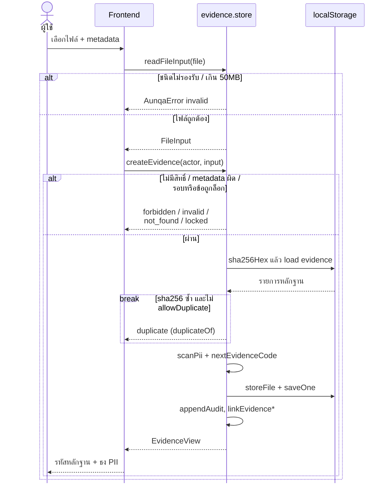

หมายเหตุสำหรับรูปที่ 3.8: การผูกหลักฐานทำเมื่อผู้ใช้ระบุข้อและรอบ การสแกนข้อมูลส่วนบุคคลตรวจชื่อหลักฐาน คำอธิบาย ข้อความที่ดึงจากไฟล์ และชื่อไฟล์ โดยแปลงเลขไทยและอักขระเต็มความกว้างเป็นอักขระ ASCII ก่อนตรวจ เมื่อพบไฟล์ซ้ำ การทำงานหยุดที่จุดนั้น และถ้าผู้ใช้ยืนยันว่าต้องการเก็บซ้ำ ระบบจึงสร้างหลักฐานใหม่อีกครั้งโดยอนุญาตไฟล์ซ้ำ กิ่ง `locked` ที่เพิ่มในระยะ R คือเมื่อผู้ใช้ระบุข้อ ระบบตรวจว่ารอบยังเขียนได้และข้อยังไม่ถูกล็อก **ก่อน** สร้างหลักฐาน จึงไม่เกิดหลักฐานที่ไม่ได้ผูกกับข้อใดค้างอยู่

รูปที่ 3.9 แสดงขั้นตอนของบริการปัญญาประดิษฐ์ระดับบริการ โดยใช้การร่าง SAR (AI-2) และการแปล (AI-4) เป็นตัวอย่าง บริการตรวจสิทธิ์ ตรวจว่ารอบยังแก้ไขได้ ตัดข้อมูลส่วนบุคคล แล้วส่งให้ตัวให้บริการ ผลลัพธ์ทุกกรณีผ่านการตรวจหลังประมวลผลและบันทึกเป็น AiRun ที่ยังไม่ถูกยอมรับ เมื่อผู้ใช้กดยอมรับ ระบบบันทึกเนื้อหาผ่านฟังก์ชันบันทึก SAR ปกติซึ่งตรวจสิทธิ์ การล็อก และรหัสหลักฐานอีกครั้ง

**รูปที่ 3.9 แผนภาพลำดับบริการปัญญาประดิษฐ์ (การร่างและการแปล SAR)**

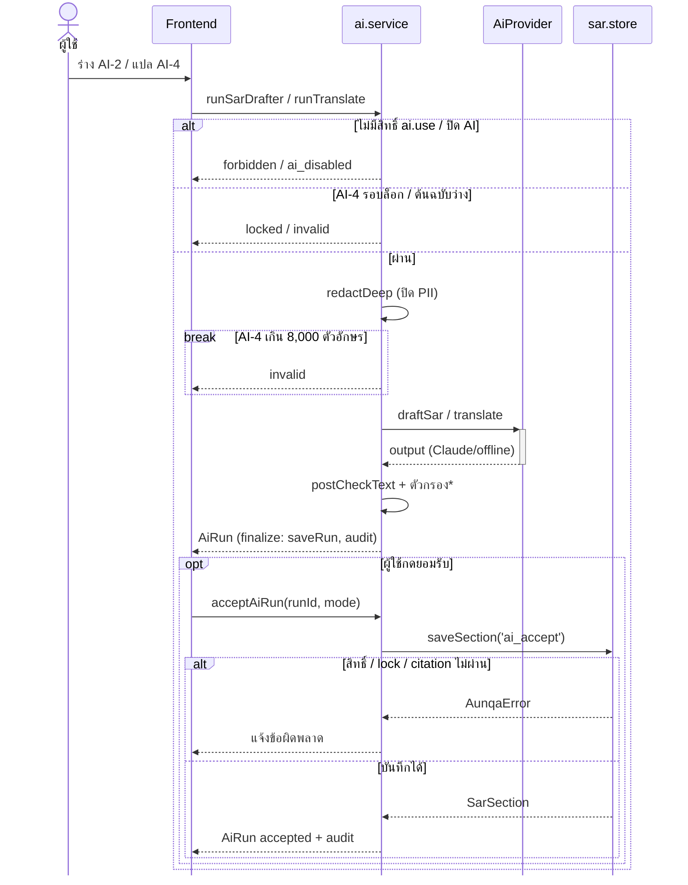

หมายเหตุสำหรับรูปที่ 3.9: ตัวกรองของ AI-2 ตัดประโยคเชิงให้คะแนนหรือตัดสินออก ส่วน AI-4 ตรวจว่ารหัสหลักฐาน `[E-…]` และตัวเลขในคำแปลครบตามต้นฉบับ และติดธงประโยคตัดสินที่เพิ่มขึ้นมาโดยไม่ตัดออก เนื่องจากเป็นเนื้อหาของผู้ใช้เอง ฟีเจอร์ AI-1, AI-3, AI-7 และ AI-9 ใช้โครงเดียวกัน คำแปลที่ได้จากตัวให้บริการออฟไลน์ถูกตั้งธง "ต้องตรวจคำแปล" เมื่อยอมรับ รายละเอียดการเรียกตัวให้บริการแสดงในรูปที่ 3.10 และบริการ AI เปลี่ยนสถานะหรือให้คะแนนไม่ได้ เนื่องจากโมดูลบริการ AI ไม่เรียกฟังก์ชันเปลี่ยนสถานะ

รูปที่ 3.10 แสดงการทำงานของตัวให้บริการ Claude ฝั่งเบราว์เซอร์ Route Handler `/api/ai` และ Messages API ของ Anthropic Route Handler ตรวจตามลำดับ คือ มีกุญแจ API หรือไม่ ต้นทางและส่วนหัวของคำขอถูกต้องหรือไม่ อัตราการเรียกต่อผู้เรียกและรวมต่อนาทีเกินหรือไม่ ขนาดและรูปแบบของคำขอถูกต้องหรือไม่ จากนั้นตัดข้อมูลส่วนบุคคลซ้ำ สร้างคำสั่งรุ่น claude-v2 ตรวจงบการเรียกรายวัน แล้วจึงเรียก Anthropic โดยกำหนดเวลารอ 60 วินาที

**รูปที่ 3.10 แผนภาพลำดับการเรียก Claude ผ่าน Route Handler และการสลับไปใช้ตัวให้บริการออฟไลน์**

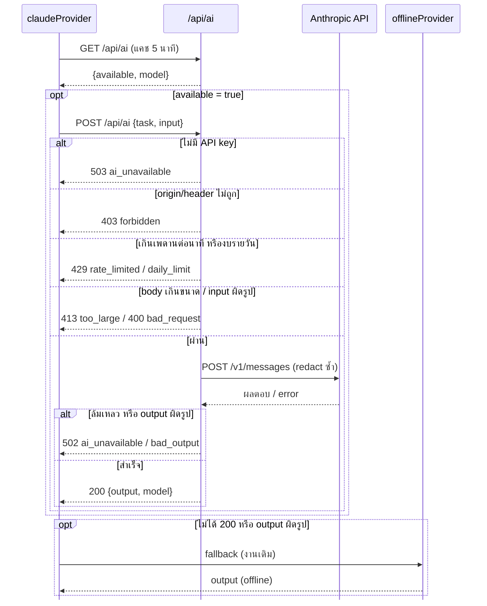

หมายเหตุสำหรับรูปที่ 3.10: รหัสตอบกลับ 429 มีสองกรณีที่แยกกันในโค้ด คือเกินอัตราการเรียกก่อนอ่านเนื้อคำขอ และเกินงบรายวันหลังตรวจข้อมูลนำเข้า แต่รวมไว้ในกิ่งเดียวเพื่อความกระชับ ทุกกรณีที่ไม่ได้รหัส 200 ฝั่งเบราว์เซอร์สลับไปใช้ตัวให้บริการออฟไลน์เสมอ ระบบจึงสาธิตได้แม้ไม่มีกุญแจ API

รูปที่ 3.11 แสดงการรักษางานที่ยังไม่บันทึกเมื่อเซสชันสิ้นสุด 3 กรณี คือ (ก) ผู้ใช้กดออกจากระบบ (ข) เซสชันหมดอายุ และ (ค) ผู้ใช้ออกจากระบบหรือเข้าสู่ระบบเป็นบุคคลอื่นจากแท็บอื่น ทุกกรณีเรียกการบันทึกงานที่ค้างทั้งหมด (flushAll) ก่อน และการบันทึกแต่ละข้อส่งเวลาบันทึกล่าสุดที่หน้าถืออยู่ (`baseUpdatedAt`) ไปด้วย

**รูปที่ 3.11 แผนภาพลำดับการออกจากระบบ การหมดอายุของเซสชัน และการตรวจความขัดแย้งในการบันทึก**

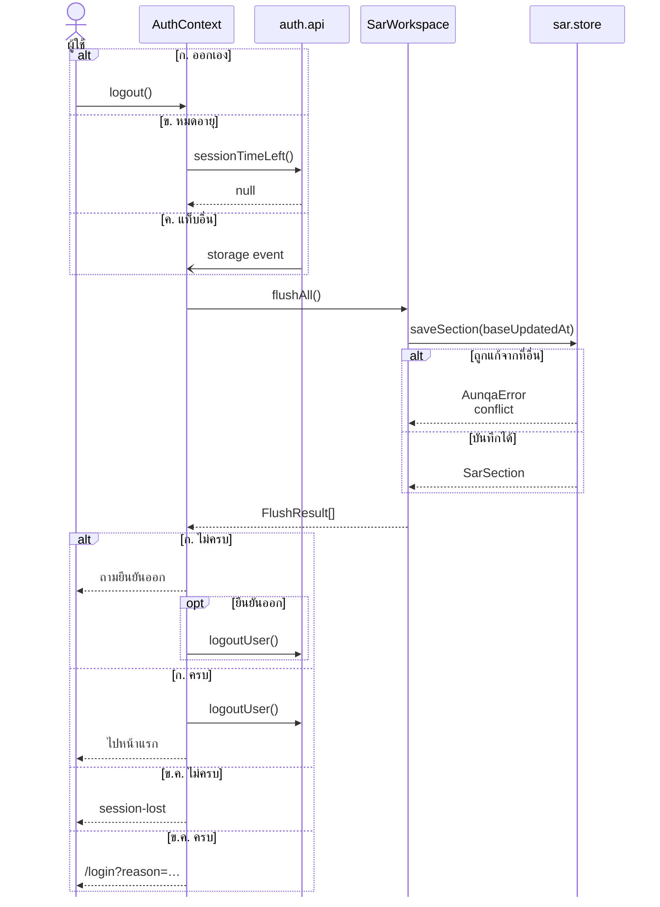

หมายเหตุสำหรับรูปที่ 3.11: AuthContext ตรวจเวลาที่เหลือของเซสชันทุก 30 วินาที เซสชันหมดอายุเมื่อไม่มีการใช้งาน 4 ชั่วโมงหรือครบ 12 ชั่วโมงนับจากเข้าสู่ระบบ และเตือนก่อนหมดอายุ 5 นาที กรณี (ค) รับรู้ผ่านเหตุการณ์ storage ของเบราว์เซอร์ สถานะ session-lost คือหน้าที่อ่านได้อย่างเดียวพร้อมปุ่มคัดลอกข้อความ การบันทึกถูกปฏิเสธด้วยรหัส conflict เมื่อเวลาบันทึกล่าสุดของข้อนั้นใหม่กว่า `baseUpdatedAt`

แผนภาพลำดับ 3 รูปต่อไปนี้เพิ่มในระยะ R รูปที่ 3.12 แสดงการขอเข้าใช้งาน ผู้ขอกรอกฟอร์มสาธารณะซึ่งไม่มีช่องบทบาท ระบบตรวจข้อมูลแล้วสร้างบัญชีสถานะรออนุมัติ (pending) ที่ไม่มีบทบาท และแจ้งเตือนผู้มีสิทธิ์จัดการผู้ใช้ของมหาวิทยาลัยนั้น (N12) ผู้ดูแลกำหนดบทบาทและขอบเขตแล้วอนุมัติ ระบบเปลี่ยนบัญชีเป็นใช้งาน (active) และแจ้งผู้ขอ (N13) หรือผู้ดูแลปฏิเสธ ระบบลบแถวผู้ใช้และลบแจ้งเตือนที่มีชื่อผู้ขอ

**รูปที่ 3.12 แผนภาพลำดับการขอเข้าใช้งานและการอนุมัติหรือปฏิเสธ**

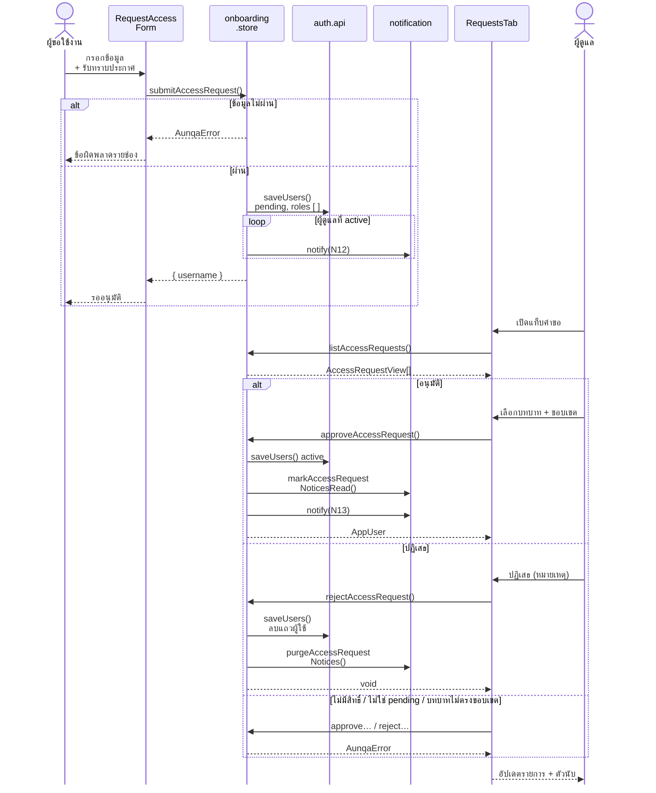

หมายเหตุสำหรับรูปที่ 3.12: "ข้อมูลไม่ผ่าน" หมายถึง โดเมนอีเมลไม่ใช่ของมหาวิทยาลัยที่ใช้ระบบ ชื่อผู้ใช้หรืออีเมลซ้ำ รหัสผ่านสั้นกว่า 8 ตัวอักษร หรือไม่ได้ทำเครื่องหมายรับทราบประกาศความเป็นส่วนตัว (ฐานตามมาตรา 24(3) ของพระราชบัญญัติคุ้มครองข้อมูลส่วนบุคคล ซึ่งเป็นการ "รับทราบ" ไม่ใช่ "ยินยอม" ดูหัวข้อ 3.3.12) ฟังก์ชัน `submitAccessRequest` อ่านเฉพาะฟิลด์ที่อยู่ในรายการอนุญาต จึงได้สถานะ pending และบทบาทว่างเสมอ ระหว่างรอ ผู้ขอที่เข้าสู่ระบบด้วยรหัสผ่านถูกจะได้ข้อความว่ารออนุมัติ เมื่ออนุมัติ แจ้งเตือน N12 ของผู้ดูแลทุกคนถูกทำเป็น "อ่านแล้ว" และเก็บไว้เป็นประวัติ เมื่อปฏิเสธ บันทึกการตรวจสอบเก็บเฉพาะโดเมนอีเมลและหน่วยงาน กิ่งข้อผิดพลาดใช้ได้ทั้งการอนุมัติและการปฏิเสธ เพราะระบบตรวจสิทธิ์และสถานะของบัญชีเป้าหมายก่อนเสมอ

รูปที่ 3.13 แสดงการเชิญ ผู้ดูแลกำหนดชื่อผู้ใช้ อีเมล บทบาท และขอบเขต ระบบสร้างบัญชีสถานะรอรับคำเชิญ (invited) และโทเคนคำเชิญที่ใช้ได้ครั้งเดียว คืนลิงก์ให้ผู้ดูแลคัดลอกไปส่งเอง ผู้ถูกเชิญเปิดลิงก์ ตั้งรหัสผ่าน แล้วเข้าสู่ระบบด้วยบทบาทที่ผู้เชิญกำหนดไว้เท่านั้น และผู้เชิญได้รับแจ้งเตือน (N14)

**รูปที่ 3.13 แผนภาพลำดับการเชิญผู้ใช้และการรับคำเชิญ**

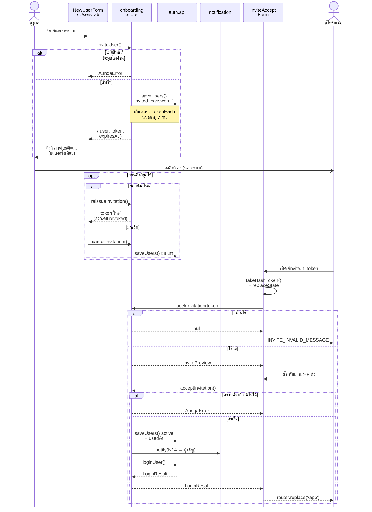

หมายเหตุสำหรับรูปที่ 3.13: โทเคนสุ่มขนาด 256 บิตจากตัวสร้างเลขสุ่มที่ปลอดภัยทางการเข้ารหัส (CSPRNG) ระบบเก็บเฉพาะค่าแฮช SHA-256 ของโทเคน (`tokenHash`) และคืนโทเคนจริงให้ผู้ดูแลเพียงครั้งเดียว ลิงก์ใส่โทเคนไว้หลังเครื่องหมาย `#` (Fragment) ซึ่งเบราว์เซอร์ไม่ส่งไปยังเซิร์ฟเวอร์และไม่อยู่ในส่วนหัว Referer และหน้า `/invite` ลบโทเคนออกจากแถบที่อยู่ทันทีที่อ่าน ลิงก์ที่ใช้ไม่ได้ทุกกรณี ได้แก่ ไม่มีอยู่ หมดอายุ ใช้แล้ว ถูกยกเลิก หรือผู้เชิญถูกระงับหรือไม่มีสิทธิ์แล้ว ตอบข้อความเดียวกันเพื่อไม่ให้คาดเดาสถานะได้ ฟังก์ชัน `acceptInvitation` ตรวจโทเคนซ้ำหลังคำนวณค่าแฮชเพื่อกันการกดซ้ำ ลิงก์ถูกส่งนอกระบบ (ลูกศรแบบไม่รอผล) และในรุ่นต้นแบบใช้ได้เฉพาะเบราว์เซอร์เดียวกับผู้ดูแล เพราะข้อมูลอยู่ใน localStorage อายุลิงก์ 7 วันเป็นค่าที่ผู้วิจัยเลือกเอง ไม่ใช่ข้อกำหนดของ NIST (ดูหัวข้อ 3.3.12)

รูปที่ 3.14 แสดงการกดแจ้งเตือน ผู้ใช้กดกระดิ่ง ระบบอ่านรายการแจ้งเตือน ผู้ใช้กดรายการหนึ่ง ระบบทำเครื่องหมายว่าอ่านแล้ว แปลงปลายทางของแจ้งเตือนเป็นที่อยู่หน้าภายในระบบ แล้วพาผู้ใช้ไปยังหน้านั้น

**รูปที่ 3.14 แผนภาพลำดับการกดแจ้งเตือนและการพาไปยังหน้าปลายทาง**

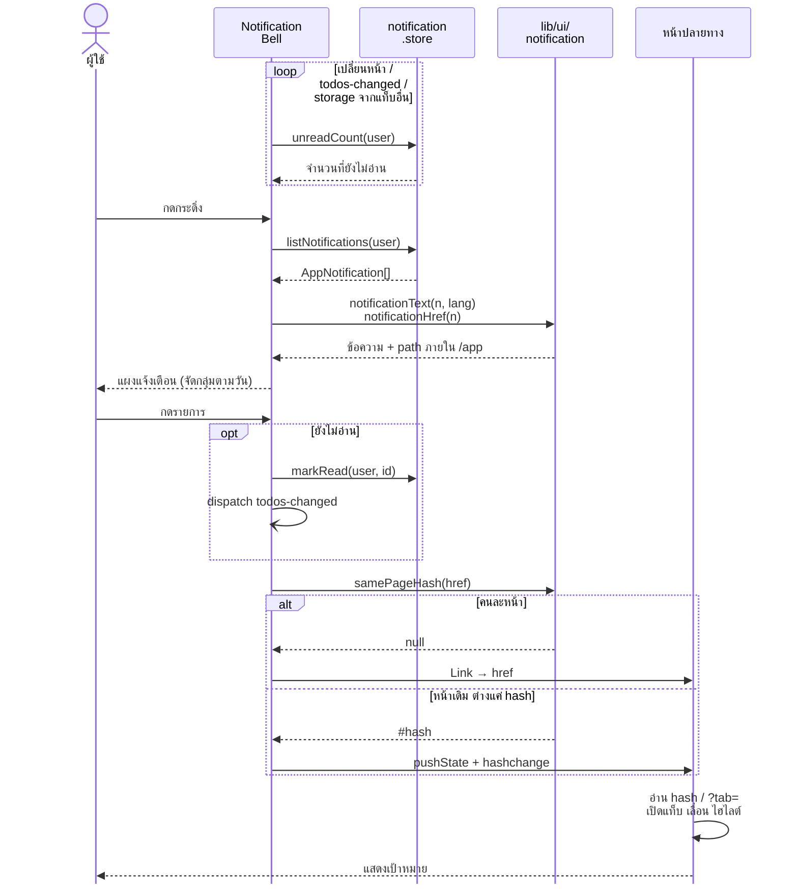

หมายเหตุสำหรับรูปที่ 3.14: ตัวนับบนกระดิ่งคำนวณใหม่เมื่อเปลี่ยนหน้า เมื่อหน้าใดส่งเหตุการณ์ `aunqa:todos-changed` และเมื่อแท็บอื่นเขียนข้อมูลแจ้งเตือน (เหตุการณ์ storage) ฟังก์ชันอ่านรายการแจ้งเตือนสร้างแจ้งเตือนกำหนดส่งที่ใกล้ถึงก่อน ระบบเก็บปลายทางแบบความหมาย (`target`) แล้วแปลงเป็นที่อยู่ภายใต้ `/app` ที่ชั้นแสดงผล โดยไม่มีที่อยู่ที่มาจากข้อมูล เพื่อป้องกันการเปลี่ยนเส้นทางไปเว็บภายนอก (Open Redirect) ข้อความภาษาไทยแสดงวันที่เป็นปีพุทธศักราชที่ชั้นแสดงผลโดยไม่แก้ข้อมูลที่เก็บ ภาษาอังกฤษใช้ข้อความ `messageEn` บัญชีที่ไม่อยู่ในสถานะใช้งานทำเครื่องหมายอ่านแล้วไม่ได้ กรณีหน้าเดิมที่ต่างกันเฉพาะส่วนหลัง `#` ระบบใช้ `pushState` และส่งเหตุการณ์ `hashchange` เอง เพราะลิงก์ของ Next.js 14 ไม่ส่งเหตุการณ์นี้ หน้าปลายทาง ได้แก่ ข้อ SAR (ถ้าเป็นความเห็นจะเปิดแท็บความเห็นให้) รอบการประเมิน พื้นที่ทำงานกรรมการ แผนปรับปรุง (เลื่อนไปแถวนั้นและเน้นสี) หน้าผู้ดูแลแท็บคำขอหรือแท็บผู้ใช้ และหน้าหลัก

### 3.3.2 แผนภาพสถานะ

แผนภาพสถานะ (State Diagram) ในรูปที่ 3.15 แสดงสถานะของรอบการประเมิน ระบบอนุญาตให้เปลี่ยนสถานะได้เฉพาะตามตารางการเปลี่ยนสถานะ (`CYCLE_TRANSITIONS`) เท่านั้น การส่งตรวจต้องอนุมัติครบทุกข้อ การส่งกลับต้องมีหมายเหตุ และการอนุมัติสุดท้ายจะล็อกรอบพร้อมบันทึกค่าแฮช หลังล็อก คณบดีเปิดรอบแก้ไขใหม่ได้โดยต้องระบุหมายเหตุ และเลขรุ่นของรอบเพิ่มขึ้นหนึ่ง

**รูปที่ 3.15 แผนภาพสถานะของรอบการประเมิน**

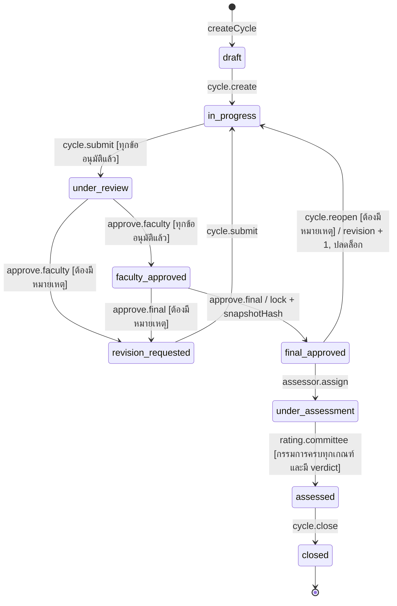

รูปที่ 3.16 แสดงสถานะของ SAR รายข้อ ผู้อนุมัติต้องไม่ใช่ผู้บันทึกเนื้อหาล่าสุดของข้อนั้น เพื่อแยกหน้าที่ผู้เขียนกับผู้อนุมัติ แผนภาพนี้ไม่มีสถานะสิ้นสุด เนื่องจากโค้ดอนุญาตให้ข้อที่อนุมัติแล้วถูกส่งกลับเพื่อแก้ไขได้

**รูปที่ 3.16 แผนภาพสถานะของรายงานการประเมินตนเองรายข้อ**

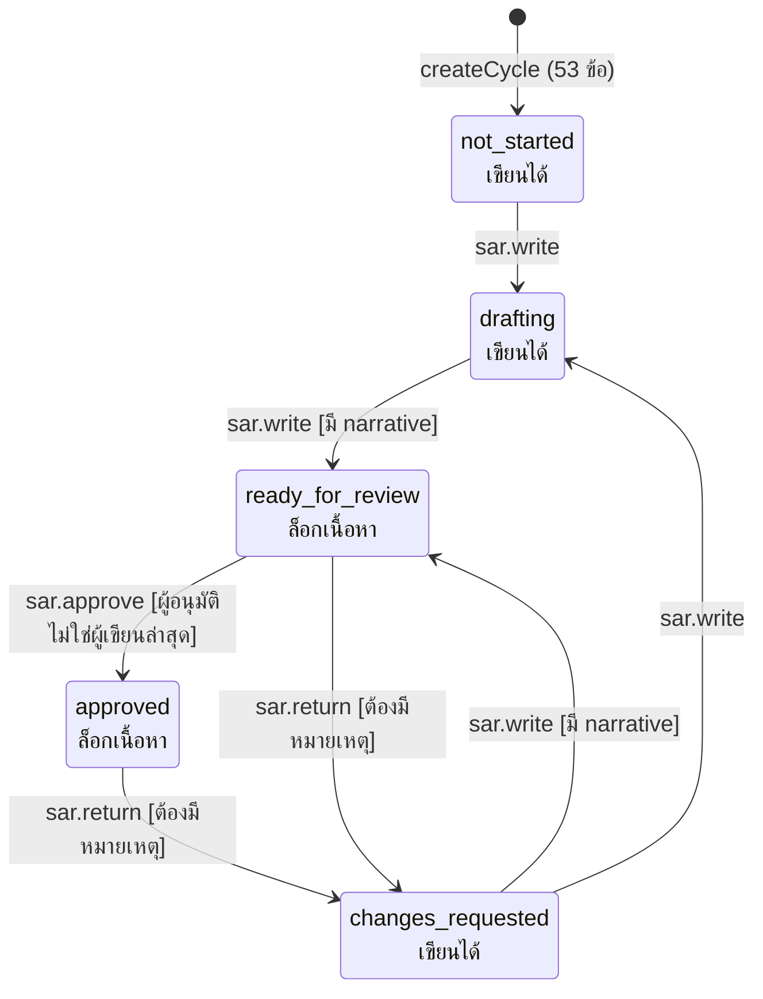

หมายเหตุสำหรับรูปที่ 3.16: ป้าย "เขียนได้" และ "ล็อกเนื้อหา" เพิ่มในระยะ R สถานะ ready_for_review และ approved เป็นสถานะล็อกเนื้อหา คือแก้เนื้อหา คะแนนตนเอง และผูกหรือเลิกผูกหลักฐานไม่ได้ ทั้งที่หน้าจอ (ซ่อนปุ่มและบอกเหตุผล) และที่ชั้นตรรกะ (ตอบรหัส `locked`)

รูปที่ 3.17 แสดงสถานะของบัญชีผู้ใช้ 4 สถานะ ได้แก่ รออนุมัติ (pending) รอรับคำเชิญ (invited) ใช้งาน (active) และระงับ (suspended) บัญชีที่ใช้งานแล้วลบไม่ได้ ผู้ดูแลต้องระงับแทน เพื่อไม่ให้ประวัติ SAR และบันทึกการตรวจสอบอ้างถึงผู้ใช้ที่ไม่มีอยู่

**รูปที่ 3.17 แผนภาพสถานะของบัญชีผู้ใช้**

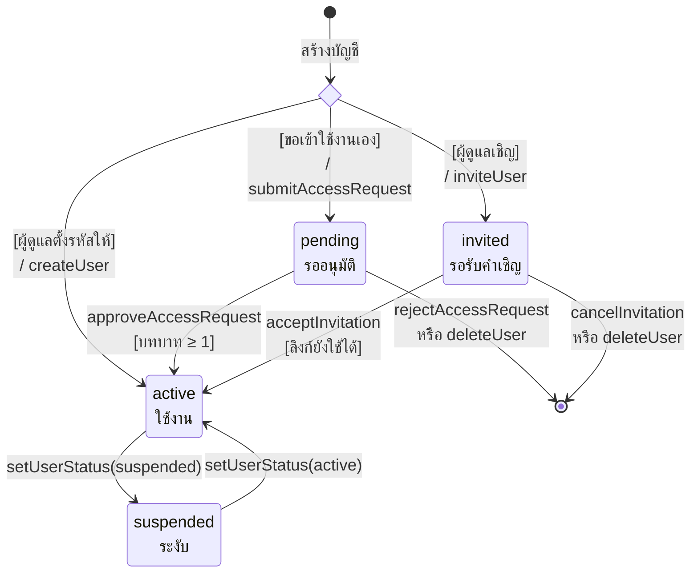

หมายเหตุสำหรับรูปที่ 3.17: ข้อมูลเดิมที่ไม่มีฟิลด์สถานะถือเป็นสถานะใช้งาน บัญชี pending และ suspended ที่เข้าสู่ระบบด้วยรหัสผ่านถูกได้ข้อความบอกสถานะ (ถ้ารหัสผ่านผิดได้ข้อความทั่วไป) เซสชันที่เปิดค้างของบัญชีที่ถูกระงับหมดผลเมื่อเรียก `getCurrentUser` ครั้งถัดไป และทุกฟังก์ชันที่เขียนข้อมูลตรวจ `requireActiveActor` จึงเป็นการบังคับ 2 ชั้น (OWASP ASVS 5.0.0 ข้อ 7.4.2) บัญชีที่ไม่ใช้งานไม่ได้รับแจ้งเตือนและไม่อยู่ในรายชื่อให้มอบหมายงาน การลบทำได้เฉพาะบัญชีที่ยังไม่เคยใช้งาน (invited หรือ pending) ผู้ดูแลระงับหรือเปิดใช้บัญชีของตนเองไม่ได้ และผู้ดูแลมหาวิทยาลัยแตะบัญชีผู้ดูแลระบบไม่ได้

รูปที่ 3.18 แสดงสถานะของคำเชิญ ได้แก่ ยังไม่ใช้ (แยกเป็นใช้ได้และถูกพักไว้) ใช้แล้ว ถูกยกเลิก และหมดอายุ

**รูปที่ 3.18 แผนภาพสถานะของคำเชิญ**

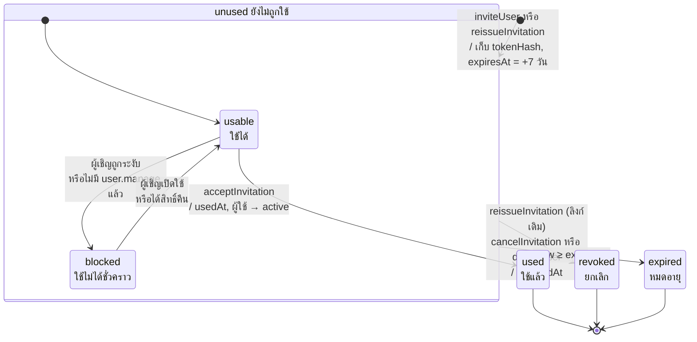

หมายเหตุสำหรับรูปที่ 3.18: สถานะใช้ได้ ถูกพักไว้ และหมดอายุ ไม่ได้เก็บเป็นฟิลด์ แต่คำนวณตอนใช้ลิงก์ (`findValidInvitation`) "ถูกพักไว้" คือผู้เชิญถูกระงับหรือไม่มีสิทธิ์จัดการผู้ใช้ของมหาวิทยาลัยนั้นแล้ว ระบบไม่ยกเลิกคำเชิญถาวรเพราะการระงับย้อนกลับได้ เมื่อเปิดใช้ผู้เชิญอีกครั้ง ลิงก์ที่ยังไม่หมดอายุจะกลับมาใช้ได้ การออกลิงก์ใหม่ยกเลิกลิงก์เดิมที่ยังไม่ใช้ของผู้ใช้นั้นทั้งหมดแล้วสร้างคำเชิญใหม่ และผู้ใช้ภายนอกเห็นทุกสถานะที่ไม่ใช่ "ใช้ได้" เป็นข้อความเดียวกัน

### 3.3.3 แผนภาพความสัมพันธ์ของข้อมูล

แผนภาพความสัมพันธ์ของข้อมูล (ER Diagram) แบ่งเป็น 4 รูป รูปที่ 3.19 แสดงแกนของระบบ ได้แก่ องค์กร ผู้ใช้และบทบาท รอบการประเมิน SAR รายข้อ และเวอร์ชันของเนื้อหา ในระยะ R ผู้ใช้ (APP_USER) เพิ่มอีเมล สถานะบัญชี และข้อมูลคำขอเข้าใช้งาน และมหาวิทยาลัยเพิ่มโดเมนอีเมลที่ใช้ตรวจคำขอ

**รูปที่ 3.19 แผนภาพความสัมพันธ์ของข้อมูลแกนหลัก**

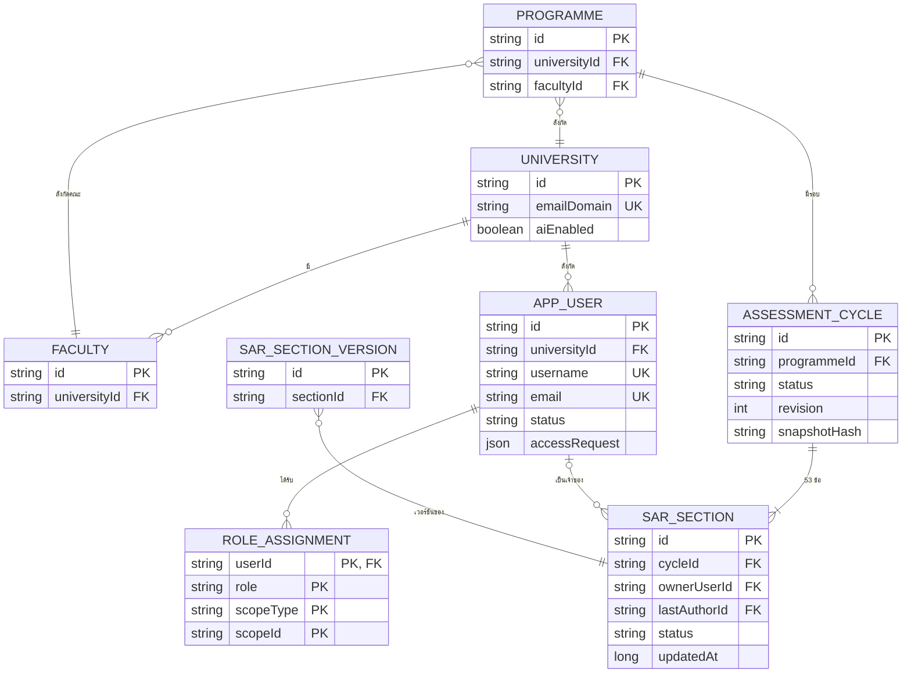

รูปที่ 3.20 แสดงข้อมูลการอนุมัติ การประเมิน และแผนปรับปรุง ได้แก่ เหตุการณ์การตรวจ (Review Event) คะแนน ข้อค้นพบของกรรมการ verdict รายการแผนปรับปรุง และการแจ้งเตือน ซึ่งเพิ่มข้อความภาษาอังกฤษ ปลายทาง คีย์กันซ้ำ และเวลาที่อ่าน

**รูปที่ 3.20 แผนภาพความสัมพันธ์ของข้อมูลการอนุมัติ การประเมิน และแผนปรับปรุง**

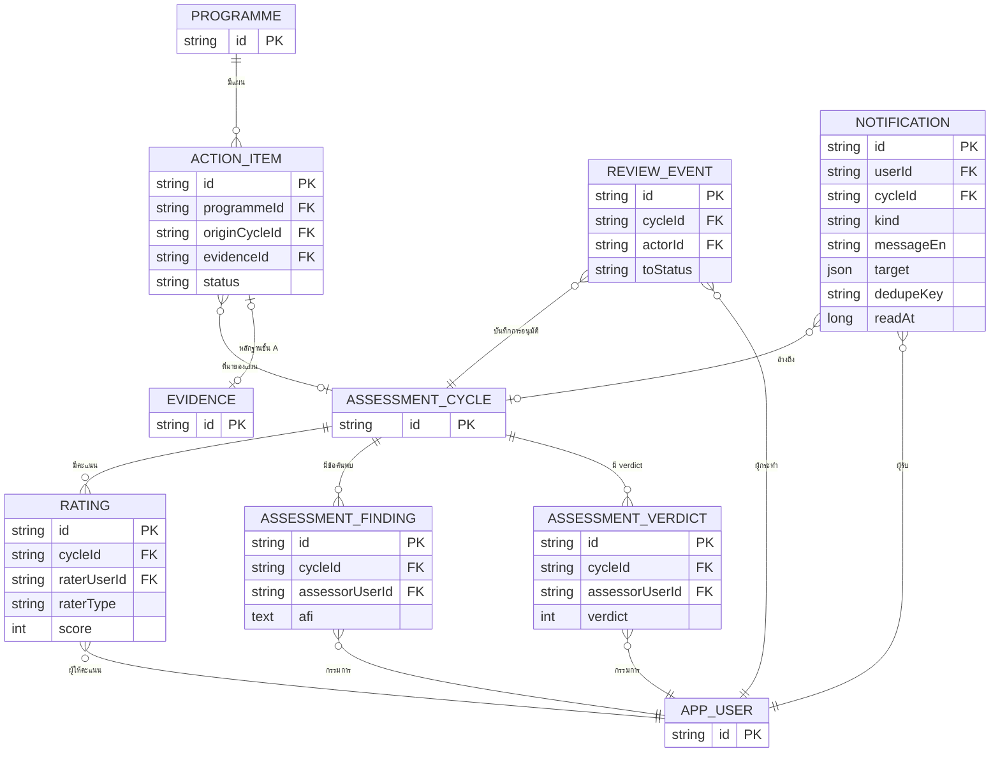

รูปที่ 3.21 แสดงข้อมูลหลักฐาน ไฟล์และเวอร์ชันของไฟล์ การผูกหลักฐานกับข้อ การเรียก AI บันทึกการตรวจสอบ และตัวชี้วัด ความสัมพันธ์แบบหลายต่อหลายระหว่างหลักฐานกับข้อเกณฑ์แยกเป็นตาราง EVIDENCE_LINK และคำเชิญ (INVITATION) ที่เพิ่มในระยะ R ซึ่งวางในรูปนี้เพราะถ้าวางในรูปที่ 3.19 ตัวอักษรจะเล็กเกินไป

**รูปที่ 3.21 แผนภาพความสัมพันธ์ของข้อมูลหลักฐาน การเรียกปัญญาประดิษฐ์ และตัวชี้วัด**

```mermaid
%% source: eduflow-next/lib/types.ts:46-56 (Invitation), 225-229 (AuditLog), Evidence/EvidenceLink/EvidenceFile/AiRun/MetricValue; lib/api/audit.store.ts:17,24 (SYSTEM_ACTOR_ID เมื่อไม่มี actor); lib/api/onboarding.store.ts:96-103 (createInvitation); lib/api/db.ts:37 (aunqa_invitations) | task: TASK-0002 | updated: 2026-10-27
%%{init: {"themeVariables": {"fontSize": "24px"}, "themeCSS": ".edgeLabel .label{font-size:22px}", "er": {"entityPadding": 6}}}%%
erDiagram
  PROGRAMME ||--o{ EVIDENCE : "เก็บ"
  PROGRAMME ||--o{ METRIC_VALUE : "มีตัวชี้วัด"
  EVIDENCE ||--o{ EVIDENCE_FILE : "มีไฟล์เวอร์ชัน"
  EVIDENCE ||--o{ EVIDENCE_LINK : "ถูกผูก"
  EVIDENCE_LINK }o--|| ASSESSMENT_CYCLE : "ในรอบ"
  AI_RUN }o--o| ASSESSMENT_CYCLE : "ใช้ข้อมูลรอบ"
  AI_RUN }o--o| EVIDENCE : "ติดป้าย"
  AI_RUN }o--o| PROGRAMME : "AI-7 ระดับหลักสูตร"
  AI_RUN }o--|| APP_USER : "สร้างโดย"
  AUDIT_LOG }o--o| APP_USER : "ผู้กระทำ"
  INVITATION }o--|| APP_USER : "ผู้ถูกเชิญ"
  INVITATION }o--|| APP_USER : "ผู้เชิญ"
  AUDIT_LOG }o--o| PROGRAMME : "ขอบเขต"
  PROGRAMME {
    string id PK
  }
  ASSESSMENT_CYCLE {
    string id PK
  }
  APP_USER {
    string id PK
  }
  EVIDENCE {
    string id PK
    string programmeId FK
    string code UK
    string sha256
    boolean containsPii
    string status
  }
  EVIDENCE_FILE {
    string id PK
    string evidenceId FK
    int version
    string piiScan
  }
  EVIDENCE_LINK {
    string id PK
    string evidenceId FK
    string cycleId FK
    string requirementId
    string source
  }
  AI_RUN {
    string id PK
    string cycleId FK
    string evidenceId FK
    string programmeId FK
    string createdBy FK
    string feature
    string redactedInputHash
    boolean accepted
  }
  AUDIT_LOG {
    string id PK
    string actorId FK
    string programmeId FK
    string action
  }
  METRIC_VALUE {
    string id PK
    string programmeId FK
    string code
    int period
    float value
  }
  INVITATION {
    string id PK
    string userId FK
    string createdBy FK
    string tokenHash UK
    long expiresAt
    long usedAt
    long revokedAt
  }
```

รูปที่ 3.22 แสดงข้อมูลหลักสูตร ได้แก่ PLO รายวิชา CLO วิธีสอนและวิธีวัดผล ตารางเชื่อม CLO กับ PLO และตารางวิชาที่ต้องเรียนก่อน

**รูปที่ 3.22 แผนภาพความสัมพันธ์ของข้อมูลหลักสูตร**

```mermaid
%% source: eduflow-next/lib/types.ts:293-306 (Plo, Course, Clo, CloPloMap, CourseMethod); lib/api/db.ts:29-33 (KEYS) | task: TASK-0001 | updated: 2026-10-23
%%{init: {"themeVariables": {"fontSize": "24px"}, "themeCSS": ".edgeLabel .label{font-size:22px}", "er": {"entityPadding": 6}}}%%
erDiagram
  PROGRAMME ||--o{ PLO : "กำหนด"
  PROGRAMME ||--o{ COURSE : "เปิดสอน"
  COURSE ||--o{ CLO : "มี"
  COURSE ||--o{ COURSE_METHOD : "ใช้วิธี"
  COURSE ||--o{ COURSE_PREREQUISITE : "เป็นวิชาที่ต้องเรียนต่อ"
  COURSE ||--o{ COURSE_PREREQUISITE : "เป็นวิชาที่ต้องเรียนก่อน"
  CLO ||--o{ CLO_PLO_MAP : "แมป"
  PLO ||--o{ CLO_PLO_MAP : "ถูกแมป"
  PROGRAMME {
    string id PK
  }
  PLO {
    string id PK
    string programmeId FK
    string code
    string type
    int bloomLevel
  }
  COURSE {
    string id PK
    string programmeId FK
    string code
    int credits
    int year
    int semester
  }
  CLO {
    string id PK
    string courseId FK
    string code
    int bloomLevel
  }
  CLO_PLO_MAP {
    string cloId "PK, FK"
    string ploId "PK, FK"
    string level
  }
  COURSE_METHOD {
    string id PK
    string courseId FK
    string kind
    string method
  }
  COURSE_PREREQUISITE {
    string courseId "PK, FK"
    string prerequisiteId "PK, FK"
  }
```

หมายเหตุสำหรับรูปที่ 3.19–3.22: สัญลักษณ์ `||--o{` หมายถึงหนึ่งต่อศูนย์หรือมาก `|o--o{` หมายถึงศูนย์หรือหนึ่งต่อศูนย์หรือมาก `||--|{` หมายถึงหนึ่งต่อหนึ่งหรือมาก และ `}o--o|` หมายถึงศูนย์หรือมากต่อศูนย์หรือหนึ่ง กล่องที่มีเฉพาะ `id PK` คือตารางจากรูปอื่นซึ่งวาดไว้เพื่อแสดงกุญแจนอก แผนภาพแสดงเฉพาะกุญแจหลัก กุญแจนอก และแอตทริบิวต์สำคัญ ฟิลด์ `requirementId` และ `criterionNo` อ้างข้อมูลเกณฑ์ AUN-QA ซึ่งเป็นค่าคงที่ในโค้ด จึงไม่มีเส้นกุญแจนอก ระบบรุ่นต้นแบบเก็บข้อมูลเป็น JSON ใน localStorage (คีย์ขึ้นต้นด้วย `aunqa_`) แผนภาพนี้จึงเป็นโครงสร้างเชิงตรรกะสำหรับย้ายไป PostgreSQL ในอนาคต โดย ROLE_ASSIGNMENT และ COURSE_PREREQUISITE ในโค้ดปัจจุบันฝังอยู่ในฟิลด์ `AppUser.roles` และ `Course.prerequisiteIds` ตามลำดับ ฟิลด์ `accessRequest` (หน่วยงาน ตำแหน่ง เหตุผล และเวลาที่ขอ) ฝังใน APP_USER มีเฉพาะบัญชีสถานะ pending และถูกลบเมื่ออนุมัติหรือปฏิเสธ ฟิลด์ `status` มีค่า active, invited, pending หรือ suspended ตาราง INVITATION มีกุญแจนอกไปยัง APP_USER สองเส้น คือผู้ถูกเชิญ (`userId`) และผู้เชิญ (`createdBy`) และเก็บเฉพาะ `tokenHash` ไม่เก็บโทเคน ฟิลด์ `target` ของ NOTIFICATION คือปลายทางเชิงความหมาย (section, my_work, cycle, assess, action, admin หรือ home) และ `actorId` ของ AUDIT_LOG อาจเป็นค่า `system` เมื่อไม่มีผู้กระทำที่เข้าสู่ระบบ เช่น การส่งคำขอเข้าใช้งาน จึงเป็นความสัมพันธ์ศูนย์หรือหนึ่ง (แผนภาพชุดเดิมวาดเป็นหนึ่งซึ่งไม่ถูกต้อง) ตัวอักษรในรูปที่ 3.19, 3.20 และ 3.22 มีขนาดประมาณ 7 พอยต์เมื่อพิมพ์ และการวางหน้าแนวนอนไม่ช่วยขยาย เนื่องจากสัดส่วนของรูปใกล้เคียงสี่เหลี่ยมจัตุรัส [ต้องตรวจสอบกับคู่มือสาขา: ขนาดตัวอักษรขั้นต่ำในแผนภาพ หากต้องการอย่างน้อย 8 พอยต์ต้องแยกรูปเพิ่มหรือย้ายไปภาคผนวก]

### 3.3.4 แผนภาพคลาส

แผนภาพคลาส (Class Diagram) ระดับการออกแบบแบ่งเป็น 3 รูป รูปที่ 3.23 แสดงบริการ AI (`AiService`) ซึ่งให้บริการ AI-1, AI-2, AI-3, AI-4, AI-7 และ AI-9 โดยเรียกตัวให้บริการผ่านส่วนต่อประสาน `AiProvider` ที่มีสองแบบคือ Claude และออฟไลน์ และใช้โมดูลตัดข้อมูลส่วนบุคคล โมดูลตรวจหลังประมวลผล และอภิธานศัพท์ AUN-QA สำหรับการแปล

**รูปที่ 3.23 แผนภาพคลาสของบริการปัญญาประดิษฐ์**

```mermaid
%% source: eduflow-next/lib/api/ai.service.ts:39 (getProvider), 115-444 (run*, acceptAiRun); ai/provider.ts:61-69 (AiProvider); ai/claude.ts:50-57; ai/offline.ts; ai/postcheck.ts:24,95,109; ai/redact.ts:15; ai/glossary.ts:110,122 | task: TASK-0001 | updated: 2026-10-23
%%{init: {"themeVariables": {"fontSize": "20px"}, "themeCSS": ".edge-pattern-dashed{stroke-dasharray: 4 4 !important}"}}%%
classDiagram
  direction TB
  class AiService {
    <<module>>
    +runEvidenceTagger()
    +runSarDrafter()
    +runSarReviewer()
    +runTranslate()
    +runVerbChecker()
    +runAssessorSummary()
    +acceptAiRun()
  }
  class AiProvider {
    <<interface>>
    +tagEvidence()
    +draftSar()
    +reviewSar()
    +translate()
    +checkVerbs()
    +summarizeCriterion()
  }
  class PostCheck {
    <<module>>
    +postCheckText()
    +stripJudgement()
    +mergePostChecks()
  }
  class Redact {
    <<module>>
    +redactDeep()
  }
  class Glossary {
    <<module>>
    +findGlossaryHits()
    +applyGlossary()
  }
  class ClaudeProvider {
    <<module>>
  }
  class OfflineProvider {
    <<module>>
  }
  AiService --> AiProvider : getProvider()
  AiService ..> PostCheck
  AiService ..> Redact
  AiService ..> Glossary
  ClaudeProvider ..|> AiProvider
  OfflineProvider ..|> AiProvider
  ClaudeProvider ..> OfflineProvider : fallback
  OfflineProvider ..> Glossary
```

รูปที่ 3.24 แสดงโมดูลลำดับงานกับที่เก็บข้อมูล ได้แก่ การเปลี่ยนสถานะ SAR รอบ แผนปรับปรุง การแจ้งเตือน การตรวจก่อนเปลี่ยนสถานะ รายการงานที่ต้องทำ และชนิดข้อผิดพลาด `AunqaError` และในระยะ R เพิ่มโมดูลการรับผู้ใช้ใหม่ (`OnboardingStore`) โมดูลยืนยันตัวตน (`AuthApi`) และฟังก์ชันอ่านและทำเครื่องหมายแจ้งเตือน จุดสำคัญคือ `AiService` ไม่พึ่งพาฟังก์ชันเปลี่ยนสถานะของรอบหรือข้อ จึงบังคับกฎ "AI เปลี่ยนสถานะไม่ได้" ด้วยโครงสร้างโค้ด

**รูปที่ 3.24 แผนภาพคลาสของลำดับงานและที่เก็บข้อมูล**

```mermaid
%% source: eduflow-next/lib/api/workflow.ts (transitionCycle, notifyCycleChange, openRevision, transitionSection, assertSectionEditable:78-99); sar.store.ts; cycle.store.ts; action.store.ts; notification.store.ts:35-117 (notify, listNotifications, unreadCount, markRead); onboarding.store.ts:129-348; auth.api.ts:37-58 (userStatus, isActiveUser, requireActiveActor), 275 (getCurrentUser), 393-438 (deleteUser, setUserStatus); preflight.ts; todo.ts; ai.service.ts (acceptAiRun → saveSection) | task: TASK-0002 | updated: 2026-10-27
%%{init: {"themeVariables": {"fontSize": "22px"}, "themeCSS": ".edge-pattern-dashed{stroke-dasharray: 4 4 !important}"}}%%
classDiagram
  direction TB
  class WorkflowService {
    <<module>>
    +transitionCycle()
    +transitionSection()
    +openRevision()
    +verifySnapshot()
  }
  class SarStore {
    <<module>>
    +saveSection()
    +submitSection()
    +setSelfRating()
  }
  class CycleStore {
    <<module>>
    +createCycle()
    +assignSections()
    +assignAssessor()
  }
  class ActionStore {
    <<module>>
    +createActionsFromAfi()
    +setActionStatus()
  }
  class NotificationStore {
    <<module>>
    +notify()
    +listNotifications()
    +unreadCount()
    +markRead()
  }
  class OnboardingStore {
    <<module>>
    +inviteUser()
    +reissueInvitation()
    +cancelInvitation()
    +peekInvitation()
    +acceptInvitation()
    +submitAccessRequest()
    +approveAccessRequest()
    +rejectAccessRequest()
  }
  class AuthApi {
    <<module>>
    +loginUser()
    +getCurrentUser()
    +requireActiveActor()
    +setUserStatus()
    +deleteUser()
  }
  class Preflight {
    <<module>>
    +getTransitionPreflight()
  }
  class Todo {
    <<module>>
    +listMyTodos()
  }
  class AiService {
    <<module>>
  }
  class AunqaError {
    +code
    +detail
  }
  AiService ..> SarStore : saveSection
  SarStore ..> WorkflowService : transitionSection
  CycleStore ..> ActionStore : materializeActionEvidence
  Preflight ..> WorkflowService : CYCLE_TRANSITIONS
  Todo ..> CycleStore : listCycles
  WorkflowService ..> NotificationStore : notify
  WorkflowService ..> AunqaError : throws
  OnboardingStore ..> AuthApi : saveUsers, loginUser
  OnboardingStore ..> NotificationStore : N12-N14
  NotificationStore ..> AuthApi : isActiveUser
```

รูปที่ 3.25 แสดงโมดูลสนับสนุน ได้แก่ คลังหลักฐาน การสแกนข้อมูลส่วนบุคคล การนำเข้าตัวชี้วัดซึ่งตรวจขนาดไฟล์บีบอัดก่อนอ่าน งานของกรรมการ การควบคุมสิทธิ์ บันทึกการตรวจสอบ และชั้นจัดเก็บข้อมูล รูปนี้จัดวางในหน้าแนวนอนเพื่อให้ตัวอักษรอ่านได้

**รูปที่ 3.25 แผนภาพคลาสของโมดูลสนับสนุน** (จัดวางในหน้าแนวนอน)

```mermaid
%% source: eduflow-next/lib/api/evidence.store.ts:149,249 (createEvidence, linkEvidence); utils/pii.ts:57,87 (normalizeForPii, scanPii); metrics-import.ts:46,207,292,350 (inspectZipDirectory, preview/commit, importCohortFile); assessor.store.ts:64-135; rbac.ts; audit.store.ts; db.ts | task: TASK-0001 | updated: 2026-10-23
%%{init: {"themeVariables": {"fontSize": "20px"}, "themeCSS": ".edge-pattern-dashed{stroke-dasharray: 4 4 !important}"}}%%
classDiagram
  direction TB
  class AiService {
    <<module>>
  }
  class EvidenceStore {
    <<module>>
    +createEvidence()
    +linkEvidence()
    +verifyEvidence()
    +resolvePii()
  }
  class PiiScan {
    <<module>>
    +normalizeForPii()
    +scanPii()
  }
  class MetricsImport {
    <<module>>
    +previewMetricImport()
    +commitMetricImport()
    +importCohortFile()
    +inspectZipDirectory()
  }
  class AssessorStore {
    <<module>>
    +upsertFinding()
    +setCriterionRating()
    +setVerdict()
  }
  class Rbac {
    <<module>>
    +can()
  }
  class AuditStore {
    <<module>>
    +appendAudit()
  }
  class Db {
    <<module>>
    +load()
    +save()
  }
  AiService ..> EvidenceStore : linkEvidence
  EvidenceStore ..> PiiScan
  EvidenceStore ..> Rbac
  EvidenceStore ..> AuditStore
  EvidenceStore ..> Db
  MetricsImport ..> Rbac
  MetricsImport ..> AuditStore
  MetricsImport ..> Db
  AssessorStore ..> Rbac
  AssessorStore ..> AuditStore
  AssessorStore ..> Db
```

หมายเหตุสำหรับรูปที่ 3.23–3.25: โค้ดจริงเป็นโมดูลของฟังก์ชัน ไม่ใช่คลาส จึงใช้ตัวกำกับ «module» กล่องว่างคือโมดูลจากรูปอื่น และแสดงเฉพาะการพึ่งพาหลัก ในรูปที่ 3.24 ทุกโมดูลที่เขียนข้อมูลเรียก `AuthApi.requireActiveActor` ก่อน แต่ไม่ได้วาดทุกเส้นเพื่อลดความแน่น N12–N14 คือแจ้งเตือนคำขอใหม่ อนุมัติแล้ว และผู้ถูกเชิญเริ่มใช้งาน ตามลำดับ ตัวอักษรในรูปที่ 3.24 มีขนาดประมาณ 6.9 พอยต์เมื่อพิมพ์

### 3.3.5 สถาปัตยกรรมระบบ

รูปที่ 3.26 แสดงสถาปัตยกรรมเชิงกายภาพของรุ่นต้นแบบ ส่วนหน้าจอและชั้นตรรกะทำงานในเบราว์เซอร์และเก็บข้อมูลกับเซสชันใน localStorage ส่วนเซิร์ฟเวอร์ Next.js มี Route Handler `/api/ai` เพียงจุดเดียวที่ถือกุญแจ API จำกัดอัตราการเรียกและงบรายวัน และเรียก Messages API ของ Anthropic ผ่าน HTTPS ในระยะ R แผนภาพปรับให้วาดทิศตามการร้องขอจากเบราว์เซอร์ไปเซิร์ฟเวอร์และไปยัง Anthropic และเพิ่มส่วนประกอบฝั่งหน้าจอ ได้แก่ ตัวจัดการธีม ภาษา และการแสดงผล (Providers) ตัวแปลข้อความทั้งหน้า และส่วนประกอบพื้นฐาน ส่วนเซิร์ฟเวอร์ให้บริการไฟล์คงที่และฟอนต์ที่ฝากไว้ในระบบเอง

**รูปที่ 3.26 แผนภาพการติดตั้งระบบ (ประยุกต์จาก UML Deployment Diagram)**

```mermaid
%% source: eduflow-next/app/layout.tsx:1-47 (next/font self-host, ThemeProvider → PrefsInit → Toast/Dialog/Auth → LangProvider); components/ui/ThemeProvider.tsx:10-24 (next-themes, aunqa_theme); context/LangContext.tsx:1-21,99-102 (aunqa_lang ค่าเดียว, syncPageLanguage, html lang); lib/i18n/dom-translate.ts:1-13,114-130 (MutationObserver); lib/ui/prefs.ts:1-8 (aunqa_ui_prefs); components/ui/primitives/*; package.json (tailwindcss 3.4.19, next-themes 0.4.6, cva, tailwind-merge, @radix-ui/react-slot); app/api/ai/route.ts; lib/api/ai/ratelimit.ts; lib/api/db.ts | task: TASK-0002 | updated: 2026-10-27
%%{init: {"themeVariables": {"fontSize": "24px"}, "themeCSS": ".edge-pattern-dashed{stroke-dasharray: 4 4 !important}", "flowchart": {"nodeSpacing": 16, "rankSpacing": 34, "wrappingWidth": 360}}}%%
flowchart TB
  subgraph Client["«device» เครื่องผู้ใช้ (Browser)"]
    subgraph FE["«component» Next.js UI (React 18)"]
      PROV["«component» Providers<br/>ThemeProvider (next-themes)<br/>LangProvider + dom-translate<br/>PrefsInit, Auth, Toast, Dialog"]
      PAGES["«component» หน้า + components<br/>บน primitives (Tailwind 3.4, cva)"]
    end
    API["«artifact» lib/api/**"]
    LS[("«datastore» localStorage<br/>aunqa_* ข้อมูล + session<br/>aunqa_theme, aunqa_lang,<br/>aunqa_ui_prefs")]
  end
  subgraph Server["«node» Next.js server (Node.js)"]
    STATIC["«artifact» JS/CSS ที่ build แล้ว<br/>+ ฟอนต์ self-host"]
    ROUTE["«artifact» /api/ai Route Handler"]
    RL["«artifact» ratelimit, guards, redact"]
    ENV["«config» ANTHROPIC_API_KEY,<br/>AI_RATE_*, AI_DAILY_LIMIT"]
  end
  subgraph Ext["«external system» Anthropic"]
    LLM["Messages API (Claude)"]
  end
  PAGES -- "เรียกฟังก์ชัน" --> API
  PROV -- "ค่าการแสดงผล" --> LS
  API -- "อ่าน/เขียน JSON" --> LS
  FE -- "HTTPS GET หน้าเว็บ" --> STATIC
  API -- "HTTPS GET/POST /api/ai" --> ROUTE
  ROUTE --> RL
  ROUTE -.-> ENV
  ROUTE -- "HTTPS POST /v1/messages" --> LLM
```

หมายเหตุ: แผนภาพนี้ใช้สัญลักษณ์ประยุกต์จาก UML Deployment Diagram เนื่องจาก Mermaid ไม่มีแผนภาพชนิดนี้โดยตรง รุ่นต้นแบบยังไม่มีเซิร์ฟเวอร์ฐานข้อมูล ข้อมูลและเซสชันอยู่ใน localStorage ของเบราว์เซอร์ และตัวนับอัตราการเรียกกับงบรายวันอยู่ในหน่วยความจำของโปรเซสเดียว Providers ประกอบด้วย ThemeProvider (next-themes ใช้คลาส `dark` ค่าเริ่มต้นสว่าง คีย์ `aunqa_theme`) LangProvider (ภาษาเดียวทั้งระบบ คีย์ `aunqa_lang` และตั้งค่า `<html lang>`) ร่วมกับตัวแปลข้อความทั้งหน้าด้วย MutationObserver ตามพจนานุกรม และ PrefsInit (ขนาดตัวอักษรและเอฟเฟกต์ คีย์ `aunqa_ui_prefs`) ส่วนประกอบพื้นฐาน (`components/ui/primitives`) สร้างด้วย Tailwind CSS 3.4, class-variance-authority และ tailwind-merge แบบคัดลอกโค้ดเข้าโครงการ (shadcn/ui) ฟอนต์ IBM Plex Sans Thai Looped ถูกดาวน์โหลดมาเก็บไว้ตอนสร้างระบบ เบราว์เซอร์จึงไม่เรียก Google Fonts

### 3.3.6 การออกแบบการวิเคราะห์ช่องว่าง

การวิเคราะห์ช่องว่างใช้กฎ 11 ข้อที่เขียนเป็นฟังก์ชันบริสุทธิ์ (Pure Function) จึงทดสอบแยกได้และไม่ต้องพึ่ง AI ดังตารางที่ 3.5 กฎ R1–R10 มาจากสเปกของระบบ ส่วน R11 เพิ่มในระยะ C เพื่อเตือนคำแปลที่ยังไม่ได้ตรวจ ผลของกฎใช้คำนวณระดับสีของแผงความพร้อม 53 ช่อง ร้อยละความพร้อมของรอบ และคำเตือนก่อนเปลี่ยนสถานะ

Table: ตารางที่ 3.5 กฎการวิเคราะห์ช่องว่าง R1–R11

| กฎ | สิ่งที่ตรวจ | ระดับ |
|---|---|---|
| R1 | ข้อนี้ไม่มีหลักฐานผูก | Critical |
| R2 | มีหลักฐานแต่ไม่มีขั้น Check หรือ Act | High |
| R3 | ตัวชี้วัดที่ข้อนี้ต้องใช้มีข้อมูลน้อยกว่า 3 ปี | High |
| R4 | เนื้อหาว่างหรือน้อยกว่า 100 คำ | Medium |
| R5 | หลักฐานเก่ากว่าจำนวนปีที่กำหนด | Medium |
| R6 | หลักฐานติดธงข้อมูลส่วนบุคคลที่ยังไม่จัดการ | High |
| R7 | PLO ไม่มีรายวิชารับผิดชอบหรือไม่มีวิธีวัด วิชาไม่ผูก PLO หรือวิชาที่ต้องเรียนก่อนวนซ้ำ | High |
| R8 | ไม่มีค่าเทียบเคียงในข้อที่เกณฑ์ต้องการ (6.6, 8.1–8.3, 8.5) | Medium |
| R9 | ประโยคในเนื้อหาไม่มีการอ้างหลักฐาน | Low |
| R10 | ให้คะแนนตนเองตั้งแต่ 4 ขึ้นไปแต่ R1 หรือ R2 ยังเปิดอยู่ | High |
| R11 | คำแปลที่ได้จากตัวให้บริการออฟไลน์ยังไม่ได้ตรวจยืนยัน | Medium |

<!-- source: .agents/spec/AUN-QA_Copilot_Spec.md M9; eduflow-next/lib/api/gap.ts; R7 ตาม Log B2; R11 ตาม Log backend-dev C4 fix (C-8: ธง needsTranslationReview + gap R11 medium) -->

### 3.3.7 การออกแบบบริการปัญญาประดิษฐ์

บริการปัญญาประดิษฐ์ยึดหลัก 4 ข้อ คือ AI เป็นผู้ช่วยไม่ใช่ผู้ประเมิน ทุกข้อความต้องมีหลักฐานรองรับ ผลลัพธ์เป็นข้อเสนอที่มนุษย์ต้องกดยอมรับ และทุกการเรียกถูกบันทึกเป็น AiRun พร้อมชื่อแบบจำลองที่ตอบจริง ข้อห้ามของ AI บังคับในโค้ดดังตารางที่ 3.6

Table: ตารางที่ 3.6 ข้อห้ามของปัญญาประดิษฐ์และวิธีบังคับในระบบ

| ข้อห้าม | วิธีบังคับ |
|---|---|
| ให้คะแนนทางการหรือ verdict | คะแนนกรรมการรับจากบทบาทกรรมการเท่านั้น ส่วนต่อประสานของตัวให้บริการไม่มีเมธอดให้คะแนน และตัวกรองคำตัดสินตัดประโยคเชิงให้คะแนนหรือตัดสินออกจากผลของ AI-1, AI-2, AI-3, AI-7 และ AI-9 ส่วน AI-4 ติดธงโดยไม่ตัด |
| อนุมัติหรือเปลี่ยนสถานะ | บริการ AI ไม่เรียกฟังก์ชันเปลี่ยนสถานะ ผลที่ยอมรับแล้วบันทึกผ่านฟังก์ชันปกติที่ตรวจสิทธิ์และการล็อก |
| สร้างตัวเลข | ตัวเลขในผลลัพธ์ต้องปรากฏในข้อมูลนำเข้า ไม่เช่นนั้นถูกติดธงหรือตัดออก ส่วนคำแปลต้องมีตัวเลขครบเท่าต้นฉบับ |
| อ้างหลักฐานที่ไม่มี | รหัส `[E-…]` ทุกตัวต้องมีอยู่ในรอบนั้น ไม่เช่นนั้นถูกตัดออก |
| เห็นข้อมูลส่วนบุคคล | ตัดเลขประจำตัวประชาชน รหัสนักศึกษา อีเมล และหมายเลขโทรศัพท์ด้วยนิพจน์ปกติก่อนส่ง โดยแปลงเลขไทยและอักขระเต็มความกว้างก่อนตรวจ รองรับรูปแบบ +66 และตัวคั่นหลายแบบ และตัดซ้ำที่เซิร์ฟเวอร์ |
| ทำตามคำสั่งที่แฝงในหลักฐาน | คำสั่งรุ่น claude-v2 ประกาศว่าข้อความนำเข้าเป็นข้อมูลไม่ใช่คำสั่ง และการตรวจหลังประมวลผลในโค้ดเป็นตัวบังคับหลัก |

<!-- source: eduflow-next/lib/api/ai.service.ts, lib/api/ai/postcheck.ts, lib/utils/pii.ts ตาม Log backend-dev "D-sec fix กลุ่ม A" (A-1 judgementFilter ครอบ AI-1/2/7, A-2 normalizeForPii, A-3 prompt) -->

ฟีเจอร์ AI ที่พัฒนาแล้วมี 6 รายการ ได้แก่ AI-1 สรุปและติดป้ายหลักฐาน AI-2 ร่าง SAR AI-3 ตรวจ SAR AI-4 แปล SAR ระหว่างภาษาไทยกับอังกฤษ AI-7 ตรวจคำกริยาของ PLO/CLO ตามระดับบลูม และ AI-9 สรุปเกณฑ์และเสนอคำถามสัมภาษณ์สำหรับกรรมการ ทุกฟีเจอร์มีตัวให้บริการแบบออฟไลน์ที่ทำงานได้โดยไม่ต้องมีกุญแจ API ซึ่งให้ผลเป็นโครงร่างจากกฎและแม่แบบ และผลของ AI ระบุชัดว่าได้จากโหมดใด

### 3.3.8 การออกแบบการแปล การนำเข้าข้อมูล และการส่งออกเอกสาร

ความสามารถที่เพิ่มในระยะ C ออกแบบดังนี้

1. **การแปล (AI-4)** แปลเนื้อหา SAR ของข้อนั้นจากอีกภาษาหนึ่ง ข้อความผ่านการตัดข้อมูลส่วนบุคคล แล้วจำกัดความยาวไม่เกิน 8,000 ตัวอักษรหลังตัด ใช้อภิธานศัพท์ AUN-QA 55 คู่เพื่อให้ศัพท์เฉพาะคงที่ ตรวจหลังประมวลผลว่ารหัสหลักฐานและตัวเลขครบเท่าต้นฉบับ ผู้ใช้เทียบต้นฉบับกับคำแปลแล้วเลือกต่อท้ายหรือแทนที่ คำแปลจากตัวให้บริการออฟไลน์แทนเฉพาะศัพท์ในอภิธานศัพท์ จึงถูกตั้งธงต้องตรวจคำแปลและเกิดช่องว่าง R11 จนกว่าผู้ใช้กดยืนยันว่าตรวจแล้ว ระบบไม่ขอแปลข้อในรอบที่แก้ไขไม่ได้
2. **การนำเข้าตัวชี้วัด** ใช้แม่แบบ Excel ที่ระบบสร้างให้ และทำงานสองขั้น คือแสดงตัวอย่างพร้อมผลตรวจรายแถว (รหัสตัวชี้วัด ปี ค่าร้อยละ 0–100 ค่าติดลบ ปีซ้ำ) แล้วจึงยืนยันบันทึกเฉพาะแถวที่ผ่าน ตัวอย่างใช้ได้ครั้งเดียว เฉพาะผู้ที่สร้าง และหมดอายุใน 30 นาที
3. **การนำเข้าข้อมูลรายรุ่น** อ่านเฉพาะคอลัมน์รุ่น สถานะ และจำนวนปีที่ใช้ศึกษา แล้วคำนวณอัตราการสำเร็จการศึกษาตามเวลา อัตราการออกกลางคัน และเวลาเฉลี่ยในการสำเร็จการศึกษาต่อรุ่น ระบบเก็บเฉพาะค่ารวมต่อรุ่น ไม่เก็บข้อมูลรายบุคคลหรือชื่อไฟล์ และถ้ามีแถวผิดแม้แถวเดียวจะไม่นำเข้าข้อมูลใดเลย ไฟล์ Excel ทุกชนิดถูกตรวจขนาดหลังแตกไฟล์บีบอัดก่อนอ่าน เพื่อป้องกันไฟล์บีบอัดที่ขยายตัวผิดปกติ
4. **การส่งออก SAR เป็น DOCX** สร้างไฟล์ Word จริงด้วยไลบรารี docx ประกอบด้วยปก สารบัญ บทสรุป ส่วนที่ 1–4 เกณฑ์ 1–8 รายข้อ และภาคผนวกดัชนีหลักฐาน รหัส `[E-…]` เป็นลิงก์ภายในเอกสาร ใช้ฟอนต์ TH Sarabun New และมีเลขหน้า ข้อความของผู้ใช้ถูกตัดอักขระควบคุมที่ XML ไม่อนุญาตก่อนส่งให้ไลบรารี ระบบยังคงการส่งออกแบบ .doc ไว้เป็นทางเลือกสำรอง

<!-- source: .agents/board/TASK-0001.md "Phase C additions (C1)" และ Log backend-dev C4 fix (C-1 xmlSafe, C-2 assertCycleWritable, C-4 เพดาน 8,000, C-5, C-8 R11); Log backend-dev D-sec (A-5 inspectZipDirectory) -->

### 3.3.9 การออกแบบการจัดการเซสชันและการบันทึกพร้อมกัน

ผลการทดลองใช้ในระยะ U พบความเสี่ยงที่งานเขียนจะหายหรือถูกเขียนทับเมื่อผู้ใช้เปิดหลายแท็บ ออกจากระบบจากแท็บอื่น หรือเซสชันหมดอายุ ผู้วิจัยจึงออกแบบดังนี้ (1) เก็บเซสชันใน localStorage เพื่อให้ทุกแท็บใช้เซสชันเดียวกัน กำหนดอายุเมื่อไม่ใช้งาน 4 ชั่วโมงและอายุสูงสุด 12 ชั่วโมง ไม่ขยายอายุสูงสุด และต่ออายุเมื่อมีกิจกรรมไม่เกินนาทีละครั้ง (2) ชื่อผู้ใช้ไม่แยกตัวพิมพ์เล็กใหญ่ (3) ก่อนออกจากระบบทุกกรณีให้บันทึกงานที่ค้าง หากบันทึกไม่ได้ให้ผู้ใช้เลือกกลับไปแก้หรือยืนยันออก (4) แท็บที่เซสชันสิ้นสุดจากที่อื่นเปลี่ยนเป็นอ่านอย่างเดียว เมนูถูกซ่อน แต่ยังคัดลอกข้อความที่ค้างได้ และ (5) การบันทึกข้อ SAR ส่งเวลาบันทึกล่าสุดที่หน้าถืออยู่ไปตรวจ ถ้าข้อนั้นถูกบันทึกจากที่อื่นหลังจากเปิดหน้า ระบบปฏิเสธด้วยรหัส conflict โดยไม่เขียนเนื้อหา เวอร์ชัน หรือบันทึกการตรวจสอบ แล้วให้ผู้ใช้เลือกโหลดฉบับล่าสุดหรือคัดลอกข้อความของตนก่อน ลำดับการทำงานแสดงในรูปที่ 3.11

<!-- source: ADR-UI-001 ข้อ 6.2 B1 และ 6.4; .agents/board/TASK-0001.md "Phase U additions (U2-B)" และ "U3 fix — รายการรวม" (U3P-2 conflict) -->

### 3.3.10 การออกแบบส่วนติดต่อผู้ใช้

ผู้ใช้หลักของระบบคืออาจารย์และบุคลากรอายุ 30 ปีขึ้นไป ผู้วิจัยจึงออกแบบส่วนติดต่อผู้ใช้ใหม่ทั้งระบบในระยะ U โดยแยกการออกแบบออกจากการพัฒนา ขั้นตอนมีดังนี้

1. **ประเมินของเดิม (U0)** ตัวแทนตรวจส่วนติดต่อผู้ใช้ตรวจทุกหน้า และตัวแทนทดลองใช้เล่นระบบทุกบทบาท พบปัญหาระดับ blocker 2 ข้อและ major 8 ข้อจากการตรวจส่วนติดต่อผู้ใช้ เช่น ฟอนต์ภาษาไทยไม่ถูกโหลดจริง ตัวอักษรขนาด 10–13.6 พิกเซลเกือบทั้งระบบ และปุ่มสูง 30 พิกเซล และพบปัญหาระดับ major 6 ข้อกับข้อบกพร่อง P1–P10 จากการทดลองใช้ เช่น บทบาทถัดไปไม่ได้รับแจ้งเตือน และงานที่พิมพ์หายเมื่อโหลดหน้าใหม่ทันที
2. **เขียนข้อกำหนดการออกแบบ (U1)** ในเอกสารบันทึกการตัดสินใจ ADR-UI-001 พร้อมไฟล์ประกอบ 3 ไฟล์ ได้แก่ โทเคนการออกแบบ (Design Tokens) รายการส่วนประกอบพร้อมทุกสถานะ และโครงหน้าจอรายหน้า รวมถึงเกณฑ์การยอมรับที่วัดได้ AC-01 ถึง AC-21
3. **ตรวจข้อกำหนดก่อนพัฒนา (U1b)** ผู้ตรวจส่วนติดต่อผู้ใช้และผู้ทดลองใช้ให้ผล PASS-WITH-CHANGES ทั้งคู่ ผู้ออกแบบแก้ข้อกำหนดครบก่อนเริ่มพัฒนา
4. **พัฒนาตามข้อกำหนดเท่านั้น (U2)** และ **ตรวจของจริงเทียบเกณฑ์ (U3)** ผลแสดงในหัวข้อ 4.2.6

ทิศทางการออกแบบชื่อ "ห้องทำงานวิชาการที่อบอุ่นและเป็นระเบียบ" (Warm Academic Workspace) มีข้อกำหนดสำคัญ ได้แก่ (1) สีหลักครามเข้ม (#3B4FA0) ใช้กับสิ่งที่กดได้เท่านั้น พื้นสีทราย (#FBF8F3) และสีเน้นอำพัน (#E9A23B) ไม่เกินร้อยละ 10 ของพื้นที่ (2) ฟอนต์ Sarabun ตระกูลเดียวที่น้ำหนัก 400, 600 และ 700 ข้อความทั่วไปไม่เล็กกว่า 16 พิกเซล และยกเว้นเป็น 14 หรือ 13 พิกเซลเฉพาะคลาสที่กำหนด (3) เป้าหมายการกดสูงไม่น้อยกว่า 44 พิกเซล วงโฟกัสหนา 3 พิกเซล และความต่างสีผ่านระดับ AA (4) สถานะแสดงด้วยสี ไอคอน และข้อความร่วมกัน ไม่พึ่งสีอย่างเดียว (5) ลูกเล่นใช้ CSS และ SVG เท่านั้น ไม่เพิ่มไลบรารี และลดการเคลื่อนไหวเมื่อผู้ใช้ตั้งค่า prefers-reduced-motion (6) เมนูด้านข้างจัดกลุ่ม และเปลี่ยนเป็นลิ้นชักบนมือถือ (7) หน้าหลักแสดง "สิ่งที่ต้องทำตอนนี้" ตามบทบาท ซึ่งคำนวณจากงานจริง 15 ชนิด เช่น ข้อที่ต้องเขียน ข้อที่รอตรวจ รอบที่รออนุมัติ และหลักฐานที่มีข้อมูลส่วนบุคคลค้าง (8) ก่อนส่งต่อหรืออนุมัติรอบ หน้าจอแสดงคำเตือนจากการตรวจก่อนเปลี่ยนสถานะ เช่น จำนวนช่องว่างระดับวิกฤตและระดับสูง และโฟกัสปุ่ม "กลับไปตรวจก่อน" เป็นค่าเริ่มต้น และ (9) ผู้ใช้ปรับขนาดตัวอักษรได้ 3 ระดับ สิ่งที่ตัดสินใจไม่ทำ ได้แก่ โหมดมืด การอนุมัติเป็นชุด เพราะส่งเสริมการอนุมัติโดยไม่อ่าน และไลบรารีภาพเคลื่อนไหว

<!-- source: .agents/decisions/ADR-UI-001-redesign.md (ทางเลือกที่พิจารณา, การตัดสินใจ, ข้อ 1, 4, 6.2, 7.4, Changelog U1b); .agents/board/TASK-0001.md Progress Checklist U0 ("ui-audit 2B/8M, playtest 6M + bug P1–P10"), U1b ("PASS-WITH-CHANGES ×2"), Log architect U1/U1b-fix; Log backend-dev U2-B (TodoKind 15 ชนิด) -->

ข้อกำหนดของระยะ U ในหัวข้อนี้ถูกแทนบางส่วนในระยะ R ได้แก่ ชุดสี ฟอนต์ การไม่มีโหมดมืด และวิธีเขียน CSS ส่วนหลักที่ยังมีผล ได้แก่ ขนาดตัวอักษรขั้นต่ำ เป้าหมายการกด สถานะที่ไม่พึ่งสีอย่างเดียว การลดการเคลื่อนไหว รายการงานตามบทบาท และการตรวจก่อนเปลี่ยนสถานะ

### 3.3.11 การออกแบบส่วนติดต่อผู้ใช้ครั้งที่สอง

**รอบที่ 1 (ADR-UI-002)** ผู้วิจัยต้องการให้ส่วนติดต่อผู้ใช้ทันสมัยขึ้นในแนวซอฟต์แวร์บริการ คือพื้นขาวหรือเทาอ่อน การ์ดขอบบาง ฟอนต์ไม่มีเชิง สีเน้นสีเดียว และมีโหมดมืด จึงย้ายจาก CSS ที่เขียนเองทั้งไฟล์ไปใช้ Tailwind CSS ร่วมกับส่วนประกอบของ shadcn/ui ข้อจำกัดสำคัญคือระบบใช้ Next.js 14.2.35 กับ React 18.3.1 ขณะที่ shadcn/ui รุ่นปัจจุบันออกแบบสำหรับ Tailwind CSS 4 และ React 19 ซึ่งเลิกใช้ `forwardRef` (shadcn, n.d.; React Team, 2024) การเปลี่ยนเป็น React 19 ต้องเปลี่ยน Next.js เป็นรุ่น 15 ซึ่งเกินขอบเขตงานที่เปลี่ยนเฉพาะหน้าจอ ผู้วิจัยจึงเลือก Tailwind CSS 3.4.19 กับเครื่องมือ shadcn รุ่น 2.3.0 ที่ส่วนประกอบยังใช้ `forwardRef` และกำหนดรุ่นของไลบรารีแบบตายตัว ส่วนประกอบของ Radix ที่เปลี่ยนบทบาท (Role) หรือโครงสร้างหน้าที่ชุดทดสอบพึ่ง เช่น รายการเลือกและกล่องโต้ตอบ ไม่นำมาใช้ แต่ปรับหน้าตาของส่วนประกอบเดิมแทน และใช้เพียง `@radix-ui/react-slot` ตัวเดียว ฟอนต์เปลี่ยนเป็น IBM Plex Sans Thai Looped ซึ่งเป็นฟอนต์ไทยแบบมีหัวที่มีอักษรละตินในตัว โหลดผ่าน `next/font` ที่ดาวน์โหลดฟอนต์มาเก็บไว้ตอนสร้างระบบ เบราว์เซอร์จึงไม่ส่งคำขอไปยัง Google (Vercel, n.d.) และโหมดมืดใช้ next-themes ซึ่งตั้งคลาสบนแท็ก `<html>` ก่อนหน้าแสดงผลจึงไม่กระพริบ (pacocoursey, n.d.)

การย้ายทำแบบสองขั้น ขั้นแรกให้ CSS เดิมอยู่ร่วมกับ Tailwind โดยปิดการล้างค่าเริ่มต้นของเบราว์เซอร์ (Preflight) ซึ่งล้างระยะขอบของหัวข้อ สัญลักษณ์รายการ และเปลี่ยนรูปแบบการแสดงของภาพ (Tailwind Labs, n.d.) แล้วย้ายทีละกลุ่มหน้า ขั้นที่สองลบ CSS เดิมทั้งไฟล์และเปิด Preflight ในขั้นนี้ผู้พัฒนาบันทึกค่า Computed Style ของทุกองค์ประกอบใน 21 หน้าก่อนและหลังลบ แล้วเทียบความต่าง พบการถดถอยที่มองด้วยตาไม่เห็น 3 จุด เช่น ป้ายสถานะตัดบรรทัด ช่องเขียน SAR ไม่ยืดตามเนื้อหา และสีข้อความตัวอย่างในช่องกรอก แล้วแก้ก่อนรวมงาน ชุดทดสอบแบบค้นหาข้อความในโค้ด (Static Check) ตรวจว่าคลาสเดิมเหลือเฉพาะ 27 ชื่อที่ชุดทดสอบใช้อ้างอิง ไม่มีไฟล์ CSS เดิม และรุ่นของไลบรารีตรงตามที่กำหนด

**รอบที่ 2 (ADR-UI-003)** หลังดูภาพหน้าจอรอบที่ 1 ผู้วิจัยเห็นว่าสีสวยแต่รูปแบบยังไม่เป็นมิตรกับผู้ใช้ ปัญหาที่พบในภาพ ได้แก่ ปุ่มบนแถบด้านบนเป็นไอคอนที่ไม่มีข้อความ ปุ่มภาษาเป็นปุ่มเดียวที่ป้ายจาง การตั้งค่าการแสดงผลและการออกจากระบบซ่อนอยู่ท้ายเมนูด้านข้าง ป้ายขนาดตัวอักษรไม่สื่อความหมาย กล่องแจ้งเตือนว่างกินพื้นที่ครึ่งหน้าหลัก และโหมดมืดเกือบดำ การออกแบบรอบที่ 2 คงโครงสร้างเทคโนโลยีของรอบที่ 1 แต่เปลี่ยนค่าโทเคนการออกแบบ (Design Token) และโครงหน้าจอ ดังนี้

1. **ชุดสี Sage & Sand และ Clay** พื้นสีทรายอุ่น สีหลักเขียวเสจเข้ม และสีดินเผา (Clay) เป็นสีเน้นที่สองใช้ตกแต่งเท่านั้น สีหลักเป็นสีเขียวเพื่อไม่ให้ชนกับความหมาย "ผิดพลาด" ของสีแดง และสีดินเผาห้ามใช้เป็นสถานะหรือปุ่ม เพราะใกล้กับสีของข้อผิดพลาด ค่าเริ่มต้นเป็นโหมดสว่าง สอดคล้องกับงานวิจัยที่พบว่าการแสดงผลแบบตัวอักษรเข้มบนพื้นสว่างให้ผลดีทั้งกับผู้ใหญ่วัยหนุ่มสาวและผู้สูงอายุ (Piepenbrock et al., 2013) โหมดมืดเป็นแบบอบอุ่นสลัว (Warm Dim) ใช้พื้นน้ำตาลถ่านแทนสีดำ ตามแนวทางที่ใช้สีเทาเข้มแทนสีดำเพื่อลดความล้าตา (Material Components, n.d.) และใช้ตัวอักษรสีครีมแทนสีขาว โทเคนสีมี 34 ตัว ค่าหลักแสดงในตารางที่ 3.7 ค่าในไฟล์ CSS เขียนเป็นช่อง HSL ที่แปลงจากรหัสสีด้วยสคริปต์ เพื่อกันการพิมพ์ผิด
2. **ตรวจความต่างสีทุกคู่ที่อนุญาต** ผู้ออกแบบกำหนดคู่สีตัวอักษรกับพื้นที่อนุญาต 42 คู่ต่อธีม เกณฑ์คือข้อความไม่ต่ำกว่า 4.5:1 และขอบของส่วนควบคุมกับไอคอนไม่ต่ำกว่า 3:1 (Campbell et al., 2024) คู่ที่ไม่อยู่ในตารางห้ามใช้เป็นข้อความหรือขอบที่มีความหมาย ชุดทดสอบอ่านค่าจากไฟล์ CSS แล้วคำนวณซ้ำทุกคู่ทั้งสองธีม และห้ามพื้นโหมดมืดมีค่าความสว่างสัมพัทธ์ต่ำกว่า 0.012 หรือตัวอักษรเป็นสีขาวล้วน
3. **แถบด้านบนและเมนูผู้ใช้** ปุ่มบนแถบด้านบนของจอกว้างมีข้อความทุกปุ่ม เพราะไอคอนที่ผู้ใช้รู้จักแทบทุกคนมีน้อย และป้ายข้อความควรแสดงตลอด (Harley, 2014) โดยเรียงเป็น ปุ่มภาษา ปุ่มแจ้งเตือน และเมนูผู้ใช้ (ชื่อและบทบาท) เมนูผู้ใช้รวมการตั้งค่าขนาดตัวอักษร (ปกติ ใหญ่ ใหญ่มาก) ธีม (สว่าง มืด ตามเครื่อง) เอฟเฟกต์ และการออกจากระบบ ส่วนหน้าเข้าสู่ระบบและหน้าแรกใช้ปุ่ม "การแสดงผล" ที่มีข้อความ เมนูด้านข้างลดเหลือ 4 กลุ่มและแสดงตลอดบนจอกว้างตั้งแต่ 1024 พิกเซล ส่วนจอที่แคบกว่าใช้ปุ่มที่มีคำว่า "เมนู" เปิดลิ้นชัก ตามผลวิจัยที่พบว่าการซ่อนเมนูหลักบนจอกว้างลดการค้นพบ (Pernice & Budiu, 2016)
4. **ปุ่มภาษา** เป็นปุ่มแบ่งช่อง 2 ช่อง "ไทย │ English" อยู่นอกเมนูทุกขนาดจอ ใช้ชื่อภาษาในภาษานั้นเองแทนธง (Friedman, 2022) ปุ่มภาษาอังกฤษมีแอตทริบิวต์ `lang="en"` (W3C, n.d.-a) และภาษาที่เลือกใช้กับทุกหน้าและทุกแท็บ
5. **หน้าหลัก** มีการ์ดทักทายที่สรุปงานตามสถานะจริง ปุ่มหลักปุ่มเดียว "ทำงานถัดไป" และรายการ "สิ่งที่ต้องทำตอนนี้" แบบแถวเดียวพร้อมปุ่ม "ไปทำ" ทุกแถว และย้ายการแจ้งเตือนออกไปอยู่ในแผงจากกระดิ่ง (หัวข้อ 3.3.13)
6. **ตารางที่ปรับตามความกว้างของกรอบ** การตรวจในระยะ R พบว่าเมื่อผู้ใช้ขยายตัวอักษรเป็น 125% ตารางบางหน้ากว้างเกินกรอบจนปุ่มท้ายแถวถูกซ่อน เพราะจุดสลับเป็นการ์ดอิงความกว้างของจอเป็นพิกเซล ผู้พัฒนาจึงเปลี่ยนเป็น CSS Container Query ที่อิงความกว้างของกรอบตารางในหน่วย rem จุดสลับจึงขยายตามขนาดตัวอักษรที่ผู้ใช้เลือก และกำหนดจุดสลับของแต่ละตารางจากความกว้างขั้นต่ำของเนื้อหาจริงบวกระยะเผื่อประมาณ 2.5 rem ยกเว้นตารางเมทริกซ์ 2 มิติที่ยังเลื่อนแนวนอนภายในกรอบ ป้ายหัวคอลัมน์ในโหมดการ์ดแปลเป็นภาษาอังกฤษด้วยเมื่อเลือกภาษาอังกฤษ
7. **ลูกเล่น** ใช้เฉพาะแบบที่ให้ผลตอบกลับ เช่น แผงเลื่อนเข้า ตัวนับขยับครั้งเดียว และการเน้นแถวปลายทาง ไม่มีภาพเคลื่อนไหวแบบวน การยกการ์ดเมื่อชี้ หรือทัวร์ที่บังจอ และทุกลูกเล่นปิดเมื่อผู้ใช้ตั้งค่าลดการเคลื่อนไหว

Table: ตารางที่ 3.7 โทเคนสีหลักของชุด Earth ในโหมดสว่างและโหมดมืด

| โทเคน | โหมดสว่าง | โหมดมืด | การใช้งาน |
|---|---|---|---|
| background | #F7F5EE | #26211C | พื้นหน้า |
| foreground | #272A21 | #EDE4D8 | ตัวอักษรหลัก |
| card | #FFFFFC | #2F2923 | การ์ด ตาราง แผง เมนู |
| primary | #3F6B5C | #8FC1AC | ปุ่มหลัก ลิงก์ วงโฟกัส |
| muted-foreground | #565A4B | #C2B5A6 | ข้อความรอง |
| input | #7E8270 | #8C7E70 | ขอบของส่วนควบคุม |
| destructive | #A5291F | #F2998C | ปุ่มอันตรายและข้อผิดพลาด |
| success | #356B3A | #9CC98A | สำเร็จและอนุมัติ (ต้องมีไอคอนและคำเสมอ) |
| warning | #8A5A0B | #E3B862 | เตือนและใกล้กำหนด |
| info | #2F5F86 | #9CC3E6 | รอตรวจและข้อมูล |
| clay | #A4482B | #E39B7B | ตกแต่งเท่านั้น |

<!-- source: .agents/decisions/ui/earth-tokens.md §E0–E2 (34 token, 42 คู่ × 2 ธีม, luminance พื้นมืด 0.0158); ADR-UI-003 ตาราง "ทางเลือกที่พิจารณา" และ D1–D11; ADR-UI-002 D1–D6; .agents/research/TASK-0002.md ข้อ 1–4; TASK-0002-r2.md ข้อ 3–5 (R16–R24); Log frontend-dev S6 (computed-style diff 21 หน้า), R2-F14 (container query, จุดสลับ), R2-F15 (data-label EN); Log qa-tester Q1 (ui-cleanup allowlist 27) -->

### 3.3.12 การออกแบบการรับผู้ใช้ใหม่และวงจรชีวิตบัญชี

ก่อนระยะ R ผู้ใช้มาจากข้อมูลตั้งต้นหรือผู้ดูแลสร้างพร้อมตั้งรหัสผ่านให้ ผู้ดูแลจึงรู้รหัสผ่านของผู้ใช้ ไม่มีการเชิญ คำขอ หรือการระงับ และการลบผู้ใช้ทำให้ข้อมูลที่อ้างถึงผู้ใช้นั้นค้างอยู่ ผู้วิจัยเปรียบเทียบทางเลือก 4 แบบ ได้แก่ ผู้ดูแลสร้างบัญชีและตั้งรหัสผ่านให้ การเชิญด้วยลิงก์ใช้ครั้งเดียว การสมัครเองแล้วรออนุมัติ และการเข้าสู่ระบบผ่านผู้ให้บริการยืนยันตัวตนของมหาวิทยาลัย (Single Sign-On) แล้วเลือก 2 ทางตามบันทึกการตัดสินใจ ADR-AUTH-001 คือ

1. **การเชิญ (O1) เป็นค่าเริ่มต้นของฟอร์มเพิ่มผู้ใช้** ผู้ดูแลกำหนดบทบาทและขอบเขตตั้งแต่ตอนเชิญ ผู้ถูกเชิญตั้งรหัสผ่านเอง ผู้ดูแลจึงไม่รู้รหัสผ่าน และบทบาทถูกล็อกโดยผู้เชิญ ผู้ถูกเชิญเปลี่ยนไม่ได้ ทางเดิมที่ผู้ดูแลตั้งรหัสผ่านให้ยังคงไว้เป็นทางรอง
2. **คำขอเข้าใช้งาน (O2)** หน้าสาธารณะให้บุคลากรกรอกชื่อ อีเมลของมหาวิทยาลัย ชื่อผู้ใช้ รหัสผ่าน หน่วยงาน ตำแหน่ง และเหตุผล **โดยไม่มีช่องเลือกบทบาท** เพื่อป้องกันการกำหนดค่าฟิลด์สิทธิ์จากฝั่งผู้ใช้ (OWASP Foundation, n.d.-c) และให้สิทธิ์น้อยที่สุดจนกว่าผู้มีสิทธิ์จะอนุมัติ (OWASP Foundation, n.d.-a) ระบบรับเฉพาะอีเมลที่โดเมนตรงกับมหาวิทยาลัยที่ใช้ระบบ ตามแนวทางที่ระบบจัดการการเรียนรู้แนะนำให้จำกัดโดเมนเมื่อเปิดให้สมัครเอง (Moodle, n.d.)

การเข้าสู่ระบบผ่านผู้ให้บริการยืนยันตัวตนต้องมีเซิร์ฟเวอร์และระบบยืนยันตัวตนจริง จึงกำหนดเป็นงานในอนาคต ส่วนการสมัครเองแล้วเลือกบทบาทไม่เลือก เพราะผู้อนุมัติอาจกดผ่านโดยไม่ตรวจ ซึ่งเท่ากับยกระดับสิทธิ์

บัญชีมี 4 สถานะ (รูปที่ 3.17) และสถานะมีผลต่อส่วนต่าง ๆ ของระบบดังตารางที่ 3.8

Table: ตารางที่ 3.8 ผลของสถานะบัญชีต่อการทำงานของระบบ

| จุดที่ได้รับผล | ใช้งาน (active) | รอรับคำเชิญ (invited) | รออนุมัติ (pending) | ระงับ (suspended) |
|---|---|---|---|---|
| การเข้าสู่ระบบ | ได้ | ไม่ได้ นับเป็นการใส่รหัสผิด | ไม่ได้ บอกว่ารออนุมัติเมื่อรหัสผ่านถูก | ไม่ได้ บอกว่าถูกระงับเมื่อรหัสผ่านถูก |
| เซสชันที่เปิดค้าง | ใช้ต่อได้ | ไม่มีเซสชัน | ไม่มีเซสชัน | หมดผลเมื่อเรียก `getCurrentUser` ครั้งถัดไป และการเขียนทุกครั้งถูกปฏิเสธ |
| การรับแจ้งเตือน | ได้ | ไม่ได้ | ไม่ได้ | ไม่ได้ |
| รายชื่อให้มอบหมายงาน | อยู่ในรายชื่อ | ไม่อยู่ | ไม่อยู่ | ไม่อยู่ |
| รายชื่อในหน้าผู้ดูแล | แท็บผู้ใช้ | แท็บผู้ใช้ | แท็บคำขอเข้าใช้งาน | แท็บผู้ใช้ |
| การลบบัญชี | ไม่ได้ ใช้การระงับแทน | ได้ (ยกเลิกคำเชิญ) | ได้ (ปฏิเสธคำขอ) | ไม่ได้ |

<!-- source: ADR-AUTH-001 A3, A5 (ตารางผลของสถานะ), A7, A9; Log backend-dev R2-B1, R2-B2 (requireActiveActor), R2-B3 -->

การออกแบบด้านความปลอดภัยของการรับผู้ใช้ใหม่อิงแนวทางต่อไปนี้ ภายใต้ข้อจำกัดว่ารุ่นต้นแบบทำงานในเบราว์เซอร์ทั้งหมด จึงเป็นการจำลองพฤติกรรมที่ถูกต้อง ไม่ใช่การป้องกันผู้โจมตีจริง

1. **โทเคนคำเชิญ** สุ่มขนาด 256 บิต สูงกว่าเกณฑ์ 128 บิตของ OWASP ASVS 5.0.0 ข้อ 11.5.1 และ 112 บิตของ NIST SP 800-63B-4 (OWASP Foundation, 2025; Temoshok, Fenton, et al., 2025) ใช้ได้ครั้งเดียว เก็บเฉพาะค่าแฮช ยกเลิกได้ และตอบข้อความเดียวทุกกรณีที่ใช้ไม่ได้ ตามหลักของรหัสเปิดใช้งานที่ต้องสุ่มอย่างปลอดภัยและหมดอายุในเวลาสั้น (ASVS ข้อ 6.4.1) และหลักการออกแบบลิงก์รีเซ็ตรหัสผ่าน (OWASP Foundation, n.d.-b)
2. **อายุลิงก์เชิญ 7 วัน** เป็นค่าที่ผู้วิจัยเลือกเอง เพราะผู้ดูแลส่งลิงก์ด้วยตนเองและผู้ใช้กลุ่มเป้าหมายอาจไม่ได้เปิดทันที NIST ไม่มีข้อกำหนดสำหรับลิงก์เชิญโดยตรง แต่รหัสยืนยันที่ส่งทางอีเมลกำหนดอายุสูงสุด 24 ชั่วโมง (Temoshok, Abruzzi, et al., 2025; Temoshok, Fenton, et al., 2025) ค่า 7 วันจึง**ยาวกว่าแนวเทียบเคียงของ NIST** และบันทึกเป็นข้อจำกัด (หัวข้อ 5.3) ระบบชดเชยด้วยการใช้ได้ครั้งเดียว ยกเลิกได้ และปุ่มออกลิงก์ใหม่
3. **รหัสผ่าน** ยาว 8–128 ตัวอักษร ไม่บังคับผสมชนิดอักขระ และใช้กฎเดียวกันทุกช่องทาง ตามข้อห้ามของ NIST ที่ไม่ให้บังคับผสมอักขระ อย่างไรก็ตาม NIST กำหนดความยาวขั้นต่ำ 15 ตัวอักษรเมื่อรหัสผ่านเป็นปัจจัยยืนยันตัวตนเดียว และต้องเทียบกับรายการรหัสผ่านที่ใช้บ่อย (Temoshok, Fenton, et al., 2025) ระบบยังไม่ทำทั้งสองข้อ จึงเป็นข้อจำกัด
4. **การระงับแทนการลบ** บัญชีที่เคยใช้งานลบไม่ได้ และเมื่อระงับ เซสชันที่เปิดอยู่ต้องใช้ไม่ได้ (ASVS ข้อ 7.4.2) ระบบบังคับ 2 ชั้นตามตารางที่ 3.8
5. **การเปิดเผยว่ามีบัญชีอยู่** หน้าเข้าสู่ระบบบอกสถานะ pending หรือ suspended เฉพาะเมื่อรหัสผ่านถูก หน้ารับคำเชิญตอบข้อความเดียว แต่หน้าขอเข้าใช้งานบอกว่าชื่อผู้ใช้หรืออีเมลถูกใช้แล้ว ซึ่งไม่ผ่าน ASVS ข้อ 6.3.8 ระดับ 3 ผู้วิจัยยอมรับความเสี่ยงนี้ในการสาธิต
6. **บันทึกการตรวจสอบ** ทุกการเชิญ ออกลิงก์ใหม่ ยกเลิก รับคำเชิญ ขอ อนุมัติ ปฏิเสธ ระงับ และเปิดใช้ มีบันทึกการตรวจสอบ โดยไม่มีรหัสผ่าน ค่าแฮช หรือโทเคนในบันทึก

ด้านข้อมูลส่วนบุคคล ฟอร์มขอเข้าใช้งานเก็บเฉพาะข้อมูลที่จำเป็นต่อการพิจารณาให้สิทธิ์ และแสดงประกาศความเป็นส่วนตัวก่อนกดส่ง ซึ่งระบุวัตถุประสงค์ ผลเมื่อไม่ให้ข้อมูล ข้อมูลที่เก็บและระยะเวลาเก็บ (ปฏิเสธแล้วลบทันที อนุมัติแล้วเก็บตลอดอายุบัญชี) ผู้ที่เห็นข้อมูล และสิทธิของเจ้าของข้อมูล ตามสาระของมาตรา 21–23 ของพระราชบัญญัติคุ้มครองข้อมูลส่วนบุคคล พ.ศ. 2562 จากคำแปลภาษาอังกฤษที่ไม่เป็นทางการ (Personal Data Protection Act, B.E. 2562 (2019) (Unofficial translation), 2019) [ต้องการข้อมูล: ถ้อยคำ PDPA จากราชกิจจาฯ] ช่องทำเครื่องหมายในฟอร์มเป็นการ "รับทราบประกาศความเป็นส่วนตัว" ไม่ใช่ "ยินยอม" เพราะผู้วิจัยใช้ฐานการดำเนินการตามคำขอของเจ้าของข้อมูลก่อนเข้าทำสัญญาตามมาตรา 24(3) หากใช้ฐานความยินยอม เจ้าของข้อมูลต้องถอนความยินยอมได้และห้ามผูกเป็นเงื่อนไขของบริการ ซึ่งไม่สอดคล้องกับฟอร์มที่ส่งไม่ได้หากไม่ทำเครื่องหมาย [ต้องตรวจสอบ: ให้อาจารย์ที่ปรึกษาหรือผู้เชี่ยวชาญด้านกฎหมายยืนยันฐานตามมาตรา 24(3)] เนื่องจากรุ่นต้นแบบยังไม่ส่งอีเมล การ์ดคำขอจึงแสดงคำเตือนว่าอีเมลยังไม่ได้ยืนยัน ให้ผู้อนุมัติตรวจสอบตัวตนผู้ขอก่อนอนุมัติ

<!-- source: ADR-AUTH-001 (ทางเลือกที่พิจารณา, A3, A7, A9); .agents/research/standards/security-auth.md §1.1, §1.3–1.5, §2.1–2.6, §3.1–3.3 (P1–P6) — ถ้อยคำไทยของ PDPA ยังไม่ได้คัด (ราชกิจจาฯ 403); .agents/research/TASK-0002-r2.md ข้อ 1 (R1–R10); .agents/reviews/TASK-0002-security.md S-02, S-07; Found Issues orchestrator 2026-10-26 ข้อ (2)–(4) -->

### 3.3.13 การออกแบบการแจ้งเตือนแบบมีปลายทาง

ก่อนระยะ R การแจ้งเตือนแสดงเป็นกล่องในหน้าหลัก ไม่มีปลายทางทั่วไป บางชนิดพาไปผิดหน้า และไม่มีข้อความภาษาอังกฤษ ผู้วิจัยออกแบบใหม่ตามแนวทางของระบบออกแบบ ได้แก่ กดตัวบอกบนแถบด้านบนเพื่อเปิดแผงรายการ เรียงใหม่ไปเก่า รายการที่ยังไม่อ่านเป็นตัวหนา มีคำสั่งอ่านทั้งหมด และกดรายการแล้วทำเครื่องหมายว่าอ่าน (Red Hat, n.d.) การแจ้งเตือนต้องให้บริบทพอ เพราะมักมาถึงขณะที่ผู้ใช้ทำงานอื่น และไม่ควรเป็นช่องทางเดียวของเรื่องที่ต้องทำทันที (Flaherty, 2024) งานเร่งด่วนจึงยังอยู่ในรายการ "สิ่งที่ต้องทำตอนนี้" บนหน้าหลัก ปุ่มกระดิ่งมีข้อความ "แจ้งเตือน" และป้ายจำนวนที่ยังไม่อ่าน ใช้แอตทริบิวต์ `aria-expanded` และป้ายสำหรับโปรแกรมอ่านหน้าจอรวมจำนวนที่ยังไม่อ่าน (W3C, n.d.-b) บนจอกว้างแผงเป็นกล่องลอยใต้กระดิ่ง บนจอแคบกว่า 768 พิกเซลเป็นแผงเต็มจอที่มีปุ่ม "ปิด" รายการจัดกลุ่มเป็น วันนี้ เมื่อวาน และก่อนหน้า และรายการใหม่มีคำว่า "ใหม่" และจุดสี จึงไม่พึ่งสีอย่างเดียว

ข้อมูลแจ้งเตือนเก็บปลายทางแบบความหมาย (`target`) แทนที่อยู่หน้า ฝั่งแสดงผลแปลงเป็นที่อยู่ภายในระบบ ทำให้ป้องกันการเปลี่ยนเส้นทางไปเว็บภายนอก และเปลี่ยนโครงสร้างหน้าได้โดยไม่ต้องแก้ข้อมูลเดิม จุดที่สร้างแจ้งเตือนมี 14 จุด (N1–N14) ทุกจุดบันทึกทั้งปลายทางและข้อความภาษาอังกฤษ สรุปดังตารางที่ 3.9

Table: ตารางที่ 3.9 ชนิดปลายทางของการแจ้งเตือนและหน้าที่ผู้ใช้ถูกพาไป

| ปลายทาง | ตัวอย่างเหตุการณ์ | หน้าที่ผู้ใช้ถูกพาไป |
|---|---|---|
| section | มอบหมาย 1 ข้อ ข้อถูกอนุมัติหรือส่งกลับ ข้อส่งตรวจ ความเห็นใหม่ ใกล้ถึงกำหนดส่ง | ตัวแก้ไข SAR ของข้อนั้น (ความเห็นเปิดแท็บความเห็นให้) |
| my_work | มอบหมายหรือใกล้ถึงกำหนดหลายข้อ | ส่วน "ข้อที่ได้รับมอบหมาย" บนหน้าหลัก |
| cycle | รอบเปลี่ยนสถานะ เช่น ส่งให้ QA คณะ ถูกส่งกลับ ล็อกแล้ว | แผงของรอบการประเมิน |
| assess | แต่งตั้งกรรมการ เปิดให้ประเมิน กรรมการส่งผลแล้ว | พื้นที่ทำงานกรรมการหรือหน้าผลการประเมิน |
| action | มอบหมายหรือตรวจรับแผนปรับปรุง | หน้าแผนปรับปรุง เลื่อนไปแถวนั้นและเน้นสี |
| admin | คำขอเข้าใช้งานใหม่ (N12) ผู้ถูกเชิญเริ่มใช้งาน (N14) | หน้าผู้ดูแลแท็บคำขอหรือแท็บผู้ใช้ |
| home | บัญชีได้รับอนุมัติ (N13) | หน้าหลัก |

<!-- source: ADR-AUTH-001 A6 (N1–N14, target, messageEn); ui/friendly-spec.md §F3; .agents/research/TASK-0002-r2.md ข้อ 2 (R11–R15); .agents/reviews/TASK-0002-playtest.md "ตารางปลายทางแจ้งเตือนที่กดจริง" -->

### 3.3.14 การออกแบบด้านความปลอดภัยและข้อมูลส่วนบุคคล

ระบบใช้มาตรการดังนี้ (1) ตรวจสิทธิ์ทุกการเขียนข้อมูลและแยกข้อมูลรายมหาวิทยาลัย (2) สแกนข้อมูลส่วนบุคคลในหลักฐาน รวมถึงชื่อไฟล์ และแสดงเป็นช่องว่างระดับ High จนกว่าจะจัดการ (3) บันทึกการตรวจสอบแบบเพิ่มต่อท้ายโดยไม่มีฟังก์ชันแก้หรือลบ และป้องกันการแทรกสูตรเมื่อส่งออก CSV (4) ไม่แสดง HTML จากผู้ใช้โดยตรง เข้ารหัสอักขระในเอกสาร .doc และตัดอักขระควบคุมในเอกสาร DOCX (5) Route Handler `/api/ai` ตรวจต้นทางและส่วนหัว จำกัดอัตราต่อหมายเลข IP 20 ครั้งต่อนาที (เมื่อตั้งค่าให้เชื่อข้อมูลจาก proxy ไม่เช่นนั้นทุกคำขอใช้ตัวนับเดียวกัน) และรวม 60 ครั้งต่อนาที จำกัดงบรายวัน 500 ครั้ง จำกัดขนาดคำขอ ตรวจรูปแบบผลลัพธ์ก่อนส่งกลับ และไม่บันทึกข้อความของผู้ใช้หรือกุญแจลงล็อก (6) การนำเข้าข้อมูลรายรุ่นเก็บเฉพาะค่ารวม และ (7) ใช้ข้อมูลสมมติเท่านั้น ค่าขีดจำกัดใน (5) เป็นค่าเริ่มต้นที่ปรับได้ด้วยตัวแปรสภาพแวดล้อม

การตรวจความมั่นคงปลอดภัยทั้งระบบในระยะ D ใช้ OWASP Top 10:2021 หมวด A01, A03, A04, A05, A06 และ A07 ร่วมกับ ASVS 4.0.3 ระดับ 1 หมวด V2, V5, V12 และ V14 (OWASP Foundation, 2021a, 2021b) และความเสี่ยง LLM01 การแทรกคำสั่ง (OWASP Gen AI Security Project, 2025) ในระยะ R ผู้ตรวจความมั่นคงปลอดภัยตรวจระบบรับผู้ใช้ใหม่ด้วยรายการตรวจ C1–C15 ที่สร้างจาก NIST SP 800-63B-4 และ 800-63A-4 OWASP ASVS 5.0.0 และมาตรา 21–24 ของพระราชบัญญัติคุ้มครองข้อมูลส่วนบุคคล (OWASP Foundation, 2025; Temoshok, Abruzzi, et al., 2025; Temoshok, Fenton, et al., 2025) ร่วมกับ OWASP Top 10:2021 สำหรับ XSS และไลบรารี และเขียนสคริปต์ทดลองโจมตีเพื่อยืนยันแต่ละข้อค้นพบ ผลการตรวจและข้อจำกัดที่เหลืออยู่แสดงในหัวข้อ 4.2.5 และ 5.3 ข้อจำกัดสำคัญของรุ่นต้นแบบคือการตรวจสิทธิ์ทั้งหมดอยู่ในเบราว์เซอร์ จึงป้องกันการใช้งานผิดผ่านหน้าจอได้ แต่ยังไม่ใช่การป้องกันผู้โจมตี ผู้วิจัยจึงไม่กล่าวว่าระบบปลอดภัยตามมาตรฐานข้างต้น แต่ออกแบบตามแนวทางของมาตรฐานเหล่านั้นภายใต้ข้อจำกัดของรุ่นต้นแบบฝั่งเบราว์เซอร์

<!-- source: lib/api/ai/ratelimit.ts (ค่าเริ่มต้น AI_RATE_PER_IP 20, AI_RATE_GLOBAL 60, AI_DAILY_LIMIT 500); .agents/reviews/TASK-0001-security.md (เกณฑ์, สิ่งที่ตรวจแล้วผ่าน); Log security-auditor D-sec -->

## 3.4 เครื่องมือที่ใช้ในการพัฒนา

Table: ตารางที่ 3.10 เครื่องมือและรุ่นที่ใช้ในการพัฒนา

| เครื่องมือ | รุ่น | การใช้งาน |
|---|---|---|
| Next.js | 14.2.35 | เฟรมเวิร์กเว็บแอปพลิเคชันและ Route Handler |
| React | 18.3.1 | ส่วนติดต่อผู้ใช้ |
| TypeScript | 5.9.3 | ภาษาพัฒนาและการตรวจชนิดข้อมูล |
| Vitest | 3.2.7 | การทดสอบหน่วยและการทดสอบร่วม |
| Playwright | 1.64.1 | การทดสอบแบบครบวงจรผ่านเบราว์เซอร์ Chromium และการวัดคุณลักษณะของหน้าจอ |
| ExcelJS | 4.4.0 | อ่านและเขียนไฟล์ .xlsx |
| docx | 9.13.0 | ส่งออก SAR เป็นไฟล์ .docx |
| Node.js | 24.16.0 | สภาพแวดล้อมรันบนเครื่องพัฒนา |
| Tailwind CSS (+ PostCSS 8.5.31, Autoprefixer 10.4.27) | 3.4.19 | เขียนสไตล์ด้วยคลาสอรรถประโยชน์และโทเคนการออกแบบ (เพิ่มในระยะ R) |
| shadcn/ui (เครื่องมือรุ่น 2.3.0) | คัดลอกโค้ดเข้าโครงการ | ต้นแบบส่วนประกอบพื้นฐาน เช่น ปุ่ม การ์ด ตาราง ช่องกรอก |
| class-variance-authority, clsx, tailwind-merge | 0.7.1, 2.1.1, 2.6.1 | รวมและเลือกชุดคลาสของส่วนประกอบ |
| @radix-ui/react-slot | 1.5.0 | ส่งคุณสมบัติของปุ่มไปยังองค์ประกอบลูก |
| next-themes | 0.4.6 | โหมดสว่าง มืด และตามเครื่อง โดยไม่กระพริบ |
| IBM Plex Sans Thai Looped (ผ่าน next/font) | น้ำหนัก 400, 500, 600 | ฟอนต์ไทยและละตินที่ฝากไว้ในระบบ |
| mermaid-cli | 12.0.0 (mermaid 12.2.0) | แปลงแผนภาพ UML เป็นรูปภาพ |
| Claude API | แบบจำลองค่าเริ่มต้น `claude-sonnet-5-5` คำสั่งรุ่น claude-v2 | LLM เมื่อเซิร์ฟเวอร์มีกุญแจ API |

<!-- source (ระยะ R): eduflow-next/package.json (อ่าน 2026-10-27 — tailwindcss 3.4.19, postcss 8.5.31, autoprefixer 10.4.27, class-variance-authority 0.7.1, clsx 2.1.1, tailwind-merge 2.6.1, @radix-ui/react-slot 1.5.0, next-themes 0.4.6); ADR-UI-002 D1, D4 -->
<!-- source: eduflow-next/package-lock.json ตาม .agents/research/TASK-0001-references.md "เวอร์ชันจาก lockfile" (อ่าน 2026-10-22); `node -v` = v24.16.0 (thesis-writer รัน 2026-10-23); docs/diagrams/INDEX.md; eduflow-next/lib/api/ai/prompts.ts (DEFAULT_CLAUDE_MODEL, CLAUDE_PROMPT_VERSION) -->

## 3.5 แผนการทดสอบระบบ

### 3.5.1 ระดับการทดสอบ

Table: ตารางที่ 3.11 ระดับการทดสอบและขอบเขต

| ระดับ | เครื่องมือ | ขอบเขต |
|---|---|---|
| การทดสอบหน่วย | Vitest | กฎ R1–R11 เครื่องสถานะ รหัสหลักฐาน การสแกนข้อมูลส่วนบุคคล การตรวจหลังประมวลผล ตัวกรองคำตัดสิน อภิธานศัพท์ การนำเข้าข้อมูล ความต่างสีของโทเคนการออกแบบ 42 คู่ × 2 ธีม การแปลงปลายทางแจ้งเตือน และการตรวจโค้ดแบบค้นหาข้อความ (คลาสเดิม รุ่นไลบรารี ป้ายที่ต้องมีคำแปล) |
| การทดสอบร่วม | Vitest (จำลอง localStorage) | ลำดับงานตั้งแต่สร้างรอบถึงล็อกและประเมิน สิทธิ์ข้ามมหาวิทยาลัย บันทึกการตรวจสอบ Route Handler `/api/ai` เซสชัน รายการงาน การตรวจก่อนเปลี่ยนสถานะ ความขัดแย้งในการบันทึก การส่งออก DOCX การเชิญ คำขอเข้าใช้งาน การระงับบัญชี บทบาทกับขอบเขต และฟังก์ชันที่ออกจาก `@/lib/api` ต้องมีการตรวจสิทธิ์ |
| การทดสอบตามสถานการณ์ผู้ใช้ | Playwright | สถานการณ์ E2E-01 ถึง E2E-14 ตามตารางที่ 3.12 |
| การทดสอบเกณฑ์การยอมรับของส่วนติดต่อผู้ใช้ | Playwright | ขนาดตัวอักษร การเลื่อนแนวนอนที่ 390, 768 และ 1440 พิกเซล ขนาดเป้าหมายการกด วงโฟกัสทั้งสองธีม การลดการเคลื่อนไหว ฟอนต์ที่โหลดจริง ธีม แถบด้านบน ปุ่มภาษา เมนูผู้ใช้ แผงแจ้งเตือน การรับผู้ใช้ใหม่ ตำแหน่งปุ่มในตารางที่หลายความกว้างและขนาดตัวอักษร และการทดสอบถดถอยของข้อบกพร่องที่แก้แล้ว |
| การประเมิน AI | ชุดข้อมูลประเมินและสคริปต์ | ตัวชี้วัดในตารางที่ 3.13 |
| ความปลอดภัย | การตรวจโค้ดทุกระยะ การตรวจทั้งระบบในระยะ D และการตรวจระบบรับผู้ใช้ใหม่ในระยะ R ด้วยสคริปต์ทดลองโจมตี (Probe) | สิทธิ์ การแยกข้อมูล XSS ความลับ Route Handler การตัดข้อมูลส่วนบุคคล ไลบรารีที่มีช่องโหว่ (`npm audit`) โทเคนคำเชิญ การกำหนดค่าฟิลด์เกินสิทธิ์ (Mass Assignment) การเปิดเผยว่ามีบัญชีอยู่ (Enumeration) และการตัดเซสชันเมื่อระงับบัญชี |
| การตรวจส่วนติดต่อผู้ใช้และการทดลองใช้ | ตัวแทนปัญญาประดิษฐ์ (หัวข้อ 3.6.4) | ทุกหน้าและทุกบทบาท เทียบเกณฑ์ AC-01 ถึง AC-21 ของระยะ U และเกณฑ์การยอมรับ AC-01 ถึง AC-31 ของระยะ R |
| การทดสอบการยอมรับ | อาจารย์ 3–5 คน | ทำงานตามโจทย์และตอบแบบสอบถาม |

เกณฑ์ผ่านของแต่ละรอบพัฒนาคือ `tsc --noEmit` ไม่มีข้อผิดพลาด `next build` สำเร็จ การทดสอบ Vitest และ Playwright ผ่านทั้งหมด (ยกเว้นกรณีที่ข้ามโดยระบุเหตุผล) และการตรวจโค้ดได้ผล APPROVE โดยไม่มีข้อค้นพบระดับ blocker หรือ major ระยะที่เปลี่ยนหน้าจอต้องไม่มีข้อค้นพบระดับ blocker หรือ major จากการตรวจส่วนติดต่อผู้ใช้และการทดลองใช้

### 3.5.2 สถานการณ์ทดสอบหลัก

Table: ตารางที่ 3.12 สถานการณ์ทดสอบหลัก (E2E)

| รหัส | สถานการณ์ | ผลที่คาดหวัง |
|---|---|---|
| E2E-01 | ผู้ดูแลมหาวิทยาลัยสร้างหลักสูตรและเพิ่มประธาน | ประธานเข้าสู่ระบบแล้วเห็นหลักสูตร |
| E2E-02 | ประธานสร้างรอบปีการศึกษาใหม่ | มี 53 ข้อ |
| E2E-03 | มอบหมายเกณฑ์ที่ 1 ให้อาจารย์ A | อาจารย์ A เห็นเฉพาะ 5 ข้อในงานของฉัน |
| E2E-04 | อาจารย์ A อัปโหลดหลักฐานและผูกข้อ 1.1 กับ 2.1 | หลักฐานปรากฏทั้งสองข้อ รหัสไม่ซ้ำ |
| E2E-05 | อัปโหลดไฟล์ที่มีเลขประจำตัวประชาชนปลอม | ติดธงข้อมูลส่วนบุคคลและเกิดช่องว่าง R6 |
| E2E-06 | ใช้ AI ร่างข้อ 1.4 | รหัสหลักฐานทุกตัวเปิดได้ ไม่มีตัวเลขนอกข้อมูลนำเข้า |
| E2E-07 | ให้คะแนนตนเอง 5 ทั้งที่ไม่มีหลักฐานขั้น C/A | เกิดช่องว่าง R10 |
| E2E-08 | QA คณะส่งกลับแก้ | สถานะ revision_requested และอาจารย์ได้รับการแจ้งเตือน |
| E2E-09 | คณบดีอนุมัติ | รอบถูกล็อก แก้ไขไม่ได้ มีค่าแฮช |
| E2E-10 | ส่งออก SAR | 53 ข้อเรียงถูกต้อง ดัชนีหลักฐานตรงกัน |
| E2E-11 | ผู้ใช้มหาวิทยาลัย X เปิดหลักฐานของมหาวิทยาลัย Y | ถูกปฏิเสธ |
| E2E-12 | กรรมการพยายามแก้เนื้อหา SAR | ไม่มีปุ่มและชั้นตรรกะปฏิเสธ |
| E2E-13 | กรรมการให้คะแนนและเลือก verdict | คะแนนตนเองเดิมไม่เปลี่ยน |
| E2E-14 | นำเข้าไฟล์ข้อมูลรุ่นนักศึกษา | ค่าที่คำนวณตรงกับการคำนวณมือ ไม่เก็บไฟล์ดิบ |

<!-- source: .agents/spec/AUN-QA_Copilot_Spec.md หัวข้อ 16.2 -->

นอกจากสถานการณ์ในตารางที่ 3.12 ระยะ R เพิ่มชุดทดสอบ Playwright สำหรับความสามารถใหม่ ได้แก่ การเชิญจนผู้ถูกเชิญเข้าสู่ระบบ การขอเข้าใช้งานจนอนุมัติหรือปฏิเสธ การระงับและเปิดใช้บัญชี รหัสผ่านสั้นกว่า 8 ตัวอักษร การกดแจ้งเตือนแต่ละชนิดแล้วไปถึงปลายทาง ธีมเริ่มต้นและการสลับธีม และตำแหน่งปุ่มในตารางทุกหน้า ผลแสดงในหัวข้อ 4.2.3

<!-- source: .agents/board/TASK-0002.md Acceptance Criteria AC-21–AC-31; Log qa-tester Q2c, Q2d, เฟส 6 -->

## 3.6 เครื่องมือวัดผลและการเก็บข้อมูลการประเมิน

### 3.6.1 ตัวชี้วัดและเป้าหมาย

การประเมินตามวัตถุประสงค์ข้อที่ 4 ใช้เครื่องมือและเป้าหมายตามตารางที่ 3.13

Table: ตารางที่ 3.13 ตัวชี้วัด วิธีวัด และเป้าหมายของการประเมินระบบ

| ด้าน | ตัวชี้วัด | วิธีวัด | เป้าหมาย |
|---|---|---|---|
| ประสิทธิภาพด้านเวลา | เวลาเขียน SAR 1 ข้อ เทียบระบบกับ Word และ Drive | ให้ผู้ทดสอบเขียน 2 ข้อด้วยทั้งสองวิธีและจับเวลา | ลดลงอย่างน้อยร้อยละ 30 |
| ความครบถ้วน | ร้อยละของข้อที่ครบ PDCA | เทียบก่อนและหลังใช้การวิเคราะห์ช่องว่าง | เพิ่มขึ้น |
| ความถูกต้องของ AI | ความถูกต้องของการอ้างหลักฐาน จำนวนตัวเลขที่ไม่มีในข้อมูลนำเข้า ความแม่นยำการติดป้าย 3 อันดับแรก ความแม่นยำการจำแนกระดับบลูม | ชุดข้อมูลประเมิน 20–30 ข้อ | ร้อยละ 100, 0, ไม่น้อยกว่าร้อยละ 80, ไม่น้อยกว่าร้อยละ 75 ตามลำดับ |
| คุณภาพร่าง | คะแนนความใช้ได้ 1–5 | อาจารย์ด้านประกันคุณภาพ 2–3 คน | ค่าเฉลี่ยไม่น้อยกว่า 3.5 |
| ความสามารถในการใช้งาน | คะแนน SUS | แบบสอบถาม SUS 10 ข้อ | ไม่น้อยกว่า 68 |
| ความพึงพอใจ | ค่าเฉลี่ยมาตราส่วน 5 ระดับ | แบบสอบถาม | ไม่น้อยกว่า 4.00 |
| ความปลอดภัย | ผลสถานการณ์ E2E-11 และ E2E-12 | ทดสอบอัตโนมัติ | ผ่านทั้งหมด |

<!-- source: .agents/spec/AUN-QA_Copilot_Spec.md หัวข้อ 7.5 และ 17 -->

### 3.6.2 แบบสอบถาม

**แบบวัดความสามารถในการใช้งาน (System Usability Scale: SUS)** ของ Brooke (1996) เป็นแบบสอบถาม 10 ข้อ ตอบ 5 ระดับ และรายงานเป็นคะแนนรวม 0–100 โดยไม่แปลผลรายข้อ วิธีคำนวณคือ ข้อคี่นำคะแนนที่ตอบลบ 1 ข้อคู่นำ 5 ลบคะแนนที่ตอบ รวมทุกข้อแล้วคูณ 2.5 (Brooke, 1996 อ้างถึงใน Sauro, 2011) ค่าเฉลี่ยของผลิตภัณฑ์จำนวนมากอยู่ที่ 68 (MeasuringU, n.d.) เป้าหมาย 68 จึงหมายถึงไม่ต่ำกว่าค่าเฉลี่ย ไม่ได้หมายถึงใช้งานง่ายมาก เนื่องจากไม่พบ SUS ฉบับภาษาไทยที่ผ่านการตรวจความตรงจากการสืบค้น ผู้วิจัยจะแปล SUS เป็นภาษาไทยเอง และให้ผู้เชี่ยวชาญ [ต้องการข้อมูล: จำนวนผู้เชี่ยวชาญ] คนตรวจความตรงเชิงเนื้อหาก่อนใช้

**แบบสอบถามความพึงพอใจ** ใช้มาตราส่วนประมาณค่า 5 ระดับของ Likert (1932) รายงานจำนวนผู้ตอบ ค่าเฉลี่ย ส่วนเบี่ยงเบนมาตรฐาน และระดับการแปลผล ผู้วิจัยกำหนดเกณฑ์แปลผลแบบช่วงเท่ากัน ความกว้างอันตรภาคชั้นเท่ากับ (คะแนนสูงสุด − คะแนนต่ำสุด) ÷ จำนวนระดับ = (5 − 1) ÷ 5 = 0.80 ได้ช่วง 1.00–1.80 น้อยที่สุด 1.81–2.60 น้อย 2.61–3.40 ปานกลาง 3.41–4.20 มาก และ 4.21–5.00 มากที่สุด

### 3.6.3 การประเมินความถูกต้องของ AI

การประเมินความถูกต้องของ AI ใช้แนวคิดคุณภาพการอ้างอิงของ Gao et al. (2023) และ Rashkin et al. (2021) สำหรับความถูกต้องของการอ้างหลักฐาน และใช้ความแม่นยำเทียบผู้เชี่ยวชาญตามแนวของ Diab and Sartawi (2017) สำหรับการจำแนกระดับบลูม ผลจะรายงานแยกตามตัวให้บริการ (ออฟไลน์และ Claude) พร้อมขนาดชุดข้อมูล จำนวนผู้ตัดสิน และรุ่นของแบบจำลอง ชุดข้อมูลประเมินควรมีกรณีการแทรกคำสั่งผ่านเนื้อหาหลักฐานด้วย

### 3.6.4 การประเมินส่วนติดต่อผู้ใช้โดยตัวแทนปัญญาประดิษฐ์

ก่อนการทดสอบกับผู้ใช้จริง ผู้วิจัยใช้ตัวแทนปัญญาประดิษฐ์ 2 บทบาทประเมินส่วนติดต่อผู้ใช้บนระบบที่สร้างเป็นรุ่นใช้งานจริง (Production Build) ในโหมดอ่านอย่างเดียว ได้แก่ (1) **ผู้ตรวจส่วนติดต่อผู้ใช้** ใช้สคริปต์ Playwright เปิดทุกหน้าที่ความกว้าง 390, 768 และ 1440 พิกเซล ถ่ายภาพหน้าจอ และวัดค่าเชิงปริมาณ ได้แก่ ฟอนต์ที่โหลดจริง ขนาดตัวอักษรที่มองเห็น การเลื่อนแนวนอน ความต่างสีจากการสุ่มองค์ประกอบ และผลตรวจการเข้าถึงด้วย axe-core และ (2) **ผู้ทดลองใช้** เดินรอบการประเมินสาธิตครบทุกบทบาทตั้งแต่มอบหมายข้อจนปิดรอบ รวมถึงกรณีผิดปกติ เช่น โหลดหน้าใหม่ เปิดสองแท็บ ออกจากระบบจากแท็บอื่น เซสชันหมดอายุ และเครือข่ายช้า แล้วนับจำนวนการกระทำและจุดที่ผู้ใช้ต้องเดา

ในระยะ R ใช้วิธีเดียวกัน โดยผู้ตรวจส่วนติดต่อผู้ใช้วัดทุกองค์ประกอบที่มีข้อความแทนการสุ่ม ตรวจทั้งสองธีมที่ 1440, 768 และ 390 พิกเซล ตรวจที่ขนาดตัวอักษร 125% ระยะห่างข้อความตาม WCAG 1.4.12 และจอ 360 พิกเซล ตรวจภาพขาวดำว่าสถานะแยกได้โดยไม่พึ่งสี และเขียนสคริปต์ตรวจตารางทุกหน้าว่ามีปุ่มถูกซ่อนนอกกรอบหรือไม่ ส่วนผู้ทดลองใช้เดินลำดับงานครบวงจรบนข้อมูลใหม่ รวมถึงการขอเข้าใช้งาน การเชิญ การระงับ และการกดแจ้งเตือนทุกชนิด หลังรอบแก้แต่ละรอบ ทั้งสองบทบาทตรวจซ้ำจนไม่มีข้อค้นพบระดับ blocker หรือ major

ผลจากวิธีนี้เป็นการประเมินเชิงคุณภาพเพื่อหาปัญหาก่อนทดสอบกับผู้ใช้ **ไม่ใช่ผลจากผู้ใช้จริง** สคริปต์คลิกเร็วกว่ามนุษย์ จึงใช้จำนวนการกระทำเป็นตัวชี้วัดหลัก และ "เวลาโดยประมาณของมนุษย์" ประมาณจากความยาวข้อความบนหน้าจอร่วมกับเวลาประมาณ 3–5 วินาทีต่อการกระทำ ผลนี้ไม่ใช้แทนคะแนน SUS หรือผลการทดสอบการยอมรับ

<!-- source: .agents/reviews/TASK-0001-ui-u3.md (วิธี, สคริปต์ shoot/ac/verify/en); .agents/playtest/TASK-0001-roles-u3.md (บรรทัด "ข้อจำกัด: สคริปต์คลิกเร็วกว่าคน…") -->

### 3.6.5 กลุ่มผู้ให้ข้อมูลและการพิทักษ์สิทธิ์

**กลุ่มผู้ให้ข้อมูล** [ต้องการข้อมูล: จำนวน บทบาท และวิธีคัดเลือกผู้ทดสอบและผู้เชี่ยวชาญ] เนื่องจากกลุ่มตัวอย่างมีขนาดเล็ก ผลจะรายงานเป็นค่าเฉลี่ยร่วมกับค่ารายบุคคลหรือช่วงคะแนน โดยไม่ทดสอบนัยสำคัญทางสถิติ

**การพิทักษ์สิทธิ์ผู้ให้ข้อมูล** ข้อมูลในระบบทั้งหมดเป็นข้อมูลสมมติ ผู้ทดสอบไม่ต้องใช้ข้อมูลจริงของหลักสูตร และผลแบบสอบถามจะไม่ระบุตัวตน [ต้องตรวจสอบกับคู่มือสาขา: ต้องขอรับรองจริยธรรมการวิจัยในมนุษย์สำหรับแบบสอบถามหรือไม่]


# บทที่ 4 ผลการวิจัย

<!-- TASK-0001 (B6 เขียนใหม่, D3 อัปเดตตามระบบสุดท้าย 2026-10-23) · TASK-0002 (เฟส 10, 2026-10-27): ภาพหน้าจอชุดใหม่ .agents/screenshots/TASK-0002/final-* (HEAD b7a4b4a), ผลทดสอบสุดท้าย, ผลตรวจความมั่นคงปลอดภัยและส่วนติดต่อผู้ใช้ระยะ R · ตัวเลขทุกตัวมาจากรายงานจริงหรือการรันซ้ำที่ระบุใน comment source เท่านั้น -->

บทนี้นำเสนอผลการพัฒนาระบบ ผลการทดสอบ และผลการประเมิน ตามวัตถุประสงค์ข้อที่ 1–4 ในบทที่ 1 ผลที่ยังไม่ได้เก็บข้อมูลจะระบุไว้อย่างชัดเจน

## 4.1 ผลการพัฒนาระบบ

### 4.1.1 สถานะของโมดูล

ผู้วิจัยพัฒนาระบบ AUN-QA Copilot เป็นเว็บแอปพลิเคชันด้วย Next.js มีหน้าจอ 19 หน้า ได้แก่ หน้าแรก หน้าเข้าสู่ระบบ หน้าขอเข้าใช้งาน หน้ารับคำเชิญ และหน้าทำงาน 15 หน้า และมี Route Handler 1 จุด (`/api/ai`) สถานะของแต่ละโมดูลเทียบกับความต้องการในตารางที่ 3.3 สรุปดังตารางที่ 4.1

<!-- source: นับไฟล์ page.tsx ใน eduflow-next/app (19 ไฟล์ — เพิ่ม app/request-access และ app/invite ในระยะ R) โดย thesis-writer 2026-10-27 -->

Table: ตารางที่ 4.1 สถานะการพัฒนาของแต่ละโมดูล

| รหัส | โมดูล | สถานะ | สิ่งที่ทำได้ / ข้อจำกัด |
|---|---|---|---|
| M1 | ผู้ใช้และองค์กร | พัฒนาแล้ว | เข้าสู่ระบบ 8 บทบาท ชื่อผู้ใช้ไม่แยกตัวพิมพ์ เซสชันมีอายุและใช้ร่วมกันทุกแท็บ รับผู้ใช้ใหม่ได้ 3 ทาง (เชิญด้วยลิงก์ ขอเข้าใช้งานแล้วผู้ดูแลอนุมัติ และผู้ดูแลตั้งรหัสผ่านให้) บัญชี 4 สถานะ ระงับแทนการลบ บทบาทผูกกับระดับขอบเขตที่อนุญาต ผู้ดูแลระบบยังจัดการผู้ใช้ของมหาวิทยาลัยอื่นผ่านหน้าจอไม่ได้ และระบบยังไม่ส่งอีเมล |
| M2 | คลังเกณฑ์ | พัฒนาแล้ว | 8 เกณฑ์ 53 ข้อ ค้นหาภาษาไทยและอังกฤษ ข้อความภาษาอังกฤษบางข้อเรียบเรียงใกล้เคียงต้นฉบับ ไม่ใช่ข้อความตรงตัว |
| M3 | รอบการประเมิน | พัฒนาแล้ว | สร้างรอบพร้อม 53 ข้อ มอบหมายรายข้อหรือทั้งเกณฑ์ กำหนดส่ง |
| M4 | การจับคู่หลักสูตร | พัฒนาแล้ว | PLO รายวิชา CLO เมทริกซ์ I/R/M แผนภาพความร้อน ช่องว่างหลักสูตร ผังวิชาที่ต้องเรียนก่อน ยังไม่มีการนำเข้าข้อมูลหลักสูตรจาก Excel |
| M5 | คลังหลักฐาน | พัฒนาแล้ว | รหัส E-ข้อ-ลำดับ ผูกหลายข้อ ตรวจไฟล์ซ้ำด้วย SHA-256 สแกนข้อมูลส่วนบุคคลจากข้อความและชื่อไฟล์ ข้อที่ส่งตรวจหรืออนุมัติแล้วผูกหรือเลิกผูกหลักฐานไม่ได้ ไฟล์ PDF DOCX XLSX และรูปภาพยังไม่ถูกดึงข้อความจึงแสดงว่า "ยังไม่ได้สแกน" |
| M6 | ตัวชี้วัด | พัฒนาแล้ว | ตารางและกราฟแนวโน้มพร้อมเส้นเป้าหมายและค่าเทียบเคียง นำเข้าตัวชี้วัดและข้อมูลรายรุ่นจากแม่แบบ Excel |
| M7 | ผลสำรวจ | ยังไม่พัฒนา | อยู่ในลำดับ Should |
| M8 | ตัวแก้ไข SAR | พัฒนาแล้ว | เนื้อหาไทยและอังกฤษ PDCA ตรวจรหัสหลักฐานขณะพิมพ์ ให้คะแนนตนเอง บันทึกอัตโนมัติและเวอร์ชัน แปลด้วย AI-4 ตรวจรายการก่อนส่ง แสดงเหตุผลที่ถูกส่งกลับ ตรวจความขัดแย้งในการบันทึก และล็อกเนื้อหาเมื่อส่งตรวจหรืออนุมัติแล้ว |
| M9 | การวิเคราะห์ช่องว่าง | พัฒนาแล้ว | กฎ R1–R11 แผงความพร้อม 53 ช่อง ร้อยละความพร้อม งานค้าง และคำเตือนก่อนเปลี่ยนสถานะ |
| M10 | ลำดับงานการอนุมัติ | พัฒนาแล้ว | เครื่องสถานะ การแยกผู้เขียนกับผู้อนุมัติ คณบดีส่งกลับได้ ล็อกพร้อมค่าแฮชและตรวจซ้ำได้ เปิดรอบแก้ไขใหม่ หน้ารอบแสดงผู้ส่งกลับ เวลา และเหตุผล |
| M11 | การส่งออก | พัฒนาแล้ว | SAR เป็นไฟล์ DOCX จริง (สำรองเป็น .doc) ดัชนีหลักฐานและ Appendix A เป็น .xlsx Appendix B และ D เป็น .doc ยังไม่มี PDF และยังไม่ตรงแม่แบบของมหาวิทยาลัยใดโดยเฉพาะ |
| M12 | พื้นที่ทำงานกรรมการ | พัฒนาแล้ว | อ่าน SAR อย่างเดียว ข้อค้นพบรายข้อ คะแนนรายเกณฑ์ verdict ที่กรรมการเลือกเอง AI-9 ยังไม่มีสถานะการส่งผลรายกรรมการ |
| M14 | แผนปรับปรุง | พัฒนาแล้ว | สร้างจาก AFI สถานะ open → in_progress → done → verified ผลที่เสร็จแล้วกลายเป็นหลักฐานขั้น A ในรอบถัดไป |
| M16 | การแจ้งเตือน | พัฒนาแล้ว | แผงแจ้งเตือนจากกระดิ่ง จัดกลุ่มตามวัน กดแล้วไปหน้าปลายทาง 7 ชนิด ข้อความภาษาอังกฤษทุกจุด แจ้งบทบาทถัดไปทุกครั้งที่รอบเปลี่ยนสถานะ และรายการ "สิ่งที่ต้องทำตอนนี้" ตามบทบาท ยังไม่ส่งอีเมล |
| M17 | บันทึกการตรวจสอบ | พัฒนาแล้ว | บันทึกแบบเพิ่มต่อท้าย รวมการกระทำด้านบัญชีผู้ใช้ทุกชนิด กรองและส่งออก CSV |
| AI | บริการปัญญาประดิษฐ์ | พัฒนาแล้ว 6 ฟีเจอร์ | AI-1, AI-2, AI-3, AI-4, AI-7, AI-9 ทำงานแบบออฟไลน์ เส้นทาง Claude พัฒนาแล้วแต่ยังไม่เคยเรียก API จริง |
| - | การแสดงผลและภาษา | พัฒนาแล้ว | โหมดสว่าง มืด และตามเครื่อง (ค่าเริ่มต้นสว่าง) ขนาดตัวอักษร 3 ระดับ ภาษาไทยและอังกฤษเลือกครั้งเดียวใช้ทุกหน้าและทุกแท็บ ข้อความแจ้งข้อผิดพลาดจากชั้นตรรกะบางส่วนและข้อมูลตัวอย่างยังเป็นภาษาไทย |
| - | ฐานข้อมูล PostgreSQL และ RLS | ยังไม่พัฒนา | รุ่นต้นแบบใช้ localStorage |

<!-- source: .agents/board/TASK-0001.md Log A2, A3, B2, B3, C1, C2, U2-B, U3 fix, D-sec fix; .agents/board/TASK-0002.md Log R2-B1–B5, R2-F1–F15, Backlog หลัง TASK-0002 (P12, super_admin ข้ามมหาวิทยาลัย); CHANGELOG.md (root); ADR-AUTH-001 A3, A6 -->

เมื่อสิ้นระยะ B ตัวแทนปัญญาประดิษฐ์บทบาทนักวิจัย (researcher) ประเมินความครอบคลุมของสเปกโดยให้น้ำหนักรายการที่ทำแล้ว 1 ทำบางส่วน 0.5 และยังไม่ทำ 0 ได้ระดับ Must ร้อยละ 87.5 (14 จาก 16 รายการ) และระดับ Should ร้อยละ 43.8 (3.5 จาก 8 รายการ) รายการระดับ Must ที่ยังขาดในขณะนั้นคือ AI-4 (ยังไม่ทำ) การส่งออก (ยังไม่ใช่ DOCX จริง) และการตัดข้อมูลส่วนบุคคล (ยังไม่มีการรู้จำชื่อบุคคล) ระยะ C พัฒนา AI-4 และการส่งออก DOCX จนครบ ส่วนการตัดข้อมูลส่วนบุคคลยังเป็นบางส่วน เมื่อคำนวณซ้ำด้วยเกณฑ์เดิม ระดับ Must เป็น 15.5 จาก 16 รายการ หรือร้อยละ 96.9 ส่วนระดับ Should ไม่เปลี่ยน ตัวเลขนี้นับการมีฟีเจอร์ตามสเปกเท่านั้น ไม่ได้วัดว่าระบบแก้ปัญหาของผู้ใช้ได้จริง และยังไม่มีผู้ใช้จริงยืนยันความต้องการ ความสามารถที่เพิ่มในระยะ R (การรับผู้ใช้ใหม่และการแจ้งเตือนแบบมีปลายทาง) ไม่ได้นำมาคำนวณซ้ำ

<!-- source: .agents/research/TASK-0001-coverage.md หัวข้อ 1.1–1.2 (researcher 2026-10-21, ก่อนระยะ C); การคำนวณซ้ำโดย thesis-writer 2026-10-23: AI-4 0→1 (Log C1), M11 0.5→1 (Log C1 exportSarDocx), PII redaction คง 0.5 (B-6 ใน TASK-0001-security.md) -->

### 4.1.2 หน้าจอของระบบ

ภาพหน้าจอในหัวข้อนี้ถ่ายจากระบบที่สร้างเป็นรุ่นใช้งานจริงของโค้ดฉบับสุดท้ายในระยะ R ด้วย Playwright บนหน้าจอกว้าง 1440 พิกเซล ยกเว้นรูปที่ระบุความกว้างอื่น และใช้ข้อมูลสมมติทั้งหมด ชื่อบุคคล อีเมล และหลักสูตรในภาพเป็นข้อมูลสาธิต ไม่ใช่บุคคลหรือหลักสูตรจริง ลิงก์และรหัสเชิญในภาพเป็นค่าของเครื่องพัฒนาที่ใช้ไม่ได้ภายนอก แถบเมนูด้านซ้ายในภาพเต็มหน้าสิ้นสุดที่ความสูงของจอ และแถบปุ่มที่ติดขอบล่างของจออาจปรากฏกลางภาพ ซึ่งเกิดจากวิธีถ่ายภาพแบบเต็มหน้า ไม่ใช่ข้อบกพร่อง

<!-- source: .agents/screenshots/TASK-0002/INDEX.md หัวข้อ Re-check 3 (HEAD b7a4b4a, server :3980 — ทุกไฟล์ final-* เป็นของ build นี้) และหมายเหตุภาพเต็มหน้า -->

หน้าเข้าสู่ระบบในรูปที่ 4.1 มีปุ่มภาษาแบบแบ่งช่อง "ไทย │ English" และปุ่ม "การแสดงผล" ที่มีข้อความอยู่ด้านบน ใต้ปุ่มเข้าสู่ระบบมีทางเข้าใหม่ 2 ทาง คือ "ขอเข้าใช้งาน" และ "มีรหัสเชิญ" และด้านล่างมีรายการบัญชีทดสอบที่พับเก็บได้


หน้าขอเข้าใช้งานในรูปที่ 4.2 มีป้ายแจ้งว่าเป็นระบบสาธิตที่เก็บคำขอในเบราว์เซอร์นี้เท่านั้น ฟอร์มแบ่งเป็นข้อมูลของผู้ขอและการตั้งค่าการเข้าสู่ระบบ ช่องหน่วยงานเลือกได้หลังกรอกอีเมลของมหาวิทยาลัย ช่องตำแหน่งระบุว่าเป็นข้อมูลประกอบ ไม่ใช่การเลือกสิทธิ์ และฟอร์มไม่มีช่องเลือกบทบาท ก่อนปุ่มส่งมีประกาศความเป็นส่วนตัว 6 ข้อ และช่องทำเครื่องหมายรับทราบ


ผู้ถูกเชิญที่เปิดลิงก์เชิญจะพบหน้ารับคำเชิญในรูปที่ 4.3 ซึ่งทักทายด้วยชื่อ สรุปชื่อผู้ใช้ มหาวิทยาลัย บทบาท และวันหมดอายุของลิงก์ และให้ตั้งรหัสผ่านอย่างน้อย 8 ตัวอักษร เมื่อตั้งรหัสผ่านแล้วระบบพาเข้าสู่ระบบทันที


หน้าหลักของประธานหลักสูตรในรูปที่ 4.4 มีแถบด้านบนที่ทุกปุ่มมีข้อความ ได้แก่ ปุ่มภาษา ปุ่มแจ้งเตือน และเมนูผู้ใช้ที่แสดงชื่อและบทบาท เมนูด้านซ้ายจัดเป็น 4 กลุ่มพร้อมตัวนับงาน การ์ดทักทายบอกวันที่และจำนวนงาน พร้อมวงแสดงความคืบหน้าของรอบและปุ่ม "ทำงานถัดไป" ใต้การ์ดเป็นรายการ "สิ่งที่ต้องทำตอนนี้" แถวละหนึ่งงานพร้อมปุ่ม "ไปทำ"


รูปที่ 4.5 คือหน้าเดียวกันในโหมดมืดแบบอบอุ่นสลัว ซึ่งใช้พื้นสีน้ำตาลถ่านและตัวอักษรสีครีมแทนสีดำและสีขาว


เมนูผู้ใช้ในรูปที่ 4.6 รวมการตั้งค่าขนาดตัวอักษร (ปกติ ใหญ่ ใหญ่มาก) ธีม (สว่าง มืด ตามเครื่อง) เอฟเฟกต์ และปุ่มออกจากระบบไว้ในที่เดียว


เมื่อกดปุ่มแจ้งเตือน แผงรายการในรูปที่ 4.7 เปิดใต้กระดิ่ง หัวแผงบอกจำนวนที่ยังไม่อ่านและมีปุ่ม "อ่านทั้งหมด" รายการจัดกลุ่มตามวัน รายการที่ยังไม่อ่านมีป้าย "ใหม่" ตัวหนา และจุดสี วันที่ในข้อความแสดงเป็นปีพุทธศักราช และกดรายการแล้วระบบพาไปหน้าของงานนั้น


บนหน้าจอกว้าง 390 พิกเซล แผงแจ้งเตือนเปลี่ยนเป็นแผงเต็มจอที่มีปุ่ม "ปิด" ดังรูปที่ 4.8

{width=45%}

แผงของรอบการประเมินในรูปที่ 4.9 แสดงแถบขั้นตอนของรอบ ตัวเลขสรุป แผนภาพความร้อน 53 ช่องซึ่งแสดงสถานะด้วยสี ไอคอน และข้อความร่วมกัน และรายการช่องว่างตามกฎ R1–R11 จำนวนช่องว่างระดับวิกฤตในภาพมาจากข้อมูลสาธิตที่ตั้งใจให้มีช่องว่าง


ตัวแก้ไข SAR รายข้อในรูปที่ 4.10 แบ่งเป็น 2 คอลัมน์ คอลัมน์ซ้ายเป็นข้อกำหนด แถบขั้นตอน และกล่องเขียนเนื้อหาแยกแท็บภาษาไทยและอังกฤษ คอลัมน์ขวาเป็นแท็บหลักฐาน ความเห็น และประวัติ และมีแถบปุ่มบันทึกและส่งตรวจติดขอบล่างของจอ


ฟอร์มเพิ่มหลักฐานในรูปที่ 4.11 ใช้ช่องค้นหาข้อเกณฑ์ที่พิมพ์เลขข้อหรือคำแล้วเลือกเป็นป้าย ข้อที่ส่งตรวจหรืออนุมัติแล้วในรอบนั้นถูกทำเครื่องหมายว่าล็อกและเลือกไม่ได้


หน้าหลักสูตรในรูปที่ 4.12 มีแท็บย่อยสำหรับ PLO รายวิชาและ CLO เมทริกซ์ แผนภาพความร้อน ช่องว่างหลักสูตร และผังวิชาที่ต้องเรียนก่อน


หน้าผู้ดูแลมี 3 แท็บสำหรับผู้ดูแลมหาวิทยาลัย ได้แก่ ผู้ใช้และบทบาท คำขอเข้าใช้งาน (พร้อมตัวนับ) และบันทึกการตรวจสอบ ส่วนแท็บข้อมูลสาธิตแสดงเฉพาะผู้ดูแลระบบ รูปที่ 4.13 คือแท็บคำขอเข้าใช้งาน การ์ดคำขอแสดงข้อมูลผู้ขอ คำเตือนว่าอีเมลยังไม่ได้ยืนยัน ช่องเลือกบทบาทและขอบเขตที่กรองตามบทบาท และปุ่มอนุมัติคำขอกับปุ่มปฏิเสธ


เมื่อผู้ดูแลเชิญผู้ใช้ ระบบแสดงผลการเชิญในรูปที่ 4.14 ประกอบด้วยลิงก์เชิญพร้อมปุ่มคัดลอก รหัสเชิญ วันหมดอายุ ข้อความว่าระบบแสดงลิงก์นี้ครั้งเดียว และป้ายระบบสาธิตที่บอกว่าต้องเปิดลิงก์ในเบราว์เซอร์เดียวกับผู้ดูแล


ตารางผู้ใช้ในรูปที่ 4.15 มี 4 คอลัมน์ คือ ผู้ใช้ บทบาท สถานะ และปุ่ม "จัดการ" ซึ่งเปิดแผงจัดการรายคนที่มีบทบาทปัจจุบัน การเพิ่มบทบาทพร้อมขอบเขต และสถานะบัญชี (ระงับหรือเปิดใช้) แถวของผู้ดูแลระบบและบัญชีของผู้ใช้เองไม่มีปุ่มจัดการ และไม่มีปุ่มลบบัญชีที่เคยใช้งาน


เมื่อกรอบของตารางแคบกว่าความกว้างที่ตารางต้องใช้ ตารางเปลี่ยนเป็นการ์ดที่มีป้ายหัวคอลัมน์กำกับแต่ละค่า และปุ่มอยู่ท้ายการ์ด รูปที่ 4.16 คือหน้ารอตรวจของประธานหลักสูตรที่ความกว้าง 1024 พิกเซล


รูปที่ 4.17 คือแผงของรอบบนหน้าจอกว้าง 390 พิกเซลที่ขนาดตัวอักษร "ใหญ่มาก" (125%) ซึ่งไม่มีการเลื่อนแนวนอนและไม่มีข้อความถูกตัด

{width=45%}

หน้าส่งออกในรูปที่ 4.18 ให้ดาวน์โหลด SAR เป็น .docx ดัชนีหลักฐานเป็น .xlsx และ Appendix A


หน้าจออื่น ได้แก่ รายการตรวจก่อนส่งข้อ คำเตือนก่อนคณบดีอนุมัติสุดท้ายและล็อกรอบ พื้นที่ทำงานกรรมการ และหน้าตัวชี้วัด ทำงานตามที่อธิบายในบทที่ 3 แต่ไม่ได้นำภาพมาแสดง เพราะชุดภาพหน้าจอสุดท้ายไม่มีภาพของสถานะเหล่านั้น หรือภาพเต็มหน้ายาวเกินกว่าจะอ่านได้เมื่อพิมพ์

[ต้องการข้อมูล: ภาพผลร่าง SAR ของ AI-2 และผลแปลของ AI-4 ที่แสดงป้ายโหมดออฟไลน์และธงการตรวจหลังประมวลผล — ชุดภาพหน้าจอสุดท้ายยังไม่มีภาพนี้]

### 4.1.3 ผลการเดินลำดับงานด้วยข้อมูลสาธิต

ข้อมูลสาธิตประกอบด้วยเนื้อหา SAR 53 ข้อ ซึ่งอนุมัติแล้ว 45 ข้อ รอตรวจ 5 ข้อ และกำลังร่าง 3 ข้อ ข้อมูลหลักสูตร 6 PLO 12 รายวิชา 23 CLO และแผนปรับปรุง 6 รายการ ข้อมูลหลักสูตรตั้งใจให้ PLO6 ไม่มีรายวิชารับผิดชอบและ PLO4 ไม่มีวิธีวัดผล เพื่อให้กฎ R7 แสดงผลได้ <!-- source: .agents/board/TASK-0001.md Log db-engineer B1 -->

ในการทดลองใช้ระยะ U ตัวแทนผู้ทดลองใช้เดินรอบสาธิตปีการศึกษา 2569 ครบ 10 ขั้น ผ่าน 7 บทบาท และทุกครั้งที่รอบเปลี่ยนสถานะ บทบาทถัดไปได้รับแจ้งเตือน <!-- source: .agents/playtest/TASK-0001-roles-u3.md -->

ในระยะ R ตัวแทนผู้ทดลองใช้เดินลำดับงานครบวงจรอีกครั้งบนข้อมูลที่เริ่มใหม่ โดยผู้ดูแลมหาวิทยาลัยสร้างกรรมการคนใหม่ ประธานมอบหมาย 3 ข้อ อาจารย์เขียน ผูกหลักฐาน และส่ง ประธานให้ความเห็นและส่งกลับ อาจารย์แก้และส่งใหม่ ประธานอนุมัติและส่งรอบให้ QA คณะ QA คณะส่งกลับ ประธานอ่านเหตุผลบนหน้ารอบแล้วทำตาม 3 ขั้นและส่งใหม่ QA คณะอนุมัติ คณบดีล็อก QA คณะกดแจ้งเตือนไปมอบหมายกรรมการคนใหม่และเริ่มการประเมิน กรรมการ 2 คนให้คะแนน ประธานดูผล สร้างแผนปรับปรุง อาจารย์ดำเนินการ ประธานตรวจรับ และส่งออก SAR เป็นไฟล์ .docx ทุกขั้นเริ่มจากการกดแจ้งเตือน จุดที่ติดเล็กน้อยคือกรรมการคนแรกกดส่งผลก่อนคนที่สองให้คะแนนครบ ซึ่งระบบยังไม่มีสถานะการส่งผลรายกรรมการ (ข้อค้นพบ P12) นอกจากนี้ผู้ทดลองใช้ทดสอบการขอเข้าใช้งาน การเชิญ การระงับ การกดแจ้งเตือนครบ 17 ชนิดที่สร้างได้ ซึ่งพาไปปลายทางถูกต้องทุกชนิด การแก้ที่อยู่หน้าเพื่อเข้าหน้าที่ไม่มีสิทธิ์ และการใช้แป้นพิมพ์อย่างเดียว ตลอดการทดลองไม่พบข้อผิดพลาดในคอนโซลของเบราว์เซอร์

<!-- source: .agents/reviews/TASK-0002-playtest.md Re-check ภารกิจ R1–R6 (R4 smoke ครบวงจร 8 บทบาท), BUG-0002-P12, รอบแรก ภารกิจ 1–22 และ "ตารางปลายทางแจ้งเตือนที่กดจริง" (17 ชนิด) -->

## 4.2 ผลการทดสอบระบบ

### 4.2.1 ผลการตรวจชนิดข้อมูลและการสร้างระบบ

ผู้วิจัยรันคำสั่ง `npx tsc --noEmit` ในโฟลเดอร์ `eduflow-next` บนโค้ดฉบับสุดท้ายเมื่อวันที่ 27 ตุลาคม 2569 ไม่พบข้อผิดพลาด การสร้างระบบด้วย `next build` สำเร็จในรอบทดสอบสุดท้ายของผู้ทดสอบ

<!-- source: thesis-writer รัน `npx tsc --noEmit` ใน eduflow-next/ ที่ HEAD 9dee963 วันที่ 2026-10-27 → TSC_EXIT=0; next build: Log qa-tester เฟส 6 สุดท้าย (server :3980 = build ของ HEAD b7a4b4a) และ Log R2-F14 "npm run build ผ่าน" — โค้ดใน eduflow-next ไม่เปลี่ยนหลัง b7a4b4a (commit หลังจากนั้นเป็น docs) -->

### 4.2.2 ผลการทดสอบหน่วยและการทดสอบร่วม

ผู้วิจัยรันชุดทดสอบ Vitest ด้วยคำสั่ง `npm test` ในโฟลเดอร์ `eduflow-next` เมื่อวันที่ 27 ตุลาคม 2569 ผลคือไฟล์ทดสอบผ่าน 30 จาก 30 ไฟล์ และกรณีทดสอบผ่าน 837 จาก 837 กรณี ไม่มีกรณีที่ไม่ผ่าน รายละเอียดดังตารางที่ 4.2 ไฟล์ที่เพิ่มในระยะ R มี 8 ไฟล์ ได้แก่ account-guards, data-label-i18n, facade-guard, notification-target, onboarding, phase7-fixes, security-r2b3 และ ui-cleanup

Table: ตารางที่ 4.2 ผลการทดสอบด้วย Vitest จำแนกตามไฟล์ทดสอบ

| ไฟล์ทดสอบ | ขอบเขต | จำนวนกรณี | ผ่าน |
|---|---|---|---|
| gap.test.ts | กฎช่องว่างและความพร้อม | 39 | 39 |
| workflow.test.ts | เครื่องสถานะ การล็อก ค่าแฮช | 21 | 21 |
| evidence-sar.test.ts | หลักฐาน รหัส การผูก และ SAR | 26 | 26 |
| rbac-ai-audit.test.ts | สิทธิ์ บริการ AI และบันทึกการตรวจสอบ | 33 | 33 |
| pii-text.test.ts | การสแกนและตัดข้อมูลส่วนบุคคล | 21 | 21 |
| review-fixes.test.ts | การแก้ข้อค้นพบจากการตรวจโค้ดระยะ A | 7 | 7 |
| phase-b2-smoke.test.ts | ทดสอบภาพรวมระยะ B | 3 | 3 |
| curriculum.test.ts | การจับคู่หลักสูตร R7 และ AI-7 | 18 | 18 |
| action-plan.test.ts | แผนปรับปรุงและหลักฐานขั้น A | 9 | 9 |
| assessor-lock.test.ts | กรรมการประเมิน การล็อก และ AI-9 | 14 | 14 |
| claude-provider.test.ts | ตัวให้บริการ Claude การสลับไปออฟไลน์ และการตรวจหลังประมวลผล | 13 | 13 |
| ai-route.test.ts | Route Handler `/api/ai` | 17 | 17 |
| phase-b-fixes.test.ts | การแก้ข้อค้นพบระยะ B | 7 | 7 |
| phase-b-review-fixes.test.ts | การแก้ข้อค้นพบระยะ B (ต่อ) | 6 | 6 |
| judgement-table.test.ts | ตารางคำตัดสินที่ต้องตัดและไม่ต้องตัด | 49 | 49 |
| ai7-ai1-trust.test.ts | การไม่เชื่อค่าที่ระบบรู้อยู่แล้วจากผล AI | 2 | 2 |
| phase-c1.test.ts | AI-4 อภิธานศัพท์ การนำเข้าตัวชี้วัดและข้อมูลรายรุ่น การส่งออก DOCX | 83 | 83 |
| phase-c-review-fixes.test.ts | การแก้ข้อค้นพบระยะ C | 41 | 41 |
| phase-u.test.ts | เซสชัน ชื่อผู้ใช้ รายการงาน การแจ้งเตือนบทบาทถัดไป การตรวจก่อนเปลี่ยนสถานะ | 47 | 47 |
| contrast.test.ts | โทเคนสีชุด Earth 34 ตัวทั้งสองธีม และความต่างสี 42 คู่ × 2 ธีมตาม WCAG ระดับ AA | 132 | 132 |
| u3-fix.test.ts | ความขัดแย้งในการบันทึกและเหตุผลที่ส่งกลับ | 12 | 12 |
| security-dsec.test.ts | การแก้ข้อค้นพบจากการตรวจความมั่นคงปลอดภัยระยะ D | 50 | 50 |
| onboarding.test.ts | การเชิญ คำขอเข้าใช้งาน การอนุมัติและปฏิเสธ การระงับ รหัสผ่าน 8–128 ตัวอักษร | 37 | 37 |
| notification-target.test.ts | ปลายทางและข้อความภาษาอังกฤษของแจ้งเตือน N1–N14 และการแปลงปลายทางเป็นที่อยู่หน้า | 33 | 33 |
| account-guards.test.ts | ผู้ใช้ที่ไม่อยู่ในสถานะใช้งานเขียนข้อมูลและรับแจ้งเตือนไม่ได้ | 17 | 17 |
| security-r2b3.test.ts | การแก้ข้อค้นพบจากการตรวจความมั่นคงปลอดภัยระยะ R (S-01 ถึง S-07) | 23 | 23 |
| ui-cleanup.test.ts | ไม่เหลือ CSS เดิม คลาสที่อนุญาต 27 ชื่อ และรุ่นของไลบรารี | 29 | 29 |
| phase7-fixes.test.ts | การแก้ข้อค้นพบจากการตรวจส่วนติดต่อผู้ใช้และการทดลองใช้ เช่น บทบาทกับขอบเขต และการล็อกหลักฐาน | 18 | 18 |
| facade-guard.test.ts | ฟังก์ชันภายในที่ไม่ตรวจสิทธิ์ต้องไม่ออกจาก `@/lib/api` และตารางบทบาทกับขอบเขตแก้ไขไม่ได้ | 24 | 24 |
| data-label-i18n.test.ts | ป้ายหัวคอลัมน์ในโหมดการ์ดทุกตัวมีคำแปลภาษาอังกฤษ | 6 | 6 |
| รวม | | 837 | 837 |

<!-- source: ผลรัน `npm test` (vitest run, Vitest 3.2.7) โดย thesis-writer 2026-10-27 ใน eduflow-next/ ที่ HEAD 9dee963 — "Test Files 30 passed (30) · Tests 837 passed (837)" ตรงกับ Log qa-tester "ผลเฟส 6 สุดท้ายของ TASK-0002" (30 files / 837); จำนวนต่อไฟล์จากผลรันเดียวกัน; ขอบเขตรายไฟล์จาก Log qa-tester Q2a, Q2b, Q1, เฟส 6 และ backend-dev R2-B3–B5 -->

จำนวนกรณีทดสอบเพิ่มขึ้นตามรอบการพัฒนา ดังตารางที่ 4.3

Table: ตารางที่ 4.3 จำนวนกรณีทดสอบ Vitest ที่ผ่านในแต่ละรอบการพัฒนา

| ระยะ | เหตุการณ์ | กรณีทดสอบที่ผ่าน |
|---|---|---|
| A | เขียนชุดทดสอบแรก | 140/140 |
| A | แก้ข้อค้นพบจากการตรวจโค้ด | 147/147 |
| B | พัฒนาตรรกะระยะ B | 150/150 |
| B | เพิ่มการทดสอบของระยะ B | 204/204 |
| B | แก้ข้อค้นพบการตรวจโค้ดรอบที่ 1 | 234/234 |
| B | แก้ข้อค้นพบที่เหลือ (R2-1, R2-2, R2-3) | 285/285 |
| C | เพิ่มการทดสอบของระยะ C | 368/368 |
| C | แก้ข้อค้นพบการตรวจโค้ดระยะ C | 409/409 |
| U | เพิ่มการทดสอบของระยะ U | 516/516 |
| U | แก้ข้อค้นพบจากการตรวจระยะ U | 528/528 |
| D | แก้ข้อค้นพบจากการตรวจความมั่นคงปลอดภัย | 578/578 |
| R | ปรับชุดทดสอบความต่างสีและฟอนต์สำหรับ Tailwind CSS | 638/638 |
| R | เพิ่มการทดสอบการรับผู้ใช้ใหม่ ปลายทางแจ้งเตือน และโทเคนชุด Earth | 707/707 |
| R | เพิ่มการทดสอบผู้ใช้ที่ไม่อยู่ในสถานะใช้งาน | 737/737 |
| R | ทดสอบหลังแก้ข้อค้นพบจากการตรวจโค้ดและความมั่นคงปลอดภัย | 789/789 |
| R | แก้ข้อค้นพบจากการตรวจส่วนติดต่อผู้ใช้และการทดลองใช้รอบที่ 1 | 807/807 |
| R | ป้องกันฟังก์ชันภายในหลุดออกจาก `@/lib/api` | 831/831 |
| R | แปลป้ายหัวคอลัมน์ในโหมดการ์ด (ผลสุดท้าย) | 837/837 |

<!-- source: .agents/board/TASK-0001.md Progress Checklist (A4 … D-sec "578 tests"); .agents/board/TASK-0002.md Log qa-tester Q0 (22 files / 638), Q2b/Q2a (24 ไฟล์ / 707), Q2c (25 ไฟล์ / 737), เฟส 6 (27 files / 789), หลังรอบแก้เฟส 7 รอบ 1 (807), R2-B5 (831), เฟส 6 สุดท้าย (837) -->

### 4.2.3 ผลการทดสอบตามสถานการณ์ผู้ใช้และเกณฑ์การยอมรับของส่วนติดต่อผู้ใช้

ชุดทดสอบ Playwright ของโค้ดฉบับสุดท้ายมี 178 กรณีใน 12 ไฟล์ ผู้ทดสอบรันบนเบราว์เซอร์ Chromium กับระบบที่สร้างเป็นรุ่นใช้งานจริงเมื่อวันที่ 27 ตุลาคม 2569 จำนวน 2 รอบติดกัน ทั้งสองรอบผ่าน 176 กรณี ข้าม 2 กรณี และไม่มีกรณีที่ไม่ผ่าน และรันไฟล์ทดสอบที่เพิ่มล่าสุดซ้ำ 3 ครั้งเพื่อตรวจความไม่เสถียร ผ่าน 39 จาก 39 ครั้ง รายละเอียดดังตารางที่ 4.4

Table: ตารางที่ 4.4 ผลการทดสอบด้วย Playwright จำแนกตามไฟล์ทดสอบ

| ไฟล์ทดสอบ | ขอบเขต | จำนวนกรณี | ผ่าน | ข้าม |
|---|---|---|---|---|
| flows-a.spec.ts | E2E-01 ถึง E2E-07 | 8 | 7 | 1 |
| flows-b.spec.ts | E2E-08 ถึง E2E-14 | 8 | 7 | 1 |
| ui-u.spec.ts | เกณฑ์การยอมรับของส่วนติดต่อผู้ใช้ (ขนาดตัวอักษร การเลื่อนแนวนอน เป้าหมายการกด โฟกัสทั้งสองธีม การลดการเคลื่อนไหว ฟอนต์) และการทดสอบถดถอย | 30 | 30 | 0 |
| regress-u1b.spec.ts | งานของกรรมการและการปิดรอบ ตัวนับงาน การรักษางานเมื่อออกจากระบบ | 5 | 5 | 0 |
| regress-u3fix.spec.ts | ข้อบกพร่องที่แก้ในระยะ U เช่น การบันทึกจากสองแท็บ เหตุผลที่ส่งกลับ | 16 | 16 | 0 |
| theme.spec.ts | ธีมเริ่มต้นสว่าง การสลับธีมผ่านเมนูผู้ใช้ ไม่กระพริบ และไม่มีการเลื่อนแนวนอนในโหมดมืด | 19 | 19 | 0 |
| shell-r2.spec.ts | แถบด้านบนไม่มีปุ่มไอคอนเดี่ยว ปุ่มภาษา เมนูผู้ใช้ แผงแจ้งเตือน และลูกเล่นเมื่อลดการเคลื่อนไหว | 33 | 33 | 0 |
| onboarding.spec.ts | เชิญจนเข้าสู่ระบบ ขอเข้าใช้งานจนอนุมัติหรือปฏิเสธ ระงับและเปิดใช้ รหัสผ่านสั้น และการกดแจ้งเตือนไปปลายทาง | 14 | 14 | 0 |
| security-fixes.spec.ts | การแก้ข้อค้นพบด้านความมั่นคงปลอดภัยที่หน้าจอ | 4 | 4 | 0 |
| phase7-fixes.spec.ts | การแก้ข้อค้นพบจากการตรวจส่วนติดต่อผู้ใช้และการทดลองใช้รอบที่ 1 | 17 | 17 | 0 |
| fix-r2f13.spec.ts | การแก้ข้อค้นพบรอบที่ 2 เช่น ปุ่มในตารางรอตรวจ | 11 | 11 | 0 |
| fix-r2f14-f15.spec.ts | ปุ่มในทุกตารางอยู่ในกรอบที่หลายความกว้างและขนาดตัวอักษร 125% และป้ายการ์ดภาษาอังกฤษ | 13 | 13 | 0 |
| รวม | | 178 | 176 | 2 |

<!-- source: Log qa-tester "ผลเฟส 6 สุดท้ายของ TASK-0002" (HEAD b7a4b4a, server :3980): `E2E_PORT=3980 E2E_REUSE=1 npx playwright test` รอบ 1 → 176 passed / 2 skipped / 0 failed (4.6m) · รอบ 2 → 176/2/0 (3.9m) · `--repeat-each=3` fix-r2f14-f15 → 39/39; จำนวนต่อไฟล์จาก `npx playwright test --list` ที่ thesis-writer รัน 2026-10-27 (Total: 178 tests in 12 files) — thesis-writer ไม่ได้รัน e2e ซ้ำเอง เพราะการสร้างระบบใหม่จะเขียนทับ .next ของเซิร์ฟเวอร์ที่ผู้ทดสอบเปิดไว้ -->

สถานการณ์ E2E-01 ถึง E2E-14 ในตารางที่ 3.12 ผ่านทั้งหมด โดยมีข้อสังเกต 3 ประการ (1) E2E-01 ทดสอบการเพิ่มผู้ใช้ประธานหลักสูตรด้วยโหมดตั้งรหัสผ่านให้ ส่วนการสร้างหลักสูตรใหม่ผ่านหน้าจอ (E2E-01b) ถูกข้ามเพราะระบบยังไม่มีหน้าจอนี้ (2) E2E-12 ทดสอบว่ากรรมการไม่มีปุ่มหรือช่องแก้เนื้อหา ส่วนการเรียก API โดยตรงแล้วได้รหัส 403 (E2E-12b) ถูกข้ามเพราะระบบไม่มี HTTP endpoint สำหรับเขียนข้อมูล การปฏิเสธที่ชั้นตรรกะครอบคลุมด้วยไฟล์ assessor-lock.test.ts แทน และ (3) E2E-06 ใช้ตัวให้บริการออฟไลน์ การทดสอบการตัดเซสชันของผู้ถูกระงับข้ามแท็บทำผ่าน Playwright ไม่ได้ เพราะในเบราว์เซอร์เดียว การเข้าสู่ระบบของผู้ดูแลจะทำให้แท็บเดิมออกจากระบบอยู่แล้ว จึงทดสอบด้วย Vitest แทน <!-- source: e2e/flows-a.spec.ts test.skip E2E-01b, e2e/flows-b.spec.ts test.skip E2E-12b; Log qa-tester C3b, Q2d ("ทดสอบ session ข้ามแท็บของผู้ถูกระงับใน e2e ไม่ได้ (ใช้ unit test)") -->

### 4.2.4 ผลการตรวจโค้ด

การตรวจโค้ดดำเนินการทุกระยะ โดยรวมรายการตรวจด้านความปลอดภัยไว้ด้วย ผลสรุปดังตารางที่ 4.5

Table: ตารางที่ 4.5 ผลการตรวจโค้ดแต่ละรอบ

| รอบ | ขอบเขต | ผล | ข้อค้นพบสำคัญ |
|---|---|---|---|
| ระยะ A | 102 ไฟล์ | APPROVE | blocker 0, major 0, minor 10, nit 2 |
| ระยะ B รอบที่ 1 | 54 ไฟล์ | CHANGES_REQUESTED | major 1 (การจำกัดอัตราของ `/api/ai` ถูกข้ามได้และไม่ตรวจรูปแบบผลลัพธ์), minor 7, nit 2 |
| ระยะ B รอบที่ 2 | 18 ไฟล์ | APPROVE | ปิดข้อค้นพบรอบที่ 1 เปิดใหม่ minor 2 และ nit 1 เกี่ยวกับตัวกรองคำตัดสินภาษาไทย ซึ่งแก้ต่อภายหลัง |
| ระยะ C รอบที่ 1 | 34 ไฟล์ | CHANGES_REQUESTED | major 1 (เอกสาร DOCX ไม่ตัดอักขระควบคุมที่ XML ไม่อนุญาต), minor 7, nit 4 |
| ระยะ C รอบที่ 2 | 11 ไฟล์ | CHANGES_REQUESTED | major 1 (ป้ายคำแปลออฟไลน์หลุดเข้าเนื้อหา SAR) |
| ระยะ C รอบที่ 3 | การแก้รอบที่ 2 | CHANGES_REQUESTED | major 1 (นิพจน์ปกติขาดเครื่องหมาย `\` ทำให้ตัดอักษร s ตัวแรกของคำแปล) แก้ 1 ตัวอักษรพร้อมการทดสอบ ผ่าน 409/409 |
| ระยะ U รอบที่ 1 | 81 ไฟล์ | CHANGES_REQUESTED | major 2 (การต่ออายุเซสชันไม่ครอบทุกฟอร์ม และสถานะเซสชันสิ้นสุดจากแท็บอื่นยังใช้งานเมนูได้), minor 4, nit 2 |
| ระยะ U รอบที่ 2 | ส่วนเซสชัน กล่องโต้ตอบ และการบันทึก | APPROVE | ปิด U-1 ถึง U-7 เหลือ minor 2 ซึ่งแก้แล้วและยืนยันด้วยการทดสอบ |
| ระยะ R | 44 commit, 290 ไฟล์ | APPROVE | blocker 0, major 0, minor 6, nit 3 เช่น ฟังก์ชันยกเลิกคำเชิญที่ไม่ตรวจสิทธิ์หลุดออกจาก `@/lib/api` และข้อความแจ้งข้อผิดพลาดใหม่บางข้อไม่มีคำแปล ข้อความแจ้งเตือนภาษาไทยเดิมไม่ถูกแก้แม้แต่ตัวอักษรเดียว |

<!-- source: .agents/reviews/TASK-0001-review.md (Phase A–U round 2); .agents/reviews/TASK-0002-review.md (Verdict APPROVE, 44 commit, 290 ไฟล์, Findings 1–9: minor 6 nit 3, "messageTh ไม่เปลี่ยน") -->

ประเด็นสำคัญจากการตรวจโค้ด ได้แก่ (1) ชั้นตรรกะตรวจสิทธิ์ทุกการเขียน และส่วนหน้าจอไม่เรียกฟังก์ชันเขียนข้อมูลดิบโดยตรง (2) ไม่พบกุญแจ API ในชุดไฟล์ฝั่งเบราว์เซอร์ที่สร้างแล้ว (3) เอกสารที่ส่งออกเข้ารหัสอักขระของข้อมูลผู้ใช้ทุกช่อง (4) บริการ AI ไม่เรียกฟังก์ชันเปลี่ยนสถานะหรือให้คะแนน และ (5) ไม่เหลือการใช้ `dangerouslySetInnerHTML` หรือ `innerHTML` ในโค้ดส่วนหน้าจอและชั้นตรรกะ ในระยะ B ผู้ตรวจทดลองข้อความ 17 ประโยคกับตัวกรองคำตัดสิน พบทั้งคำที่เลี่ยงตัวกรองได้และการตัดเกินข้อเท็จจริง จึงเพิ่มการทดสอบแบบตารางทั้งกรณีที่ต้องตัดและไม่ต้องตัด 49 กรณี ในระยะ R ผู้ตรวจเขียนสคริปต์สแกนทุกฟังก์ชันที่เขียนข้อมูลว่ามีการตรวจว่าผู้กระทำยังอยู่ในสถานะใช้งานหรือไม่ และยืนยันว่าข้อมูลเดิมใน localStorage ใช้ต่อได้โดยไม่ต้องแปลงโครงสร้าง <!-- source: .agents/reviews/TASK-0001-review.md หัวข้อ Security, Phase B "ตรวจ JUDGEMENT_RE"; TASK-0002-review.md "requireActiveActor (~72 จุด)", "ข้อมูลเดิมใน localStorage" -->

### 4.2.5 ผลการตรวจความมั่นคงปลอดภัยและการคุ้มครองข้อมูลส่วนบุคคล

ในระยะ D ผู้ตรวจความมั่นคงปลอดภัยตรวจทั้งระบบตามเกณฑ์ในหัวข้อ 3.3.14 ได้ผล **PASS ในขอบเขตการสาธิต** ซึ่งไม่ได้ติดตั้งบนเซิร์ฟเวอร์ โดยมีเงื่อนไขว่าหากนำระบบขึ้นให้บุคคลภายนอกเข้าถึง ข้อจำกัด B-1 ถึง B-4 จะกลายเป็นความรุนแรงระดับสูง และผลจะเป็น FAIL จนกว่าจะแก้ ข้อค้นพบแบ่งเป็น 2 กลุ่ม ดังตารางที่ 4.6

Table: ตารางที่ 4.6 ข้อค้นพบจากการตรวจความมั่นคงปลอดภัยระยะ D และการดำเนินการ

| รหัส | ระดับ | ข้อค้นพบ | การดำเนินการ |
|---|---|---|---|
| A-1 | Medium | ตัวกรองคำตัดสินใช้เฉพาะ AI-3 และ AI-9 ข้อความร่าง SAR ของ AI-2 ไม่ผ่านตัวกรอง | ขยายตัวกรองไปยัง AI-1, AI-2 และ AI-7 ส่วน AI-4 ติดธง |
| A-2 | Medium | นิพจน์ปกติตรวจข้อมูลส่วนบุคคลไม่จับเลขไทย เบอร์ +66 ตัวคั่นจุด และอีเมลแบบ [at] จากการทดลอง 24 รูปแบบ ไม่จับ 16 รูปแบบ ซึ่งบางรูปแบบ เช่น ชื่อบุคคล อยู่ในข้อจำกัด B-6 | แปลงอักขระก่อนตรวจ ขยายรูปแบบ และเพิ่มการทดสอบ 37 กรณี |
| A-3 | Low | คำสั่งไม่ประกาศว่าข้อความนำเข้าเป็นข้อมูล | เพิ่มกฎในคำสั่งรุ่น claude-v2 |
| A-4 | Low | ไฟล์ผลทดสอบที่ไม่ควรเก็บอยู่ในสาขาหลักของคลังโค้ด | ส่งให้เจ้าของโครงการตัดสิน |
| A-5 | Low | ไฟล์ Excel แบบบีบอัดที่ขยายตัวผิดปกติทำให้แท็บค้าง | ตรวจขนาดหลังแตกไฟล์ก่อนอ่าน |
| A-6 | Low | ชื่อไฟล์ไม่ถูกสแกนข้อมูลส่วนบุคคล | สแกนชื่อไฟล์ด้วย |
| A-7 | Low | ไลบรารี uuid รุ่นเก่าที่ ExcelJS ใช้มีช่องโหว่ แต่ระบบไม่ได้ใช้ในรูปแบบที่ถูกโจมตีได้ | เลื่อนเป็นงานในอนาคต |
| B-1 ถึง B-10 | High 4, Medium 4, Low 2 (เมื่อขึ้นใช้งานจริง) | ข้อจำกัดเชิงสถาปัตยกรรม เช่น การตรวจสิทธิ์อยู่ในเบราว์เซอร์ Route Handler ไม่ยืนยันตัวตน และ Next.js 14.2.35 มีช่องโหว่ระดับ critical | บันทึกเป็นข้อจำกัดและงานในอนาคต (หัวข้อ 5.3) |

<!-- source: .agents/reviews/TASK-0001-security.md (Verdict, ตาราง A และ B, คำสั่งที่รันจริง); .agents/board/TASK-0001.md Log backend-dev "D-sec fix กลุ่ม A" -->

ผู้ตรวจรัน `npm audit --omit=dev` ในระยะ D พบ 5 รายการ ได้แก่ Next.js 14.2.35 ระดับ critical postcss และ brace-expansion ระดับ high และ exceljs กับ uuid ระดับ moderate การแก้ช่องโหว่ของ Next.js ต้องเปลี่ยนเป็นรุ่น 16 ซึ่งผู้วิจัยไม่ทำในงานนี้เนื่องจากเป็นการเปลี่ยนรุ่นหลักที่มีความเสี่ยงสูง ผู้ตรวจยังค้นหากุญแจ API ในคลังโค้ดและไฟล์ที่สร้างแล้ว พบเฉพาะค่าปลอมในไฟล์ทดสอบ และตรวจไฟล์ SAR ที่ส่งออกไม่พบข้อมูลส่วนบุคคล <!-- source: .agents/reviews/TASK-0001-security.md "คำสั่งที่รันจริง" และ B-4 -->

ในระยะ R ผู้ตรวจความมั่นคงปลอดภัยตรวจระบบรับผู้ใช้ใหม่ 3 รอบ รอบแรกได้ผล **PASS WITH FIXES** คือไม่มีข้อค้นพบระดับ Critical หรือ High มีระดับ Medium 1 ข้อ Low 6 ข้อ และข้อจำกัดเชิงสถาปัตยกรรมฝั่งเบราว์เซอร์ 16 ข้อ หลังผู้พัฒนาแก้ การตรวจซ้ำครั้งที่ 1 ได้ผล **PASS** โดยปิดข้อค้นพบทั้งหมด และการตรวจซ้ำครั้งที่ 2 หลังรอบแก้จากการทดลองใช้ได้ผล **PASS** พบข้อใหม่ระดับ Low 2 ข้อ ข้อค้นพบและการดำเนินการสรุปดังตารางที่ 4.7 ผู้ตรวจยืนยันทุกข้อด้วยสคริปต์ทดลองโจมตี ซึ่งในการตรวจซ้ำครั้งสุดท้ายผ่าน 34 จาก 34 สคริปต์ dependency ใหม่ 8 ตัวของส่วนติดต่อผู้ใช้ไม่เพิ่มช่องโหว่ในส่วนที่ใช้งานจริง

Table: ตารางที่ 4.7 ข้อค้นพบจากการตรวจความมั่นคงปลอดภัยระยะ R และการดำเนินการ

| รหัส | ระดับ | ข้อค้นพบ | การดำเนินการ |
|---|---|---|---|
| S-01 | Medium | ปฏิเสธคำขอแล้วแถวผู้ใช้ถูกลบ แต่ชื่อผู้ขอยังค้างในแจ้งเตือนของผู้ดูแล ขัดกับประกาศความเป็นส่วนตัวที่บอกว่าลบทันที | ใส่คีย์ให้แจ้งเตือนคำขอ และลบแจ้งเตือนนั้นจากผู้รับทุกคนเมื่อปฏิเสธ |
| S-02 | Low | ประกาศความเป็นส่วนตัวไม่ระบุว่าผู้ดูแลระบบส่วนกลางเห็นคำขอด้วย | แก้ข้อความประกาศทั้งภาษาไทยและอังกฤษ |
| S-03 | Low | แท็บที่เปิดค้างของผู้ถูกระงับยังอ่านข้อมูลได้จนกว่าจะโหลดหน้าใหม่ แม้การเขียนถูกปฏิเสธครบ | ยอมรับเป็นข้อจำกัดของรุ่นต้นแบบ (ข-09) |
| S-04 | Low | คำเชิญยังใช้ได้หลังผู้เชิญถูกระงับ | ตรวจว่าผู้เชิญยังใช้งานและมีสิทธิ์ ณ เวลาที่ใช้ลิงก์ |
| S-05 | Low | ฟังก์ชันยกเลิกคำเชิญที่ไม่ตรวจสิทธิ์หลุดออกจาก `@/lib/api` | ย้ายไปไฟล์ภายใน |
| S-06 | Low | ฟังก์ชันอนุมัติ ระงับ และสร้างผู้ใช้คืนค่าแฮชรหัสผ่านให้หน้าจอ | คืนข้อมูลโดยไม่มีรหัสผ่าน |
| S-07 | Low | ไม่มีการยืนยันอีเมล ผู้อนุมัติเห็นเพียงชื่อและอีเมล | เพิ่มคำเตือน "อีเมลนี้ยังไม่ได้ยืนยัน" บนการ์ดคำขอ |
| S-08 | Low | หลักฐานที่ข้อที่อนุมัติแล้วอ้างถึงยังอัปโหลดไฟล์รุ่นใหม่หรือเปลี่ยนชื่อได้ | ผู้ออกแบบตัดสินไม่ล็อก และบันทึกเป็นข้อจำกัด (หัวข้อ 5.3) |
| S-09 | Low | ฟังก์ชันเขียนข้อมูลภายในที่ไม่ตรวจสิทธิ์ 5 ตัวออกจาก `@/lib/api` (มีมาก่อนระยะ R) เช่น ใช้ปลดล็อกรอบได้โดยไม่มีผู้กระทำ | เปลี่ยนการส่งออกฟังก์ชันเป็นรายชื่อที่อนุญาต และเพิ่มการทดสอบ |

<!-- source: .agents/reviews/TASK-0002-security.md Verdict รอบแรก (PASS WITH FIXES: Medium 1, Low 6, Info 3, (ข) 16), Re-check (PASS, S-01..S-07 closed, S-03 accepted-limitation, probe 26/26), Re-check 2 (PASS, S-08, S-09 ใหม่, probe 34/34), "Dependency ใหม่ 8 ตัว"; .agents/board/TASK-0002.md Log backend-dev R2-B5 (S-09 facade allow-list), Backlog orchestrator (S-08 ไม่ล็อก) -->

### 4.2.6 ผลการตรวจส่วนติดต่อผู้ใช้และการทดลองใช้โดยตัวแทนปัญญาประดิษฐ์

ผลในหัวข้อนี้ได้จากวิธีในหัวข้อ 3.6.4 ซึ่งเป็นการประเมินโดยตัวแทนปัญญาประดิษฐ์ **ไม่ใช่ผลจากผู้ใช้จริง** ในระยะ U ผู้ตรวจส่วนติดต่อผู้ใช้วัดค่าก่อนการออกแบบใหม่ (U0) และหลังพัฒนาตามข้อกำหนด (U3) ได้ผลดังตารางที่ 4.8

Table: ตารางที่ 4.8 ผลการตรวจส่วนติดต่อผู้ใช้ก่อนและหลังการออกแบบใหม่ในระยะ U

| รายการ | ก่อน (U0) | หลัง (U3) |
|---|---|---|
| ข้อค้นพบ | blocker 2, major 8 | blocker 0, major 1 (แก้แล้วในรอบแก้ไข), ข้อค้นพบของ U0 ปิดทั้งหมด |
| ฟอนต์ที่โหลดจริง | ข้อความหลักใช้ฟอนต์ที่ไม่มีอักขระไทย และ Sarabun โหลดเพียงน้ำหนักเดียว | Sarabun น้ำหนัก 400, 600 และ 700 ทุกหน้า |
| ข้อความที่เล็กกว่า 13 พิกเซล | 17–598 องค์ประกอบต่อหน้า | 0 ทุกหน้า |
| การเลื่อนแนวนอน | พบในหน้าแรก หน้าเข้าสู่ระบบ และตัวแก้ไข SAR | 0 จาก 59 การวัด (หน้า × ขนาดจอ) |
| ความต่างสี | ตัวอักษรสีขาวบนสีกลางในแผนภาพความร้อน | สุ่ม 120 องค์ประกอบจาก 10 หน้า ไม่ต่ำกว่า 4.5:1 ทุกองค์ประกอบ |
| การตรวจการเข้าถึงด้วย axe-core | - | 0 ข้อผิดพลาดใน 4 หน้าที่ตรวจ |

<!-- source: .agents/reviews/TASK-0001-ui-u3.md; .agents/board/TASK-0001.md Log ui-inspector U3 และ Debrief C6; ADR-UI-001 "บริบท" -->

ผู้ทดลองใช้เปรียบเทียบจำนวนการกระทำและจุดที่ต้องเดาของแต่ละบทบาทก่อนและหลังการออกแบบใหม่ในระยะ U ดังตารางที่ 4.9

Table: ตารางที่ 4.9 จำนวนการกระทำต่อภารกิจก่อนและหลังการออกแบบใหม่ในระยะ U (ประเมินโดยตัวแทนปัญญาประดิษฐ์)

| บทบาท | ภารกิจ | ก่อน (U0) | หลัง (U3) | เวลาโดยประมาณของมนุษย์ |
|---|---|---|---|---|
| อาจารย์ | อัปโหลดหลักฐานและผูก 1 ข้อจากหน้าหลัก | 5 คลิก มีจุดที่ทำให้ผิดพลาด 5 จุด ประมาณ 2–4 นาที | 7 การกระทำ จุดที่ต้องเดา 0–1 จุด | 1.5–2 นาที |
| อาจารย์ | รับงาน ผูกหลักฐาน ให้ AI ร่าง ระบุ PDCA และคะแนน แล้วส่ง | 16 คลิก ต้องเดาลำดับ | 12 การกระทำ จุดที่ต้องเดา 0 จุด | 6–10 นาที (ส่วนใหญ่เป็นเวลาเขียน) |
| ประธานหลักสูตร | ตรวจ 8 ข้อ (ส่งกลับ 1 อนุมัติ 7) แล้วส่ง QA คณะ | 10 คลิกต่อ 5 ข้อ ผ่าน 3 หน้า | 25 การกระทำ และส่ง QA คณะ 3 การกระทำ | 10–20 นาที (ส่วนใหญ่เป็นเวลาอ่าน) |
| QA คณะ | รู้ว่ามีรอบรอและอนุมัติระดับคณะ | ไม่มีการแจ้งเตือน หน้าหลักว่าง | 3 การกระทำ | 1 นาทีและเวลาอ่าน |
| คณบดี | อนุมัติสุดท้ายและล็อก | ไม่มีคำเตือน ปุ่มอยู่ติดกัน | 3 การกระทำ พร้อมคำเตือนก่อนล็อก | 1 นาที |
| กรรมการประเมิน | ให้คะแนน 8 เกณฑ์ เลือก verdict และส่ง | ไม่มีการแจ้งเตือน ปุ่มไม่บอกเหตุที่ใช้ไม่ได้ | 38 การกระทำ ปุ่มส่งบอกสิ่งที่ยังขาด | 15–25 นาที |
| ผู้ดูแลมหาวิทยาลัย | ปิดรอบ | ไม่มีรายการงาน | 3 การกระทำ | น้อยกว่า 1 นาที |

<!-- source: .agents/playtest/TASK-0001-roles-u3.md ตาราง "ก่อน/หลัง ต่อ role" และ "ตัวเลขจริงจากรอบนี้" -->

ภารกิจแรกในตารางที่ 4.9 คือเกณฑ์การยอมรับ AC-14 ของระยะ U ซึ่งกำหนดให้ผู้ใช้ใหม่อัปโหลดหลักฐานและผูก 1 ข้อได้ภายใน 3 นาทีและไม่เกิน 6 การกระทำ ผลในระยะ U3 ผ่านด้านเวลาและจุดที่ต้องเดา แต่จำนวนการกระทำเป็น 7 จึงผ่านแบบมีเงื่อนไข ผู้วิจัยแก้โดยเพิ่มปุ่ม "เพิ่มหลักฐาน" บนหน้าหลักซึ่งเปิดฟอร์มทันที หลังแก้ การทดสอบ Playwright ยืนยันว่าภารกิจนี้ใช้ 6 การกระทำ <!-- source: .agents/playtest/TASK-0001-roles-u3.md; Log qa-tester U3 fix regression -->

ในระยะ R ผู้ตรวจส่วนติดต่อผู้ใช้ตรวจของจริงหลังพัฒนาครบ และตรวจซ้ำหลังรอบแก้แต่ละรอบ ผลการตรวจครั้งสุดท้ายเทียบเกณฑ์การยอมรับแสดงในตารางที่ 4.10

Table: ตารางที่ 4.10 ผลการตรวจส่วนติดต่อผู้ใช้ครั้งสุดท้ายในระยะ R

| รายการ | วิธีวัด | ผล |
|---|---|---|
| ความต่างสีของโทเคน | ชุดทดสอบคำนวณ 42 คู่ × 2 ธีม จากไฟล์ CSS | ผ่านทุกคู่ (132 กรณีทดสอบ) |
| ความต่างสีบนหน้าจริง | วัดทุกองค์ประกอบที่มีข้อความ 23,066 องค์ประกอบใน 38 หน้า × 2 ธีม × 3 ความกว้าง (รอบแรก) และวัดซ้ำทุกรอบ | ต่ำกว่าเกณฑ์ 0 องค์ประกอบ ค่าต่ำสุด 4.81:1 (สว่าง) และ 5.45:1 (มืด) วงโฟกัสต่ำสุด 5.12:1 |
| การตรวจการเข้าถึงด้วย axe-core (WCAG 2 A/AA, 2.1 AA, 2.2 AA) | 70 ชุด (หน้า × ความกว้าง × ธีม) | ข้อผิดพลาด 0 |
| ฟอนต์ที่โหลดจริง | ทุกหน้าทุกธีม | IBM Plex Sans Thai Looped น้ำหนัก 400, 500 และ 600 เท่านั้น ไม่มีคำขอไปยัง Google Fonts |
| ข้อความเล็กกว่า 13 พิกเซล และการเลื่อนแนวนอนทั้งหน้า | ทุกหน้า × 2 ธีม × 1440, 768, 390 พิกเซล | 0 และ 0 |
| ขนาดตัวอักษร 125% ระยะห่างข้อความตาม WCAG 1.4.12 และจอ 360 พิกเซล | 6 หน้า × 2 ธีม | ไม่มีการเลื่อนแนวนอน ข้อความถูกตัด หรือปุ่มล้น |
| สถานะไม่พึ่งสี | ภาพขาวดำของแผงรอบ หน้ารอตรวจ คลังหลักฐาน และแผงแจ้งเตือน | แยกได้ด้วยไอคอนและคำทุกจุด |
| ปุ่มในตารางถูกซ่อน | 14 มุมมองตาราง × 7 ความกว้าง × ขนาดตัวอักษร 100% และ 125% × 2 ธีม และโหมดภาษาอังกฤษ รวม 476 มุมมอง | 0 มุมมอง และป้ายภาษาไทยในโหมดภาษาอังกฤษ 0 |
| ลูกเล่นและการลดการเคลื่อนไหว | ค้นกฎ CSS และภาพเคลื่อนไหวที่ทำงานอยู่ | ไม่มีการยกการ์ดเมื่อชี้ ไม่มีภาพเคลื่อนไหวแบบวน และไม่มีภาพเคลื่อนไหวเมื่อลดการเคลื่อนไหว |

<!-- source: .agents/reviews/TASK-0002-ui.md รอบแรก "ผลตาม AC ฝั่ง UI" (23,066 element, 4.81/5.45, focus 5.12, AC-07, AC-31), Re-check 3 (axe: recheck2-axe 20 + checks 10 + recheck3-axe 40 = 70 ชุด violations 0; recheck3-tables 476 views issues 0; ฟอนต์; <13px/h-scroll 0); Log qa-tester Q2a (contrast.test 132) -->

การตรวจส่วนติดต่อผู้ใช้และการทดลองใช้ในระยะ R วนแก้ 3 รอบ จำนวนข้อค้นพบแต่ละรอบสรุปดังตารางที่ 4.11

Table: ตารางที่ 4.11 ข้อค้นพบจากการตรวจส่วนติดต่อผู้ใช้และการทดลองใช้ในระยะ R แต่ละรอบ

| รอบ | การตรวจส่วนติดต่อผู้ใช้ | การทดลองใช้ | การแก้ไข |
|---|---|---|---|
| ตรวจครั้งแรก | ISSUES: major 1 (ตารางผู้ใช้แน่นจนข้อความถูกตัด) minor 9 | ISSUES: major 5 (เลิกผูกหลักฐานจากข้อที่อนุมัติแล้วได้ บทบาทกับขอบเขตจับคู่แบบใดก็ได้ QA คณะไม่มีทางไปมอบหมายกรรมการ เหตุผลที่ส่งกลับไม่อยู่บนหน้ารอบ และลิงก์เชิญไม่บอกว่าใช้ได้เฉพาะเบราว์เซอร์เดียวกัน) minor 21 | รอบแก้ที่ 1 ทั้งชั้นตรรกะและหน้าจอ |
| ตรวจซ้ำครั้งที่ 1 | ISSUES: major 1 (การแก้คอลัมน์ไม่ตัดบรรทัดทำให้ปุ่มในตารางรอตรวจถูกซ่อน) minor 6 | PASS: major เดิมปิดครบ minor ใหม่ 4 | รอบแก้ที่ 2 |
| ตรวจซ้ำครั้งที่ 2 | ISSUES: major 2 (ตารางที่ขนาดตัวอักษร 125% และตารางแผนปรับปรุงที่ 1024 พิกเซลซ่อนปุ่ม) minor 2 | - | รอบแก้ที่ 3 เปลี่ยนเป็น Container Query และแปลป้ายการ์ด |
| ตรวจซ้ำครั้งที่ 3 | PASS: major 0 minor ใหม่ 1 (การ์ดคอลัมน์เดียวบนกรอบกว้าง) ซึ่งเลื่อนเป็นงานต่อไป | - | - |

<!-- source: .agents/reviews/TASK-0002-ui.md (รอบแรก ISSUES major 1 minor 9; Re-check major 1 + minor 6; Re-check 2 major 2 + minor 2 ใหม่ + m6; Re-check 3 PASS, N11); .agents/reviews/TASK-0002-playtest.md (รอบแรก major 5: P1, P2, P3, U1, U2 · minor 11 bug + 10 UX; Re-check PASS minor ใหม่ 4); .agents/board/TASK-0002.md Progress "วนแก้ 3 รอบ (R2-B4/F10/F11 → R2-F13 → R2-F14/F15)" -->

ข้อค้นพบระดับ major ข้อแรกของการทดลองใช้มีมาตั้งแต่ก่อนระยะ R ผู้วิจัยแก้โดยล็อกการผูกหลักฐานทั้งที่หน้าจอและชั้นตรรกะ และผู้ทดลองใช้ยืนยันว่าทดลองทั้ง 6 ทางแล้วไม่มีทางใดเปลี่ยนหลักฐานของข้อที่ส่งตรวจหรืออนุมัติแล้วได้ และทุกทางบอกเหตุผลกับวิธีแก้ ผู้ตรวจส่วนติดต่อผู้ใช้ยังประเมินจากมุมของผู้ใช้วัย 45–60 ปีขึ้นไปว่าหน้าหลักบอกได้ทันทีว่าต้องทำอะไรต่อ ปุ่มบนแถบด้านบนมีคำทุกปุ่ม และการขยายตัวอักษรเป็น 125% ไม่ทำให้หน้าใดพัง ส่วนหน้าที่ยังหนักสำหรับผู้ใช้กลุ่มนี้คือหน้าตัวชี้วัดที่ข้อมูลยาวมาก <!-- source: .agents/reviews/TASK-0002-playtest.md BUG-0002-P1 ("มีมาก่อนบน master"), Re-check R1, "สิ่งที่ทำงานดีเพิ่ม"; TASK-0002-ui.md "ประเมินด้วยสายตาผู้ใช้อาจารย์/ผู้บริหารวัย 45–60+", m6 -->

## 4.3 ผลการประเมิน

### 4.3.1 ผลการประเมินด้านเวลาและความครบถ้วน

Table: ตารางที่ 4.12 เวลาที่ใช้เขียน SAR ต่อข้อ เทียบระบบกับวิธีเดิม

| ผู้ทดสอบ | วิธีเดิม (นาที) | ระบบ (นาที) | ผลต่าง (ร้อยละ) |
|---|---|---|---|
| [ต้องการข้อมูล] | [ต้องการข้อมูล] | [ต้องการข้อมูล] | [ต้องการข้อมูล] |

ร้อยละของข้อที่ครบ PDCA ก่อนและหลังใช้การวิเคราะห์ช่องว่าง [ต้องการข้อมูล: ผลการเปรียบเทียบก่อนและหลัง]

เวลาโดยประมาณในตารางที่ 4.9 และในหัวข้อ 4.1.3 เป็นการประมาณของตัวแทนปัญญาประดิษฐ์ ไม่ใช่เวลาที่วัดจากผู้ใช้จริง จึงไม่ใช้แทนผลในตารางที่ 4.12

### 4.3.2 ผลการประเมินความถูกต้องของปัญญาประดิษฐ์

ผลการทดสอบหน่วยยืนยันพฤติกรรมของการตรวจหลังประมวลผลในกรณีที่กำหนด เช่น ผลจาก Claude แบบจำลองที่ใส่ตัวเลขนอกข้อมูลนำเข้าและรหัสหลักฐานปลอมถูกตัดหรือติดธง และบันทึกเป็น AiRun คำแปลที่ขาดรหัสหลักฐานหรือตัวเลขถูกติดธง และประโยคเชิงตัดสินในผลของ AI-1, AI-2 และ AI-7 ถูกตัดออก <!-- source: ผลรัน vitest ไฟล์ claude-provider.test.ts, phase-c1.test.ts, security-dsec.test.ts (2026-10-27) --> อย่างไรก็ตาม ผลดังกล่าวเป็นการทดสอบตรรกะ ไม่ใช่การวัดความถูกต้องกับชุดข้อมูลประเมิน และเส้นทาง Claude ยังไม่เคยเรียก API จริงเนื่องจากไม่มีกุญแจ API ผู้วิจัยจึงยังไม่รายงานความแม่นยำของ Claude <!-- source: .agents/board/TASK-0001.md Log B2 "ติดขัด/ต้องให้คนอื่น", Log C1 ข้อ (3), Log qa-tester C3b -->

Table: ตารางที่ 4.13 ผลการประเมินความถูกต้องของปัญญาประดิษฐ์

| ตัวชี้วัด | ตัวให้บริการ | ขนาดชุดข้อมูล | ผล | เป้าหมาย |
|---|---|---|---|---|
| ความถูกต้องของการอ้างหลักฐาน | ออฟไลน์ / Claude | [ต้องการข้อมูล] | [ต้องการข้อมูล] | ร้อยละ 100 |
| ตัวเลขที่ไม่มีในข้อมูลนำเข้า | ออฟไลน์ / Claude | [ต้องการข้อมูล] | [ต้องการข้อมูล] | 0 |
| ความแม่นยำการติดป้าย 3 อันดับแรก (AI-1) | ออฟไลน์ / Claude | [ต้องการข้อมูล] | [ต้องการข้อมูล] | ไม่น้อยกว่าร้อยละ 80 |
| ความแม่นยำการจำแนกระดับบลูม (AI-7) | ออฟไลน์ / Claude | [ต้องการข้อมูล] | [ต้องการข้อมูล] | ไม่น้อยกว่าร้อยละ 75 |
| คะแนนคุณภาพร่างจากผู้เชี่ยวชาญ (1–5) | ออฟไลน์ / Claude | [ต้องการข้อมูล] | [ต้องการข้อมูล] | ไม่น้อยกว่า 3.5 |

### 4.3.3 ผลการประเมินความสามารถในการใช้งานและความพึงพอใจ

Table: ตารางที่ 4.14 คะแนน SUS ของผู้ทดสอบ

| ผู้ทดสอบ | บทบาท | คะแนน SUS |
|---|---|---|
| [ต้องการข้อมูล] | [ต้องการข้อมูล] | [ต้องการข้อมูล] |
| ค่าเฉลี่ย (n = [ต้องการข้อมูล]) | | [ต้องการข้อมูล] |

Table: ตารางที่ 4.15 ผลการประเมินความพึงพอใจ

| รายการประเมิน | ค่าเฉลี่ย | ส่วนเบี่ยงเบนมาตรฐาน | ระดับ |
|---|---|---|---|
| [ต้องการข้อมูล: รายการข้อคำถามในแบบสอบถาม] | [ต้องการข้อมูล] | [ต้องการข้อมูล] | [ต้องการข้อมูล] |
| รวม (n = [ต้องการข้อมูล]) | [ต้องการข้อมูล] | [ต้องการข้อมูล] | [ต้องการข้อมูล] |

[ต้องการข้อมูล: ผลการทดสอบการยอมรับ (UAT) กับอาจารย์ 3–5 คน และข้อเสนอแนะจากผู้ทดสอบ โดยไม่ระบุตัวตน]


# บทที่ 5 สรุป อภิปรายผล และข้อเสนอแนะ

<!-- TASK-0001 (B6 เขียนใหม่, D3 อัปเดต 2026-10-23) · TASK-0002 (เฟส 10, 2026-10-27): สรุปและข้อจำกัดของระยะ R · ไม่มีตัวเลขใหม่ที่ไม่ปรากฏในบทที่ 4 · ข้อจำกัดจาก .agents/reviews/TASK-0001-security.md กลุ่ม B, .agents/reviews/TASK-0002-security.md ตาราง (ข) ข-01..ข-20 + S-08, .agents/board/TASK-0002.md หัวข้อ "Backlog หลัง TASK-0002", docs/guide/00-overview.md -->

## 5.1 สรุปผลการวิจัย

ผู้วิจัยสรุปผลตามวัตถุประสงค์ทีละข้อดังนี้

1. **วัตถุประสงค์ข้อที่ 1 พัฒนาเว็บแอปพลิเคชันจัดการเอกสารและหลักฐานตามเกณฑ์ AUN-QA ฉบับที่ 4.0 ครบ 8 เกณฑ์ 53 ข้อ** ระบบรองรับคลังเกณฑ์ 53 ข้อ การสร้างรอบที่มี 53 ข้ออัตโนมัติ การมอบหมายรายข้อ คลังหลักฐานที่มีรหัสไม่ซ้ำ ผูกหลายข้อได้ ตรวจไฟล์ซ้ำ และสแกนข้อมูลส่วนบุคคล การจับคู่หลักสูตร ตัวชี้วัดพร้อมการนำเข้าจาก Excel และการส่งออก SAR เป็นไฟล์ DOCX ดัชนีหลักฐาน และ Appendix A ตามตารางที่ 4.1 ส่วนติดต่อผู้ใช้ได้รับการออกแบบใหม่ 2 ครั้ง ครั้งที่สองในระยะ R เป็นแบบเป็นมิตรโทนสีธรรมชาติ มีโหมดสว่างเป็นค่าเริ่มต้นและโหมดมืดที่ไม่ดำสนิท ข้อจำกัดคือยังไม่มีการส่งออก PDF และไฟล์ที่ส่งออกยังไม่ตรงแม่แบบของมหาวิทยาลัยใดโดยเฉพาะ
2. **วัตถุประสงค์ข้อที่ 2 พัฒนาระบบ AI ช่วยร่าง SAR จากหลักฐานจริง และระบบวิเคราะห์ช่องว่างตาม PDCA** ระบบมีฟีเจอร์ AI 6 รายการ (AI-1, AI-2, AI-3, AI-4, AI-7, AI-9) ที่ผ่านการตัดข้อมูลส่วนบุคคล การตรวจหลังประมวลผล ตัวกรองคำตัดสิน การบันทึก AiRun และการยอมรับโดยมนุษย์ และมีกฎวิเคราะห์ช่องว่าง R1–R11 พร้อมแผงความพร้อม 53 ช่องและคำเตือนก่อนเปลี่ยนสถานะ ฟีเจอร์ทั้งหมดทำงานด้วยตัวให้บริการแบบออฟไลน์ ส่วนเส้นทาง Claude พัฒนาและทดสอบด้วยการจำลองแล้ว แต่ยังไม่ได้เรียก API จริง
3. **วัตถุประสงค์ข้อที่ 3 พัฒนาระบบลำดับงานพร้อมการควบคุมสิทธิ์และบันทึกการตรวจสอบ** ระบบบังคับการเปลี่ยนสถานะตามตารางการเปลี่ยนสถานะ แยกผู้เขียนกับผู้อนุมัติ ล็อกรอบพร้อมค่าแฮช ล็อกเนื้อหาของข้อที่ส่งตรวจหรืออนุมัติแล้ว ควบคุมสิทธิ์ 8 บทบาทที่ผูกกับระดับขอบเขต แจ้งเตือนบทบาทถัดไปพร้อมพาไปหน้างาน และบันทึกการตรวจสอบแบบเพิ่มต่อท้าย ในระยะ R เพิ่มการรับผู้ใช้ใหม่ด้วยการเชิญและคำขอเข้าใช้งาน และการระงับบัญชี ผลการทดสอบด้วย Vitest ผ่าน 837 จาก 837 กรณี ผลการทดสอบด้วย Playwright ผ่าน 176 กรณีและข้าม 2 กรณีโดยมีเหตุผล ทั้ง 2 รอบ การตรวจโค้ดรอบล่าสุดได้ผล APPROVE และการตรวจความมั่นคงปลอดภัยได้ผล PASS ในขอบเขตการสาธิต (ตารางที่ 4.2, 4.4, 4.5, 4.6 และ 4.7)
4. **วัตถุประสงค์ข้อที่ 4 ประเมินประสิทธิภาพด้านเวลา ความถูกต้องของ AI และความพึงพอใจ** การประเมินกับผู้ใช้จริงและผู้เชี่ยวชาญยังไม่ได้ดำเนินการ [ต้องการข้อมูล: ผลการประเมินด้านเวลา ความถูกต้องของ AI SUS และความพึงพอใจตามตารางที่ 4.12–4.15] ผลที่มีในขณะนี้คือการประเมินส่วนติดต่อผู้ใช้และการทดลองใช้โดยตัวแทนปัญญาประดิษฐ์ (ตารางที่ 4.8–4.11) ซึ่งเป็นผลเชิงคุณภาพ และไม่ใช้แทนผลจากผู้ใช้จริง

## 5.2 อภิปรายผล

ผลการพัฒนาแสดงว่าการบังคับกฎของ AI ด้วยโครงสร้างโค้ดทำได้จริงและทดสอบได้ บริการ AI ไม่พึ่งพาฟังก์ชันเปลี่ยนสถานะ ส่วนต่อประสานของตัวให้บริการไม่มีเมธอดให้คะแนน และผลที่ยอมรับแล้วบันทึกผ่านฟังก์ชันปกติที่ตรวจสิทธิ์และการล็อก แนวทางนี้สอดคล้องกับข้อกังวลเรื่องการหลอนของ LLM ที่ Ji et al. (2023) สำรวจไว้ และแตกต่างจากงานของ Sulton et al. (2026) ที่ใช้ LLM เป็นผู้ประเมินตัวบ่งชี้โดยตรง ระบบนี้วาง LLM เป็นผู้ช่วยร่างและตรวจ โดยการให้คะแนนและ verdict เป็นของกรรมการเท่านั้น ซึ่งตรงกับหลักการตัดสิน verdict แบบองค์รวมของคู่มือ AUN-QA (AUN, 2020, pp. 57–59)

อย่างไรก็ตาม การตรวจความมั่นคงปลอดภัยพบว่าตัวกรองคำตัดสินถูกใช้กับเพียงบางฟีเจอร์ และข้อความร่าง SAR ของ AI-2 ซึ่งเป็นข้อความที่เข้าเอกสารโดยตรงไม่ผ่านตัวกรองนี้ (ตารางที่ 4.6 ข้อ A-1) ข้อค้นพบนี้แสดงว่ากฎที่บังคับในโค้ดต้องตรวจให้ครบทุกเส้นทางที่ AI คืนข้อความ ไม่ใช่เฉพาะฟีเจอร์ที่ถูกตรวจในแต่ละรอบ และการตรวจตัวเลขหลังประมวลผลเพียงอย่างเดียวไม่สามารถกันประโยคเชิงให้คะแนนได้ เนื่องจากตัวเลขระดับคะแนน 1–7 มักปรากฏอยู่ในข้อมูลนำเข้าอยู่แล้ว บทเรียนเดียวกันปรากฏในระยะ R เมื่อผู้ตรวจพบว่าฟังก์ชันเขียนข้อมูลภายในที่ไม่ตรวจสิทธิ์ 5 ตัวหลุดออกจากจุดเรียกกลางมาตั้งแต่ก่อนระยะนี้ (ตารางที่ 4.7 ข้อ S-09) เพราะสคริปต์ตรวจรอบก่อนกรองเฉพาะฟังก์ชันที่รับผู้ใช้เป็นพารามิเตอร์ การแก้ด้วยรายชื่อฟังก์ชันที่อนุญาตพร้อมการทดสอบจึงป้องกันได้ดีกว่าการตรวจทีละครั้ง

เมื่อเทียบกับระบบประกันคุณภาพของไทยในบทที่ 2 (พิสิฐ เมธาภัทร, 2549; อนุพล สิงขรเขตต์ และคณะ, 2560) ระบบนี้เพิ่มความสามารถด้านการผูกหลักฐานแบบหลายต่อหลาย การวิเคราะห์ช่องว่างตาม PDCA และการแยกบทบาทในลำดับงาน การวิเคราะห์ช่องว่างด้วยกฎ R2 และ R10 ตอบปัญหาการเขียนที่ขาดหลักฐานขั้น Check และ Act ซึ่งคู่มือกำหนดให้เป็นส่วนหนึ่งของทุกเกณฑ์ (AUN, 2020, p. 13) และระดับ 4 ต้องมีหลักฐานว่าดำเนินการครบและให้ผลสม่ำเสมอ (AUN, 2020, p. 57) เมื่อเทียบกับ Tumthong et al. (2026) ที่ใช้ LLM ช่วยจับคู่ CLO กับ PLO ระบบนี้ใช้กฎตรวจช่องว่างของหลักสูตรซึ่งให้ผลแน่นอนและทดสอบได้ แต่ยังไม่ได้วัดความสอดคล้องกับผู้เชี่ยวชาญ ผู้วิจัยยังสรุปไม่ได้ว่าระบบช่วยลดเวลาหรือเพิ่มคุณภาพ SAR จริง จนกว่าจะได้ผลการประเมินในตารางที่ 4.12–4.15 [ต้องการข้อมูล: อภิปรายผลการประเมินเทียบเป้าหมายในตารางที่ 3.13 และเทียบกับอนุพล สิงขรเขตต์ และคณะ (2560)]

ผลการออกแบบส่วนติดต่อผู้ใช้ใหม่ในระยะ U แสดงว่าการเขียนข้อกำหนดและเกณฑ์การยอมรับที่วัดได้ก่อนพัฒนา แล้วตรวจข้อกำหนดก่อนลงมือ ช่วยให้แก้ปัญหาที่พบในการประเมินครั้งแรกได้ครบ (ตารางที่ 4.8) และลดจำนวนการกระทำและจุดที่ต้องเดาของหลายบทบาท (ตารางที่ 4.9) ส่วนระยะ R แสดงว่าเกณฑ์ที่วัดได้ยังไม่พอจะบอกว่าหน้าจอเป็นมิตร หน้าจอรอบที่ 1 ผ่านเกณฑ์ด้านความต่างสีและขนาดแต่ผู้วิจัยยังเห็นว่าใช้ยาก ปัญหาอยู่ที่รูปแบบ เช่น ปุ่มไอคอนที่ไม่มีข้อความและการตั้งค่าที่ซ่อนอยู่ ซึ่งสอดคล้องกับข้อค้นพบของ Harley (2014) และ Pernice and Budiu (2016) การออกแบบรอบที่ 2 จึงเพิ่มเกณฑ์เชิงรูปแบบที่ทดสอบได้ เช่น ปุ่มบนแถบด้านบนต้องมีข้อความทุกปุ่ม นอกจากนี้ การทดสอบแบบวัดค่าจริงพบปัญหาที่การดูภาพไม่พบ ได้แก่ ปุ่มท้ายตารางถูกซ่อนเมื่อผู้ใช้ขยายตัวอักษร ซึ่งเกิดจากการใช้ความกว้างของจอเป็นจุดสลับรูปแบบตาราง การเปลี่ยนเป็นความกว้างของกรอบในหน่วยที่ขยายตามตัวอักษรแก้ปัญหาได้ทุกตาราง (ตารางที่ 4.10) และการแก้ทีละจุดในรอบแก้ที่ 1 ทำให้เกิดปัญหาใหม่ที่ตารางเดียวกัน (ตารางที่ 4.11) จึงควรวัดทุกตารางทุกความกว้างหลังแก้ทุกครั้ง ผลทั้งหมดนี้มาจากตัวแทนปัญญาประดิษฐ์ที่ใช้สคริปต์ เวลาที่รายงานเป็นการประมาณ และยังต้องยืนยันด้วยการทดสอบกับอาจารย์และบุคลากรจริง

ด้านการรับผู้ใช้ใหม่ การแยกการกำหนดบทบาทออกจากผู้ขอทำให้ฟอร์มสาธารณะไม่มีทางยกระดับสิทธิ์ และการบังคับตารางบทบาทกับขอบเขตที่ชั้นตรรกะแก้ปัญหาการให้สิทธิ์กว้างเกินที่ผู้ทดลองใช้พบ อย่างไรก็ตาม การตรวจความมั่นคงปลอดภัยพบว่าการลบข้อมูลผู้ขอต้องครอบทุกที่ที่ข้อมูลถูกคัดลอกไป รวมถึงข้อความแจ้งเตือน (ตารางที่ 4.7 ข้อ S-01) มิฉะนั้นประกาศความเป็นส่วนตัวจะไม่ตรงกับพฤติกรรมจริง

ประเด็นที่พบระหว่างการตรวจโค้ดคือการตัดคำตัดสินในภาษาไทยด้วยนิพจน์ปกติทำได้ยาก เนื่องจากประโยคภาษาไทยไม่มีเครื่องหมายแบ่งประโยคที่ชัดเจน การตัดหนึ่งครั้งอาจทำให้ข้อความหายทั้งย่อหน้า และคำแปลภาษาไทยของสเกล AUN-QA เช่น "เพียงพอ" ใช้เลี่ยงตัวกรองได้ ตัวกรองยังต้องรู้บริบทของฟีเจอร์ เช่น คำว่า "ระดับ" ในฟีเจอร์ตรวจคำกริยาหมายถึงระดับบลูม ไม่ใช่คะแนน ผู้วิจัยจึงใช้การทดสอบแบบตารางทั้งกรณีที่ต้องตัดและไม่ต้องตัด และถือว่าตัวกรองนี้เป็นชั้นเสริมจากคำสั่งและการตรวจโดยมนุษย์ ไม่ใช่การป้องกันชั้นเดียว

## 5.3 ข้อจำกัดของระบบ

ข้อจำกัดของระบบแบ่งเป็น 5 กลุ่ม ดังนี้

**ก. ข้อจำกัดเชิงสถาปัตยกรรมและความมั่นคงปลอดภัย** (ยอมรับได้ในการสาธิต แต่ต้องแก้ก่อนใช้งานจริง)

1. การยืนยันตัวตน เซสชัน และการตรวจสิทธิ์ทำงานในเบราว์เซอร์ทั้งหมด และข้อมูลทุกอย่างอยู่ใน localStorage ผู้ใช้ที่เปิดเครื่องมือของเบราว์เซอร์จึงแก้บทบาทหรือข้อมูลของมหาวิทยาลัยอื่นได้ และเซสชันถูกอ่านได้ด้วย JavaScript ทุกตัวบนต้นทางเดียวกัน ข้อมูลยังไม่ข้ามเครื่องหรือข้ามเบราว์เซอร์ (B-1)
2. รหัสผ่านถูกแปลงค่าแฮชด้วย SHA-256 ที่ใช้ค่าเกลือคงที่ร่วมกันทุกบัญชีและทำในเบราว์เซอร์ บัญชีสาธิตใช้รหัสผ่านเดียวกัน และการล็อกบัญชีเมื่อใส่รหัสผิดเก็บใน localStorage ซึ่งผู้ใช้ลบเองได้ (B-2)
3. Route Handler `/api/ai` ไม่ตรวจตัวตนผู้เรียก ตัวนับอัตราการเรียกและงบรายวันอยู่ในหน่วยความจำของโปรเซสเดียว รีสตาร์ตแล้วหาย และถ้าไม่ตั้งค่าให้เชื่อ proxy ผู้ใช้ทุกคนใช้ตัวนับเดียวกัน (B-3)
4. Next.js 14.2.35 มีช่องโหว่ระดับ critical ที่แก้ได้ด้วยการเปลี่ยนเป็นรุ่น 16 เท่านั้น และไลบรารีอื่นมีช่องโหว่ระดับ high และ moderate (B-4, A-7)
5. ยังไม่ตั้งส่วนหัวความปลอดภัย เช่น CSP และ HSTS และยังไม่บังคับ HTTPS (B-5)
6. การตัดข้อมูลส่วนบุคคลใช้นิพจน์ปกติอย่างเดียว ยังไม่มีการรู้จำชื่อบุคคล (Named Entity Recognition: NER) และไฟล์ PDF DOCX XLSX และรูปภาพยังไม่ถูกดึงข้อความมาสแกน ชื่อบุคคลในหลักฐานจึงอาจถูกส่งให้ LLM (B-6)
7. บันทึกการตรวจสอบเพิ่มต่อท้ายได้อย่างเดียวในระดับโค้ด แต่อยู่ใน localStorage จึงแก้หรือลบได้ ไม่มีห่วงโซ่ค่าแฮช และการรีเซ็ตข้อมูลสาธิตล้างบันทึกทั้งหมด (B-7)
8. ยังไม่มีมาตรการตามพระราชบัญญัติคุ้มครองข้อมูลส่วนบุคคลหลายข้อ ได้แก่ การเข้ารหัสข้อมูลที่จัดเก็บ ระยะเวลาเก็บรักษา การสำรองข้อมูล การให้เจ้าของข้อมูลขอรับหรือลบข้อมูลของตน และข้อตกลงการประมวลผลข้อมูลกับมหาวิทยาลัยและผู้ให้บริการ LLM ซึ่งเป็นการส่งข้อมูลไปต่างประเทศ (B-8)
9. ตัวชี้วัดรายรุ่นไม่ปิดค่าเมื่อรุ่นมีจำนวนคนน้อย ซึ่งอาจระบุตัวบุคคลได้ (B-9)
10. การแทรกคำสั่งผ่านเนื้อหาหลักฐานป้องกันได้ไม่ทั้งหมดตามธรรมชาติของ LLM ระบบลดความเสี่ยงด้วยการตรวจหลังประมวลผลและการยืนยันโดยมนุษย์ (B-10)

**ข. ข้อจำกัดของระบบรับผู้ใช้ใหม่และบัญชีผู้ใช้** (จากการตรวจความมั่นคงปลอดภัยระยะ R) สรุปดังตารางที่ 5.1 ข้อจำกัดเหล่านี้เกิดจากรุ่นต้นแบบที่ทำงานในเบราว์เซอร์ทั้งหมด หรือเป็นทางเลือกที่ผู้วิจัยยอมรับสำหรับการสาธิต ผู้วิจัยจึงไม่กล่าวว่าระบบปลอดภัยตามมาตรฐาน NIST หรือ ASVS แต่ออกแบบตามแนวทางของมาตรฐานเหล่านั้นภายใต้ข้อจำกัดดังกล่าว

Table: ตารางที่ 5.1 ข้อจำกัดของระบบรับผู้ใช้ใหม่และบัญชีผู้ใช้ (ข-01 ถึง ข-20 และ S-08)

| รหัส | ข้อจำกัด | แนวทางเมื่อย้ายไปเซิร์ฟเวอร์ |
|---|---|---|
| ข-01, ข-19 | ไม่มีชั้นบริการที่เชื่อถือได้ การตรวจสิทธิ์ทั้งหมดอยู่ในเบราว์เซอร์ และการตรวจผู้กระทำยอมให้ผ่านเมื่อไม่พบแถวของผู้กระทำ | โหลดผู้กระทำจากเซสชันฝั่งเซิร์ฟเวอร์ทุกคำขอ และปฏิเสธเมื่อไม่พบ |
| ข-02 | ข้อมูลทั้งหมด รวมค่าแฮชรหัสผ่านและข้อมูลผู้ขอ อยู่ใน localStorage | ฐานข้อมูลฝั่งเซิร์ฟเวอร์ |
| ข-03 | ค่าแฮชรหัสผ่านใช้ SHA-256 ไม่มีค่าเกลือรายบัญชีหรือการเพิ่มภาระการคำนวณ | Argon2id หรือ bcrypt |
| ข-04 | รหัสผ่านขั้นต่ำ 8 ตัวอักษรโดยไม่มีการยืนยันตัวตนหลายปัจจัย ขณะที่ NIST กำหนด 15 ตัวอักษร และยังไม่เทียบกับรายการรหัสผ่านที่ใช้บ่อย | เพิ่มการยืนยันตัวตนหลายปัจจัยหรือขั้นต่ำ 15 ตัวอักษร และรายการรหัสผ่านต้องห้าม |
| ข-05 | อายุลิงก์เชิญ 7 วันยาวกว่าแนวเทียบเคียงของ NIST สำหรับรหัสที่ส่งทางอีเมล (24 ชั่วโมง) | ลดอายุลิงก์เมื่อมีการส่งอีเมลจริง |
| ข-06 | ไม่มีการยืนยันอีเมล ผู้ขออาจใช้อีเมลของผู้อื่น (ระบบเตือนผู้อนุมัติแทน) | ยืนยันอีเมลหรือเข้าสู่ระบบผ่านผู้ให้บริการของมหาวิทยาลัย |
| ข-07 | หน้าขอเข้าใช้งานบอกว่าชื่อผู้ใช้หรืออีเมลถูกใช้แล้ว ทำให้คาดเดาได้ว่ามีบัญชีอยู่ | ตอบข้อความเดียวและแจ้งผลทางอีเมล |
| ข-08 | ฟอร์มสาธารณะไม่จำกัดอัตราการส่ง | จำกัดอัตราที่เซิร์ฟเวอร์ |
| ข-09 | ผู้ดูแลยุติเซสชันของผู้ใช้รายคนไม่ได้ และแท็บที่เปิดค้างของผู้ถูกระงับยังอ่านข้อมูลได้จนกว่าจะโหลดใหม่ | ตรวจสถานะทุกคำขอและเพิกถอนโทเคนเซสชัน |
| ข-10 | ลิงก์เชิญยังอยู่ในประวัติเบราว์เซอร์หรือคลิปบอร์ดของผู้ดูแล | บรรเทาด้วยการใช้ได้ครั้งเดียวและมีวันหมดอายุ |
| ข-11 | ไม่บันทึกการเข้าสู่ระบบที่ล้มเหลวในบันทึกการตรวจสอบ | บันทึกที่เซิร์ฟเวอร์ |
| ข-12 | คำขอที่ค้างไม่มีระยะลบอัตโนมัติ และผู้ขอถอนคำขอเองไม่ได้ | กำหนดระยะเก็บและช่องทางถอนคำขอ |
| ข-13 | ประกาศความเป็นส่วนตัวไม่มีช่องทางติดต่อผู้ควบคุมข้อมูลหรือเจ้าหน้าที่คุ้มครองข้อมูลจริง | ใส่ช่องทางติดต่อจริงของมหาวิทยาลัย |
| ข-14 | ฐานตามมาตรา 24(3) เป็นข้ออนุมานที่ยังต้องให้ผู้เชี่ยวชาญยืนยัน และยังไม่ได้ตรวจถ้อยคำภาษาไทยจากราชกิจจานุเบกษา | ให้ที่ปรึกษากฎหมายยืนยัน |
| ข-15 | Next.js 14.2.35 มีช่องโหว่ระดับ critical (เดิม) | เปลี่ยนเป็นรุ่น 16 |
| ข-16 | Tailwind CSS 3.4.19 ใช้ไลบรารีที่มีช่องโหว่ระดับ moderate ในขั้นสร้างระบบเท่านั้น | ติดตามรุ่นใหม่ |
| ข-17 | การลบแจ้งเตือนคำขอแบบเดิมที่ไม่มีคีย์ใช้การจับข้อความ ชื่อซ้ำอาจลบแจ้งเตือนของคำขออื่น | ใช้กุญแจนอกพร้อมการลบต่อเนื่อง |
| ข-18 | คำเชิญใช้ได้หรือไม่ขึ้นกับสถานะและสิทธิ์ของผู้เชิญ ณ เวลาที่ใช้ เปิดใช้ผู้เชิญแล้วลิงก์กลับมาใช้ได้ | เป็นพฤติกรรมที่ตั้งใจ ระบบแจ้งผู้ดูแลเมื่อเปิดใช้บัญชี |
| ข-20 | ตารางบทบาทกับขอบเขตบังคับเฉพาะการมอบบทบาทใหม่ บทบาทเดิมที่ผิดคู่ยังคงอยู่จนกว่าจะถูกถอด | ตรวจและล้างข้อมูลครั้งเดียว และใช้ข้อจำกัดของฐานข้อมูล |
| S-08 | หลักฐานที่ข้อที่อนุมัติแล้วอ้างถึงยังอัปโหลดไฟล์รุ่นใหม่หรือเปลี่ยนชื่อได้ (เก็บรุ่นเดิมและมีบันทึกการตรวจสอบ) | ผู้ออกแบบตัดสินไม่ล็อกในรุ่นนี้ |

<!-- source: .agents/reviews/TASK-0002-security.md (ข) ข-01..ข-16, Re-check "ข้อจำกัดเพิ่มเติม" ข-17..ข-19, Re-check 2 ข-20 และ S-08; .agents/board/TASK-0002.md Backlog orchestrator ("S-08 … ตัดสิน: ไม่ล็อก — ข้อจำกัดในเล่ม") -->

**ค. ข้อจำกัดด้านฟีเจอร์**

1. ยังไม่มีผลสำรวจ (M7) การสรุปผลสำรวจด้วย AI (AI-6) การเสนอระดับคะแนนที่ติดป้ายว่าเป็นข้อเสนอของ AI (AI-5) การวิเคราะห์ข้อสอบกับ CLO (AI-8) และมุมมองระดับคณะ
2. ยังไม่มีการนำเข้าข้อมูลหลักสูตรจาก Excel การส่งออก PDF และแม่แบบ SAR ของมหาวิทยาลัยเฉพาะ ไฟล์ขนาดใหญ่เก็บเฉพาะชื่อ ขนาด และค่าแฮช และระบบยังไม่ส่งอีเมล ผู้ดูแลต้องคัดลอกลิงก์เชิญไปส่งเอง
3. รุ่นต้นแบบเก็บข้อมูลในเบราว์เซอร์เครื่องเดียว การขอเข้าใช้งานและการรับคำเชิญจึงต้องทำในเบราว์เซอร์เดียวกับผู้ดูแล และการเข้าสู่ระบบด้วยบัญชีอื่นในแท็บที่สองทำให้แท็บแรกออกจากระบบ จึงสาธิตสองบทบาทพร้อมกันในเบราว์เซอร์เดียวไม่ได้
4. ยังไม่มีสถานะการส่งผลการประเมินรายกรรมการ เมื่อกรรมการคนแรกกดส่งผลก่อนคนอื่นให้คะแนนครบ หน้าจอแสดงข้อความรอ แต่ข้อความหายเมื่อโหลดหน้าใหม่
5. แจ้งเตือน "ส่งตรวจแล้ว รอประธานอนุมัติ" ระดับข้อไม่ถูกทำเครื่องหมายว่าอ่านโดยอัตโนมัติหลังประธานอนุมัติ และเมื่อเปิดลิงก์ขณะยังไม่ได้เข้าสู่ระบบ ระบบไม่พากลับหน้าเดิมหลังเข้าสู่ระบบ
6. ตารางในโหมดการ์ดบนกรอบกว้างเรียงค่าเป็นคอลัมน์เดียวทำให้หน้ายาว และหน้าตัวชี้วัดยาวมาก โดยตัวอักษรในกราฟมีขนาด 13 พิกเซล
7. อาจารย์ผู้รับผิดชอบข้ออ่านความเห็นได้แต่ตอบกลับผ่านหน้าจอไม่ได้ แม้ชั้นตรรกะรองรับการตอบกลับแล้ว และผู้ดูแลระบบจัดการผู้ใช้ของมหาวิทยาลัยอื่นผ่านหน้าจอไม่ได้
8. ในโหมดภาษาอังกฤษ ข้อความแจ้งข้อผิดพลาดจากชั้นตรรกะบางส่วนยังเป็นภาษาไทย
9. การตรวจความขัดแย้งในการบันทึกใช้เวลาระดับมิลลิวินาที และที่เก็บข้อมูลคืนการอ้างอิงถึงข้อมูลในหน่วยความจำแคช เมื่อย้ายไปฐานข้อมูลควรใช้ตัวนับรุ่นของข้อมูลแทน
10. การตรวจคำกริยาบลูมใช้พจนานุกรมและการจับคู่ข้อความย่อย อาจติดธงเกินในคำภาษาไทยบางคำ และการแทนศัพท์ในการแปลแบบออฟไลน์ทำได้เฉพาะคำในอภิธานศัพท์

<!-- source: .agents/board/TASK-0002.md "Backlog หลัง TASK-0002" (N11, m6, P12, P7, U5/U6, super_admin ข้ามมหาวิทยาลัย, UI ตอบกลับความเห็น); .agents/reviews/TASK-0002-playtest.md U2, U5, U6, P12; ADR-AUTH-001 A9 (เดโม่เบราว์เซอร์เดียว ไม่มีอีเมล); .agents/reviews/TASK-0002-review.md finding 6 (ข้อความ error ไม่มีใน dict EN) -->

**ง. ข้อจำกัดด้านการทดสอบและการประเมิน**

1. เส้นทาง Claude ยังไม่เคยเรียก API จริง และยังไม่มีชุดข้อมูลประเมินความถูกต้องของ AI
2. ยังไม่ได้ประเมินกับผู้ใช้จริง ผลการประเมินส่วนติดต่อผู้ใช้และการทดลองใช้มาจากตัวแทนปัญญาประดิษฐ์เท่านั้น
3. สถานการณ์ E2E-01b และ E2E-12b ถูกข้าม เนื่องจากระบบไม่มีหน้าจอสร้างหลักสูตรและไม่มี HTTP endpoint สำหรับเขียนข้อมูล และการตัดเซสชันของผู้ถูกระงับข้ามแท็บทดสอบได้ด้วย Vitest เท่านั้น
4. ความต้องการของผู้ใช้ได้มาจากเอกสารและงานวิจัย ยังไม่ได้สัมภาษณ์ผู้ใช้จริง และความต้องการด้านส่วนติดต่อผู้ใช้ในระยะ R มาจากความเห็นของผู้วิจัยเอง

**จ. ข้อจำกัดของเล่มและแผนภาพ**

1. แผนภาพความสัมพันธ์ของข้อมูล 3 รูปมีตัวอักษรประมาณ 7 พอยต์ และแผนภาพคลาสรูปที่ 3.24 ประมาณ 6.9 พอยต์เมื่อพิมพ์ ซึ่งอาจเล็กกว่าที่สาขากำหนด
2. รูปแบบเล่มใช้ค่ากลางจากคู่มือหลายสถาบัน เนื่องจากยังไม่ได้รับคู่มือของสาขา

## 5.4 ปัญหาและอุปสรรค และแนวทางแก้ไข

Table: ตารางที่ 5.2 ปัญหา อุปสรรค และแนวทางแก้ไข

| ปัญหาและอุปสรรค | แนวทางแก้ไข |
|---|---|
| ต้องเปลี่ยนหัวข้อโครงงานกลางทางจากระบบโรงเรียนเป็นระบบประกันคุณภาพ | ใช้โครงสร้างโครงการเดิมต่อ ยึดสเปกเป็นแหล่งความจริงเดียว และแบ่งงานเป็นระยะ A, B, C, U, D และ R |
| ไม่มีบริการฐานข้อมูลและกุญแจ API ระหว่างพัฒนา | ออกแบบชั้นจัดเก็บข้อมูลให้ย้ายไป PostgreSQL ได้ และพัฒนาตัวให้บริการออฟไลน์ให้ระบบสาธิตได้เสมอ |
| ข้อมูลสาธิตเริ่มต้นว่าง ทำให้สาธิตลำดับงานถึงการล็อกได้ยาก | เพิ่มข้อมูลสาธิตเนื้อหา 53 ข้อ และแยกชุดข้อมูลทดสอบแบบว่างกับแบบมีข้อมูล |
| การตรวจโค้ดพบว่าการจำกัดอัตราของ `/api/ai` ถูกข้ามได้ | ไม่เชื่อส่วนหัว x-forwarded-for เพิ่มขีดจำกัดรวมต่อนาทีและต่อวัน และตรวจรูปแบบข้อมูลเข้าและออก |
| ตัวกรองคำตัดสินภาษาไทยเลี่ยงได้หรือตัดเกิน และไม่ครอบทุกฟีเจอร์ | ปรับนิพจน์ปกติให้รู้บริบทของฟีเจอร์ ขยายไปทุกฟีเจอร์ที่คืนข้อความ และเพิ่มการทดสอบแบบตาราง |
| เอกสาร DOCX เสียเมื่อข้อความมีอักขระควบคุม และป้ายคำแปลออฟไลน์หลุดเข้าเนื้อหา SAR | ตัดอักขระที่ XML ไม่อนุญาตก่อนสร้างเอกสาร และแยกป้ายออกจากข้อความคำแปล ใช้ธงและกฎ R11 แทน |
| เครื่องมือแก้ไฟล์ทำให้เครื่องหมาย `\` ในนิพจน์ปกติหายไป จนเกิดข้อบกพร่องที่ตัดตัวอักษรของคำแปล | แก้นิพจน์ปกติด้วยเครื่องมือแก้ไขที่ไม่ตีความอักขระพิเศษ แล้วตรวจซ้ำด้วยการค้นหาและการทดลองรันทันที |
| ส่วนติดต่อผู้ใช้เดิมมีปัญหาฟอนต์ไทย ตัวอักษรเล็ก และบทบาทผู้ตรวจไม่รู้ว่ามีงานรอ | ออกแบบใหม่โดยเขียนข้อกำหนดและเกณฑ์การยอมรับให้เสร็จและตรวจก่อนพัฒนา |
| งานที่พิมพ์เสี่ยงหายหรือถูกเขียนทับเมื่อเปิดหลายแท็บหรือเซสชันสิ้นสุด | บันทึกงานที่ค้างก่อนออกจากระบบ ตรวจความขัดแย้งในการบันทึก และเปลี่ยนแท็บที่เซสชันสิ้นสุดเป็นอ่านอย่างเดียว |
| การตรวจความมั่นคงปลอดภัยพบว่าการตัดข้อมูลส่วนบุคคลไม่จับรูปแบบที่พบบ่อยในเอกสารไทย | แปลงเลขไทยและอักขระเต็มความกว้างก่อนตรวจ เพิ่มรูปแบบ และเพิ่มการทดสอบทั้งกรณีที่ต้องจับและไม่ต้องจับ |
| shadcn/ui รุ่นปัจจุบันต้องใช้ React 19 แต่ระบบใช้ React 18 | ใช้ Tailwind CSS 3.4 กับเครื่องมือ shadcn รุ่น 2.3.0 และกำหนดรุ่นไลบรารีแบบตายตัว |
| CSS เดิมกับ Tailwind ขัดกันระหว่างย้ายระบบ และการลบ CSS เดิมอาจทำให้หน้าจอถดถอยโดยมองไม่เห็น | ย้ายแบบสองขั้นโดยปิด Preflight ก่อน แล้วเทียบค่า Computed Style ของทุกองค์ประกอบก่อนและหลังลบ CSS เดิม |
| หน้าจอที่ออกแบบรอบแรกผ่านเกณฑ์ที่วัดได้แต่ไม่เป็นมิตรกับผู้ใช้ | ออกแบบรอบที่สองตามหลักการใช้งานสำหรับผู้ใช้สูงวัย และเพิ่มเกณฑ์เชิงรูปแบบที่ทดสอบได้ |
| การแปลแบบใช้ข้อความภาษาไทยเป็นกุญแจทำให้คำเดียวมีสองความหมาย เช่น "อนุมัติ" ที่เป็นทั้งปุ่มและป้ายสถานะ | แยกข้อความของปุ่มเป็น "อนุมัติคำขอ" และให้ปุ่มที่เหลือใช้คำแปลเฉพาะจุด |
| ปุ่มท้ายตารางถูกซ่อนเมื่อผู้ใช้ขยายตัวอักษร และการแก้ทีละจุดทำให้เกิดปัญหาใหม่ | ใช้ CSS Container Query ในหน่วย rem และเขียนสคริปต์ตรวจทุกตารางทุกความกว้างหลังแก้ทุกครั้ง |
| ประกาศความเป็นส่วนตัวบอกว่าลบข้อมูลทันที แต่ชื่อผู้ขอยังค้างในแจ้งเตือน | ลบแจ้งเตือนที่มีชื่อผู้ขอเมื่อปฏิเสธ และเพิ่มการทดสอบว่าไม่เหลือข้อมูลใน localStorage |
| ยังไม่ทราบรูปแบบเล่มของสาขา | ใช้ค่ากลางจากคู่มือหลายสถาบันและติดป้ายจุดที่ต้องยืนยันกับคู่มือสาขา |

<!-- source (แถวระยะ R): ADR-UI-002 บริบท; Log frontend-dev S6; ADR-UI-003 บริบท; Found Issues orchestrator/frontend-dev R2-F0 ("อนุมัติ" = Approve/Approved); Log R2-F13, R2-F14; .agents/reviews/TASK-0002-security.md S-01 -->

## 5.5 ข้อเสนอแนะ

### 5.5.1 ข้อเสนอแนะในการพัฒนาต่อ

1. ย้ายข้อมูลไป PostgreSQL พร้อม Row-Level Security ตามมหาวิทยาลัย ตรวจสิทธิ์ซ้ำที่ API ทุกจุด ใช้คุกกี้เซสชันแบบ HttpOnly Secure และ SameSite พร้อมป้องกัน CSRF แปลงค่าแฮชรหัสผ่านด้วย Argon2id หรือ bcrypt ฝั่งเซิร์ฟเวอร์ และใช้ตัวนับรุ่นของข้อมูลในการตรวจความขัดแย้งในการบันทึก
2. ย้ายการเชิญไปใช้บริการยืนยันตัวตนฝั่งเซิร์ฟเวอร์ที่ส่งอีเมลเชิญได้ เช่น Supabase Auth และเพิ่มการเข้าสู่ระบบผ่านผู้ให้บริการยืนยันตัวตนของมหาวิทยาลัย การยืนยันอีเมล การยืนยันตัวตนหลายปัจจัย หรือรหัสผ่านขั้นต่ำ 15 ตัวอักษร รายการรหัสผ่านต้องห้าม การจำกัดอัตราของฟอร์มสาธารณะ ระยะเก็บคำขอที่ค้าง และการให้ประธานหลักสูตรเสนอชื่อผู้ใช้ให้ผู้ดูแลอนุมัติ
3. ตรวจตัวตนที่ Route Handler `/api/ai` ผูกโควตากับผู้ใช้และมหาวิทยาลัย ย้ายตัวนับไปที่เก็บข้อมูลกลาง และตรวจการเปิดใช้ AI ของมหาวิทยาลัยฝั่งเซิร์ฟเวอร์
4. เขียนบันทึกการตัดสินใจและอัปเกรด Next.js เป็นรุ่น 16 แล้วรันการทดสอบถดถอยทั้งหมด ใส่ `npm audit` ในกระบวนการตรวจอัตโนมัติ และตั้งส่วนหัวความปลอดภัยกับ HTTPS
5. เพิ่มการดึงข้อความจาก PDF DOCX และภาพ การรู้จำชื่อบุคคลภาษาไทยก่อนเรียก LLM และวัดความครบถ้วนของการตัดข้อมูลส่วนบุคคลด้วยชุดข้อมูลทดสอบ
6. เก็บไฟล์ในที่เก็บที่เข้ารหัสพร้อมลิงก์ที่มีอายุสั้น กำหนดระยะเวลาเก็บรักษา สำรองข้อมูล ให้เจ้าของข้อมูลขอรับหรือลบข้อมูลได้ ปิดค่าตัวชี้วัดของรุ่นที่มีคนน้อย และทำข้อตกลงการประมวลผลข้อมูลกับมหาวิทยาลัยและผู้ให้บริการ LLM
7. ทำบันทึกการตรวจสอบที่ห้ามแก้ไขหรือลบในฐานข้อมูลพร้อมห่วงโซ่ค่าแฮช และบันทึกหมายเลข IP จริงจากเซิร์ฟเวอร์
8. พัฒนาฟีเจอร์ที่ยังขาด ได้แก่ การส่งผลการประเมินรายกรรมการ การทำเครื่องหมายอ่านแจ้งเตือนของงานที่จัดการแล้วโดยอัตโนมัติ การพากลับหน้าเดิมหลังเข้าสู่ระบบ การ์ดตาราง 2 คอลัมน์บนกรอบกว้าง การตอบกลับความเห็นของอาจารย์ หน้าจัดการผู้ใช้ข้ามมหาวิทยาลัยของผู้ดูแลระบบ การแปลข้อความแจ้งข้อผิดพลาด ผลสำรวจ (M7) AI-5 AI-6 AI-8 มุมมองระดับคณะ การนำเข้าข้อมูลหลักสูตร และการส่งออกตามแม่แบบของมหาวิทยาลัย
9. สร้างชุดข้อมูลประเมิน AI ตามหัวข้อ 3.6 รวมกรณีการแทรกคำสั่ง และทดสอบเส้นทาง Claude กับ API จริง
10. งานที่กำหนดเป็นงานในอนาคต ได้แก่ การเชื่อมต่อระบบทะเบียนจริง การประกันคุณภาพระดับสถาบัน แอปพลิเคชันบนอุปกรณ์เคลื่อนที่ และเกณฑ์ชุดอื่นเช่นมาตรฐานการศึกษาขั้นพื้นฐาน พ.ศ. 2561

### 5.5.2 ข้อเสนอแนะในการนำไปใช้

1. ระบบรุ่นนี้เหมาะสำหรับสาธิตบนเครื่องเดียว ไม่ควรเปิดให้บุคคลภายนอกเข้าถึงผ่านอินเทอร์เน็ตจนกว่าจะแก้ข้อจำกัดกลุ่ม ก ข้อ 1–4 และข้อจำกัด ข-01 ถึง ข-03
2. ในการสาธิตการขอเข้าใช้งานหรือการเชิญ ผู้ขอหรือผู้ถูกเชิญต้องใช้เบราว์เซอร์เดียวกับผู้ดูแล และควรสาธิตบทบาทต่าง ๆ ทีละบทบาท
3. ก่อนเปิดใช้ Claude API จริง ควรตั้งค่าขีดจำกัดการเรียกรายวัน ตั้งการแจ้งเตือนงบประมาณที่ผู้ให้บริการ และประเมินความถูกต้องกับชุดข้อมูลประเมินก่อน
4. หลักสูตรควรเก็บหลักฐานต่อเนื่องตลอดปีการศึกษา และใช้แผงความพร้อมติดตามช่องว่างก่อนถึงกำหนดส่ง
5. ผลของ AI เป็นข้อเสนอเท่านั้น ผู้ใช้ต้องตรวจทุกครั้งก่อนกดยอมรับ โดยเฉพาะคำแปลจากโหมดออฟไลน์ซึ่งแทนเฉพาะศัพท์เฉพาะ
6. ควรทดสอบการยอมรับกับอาจารย์และบุคลากรจริงตามแผนในหัวข้อ 3.6 ก่อนนำไปใช้ในวงกว้าง


# บรรณานุกรม

<!-- source: .agents/research/TASK-0001-references.md (researcher D2, เข้าถึงแหล่ง 2026-10-22) ตาราง A–E และ "แหล่งอ้างอิงสำหรับเล่ม" · รูปแบบตาม .agents/research/standards/thesis-th.md หัวข้อ 5 · ไทยก่อนอังกฤษ · ตัด "วันที่เข้าถึง" ออกตาม APA 7 · ป้ายที่เหลือ = จุดที่ researcher ยืนยันได้จากแหล่งรองเท่านั้น · TASK-0002 (2026-10-27): +25 รายการจาก .agents/research/TASK-0002.md, TASK-0002-r2.md และ standards/security-auth.md §6 (เข้าถึง 2026-10-25/26) — Piepenbrock et al. (2013) researcher ยืนยันข้อมูลบรรณานุกรมด้วย Crossref แต่ไม่ได้อ่านเนื้อหาเต็ม จึงอ้างเฉพาะข้อสรุปตามชื่อเรื่อง -->

กฎกระทรวงมาตรฐานหลักสูตรการศึกษาระดับอุดมศึกษา พ.ศ. 2565. (2565, 31 มีนาคม). *ราชกิจจานุเบกษา*. เล่ม 139 ตอนที่ 20 ก. หน้า 12–19. [ต้องตรวจสอบ: เปิดราชกิจจานุเบกษายืนยันเล่ม ตอน และหน้า]

บรรณกร แซ่ลิ่ม. (2567). แนวทางการพัฒนาคุณภาพระดับหลักสูตรตามเกณฑ์ AUN-QA คณะศิลปศาสตร์ มหาวิทยาลัยสงขลานครินทร์. *วารสารมนุษยศาสตร์และสังคมศาสตร์ มหาวิทยาลัยมหาสารคาม, 43*(1). https://so03.tci-thaijo.org/index.php/humsujournal/article/view/266983

พระราชบัญญัติคุ้มครองข้อมูลส่วนบุคคล พ.ศ. 2562. (2562, 27 พฤษภาคม). *ราชกิจจานุเบกษา*. เล่ม 136 ตอนที่ 69 ก. หน้า 52. https://www.ratchakitcha.soc.go.th/DATA/PDF/2562/A/069/T_0052.PDF [ต้องตรวจสอบ: หน้าสุดท้ายของตัวบท — เว็บไซต์ราชกิจจานุเบกษาปฏิเสธการเข้าถึงของเครื่องมือ]

พิสิฐ เมธาภัทร. (2549). ระบบสารสนเทศเพื่องานประกันคุณภาพการศึกษา. *Information Technology Journal KMUTNB, 2*(1). https://ph01.tci-thaijo.org/index.php/IT_Journal/article/view/74090

อนุพล สิงขรเขตต์, เปรมปรีดา ทองลา, ปัชญาภรณ์ เธียรประดิษฐ์ และรัตน์ฟ้า เภกะสุต. (2560). ระบบควบคุมงานประกันคุณภาพการศึกษาภายในระดับหลักสูตรออนไลน์ กรณีศึกษา คณะวิทยาการจัดการ มหาวิทยาลัยราชภัฏรำไพพรรณี. *วารสารวิจัยและพัฒนา มหาวิทยาลัยราชภัฏสวนสุนันทา, 9*(1 ฉบับพิเศษ). https://so05.tci-thaijo.org/index.php/irdssru/article/view/213882

Anderson, L. W., & Krathwohl, D. R. (2001). *A taxonomy for learning, teaching, and assessing: A revision of Bloom's taxonomy of educational objectives*. Longman. [ต้องตรวจสอบ: สำนักพิมพ์และสถานะผู้แต่งหรือบรรณาธิการจากหน้าลิขสิทธิ์ของเล่ม]

Anthropic. (n.d.). *API overview*. Claude Docs. https://platform.claude.com/docs/en/api/overview

ASEAN University Network. (2020). *Guide to AUN-QA assessment at programme level version 4.0*. AUN Secretariat. https://www.aunsec.org/application/files/2816/7290/3752/Guide_to_AUN-QA_Assessment_at_Programme_Level_Version_4.0_4.pdf

Biggs, J. (1996). Enhancing teaching through constructive alignment. *Higher Education, 32*(3), 347–364. https://doi.org/10.1007/BF00138871

Brooke, J. (1996). SUS: A "quick and dirty" usability scale. In P. W. Jordan, B. Thomas, B. A. Weerdmeester, & I. L. McClelland (Eds.), *Usability evaluation in industry* (pp. 189–194). Taylor & Francis. [ต้องตรวจสอบ: เลขหน้าจากตัวเล่ม]

Campbell, A., Adams, C., Bradley Montgomery, R., Cooper, M., & Kirkpatrick, A. (Eds.). (2024). *Web content accessibility guidelines (WCAG) 2.2*. W3C. https://www.w3.org/TR/WCAG22/

Diab, S., & Sartawi, B. (2017). Classification of questions and learning outcome statements (LOS) into Bloom's taxonomy (BT) by similarity measurements towards extracting of learning outcome from learning material. *International Journal of Managing Information Technology, 9*(2), 1–12. https://doi.org/10.5121/ijmit.2017.9201

dolanmiu. (n.d.). *docx* [Computer software]. GitHub. https://github.com/dolanmiu/docx

Es, S., James, J., Espinosa-Anke, L., & Schockaert, S. (2023). *Ragas: Automated evaluation of retrieval augmented generation* (arXiv:2309.15217). arXiv. https://arxiv.org/abs/2309.15217

ExcelJS. (n.d.). *ExcelJS* [Computer software]. GitHub. https://github.com/exceljs/exceljs

Farrell, S. (2015, October 4). *Utility navigation: What it is and how to design it*. Nielsen Norman Group. https://www.nngroup.com/articles/utility-navigation/

Flaherty, K. (2024, January 17). *Indicators, validations, and notifications: Pick the correct communication option*. Nielsen Norman Group. https://www.nngroup.com/articles/indicators-validations-notifications/

Friedman, V. (2022, May 4). *Designing a perfect language selector UX*. Smashing Magazine. https://www.smashingmagazine.com/2022/05/designing-better-language-selector/

Gao, T., Yen, H., Yu, J., & Chen, D. (2023). *Enabling large language models to generate text with citations* (arXiv:2305.14627). arXiv. https://arxiv.org/abs/2305.14627

Harley, A. (2014, July 27). *Icon usability*. Nielsen Norman Group. https://www.nngroup.com/articles/icon-usability/

Ji, Z., Lee, N., Frieske, R., Yu, T., Su, D., Xu, Y., Ishii, E., Bang, Y. J., Madotto, A., & Fung, P. (2023). Survey of hallucination in natural language generation. *ACM Computing Surveys, 55*(12), 1–38. https://doi.org/10.1145/3571730

Kane, L. (2019, September 8). *Usability for older adults: Challenges and changes*. Nielsen Norman Group. https://www.nngroup.com/articles/usability-for-senior-citizens/

Likert, R. (1932). A technique for the measurement of attitudes. *Archives of Psychology, 140*, 1–55.

Material Components. (n.d.). *Dark theme* [Material Components for Android documentation]. GitHub. https://github.com/material-components/material-components-android/blob/master/docs/theming/Dark.md

MDN contributors. (n.d.). *Web Storage API*. MDN Web Docs. https://developer.mozilla.org/en-US/docs/Web/API/Web_Storage_API

MeasuringU. (n.d.). *5 ways to interpret a SUS score*. https://measuringu.com/interpret-sus-score/

Mermaid. (n.d.). *About Mermaid*. https://mermaid.js.org/intro/

Microsoft. (n.d.-a). *The basics*. TypeScript handbook. https://www.typescriptlang.org/docs/handbook/2/basic-types.html

Microsoft. (n.d.-b). *Installation*. Playwright. https://playwright.dev/docs/intro

Moodle. (n.d.). *Email-based self-registration*. MoodleDocs. https://docs.moodle.org/en/Email-based_self-registration

Muangsanam, P. (2025). Analysis of data relationships for internal quality assurance at the program level based on AUN-QA criteria. *Journal of Information Science Research and Practice, 43*(4), 20–39. https://doi.org/10.14456/jiskku.2025.22 [ต้องตรวจสอบ: ถ้าบทความเป็นภาษาไทย ให้ลงชื่อเรื่องและชื่อผู้แต่งภาษาไทย]

National Institute of Standards and Technology. (n.d.). *Separation of duty* [Glossary entry]. Computer Security Resource Center. https://csrc.nist.gov/glossary/term/separation_of_duty

OWASP Foundation. (2021a). *OWASP application security verification standard 4.0.3*. https://github.com/OWASP/ASVS/releases/tag/v4.0.3_release

OWASP Foundation. (2021b). *OWASP Top 10:2021*. https://top10.owasp.org/2021

OWASP Foundation. (2025). *OWASP application security verification standard 5.0.0*. https://github.com/OWASP/ASVS/tree/v5.0.0/5.0/en

OWASP Foundation. (n.d.-a). *Authorization cheat sheet*. OWASP Cheat Sheet Series. https://cheatsheetseries.owasp.org/cheatsheets/Authorization_Cheat_Sheet.html

OWASP Foundation. (n.d.-b). *Forgot password cheat sheet*. OWASP Cheat Sheet Series. https://cheatsheetseries.owasp.org/cheatsheets/Forgot_Password_Cheat_Sheet.html

OWASP Foundation. (n.d.-c). *Mass assignment cheat sheet*. OWASP Cheat Sheet Series. https://cheatsheetseries.owasp.org/cheatsheets/Mass_Assignment_Cheat_Sheet.html

OWASP Gen AI Security Project. (2025). *LLM01:2025 prompt injection*. https://genai.owasp.org/llmrisk/llm01-prompt-injection/

pacocoursey. (n.d.). *next-themes* [Computer software]. GitHub. https://github.com/pacocoursey/next-themes

Pernice, K., & Budiu, R. (2016, June 26). *Hamburger menus and hidden navigation hurt UX metrics*. Nielsen Norman Group. https://www.nngroup.com/articles/hamburger-menus/

Personal Data Protection Act, B.E. 2562 (2019) (Unofficial translation). (2019). Mahasarakham University. https://pdpa.msu.ac.th/wp-content/uploads/2022/05/EN-PDPA-2019.pdf

Piepenbrock, C., Mayr, S., Mund, I., & Buchner, A. (2013). Positive display polarity is advantageous for both younger and older adults. *Ergonomics, 56*(7), 1116–1124. https://doi.org/10.1080/00140139.2013.790485

Rashkin, H., Nikolaev, V., Lamm, M., Aroyo, L., Collins, M., Das, D., Petrov, S., Tomar, G. S., Turc, I., & Reitter, D. (2021). *Measuring attribution in natural language generation models* (arXiv:2112.12870). arXiv. https://doi.org/10.48550/arXiv.2112.12870

React Team. (2024, December 5). *React v19*. React Blog. https://react.dev/blog/2024/12/05/react-19

Red Hat. (n.d.). *Notification drawer: Design guidelines*. PatternFly. https://www.patternfly.org/components/notification-drawer/design-guidelines

Sauro, J. (2011, February 3). *Measuring usability with the System Usability Scale (SUS)*. MeasuringU. https://measuringu.com/sus/

shadcn. (n.d.). *Tailwind v4*. shadcn/ui. https://ui.shadcn.com/docs/tailwind-v4

Sulton, M. A., Karlita, T., Surapati, N. B., Nurmaida, F. P., Althaf, F. A., Mahardhika, Y. M., Lestari, P. E. W., & Rizki, A. B. (2026). Automated Tri Dharma quality assessment for academic accreditation using Qwen, Mistral, and DeepSeek. *Equilibrium: Jurnal Pendidikan, 14*(2), 308–317. https://doi.org/10.26618/3zghgz16

Tailwind Labs. (n.d.). *Preflight* (Tailwind CSS v3 documentation). https://v3.tailwindcss.com/docs/preflight

Temoshok, D., Abruzzi, C., Choong, Y.-Y., Fenton, J. L., Galluzzo, R., LaSalle, C., Lefkovitz, N., Regenscheid, A., & Vachino, M. (2025). *Digital identity guidelines: Identity proofing and enrollment* (NIST Special Publication 800-63A-4). National Institute of Standards and Technology. https://doi.org/10.6028/NIST.SP.800-63a-4

Temoshok, D., Fenton, J. L., Choong, Y.-Y., Lefkovitz, N., Regenscheid, A., Galluzzo, R., & Richer, J. P. (2025). *Digital identity guidelines: Authentication and authenticator management* (NIST Special Publication 800-63B-4). National Institute of Standards and Technology. https://doi.org/10.6028/NIST.SP.800-63b-4

Tilleke & Gibbins. (2024, January 4). *Thailand unveils regulations for cross-border personal data transfer*. https://www.tilleke.com/insights/thailand-unveils-regulations-for-cross-border-personal-data-transfer

Tumthong, S., Samakthai, N., & Tasatanattakool, P. (2026). Evaluating LLM-assisted CLO–PLO alignment decisions for AUN-QA–aligned curriculum mapping. *International Journal of Modern Education and Computer Science, 18*(3), 121–134. https://doi.org/10.5815/ijmecs.2026.03.08 [ต้องตรวจสอบ: เลขปีที่ (volume) 18 อนุมานจาก URL ของวารสาร]

Verbeken, B. F., Van den Broeck, J., De Cleyn, I., Van Luchene, S., Engels, N., Algaba, A., & Ginis, V. (2026). *Scalable classification of course information sheets using large language models: A reusable institutional method for academic quality assurance* (arXiv:2603.13562). arXiv. https://arxiv.org/abs/2603.13562

Vercel. (2024). *Route handlers* (Next.js 14 documentation). https://nextjs.org/docs/14/app/building-your-application/routing/route-handlers

Vercel. (n.d.). *Font optimization* (Next.js 14 documentation). https://nextjs.org/docs/14/app/building-your-application/optimizing/fonts

Vitest. (n.d.). *Getting started*. https://vitest.dev/guide/

W3C. (n.d.-a). *Understanding SC 3.1.2: Language of parts* (WCAG 2.2). https://www.w3.org/WAI/WCAG22/Understanding/language-of-parts.html

W3C. (n.d.-b). *Understanding SC 4.1.3: Status messages* (WCAG 2.2). https://www.w3.org/WAI/WCAG22/Understanding/status-messages.html


# ภาคผนวก

<!-- TASK-0001 (B6 เขียนใหม่, D3 อัปเดต 2026-10-23) · source: .agents/board/TASK-0001.md หัวข้อ "API for frontend (A2)", "Phase B/C/U additions", Log frontend-dev, db-engineer A1; docs/guide/** (docs-writer D0.5); .agents/screenshots/final/INDEX.md · TASK-0002 (2026-10-27): ภาพจาก .agents/screenshots/TASK-0002/final-*, ฟังก์ชันบัญชี/แจ้งเตือนตาม ADR-AUTH-001 A3 -->

## ภาคผนวก ก คู่มือการใช้งานระบบ

คู่มือการใช้งานฉบับเต็มแยกตามบทบาทอยู่ในโฟลเดอร์ `docs/guide/` ของโครงการ ประกอบด้วยภาพรวมระบบ คู่มือราย 8 บทบาท และอภิธานศัพท์ ภาคผนวกนี้สรุปเฉพาะส่วนสำคัญ

### ก.1 บัญชีผู้ใช้สาธิต

ระบบมีบัญชีสาธิตสำหรับทุกบทบาท ซึ่งเป็นข้อมูลสมมติทั้งหมด หน้าเข้าสู่ระบบมีรายการ "บัญชีทดสอบ" แบบพับเก็บได้ให้เลือกเติมชื่อผู้ใช้อัตโนมัติ (ส่วนล่างของรูปที่ 4.1) ชื่อผู้ใช้ไม่แยกตัวพิมพ์เล็กใหญ่

Table: ตารางที่ ก.1 บัญชีผู้ใช้สาธิต

| ชื่อผู้ใช้ | บทบาท |
|---|---|
| sadmin | ผู้ดูแลระบบ |
| uadmin | ผู้ดูแลมหาวิทยาลัย |
| uadmin2 | ผู้ดูแลมหาวิทยาลัยแห่งที่สอง (ใช้ทดสอบการแยกข้อมูล) |
| chair1 | ประธานหลักสูตร |
| staff1, lect1, lect2 | อาจารย์ผู้รับผิดชอบข้อ |
| data1 | เจ้าหน้าที่ข้อมูล |
| fqa1 | QA คณะ |
| dean1 | คณบดี |
| assess1 | กรรมการประเมินของรอบสาธิตปีการศึกษา 2569 |

### ก.2 ลำดับการใช้งานหลัก

1. **เข้าสู่ระบบ** ที่หน้า `/login` แล้วระบบพาไปหน้าหลัก (`/app`) ซึ่งแสดงการ์ดทักทาย ปุ่ม "ทำงานถัดไป" รายการ "สิ่งที่ต้องทำตอนนี้" ตามบทบาท และรอบที่เข้าถึงได้ แต่ละแถวพาไปหน้าทำงานได้ใน 1 คลิก ผู้ที่ยังไม่มีบัญชีกด "ขอเข้าใช้งาน" เพื่อกรอกคำขอ หรือกด "มีรหัสเชิญ" หรือเปิดลิงก์เชิญเพื่อตั้งรหัสผ่าน การแจ้งเตือนเปิดจากปุ่ม "แจ้งเตือน" บนแถบด้านบน และการตั้งค่าขนาดตัวอักษร ธีม และการออกจากระบบอยู่ในเมนูผู้ใช้ ส่วนภาษาเปลี่ยนได้จากปุ่ม "ไทย │ English"
2. **สร้างรอบและมอบหมาย** ประธานหลักสูตรสร้างรอบที่หน้ารายการรอบ (`/app/cycles`) ซึ่งสร้าง 53 ข้อให้อัตโนมัติ แล้วมอบหมายเจ้าของและกำหนดส่งรายข้อหรือทั้งเกณฑ์ที่หน้ามอบหมาย
3. **แนบหลักฐาน** ที่หน้าคลังหลักฐาน (`/app/evidence`) หรือปุ่ม "เพิ่มหลักฐาน" บนหน้าหลัก กรอกฟอร์ม 3 ขั้น เลือกไฟล์ ลิงก์ หรือข้อความ ระบุชนิด ขั้น PDCA ปีการศึกษา และค้นหาข้อที่เกี่ยวข้องด้วยเลขข้อ ถ้าพบข้อมูลส่วนบุคคล ระบบแสดงกล่องเตือน
4. **นำเข้าตัวชี้วัด** ที่หน้าตัวชี้วัด (`/app/metrics`) ดาวน์โหลดแม่แบบ Excel กรอกข้อมูล อัปโหลดเพื่อดูตัวอย่างและผลตรวจรายแถว แล้วยืนยันนำเข้า ข้อมูลรายรุ่นเก็บเฉพาะค่ารวมต่อรุ่น
5. **เขียน SAR** ที่ตัวแก้ไขรายข้อ (`/app/sections/{รอบ}::{ข้อ}`) เขียนเนื้อหาและ PDCA อ้างหลักฐานด้วยรูปแบบ `[E-1.1-01]` ระบบเตือนทันทีเมื่ออ้างรหัสที่ไม่มีอยู่ กดปุ่มให้ AI ร่าง ตรวจ หรือแปลได้ และต้องกดยอมรับก่อนผลของ AI จะเข้าเอกสาร คำแปลจากโหมดออฟไลน์ต้องกดยืนยันว่าตรวจแล้ว
6. **ติดตามความพร้อม** ที่แผงความพร้อมของรอบ (`/app/cycles/{รอบ}`) ซึ่งแสดงแถบขั้นตอนของรอบ แผนภาพความร้อน 53 ช่อง ร้อยละความพร้อม และช่องว่างตามกฎ R1–R11 จัดกลุ่มตามเกณฑ์
7. **ส่งตรวจและอนุมัติ** อาจารย์ส่งข้อให้ประธานตรวจหลังผ่านรายการตรวจก่อนส่ง ประธานตรวจที่หน้ารอตรวจ (`/app/review`) ดังรูปที่ ก.1 แล้วอนุมัติรายข้อ (ยกเว้นข้อที่ตนเขียนล่าสุด) หรือส่งกลับพร้อมเหตุผล ซึ่งแสดงในหน้าข้อของผู้เขียน เมื่ออนุมัติครบจึงส่งรอบให้ QA คณะ QA คณะอนุมัติหรือส่งกลับ และคณบดีอนุมัติสุดท้ายซึ่งล็อกรอบ ทุกการเปลี่ยนสถานะแสดงคำเตือนก่อนยืนยัน
8. **ประเมิน** QA คณะหรือผู้ดูแลมหาวิทยาลัยมอบหมายกรรมการและเริ่มการประเมิน กรรมการบันทึกข้อค้นพบ ให้คะแนนครบ 8 เกณฑ์ เลือก verdict และส่งผลที่หน้า `/app/cycles/{รอบ}/assess`
9. **ส่งออก** ที่หน้า `/app/export` ได้ไฟล์ SAR (.docx และ .doc สำรอง) ดัชนีหลักฐานและ Appendix A (.xlsx) และ Appendix B และ D หลังประเมินเสร็จ เมื่อเปิดไฟล์ DOCX ครั้งแรก Word จะถามให้อัปเดตสารบัญ
10. **แผนปรับปรุง** ที่หน้า `/app/actions` สร้างรายการจาก AFI ติดตามสถานะ และตรวจรับ
11. **ผู้ดูแล** ที่หน้า `/app/admin` เชิญหรือเพิ่มผู้ใช้ อนุมัติหรือปฏิเสธคำขอเข้าใช้งาน เพิ่มหรือถอนบทบาทพร้อมขอบเขต ระงับหรือเปิดใช้บัญชี และดูและส่งออกบันทึกการตรวจสอบ ส่วนการรีเซ็ตข้อมูลสาธิตทำได้เฉพาะผู้ดูแลระบบ
12. **ออกจากระบบ** ระบบบันทึกงานที่ค้างก่อนออก ถ้าบันทึกไม่ได้จะถามว่าจะกลับไปแก้หรือออกโดยไม่บันทึก


หน้าผู้ดูแลในรูปที่ ก.2 แบ่งเป็นแท็บผู้ใช้และบทบาท คำขอเข้าใช้งาน บันทึกการตรวจสอบ และข้อมูลสาธิต (เฉพาะผู้ดูแลระบบ) แท็บผู้ใช้มีปุ่ม "เพิ่มผู้ใช้" ช่องค้นหา และตารางที่แสดงบทบาทกับสถานะของแต่ละผู้ใช้


## ภาคผนวก ข ตัวอย่าง API

### ข.1 ฟังก์ชันของชั้นตรรกะ

ส่วนหน้าจอเรียกชั้นตรรกะผ่านจุดเดียวคือ `@/lib/api` ทุกฟังก์ชันที่เขียนข้อมูลรับผู้กระทำ (`actor`) และโยนข้อผิดพลาด `AunqaError` ที่มีรหัส เช่น `forbidden`, `locked`, `invalid`, `not_found`, `duplicate`, `bad_transition`, `citation_invalid`, `ai_disabled`, `conflict` ตัวอย่างฟังก์ชันหลักดังตารางที่ ข.1

Table: ตารางที่ ข.1 ตัวอย่างฟังก์ชันหลักของชั้นตรรกะ

| กลุ่ม | ฟังก์ชัน | หน้าที่ |
|---|---|---|
| รอบ | `createCycle(actor, {programmeId, academicYear, ...})` | สร้างรอบพร้อม 53 ข้อ |
| รอบ | `assignSections(actor, cycleId, reqIds, ownerUserId, due?)` | มอบหมายข้อ |
| ลำดับงาน | `transitionCycle(actor, cycleId, to, note?)` | เปลี่ยนสถานะรอบตามตารางการเปลี่ยนสถานะและแจ้งเตือนบทบาทถัดไป |
| ลำดับงาน | `getTransitionPreflight(user, cycleId, to)` | คืนเงื่อนไขที่ยังไม่ผ่านและคำเตือนก่อนเปลี่ยนสถานะ โดยไม่เขียนข้อมูล |
| ลำดับงาน | `verifySnapshot(cycleId)` | ตรวจค่าแฮชของรอบที่ล็อก |
| งานของฉัน | `listMyTodos(user)` | รายการงานที่ต้องทำตามบทบาท 15 ชนิด |
| SAR | `saveSection(actor, cycleId, reqId, input, reason, {baseUpdatedAt?})` | บันทึกเนื้อหา ตรวจรหัสหลักฐาน และปฏิเสธด้วย `conflict` เมื่อถูกบันทึกจากที่อื่นหลังเปิดหน้า |
| SAR | `setSelfRating(actor, cycleId, reqId, score)` | ให้คะแนนตนเอง 1–7 |
| หลักฐาน | `createEvidence(actor, {...})` | สร้างหลักฐาน ตรวจไฟล์ซ้ำ สแกนข้อมูลส่วนบุคคล |
| หลักฐาน | `linkEvidence(actor, evidenceId, cycleId, reqIds)` | ผูกหลักฐานกับหลายข้อ |
| ช่องว่าง | `getReadiness(user, cycleId)` | ร้อยละความพร้อม แผนภาพความร้อน และรายการช่องว่าง |
| ตัวชี้วัด | `previewMetricImport(actor, programmeId, file)` / `commitMetricImport(actor, previewId)` | ตรวจไฟล์ Excel รายแถวแล้วยืนยันนำเข้าเฉพาะแถวที่ผ่าน |
| ตัวชี้วัด | `importCohortFile(actor, programmeId, file, {dryRun?})` | คำนวณตัวชี้วัดรายรุ่นและเก็บเฉพาะค่ารวม |
| AI | `runSarDrafter(actor, cycleId, reqId, 'th' \| 'en')` | ร่าง SAR (AI-2) คืน AiRun |
| AI | `runTranslate(actor, sectionId, 'en' \| 'th')` | แปล SAR (AI-4) คืน AiRun |
| AI | `acceptAiRun(actor, runId, opts)` | ยอมรับผลของ AI เข้าเอกสาร |
| กรรมการ | `setCriterionRating(actor, cycleId, criterionNo, score)` | คะแนนกรรมการรายเกณฑ์ |
| กรรมการ | `setVerdict(actor, cycleId, verdict)` | verdict ที่กรรมการเลือก |
| ส่งออก | `exportSarDocx(user, cycleId)` | ไฟล์ SAR (.docx) |
| บัญชี | `inviteUser(actor, {username, email, fullName, roles})` | สร้างบัญชีสถานะ invited และคืนโทเคนเชิญครั้งเดียว |
| บัญชี | `reissueInvitation(actor, userId)` / `cancelInvitation(actor, userId)` | ออกลิงก์เชิญใหม่ / ยกเลิกคำเชิญ |
| บัญชี | `peekInvitation(token)` / `acceptInvitation(token, password)` | อ่านสรุปคำเชิญ / ตั้งรหัสผ่านและเข้าสู่ระบบ (ลิงก์ที่ใช้ไม่ได้ตอบข้อความเดียว) |
| บัญชี | `submitAccessRequest({fullName, email, username, password, ...})` | ส่งคำขอเข้าใช้งาน (อ่านเฉพาะฟิลด์ที่อนุญาต ได้สถานะ pending และไม่มีบทบาท) |
| บัญชี | `approveAccessRequest(actor, userId, roles)` / `rejectAccessRequest(actor, userId, note?)` | อนุมัติพร้อมกำหนดบทบาท / ปฏิเสธและลบข้อมูลผู้ขอ |
| บัญชี | `setUserStatus(actor, userId, 'active' \| 'suspended')` | ระงับหรือเปิดใช้บัญชี |
| แจ้งเตือน | `listNotifications(user)` / `markRead(user, id)` | อ่านรายการแจ้งเตือน / ทำเครื่องหมายว่าอ่าน ปลายทางแปลงด้วย `notificationHref` ฝั่งหน้าจอ |

### ข.2 Route Handler `/api/ai`

Table: ตารางที่ ข.2 เมธอดและผลตอบกลับของ Route Handler `/api/ai`

| เมธอด | หน้าที่ | ผลตอบกลับ |
|---|---|---|
| GET | ตรวจว่าเซิร์ฟเวอร์มีกุญแจ API หรือไม่ | `{"available": true}` หรือ `{"available": false}` |
| POST | ส่งงาน AI (`task`, `input`) ไปยัง Claude | 200 พร้อม `output` และ `model` หรือรหัสข้อผิดพลาด ได้แก่ 503 (ไม่มีกุญแจ API) 403 (ต้นทางหรือส่วนหัวไม่ถูกต้อง) 429 (เกินอัตราการเรียกหรือเกินงบรายวัน) 413 (คำขอใหญ่เกิน) 400 (งานหรือข้อมูลนำเข้าไม่ถูกต้อง) 502 (เรียก Claude ไม่สำเร็จหรือผลลัพธ์ผิดรูปแบบ) |

<!-- source: .agents/board/TASK-0001.md "API for frontend (A2)" และ Phase B/C/U additions; docs/diagrams/INDEX.md (seq-ai-route: 503/403/429 rate + daily budget/413/400/502); .agents/reviews/TASK-0001-review.md Phase B round 2 (tests/ai-route.test.ts) -->

## ภาคผนวก ค กรณีทดสอบ (Test Case)

สรุปจำนวนกรณีทดสอบรายไฟล์อยู่ในตารางที่ 4.2 (Vitest 30 ไฟล์ 837 กรณี) และตารางที่ 4.4 (Playwright 12 ไฟล์ 178 กรณี) กรณีทดสอบหน่วยและการทดสอบร่วมอยู่ในโฟลเดอร์ `eduflow-next/tests/` รันซ้ำได้ด้วยคำสั่ง `npx vitest run` ส่วนกรณีทดสอบผ่านเบราว์เซอร์อยู่ในโฟลเดอร์ `eduflow-next/e2e/` รันซ้ำได้ด้วยคำสั่ง `npm run e2e` ซึ่งสร้างระบบและเปิดเซิร์ฟเวอร์ให้เอง

[ต้องการข้อมูล: ตารางกรณีทดสอบฉบับเต็ม (รหัส ชื่อ ขั้นตอน ผลที่คาด ผลจริง) ส่งออกจาก Vitest และ Playwright โดย qa-tester]

## ภาคผนวก ง แบบสอบถามและแบบประเมิน

[ต้องการข้อมูล: แบบสอบถาม SUS ฉบับที่ใช้จริง แบบสอบถามความพึงพอใจ แบบให้คะแนนคุณภาพร่างของผู้เชี่ยวชาญ และใบงานสำหรับการจับเวลา]

## ประวัติผู้วิจัย

[ต้องการข้อมูล: ชื่อ-นามสกุล ประวัติการศึกษา และผลงานของผู้วิจัย] [ต้องตรวจสอบกับคู่มือสาขา: สาขาบังคับให้มีประวัติผู้วิจัยหรือไม่]

